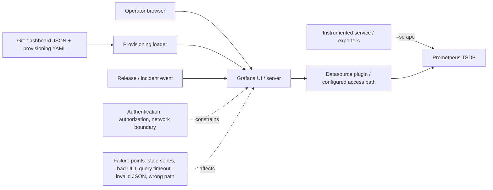

# Unit 3 — Grafana Dashboards and Dashboard-as-Code

**Target file:** `03-grafana-dashboards-and-dashboard-as-code.md` | **Estimated time:** 12–18 hours | **Prerequisites:** M11 Units 1–2; basic Prometheus/PromQL, Docker Compose or local `kind`, SLI/SLO and incident fundamentals.
**Core tools:** Grafana, Prometheus, JSON, YAML, Python standard library, Git, browser developer tools. | **Awareness:** Grafana HTTP API, Explore, Query Inspector, optional traces/logs integrations. | **Last reviewed:** 2026-10-28 (authoring date; not a claim that official documentation was checked). | **Tool baseline assumed:** a locally pinned Grafana and Prometheus release selected by the learner `[VERIFY]` | **Stack profile required:** Core | **Footprint:** measure yours

> **Source and execution honesty.** This lesson is authored from the supplied unit-generation prompt and established technical knowledge. Official documentation was not consulted during this authoring pass, and the runtime labs were not executed. Version-sensitive Grafana model/provisioning fields are marked `[VERIFY]`; verify them against the exact pinned release before relying on them. Representative output is illustrative, not observed output.

## Table of contents

- [3.0 Why this matters in production](#30-why-this-matters-in-production)
- [3.1 Learning objectives](#31-learning-objectives)
- [3.2 Concept map and vocabulary](#32-concept-map-and-vocabulary)
- [3.3 Level 1 — Beginner](#33-level-1--beginner)
- [3.4 Level 2 — Intermediate](#34-level-2--intermediate)
- [3.5 Level 3 — Advanced](#35-level-3--advanced)
- [3.6 Level 4 — Expert](#36-level-4--expert)
- [3.7 SRE lens](#37-sre-lens)
- [3.8 Security lens](#38-security-lens)
- [3.9 Production checklist](#39-production-checklist)
- [3.10 Hands-on lab set](#310-hands-on-lab-set)
- [3.11 Self-check questions](#311-self-check-questions)
- [3.12 Evidence artifacts](#312-evidence-artifacts)
- [3.13 Common interview and design-review questions](#313-common-interview-and-design-review-questions)
- [3.14 Sources and verification notes](#314-sources-and-verification-notes)
- [Audit summary](#audit-summary)
- [Open verification items](#open-verification-items)
- [Definition of done](#definition-of-done)

## Unit 3 — Grafana Dashboards and Dashboard-as-Code

This unit turns telemetry from Unit 1 and metrics/query patterns from Unit 2 into operational views that support decisions. It does not replace the sibling lessons on logs, traces, alert routing, alert design, saturation, batch freshness, cardinality, or load testing.

### 3.0 Why this matters in production

During an inference incident, an overview dashboard showed a green average-latency stat while one route and one replica were timing out; the panel had averaged per-replica p95 values, and a missing series was transformed into zero. Responders lost time because the dashboard did not expose absent telemetry, query semantics, or the release annotation needed to frame the investigation. A later manual UI edit fixed one panel but was not committed, so the next provisioning cycle overwrote it. A dashboard is operational software: a wrong query, unreviewed change, or misleading visual can extend an incident just as surely as a broken deployment.

### 3.1 Learning objectives

By the end, the learner can:

1. **[L1]** Explain the responsibilities of Grafana, a datasource, Prometheus, dashboard JSON, provisioning and the browser.
2. **[L1]** Interpret units, legends, time ranges, refresh, valid zero, absent series and query errors without conflating them.
3. **[L2]** Build a service dashboard using a coherent bounded-label metric contract and correct PromQL aggregations.
4. **[L2]** Provision a portable dashboard and datasource using stable UIDs and source-controlled artifacts.
5. **[L2]** Configure bounded variables, annotations and drilldown links while identifying version-sensitive fields.
6. **[L3]** Review latency histograms and ratios, test dashboard JSON with a static linter, and explain the limits of static checks.
7. **[L3]** Measure query cost and dashboard usability, then perform a controlled promotion and rollback drill.
8. **[L4]** Diagnose failures across browser, Grafana, datasource, Prometheus, provisioning and schema boundaries.
9. **[L4]** Establish ownership, least privilege, compatibility verification, drift detection and dashboard-quality indicators.

### 3.2 Concept map and vocabulary

| Term | Precise definition | Common misconception |
|---|---|---|
| Dashboard | A saved collection of panels, variables, time controls and navigation context. | A dashboard is not the telemetry database. |
| Panel | A query plus field configuration and a visual/tablular representation. | A visually plausible panel does not prove its query is correct. |
| Datasource | A configured connection through which Grafana requests data. | Grafana does not normally execute PromQL itself; Prometheus evaluates PromQL. |
| Target / `refId` | A query entry within a panel, often identified by a stable local reference such as `A`. | `refId` is not a Prometheus metric name. |
| UID | Stable identifier used to refer to a dashboard or datasource. | A UID is not a credential and does not guarantee portability by itself. |
| Provisioning | Loading configuration/assets from files under configured paths. | Provisioning is not equivalent to editing the UI and hoping it persists. |
| Dashboard model/schema | JSON representation accepted by a particular Grafana model/version. | It is not the same thing as Grafana's software version. |
| Refresh interval | How often a dashboard requests fresh results. | It is not the Prometheus scrape interval. |
| Query step | Evaluation resolution for a range query. | A smaller step does not necessarily mean more accurate or cheaper results. |
| Missing series | No matching sample/series exists for the requested label set or time. | Missing is not automatically zero or healthy. |
| Histogram quantile | An estimated percentile calculated from histogram bucket rates. | Averaging pod-level p95 values is not a valid fleet p95. |
| Annotation | Time-aligned event context such as a release or incident marker. | Temporal proximity alone does not prove causation. |
| Variable | A dashboard input that can parameterize queries or navigation. | A variable is not an authorization boundary. |
| Dashboard-as-code | Reviewed, tested, versioned dashboard and provisioning artifacts. | Exporting JSON once is not a complete lifecycle. |

**Telemetry and dashboard request path**



Prometheus scrapes and stores metrics; Grafana requests results and visualizes them. Browser/client versus server/proxy datasource access behavior depends on datasource and Grafana release; verify the configured access mode and network path `[VERIFY]`. If Grafana fails, Prometheus may still be collecting and storing metrics. Preserve a separate, safe route to critical queries and alerts.

**Dashboard design starts with the decision.** A persona and question precede the chart. A single kitchen-sink dashboard encourages excessive density, ambiguous ownership, expensive queries and weak navigation. Prefer a small portfolio:

| View | Primary persona / decision | Core panels | Blind spots and acceptance criteria |
|---|---|---|---|
| Service Overview | On-call: is the API serving users? | request rate, error ratio, histogram p95/p99, in-flight, target health | Does not prove root cause; missing telemetry is explicit; owner and links are visible. |
| SLO / User Experience | Service owner: are measured SLIs within the approved policy? | measured SLI, target context, error-budget/burn only when valid source rules exist | Do not invent targets or rules; missing data is not compliant status. |
| Saturation & Dependencies | On-call: which queue/dependency is constraining service? | queue depth, worker utilization, DB/target health if configured | No DB panels unless DB metrics exist; owner documents absent dependencies. |
| Batch Freshness | Data platform owner: did the job complete within its deadline? | freshness age and last-success/deadline state from defined metrics | Timestamp semantics and exporter/job lifetime must be defined first. |
| Observability Platform Health | Platform owner: can telemetry be collected and queried? | Prometheus target/scrape health, datasource query health, stack self-metrics where enabled | Grafana cannot be its only monitor; metric names require verification. |
| Deployment / Release Analysis | Incident commander: did symptoms change around a release? | symptom panels plus release annotations and before/after comparison | Correlation is not causation; compare traffic, range and confounders. |

**Illustrative metric contract.** The exact Unit 2 schema was not available for direct comparison in this authoring context, so the following is `[ILLUSTRATIVE]`; reconcile it with Unit 2 before use. Labels are bounded: `service`, `env`, `route` (route template, never raw URL), `method`, and `status` or `outcome`. Never use request IDs, trace IDs, user IDs, arbitrary exceptions, raw URLs or unbounded values as ordinary metric labels.

| Metric | Type / unit | Labels | Semantics |
|---|---|---|---|
| `http_requests_total` | Counter, requests | `service,env,route,method,status` | Completed requests; status is a bounded code/class. |
| `http_request_duration_seconds_bucket` | Classic histogram buckets, seconds | same bounded labels plus `le` | Cumulative bucket counts; bucket boundaries must be exposed consistently. |
| `http_request_duration_seconds_sum` / `_count` | Histogram sum/count | same bounded labels | Aggregate duration and observation count. |
| `http_requests_in_flight` | Gauge, requests | `service,env,route` | Currently active requests. |
| `worker_queue_depth` | Gauge, jobs | `service,env,queue` | Pending jobs; `queue` comes from a bounded configured set. |
| `worker_busy_ratio` | Gauge, ratio 0–1 | `service,env,worker_pool` | Busy workers / configured workers; define missing and zero-capacity behavior. |
| `batch_last_success_timestamp_seconds` | Gauge, Unix timestamp seconds | `service,env,job` | Timestamp of last successful completion; only meaningful if the exporter survives between runs. |
| `build_info` | Gauge, value 1 | `service,env,version` | Build identity; version values should be bounded by release process. |

Sample PromQL used throughout (only valid if the contract is actually exported):

```promql
# Request rate by route; unit: requests/second
sum by (service, env, route) (rate(http_requests_total[5m]))

# Error ratio: aggregate numerator and denominator before division.
sum by (service, env, route) (rate(http_requests_total{status=~"5.."}[5m]))
/
clamp_min(sum by (service, env, route) (rate(http_requests_total[5m])), 1e-12)

# Fleet p95 from classic histogram buckets. Preserve le until histogram_quantile.
histogram_quantile(0.95,
  sum by (service, env, route, le) (
    rate(http_request_duration_seconds_bucket[5m])
  )
)

# In-flight request count; current gauge, not a rate.
sum by (service, env, route) (http_requests_in_flight)

# Queue depth; count of queued jobs.
sum by (service, env, queue) (worker_queue_depth)

# Batch freshness age in seconds; only if last-success timestamp exists.
time() - batch_last_success_timestamp_seconds
```

The `clamp_min` expression avoids division by a zero denominator but can make a no-traffic result look like a numeric ratio; therefore panel-level no-data/low-traffic policy must explicitly distinguish zero traffic from a measured error ratio. Prefer an explicit traffic-presence panel or a carefully tested conditional expression appropriate to the metric schema. Do not use a clamp as a substitute for data-quality semantics.

### 3.3 Level 1 — Beginner

#### Dashboard anatomy and interpretation

- **Dashboard metadata:** title, UID, tags, folder/ownership context, time range and refresh policy. A stable UID helps links and promotion; do not assume every field is identical across versions `[VERIFY]`.
- **Row:** grouping and optional collapsing of related panels; not a substitute for good hierarchy.
- **Panel:** title, query targets, datasource, field/unit settings, legend, thresholds and links. Panel settings affect display; they must not silently change query meaning.
- **Field/unit:** controls how values are labeled and formatted. A seconds-valued query displayed as milliseconds without scaling is wrong; a ratio in `[0,1]` shown as percent must be formatted/scaled consistently.
- **Time range and timezone:** determine which samples are queried and how timestamps appear. Prefer explicit UTC in evidence; record local timezone when relevant.
- **Refresh:** controls request frequency. Refresh every few seconds does not make scrapes arrive faster and can increase query load.
- **Legend:** helps identify bounded series. Avoid long, unstable labels and hide dimensions only when they are not needed for the decision.
- **Variables:** inputs that parameterize queries. They are not security controls.
- **Annotations:** events overlaid on time. They supply context, not causal proof.
- **Transformations:** post-query presentation operations. Use only when their semantics are clear; they cannot repair a wrong aggregation.
- **Dashboard/panel/data links:** navigation to related dashboards, Explore, logs or traces only if the target is configured and authorized.

#### Choosing a visualization

| Visualization | Use when | Common failure mode |
|---|---|---|
| Time series | Trends, rates, ratios and latency over time | Unclear units, excessive series or misleading axis range. |
| Stat | One current aggregate or a deliberately selected recent value | Hides distribution, history and missing samples. |
| Table | Per-instance, route or job comparison with bounded rows | Unbounded dimensions overwhelm responders. |
| Gauge / bar gauge | A scalar with an operationally meaningful range and defensible thresholds | Decorative thresholds imply risk where no policy exists. |
| Heatmap | Data shape and histogram support the chosen heatmap mode | Ordinary quantile lines are not automatically heatmap input. |
| Pie chart | Small, mutually exclusive composition that sums to a meaningful whole | Poor for trends, many categories or values that do not form a whole. |
| Stacked chart | Additive components whose sum matters | Can hide a component's own trend and confuse non-additive values. |
| Logs/traces | Only through configured supported datasources | A link does not create a log/trace pipeline. |

#### Lab: inspect a first query

**Level:** L1. **Profile:** Core, local-only. **Prerequisites:** Unit 2 Prometheus is running and exposes `up`. **Footprint:** measure CPU/RAM/disk before and during; do not assume a universal footprint.

1. Open Grafana on its loopback address and authenticate using the local lab's configured mechanism.
2. Add a Prometheus datasource whose URL is reachable from the Grafana server/container. If using Compose, a service DNS name such as `http://prometheus:9090` may be appropriate from Grafana's network; `localhost` inside the Grafana container means the Grafana container itself. Verify the actual topology.
3. Use the datasource test action available in the selected release `[VERIFY]`; capture the result without credentials.
4. Create a dashboard and add a time-series panel with `up`. Interpret `1` as the target currently considered up and `0` as a failed scrape, while remembering that a missing series is different from a present zero.
5. Add `sum by (job) (up)` only if that aggregate answers a real question; otherwise use a table to inspect target-level status.
6. Save/export the JSON in the disposable lab and record the dashboard UID/title.

**Wrong query vs corrected query:** `avg(http_request_duration_seconds)` is not a valid latency percentile and may not even represent the desired statistic; for a classic histogram, use `histogram_quantile(0.95, sum by (le, service, env, route) (rate(http_request_duration_seconds_bucket[5m])))`. Confirm that the `_bucket` series and `le` label exist before use.

**Evidence:** datasource test, UID/title, query text, time range, one valid-zero example, one absent-series example. **Acceptance:** explain the difference among zero, no data and query error; identify where PromQL executes. **Cleanup:** delete only the disposable dashboard or stop the local stack when done. **Stretch:** compare a 5-minute range query at two query steps and explain the visible difference.

### 3.4 Level 2 — Intermediate

#### Panel query design and operational contracts

Every panel specification should record: question/persona, query, expected result type, unit, labels/aggregation, time window, refresh, thresholds/rationale, no-data policy, known blind spot and owner. Example specifications:

| Question / panel | Query | Unit / legend | Interpretation and no-data policy |
|---|---|---|---|
| Is traffic arriving? | `sum by (service,env,route) (rate(http_requests_total[5m]))` | requests/s; `{{route}}` | Valid zero can mean no traffic; missing series needs an independent target/telemetry check. |
| Are requests failing? | Error counter rate divided by total request rate after aggregation | ratio 0–1, formatted as percent only if formatter supports correct scaling | Low traffic and absent numerator must not silently look like zero errors. |
| Is tail latency elevated? | Classic histogram `histogram_quantile(0.95, sum by (le,service,env,route) (rate(..._bucket[5m])))` | seconds; route | Estimated p95 over 5m; not a per-request trace and not an average of pod p95s. |
| Are requests accumulating? | `sum by (service,env,route) (http_requests_in_flight)` | requests | Gauge at evaluation time; absence is not a zero. |
| Is the worker backlog growing? | `sum by (service,env,queue) (worker_queue_depth)` | jobs | Pair with throughput/worker saturation; a queue count alone does not prove a bottleneck. |
| Is a batch job fresh? | `time() - batch_last_success_timestamp_seconds` | seconds since success | Requires defined timestamp/exporter semantics; absent signal means unknown, not fresh. |

#### Variables, “All”, repeats and portability

A variable can make a dashboard reusable but also multiply queries. Start with a bounded service/environment/route dimension. Query-based variables, datasource variables, custom/constant/interval/text-box types, multi-value and “All” syntax differ by release and datasource `[VERIFY]`. Set a safe default that is known to exist; document whether “All” expands to a regex or another query form. Escape values using Grafana's supported templating rules rather than string-concatenating untrusted values. A variable selection is not authorization.

Example selector once `service` and `env` variables exist:

```promql
sum by (route) (
  rate(http_requests_total{service="$service",env="$env"}[5m])
)
```

If multi-select is enabled, equality matching may not behave as intended; configure the appropriate supported interpolation/regex form and verify the generated query in Query Inspector `[VERIFY]`. Do not blindly copy a `$__all` pattern across versions. Avoid repeating a panel for every arbitrary label; cap the dimension and evaluate query fan-out. Repeated rows/panels are useful for a small, known set of services or instances, not a default for every label.

#### Annotation and navigation design

Use a synthetic release event at a known timestamp. The simplest safe lab path is a manually added annotation in a disposable dashboard; query-backed annotations depend on configured datasource support and version-specific fields `[VERIFY]`. Include release identifier and short change description, not credentials or personal data. Link overview to troubleshooting views with a stable dashboard UID and explicitly tested time-range/variable propagation. Add a Loki/trace link only when the destination datasource and correlation conventions exist; Units 4, 5, 7 and 10 own pipeline setup. Never put credentials or untrusted full URLs in data links.

#### File provisioning example (release-sensitive)

The following is a conservative teaching example. Confirm directory paths, YAML schema, provider options and update/delete semantics against the pinned Grafana release before use. Provisioning file formats and behavior are `[VERIFY]`.

`lab/grafana/provisioning/datasources/prometheus.yaml`

```yaml
apiVersion: 1

datasources:
  - name: Prometheus
    uid: prometheus-local
    type: prometheus
    access: proxy
    url: http://prometheus:9090
    isDefault: true
    editable: false
```

`lab/grafana/provisioning/dashboards/provider.yaml`

```yaml
apiVersion: 1
providers:
  - name: local-dashboard-files
    orgId: 1
    folder: Platform Operations
    type: file
    disableDeletion: false
    editable: false
    options:
      path: /var/lib/grafana/dashboards
```

`access: proxy`, `uid`, `editable`, `disableDeletion`, `orgId`, and provider semantics must be checked for the selected release and datasource plugin `[VERIFY]`. Do not infer that a UI edit to a provisioned dashboard is the source of truth. Keep the JSON in Git, review changes, provision it, and confirm the running dashboard UID and panels.

#### Minimal Compose integration snippet

This snippet assumes the Unit 2 Compose network already contains a `prometheus` service and a pinned Grafana image is supplied through `GRAFANA_IMAGE`. It is an integration snippet, not a complete stack and not a claim that a specific tag is current. Pin an approved immutable release/tag in your own local file after checking its provenance; do not use `latest` for repeatable exercises.

`lab/compose.grafana.override.yaml`

```yaml
services:
  grafana:
    image: ${GRAFANA_IMAGE:?set a pinned Grafana image}
    ports:
      - "127.0.0.1:3000:3000"
    environment:
      # Use the lab's supported secret mechanism; never commit a real value.
      GF_SECURITY_ADMIN_USER: ${GRAFANA_ADMIN_USER:-admin}
      GF_SECURITY_ADMIN_PASSWORD: ${GRAFANA_ADMIN_PASSWORD:?set a disposable local password}
    volumes:
      - ./grafana/provisioning:/etc/grafana/provisioning:ro
      - ./grafana/dashboards:/var/lib/grafana/dashboards:ro
    depends_on:
      - prometheus
```

Run commands from the directory containing the existing Compose file and the paths shown above; adjust relative paths only after verifying the actual project layout. A bind mount marked read-only prevents Grafana from modifying source files, but the dashboard loader still needs read access. Use file permissions that make assets readable without exposing secrets. Do not publish port 3000 on `0.0.0.0`.

### 3.5 Level 3 — Advanced

#### SLO panels without re-deriving SLO policy

Use the approved M10 SLI/SLO and alert policy as inputs. A dashboard may show measured availability/error ratio, target context, and error-budget/burn data only if the underlying recording rules or source metrics exist and are validated. Keep target and measured value visually distinct. Never invent a target or display a static target line as measured health. If the source is absent, label the panel “source not configured” or explicitly show no data; do not synthesize a green status.

#### Histogram and ratio correctness

For classic histograms, compute `rate()` per bucket, aggregate while preserving `le`, then call `histogram_quantile()`. Do not average percentiles across pods or instances: percentiles are not additive. For ratios, sum numerator and denominator at the same intended grouping before dividing; an average of per-pod ratios weights low-traffic and high-traffic pods equally. If traffic is absent, show a separate traffic-presence signal or a clear no-data/low-traffic state.

#### Query cost and investigation workflow

Query cost depends on range, step/resolution, series count, selector breadth, refresh rate, panel count, repeated panels, variable fan-out, transformations and datasource behavior. Do not claim a universal latency or resource cost. Compare query shapes in a controlled local test: record query text, time range, step, returned series/sample count, response time as observed, Prometheus load indicators, and whether the result changed. Do not use production load for this exercise.

Investigation sequence:

1. State the operational question and incident time window.
2. Run the exact query in Prometheus's expression UI; inspect labels and units.
3. Open Grafana's Query Inspector (exact UI name and location `[VERIFY]`) and inspect the actual interpolated query, request parameters, result and errors.
4. Compare time range, step, variables, datasource UID and access path.
5. Check target health, missing series and label-schema changes.
6. Simplify the query and narrow the range; then restore one dimension at a time.
7. Save the query text and evidence; do not infer causality from temporal correlation alone.

#### Transformations, thresholds and recording rules

Transformations such as reduce, merge/join, organize fields, labels-to-fields and calculated fields are version-sensitive `[VERIFY]`. Use them for presentation, not to conceal semantically wrong PromQL. Put aggregation in PromQL when the data semantics belong at the source; use transformations only when their post-query behavior is explicit and tested. Thresholds must be tied to an operational decision or approved policy. Use accessible palettes, units and textual labels; color alone must not communicate status.

A recording rule is appropriate when a complex, repeated expression is used broadly and the team can own, test and review the rule. A direct dashboard query is reasonable for exploratory or low-frequency panels. See Unit 2 for rule testing and query design. Do not copy a costly expression into many repeated panels without measuring its effect.

#### Static dashboard linter

Static linting can check JSON syntax, UID/title, panel count, query target presence, units/titles, datasource UID, likely secret patterns, policy limits and obvious forbidden labels. It cannot prove PromQL parses, that the datasource exists, that Grafana renders a field, or that a query returns correct results. Those require separate runtime validation.

`lab/dashboard_lint.py`

```python
#!/usr/bin/env python3
"""Small standard-library linter for the illustrative lab dashboard model."""
import json
import re
import sys
from pathlib import Path

FORBIDDEN_LABELS = {"request_id", "trace_id", "user_id", "raw_url", "exception"}
SECRET_PATTERNS = [
    re.compile(r"(?i)(password|api[_-]?token|access[_-]?token|secret)\s*[:=]\s*['\"]?[^\s'\"]{6,}"),
    re.compile(r"(?i)Bearer\s+[A-Za-z0-9._~+/=-]{12,}"),
]


def lint_dashboard(doc):
    errors = []
    if not isinstance(doc, dict):
        return ["root must be a JSON object"]
    if not isinstance(doc.get("uid"), str) or not doc["uid"].strip():
        errors.append("dashboard uid must be a non-empty stable string")
    if not isinstance(doc.get("title"), str) or not doc["title"].strip():
        errors.append("dashboard title must be non-empty")
    panels = doc.get("panels")
    if not isinstance(panels, list) or not panels:
        errors.append("panels must be a non-empty list")
        panels = []
    if len(panels) > 16:
        errors.append("panel count exceeds local policy limit 16")
    text = json.dumps(doc, sort_keys=True)
    for pattern in SECRET_PATTERNS:
        if pattern.search(text):
            errors.append("possible credential/token material in dashboard JSON")
            break
    for index, panel in enumerate(panels):
        if not isinstance(panel, dict):
            errors.append(f"panel[{index}] must be an object")
            continue
        title = panel.get("title")
        if not isinstance(title, str) or not title.strip():
            errors.append(f"panel[{index}] needs a non-empty title")
        targets = panel.get("targets", [])
        if not isinstance(targets, list) or not targets:
            errors.append(f"panel[{index}] needs at least one query target")
            continue
        for target_index, target in enumerate(targets):
            if not isinstance(target, dict) or not str(target.get("expr", "")).strip():
                errors.append(f"panel[{index}].targets[{target_index}] has empty expr")
                continue
            expr = target["expr"]
            # Heuristic only: this is not a PromQL parser.
            for label in FORBIDDEN_LABELS:
                if re.search(rf"\b{re.escape(label)}\s*=", expr):
                    errors.append(f"panel[{index}] query uses prohibited high-cardinality label {label}")
            if "datasource" in target:
                ds = target["datasource"]
                if isinstance(ds, dict) and ds.get("uid") not in ("prometheus-local", "${PROMETHEUS_UID}"):
                    errors.append(f"panel[{index}] uses non-portable datasource UID {ds.get('uid')!r}")
        field_config = panel.get("fieldConfig", {})
        defaults = field_config.get("defaults", {}) if isinstance(field_config, dict) else {}
        if not defaults.get("unit"):
            errors.append(f"panel[{index}] should declare a unit in fieldConfig.defaults.unit")
    return errors


def main(argv):
    if len(argv) != 2:
        print(f"usage: {argv[0]} DASHBOARD.json", file=sys.stderr)
        return 2
    path = Path(argv[1])
    try:
        doc = json.loads(path.read_text(encoding="utf-8"))
    except (OSError, json.JSONDecodeError) as exc:
        print(f"FAIL: cannot read/parse JSON: {exc}")
        return 1
    errors = lint_dashboard(doc)
    if errors:
        print("FAIL")
        for error in errors:
            print(f"- {error}")
        return 1
    print(f"PASS: {path} passed static dashboard checks")
    return 0

if __name__ == "__main__":
    raise SystemExit(main(sys.argv))
```

`lab/test_dashboard_lint.py`

```python
import unittest
from dashboard_lint import lint_dashboard

GOOD = {
    "uid": "service-overview", "title": "Service Overview",
    "panels": [{"title": "Request rate", "targets": [{"expr": "sum(rate(http_requests_total[5m]))", "datasource": {"uid": "prometheus-local"}}], "fieldConfig": {"defaults": {"unit": "reqps"}}}],
}

class DashboardLintTests(unittest.TestCase):
    def test_good_dashboard(self):
        self.assertEqual(lint_dashboard(GOOD), [])

    def test_missing_uid(self):
        doc = {**GOOD, "uid": ""}
        self.assertTrue(any("uid" in e for e in lint_dashboard(doc)))

    def test_empty_query(self):
        doc = {**GOOD, "panels": [{**GOOD["panels"][0], "targets": [{"expr": " "}]}]}
        self.assertTrue(any("empty expr" in e for e in lint_dashboard(doc)))

    def test_forbidden_label(self):
        doc = {**GOOD, "panels": [{**GOOD["panels"][0], "targets": [{"expr": 'http_requests_total{trace_id="x"}'}]}]}
        self.assertTrue(any("trace_id" in e for e in lint_dashboard(doc)))

    def test_secret_pattern(self):
        doc = {**GOOD, "description": "api_token=abcdefghijklmnop"}
        self.assertTrue(any("credential" in e for e in lint_dashboard(doc)))

if __name__ == "__main__":
    unittest.main()
```

**Broken fixture** (save as `lab/fixtures/broken-dashboard.json` to test the failure path):

```json
{
  "uid": "",
  "title": "Broken test dashboard",
  "panels": [
    {"title": "", "targets": [{"expr": "http_requests_total{trace_id=\"abc\"}"}], "fieldConfig": {"defaults": {}}}
  ],
  "description": "api_token=abcdefghijklmnop"
}
```

**Corrected fixture** is the `GOOD` object in the test file; the linter's acceptance path also requires a declared unit and portable datasource UID. Keep fixtures separate from real credentials. Example commands from `lab/`:

```bash
python3 -m unittest -v test_dashboard_lint.py
python3 dashboard_lint.py fixtures/broken-dashboard.json
python3 dashboard_lint.py dashboards/service-overview.json
```

Representative expected output — not run here:

```text
Ran 5 tests ... OK
FAIL
- dashboard uid must be a non-empty stable string
- panel[0] needs a non-empty title
- possible credential/token material in dashboard JSON
- panel[0] query uses prohibited high-cardinality label trace_id
- panel[0] should declare a unit in fieldConfig.defaults.unit
```

Run from a directory where Python can import `dashboard_lint.py`; adjust the test path or use a package layout consistently. No third-party dependency is required. This is a heuristic linter; regexes can miss secrets or flag benign text, and it does not parse PromQL.

### 3.6 Level 4 — Expert

#### Governance and controlled promotion

Treat dashboards like code: stable UID, owner, reviewer, rationale, change ticket/context, schema/version notes, validation, local test provisioning, rollout verification, and rollback artifact. Use M08's GitOps/release workflow rather than introducing a competing deployment system. Do not commit a dashboard change made only in the UI; if a UI edit is used for exploration, export/reconcile it into the reviewed source artifact.

**Promotion record template:**

```yaml
# Illustrative change record; not Grafana provisioning config.
dashboard_uid: service-overview
owner: platform-observability
reviewer: service-owner
change_reason: expose route-level p95 and explicit missing-data state
validation:
  - json-parse
  - static-linter
  - local-provisioning
  - query-inspection
rollback: restore previous reviewed dashboard JSON and reprovision
acceptance:
  - p95 query preserves histogram le buckets
  - no-data is visibly distinct from zero
  - datasource UID resolves in target environment
```

#### Drift, upgrades and migration

Compare source-controlled JSON with the running dashboard representation only through a documented export/API/UI workflow verified for the chosen release `[VERIFY]`. Normalize known generated fields only after documenting why they are noise; do not strip fields blindly. A diff can reveal UID changes, query changes, removed panels, datasource drift, units, thresholds and links, but a clean diff does not prove semantic correctness.

For upgrades: pin the selected Grafana release, read its release notes and dashboard/provisioning migration notes, test datasource plugin compatibility, import/provision in local staging, compare panel/query behavior, inspect no-data and permissions, and retain the prior artifact. Never invent a Grafana version or claim compatibility without checking. For datasource migration, preserve logical UIDs where supported; map each environment's UID deliberately, test queries before broad promotion, and keep a rollback copy. If label schema changes, migrate queries and metrics as a coordinated change rather than leaving dashboards silently empty.

#### Incident cases: evidence, correction and prevention

1. **p95 averages pod percentiles.** Evidence: panel query aggregates a precomputed per-pod quantile or averages percentile series. Root cause: non-additive statistic. Correction: aggregate classic bucket rates preserving `le`, then apply `histogram_quantile`. Prevention: linter/review rule and query workbook.
2. **Empty series looks green.** Evidence: missing selector result plus a transformation/default that converts null to zero. Root cause: missing data was given healthy semantics. Correction: expose no-data and target/telemetry state explicitly. Prevention: missing-series test fixture.
3. **“All” creates expensive queries.** Evidence: interpolated query expands to many series; query time/series count rises in a bounded local comparison. Root cause: unbounded variable fan-out. Correction: restrict variable values and query scope; use recording rules if justified. Prevention: policy and performance review.
4. **Datasource UID changes on promotion.** Evidence: dashboard references an unknown UID in target environment. Root cause: environment-specific binding was copied as if portable. Correction: map a stable logical UID per environment or apply reviewed environment-specific provisioning. Prevention: linter and promotion test.
5. **Provisioned dashboard missing.** Evidence: provider path, mounted files, permissions and Grafana logs disagree. Root cause may be path/provider/schema/permissions. Correction: fix the discriminating mismatch and restart/reload only as supported. Prevention: mount/path smoke test.
6. **UI edit is lost.** Evidence: running dashboard differs from source JSON; next provisioning cycle restores source. Root cause: provisioned artifact is source of truth. Correction: export/reconcile and commit reviewed JSON. Prevention: read-only provisioned workflow and ownership.
7. **Refresh overloads Prometheus.** Evidence: query volume/latency increases with refresh and panel count in controlled measurement. Root cause: excess request frequency/fan-out. Correction: lengthen refresh, narrow ranges, reduce duplicate queries. Prevention: dashboard query budget.
8. **JSON changes after upgrade.** Evidence: panel behavior or schema fields differ across tested versions. Root cause: model/field compatibility. Correction: migrate and validate against selected release. Prevention: staging and rollback artifact.
9. **Unsafe data link.** Evidence: link contains credentials, untrusted URL parameters or sensitive data. Root cause: unsafe templating/URL construction. Correction: remove secrets and constrain destinations/parameters. Prevention: security review and static scan.
10. **No owner or release annotation.** Evidence: metadata absent during incident and no responsible team can confirm recent change. Root cause: governance gap. Correction: assign owner and add controlled release context. Prevention: required metadata and deployment annotation workflow.

#### Failure-domain separation

- **Browser/network:** UI cannot load or requests are blocked; inspect browser/network errors and local port binding.
- **Grafana server:** login/UI/API or internal server error; inspect Grafana logs and its own health endpoint only if verified for the release.
- **Datasource plugin/config:** datasource test/query fails, UID mismatch, access mode or network/DNS problem.
- **Prometheus:** target/scrape may be healthy while query evaluation is slow/failing; test the same expression and range in Prometheus directly.
- **Dashboard JSON/provisioning:** only one dashboard/panel absent or changed; validate JSON, provider path, permissions, UID and logs.
- **Metric/schema:** query succeeds but series are absent due to labels/names/time range; inspect exposition and labels in Unit 2 workflow.

Do not infer that a healthy Grafana process means its datasource is healthy. Conversely, a blank Grafana view does not prove Prometheus stopped scraping.

### 3.7 SRE lens

#### Dashboard quality scorecard

These are measurement definitions, not universal targets. Establish local baselines before selecting thresholds; any numeric target added by a team is `[ILLUSTRATIVE]` until approved.

| Indicator | Measurement method | Required data / caveat |
|---|---|---|
| Key questions answered | Review checklist mapping each incident/capacity question to a panel and action | Needs named personas and service owner review. |
| Source-controlled coverage | Number of critical dashboards provisioned from reviewed files / total critical dashboards | Inventory and source-of-truth definition required. |
| Query/panel validation | CI/static checks plus local provision-and-query smoke test pass rate | Static checks alone cannot validate live semantics. |
| Datasource query success | Successful query requests / attempted query requests over a defined window, if exposed by supported metrics/logs | Exact Grafana self-metric names/labels are `[VERIFY]`; do not assume them. |
| Dashboard load latency | Browser automation or repeatable manual timing with fixed dashboard, time range and environment; report distribution | Control cache, browser, query range and machine load. Do not compare unlike runs. |
| Stale/missing-data visibility | Test panels with absent series and confirm explicit “unknown/no data” behavior | Use fixtures or controlled absence; do not mask missing data. |
| Ownership/review coverage | Critical dashboards with owner and recent review / total critical dashboards | Requires inventory and policy. |
| Rollback recovery | Time and steps required to restore prior reviewed JSON and verify it | Run a local rollback drill; record measured duration. |
| Accessibility/readability | Review unit/legend/title, color-independent status, contrast and screen-size behavior | Include a reviewer using the intended display environment. |
| Dashboard platform availability | Independent local check of Grafana and a datasource query path | A check hosted only inside Grafana cannot detect all Grafana failures. |

#### Runbook: dashboard blank, slow or wrong

1. **Scope:** note dashboard UID, panel, user, exact time range, timezone, variable values and when symptoms began.
2. **Browser/UI:** determine whether the UI loads; inspect browser/network errors without capturing secrets.
3. **Grafana:** check process/container health and logs; do not assume UI availability implies datasource health.
4. **Datasource:** test datasource connectivity and confirm the dashboard's datasource UID and access mode.
5. **Prometheus:** inspect target health and run the exact expression/range directly; check metric name, labels, staleness and query errors.
6. **Query context:** inspect interpolated query, range, step, refresh and repeated panel/variable fan-out.
7. **Provisioning/schema:** validate JSON/YAML, provider path, mounts, read permissions, UID and release compatibility.
8. **Mitigate:** narrow range/selector, disable expensive repeats or lengthen refresh; do not silently replace missing data with zero.
9. **Rollback:** restore the prior reviewed artifact if a recent change caused the failure; provision and verify.
10. **Evidence:** save sanitized query, error text, time window, relevant logs, before/after screenshots and prevention action.

#### Platform SLIs/SLOs and blind spots

Candidate SLIs include availability of critical dashboard navigation, datasource query success, successful provisioning/reload, time to render a fixed operational view, freshness visibility, and rollback recovery. Define a measurement population and denominator before setting a target. An SLO should reflect the platform's actual user need, not a copied industry number. Blind spots include dashboards depending on the same failed datasource they are meant to diagnose, stale cached/browser state, missing telemetry, bad label schemas, time-zone confusion, and metrics whose exporter disappears after a job exits.

**Technical capacity:** record CPU/RAM/disk, Prometheus query latency/series count, panel count, query range/step, refresh cadence, variable cardinality, browser render time and Grafana logs during local tests. Change one dimension at a time. There is no universal laptop footprint: Grafana, Prometheus, exporters and application containers compete for the same limited resources. Keep the Core profile lean and measure yours.

### 3.8 Security lens

| Threat | Control | Verification |
|---|---|---|
| Unauthenticated/public Grafana | Bind lab port to loopback; require authentication; do not enable anonymous/public sharing. Exact settings are release-sensitive `[VERIFY]`. | Inspect port binding, login behavior and effective config; verify from another host is not possible/allowed. |
| Overprivileged user/service account | Least privilege; separate viewer/operator/admin roles where available; avoid shared admin use. Some RBAC capabilities vary by edition/version `[VERIFY]`. | Review user/team/folder permissions in selected release; test with a non-admin account. |
| Secrets in JSON/YAML/URLs | Never commit tokens/passwords; use environment/secret mechanism for runtime credentials; dashboard artifacts should not contain credentials. | Run linter/secret scanner; inspect Git diff and sanitized exports. |
| PII in labels or links | Bounded dimensions; no user IDs, raw URLs, trace IDs or exception text as metric labels; sanitize drilldowns. | Inspect exposition and dashboard JSON; review links and legends. |
| Unsafe data links/templates | Constrain destination hosts and parameters; do not interpolate arbitrary user-controlled URLs. | Click-test using harmless synthetic values; inspect generated URL and JSON. |
| Untrusted imported dashboard JSON | Review JSON before import/provision; treat links, queries and datasource references as untrusted. | Diff and lint before loading; use disposable local environment. |
| Public dashboards/snapshots/sharing | Keep disabled unless explicitly approved; do not require such features in this lab. Feature names vary `[VERIFY]`. | Review sharing UI/config and confirm no public URL is generated. |
| Vulnerable/unneeded plugins | Use only required/core datasource support; maintain a reviewed plugin allowlist. | Inventory installed plugins and compare with approved baseline. |
| Datasource access / SSRF risk | Restrict who can configure datasources and what destinations the server can reach; keep local lab isolated. | Review datasource permissions/network policy and inspect configured URLs. |
| API tokens/provisioning credentials | No literal tokens in examples; use least-privilege token and environment/secret injection if API automation is used. | Inspect shell history, process environment handling and repository diff; rotate if exposed. |
| Tampered dashboard source | Protected branches/review, limited write access, audit trail and rollback. | Inspect repository permissions and change history. |

**Native/free vs version-dependent:** local file provisioning and core Prometheus datasource workflows are the intended free path, subject to release validation. Fine-grained RBAC, enterprise sharing controls, plugin features and some alerting capabilities may vary by edition/release. Do not depend on paid features for acceptance. Dashboard variables do not secure data; authorization must be enforced at the access/data layer.

Security checklist: [ ] loopback-only port; [ ] authentication required; [ ] no public sharing/anonymous access; [ ] no secrets/PII in artifacts; [ ] reviewed dashboard JSON; [ ] datasource destinations constrained; [ ] minimal plugins; [ ] least privilege; [ ] no production datasource; [ ] sanitized evidence; [ ] Git source access reviewed.

### 3.9 Production checklist

- [ ] Dashboard answers named operational questions for a named persona.
- [ ] Every panel has a meaningful title, unit, bounded legend and owner.
- [ ] Queries match the actual metric/label contract and expected result type.
- [ ] Histogram percentile aggregates buckets while preserving `le`; pod percentiles are not averaged.
- [ ] Ratios aggregate numerator and denominator before division.
- [ ] Valid zero, absent/stale series and query error are visibly distinct.
- [ ] SLO target is distinguished from measured SLI; no invented target/rule is displayed.
- [ ] Time range, timezone, query step, scrape interval and refresh are documented where relevant.
- [ ] Variables have safe defaults, bounded choices and reviewed “All” behavior.
- [ ] Repeated panels and refresh frequency have a measured/justified query budget.
- [ ] Dashboard UID and datasource binding are stable/portable for the intended environments.
- [ ] Provisioning files, dashboard JSON and tests are reviewed in Git.
- [ ] Static linter limitations are understood; live provisioning/query smoke test is separate.
- [ ] Release annotations and links are safe and actually resolve.
- [ ] No secrets, PII, credential-bearing URLs or untrusted destinations are present.
- [ ] Dashboard owner, reviewer, deprecation path and rollback artifact exist.
- [ ] Upgrade compatibility was checked against the exact pinned release.
- [ ] A blank/slow/wrong dashboard runbook and independent critical-query path exist.
- [ ] Local resource footprint and query behavior were measured, not guessed.

### 3.10 Hands-on lab set

The following five labs cover the required progression. Run only against a disposable local stack. Do not use production endpoints, public ports, SaaS, real credentials, unbounded traffic or destructive actions. For each lab, preserve evidence without secrets or PII.

#### Lab A — First dashboard from Prometheus [L1–L2]

**Profile/footprint:** Core; local-only; measure CPU/RAM/disk before and after. **Prerequisites:** M11 Unit 2 stack, an instrumented lab service, and the illustrative metric contract above reconciled with actual exposition.

**Steps**

1. Start the existing M11 stack using its documented command. Do not assume a Compose filename; use the Unit 2 command and confirm the services are running.
2. Add/test the Prometheus datasource from Grafana. Use the URL reachable from Grafana's runtime network. Record the datasource UID and test result.
3. Create five panels using the queries below. Use a time-series visualization for trends, table for target status if useful, and explicit units.
4. Compare each query in Prometheus directly and then in Grafana. Inspect labels and actual interpolated query.
5. Record dashboard UID/title, time range, refresh and no-data behavior.

**Panel workbook**

| Panel | Query | Unit | Aggregation / interpretation | No-data policy |
|---|---|---|---|---|
| Target health | `up` | short/none | Per scrape target; 1 up, 0 failed scrape | Missing series means target/label inventory must be checked. |
| Request rate | `sum by (service,env,route) (rate(http_requests_total[5m]))` | requests/s | Sum counter rates by bounded route | Zero can be valid; absent series remains unknown. |
| Error ratio | `sum by (service,env,route) (rate(http_requests_total{status=~"5.."}[5m])) / sum by (service,env,route) (rate(http_requests_total[5m]))` | ratio or percent with correct scaling | Aggregate numerator and denominator first | Low traffic/zero denominator must not appear as proven zero errors. |
| p95 latency | `histogram_quantile(0.95, sum by (service,env,route,le) (rate(http_request_duration_seconds_bucket[5m])))` | seconds | Fleet estimate from classic histogram buckets | Missing buckets or insufficient samples are not healthy latency. |
| Queue/in-flight | `sum by (service,env,queue) (worker_queue_depth)` and `sum by (service,env,route) (http_requests_in_flight)` | jobs / requests | Separate panels because dimensions/units differ | Missing gauge series is not zero. |

The error ratio expression can return no data or undefined results when denominator is absent/zero; do not silently force a green value. Add a separate traffic panel and document the policy. Do not combine queue depth and in-flight requests into one unitless stat.

**Complete illustrative dashboard JSON**

`lab/grafana/dashboards/service-overview.json`

```json
{
  "uid": "service-overview",
  "title": "Service Overview",
  "tags": ["m11", "core", "service-health"],
  "timezone": "utc",
  "schemaVersion": 39,
  "version": 1,
  "refresh": "30s",
  "time": {"from": "now-1h", "to": "now"},
  "annotations": {"list": []},
  "templating": {"list": []},
  "panels": [
    {"id": 1, "type": "timeseries", "title": "Target health (up)", "datasource": {"type": "prometheus", "uid": "prometheus-local"}, "targets": [{"refId": "A", "expr": "up", "legendFormat": "{{job}} / {{instance}}"}], "fieldConfig": {"defaults": {"unit": "short"}, "overrides": []}, "gridPos": {"h": 8, "w": 12, "x": 0, "y": 0}},
    {"id": 2, "type": "timeseries", "title": "Request rate by route", "datasource": {"type": "prometheus", "uid": "prometheus-local"}, "targets": [{"refId": "A", "expr": "sum by (service, env, route) (rate(http_requests_total[5m]))", "legendFormat": "{{service}} {{route}}"}], "fieldConfig": {"defaults": {"unit": "reqps"}, "overrides": []}, "gridPos": {"h": 8, "w": 12, "x": 12, "y": 0}},
    {"id": 3, "type": "timeseries", "title": "5xx ratio by route", "datasource": {"type": "prometheus", "uid": "prometheus-local"}, "targets": [{"refId": "A", "expr": "sum by (service, env, route) (rate(http_requests_total{status=~\"5..\"}[5m])) / sum by (service, env, route) (rate(http_requests_total[5m]))", "legendFormat": "{{service}} {{route}}"}], "fieldConfig": {"defaults": {"unit": "percentunit"}, "overrides": []}, "gridPos": {"h": 8, "w": 12, "x": 0, "y": 8}},
    {"id": 4, "type": "timeseries", "title": "Estimated p95 latency", "datasource": {"type": "prometheus", "uid": "prometheus-local"}, "targets": [{"refId": "A", "expr": "histogram_quantile(0.95, sum by (service, env, route, le) (rate(http_request_duration_seconds_bucket[5m])))", "legendFormat": "{{service}} {{route}}"}], "fieldConfig": {"defaults": {"unit": "s"}, "overrides": []}, "gridPos": {"h": 8, "w": 12, "x": 12, "y": 8}},
    {"id": 5, "type": "timeseries", "title": "In-flight requests", "datasource": {"type": "prometheus", "uid": "prometheus-local"}, "targets": [{"refId": "A", "expr": "sum by (service, env, route) (http_requests_in_flight)", "legendFormat": "{{service}} {{route}}"}], "fieldConfig": {"defaults": {"unit": "short"}, "overrides": []}, "gridPos": {"h": 8, "w": 12, "x": 0, "y": 16}},
    {"id": 6, "type": "timeseries", "title": "Queue depth", "datasource": {"type": "prometheus", "uid": "prometheus-local"}, "targets": [{"refId": "A", "expr": "sum by (service, env, queue) (worker_queue_depth)", "legendFormat": "{{service}} {{queue}}"}], "fieldConfig": {"defaults": {"unit": "short"}, "overrides": []}, "gridPos": {"h": 8, "w": 12, "x": 12, "y": 16}}
  ]
}
```

**Version caveat:** this is a complete illustrative dashboard artifact, but `schemaVersion`, `type`, field/unit names, datasource reference shape, time settings and panel model fields must be validated against the pinned Grafana release `[VERIFY]`. JSON parse success does not prove Grafana compatibility. If the actual Unit 2 metric names differ, update the metric contract, queries, tests and dashboard together.

**Verification and expected evidence:** datasource test, each query in Prometheus, dashboard title/UID, screenshots or sanitized panel JSON, panel workbook. Representative expected result — not run here: a query result is visible only if the corresponding metric series exists in the selected time range; absent metrics should be investigated rather than replaced by zero. **Acceptance:** five required panel categories are represented; p95 query preserves `le`; ratio aggregates before division; units/no-data behavior documented. **Cleanup:** remove disposable dashboard or stop the local stack; do not delete shared project resources. **Stretch:** add a batch freshness panel only after confirming timestamp metric semantics.

#### Lab B — Dashboard-as-code with provisioning [L2–L3]

**Profile/footprint:** Core; local-only. **Prerequisites:** Lab A and an existing local Prometheus Compose network. **Safety:** loopback-only port; no production datasource or real credentials.

Use the complete inline files from Section 3.4:

- `lab/grafana/provisioning/datasources/prometheus.yaml`
- `lab/grafana/provisioning/dashboards/provider.yaml`
- `lab/grafana/dashboards/service-overview.json` (Section 3.10 Lab A)
- `lab/compose.grafana.override.yaml`

**Operating procedure:**

1. Create those paths locally from the inline examples; they are teaching artifacts, not files written by this lesson.
2. Choose a pinned Grafana image after checking the official release and provenance. Export `GRAFANA_IMAGE`, `GRAFANA_ADMIN_USER` and `GRAFANA_ADMIN_PASSWORD` in the local shell or an ignored local environment file. Never commit the password.
3. Verify the Compose project/network and relative mount paths. Run `docker compose config` and inspect the rendered config for unintended public binding or secrets before starting.
4. Start the stack with the existing Unit 2 Compose file plus the override, using the same project/network. The exact command depends on the repository's Compose filenames; do not guess it.
5. Inspect Grafana logs for provisioning errors. Open the dashboard, confirm UID `service-overview`, and confirm datasource UID `prometheus-local` resolves.
6. Change a panel title in the source JSON, validate JSON, then observe the selected release's provisioning update behavior. Do not assume hot reload; restart/reload only as documented for that release `[VERIFY]`.
7. Confirm the dashboard still works after a restart and that the JSON in Git remains the source of truth.

Validation commands:

```bash
python3 -m json.tool lab/grafana/dashboards/service-overview.json >/dev/null
# From the directory with the Compose files; inspect output before starting.
docker compose -f compose.yaml -f lab/compose.grafana.override.yaml config
# Then use the project's documented startup command and inspect logs.
```

Replace `compose.yaml` with the actual existing file; this is a placeholder path, not an assertion about the repository tree. The YAML `version` key is intentionally omitted because Compose schema behavior is version-dependent. **Expected evidence:** sanitized rendered Compose config, datasource test, dashboard UID/title, provisioning log excerpt and JSON validation. **Acceptance:** no external port binding, no committed secret, stable UIDs, dashboard is provisioned from files, documented update behavior. **Cleanup:** stop only the disposable stack and remove only disposable local environment files/containers. **Stretch:** run the same dashboard in a second local environment with a deliberately different datasource UID and document the mapping needed for portability.

#### Lab C — Variables, annotations, links and incident drill [L2–L3]

**Profile/footprint:** Core. **Prerequisites:** Labs A–B; bounded `service`, `env`, `route` labels confirmed in actual exposition. **Safety:** inject only a small, time-bounded synthetic fault in the disposable app; no unbounded traffic.

1. Add a `service` variable with a query appropriate to the datasource and selected Grafana version. Set a default to a known service. Add `env` only if it exists in the metric schema. Variable query/type syntax and refresh options are `[VERIFY]`.
2. Enable multi-select only if needed. Inspect the generated query for a single selection and “All”. Confirm that “All” does not expand into an uncontrolled series scan. Use the selected release's supported interpolation/regex escaping.
3. Add a manual annotation at the synthetic deployment time: `release=lab-2026-10-28`, with a short non-sensitive change note. Query-backed annotations can be used only after validating supported fields and datasource behavior `[VERIFY]`.
4. Link the Service Overview to a troubleshooting dashboard using a stable UID and only supported time-range/variable propagation fields `[VERIFY]`. If no troubleshooting dashboard exists, create it as a second dashboard in the lab environment only; do not add another repository deliverable.
5. Trigger a small controlled fault using the existing Unit 2 lab app's documented fault-injection switch, if one exists. If not, simulate the investigation with a saved query fixture rather than inventing an endpoint or running uncontrolled traffic.
6. Follow: symptom overview → route/service variable → latency/error/queue panel → release annotation → exact query in Prometheus → evidence capture.
7. Stop the fault immediately after the bounded observation window; confirm normal behavior and remove temporary switches.

**Expected evidence:** variable defaults and actual interpolated query, annotation timestamp and text, tested link destination, short incident timeline, before/after panel evidence and cleanup proof. **Acceptance:** no unsafe URLs; bounded fan-out; no causal claim from annotation coincidence alone; fault stopped. **Cleanup:** revert the fault switch and temporary annotations/dashboard changes. **Stretch:** compare a fixed query with variable “All” under the same range and record measured latency/series counts without generalizing to all environments.

#### Lab D — Dashboard linter and tests [L3]

**Profile/footprint:** Core; Python standard library. **Prerequisites:** Lab A JSON. **Safety:** fixtures only; never scan or publish real credentials.

Use `lab/dashboard_lint.py`, `lab/test_dashboard_lint.py`, and `lab/fixtures/broken-dashboard.json` from Section 3.5. Save the `GOOD` object from the test file as a corrected JSON fixture if desired. Ensure `dashboard_lint.py` is importable by the test runner from the chosen working directory.

Commands:

```bash
cd lab
python3 -m unittest -v test_dashboard_lint.py
python3 dashboard_lint.py fixtures/broken-dashboard.json
python3 -m json.tool grafana/dashboards/service-overview.json >/dev/null
python3 dashboard_lint.py grafana/dashboards/service-overview.json
```

Representative expected output — not run here: the unit tests report `OK`; the broken fixture returns non-zero and lists missing UID, empty title, possible credential pattern, forbidden `trace_id`, and missing unit. The sample dashboard may need model-specific adjustments and a `unit` accepted by the chosen release before passing the linter.

**Acceptance:** valid JSON is distinguished from semantic validity; tests include good and bad cases; the linter catches the deliberate broken fixture; the learner can state at least three limitations (no full PromQL parse, no live datasource test, no rendering/schema validation). **Evidence:** source, test output, broken fixture output, corrected JSON and limitations note. **Cleanup:** delete only local temporary test output. **Stretch:** add policy for maximum refresh frequency and test it; do not present the policy as a universal Grafana requirement.

#### Lab E — Promotion, drift and rollback drill [L3–L4]

**Profile/footprint:** Core; local-only. **Prerequisites:** provisioned dashboard and linter. **Safety:** only disposable local assets; no repository commits are made by this lesson.

1. Record the known-good JSON checksum or save a copy outside the active test path. In a real repository, the prior reviewed Git commit is the rollback source; do not claim a commit was made here.
2. Submit a harmless proposed change: update a title and add a query that uses a nonexistent label, or change the datasource UID to `prometheus-not-real` in a temporary copy.
3. Run JSON validation and the static linter. Note that a nonexistent metric/label may pass static linting; the local runtime smoke test must detect the empty result/unknown datasource.
4. Review the diff for query semantics, units, no-data behavior, security, ownership, UID stability and release compatibility. Record owner, reviewer, rationale, acceptance and rollback criteria.
5. Provision the candidate in local test. Confirm dashboard UID, datasource binding, query output and absence of provisioning errors.
6. Trigger rollback by restoring the known-good artifact and using the release-supported provisioning update/restart path. Verify that the known-good query and panels return.
7. Compare exported/running JSON with source JSON. Document generated-field noise separately from meaningful drift; do not invent a built-in diff command.

**Acceptance criteria:** broken datasource/query is detected before promotion or by the documented runtime test; prior artifact restores the dashboard; owner/reviewer and rollback conditions are recorded; no real credentials are used. **Rollback criteria:** any critical panel fails, datasource UID cannot resolve, missing data is shown as healthy, or security review finds an unsafe link/secret. **Evidence:** before/after diff, validation output, provisioned UID, runtime query check, rollback record and review checklist. **Cleanup:** restore known-good JSON and verify fault injection is off. **Stretch:** design a CI gate sequence that runs JSON parse, static lint, local provisioning smoke test and review approval before M08 promotion.

### 3.11 Self-check questions

1. **What does Grafana do versus Prometheus?** Prometheus scrapes/stores metrics and evaluates PromQL; Grafana requests datasource results and visualizes them. Wrong answer: “Grafana stores all metrics” confuses the visualization layer with the time-series backend.
2. **How do valid zero, absent series and query error differ?** Zero is a present measurement with value zero; absent means no matching series/sample; error means evaluation/request failed. Wrong answer: turning all three into green zero conceals telemetry failure.
3. **How should a classic-histogram p95 be computed across pods?** Apply `rate()` to buckets, sum by the desired dimensions while preserving `le`, then call `histogram_quantile(0.95, ...)`. Wrong answer: average pod p95 values; percentiles are not additive.
4. **Does a 5-second dashboard refresh mean metrics are scraped every 5 seconds?** No. Refresh controls Grafana requests; scrape interval controls Prometheus collection. A faster refresh can amplify load without creating fresher samples.
5. **How are datasource UIDs made portable?** Keep dashboard references stable and explicitly bind the logical datasource UID in each environment's provisioning/configuration; verify actual behavior. Wrong answer: copying environment-specific numeric/internal IDs without a promotion test.
6. **What is the source of truth for a provisioned dashboard?** The reviewed source-controlled JSON/provisioning artifacts. A UI edit is exploratory until reconciled and committed. Wrong answer: assuming a successful UI save updates Git.
7. **Why can “All” be expensive?** It can expand selectors and multiply queries across panels/rows. Bound values, inspect interpolation and measure query fan-out. Wrong answer: assuming a variable is just a visual filter with no backend cost.
8. **How should a bad dashboard release be rolled back?** Restore the prior reviewed artifact/commit, use the verified provisioning update path, and confirm UID, queries and no-data behavior. Wrong answer: merely undoing a UI change without checking source control.
9. **What is the minimum security posture?** Local-only binding for the lab, authentication, least privilege, no secrets/PII in artifacts, reviewed links/plugins and no public sharing. Wrong answer: treating a variable or hidden panel as access control.
10. **What is the first diagnostic order for a blank dashboard?** Capture range/variables; check browser/UI and Grafana; test datasource; run exact query in Prometheus; inspect labels/time range; validate provisioning/schema. Wrong answer: restarting the entire stack before isolating the failure domain.

### 3.12 Evidence artifacts

Save these sanitized artifacts in the learner's own workspace (not as changes made by this lesson):

- chosen Core stack profile, pinned version/baseline notes and `[VERIFY]` register;
- dashboard architecture diagram and browser/server/datasource/Prometheus path;
- datasource test evidence and local dashboard UID/title;
- complete provisioned dashboard JSON plus datasource/provider YAML;
- panel query workbook: question, query, unit, labels, aggregation, range/step, refresh, thresholds, no-data policy and blind spots;
- dashboard linter source and tests, broken fixture, corrected fixture and output;
- variable, annotation and dashboard-link evidence with interpolated query and safe destinations;
- synthetic incident timeline and before/after panel evidence;
- promotion, drift review and rollback record;
- dashboard review checklist, owner/reviewer and deprecation metadata;
- security checklist and proof of loopback-only access;
- local capacity measurements and methodology (not universal claims);
- cleanup proof showing fault injection/load generator stopped and disposable stack state understood.

Never save secrets, tokens, credentials, PII, real user data or public URLs. Sanitize screenshots and logs before sharing.

### 3.13 Common interview and design-review questions

1. **How would you design an operational dashboard for a high-volume inference API without hiding tail latency?**

   Start with user-facing symptoms and approved SLO/SLI definitions. Show request rate, error ratio, latency distribution/quantiles, in-flight requests, dependency/queue saturation and deployment context. For classic histograms, aggregate bucket rates across the intended fleet while preserving `le`, then apply `histogram_quantile`; never average pod p95 values. Show route templates and bounded labels, clear units and time windows, traffic/low-sample context, and an explicit missing-data state. Keep overview and troubleshooting views separate, cap variables/repeats, and measure query load. A percentile panel is an estimate over a window, not proof of which request or dependency caused the tail.

2. **How would you make dashboards portable across local/test/prod environments using provisioning and stable UIDs?**

   Store dashboard JSON and provider/datasource provisioning in version control; use a stable dashboard UID and a deliberate logical datasource UID, with environment-specific datasource URL/config injected outside the dashboard artifact. Avoid environment-specific numeric IDs and credentials. Validate JSON, run static checks, provision in a local test environment, confirm the running UID and actual query, then promote through reviewed GitOps gates. Keep prior artifacts for rollback and verify provider path, file permissions and update behavior against the exact Grafana release. Portability is tested, not inferred from identical-looking JSON.

3. **How do you prevent a dashboard from making missing telemetry appear healthy?**

   Define zero, absent/stale series and query error separately; never convert null/no-data to zero without a documented defensible policy. Add independent target/telemetry health signals, inspect selectors and label changes, and test panels with intentionally absent series. Use explicit no-data text/state and avoid green-by-default thresholds. A valid zero can be healthy or suspicious depending on the question; it needs traffic/context. Confirm that an exporter/job lifecycle does not make a last-success metric disappear after the process exits.

4. **How would you govern dashboard-as-code, test changes and roll back a bad release?**

   Require owner/reviewer, rationale, stable UID, schema/version note, bounded query design, units, no-data review, security checks and a rollback artifact. CI parses JSON and runs static lint/unit tests; local integration provisions the dashboard and checks datasource resolution and real query behavior. Static linting cannot prove PromQL or rendering correctness. Promote via M08 review/release controls, add a release annotation, monitor the critical panels, and restore the prior reviewed artifact if acceptance criteria fail. Reconcile UI exploration into source control; audit drift while distinguishing generated JSON noise from meaningful changes.

5. **How do you diagnose a slow or blank dashboard and distinguish Grafana, datasource, Prometheus and query problems?**

   Capture dashboard UID, panel, range, variables, timezone and error. Determine whether the browser/UI loads; inspect network errors, then Grafana health/logs. Test the datasource and verify its UID/access path. Run the exact expression and time range directly in Prometheus; inspect target health, labels, staleness and query errors. In Grafana's Query Inspector, inspect the interpolated query, step and returned result. Check range, refresh, variable fan-out, repeated panels and query cost. Validate provisioning paths/schema if the dashboard is missing or stale. Mitigate by narrowing queries/lengthening refresh, then roll back a suspect change; preserve evidence and avoid claiming causality without corroboration.

### 3.14 Sources and verification notes

**Source hierarchy used:** the supplied copy-paste prompt is the primary source for this unit's scope and required teaching model. The supplied prompt identifies M11 Unit 2 and sibling units as repository dependencies, but the Unit 2 source file and full roadmap were not independently inspected during this authoring pass. The illustrative metric contract above must therefore be reconciled with the actual Unit 2 lesson before reuse. Official documentation was not consulted during authoring; the following official areas are supplied for human verification, not represented as visited sources:

- Grafana documentation — dashboards and panels: https://grafana.com/docs/grafana/latest/dashboards/
- Grafana dashboard JSON model: https://grafana.com/docs/grafana/latest/dashboards/build-dashboards/view-dashboard-json-model/
- Grafana file provisioning: https://grafana.com/docs/grafana/latest/administration/provisioning/
- Grafana datasource provisioning: https://grafana.com/docs/grafana/latest/administration/provisioning/#data-sources
- Grafana dashboard provisioning: https://grafana.com/docs/grafana/latest/administration/provisioning/#dashboards
- Grafana variables: https://grafana.com/docs/grafana/latest/dashboards/variables/
- Grafana annotations: https://grafana.com/docs/grafana/latest/dashboards/annotations/
- Grafana links: https://grafana.com/docs/grafana/latest/dashboards/links/
- Grafana transformations: https://grafana.com/docs/grafana/latest/panels-visualizations/query-transform-data/transform-data/
- Grafana Explore: https://grafana.com/docs/grafana/latest/explore/
- Grafana datasource configuration: https://grafana.com/docs/grafana/latest/datasources/
- Grafana configuration and security: https://grafana.com/docs/grafana/latest/setup-grafana/configure-security/
- Grafana HTTP API: https://grafana.com/docs/grafana/latest/developer-resources/api-reference/http-api/
- Prometheus query basics: https://prometheus.io/docs/prometheus/latest/querying/basics/
- Prometheus functions and operators: https://prometheus.io/docs/prometheus/latest/querying/functions/ and https://prometheus.io/docs/prometheus/latest/querying/operators/
- Prometheus histogram practices: https://prometheus.io/docs/practices/histograms/

`latest` documentation URLs may describe a release different from the pinned lab version. Select the exact Grafana and Prometheus versions first, then use version-specific docs/release notes and examples. If a listed URL has moved, navigate from the official documentation home page; do not assume the field is supported merely because an example appears online.

**Verification Register**

| ID | Claim/artifact | Why version-sensitive | Human verification procedure | Status |
|---|---|---|---|---|
| V-01 | Grafana software version and dashboard JSON model/schema | Model fields and migrations change across releases. | Pin exact image/release; inspect official versioned docs and release notes; import/provision in disposable staging. | `[VERIFY]` |
| V-02 | Datasource provisioning YAML, UID, `access`, `editable`, URL behavior | Plugin and config semantics can vary. | Validate against the pinned release's datasource provisioning schema and test datasource connectivity. | `[VERIFY]` |
| V-03 | Dashboard-provider YAML and `disableDeletion`, `editable`, `orgId`, `options.path` | Provisioning fields/update/delete behavior are release-sensitive. | Compare provider YAML to official versioned docs; test initial load, update and deletion behavior locally. | `[VERIFY]` |
| V-04 | Provisioning reload/restart behavior and file ownership/permissions | Reload behavior and runtime filesystem access vary by deployment. | Inspect logs; change one title in a disposable copy; verify documented reload/restart path and read permissions. | `[VERIFY]` |
| V-05 | Datasource client/browser vs server/proxy access mode | Network route and UI labels depend on plugin/release. | Inspect datasource settings and test DNS/URL from the actual Grafana runtime. | `[VERIFY]` |
| V-06 | Variable types, multi-value, “All”, interpolation/escaping and refresh | UI/model behavior changes and datasource interpolation matters. | Use official docs for the pinned release; inspect actual generated query for single, multi and All selection. | `[VERIFY]` |
| V-07 | Repeated panels/rows and fan-out behavior | Layout/model fields and query evaluation details can vary. | Build a bounded repeat example; inspect query count/latency and confirm release schema. | `[VERIFY]` |
| V-08 | Annotation JSON/query-backed annotations | Supported fields and datasource behavior vary. | Verify annotation docs and create a synthetic annotation in the local release. | `[VERIFY]` |
| V-09 | Dashboard links/data links/time-range propagation | URL field names, variable propagation and interpolation are model-sensitive. | Verify link docs; test harmless URLs and inspect generated destination. | `[VERIFY]` |
| V-10 | Explore and Query Inspector UI names/locations/request details | UI changes between releases. | Follow exact release docs; inspect the actual interpolated query, request and errors. | `[VERIFY]` |
| V-11 | Transformation names and behavior | Transformations and field options can change. | Check official transformation docs for the pinned release; test representative rows and nulls. | `[VERIFY]` |
| V-12 | Units, thresholds, panel type and field configuration keys | Dashboard model properties and accepted unit IDs vary. | Compare JSON to the release's dashboard model; inspect actual panel formatting. | `[VERIFY]` |
| V-13 | Permissions, folder/team roles, datasource permissions and sharing | Feature availability can differ by edition and release. | Inspect selected edition documentation and UI; test with a non-admin account. | `[VERIFY]` |
| V-14 | Public dashboard/snapshot/anonymous access controls | Names and availability may differ; some capabilities are edition-dependent. | Verify security configuration and sharing UI; confirm no public access path is enabled. | `[VERIFY]` |
| V-15 | HTTP API routes, authentication, UID idempotency and update/overwrite semantics | API version and endpoint semantics may change. | Consult the selected release's official API reference; use a local disposable dashboard and least-privilege token. | `[VERIFY]` |
| V-16 | Dashboard alerting versus separate alerting/Alertmanager behavior | Alerting model and UI semantics vary; broader routing belongs to Unit 6. | Verify the selected release's alerting docs; do not infer routing from a panel threshold. | `[VERIFY]` |
| V-17 | Prometheus datasource plugin behavior and result format | Plugin and Grafana release compatibility can change. | Pin versions; test representative instant/range queries and inspect returned series. | `[VERIFY]` |
| V-18 | Grafana self-metric names/labels and health endpoints | Names, labels and exposure settings are not universal. | Inspect the pinned release's metrics/health documentation and actual local exposition before querying. | `[VERIFY]` |
| V-19 | `schemaVersion`, panel `type`, `fieldConfig`, `timezone`, `refresh`, annotations and templating fields in sample JSON | Complete example is a representative model, not a release-validated export. | Import into a disposable instance matching the pinned release, export JSON, diff and fix fields. | `[VERIFY]` |
| V-20 | Unit IDs such as `reqps`, `percentunit`, `s`, `short` | Unit identifiers can be model-specific. | Confirm accepted unit IDs in the pinned release and inspect panel rendering. | `[VERIFY]` |
| V-21 | Compose image tag, service/network names and relative mount paths | They depend on the learner's actual Unit 2 stack. | Pin a release after checking official provenance; run `docker compose config`; verify paths/network. | `[VERIFY]` |
| V-22 | Metric names, labels and histogram buckets | Unit 2 schema may differ from illustrative schema. | Inspect application exposition and Prometheus series; reconcile the contract before running dashboard queries. | `[OPEN]` |
| V-23 | Error-ratio low-traffic/no-denominator policy | Semantics depend on approved SLI and metric contract. | Test zero traffic, absent numerator and absent denominator; review with service owner/M10 policy. | `[OPEN]` |
| V-24 | Optional logs/traces/exemplar drilldowns | Requires datasource and correlation configuration not built in this unit. | Verify Units 4/5/7/10 and test only when those pipelines are configured. | `[OPEN]` |
| V-25 | Linter's forbidden-label/secret patterns and policy limits | Heuristic, incomplete and intentionally lab-specific. | Add fixtures for the team's schema; test false positives/negatives; never treat it as a security scanner. | `[OPEN]` |
| V-26 | JSON export normalization and drift comparison method | Generated fields and API/UI representations can vary. | Export twice from the pinned release, identify stable noise, document normalization and review semantic diff. | `[VERIFY]` |
| V-27 | Dashboard load latency and query cost | Strongly dependent on hardware, range, cache, traffic and cardinality. | Run controlled repeatable local measurements; record environment and methodology. | `[OPEN]` |
| V-28 | Optional plugins | Capability, license and compatibility differ by plugin/release. | Inventory plugins and verify official plugin docs; no plugin is required for this lesson's acceptance path. | `[VERIFY]` |

#### Cross-module boundaries and handoffs

- **M10 → M11:** M10 owns SLI/SLO policy, burn-rate derivation, alert quality, severity/roles and incident process; this unit visualizes approved signals and incident context without reteaching those policies.
- **Unit 1:** architecture, naming, units, retention and correlation context.
- **Unit 2:** metrics, scrape config, schema and PromQL. This unit reuses queries and requires metric-contract reconciliation.
- **Unit 4:** Loki and log pipelines; only optional log drilldown appears here.
- **Unit 5 and Unit 10:** OpenTelemetry/traces and trace analysis; only navigation/correlation boundaries appear here.
- **Unit 6:** Alertmanager routing/silencing/on-call; this unit does not implement notification routing.
- **Unit 7:** dependency and end-to-end failure correlation; dashboard links may support the investigation.
- **Unit 8:** actionable symptom-based alerts; dashboards should show symptoms, not a wall of counters.
- **Unit 9:** saturation, queue depth and resource exhaustion; this unit displays available signals.
- **Unit 11:** scheduled-job freshness/deadlines; batch view depends on defined timestamp metrics.
- **Unit 12:** cardinality, retention and observability cost; this unit discusses query/cardinality effects but not the M15 financial model.
- **Unit 13:** load/stress/soak testing; this unit may visualize test evidence but does not teach the full testing curriculum.
- **M06:** Helm/Kustomize and packaging, including Prometheus Operator CRDs; broader packaging is deferred.
- **M08:** GitOps, release annotations and rollout analysis; dashboard assets are reviewed/promoted as code.
- **M09:** secrets and identity; no secrets in telemetry or dashboard artifacts.
- **M13:** backup/DR handoff for observability assets.
- **M14:** multi-cluster aggregation awareness; not a multi-cluster implementation lesson.
- **M15:** financial cost model is out of scope; no monetary prices or ROI calculations are included.
- **M16:** golden-path service templates may establish dashboard standards.
- **M17:** capstone portfolio handoff; retain the evidence artifacts listed in Section 3.12.

### Audit summary

This is an authoring-time structural and consistency audit. It is not proof that every command or dashboard was executed. Verify runtime behavior in the learner’s environment.

| Pass | Status | Evidence/notes |
|---|---|---|
| 1. Roadmap fidelity | PASS with open source check | Exact Unit 3 title/target and M11 boundaries included; supplied prompt was primary source. Full roadmap/Unit 2 metric schema was not directly verified. |
| 2. Coverage | PASS with version checks open | L1–L4, six-view portfolio, five labs, troubleshooting and security topics are covered in this artifact. |
| 3. Pedagogy | PASS | Objectives, worked queries, labs, acceptance criteria, cleanup, assessment and evidence included. |
| 4. Grafana correctness | OPEN | JSON/provisioning are internally illustrative; schema and runtime compatibility require the pinned-release test in V-01–V-21. |
| 5. PromQL correctness | PASS with schema open | Histogram aggregation preserves `le`; ratios aggregate before division; absent/zero caveats stated. Reconcile names with Unit 2 (V-22). |
| 6. Artifact consistency | PASS with runtime open | Dashboard UID and datasource UID are consistent across examples; Compose integration path and actual Unit 2 service names require local reconciliation. |
| 7. Version/source honesty | PASS | No claim that official docs or runtime tests were executed; version-sensitive items are registered. |
| 8. Security/privacy/safety | PASS | Local-only binding, no-secret/no-PII policy, least privilege and bounded drills included. |
| 9. Operational usefulness | PASS with runtime open | Runbook, failure domains, governance, drift, rollback and capacity measurement included. |
| 10. Scope and Markdown quality | PASS with runtime open | Single target document authored; commands, JSON and YAML are teaching artifacts only; no repository changes claimed. |

### Open verification items

Resolve every `[VERIFY]` and `[OPEN]` row in the Verification Register before using the examples as a production baseline. In particular:

1. Pin exact Grafana/Prometheus releases and verify the JSON model, panel types, unit IDs, datasource reference shape, provisioning YAML and update/reload behavior (V-01–V-04, V-19–V-21).
2. Reconcile the illustrative metric contract and every PromQL query with the actual Unit 2 exposition and histogram buckets (V-22).
3. Validate variables, “All” expansion, annotations, links, Query Inspector, transformations, permissions/sharing and API behavior against the chosen release (V-05–V-18).
4. Test low-traffic and missing-denominator ratio semantics with the service owner and approved M10 policy (V-23).
5. Do not enable log/trace drilldowns until the corresponding sibling pipelines and correlation conventions are configured (V-24).
6. Extend the heuristic linter with repository-specific tests and separately run runtime query/provisioning checks; the linter is not a PromQL parser or complete secret scanner (V-25).
7. Document JSON export normalization and measure dashboard/query performance locally before setting budgets (V-26–V-27).
8. Verify any optional plugin explicitly; no plugin is required for the acceptance path (V-28).

### Definition of done

- [x] Exact Unit 3 title and target filename.
- [x] Sections `3.0`–`3.14` exist in the specified order.
- [x] L1–L4 content and measurable objectives are present.
- [x] Mandatory dashboard concepts are explained with examples and operational reasoning.
- [x] Portfolio includes all six required views; data-dependent views identify prerequisites and missing-source behavior.
- [x] Labs A–E include inline artifacts, commands, evidence, acceptance criteria and cleanup guidance.
- [x] Dashboard JSON and provisioning artifacts are internally consistent as illustrative artifacts; release-sensitive fields are marked `[VERIFY]`.
- [x] Histogram math, ratio aggregation, units and no-data semantics are addressed.
- [x] Variables, annotations, links, Explore/Query Inspector, provisioning and source control are covered.
- [x] Dashboard linter/tests and their limitations are included.
- [x] Troubleshooting matrix below covers all 16 required cases.
- [x] Security, laptop constraints, no-secret/no-PII and local-only access are explicit.
- [x] M10, sibling M11 units and M06/M08/M09/M13/M14/M15/M16/M17 boundaries are stated.
- [x] No monetary prices or financial ROI calculations.
- [x] No fabricated versions, runtime outputs, test results or documentation-consultation claims.
- [x] Ten-pass audit summary and open verification register are present.
- [x] Only the target Markdown content is authored; no other repository file is claimed to have been changed.

#### Troubleshooting matrix — required failure cases

| Symptom | First check | Evidence | Likely cause | Discriminating test | Fix | Prevention |
|---|---|---|---|---|---|---|
| Dashboard loads but every panel says no data | Check time range, datasource UID and one simple `up` query | Query error/result and target list | Wrong datasource, range, network or metrics absent | Run same `up` query directly in Prometheus | Correct datasource/range/network or investigate scrape | Datasource smoke test and known-good query |
| Only one panel is broken | Inspect that panel's target expression and field config | Panel JSON and query error | Typo, wrong label/unit or incompatible field | Run exact expression in Prometheus | Correct query/config and retest | Panel query review and fixture |
| Zero shown when service metrics absent | Inspect transformations/defaults and raw result | Empty raw series vs displayed zero | Null converted to zero or stat default | Remove transform and query directly | Render explicit no-data/unknown state | Missing-series test |
| p95 healthy but individual pods slow | Inspect percentile aggregation and grouping | Query includes pod quantile average or drops `le` | Invalid aggregation hides tail | Query bucket rates grouped by `le` and compute quantile | Use histogram quantile after bucket aggregation | Review rule forbidding percentile averages |
| Dashboard slow after variable/repeats | Inspect interpolated query and number of repeats | Query text, series count, response time | “All” fan-out, broad regex, many panels | Compare same range with variable fixed to one value | Bound values, narrow range, reduce repeats/refresh | Query budget and review |
| Provisioned dashboard missing | Check provider path, mounts, file readability and logs | `docker compose config`, filesystem path, logs | Wrong path/schema/permissions or invalid JSON | Validate JSON and inspect exact mounted path | Correct provider/mount/permissions | Provisioning smoke test |
| JSON changes do not appear | Check source path and release reload behavior | File checksum, logs, current panel JSON | Wrong mounted file, update/reload semantics or stale source | Change a harmless title in a disposable copy and follow documented reload path | Correct path or use supported reload/restart | Test update behavior for pinned version |
| Datasource UID differs across environments | Inspect dashboard datasource reference and provisioned UID | JSON UID vs datasource inventory | Environment-specific binding not mapped | Provision with known local UID and inspect resolution | Map stable logical UID or reviewed environment binding | Promotion test and linter |
| JSON imports but renders differently after upgrade | Compare release/schema and panel fields | Before/after export and release notes | Model migration or changed field behavior | Import in disposable instance of pinned release | Migrate fields and retest; rollback if needed | Staging upgrade test |
| Query works in Prometheus UI but differs in Grafana | Inspect actual interpolated query, range and step | Query Inspector details | Variable interpolation, datasource, step or timezone mismatch | Copy actual Grafana query to Prometheus with matching range | Fix interpolation/range/datasource settings | Query workbook and regression test |
| Time range/step/refresh misleads | Record dashboard range, panel override and query step | Request parameters and timestamps | Incompatible window/resolution or refresh assumptions | Compare fixed absolute range and step | Set documented range/step and reasonable refresh | Time-control review |
| Thresholds/units misrepresent data | Check raw value, unit ID and scaling | Raw result vs displayed value | Ratio displayed as percent incorrectly, seconds/ms mismatch, arbitrary threshold | Compare known synthetic value against displayed value | Correct unit/scaling and policy-backed threshold | Unit and threshold checklist |
| User sees dashboard but cannot access datasource | Check role and datasource permissions/credentials | Permission error and account role | Separate dashboard and datasource authorization | Test same query with authorized viewer account | Grant least privilege or correct datasource permission | Permission matrix and access review |
| Dashboard blank while Prometheus still scrapes | Check Grafana and datasource path | Prometheus target health plus Grafana errors | Visualization layer/datasource/query failure | Run expression directly in Prometheus | Restore Grafana/datasource; retain alternate query route | Independent critical-query path |
| Grafana healthy but Prometheus query execution fails | Run simple query then failing query in Prometheus | Query error, latency, target/cardinality evidence | Prometheus overload, invalid query or missing series | Narrow range/selector and compare query | Fix query or mitigate load; measure before changing capacity | Query budget and Prometheus self-monitoring |
| Unsafe data link/templated URL detected | Inspect URL template and generated destination | Sanitized JSON and destination host | Untrusted interpolation, secret or unsafe host | Test with harmless synthetic value and inspect final URL | Remove secret, allowlist destination, encode bounded values | Link security review and static scan |

**Final operational gate:** This is an authoring-time structural and consistency audit, not proof that every command or dashboard was executed. Verify runtime behavior in the learner’s environment.
