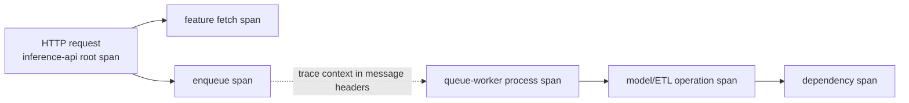
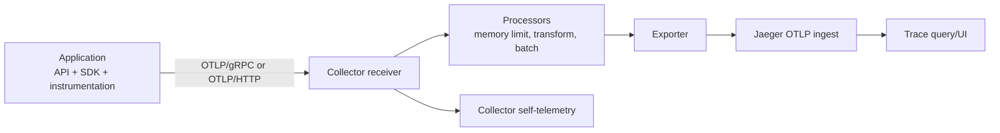
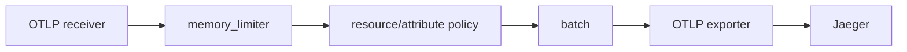
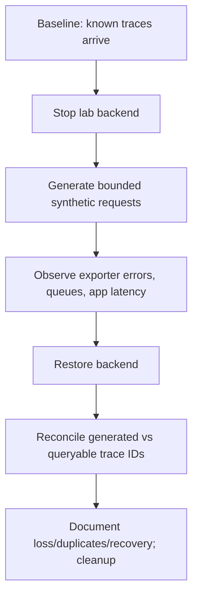

# Unit 5 — OpenTelemetry Collector and Trace Pipelines

**Target file:** `05-opentelemetry-collector-and-trace-pipelines.md` | **Estimated time:** 18–26 hours | **Prerequisites:** M11 Units 1–4 concepts; Python/FastAPI basics; Docker Compose; HTTP and queues; SLI/SLO and incident fundamentals  
**Core tools:** OpenTelemetry API/SDK, OpenTelemetry Collector, OTLP, FastAPI, local Jaeger trace backend, Docker Compose, Python tests | **Awareness:** tail-sampling tiers, span-metrics connector, Kubernetes attributes, Grafana Tempo, Collector Builder, multi-cluster routing  
**Last reviewed:** 2026-10-28 (authoring date; not an official compatibility review) | **Tool baseline assumed:** `[VERIFY]` Select and pin mutually compatible Collector, Jaeger, Python SDK/instrumentation, FastAPI, and HTTP-client releases before execution. Do not treat this lesson's date as proof of release compatibility. | **Stack profile required:** Core tracing first; Full tracing only for selected labs | **Footprint:** measure yours

> **Source and execution honesty.** This lesson was authored from the supplied Unit 5 generation prompt. The roadmap tree and authoritative M11 syllabus file were not independently available for direct inspection in this authoring pass, so exact source-tree agreement beyond the supplied prompt remains `[OPEN]`. Official documentation was not live-consulted during authoring. All commands, configs, and output examples below are instructional; commands and tests were **not executed here**. Version-sensitive items are explicitly marked `[VERIFY]`.

## Table of contents

- [5.0 — Unit map, prerequisites, and completion gate](#50--unit-map-prerequisites-and-completion-gate)
- [5.1 — What distributed tracing can and cannot answer](#51--what-distributed-tracing-can-and-cannot-answer)
- [5.2 — OpenTelemetry architecture and terminology](#52--opentelemetry-architecture-and-terminology)
- [5.3 — Trace context, W3C propagation, resource attributes, and semantic conventions](#53--trace-context-w3c-propagation-resource-attributes-and-semantic-conventions)
- [5.4 — Local trace backend: Jaeger and alternatives](#54--local-trace-backend-jaeger-and-alternatives)
- [5.5 — Instrument a FastAPI service and a worker (Python)](#55--instrument-a-fastapi-service-and-a-worker-python)
- [5.6 — Collector deployment and pipeline configuration](#56--collector-deployment-and-pipeline-configuration)
- [5.7 — Explore traces and correlate metrics, logs, and traces](#57--explore-traces-and-correlate-metrics-logs-and-traces)
- [5.8 — Sampling strategy and measurable sampling lab](#58--sampling-strategy-and-measurable-sampling-lab)
- [5.9 — Pipeline reliability, queues, retries, backpressure, and persistence](#59--pipeline-reliability-queues-retries-backpressure-and-persistence)
- [5.10 — Processors, redaction, OTTL, span metrics, and semantic-convention migration](#510--processors-redaction-ottl-span-metrics-and-semantic-convention-migration)
- [5.11 — Collector meta-monitoring and trace quality](#511--collector-meta-monitoring-and-trace-quality)
- [5.12 — Security, privacy, and safe exposure](#512--security-privacy-and-safe-exposure)
- [5.13 — Performance overhead, rollout, scaling, upgrades, and alternatives](#513--performance-overhead-rollout-scaling-upgrades-and-alternatives)
- [5.14 — Incident diagnosis, runbooks, and final acceptance gate](#514--incident-diagnosis-runbooks-and-final-acceptance-gate)
- [5.15 — Five interview/design-review questions and references](#515--five-interviewdesign-review-questions-and-references)

## Unit 5 — OpenTelemetry Collector and Trace Pipelines

This unit builds the trace pipeline layer: application instrumentation creates spans, context propagation joins work across service boundaries, the Collector processes and exports telemetry, and a trace backend stores it for investigation. The goal is not simply to see one trace in a UI; it is to demonstrate that trace context, service identity, error signals, and delivery behavior remain understandable under controlled failure. All examples use synthetic local workloads and a resource-conscious sequence. Unit 10 owns deep bottleneck isolation; this unit establishes reliable trace production and delivery.

## 5.0 — Unit map, prerequisites, and completion gate

### Why this unit exists in M11

Units 1–4 establish telemetry architecture, metrics/PromQL, dashboards, and centralized logs. Traces add causal structure across request, dependency, queue, and worker boundaries, but only when instrumentation and propagation are correct. A trace pipeline is itself production infrastructure: it can drop spans, leak sensitive attributes, overload a service, or silently stop exporting while its process remains alive.

**M11 sequence from the supplied prompt:** Unit 1 telemetry architecture; Unit 2 Prometheus metrics; Unit 3 Grafana dashboards; Unit 4 Loki/log pipelines; **Unit 5 this lesson**; Unit 6 Alertmanager; Unit 7 cross-service correlation; Unit 8 actionable alerts; Unit 9 saturation/queues; Unit 10 trace analysis; Unit 11 batch freshness; Unit 12 observability cost/cardinality/retention; Unit 13 load/stress/soak; then practice questions and two capstones.

### Prerequisites and remediation

- Python functions, exceptions, HTTP request handling, JSON, environment variables, and basic unit tests.
- Docker Compose networking, ports, volumes, and logs.
- The difference between metric, log, and trace signals.
- Basic service identity and safe handling of secrets.
- M11 Unit 2–4 concepts: Prometheus query interpretation, dashboard navigation, and structured logs.

If context propagation is unfamiliar, first trace one synchronous HTTP request manually: caller creates context, injects headers, callee extracts context, and child spans share the trace ID. If Docker networking is unfamiliar, verify that containers address one another by Compose service name rather than `localhost` (inside a container, `localhost` means that same container).

### Learning map

| Level | Capability | Required evidence |
|---|---|---|
| L1 — Foundations | Explain trace/span/context and inspect a synthetic trace | Annotated trace tree and vocabulary answers |
| L2 — Applied implementation | Instrument API and worker; configure local Collector and backend | Runnable sample, tests, config validation and trace screenshot/record |
| L3 — Advanced engineering | Compare sampling, test redaction, and observe backpressure | Sampling workbook, failure timeline, redaction tests |
| L4 — Production operations | Audit trace completeness, roll back a pipeline change, and measure overhead | Quality-audit report, runbook, measured local results, verification register |

### Source-derived requirements, assumptions, and open items

- **SOURCE-REQUIRED:** Teach the six labs A–F, L1–L4, propagation, sampling, reliability, redaction, meta-monitoring, performance measurement, incident diagnosis, and exactly five interview questions.
- **[ASSUMPTION]:** Docker Compose is the primary local environment because it is straightforward to keep isolated and stop between labs. A small `kind` cluster is optional, not required.
- **[ASSUMPTION]:** Jaeger is the local trace-backend choice, following the supplied prompt.
- **[VERIFY]:** Select compatible release pins for Collector, Jaeger, OpenTelemetry Python packages, and FastAPI instrumentation. Do not copy a version from an unrelated example and assume compatibility.
- **[OPEN]:** The full roadmap tree and separate authoritative M11 syllabus file were not independently inspected in this pass.

### Completion gate

The unit is complete only when the learner has:
1. Captured a multi-hop trace with distinct `inference-api` and `queue-worker` service identities.
2. Demonstrated context propagation across HTTP and a queue boundary; the async/batch relationship is represented with a parent or span link that matches the actual work model.
3. Validated the Collector config using the selected release's supported validation command.
4. Tested redaction and trace-quality checks with synthetic fixtures.
5. Measured sampling retention and local overhead rather than copying expected numbers.
6. Performed a bounded backend-outage/recovery drill and recorded missing, late, or duplicate trace IDs.
7. Reviewed security controls, cleanup, and all unresolved `[VERIFY]` items.

## 5.1 — What distributed tracing can and cannot answer

A **trace** is a collection of spans describing one logical operation across boundaries. A **span** is a timed operation with a name, start/end timestamps, attributes, events, status, kind, and relationships to other spans. The root span represents the entry operation; child spans describe nested work. Span links express relationships that are not accurately modeled as direct parent-child nesting, such as a worker processing a message from a batch or combining several messages.

### Vocabulary and engineering model

| Term | Precise meaning | Common misconception |
|---|---|---|
| Trace | Related spans associated with a trace context/trace ID | Every span from a request is guaranteed to be present |
| Span | Timed operation with context, attributes, events and status | A span is a log line |
| Root span | Span with no parent in the represented trace | It proves all downstream work completed |
| Parent/child | Direct causal nesting represented in span context | A queue worker must always be a child of the HTTP request |
| Span event | Timestamped event inside a span | An event is automatically a separate span |
| Span link | Relationship to another span context without normal parenthood | A link guarantees backend UI renders a merged tree |
| Resource | Identity of the entity producing telemetry, e.g. service name | Resource attributes are the same as request-specific span attributes |
| Propagation | Carrying context across process/protocol boundaries | Installing auto-instrumentation fixes every custom queue |
| Baggage | Context values propagated across boundaries | Baggage is a safe place for user data or secrets |
| Critical path | Work that constrains end-to-end completion in the represented dependency graph | The visually longest span always proves the root cause |
| Sampling | Decision about which traces/spans to retain | Missing trace means the request did not happen |

### Example journey

Synthetic request `req-lab-0042` enters `inference-api`, validates input, fetches features, and submits work to a queue. A worker later processes the message and writes a result. The API request and worker may be causally related but do not necessarily share a live parent-child execution lifetime. Use propagated context where the queue semantics support it; use a span link for detached/batched work when that is the more honest relationship.



### Choose the signal for the question

- **Metrics:** “Is the error ratio elevated across all requests?” Metrics summarize numeric behavior efficiently.
- **Logs:** “Which safe error code and diagnostic message occurred for this request?” Logs provide event detail.
- **Traces:** “Where did this particular operation spend time, and which downstream boundary failed?” Traces show the represented path and timing.

No signal replaces the others. A trace can be incomplete because a library was not instrumented, context was not propagated, spans were sampled/dropped, clocks differ, the exporter failed, or the backend rejected data. Correlation is evidence, not automatic proof of causality.

### Trace interpretation discipline

1. Confirm service/resource identity before comparing spans.
2. Check the time range and sampling policy.
3. Inspect parent IDs and links; do not infer missing spans are zero-duration work.
4. Separate application error status from exporter/backend failure.
5. Compare timestamps with metrics/logs, accounting for clock skew and asynchronous work.
6. Record trace ID as an investigation identifier in logs only when safe; never use it as an ordinary metric label or high-cardinality Loki stream label.

**Mistake:** adding an attribute such as `user.email`, raw URL, request body, prompt, or SQL parameter to every span for “more context.” This increases exposure and may create high-cardinality queries. Prefer bounded operation names and allowlisted, non-sensitive attributes.

## 5.2 — OpenTelemetry architecture and terminology

OpenTelemetry (OTel) is a vendor-neutral set of APIs, SDKs, instrumentation, semantic conventions, and telemetry protocols. It does not itself define the backend's storage model or query UI.



### Components

- **API:** interfaces an application uses to create spans and set context.
- **SDK:** implementation that records spans, applies sampling/processors, and exports them.
- **Instrumentation library:** hooks common frameworks/clients such as ASGI or HTTP clients.
- **Manual instrumentation:** spans around domain operations that generic libraries cannot understand.
- **Propagator:** injects/extracts context through supported carriers such as HTTP headers.
- **Exporter:** sends SDK telemetry to a Collector or backend.
- **OTLP:** OpenTelemetry Protocol. It has gRPC and HTTP transport variants; endpoint paths and ports depend on the selected component/configuration `[VERIFY]`.
- **Collector receiver:** accepts telemetry from an application or another Collector.
- **Processor:** transforms, filters, batches, or protects telemetry.
- **Exporter:** forwards telemetry to a backend or another destination.
- **Extension:** provides service capabilities such as health checks or authentication, depending on build.
- **Connector:** connects one signal pipeline to another or derives a signal, depending on supported component/version.
- **Pipeline:** a signal-specific sequence of receivers, processors, and exporters configured under `service.pipelines`.
- **Trace backend:** stores/indexes traces and provides query/UI capabilities.

### Distribution matters

Collector components are compiled into a particular distribution. A configuration can be syntactically valid YAML yet fail because the selected binary lacks a named receiver, processor, connector, extension, or exporter. Core, Contrib, and custom-built distributions differ; exact availability must be checked in the component registry for the chosen release. Do not assume a component is present just because a blog post uses it.

### OTLP transport is not storage

OTLP is a transport/data protocol. Jaeger, Tempo, or another backend has its own ingestion, storage, query, and retention behavior. A successful TCP connection is not proof that spans were accepted and queryable. Validate at each boundary: SDK export → Collector receiver → processor output → exporter delivery → backend ingestion → UI query.

### Component/failure/verification table

| Component | Purpose | Typical failure | Verification |
|---|---|---|---|
| SDK/instrumentation | Creates spans and propagation | No spans, duplicate spans, unsafe attributes | Test exporter or inspect a known trace |
| OTLP receiver | Accepts telemetry | Wrong bind/port/protocol | Inspect Collector logs and config validation |
| `memory_limiter` processor | Applies memory pressure protection | Misconfiguration or too-late protection | Verify selected release docs and memory metrics |
| `batch` processor | Groups spans for export | Flush delay or batching memory | Observe delivery latency under bounded traffic |
| Exporter | Sends spans downstream | Queue/retry exhaustion or backend mismatch | Inspect exporter errors and backend arrival |
| Jaeger backend | Ingests and stores trace data | Wrong ingest protocol or volatile storage | Query a known synthetic trace ID |
| Health extension | Reports service health | Health endpoint reachable but data pipeline broken | Pair health with end-to-end canary |
| Self-telemetry | Exposes Collector health metrics | Metrics missing/renamed or endpoint exposed | Discover actual series in selected build |

## 5.3 — Trace context, W3C propagation, resource attributes, and semantic conventions

### W3C Trace Context

The W3C Trace Context specification defines interoperable propagation for distributed tracing. The commonly used `traceparent` header carries trace and parent context. Exact header grammar, version rules, validation behavior, and handling of invalid headers must be checked against the current specification and the selected SDK `[VERIFY]`; do not implement custom parsing from memory.

A typical flow is:

1. Incoming HTTP instrumentation extracts context.
2. The server span becomes the active context.
3. An instrumented HTTP client injects context into the outgoing request.
4. A queue producer injects context into message headers.
5. The worker extracts it and creates a processing span or link appropriate to the queue's lifetime.

Context loss often occurs at custom boundaries: a task is serialized without headers, a thread/task context is not propagated, a message wrapper discards metadata, or a consumer starts a fresh trace. Write a test that checks the resulting trace relationship rather than assuming propagation works.

### Resource attributes versus span attributes

- **Resource attributes** identify the emitting entity and remain stable across spans from that resource: `service.name`, deployment environment, service version, and possibly namespace/cluster identity.
- **Span attributes** describe one operation: HTTP method, route template, status code, bounded model name, or safe dependency operation.
- **Events** represent timestamped details during a span.
- **Baggage** propagates application-defined values and must be tightly allowlisted; it is not an authorization mechanism.

`service.name` is essential for readable service identity. Environment/deployment semantic-convention keys have evolved; use the selected convention version and verify exact names `[VERIFY]`. Do not mix old and new names without a documented migration map.

### Privacy rules

Never record access tokens, authorization/cookie headers, credentials, raw prompts or model inputs, customer payloads, email/phone/user identifiers, full SQL with literals, or raw URL query strings. Avoid unbounded attributes such as arbitrary exception text as indexed dimensions. Redact at source where feasible and again in the Collector as defense in depth. Collector redaction cannot recall data already exported or retained.

## 5.4 — Local trace backend: Jaeger and alternatives

The supplied M11 prompt selects Jaeger for the local lab. Its logical responsibilities include accepting trace telemetry, storing trace data, querying traces, and rendering a UI. The deployment topology and accepted OTLP protocols differ by major release. **[VERIFY]** Pin a Jaeger release and use that release's official all-in-one or deployment documentation; do not mix legacy collector-agent settings with newer all-in-one behavior.

### Local versus production storage

- A local, ephemeral backend is useful for proving instrumentation and pipeline wiring.
- Restarting an in-memory or disposable local backend may erase traces. This is expected for a learning lab, not a durability design.
- Production requires an explicit storage, retention, access-control, backup, and recovery decision.
- A successful UI search proves only that matching retained spans are queryable at that moment.

### Jaeger versus Grafana Tempo (awareness)

| Dimension | Jaeger | Tempo |
|---|---|---|
| Lab role here | Required local backend in this lesson | Awareness alternative |
| Query experience | Jaeger trace UI/query model | Grafana-integrated trace query experience; TraceQL availability/version `[VERIFY]` |
| Storage/deployment | Release-specific backend and storage options `[VERIFY]` | Architecture and storage choices differ; verify current documentation |
| Decision | Follow the M11 Jaeger lab path | Evaluate if Grafana-native integration and platform architecture justify it |

These systems are not interchangeable drop-in components. The application can use OTLP while backend ingestion, storage, querying, and operational characteristics differ.

### Backend preflight

Before writing Compose configuration, verify:
- chosen image tag/digest and its deployment mode;
- the exact OTLP receiver ports/protocols enabled by that image;
- UI port and local bind behavior;
- storage durability and restart behavior;
- health/readiness endpoint, if used;
- compatibility with the chosen Collector exporter.

**[VERIFY]** Official Jaeger deployment and OTLP ingestion docs are required for the selected major version. This lesson does not claim to have checked a current tag or tested a particular image.

## 5.5 — Instrument a FastAPI service and a worker (Python)

### Lab B — Instrument API and worker with a complete multi-hop trace (L2)

**Objective:** produce and verify a synthetic API-to-worker trace and safe structured log context. **Profile:** Core tracing. **Footprint:** measure yours. **Prerequisites:** Python virtual environment and Lab A's Collector/backend are available. **Safety:** use only the synthetic `/infer/{model}` route; do not send real payloads.

1. Create the `requirements.txt` and `trace_app.py` shown below.
2. Pin compatible package versions after checking official release documentation; the unpinned requirements are a discovery starting point, not a reproducible lock.
3. Start the Collector/backend, run the API, call the success and synthetic failure paths, then query the known service in Jaeger.
4. Verify `service.name`, operation names, error status, and context injection/extraction. The in-process worker is a teaching substitute for a real broker, so it does not prove cross-process delivery.
5. Save package versions, commands, a redacted trace view, and a test result. **Acceptance:** the success path has API/business/worker spans, the failure path records an error, and no sensitive-looking fixture appears in exported attributes.
6. Cleanup: stop only the lab API and Compose project; do not use broad Docker cleanup commands.

**Representative expected output — not run here:** HTTP success response, a synthetic 503 response for `?fail=true`, and a queryable trace with the expected service identity. If auto-instrumentation is not enabled, an HTTP server span may be absent; do not claim it exists unless observed.

This section provides a compact runnable teaching example using the OpenTelemetry Python SDK, FastAPI instrumentation, and manual spans. Package names and APIs are version-sensitive; pin compatible versions in a project-specific lock file before use. The sample intentionally uses an in-process queue simulation to teach context injection/extraction without requiring a broker. It is not a durable production queue.

### Example file: `lab/unit-5/requirements.txt`

```text
fastapi
uvicorn
httpx
pytest
opentelemetry-api
opentelemetry-sdk
opentelemetry-exporter-otlp-proto-grpc
opentelemetry-instrumentation-fastapi
opentelemetry-instrumentation-httpx
```

These are package names, not a verified lock. **[VERIFY]** Select compatible exact versions using official package documentation and pin them before treating the lab as reproducible.

### Example file: `lab/unit-5/trace_app.py`

```python
"""Synthetic FastAPI + worker tracing example. No real data or external broker."""
from __future__ import annotations

import os
import uuid
from typing import Any

from fastapi import FastAPI, HTTPException
from opentelemetry import trace
from opentelemetry.propagate import extract, inject
from opentelemetry.sdk.resources import Resource
from opentelemetry.sdk.trace import TracerProvider
from opentelemetry.sdk.trace.export import BatchSpanProcessor
from opentelemetry.exporter.otlp.proto.grpc.trace_exporter import OTLPSpanExporter

SERVICE_NAME = os.getenv("OTEL_SERVICE_NAME", "inference-api")
OTLP_ENDPOINT = os.getenv("OTEL_EXPORTER_OTLP_TRACES_ENDPOINT", "http://localhost:4317")

resource = Resource.create({
    "service.name": SERVICE_NAME,
    "deployment.environment.name": os.getenv("APP_ENV", "local"),
    "service.version": os.getenv("APP_VERSION", "0.1.0"),
})
provider = TracerProvider(resource=resource)
provider.add_span_processor(BatchSpanProcessor(
    OTLPSpanExporter(endpoint=OTLP_ENDPOINT, insecure=True)
))
trace.set_tracer_provider(provider)
tracer = trace.get_tracer("unit5.synthetic")

app = FastAPI(title="Unit 5 Synthetic Trace Lab")


def synthetic_worker(carrier: dict[str, str], job_id: str) -> dict[str, Any]:
    """Simulate a detached consumer extracting context from message headers."""
    ctx = extract(carrier)
    with tracer.start_as_current_span("queue-worker.process", context=ctx) as span:
        span.set_attribute("messaging.destination.name", "lab-jobs")
        span.set_attribute("job.kind", "synthetic")
        span.add_event("job.started")
        span.set_attribute("job.id", job_id)  # synthetic ID; not a resource/metric label
        result = {"job_id": job_id, "status": "completed"}
        span.add_event("job.completed")
        return result


@app.get("/health")
def health() -> dict[str, str]:
    return {"status": "ok"}


@app.get("/infer/{model}")
async def infer(model: str, fail: bool = False) -> dict[str, Any]:
    # `model` is a bounded synthetic route segment in this lab. In production,
    # prefer an allowlisted model name and do not copy arbitrary path values.
    with tracer.start_as_current_span("inference.validate") as span:
        span.set_attribute("model.name", model[:40])
        span.add_event("input.validated")

    with tracer.start_as_current_span("inference.enqueue") as span:
        carrier: dict[str, str] = {}
        inject(carrier)
        job_id = f"job-{uuid.uuid4().hex[:8]}"
        span.set_attribute("messaging.destination.name", "lab-jobs")
        result = synthetic_worker(carrier, job_id)
        span.add_event("worker.result.received")

    if fail:
        with tracer.start_as_current_span("inference.synthetic_failure") as span:
            span.set_status(trace.Status(trace.StatusCode.ERROR, "synthetic failure"))
            span.record_exception(RuntimeError("SYNTHETIC failure for lab"))
        raise HTTPException(status_code=503, detail="synthetic failure")
    return {"model": model, "result": result}


@app.on_event("shutdown")
def shutdown_tracing() -> None:
    # Ensure the SDK has an opportunity to flush buffered spans.
    provider.force_flush(timeout_millis=3000)
    provider.shutdown()
```

**Important implementation caveats:**
- This sample demonstrates context propagation but executes the worker in-process, so it is not a real queue or separate service. For an actual worker process, serialize the carrier into message headers and extract it in the consumer.
- The `OTLPSpanExporter` endpoint format and `insecure` parameter are `[VERIFY]` for the pinned Python exporter version. The example uses gRPC port conventionally, but the exact endpoint syntax must match the selected exporter.
- FastAPI auto-instrumentation is discussed below; the core code above manually creates spans and can be used to validate export. It does not automatically instrument every HTTP dependency.
- `@app.on_event` lifecycle behavior can change in framework versions; verify against the selected FastAPI version.
- `job.id` is in span content, not a metric label or stream label. In a real privacy-sensitive system, assess whether even this identifier is necessary.

### Optional auto-instrumentation entry point

For an environment with compatible OTel Python packages, an instrumentation command may be used to hook FastAPI/ASGI and HTTP clients. The exact package CLI and supported flags must be checked for the pinned release `[VERIFY]`. Do not run both auto-instrumentation and equivalent manual server instrumentation without checking for duplicate spans.

### Example structured log with trace context

```python
import json
import logging
from datetime import datetime, timezone
from opentelemetry import trace

logger = logging.getLogger("unit5")


def log_synthetic_event(level: str, message: str, **safe_fields: object) -> str:
    """Emit a JSON event; caller is responsible for allowlisting safe fields."""
    span = trace.get_current_span()
    ctx = span.get_span_context()
    record = {
        "timestamp": datetime.now(timezone.utc).isoformat(),
        "level": level,
        "service": "inference-api",
        "environment": "local",
        "message": message,
        "trace_id": f"{ctx.trace_id:032x}" if ctx.is_valid else None,
        "span_id": f"{ctx.span_id:016x}" if ctx.is_valid else None,
    }
    # Do not blindly merge untrusted request data into log records.
    allowed = {"route", "outcome", "error_code"}
    record.update({k: v for k, v in safe_fields.items() if k in allowed})
    line = json.dumps(record, separators=(",", ":"), ensure_ascii=True)
    logger.info(line)
    return line
```

### Test strategy

A proper automated test should use an in-memory span exporter or a test OTLP endpoint, not require a live backend. The exact SDK testing class/API is version-sensitive `[VERIFY]`. Test at minimum:
- a span is created for the expected operation;
- resource `service.name` is correct;
- synthetic error status is recorded;
- a trace context is injected into the carrier and extracted by the worker;
- sensitive test strings are absent from exported attributes/logs;
- a missing worker hop causes a test failure.

### Run commands

From `lab/unit-5/` in a virtual environment:

```bash
python -m venv .venv
. .venv/bin/activate
python -m pip install -r requirements.txt
uvicorn trace_app:app --host 127.0.0.1 --port 8000
```

In another terminal:

```bash
curl -sS http://127.0.0.1:8000/infer/demo-model
curl -sS 'http://127.0.0.1:8000/infer/demo-model?fail=true'
```

Representative responses (not executed here):

```json
{"model":"demo-model","result":{"job_id":"job-1234abcd","status":"completed"}}
{"detail":"synthetic failure"}
```

The job ID is illustrative and will vary. If the API responds but no trace appears, verify the Collector endpoint, receiver protocol, exporter config, backend ingestion, sampling, and trace time range. Clean up with `Ctrl+C`, then deactivate/remove the disposable virtual environment only if it belongs to this lab.

## 5.6 — Collector deployment and pipeline configuration

### Lab A — Deploy and validate a local Collector + trace backend (L1/L2)

**Objective:** validate a version-pinned local trace pipeline end to end. **Profile:** Core tracing. **Footprint:** measure yours. **Prerequisites:** Docker Compose; selected image tags and component docs reviewed. **Safety:** all host-published ports are loopback-bound; no production endpoints or credentials.

**Preflight and exact steps:**
1. Copy the following inline examples into a disposable `lab/unit-5/` directory using the paths shown in this lesson. These are instructions; they have not been written into the learner's repository.
2. Resolve the `<VERIFIED_TAG>` placeholders only after confirming compatible release documentation. Do not execute the literal placeholders.
3. Save `.env.example` as a local `.env` after editing the tags. Keep `.env` out of source control; it contains no credentials but is environment-specific.
4. Run the Compose config render and inspect the port bindings. Run the exact Collector config validation command documented for the chosen image. `[VERIFY]` The validator name and flags are release-specific; do not substitute an assumed command.
5. Start the two services and inspect logs. Start the app from Lab B, send a synthetic request, and confirm a known trace appears in the backend UI.

**CI-style validation wrapper — `lab/unit-5/validate-local.sh`:** this script verifies that required local files exist and that Compose can render the configuration. It does **not** replace the selected Collector binary's config validator or the live smoke test.

```bash
#!/usr/bin/env bash
set -euo pipefail
: "${COMPOSE_FILE:=compose.yaml}"
: "${ENV_FILE:=.env}"
for file in "$COMPOSE_FILE" "$ENV_FILE" "otel-collector.yaml"; do
  if [[ ! -f "$file" ]]; then
    echo "missing required lab file: $file" >&2
    exit 2
  fi
done
docker compose --env-file "$ENV_FILE" -f "$COMPOSE_FILE" config >/dev/null
echo "Compose syntax/render check passed; Collector validation and trace smoke test remain required."
```

**Representative expected output — not run here:** `Compose syntax/render check passed; Collector validation and trace smoke test remain required.` A successful render proves Compose interpolation/schema parsing only, not that the image contains every Collector component or that Jaeger accepts the exporter protocol.

**Acceptance/evidence:** config render, exact-version Collector validation, loopback port review, Collector startup logs, one queryable trace, and recorded image references/digests. **Cleanup:** stop the named lab project with `docker compose --env-file .env -f compose.yaml down`; preserve any evidence first. Add `--volumes` only if you have verified the project volumes are disposable and intentionally want to delete them. **Stretch:** repeat after changing one endpoint to a deliberately wrong local hostname, capture the failure, then restore the known-good file.

### Agent versus gateway

- **Agent:** close to the workload; can collect local context and buffer near the source, but multiplies deployment/configuration overhead.
- **Gateway:** centralizes policy, credentials, and export; simpler for a local lab, but becomes a shared capacity and availability boundary.
- **Local choice:** one gateway Collector for the core lab. Production commonly combines agents and gateways when local collection and centralized policy both matter.

### Collector pipeline anatomy



The order shown is a **teaching shape**, not a universal prescription. Processor ordering and supported settings must be validated for the chosen Collector version and workload. The memory limiter should be placed and tuned according to that release's documentation; batching can affect memory and delivery latency.

### Example file: `lab/unit-5/otel-collector.yaml`

The following is a conservative illustrative template. **Do not run until each component and key has been checked against the selected Collector distribution/version.** It intentionally avoids unverified tail-sampling, transform, persistent-queue, and spanmetrics components in the core path.

```yaml
receivers:
  otlp:
    protocols:
      grpc:
        endpoint: 0.0.0.0:4317
      http:
        endpoint: 0.0.0.0:4318

processors:
  memory_limiter:
    check_interval: 1s
    limit_mib: 256
    spike_limit_mib: 64
  batch:
    timeout: 2s
    send_batch_size: 512

exporters:
  otlp:
    endpoint: jaeger:4317
    tls:
      insecure: true

extensions:
  health_check:
    endpoint: 0.0.0.0:13133

service:
  extensions: [health_check]
  pipelines:
    traces:
      receivers: [otlp]
      processors: [memory_limiter, batch]
      exporters: [otlp]
```

**[VERIFY] Required before execution:** the selected Collector binary must include `otlp` receiver, `memory_limiter`, `batch`, `otlp` exporter, and `health_check`; the exporter endpoint and TLS options must match the selected Jaeger receiver; the health-check component schema and bind behavior must match the selected version. `0.0.0.0` binds inside the container; do not publish diagnostic ports to the LAN. Docker Compose port publication should bind to `127.0.0.1` where host access is needed.

### Example file: `lab/unit-5/compose.yaml`

```yaml
services:
  jaeger:
    image: ${JAEGER_IMAGE:?Set a verified Jaeger image tag}
    environment:
      # [VERIFY] Environment variables depend on the selected Jaeger release.
      # Configure OTLP ingestion using that release's official instructions.
      - COLLECTOR_OTLP_ENABLED=true
    ports:
      - "127.0.0.1:16686:16686"
    networks: [trace-lab]

  otel-collector:
    image: ${OTELCOL_IMAGE:?Set a verified Collector image tag}
    command: ["--config=/etc/otelcol/config.yaml"]
    volumes:
      - ./otel-collector.yaml:/etc/otelcol/config.yaml:ro
    ports:
      - "127.0.0.1:4317:4317"
      - "127.0.0.1:4318:4318"
      - "127.0.0.1:13133:13133"
    depends_on: [jaeger]
    networks: [trace-lab]

networks:
  trace-lab:
    internal: true
```

This Compose file is a template, not a verified working pairing. The Jaeger image variable must be set to a release that accepts OTLP on the configured endpoint and exposes the UI on the configured port; the Collector image must include the configured components and use the shown config path. **[VERIFY]** Jaeger image environment flags and ports differ across releases. The internal network plus loopback port bindings reduce exposure, but verify actual Docker networking on WSL2.

Example environment file (do not commit an unverified tag as a production pin):

```dotenv
# lab/unit-5/.env.example
# Replace only after checking official release documentation and image digests.
JAEGER_IMAGE=jaegertracing/all-in-one:<VERIFIED_TAG>
OTELCOL_IMAGE=otel/opentelemetry-collector-contrib:<VERIFIED_TAG>
```

Do not put secrets in `.env`; this lab requires no credentials.

### Validation and startup procedure

1. Check the exact release documentation and image contents.
2. Pin a version and, for stronger supply-chain reproducibility, record the resolved digest.
3. Validate the Collector config with the command supported by that exact image. **[VERIFY]** The command/flags differ by distribution and release; do not assume `validate` is universal.
4. Start only the trace lab:
   ```bash
   docker compose --env-file .env -f compose.yaml config
   docker compose --env-file .env -f compose.yaml up -d
   docker compose --env-file .env -f compose.yaml ps
   docker compose --env-file .env -f compose.yaml logs --tail=100 otel-collector
   ```
5. Send one synthetic span from the app and search Jaeger UI at `http://127.0.0.1:16686`.
6. Confirm service name, operation name, duration, and status.

Representative evidence (not executed): Compose renders the two services and Collector logs show a started trace pipeline. A running container alone is not acceptance evidence; the known synthetic trace must be queryable.

### Component self-telemetry and Kubernetes awareness

Collector self-telemetry can expose accepted/refused spans, exporter failures, queue metrics, process memory and uptime, but exact metric names and default endpoints vary `[VERIFY]`. Discover actual series from the selected build before writing PromQL. In Kubernetes, `k8sattributes` needs a supported build, pod metadata access, and appropriate RBAC; it is not a Docker Compose feature. Do not mount the Docker socket or broad host paths unless there is a justified, reviewed need.

## 5.7 — Explore traces and correlate metrics, logs, and traces

### Investigation sequence

1. Start from a symptom metric or alert context (Unit 2/3/8).
2. Select a narrow time range and a service/operation.
3. Open a trace with the relevant error/latency.
4. Check root span status, child spans, attributes, events, parent IDs, and links.
5. Find a safe structured log carrying the same trace ID, if available.
6. Compare timestamps and deployment/version attributes.
7. Validate hypotheses with an independent signal; temporal correlation alone does not prove causality.

### Expected trace shape

For a successful synthetic request, expect at least:
- `inference-api` resource identity;
- server/request operation (if auto-instrumentation is enabled);
- `inference.validate`;
- `inference.enqueue`;
- `queue-worker.process` with propagated context or a documented link;
- completed status.

If the core manual sample is used without FastAPI instrumentation, there may be no automatic HTTP server span. This is a known limitation and must not be mistaken for a broken exporter.

### Correlation rules

- Trace ID belongs in logs as a field when needed, not as a high-cardinality Prometheus label or Loki stream label.
- Exemplars can connect metrics to traces when the SDK, metric pipeline, backend, and UI are configured compatibly `[VERIFY]`.
- Derived fields/data links depend on Grafana datasource configuration and are deferred to Units 3–4.
- Unit 7 owns broader cross-service correlation conventions; Unit 10 owns deep trace bottleneck analysis.

### End-to-end checklist

- [ ] One known synthetic trace is queryable.
- [ ] Resource `service.name` is stable and distinct for API and worker.
- [ ] Trace ID survives the tested boundary.
- [ ] Error trace contains an error status/event without sensitive payload.
- [ ] Corresponding structured log contains matching trace ID, if logging integration is enabled.
- [ ] No conclusion depends only on the absence of a sampled or missing span.

## 5.8 — Sampling strategy and measurable sampling lab

Sampling is a deliberate retention decision, not proof that unretained events did not happen.

| Strategy | Decision point | Benefit | Blind spot / risk |
|---|---|---|---|
| Always-on | Retain all spans | Strong local ground truth | High resource/volume demand |
| Head probability sampling | At trace start | Low overhead and simple decision | Later error/latency may be unknown when decision is made |
| Rate limiting | Based on configured rate/limit | Bounds traffic | May bias what is retained |
| Tail sampling | After spans arrive at a Collector tier | Can retain traces based on observed status/latency/attributes | Memory, decision wait, late spans, incomplete traces, and routing complexity |

### Head versus tail sampling

Head sampling makes a decision near trace creation. If a request fails after the initial decision, the sampler cannot retroactively know the outcome. Tail sampling can make a decision after observing spans, but all spans belonging to a trace must reach the same decision-maker. A load balancer that distributes spans independently can split a trace across sampler instances and cause partial or incorrect decisions. A production tail-sampling tier therefore needs trace-ID-aware routing and explicit memory/wait/late-span policies.

### Lab C — deterministic sampling comparison

**Objective (L3):** compare generated ground truth with retained trace IDs and calculate retained fractions.  
**Profile:** Core tracing; one backend, one Collector. **Footprint:** measure yours.  
**Safety:** generate a small, bounded number of requests; no load generator against external systems.

Use a deterministic local dataset as a first step:

```python
# lab/unit-5/sampling_math.py
from dataclasses import dataclass

@dataclass(frozen=True)
class TraceCase:
    trace_id: str
    kind: str  # fast, slow, error

CASES = [
    TraceCase(f"trace-{i:03d}", kind)
    for i, kind in enumerate(
        ["fast"] * 60 + ["slow"] * 25 + ["error"] * 15, start=1
    )
]

def retained_fraction(total: int, retained: int) -> float:
    if total <= 0 or retained < 0 or retained > total:
        raise ValueError("require 0 <= retained <= total and total > 0")
    return retained / total

if __name__ == "__main__":
    total = len(CASES)
    errors = sum(case.kind == "error" for case in CASES)
    print(f"generated={total} errors={errors}")
    print(f"error_fraction={errors / total:.3f}")
```

Representative output (not executed): `generated=100 errors=15` and `error_fraction=0.150`.

This fixture establishes ground truth, not a live Collector sampling result. For the live exercise:
1. Run a bounded batch of cases with known fast/slow/error labels.
2. Capture generated trace IDs and outcomes in a local ground-truth file.
3. Run the selected always-on/head-sampling configuration and export/query retained trace IDs.
4. Calculate `retained_fraction = retained unique trace IDs / generated unique trace IDs`.
5. Calculate error retention as `retained error trace IDs / generated error trace IDs`.
6. Configure tail sampling only after verifying the selected Collector distribution, processor component, policy syntax, decision wait, memory sizing, and trace-ID routing.
7. Repeat the same deterministic workload and compare observed results.

**Acceptance:** record actual results; do not copy expected percentages. A lab goal of retaining 100% of synthetic error traces is only an acceptance target for a particular validated configuration, not a universal guarantee. If the chosen config cannot be verified or executed, mark the live tail-sampling result `[OPEN]`.

### Tail-sampling configuration gate

Do not paste a generic `tail_sampling` configuration into a production pipeline without checking:
- component availability in the selected distribution;
- policy names and field paths;
- expected status/latency attribute names;
- decision wait and memory behavior;
- exporter routing and trace-ID-aware load balancing;
- late-span and incomplete-trace behavior;
- the test that proves error retention.

## 5.9 — Pipeline reliability, queues, retries, backpressure, and persistence

### Separate the buffers

- **SDK batch processor:** buffers spans before export from the application.
- **Exporter sending queue:** buffers telemetry waiting for an exporter, if configured/supported.
- **Retry policy:** attempts to resend after retryable failures.
- **Persistent queue/storage extension:** may survive process restart only if configured and supported; it is not implied by batching.
- **Backend storage:** durability after successful ingestion is a separate backend decision.

Retries can produce duplicates. Queue exhaustion, process termination, disk exhaustion, SDK shutdown without flush, non-retryable rejection, and sampling can produce gaps. “At least once” is not a blanket Collector guarantee: document the semantics of the actual selected components and configuration.

### Lab D — bounded backend outage and recovery

**Objective (L3/L4):** characterize observed delivery and loss under a short backend outage.  
**Profile:** Core tracing. **Footprint:** measure yours.  
**Preconditions:** a known-good end-to-end trace works and the workload is disposable.

1. Record a baseline set of synthetic trace IDs and confirm they appear in the backend.
2. Stop only the lab backend service, using the Compose project and file path created for this lab.
3. Send a small bounded set (e.g. 20–50) of synthetic requests. Record generated IDs and request latency.
4. Inspect Collector logs and available self-metrics; identify actual queue/retry/drop series rather than assuming metric names.
5. Restart the backend. Wait for a declared, bounded recovery window.
6. Query for generated trace IDs and classify each as received, missing, late, or duplicated.
7. Repeat with a persistent queue only if the chosen exporter/storage extension supports it and disk capacity is guarded.
8. Stop the app and stack; preserve evidence, then remove only the named lab project resources if no evidence depends on them.

Representative evidence table (fill from actual run):

| Metric | Baseline | Backend stopped | Recovery | Evidence source |
|---|---:|---:|---:|---|
| Generated trace IDs | `[MEASURE]` | `[MEASURE]` | `[MEASURE]` | Ground-truth file |
| Queryable unique IDs | `[MEASURE]` | `[MEASURE]` | `[MEASURE]` | Backend search/export |
| Missing IDs | `[MEASURE]` | `[MEASURE]` | `[MEASURE]` | Reconciliation script |
| Duplicate IDs/spans | `[MEASURE]` | `[MEASURE]` | `[MEASURE]` | Exported trace data |
| App p95 latency | `[MEASURE]` | `[MEASURE]` | `[MEASURE]` | Local timing harness |

The result describes this laptop, release, and configuration only. It does not prove lossless delivery under all failures.

### Safe application behavior

Telemetry export should not block application requests indefinitely. Configure bounded timeouts and queues, use graceful shutdown/flush where appropriate, and test the app while the backend is unavailable. Decide explicitly whether telemetry failure should be fail-open or fail-closed; for ordinary diagnostics, application availability usually should not depend on a remote trace backend, while regulated/audit requirements need a separately designed control.

### Failure/recovery sequence



## 5.10 — Processors, redaction, OTTL, span metrics, and semantic-convention migration

### Attribute transformation and filtering

Processors can insert, update, delete, hash, or filter attributes depending on the component and version. OpenTelemetry Transformation Language (OTTL) is used by some Collector components for transformations; syntax and supported functions are release-sensitive `[VERIFY]`. Never deploy a redaction rule based solely on a happy-path sample. Test:
- a value that must be redacted;
- a benign value that must remain;
- an alternate spelling/case;
- an encoded or structured variant;
- a malformed value;
- a field absent from the event.

Redaction at the Collector is defense in depth. The source application should avoid recording sensitive data in the first place.

### Lab E — redaction and trace-quality audit

Example safe fixture:

```json
{"service.name":"inference-api","message":"[SYNTHETIC] request completed","authorization":"FAKE_TOKEN_DO_NOT_USE_123","email":"sample.user@example.invalid","duration_ms":12}
```

Example expected sanitized shape (illustrative policy, not a tested OTTL config):

```json
{"service.name":"inference-api","message":"[SYNTHETIC] request completed","authorization":"[REDACTED]","email":"[REDACTED]","duration_ms":12}
```

The actual redaction implementation must be chosen from components present in the selected Collector distribution. **[VERIFY]** Check the current transform/attributes processor docs, OTTL functions, field paths, and whether the rule operates on span attributes, resource attributes, events, or logs. The test must inspect the actual payload sent to the next hop, not only the source fixture.

### Span metrics and RED metrics

A span-metrics connector or equivalent can derive request rate, error counts, and duration distributions from spans. Availability and configuration are version-sensitive `[VERIFY]`. Derived metrics can overlap with SDK metrics and may be affected by trace sampling; do not sum both sources as if they were independent. Define one source of truth for each SLI, document sampling impact, and bound dimensions such as service, operation, status class, and environment. Do not use trace ID, user ID, raw URL, or exception text as metric labels.

### Semantic-convention migration

1. Inventory current attribute names used by dashboards, queries, alerts, and runbooks.
2. Select the target semantic-convention version and verify migration guidance.
3. Add a compatibility mapping or dual emission only when necessary and measured.
4. Test both old and new attributes against fixtures and representative traces.
5. Deploy to a small canary; compare query coverage and service identity.
6. Remove old names only after consumers have migrated and a rollback window has passed.

### Example testable attribute policy (Python standard library)

```python
# lab/unit-5/redaction.py
import re

SENSITIVE_KEYS = {"authorization", "cookie", "email", "user.email", "access_token"}
TOKEN_PATTERN = re.compile(r"FAKE_TOKEN_[A-Z0-9_]+")
EMAIL_PATTERN = re.compile(r"\b[A-Za-z0-9._%+-]+@[A-Za-z0-9.-]+\.[A-Za-z]{2,}\b")

def sanitize_attributes(attrs: dict[str, object]) -> dict[str, object]:
    result: dict[str, object] = {}
    for key, value in attrs.items():
        if key.lower() in SENSITIVE_KEYS:
            result[key] = "[REDACTED]"
        elif isinstance(value, str):
            value = TOKEN_PATTERN.sub("[REDACTED]", value)
            value = EMAIL_PATTERN.sub("[REDACTED]", value)
            result[key] = value
        else:
            result[key] = value
    return result
```

```python
# lab/unit-5/test_redaction.py
from redaction import sanitize_attributes

def test_sensitive_keys_are_redacted():
    result = sanitize_attributes({
        "authorization": "FAKE_TOKEN_DO_NOT_USE_123",
        "email": "sample.user@example.invalid",
        "route": "/infer/{model}",
    })
    assert result["authorization"] == "[REDACTED]"
    assert result["email"] == "[REDACTED]"
    assert result["route"] == "/infer/{model}"

def test_embedded_synthetic_token_is_redacted():
    result = sanitize_attributes({"message": "token=FAKE_TOKEN_ABC_123"})
    assert "FAKE_TOKEN_" not in result["message"]

def test_safe_diagnostic_value_survives():
    result = sanitize_attributes({"error_code": "MODEL_TIMEOUT"})
    assert result["error_code"] == "MODEL_TIMEOUT"
```

Run `python -m pytest -q` in the lab virtual environment. This helper is an educational allowlist example, not a complete secret/PII detector; regexes have false negatives and false positives. The required integration test must prove that the final exported span/log contains no test secret.

## 5.11 — Collector meta-monitoring and trace quality

### Monitor the pipeline, not only the process

A healthy process or health endpoint does not prove that spans reach the backend. Monitor:
- accepted/refused/dropped spans;
- exporter errors/retries;
- queue size and capacity;
- process memory/CPU and restarts;
- receiver and exporter request latency;
- ingestion delay and canary arrival;
- backend ingestion errors and query success;
- completeness of expected hops in sampled synthetic traces.

Exact `otelcol_*` metric names, labels, endpoint defaults, and availability vary by distribution/version `[VERIFY]`. Discover them from the actual `/metrics` output or selected release documentation before creating PromQL or dashboards.

### Suggested dashboard/alert catalog

| Signal | Symptom | Evidence | Response |
|---|---|---|---|
| Canary arrival age | Known trace is late/missing | Emitter log + backend query | Follow the stage-by-stage pipeline runbook |
| Exporter failures | Spans are not being delivered | Collector logs and actual exporter metrics | Check endpoint, protocol, backend health, queue |
| Queue utilization | Buffer approaching capacity | Actual queue metric and config | Bound traffic, restore backend, assess persistence |
| Process memory | Rising toward configured limit | Container stats and Collector telemetry | Check batching, queue, sampling, traffic |
| Trace completeness | Expected hop absent | Trace-quality audit | Check instrumentation and propagation boundary |
| Backend query failures | UI cannot find known trace | Backend logs and known trace ID | Separate ingest failure from query/time-range issue |

Do not deploy alerts from this catalog until the actual metric names and meanings are verified. Unit 6 owns Alertmanager routing; Unit 8 owns actionable symptom-based alert design.

### Trace-quality audit script

This script checks a normalized JSON fixture format, not a backend-specific export format. Adapt the importer to the chosen backend's supported export API or OTLP data representation only after verifying it.

```python
# lab/unit-5/trace_quality.py
from __future__ import annotations
from collections import defaultdict
from typing import Any

def audit_spans(spans: list[dict[str, Any]], expected_services: set[str]) -> list[str]:
    errors: list[str] = []
    by_trace: dict[str, list[dict[str, Any]]] = defaultdict(list)
    seen: set[tuple[str, str]] = set()

    for index, span in enumerate(spans):
        trace_id = span.get("trace_id")
        span_id = span.get("span_id")
        service = span.get("service.name")
        start = span.get("start_ns")
        end = span.get("end_ns")
        if not service:
            errors.append(f"span[{index}]: missing service.name")
        if not trace_id or not span_id:
            errors.append(f"span[{index}]: missing trace_id/span_id")
            continue
        key = (str(trace_id), str(span_id))
        if key in seen:
            errors.append(f"span[{index}]: duplicate trace_id/span_id")
        seen.add(key)
        if not isinstance(start, int) or not isinstance(end, int) or end < start:
            errors.append(f"span[{index}]: invalid duration/timestamps")
        by_trace[str(trace_id)].append(span)

    for trace_id, group in by_trace.items():
        ids = {str(s.get("span_id")) for s in group}
        for span in group:
            parent = span.get("parent_span_id")
            if parent and str(parent) not in ids:
                errors.append(f"trace {trace_id}: orphan parent {parent}")
    services = {str(s.get("service.name")) for s in spans if s.get("service.name")}
    for expected in expected_services - services:
        errors.append(f"missing expected service: {expected}")
    return errors
```

```python
# lab/unit-5/test_trace_quality.py
from trace_quality import audit_spans

def test_good_trace_has_no_errors():
    spans = [
        {"trace_id":"t1","span_id":"s1","service.name":"inference-api","start_ns":10,"end_ns":30},
        {"trace_id":"t1","span_id":"s2","parent_span_id":"s1","service.name":"queue-worker","start_ns":15,"end_ns":25},
    ]
    assert audit_spans(spans, {"inference-api", "queue-worker"}) == []

def test_orphan_missing_service_and_negative_duration_are_detected():
    spans = [
        {"trace_id":"t2","span_id":"s1","service.name":"inference-api","start_ns":30,"end_ns":10},
        {"trace_id":"t2","span_id":"s2","parent_span_id":"missing","start_ns":12,"end_ns":15},
        {"trace_id":"t2","span_id":"s3","start_ns":1,"end_ns":2},
    ]
    errors = audit_spans(spans, {"inference-api", "queue-worker"})
    assert any("invalid duration" in e for e in errors)
    assert any("orphan parent" in e for e in errors)
    assert any("missing service.name" in e for e in errors)
    assert any("missing expected service" in e for e in errors)
```

Limitations: this normalized fixture auditor does not validate W3C IDs, clock synchronization, span links, duplicate events, backend completeness, or semantic correctness. It can only detect relationships represented in the input. A real exported trace may show a linked span separately; do not call it orphaned merely because a link is not a parent.

## 5.12 — Security, privacy, and safe exposure

| Threat | Control | Verification |
|---|---|---|
| Tokens/PII in span attributes | Source allowlist and unit tests; Collector defense-in-depth redaction | Inspect exported synthetic span for prohibited strings |
| OTLP receiver exposed to LAN | Loopback host port binding, isolated network, firewall and TLS/auth outside lab | Inspect `docker compose ps`, port bindings, and listening sockets |
| Overprivileged Collector | Minimal read-only mounts and least-privilege Kubernetes RBAC | Review mounts, service account and RBAC manifests |
| Untrusted component/image | Pin release/digest, minimize components, review provenance and advisories | Record image reference/digest and approved component list |
| Unsafe baggage propagation | Allowlist keys/values; avoid secrets and user identifiers | Send synthetic disallowed baggage and confirm it is not propagated |
| Sensitive SQL/URL/header values | Do not record by default; sanitize at source | Test query strings and fake tokens |
| Debug endpoints exposed | Bind privately; do not publish zpages/pprof in lab | Inspect ports and network reachability |
| Unauthorized cross-team trace access | Authenticated gateway/backend, tenant/access policy, network boundaries | Test as distinct identities in a production-like environment |
| Tampered config | Code review, protected branches, validation, versioned releases | Review change and rollback record |
| Excessive retention | Explicit retention and deletion policy; access audit | Verify backend behavior and deletion process |
| Forensic evidence altered | Approved export/hold process, hashes, access controls | Record export metadata and integrity hash |

Jaeger/Collector native access-control behavior depends on deployment and release; do not assume the local lab offers production-grade tenant isolation. For production, use appropriate authentication/TLS/network controls and an access-control layer where required. Do not expose health, zpages, pprof, debug exporters, or unauthenticated OTLP endpoints to an untrusted network.

### Security preflight

- [ ] All test data is synthetic.
- [ ] No auth headers, cookies, prompts, raw payloads, or SQL literals are recorded.
- [ ] OTLP host ports bind to loopback for local work.
- [ ] Diagnostic endpoints are not published beyond the isolated lab.
- [ ] Collector mounts and Kubernetes permissions are minimal.
- [ ] Component list and image digests are recorded.
- [ ] Redaction tests include positive and negative cases.
- [ ] Access control and retention are treated as production requirements, not assumed from a local demo.

## 5.13 — Performance overhead, rollout, scaling, upgrades, and alternatives

### Lab F — Span metrics, self-monitoring, and measured overhead (L3/L4)

**Objective:** measure the effect of tracing and inventory the telemetry needed to operate the Collector. **Profile:** start with Core tracing; run only if laptop headroom permits. **Footprint:** measure yours. **Prerequisites:** working Lab A/B trace path and a stable, bounded synthetic request set. **Safety:** no external endpoints; stop immediately if disk/memory pressure grows or the app becomes unresponsive.

**Overhead procedure:**
1. Run the same small request corpus with tracing disabled, then enabled at each supported sampling rate. Verify the exact SDK sampling configuration before changing it `[VERIFY]`.
2. Capture request count, errors, elapsed time, latency distribution, app CPU/memory, Collector CPU/memory, and queryable trace count. Repeat each condition at least three times if practical and keep the same machine conditions.
3. Save raw observations; report median and range, not a remembered benchmark. Do not infer production capacity from one laptop run.
4. Discover the actual Collector self-telemetry endpoint and metric names from the selected release. Do not write production alerts against guessed `otelcol_*` names.

**Span metrics optional path:** if the selected Collector distribution includes a supported spanmetrics connector/equivalent, verify its config and output schema from that release's component docs before enabling it. Compare a small derived RED metric sample with the SDK's own request metrics. Explain overlap and sampling bias; do not add the two sources together. If the component cannot be verified, record `[OPEN]` and complete the self-monitoring/overhead work without it.

**Evidence and acceptance:** version/config record; table of local measurements; actual self-metric series inventory; explanation of any differences between generated spans and queryable traces; no invented metric names or timing results. **Cleanup:** stop the request generator, app, Collector and backend; verify no background process remains. **Stretch:** repeat after a Collector config change in a canary-only local profile and compare delivery/latency against baseline.

### Controlled overhead experiment

Do not quote a remembered overhead percentage. Measure a stable local workload with the same request mix in these states:

1. tracing disabled;
2. tracing enabled with a low sampling rate, if the chosen SDK config supports it;
3. tracing enabled with a higher sampling rate;
4. optionally always-on sampling if laptop headroom permits.

For each state, record:
- exact image/package versions and config;
- generated request count and mix;
- throughput and latency distribution;
- application and Collector CPU/memory;
- span count generated/exported/queryable;
- error rate and missing traces;
- machine conditions and repeat count.

Use a small bounded request count first; stop if memory/disk pressure rises or the app becomes unresponsive. Unit 13 owns full load/stress/soak design. This exercise measures tracing overhead under one local workload, not production capacity.

### Rollout and configuration-as-code

- Pin images and Python packages; record image digests where practical.
- Validate configuration with the selected Collector's documented validation command.
- Test the config and instrumentation against a local backend before rollout.
- Canary one service or a small fraction of traffic.
- Compare error rate, latency, export failures, queue utilization, and trace completeness.
- Roll back to the previous known-good config/image if delivery or application behavior regresses.
- Detect drift by comparing reviewed config with deployed config; don't treat generated defaults or normalized JSON/YAML ordering as meaningful drift without review.

### Scaling architecture choices

| Decision | Option A | Option B | Trade-off / choose when |
|---|---|---|---|
| Collection | Agent near workload | Central gateway | Agent has local context; gateway centralizes policy but can become a shared bottleneck |
| Sampling | Head | Tail | Head is simpler/cheaper; tail can use outcome but needs trace-aware routing and state |
| Buffer | In-memory | Persistent queue if supported | Persistent queues may survive restart but add disk and recovery concerns |
| Distribution | Standard pinned distribution | Custom-built minimal distribution | Custom build reduces component surface but adds build/release responsibility |
| Instrumentation | Auto | Manual | Auto covers common frameworks; manual spans capture domain meaning |
| Backend | Jaeger | Tempo or another supported backend | Choose based on storage, query workflow, operational model, and verified integration |

Grafana Alloy and vendor agents may provide collection alternatives, but product capabilities and support recommendations change; verify current status before choosing. Keep OpenTelemetry concepts vendor-neutral. Multi-cluster/multi-tenant routing belongs at awareness depth here and hands off to M14.

## 5.14 — Incident diagnosis, runbooks, and final acceptance gate

### Incident matrix

| Incident | Evidence to gather | Likely cause | Discriminating test | Immediate mitigation | Durable prevention |
|---|---|---|---|---|---|
| 1. `memory_limiter` ineffective; Collector OOM | Memory, restarts, config, exporter queues | Wrong ordering/tuning or traffic exceeds capacity | Validate selected release config; reduce bounded traffic | Reduce load/restore previous config | Capacity test and verified processor configuration |
| 2. Tail sampler split across instances | Partial traces, per-instance span distribution | No trace-ID-aware routing | Send one known trace through routing path | Use single sampler instance in lab | Trace-ID routing and explicit topology tests |
| 3. Semantic rename breaks queries | Old/new attribute samples and query results | Consumer still expects old field | Query both names on canary traces | Restore compatibility mapping | Migration inventory and regression tests |
| 4. Config typo breaks rollout | Collector startup logs, validation output | No pre-deploy validation/canary | Run version-matched config validation | Roll back last known-good config | CI validation and canary |
| 5. SQL/URL/header leaks | Exported span attributes | Auto-instrumentation captures sensitive values | Send synthetic marker and inspect export | Disable offending attribute capture | Source allowlist plus redaction tests |
| 6. Child appears before parent | Timestamps and host clock health | Clock skew or async timing | Compare synchronized clocks and span relationships | Avoid timing-only conclusions | Clock monitoring and propagation tests |
| 7. Async spans look unrelated | Message headers and span links | Context discarded or wrong parent model | Verify carrier injection/extraction | Add correct propagation/link | Queue contract and integration tests |
| 8. 100% sampling overloads service | CPU/memory/latency/span volume | Sampling rate exceeds capacity | Repeat bounded test at lower rate | Reduce sampling rate | Sampling policy and overhead budget |
| 9. Backend outage fills queue | Exporter errors, queue/capacity, drops | Backend unavailable beyond buffer window | Stop/restart only lab backend | Restore backend, reduce traffic | Bounded queues, recovery test, alerting |
| 10. Context lost at HTTP/queue | Trace IDs differ across hop | Missing instrumentation or carrier propagation | Inspect outgoing headers/message metadata | Repair boundary instrumentation | Automated cross-boundary test |
| 11. OTLP endpoint exposed | Port bindings and socket/network test | Wildcard host publish or permissive network | Inspect Compose bindings and reachability | Unpublish port/isolate network | Secure defaults and CI policy |
| 12. Exporter absent from distribution | Collector startup/config error | Component not compiled into image | Check component registry for exact image | Choose supported distribution or build | Component inventory and config test |
| 13. Persistent queue fills disk | Disk usage, queue storage files | Backend down or queue unbounded/undersized | Compare queue growth and free disk | Stop test traffic and restore backend | Disk guard, queue limits, runbook |
| 14. Instrumentation upgrade changes fields | Span diff, package lock, tests | Semantic/API change | Compare canary trace to fixture | Pin/roll back package | Upgrade compatibility tests |
| 15. Collector alive, no delivery | Health endpoint, exporter logs, canary | Pipeline missing/broken or backend rejection | Send known trace and follow each boundary | Restore pipeline/backend path | End-to-end canary and delivery SLI |

Treat each cause as a hypothesis until the discriminating test supports it.

### Runbook template: trace missing or delayed

1. **Scope:** affected service, time window, trace ID, deployment version, expected hop.
2. **Confirm source:** verify the SDK created spans; inspect local test exporter or SDK diagnostics safely.
3. **Check propagation:** compare trace context at HTTP/queue boundary; verify the expected carrier/header.
4. **Check Collector:** inspect config validation, receiver logs, processor filtering, exporter failures, queue/drop signals, memory/disk.
5. **Check backend:** confirm receiver protocol/port, ingestion status, storage health, query time range and service filter.
6. **Check sampling:** distinguish unsampled trace from export loss; compare with the configured policy.
7. **Mitigate:** reduce telemetry volume, roll back config/instrumentation, restore backend, or route to a known-good Collector.
8. **Verify recovery:** send a new known synthetic trace and confirm the expected hops.
9. **Preserve evidence:** config version, logs with secrets redacted, generated/received IDs, timing, and changes.
10. **Prevent recurrence:** add the missing boundary test, canary, config check, or alert.

### Pre-deployment checklist

- [ ] Version pins, image digest and component availability reviewed.
- [ ] Collector config validates against the exact selected distribution.
- [ ] Endpoint, protocol, ports and service names agree across config files.
- [ ] Synthetic success and error traces are queryable.
- [ ] HTTP and queue context propagation are tested.
- [ ] Redaction tests cover sensitive and safe values.
- [ ] Sampling behavior and error-retention results are measured.
- [ ] Backend-outage drill has a bounded traffic limit and cleanup.
- [ ] Self-telemetry series are discovered, not guessed.
- [ ] Rollback artifact and owner are recorded.
- [ ] No diagnostic endpoint is exposed to untrusted networks.
- [ ] Local resources and all fault injectors are stopped after the lab.

### Final acceptance gate

| Gate | Evidence required | Status |
|---|---|---|
| Complete multi-hop trace | Trace with API and worker identities, expected spans/links | `[LEARNER TO COMPLETE]` |
| Propagation | Test through HTTP and queue boundary | `[LEARNER TO COMPLETE]` |
| Collector config | Version-matched validation output | `[LEARNER TO COMPLETE]` |
| Sampling | Ground truth, retained IDs, error retention calculation | `[LEARNER TO COMPLETE]` |
| Outage/recovery | Before/during/after reconciliation | `[LEARNER TO COMPLETE]` |
| Redaction | Positive/negative tests and exported payload check | `[LEARNER TO COMPLETE]` |
| Meta-monitoring/quality | Actual series inventory and audit report | `[LEARNER TO COMPLETE]` |
| Overhead | Local measurements with methodology | `[LEARNER TO COMPLETE]` |
| Verification register | All unresolved version items assigned for checking | `[LEARNER TO COMPLETE]` |
| Cleanup | No lab services, fault generators, or temporary sensitive fixtures remain | `[LEARNER TO COMPLETE]` |

## 5.15 — Five interview/design-review questions and references

### 1. When would you choose head sampling versus tail sampling?

**Model answer:** Head sampling is operationally simple and bounds volume early, but it cannot use an error or latency outcome that is only known later. Tail sampling can retain traces based on observed status/latency/attributes, but requires all spans for a trace to reach the same decision-maker, adds decision delay and memory use, and must handle late/incomplete spans. I would start with head sampling unless retaining outcome-specific traces justifies the added state and routing complexity, then validate the policy using known ground-truth traffic.

### 2. Why is trace-ID routing required for a multi-instance tail-sampling tier?

**Model answer:** A sampling decision is trace-wide. If spans for one trace land on different sampler instances, each instance sees only a partial trace and may make an inconsistent decision. Route all spans with the same trace ID to the same decision-maker, test the routing with multi-hop traces, and monitor incomplete traces and late spans. A single gateway is a simpler lab profile, not a universal production scaling design.

### 3. What do queues and retries guarantee during a backend outage?

**Model answer:** Nothing universal. In-memory queues can be lost on restart; retries can duplicate delivery; bounded queues can fill; non-retryable errors can be rejected; persistent queues work only when explicitly supported and configured; and the backend's own durability is separate. I would generate known trace IDs, stop the disposable backend, measure queue/error behavior, restore it, and reconcile generated versus queryable IDs. I would not claim lossless or exactly-once delivery without evidence.

### 4. How do you prevent sensitive attributes from leaking into spans?

**Model answer:** Prefer source-level allowlisting and avoid capturing request bodies, authorization/cookie headers, SQL literals, raw query strings, user identifiers, or model prompts. Add Collector-side redaction as defense in depth, test both prohibited and safe values, inspect the exported payload, and consider baggage propagation. A downstream processor cannot erase copies already exported or retained; access controls and retention still matter.

### 5. How would you roll out an instrumentation or Collector upgrade safely?

**Model answer:** Pin package/image versions and component inventory, read the release notes and semantic-convention migration guidance, validate config against the exact binary, run fixture and integration tests, canary one service, and compare trace completeness, export errors, application latency, memory, and resource attributes. Preserve a known-good config/image and rollback trigger. Remove compatibility mappings only after dashboards, queries, and alert consumers have migrated.

### Official documentation reference targets

The following are suggested official verification targets; **they were not visited during this authoring pass**, so URLs and page availability should be checked before use.

- OpenTelemetry overview: https://opentelemetry.io/docs/what-is-opentelemetry/
- OpenTelemetry concepts: https://opentelemetry.io/docs/concepts/
- Collector architecture: https://opentelemetry.io/docs/collector/
- Collector configuration: https://opentelemetry.io/docs/collector/configuration/
- Collector components: https://opentelemetry.io/docs/collector/components/
- Collector distributions/builders: https://opentelemetry.io/docs/collector/ — follow the current distribution/builder documentation from the official site.
- OpenTelemetry Python: https://opentelemetry.io/docs/languages/python/
- OpenTelemetry Python instrumentation: https://opentelemetry.io/docs/languages/python/instrumentation/
- W3C Trace Context: https://www.w3.org/TR/trace-context/
- OpenTelemetry semantic conventions: https://opentelemetry.io/docs/specs/semconv/
- Jaeger documentation: https://www.jaegertracing.io/docs/
- Grafana trace correlation: https://grafana.com/docs/grafana/latest/ — find the current trace-to-logs/exemplars documentation for the selected release.
- Prometheus documentation: https://prometheus.io/docs/introduction/overview/
- Loki documentation: https://grafana.com/docs/loki/latest/
- Docker Compose documentation: https://docs.docker.com/compose/
- Kubernetes documentation: https://kubernetes.io/docs/

### Claim and decision traceability

| Claim or decision | Classification | Evidence/source | Status/action |
|---|---|---|---|
| Unit 5 must teach Collector and trace pipelines, L1–L4, Labs A–F | SOURCE-REQUIRED | Supplied Unit 5 prompt | Included in lesson |
| Jaeger is the local backend choice | SOURCE-REQUIRED | Supplied Unit 5 prompt | Release/config still `[VERIFY]` |
| Docker Compose is the primary lab platform | ASSUMPTION | Resource constraints and local-only scope | Confirm against authoritative roadmap when available |
| Exact Collector component availability | ENGINEERING-INFERENCE | Depends on chosen distribution | `[VERIFY]` against exact image and component registry |
| Python exporter and instrumentation APIs | ENGINEERING-INFERENCE | Depend on pinned package versions | `[VERIFY]` against selected package docs |
| Jaeger ports/environment settings | ENGINEERING-INFERENCE | Depend on selected Jaeger major release | `[VERIFY]` before startup |
| Tail-sampling policy schema/routing | ENGINEERING-INFERENCE | Collector component/version and deployment topology | `[VERIFY]`; live acceptance not claimed |
| Collector self-metric names | ENGINEERING-INFERENCE | Distribution and version dependent | Discover actual series; do not copy guessed names |
| Redaction and semantic-convention syntax | ENGINEERING-INFERENCE | OTTL/component/convention versions vary | Test exported payload and mapping |
| Runtime tests and benchmarks | ASSUMPTION | No execution performed here | NOT EXECUTED; learner must run and capture evidence |

### Ten-pass audit summary

| Pass | Status | Evidence/notes |
|---|---|---|
| 1. Source fidelity | PASS WITH `[VERIFY]` ITEMS | Supplied Unit 5 prompt topics and labs represented; authoritative M11 source files not independently inspected |
| 2. Tree/scope | PASS WITH `[OPEN]` ITEM | Exact target filename and Unit 5 position follow supplied prompt; full tree not independently inspected |
| 3. L1–L4 progression | PASS | Foundations, implementation, advanced engineering, and production operations sections included |
| 4. Technical accuracy | PASS WITH `[VERIFY]` ITEMS | Version-sensitive Collector, Jaeger, Python, sampling and semantic-convention details explicitly flagged |
| 5. Configuration consistency | PASS WITH `[VERIFY]` ITEMS | Compose/config endpoints are aligned as a template; exact image-specific flags/ports must be verified |
| 6. Safety/security | PASS | Synthetic-only examples, loopback host bindings, no credentials, bounded failure drill and scoped cleanup |
| 7. Lab completeness | PASS WITH `[VERIFY]` ITEMS | Labs A–F covered; live tail sampling, backend compatibility, and exact config validation require selected versions |
| 8. Reliability/operations | PASS | Backpressure, outage/recovery, sampling routing, meta-monitoring, quality audit and runbooks included |
| 9. Evidence/references | PASS WITH `[VERIFY]` ITEMS | Expected output is labeled; no command was claimed executed; documentation URLs are suggested, not consulted |
| 10. Editorial/completion gate | PASS | Sections 5.0–5.15, exactly five interview questions, acceptance gate and register included |

### Open verification register

| ID | Claim/artifact | Why version-sensitive | Human verification procedure | Status |
|---|---|---|---|---|
| V01 | Collector image/tag and distribution | Components vary by build/release | Choose release; inspect official component registry and image digest | `[VERIFY]` |
| V02 | Collector config validation command | CLI and flags can change | Check selected image's official docs/help and run validation | `[VERIFY]` |
| V03 | OTLP receiver endpoints/protocols | Config and bind defaults vary | Inspect effective config and confirm with a synthetic export | `[VERIFY]` |
| V04 | `memory_limiter` keys/order | Schema/behavior can change | Verify exact version docs and test under bounded load | `[VERIFY]` |
| V05 | `batch` processor keys/behavior | Version and workload dependent | Verify schema and observe flush/delivery delay | `[VERIFY]` |
| V06 | OTLP exporter endpoint/TLS options | Exporter version and target backend matter | Verify protocol/port/TLS config for both components | `[VERIFY]` |
| V07 | Jaeger image tag, OTLP ingestion and UI port | Major versions differ | Use selected release deployment docs and query a test trace | `[VERIFY]` |
| V08 | Jaeger environment variables/storage behavior | Release-specific | Confirm exact image docs; restart lab and observe data persistence | `[VERIFY]` |
| V09 | Python SDK/exporter APIs and endpoint syntax | Package APIs evolve | Pin package versions; run focused export smoke test | `[VERIFY]` |
| V10 | FastAPI/ASGI instrumentation and lifecycle | Framework/API changes | Follow current instrumentation guide and test for duplicate spans | `[VERIFY]` |
| V11 | HTTPX/requests instrumentation | Package/API changes | Verify package compatibility and propagation in test | `[VERIFY]` |
| V12 | Semantic-convention attribute names | Convention migrations occur | Select convention release and check migration notes | `[VERIFY]` |
| V13 | W3C Trace Context parsing/validation | Spec and SDK validation details | Consult current W3C spec and SDK propagator docs | `[VERIFY]` |
| V14 | Tail-sampling component/policies | Distribution/schema/policy names change | Verify component registry and run ground-truth retention test | `[VERIFY]` |
| V15 | Trace-ID routing for tail sampling | Topology and routing implementation dependent | Test same trace across sampler instances and verify locality | `[VERIFY]` |
| V16 | Exporter queues/retries/persistent storage | Component-specific semantics | Verify config and run outage/restart experiment | `[VERIFY]` |
| V17 | Transform processor/OTTL syntax | Version and signal context dependent | Validate config and test sanitized exported payload | `[VERIFY]` |
| V18 | Spanmetrics connector/equivalent | Component availability and metric semantics vary | Verify connector availability and compare with SDK metrics | `[VERIFY]` |
| V19 | Collector self-metric names/endpoints | Distribution/default configuration varies | Inspect actual metrics endpoint and record series | `[VERIFY]` |
| V20 | Health-check extension fields/port | Version and bind behavior vary | Verify config schema and inspect host port bindings | `[VERIFY]` |
| V21 | Jaeger UI/trace export API for quality audit | Backend data/export formats vary | Use documented export/query interface and normalize fixture | `[VERIFY]` |
| V22 | Docker Compose internal networking on WSL2 | Platform-specific behavior | Inspect `docker compose config`, ports and connectivity | `[VERIFY]` |
| V23 | Image digests and security posture | Mutable tags and advisories change | Resolve digest and review official release/security notes | `[VERIFY]` |
| V24 | Official reference URLs | Page organization may change | Open each official URL and confirm title/content for selected release | `[VERIFY]` |
| V25 | Roadmap tree and separate M11 syllabus | Not independently available in this authoring pass | Inspect supplied source files and compare target/order/boundaries | `[OPEN]` |

## Definition of done

- [ ] Exact Unit 5 title and target filename are correct.
- [ ] Sections 5.0–5.15 are present in order.
- [ ] L1–L4 progression and completion evidence are defined.
- [ ] Trace model, context propagation, resource identity and semantic conventions are explained.
- [ ] Jaeger is retained as the local backend choice; exact release configuration is verified before use.
- [ ] Collector pipeline and component availability are verified against the selected distribution.
- [ ] FastAPI/worker examples are understood as a local synthetic demonstration, with limitations stated.
- [ ] Sampling comparison uses actual ground truth and measured retention results.
- [ ] Backend outage/recovery evidence reconciles generated and received trace IDs.
- [ ] Redaction tests inspect the payload that leaves the Collector/application boundary.
- [ ] Trace-quality audit and its limitations are understood.
- [ ] Meta-monitoring uses discovered metrics, not guessed names.
- [ ] Overhead is measured locally; no universal benchmark is asserted.
- [ ] Security, safe endpoint binding, privacy, and cleanup are complete.
- [ ] Exactly five senior interview/design-review questions are included.
- [ ] Verification register is resolved or explicitly accepted as open before execution.
- [ ] Only the contents of the target Markdown lesson are authored; no other repository file is changed.

**Honest authoring statement:** This is an authoring-time structural and consistency review, not independent human verification. Commands, configs, tests, and benchmarks were **not executed here**. Verify runtime behavior in the learner's environment before relying on the lab or adapting any configuration to production.
