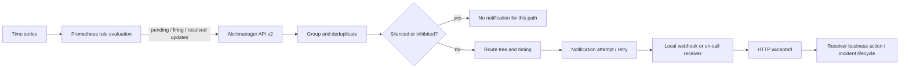
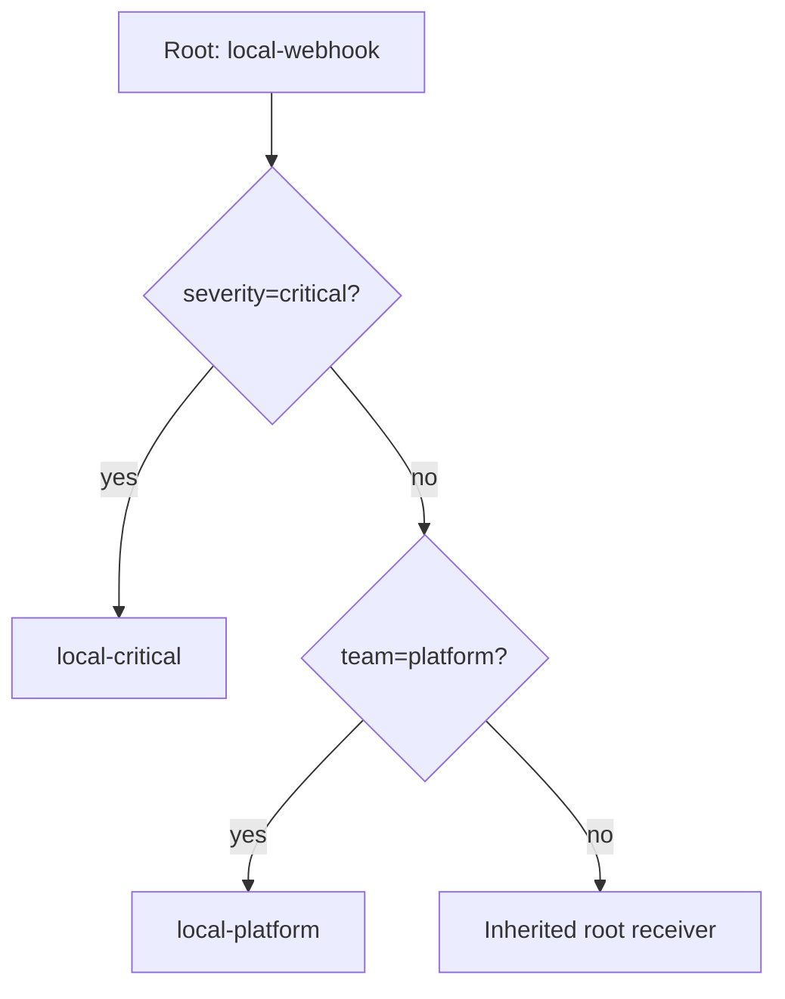
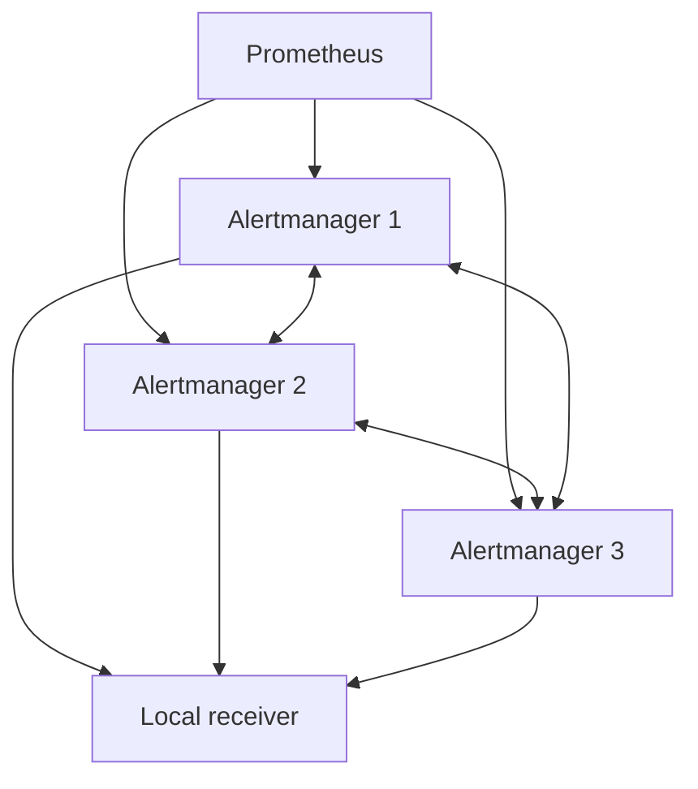
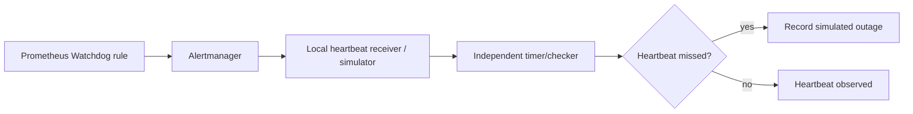

# Unit 6 — Alertmanager: Routing, Silencing, and On-Call Integration

> **Scope:** production operation of Alertmanager as notification infrastructure. Examples use synthetic data and a local-only environment. Commands and output marked **EXPECTED REPRESENTATIVE OUTPUT** are not claims of execution.

## 6.0 — Unit map, handoff, prerequisites, and completion gate

*M10 Unit 3 taught alert design, burn-rate rules, routing/inhibition/silence basics, `amtool` route tests, and the local escalation simulator. This unit covers running Alertmanager as production infrastructure: its architecture and clustering, notification integrations, templating at scale, configuration management and testing, failure modes, and integration with real on-call systems — **without repeating M10's design content.***

### What changes in this unit

M10 established why an alert should exist and the fundamentals of routing and suppression. Unit 6 asks whether the configured system can reliably deliver the right notification, preserve operational state, survive a replica or receiver failure, and prove that a configuration change is active. Prometheus (Unit 2) evaluates rules; Grafana (Unit 3) provides dashboards; Loki and tracing (Units 4–5) enrich investigations. Unit 7 correlates service dependencies, Unit 8 owns deep actionable/symptom-based alert design, and later units cover saturation, scheduled-job freshness, cost, and load testing.

### Prerequisites

- Linux shell, Docker Compose, YAML, HTTP/JSON, and basic networking.
- Completed Stage 2E M01–M10, including the M10 Unit 3 work named above.
- A local Prometheus + Alertmanager lab and synthetic alert rules.
- No cloud account, paid service, real paging credentials, or external network is required.

### Learning outcomes

By completion, you can deploy and validate Alertmanager; explain route and notification state; build a local webhook integration; test templates, silences, inhibition, and time intervals; run a three-replica local HA exercise; generate routes from ownership metadata; measure rule-to-webhook latency; detect an Alertmanager outage through an independent heartbeat; and conduct safe rollout, rollback, and incident analysis.

### L1–L4 progression

| Level | Operational capability | Evidence |
|---|---|---|
| L1 — Understand | Explain the Prometheus → Alertmanager → receiver boundary and the main stateful components. | Annotated pipeline diagram and failure table. |
| L2 — Operate | Deploy a pinned local instance, validate configuration, inspect alerts/silences, and restart safely. | `amtool check-config`, API/UI observations, state-restart record. |
| L3 — Test resilience | Exercise receiver failure, HA peer loss, time boundaries, and route regressions. | Reproducible test output and timestamps. |
| L4 — Engineer safely | Version route configuration, enforce ownership metadata, secure endpoints, and monitor notification delivery independently. | CI-style gate, rollback record, runbook, and acceptance evidence. |

**Completion gate:** pass Labs A–J; provide a route matrix with at least 30 distinct label sets; demonstrate a deliberately failing misroute test; show one-replica loss/recovery in the local HA lab; record actual rule-fire-to-webhook timestamps from your own run; prove an external heartbeat simulator detects a stopped Alertmanager; and submit the final acceptance checklist. A parser success alone does not pass the gate.

### Source discrepancies and assumptions

- **[SOURCE-REQUIRED]** The supplied generation prompt is the Unit 6 specification and requires Sections 6.0–6.15 and Labs A–J.
- **[SOURCE-REQUIRED]** The M11 sequence places Unit 6 after the OpenTelemetry lesson and before service-dependency correlation; Unit 8 owns deep alert design.
- **[ASSUMPTION]** Use Docker Compose on WSL2 Ubuntu/Linux, loopback-only published ports, synthetic alert data, and a local HTTP receiver. Keep the three-replica lab separate from the core lab to limit laptop load.
- **[VERIFY]** This lesson references the current Prometheus documentation pages consulted during generation, but no runtime binaries or Docker images were executed here. The examples use Alertmanager `v0.28.1` and Prometheus `v3.5.0` as explicit example pins, not a claim that these are the newest or mutually tested releases. Confirm image availability, flags, schemas, and security behavior before running. Use the exact same Alertmanager version for server and `amtool`.
- **Source limitation:** a relevant `Roadmap_ptree` copy and the M11 syllabus-generation prompt were found in the Library search; the complete repository checkout, all M10 materials, and all M11 sibling lesson contents were not inspected in full. This lesson therefore preserves the supplied prompt's stated boundaries without claiming full repository validation.

## 6.1 — Alertmanager’s role and the end-to-end alert pipeline

Alertmanager is a notification-processing service. It **does not evaluate Prometheus alerting expressions**. Prometheus evaluates rules, applies `for` durations, and sends alert updates to configured Alertmanager endpoints. Alertmanager then groups, deduplicates, routes, silences, inhibits, and attempts notifications.



The pipeline above is conceptual, not a claim about every internal function's exact execution order. **[VERIFY]** Internal notification-pipeline ordering and retry details must be checked against the selected release documentation and observed behavior.

| Component | Responsibility | State or evidence | Common failure |
|---|---|---|---|
| Prometheus rules | Evaluate expressions and `for` state | Rule UI/API, rule evaluation metrics/logs | Rule absent, expression false, evaluation error, delayed evaluation |
| Prometheus alert sender | POST alert updates to configured peers | Prometheus logs and alertmanager target/config | Wrong endpoint, network/TLS/auth error, only one replica selected |
| Alertmanager | Group, route, silence, inhibit, deduplicate notifications | UI/API, logs, config status, state directory | Invalid/stale config, broken route, state loss, peer partition |
| Notification integration | Deliver an HTTP/email/chat/pager request | Receiver log, response status, latency | Receiver down, slow, rejects payload, credential expired |
| Incident/on-call tool | Own acknowledgment and incident lifecycle | Its own event/ticket audit | Dedup key mismatch, callback races, false resolution |

### Labels, annotations, and alert state

- **Labels** identify the alert instance and drive routing, grouping, silence/inhibition matching, and deduplication. For example: `alertname`, `severity`, `team`, `service`, `environment`, `cluster`.
- **Annotations** add descriptive context such as `summary`, `description`, `runbook_url`, `dashboard_url`, or a query link. They should not carry secrets and generally do not identify the alert instance.
- Prometheus alerting rules can be `pending` while a `for` duration elapses, then `firing`; when the expression is no longer active, the alert can resolve. Alertmanager sees updates from Prometheus; it does not redo the PromQL evaluation.
- Distinguish five events: rule became firing; Prometheus sent it; Alertmanager received it; a receiver accepted an HTTP request; a human/system acted on the incident. Each boundary needs separate evidence.

A green Prometheus rule page proves neither that Alertmanager received the update nor that a human was paged. Likewise, HTTP 2xx means the receiver accepted the request according to its contract, not that an incident was acknowledged or resolved.

## 6.2 — Alertmanager architecture, configuration, API, UI, and state

### Mental model

A single instance is simpler and useful for a local lab, but it is a single notification-path failure domain. A cluster adds peers that exchange state; it is not a replacement for correct Prometheus fan-out, persistent storage, independent monitoring, or receiver-side idempotency.

Core configuration blocks:

- `global`: shared integration defaults and timeout behavior.
- `route`: required root route plus child routes, grouping and notification timing.
- `receivers`: named integrations referenced by routes.
- `inhibit_rules`: suppress target notifications when a source alert is active and configured equal labels agree.
- `templates`: files with reusable Go templates.
- `time_intervals`: named time windows used by route timing controls in current docs. `mute_time_intervals` is deprecated in current documentation; older versions may differ. `active_time_intervals` and exact semantics are **[VERIFY]** for the pinned release.

### Example core configuration

Intended path: `lab/alertmanager/alertmanager.yml`

```yaml
global:
  resolve_timeout: 5m

route:
  receiver: local-webhook
  group_by: [alertname, service, environment]
  group_wait: 5s
  group_interval: 30s
  repeat_interval: 4h
  routes:
    - receiver: local-critical
      matchers:
        - severity="critical"
      continue: false
    - receiver: local-platform
      matchers:
        - team="platform"

receivers:
  - name: local-webhook
    webhook_configs:
      - url: http://receiver:8080/alertmanager
        send_resolved: true
        max_alerts: 20
  - name: local-critical
    webhook_configs:
      - url: http://receiver:8080/alertmanager
        send_resolved: true
        max_alerts: 20
  - name: local-platform
    webhook_configs:
      - url: http://receiver:8080/alertmanager
        send_resolved: true
        max_alerts: 20

templates:
  - /etc/alertmanager/templates/*.tmpl
```

`max_alerts` limits how many alerts are included in the webhook payload; verify exact behavior for the chosen release. No external credentials are present. For a production route tree, replace duplicate local receivers with real receiver definitions only after secret handling, delivery tests, and ownership review.

### Route tree semantics

Every alert enters the root route, which must match all alerts. Child routes are evaluated in order. A matching child route ordinarily stops sibling traversal unless `continue: true` allows later sibling matches. Child routes inherit unspecified settings from parents. The root receiver is the fallback for alerts that do not match a child. This is a frequent place for critical alerts to be misrouted silently: test actual labels, not just the YAML.



`group_by` determines which labels distinguish notification groups. `group_wait` allows related alerts to arrive before the first notification. `group_interval` controls checks for updates in an existing group and can also bound notification execution context; overly small intervals can cancel slow receiver calls. `repeat_interval` controls reminders for an unchanged firing group. Effective defaults and timing details are version-sensitive; set them explicitly for labs and verify production choices against the pinned release.

### API, UI, and state

The current official management API documentation includes health/readiness endpoints `/-/healthy` and `/-/ready`, reload `POST /-/reload`, and Alertmanager API v2 resources including alerts and silences. **[VERIFY]** Confirm paths and API schema for the exact deployed release; do not assume a reverse proxy path prefix is irrelevant. Typical local checks:

```bash
curl -fsS http://127.0.0.1:9093/-/healthy
curl -fsS http://127.0.0.1:9093/-/ready
curl -fsS http://127.0.0.1:9093/api/v2/alerts
curl -fsS http://127.0.0.1:9093/api/v2/silences
```

Alertmanager maintains silence state and a notification log (nflog) used in notification coordination/deduplication. Persistence depends on the configured data directory, filesystem/container lifecycle, and version-specific flags. A named Docker volume surviving a container recreation is not the same as a backup, and local persistence is not cluster replication. If all replicas and their state volumes are lost, assume silences and notification history may be lost until proven otherwise.

**[VERIFY]** Confirm `--storage.path`, cluster flags, retention/state behavior, and exact defaults with `alertmanager --help` and the documentation for the selected release. Never delete a state volume as routine cleanup before recording its contents and understanding the impact.

## 6.3 — Receiver integrations and safe local webhook delivery

Webhook is the universal local integration. Email, chat, PagerDuty/Opsgenie-class systems, ticketing, and other integrations are useful awareness topics, but they are not required for these labs. A receiver should record enough synthetic metadata to correlate attempts without storing raw secrets or full sensitive payloads.

### Local receiver implementation

Intended path: `lab/receiver/app.py`

```python
from __future__ import annotations

import json
import os
import time
from http.server import BaseHTTPRequestHandler, ThreadingHTTPServer
from urllib.parse import urlparse

MODE_FILE = os.environ.get("MODE_FILE", "/tmp/receiver-mode")
TOKEN = os.environ.get("WEBHOOK_TOKEN", "local-test-token")
MAX_BODY = 1_000_000


def mode() -> str:
    try:
        value = open(MODE_FILE, encoding="utf-8").read().strip()
    except FileNotFoundError:
        value = "healthy"
    return value if value in {"healthy", "slow", "fail"} else "fail"


class Handler(BaseHTTPRequestHandler):
    server_version = "SyntheticReceiver/1.0"

    def do_POST(self) -> None:
        if urlparse(self.path).path != "/alertmanager":
            self.send_error(404)
            return
        # For the local unauthenticated lab, this is a synthetic token contract.
        # Use a proper secret manager and TLS in production.
        expected = "Bearer " + TOKEN
        if self.headers.get("Authorization") != expected:
            self.send_error(401)
            return
        try:
            length = int(self.headers.get("Content-Length", "0"))
        except ValueError:
            self.send_error(400)
            return
        if length < 0 or length > MAX_BODY:
            self.send_error(413)
            return
        raw = self.rfile.read(length)
        try:
            payload = json.loads(raw or b"{}")
        except json.JSONDecodeError:
            self.send_error(400)
            return

        current = mode()
        if current == "slow":
            time.sleep(8)  # intentionally exceeds common lab timeouts
        if current == "fail":
            self.send_response(503)
            self.end_headers()
            self.wfile.write(b"synthetic receiver failure\n")
            return

        alerts = payload.get("alerts", [])
        safe_alerts = []
        for alert in alerts[:100]:
            labels = alert.get("labels", {}) if isinstance(alert, dict) else {}
            annotations = alert.get("annotations", {}) if isinstance(alert, dict) else {}
            safe_alerts.append({
                "alertname": str(labels.get("alertname", "unknown"))[:120],
                "severity": str(labels.get("severity", "unknown"))[:32],
                "service": str(labels.get("service", "unknown"))[:120],
                "status": str(alert.get("status", "unknown"))[:20],
                "summary_present": bool(annotations.get("summary")),
            })
        event = {
            "received_unix": time.time(),
            "receiver_mode": current,
            "group_status": str(payload.get("status", "unknown"))[:20],
            "receiver": str(payload.get("receiver", "unknown"))[:80],
            "alerts": safe_alerts,
        }
        print(json.dumps(event, sort_keys=True), flush=True)
        self.send_response(202)
        self.send_header("Content-Type", "application/json")
        self.end_headers()
        self.wfile.write(b'{"accepted":true,"synthetic":true}\n')

    def log_message(self, fmt: str, *args: object) -> None:
        # Avoid logging authorization headers or arbitrary request bodies.
        print(f"http access: {self.client_address[0]} {fmt % args}", flush=True)


if __name__ == "__main__":
    ThreadingHTTPServer(("0.0.0.0", 8080), Handler).serve_forever()
```

**Important integration note:** Alertmanager's webhook integration does not automatically attach a custom `Authorization` header from the example above. To run the authenticated receiver lab, either put a local reverse proxy with auth in front of it or modify the lab contract so the receiver is intentionally unauthenticated on an isolated Compose network. Do not pretend these snippets authenticate each other automatically. The base configuration above is intended for the isolated network; Lab I covers the explicit auth contract.

A safe receiver test uses only local synthetic traffic:

```bash
# Set mode without editing code; the receiver reads this file per request.
printf 'healthy\n' > /tmp/receiver-mode
printf 'slow\n' > /tmp/receiver-mode
printf 'fail\n' > /tmp/receiver-mode
```

For containerized labs, mount a named mode file or use an equivalent controlled test endpoint. Avoid exposing a mode-changing endpoint to the network; the file is a lab-only control. HTTP 5xx, timeouts, and retries may lead to delayed or repeated deliveries. Alertmanager is not an exactly-once transport. Design receiver processing to be idempotent, for example by using a stable key derived from the receiver, alert group labels, and lifecycle state. Do not use a timestamp alone as a deduplication key.

### Fallback is a route, not a guarantee

A fallback receiver only helps if the route can select it and it is reachable, authorized, observable, and able to accept the payload. Test both the primary and fallback paths with a receiver-down drill. A notification failure metric or log is evidence of an attempt failing, not evidence that a fallback incident was successfully delivered.

## 6.4 — Actionable notification templates

Alertmanager notification templates use Go templates. The notification data commonly includes `.Receiver`, `.Status`, `.Alerts`, `.GroupLabels`, `.CommonLabels`, `.CommonAnnotations`, and `.ExternalURL`; each alert has labels, annotations, start/end timestamps, generator URL, and status. Confirm the exact data structures and available functions in the versioned official template reference before relying on additional fields.

Intended path: `lab/alertmanager/templates/notification.tmpl`

```gotemplate
{{ define "lab.alert.title" -}}
[{{ if .Status }}{{ .Status | toUpper }}{{ else }}UNKNOWN{{ end }}]
{{ with .CommonLabels.alertname }}{{ . }}{{ else }}Alert group (name unavailable){{ end }}
{{- end }}

{{ define "lab.alert.message" -}}
{{ template "lab.alert.title" . }}
Receiver: {{ .Receiver }}
Group: {{ if .GroupLabels }}{{ .GroupLabels }}{{ else }}(no group labels){{ end }}

{{ range .Alerts -}}
- Alert: {{ with .Labels.alertname }}{{ . }}{{ else }}(name unavailable){{ end }}
  Severity: {{ with .Labels.severity }}{{ . }}{{ else }}unknown{{ end }}
  Service: {{ with .Labels.service }}{{ . }}{{ else }}unknown{{ end }}
  Team: {{ with .Labels.team }}{{ . }}{{ else }}unowned{{ end }}
  Cluster: {{ with .Labels.cluster }}{{ . }}{{ else }}unspecified{{ end }}
  Summary: {{ with .Annotations.summary }}{{ . }}{{ else }}No summary supplied; inspect alert labels and rule configuration.{{ end }}
  Description: {{ with .Annotations.description }}{{ . }}{{ else }}No description supplied.{{ end }}
  Runbook: {{ with .Annotations.runbook_url }}{{ . }}{{ else }}(no runbook link){{ end }}
  Dashboard: {{ with .Annotations.dashboard_url }}{{ . }}{{ else }}(no dashboard link){{ end }}
  Query: {{ with .Annotations.query_url }}{{ . }}{{ else }}(no query link){{ end }}
  Started: {{ .StartsAt }}
  Status: {{ .Status }}
{{ end -}}

Alertmanager: {{ .ExternalURL }}
{{- end }}
```

A receiver can refer to `{{ template "lab.alert.title" . }}` and `{{ template "lab.alert.message" . }}` in integrations that expose title/message fields. For a webhook receiver, Alertmanager sends its structured JSON payload; the receiver can render the template itself only if it has the matching template implementation. Do not assume a custom text template rewrites the generic webhook JSON.

### Template safety and quality

- Missing labels must produce explicit fallbacks, not an empty critical message.
- Limit untrusted label/annotation length at the receiver boundary; avoid rendering arbitrary HTML unless the channel's escaping model is understood.
- Markdown and HTML channels have different escaping rules. Text templates and HTML templates do not have identical escaping behavior.
- Truncation should preserve the alert name, severity, service, summary, runbook, and group identity before long descriptions.
- Never place tokens in labels, annotations, dashboard links, or templates. A URL can leak a token through logs, status pages, rendered notifications, and screenshots.

**EXPECTED REPRESENTATIVE OUTPUT** (not executed):

```text
[FIRING] ApiErrorRateHigh
Receiver: local-critical
Group: map[alertname:ApiErrorRateHigh service:checkout]
- Alert: ApiErrorRateHigh
  Severity: critical
  Service: checkout
  Team: payments
  Cluster: local
  Summary: 5xx ratio is above the synthetic threshold
  Runbook: http://127.0.0.1:3000/runbooks/api-error-rate
```

Test empty/missing labels, very long values, resolved alerts, and Unicode before promoting a template. For a webhook, inspect the actual JSON fields and validate any downstream rendering separately.

## 6.5 — Time intervals, scheduled silence, and maintenance windows

A time interval is a reusable calendar window. A silence is an explicit matcher-based suppression record with a start and end time. Route timing controls can mute or activate notification behavior for a route; they do not stop Prometheus rule evaluation and do not resolve an alert.

**[VERIFY]** Current configuration documentation uses `time_intervals` and route references such as `mute_time_intervals` or `active_time_intervals`; exact fields and mutual behavior are version-sensitive. Validate the selected release's schema before using the sample in a live stack.

Illustrative interval shape (verify exact keys against the selected release):

```yaml
time_intervals:
  - name: weekday-maintenance
    time_intervals:
      - weekdays: [monday:friday]
        times:
          - start_time: "22:00"
            end_time: "23:00"
        location: "Asia/Kolkata"

route:
  receiver: local-webhook
  routes:
    - receiver: local-webhook
      matchers: ["environment=\"lab\""]
      mute_time_intervals: [weekday-maintenance]
```

The example is **[VERIFY]**, not guaranteed to parse on the example pin. Treat time-zone names as IANA identifiers. Test before, at, and after each boundary, and record UTC plus local wall-clock timestamps. Daylight-saving transitions can create skipped or repeated local times; choose a named zone, document the intended policy, and test the next transition. Do not assume the learner's laptop timezone is the policy timezone.

### Bounded boundary lab

1. Choose a named timezone explicitly; for a no-DST exercise use `Asia/Kolkata`.
2. Configure a one-hour lab interval using the version-correct syntax.
3. Send the same synthetic alert at `21:59`, `22:00`, and `23:00` local time, including UTC timestamps in the evidence log.
4. Compare the route's timing behavior with a silence using an explicit matcher and finite end time.
5. Repeat with a timezone that observes daylight saving only if the environment and chosen release can be tested safely.

**Success:** the expected behavior at each boundary is documented from actual observations, and the learner can explain that muted notification behavior is not alert resolution. Do not use a clock change on the host as a test shortcut; inject fixed timestamps or schedule controlled tests.

## 6.6 — Safe silence management and governance

A silence is a stateful suppression record, not a maintenance ticket and not a fix. Require all of the following: one or more explicit matchers, a named owner, a reason/comment, a ticket-like reference, a finite start/end time, and a reviewable change trail. The local policy below prohibits matcher-less silences. It also reports potentially broad matchers rather than automatically deleting records.

### API examples

**[VERIFY]** Alertmanager API v2 uses `/api/v2/silences` in current documentation. Verify the exact response schema, matcher representation, and `amtool` flags for the pinned release.

```bash
# Read-only listing; keep the response as evidence.
curl -fsS http://127.0.0.1:9093/api/v2/silences | python -m json.tool

# Inspect alert state; do not use API write calls against production in this lab.
curl -fsS http://127.0.0.1:9093/api/v2/alerts | python -m json.tool
```

Create a silence through the local UI for the lab, with matchers such as `alertname=ApiErrorRateHigh` and `environment=lab`, an owner/comment, and a short finite expiry. Avoid posting guessed JSON: request/response schemas should be taken from the exact API specification for the chosen version. `amtool silence add`, `amtool silence query`, and `amtool silence expire` are useful commands, but **[VERIFY]** the exact flags with `amtool --help` and `amtool silence --help` before running them.

### Silence audit script

Intended path: `lab/scripts/audit_silences.py`

```python
from __future__ import annotations

import argparse
import json
import re
import sys
import time
import urllib.error
import urllib.request
from datetime import datetime, timezone
from typing import Any

BROAD_LABELS = {"alertname", "service", "team", "severity", "environment", "cluster"}


def get_json(url: str, timeout: float = 3.0) -> Any:
    request = urllib.request.Request(url, headers={"Accept": "application/json"})
    with urllib.request.urlopen(request, timeout=timeout) as response:
        return json.loads(response.read())


def parse_time(value: str | None) -> float | None:
    if not value:
        return None
    try:
        return datetime.fromisoformat(value.replace("Z", "+00:00")).timestamp()
    except ValueError:
        return None


def matcher_text(m: dict[str, Any]) -> str:
    name = str(m.get("name", ""))
    value = str(m.get("value", ""))
    is_regex = bool(m.get("isRegex", False))
    is_equal = bool(m.get("isEqual", True))
    op = "=~" if is_regex and is_equal else "!~" if is_regex else "=" if is_equal else "!="
    return f"{name}{op}{value}"


def findings(silence: dict[str, Any], now: float) -> list[str]:
    out: list[str] = []
    sid = str(silence.get("id", "unknown"))
    matchers = silence.get("matchers") or []
    comment = str((silence.get("comment") or "")).strip()
    created_by = str((silence.get("createdBy") or "")).strip()
    starts = parse_time(silence.get("startsAt"))
    ends = parse_time(silence.get("endsAt"))
    status = silence.get("status") or {}
    if not matchers:
        out.append("matcher-less")
    if not created_by:
        out.append("missing-owner")
    if not comment:
        out.append("missing-comment/reason")
    if ends is None:
        out.append("missing-or-invalid-expiry")
    elif ends <= now:
        out.append("expired-record")
    elif starts is not None and ends - starts > 24 * 3600:
        out.append("long-duration-over-24h")
    if status.get("state") == "active" and not matchers:
        out.append("active-broad-suppression")
    for m in matchers:
        name = str(m.get("name", ""))
        value = str(m.get("value", ""))
        is_regex = bool(m.get("isRegex", False))
        is_equal = bool(m.get("isEqual", True))
        if name not in BROAD_LABELS:
            out.append(f"review-unexpected-matcher-label:{name or '<empty>'}")
        if is_regex and value in {".*", ".+", "^.*$", "^.+$"}:
            out.append(f"over-broad-regex:{name}")
        if is_equal and value == "" and not is_regex:
            out.append(f"empty-equality-value:{name}")
    return sorted(set(out))


def main() -> int:
    p = argparse.ArgumentParser(description="Read-only Alertmanager silence governance audit")
    p.add_argument("--url", default="http://127.0.0.1:9093/api/v2/silences")
    p.add_argument("--fixture", help="read synthetic JSON array instead of calling an API")
    p.add_argument("--now", type=float, default=time.time(), help="epoch override for deterministic tests")
    p.add_argument("--apply", action="store_true", help="reserved; this script never mutates silences")
    p.add_argument("--confirm", help="reserved explicit target confirmation; mutation is not implemented")
    args = p.parse_args()
    if args.apply:
        print("ERROR: this audit tool is read-only; use a separately reviewed narrow mutation workflow", file=sys.stderr)
        return 2
    try:
        if args.fixture:
            with open(args.fixture, encoding="utf-8") as f:
                data = json.load(f)
        else:
            data = get_json(args.url)
    except (OSError, ValueError, urllib.error.URLError, TimeoutError) as exc:
        print(f"ERROR: unable to load silence data: {exc}", file=sys.stderr)
        return 2
    if not isinstance(data, list):
        print("ERROR: expected a JSON array of silence objects", file=sys.stderr)
        return 2
    failed = 0
    for item in data:
        if not isinstance(item, dict):
            print("ERROR: skipping non-object fixture row", file=sys.stderr)
            failed += 1
            continue
        issues = findings(item, args.now)
        if issues:
            failed += 1
            print(f"FINDING id={item.get('id', 'unknown')} issues={','.join(issues)} matchers={[matcher_text(m) for m in item.get('matchers') or []]}")
        else:
            print(f"OK id={item.get('id', 'unknown')} policy checks passed")
    print(f"SUMMARY total={len(data)} flagged={failed} mode=report-only")
    return 1 if failed else 0


if __name__ == "__main__":
    raise SystemExit(main())
```

This script is intentionally read-only. It detects obvious broadness signals; it cannot prove that a regex or a matcher set is semantically safe. Review exact matcher semantics against the API response schema. The script accepts synthetic fixtures so the policy can be unit-tested without a running Alertmanager.

### Synthetic fixture and tests

Intended path: `lab/fixtures/silences.json`

```json
[
  {"id":"S-001","createdBy":"learner","comment":"CHG-101 planned restart","startsAt":"2026-10-28T20:00:00Z","endsAt":"2026-10-28T20:30:00Z","status":{"state":"active"},"matchers":[{"name":"alertname","value":"SyntheticMaintenance","isRegex":false,"isEqual":true}]},
  {"id":"S-002","createdBy":"","comment":"","startsAt":"2026-10-01T00:00:00Z","endsAt":"2027-10-01T00:00:00Z","status":{"state":"active"},"matchers":[]},
  {"id":"S-003","createdBy":"learner","comment":"broad test","startsAt":"2026-10-28T00:00:00Z","endsAt":"2026-10-30T00:00:00Z","status":{"state":"active"},"matchers":[{"name":"service","value":".*","isRegex":true,"isEqual":true}]}
]
```

```bash
python lab/scripts/audit_silences.py --fixture lab/fixtures/silences.json --now 1793217600
```

**EXPECTED REPRESENTATIVE OUTPUT:** S-001 should be OK only if the fixed `--now` falls inside its finite interval and the API-style fixture meets the script's checks; S-002 should flag matcher-less, missing owner/comment, and long duration; S-003 should flag over-broad regex and long duration. Because timestamps and current time matter, run with a chosen epoch and record the exact value in your evidence.

### Broad silence masking drill

1. Create a synthetic firing alert `SyntheticMaintenance` with `environment=lab` and `service=checkout`.
2. Create a broad matcher-less silence only in an isolated fixture or disposable local lab, not as a recommended operational action. If your local UI prevents it, demonstrate the policy rejection using the fixture instead.
3. Observe that a matching active silence can suppress notifications while the alert remains firing.
4. Replace the broad suppression with explicit matchers, owner, reason, and a finite expiry; verify a distinct critical alert is no longer matched by the silence.
5. Save the alert API response, silence audit report, and timestamps. Never leave the broad silence active after the lab.

## 6.7 — HA clustering, gossip, Prometheus fan-out, and replica failure

Alertmanager clustering lets instances exchange state, including information relevant to silences and notification coordination. Do not describe the protocol as a conventional quorum system unless the selected implementation/documentation supports that claim. A cluster is only useful when peers can discover and communicate with each other and Prometheus sends alert updates to all Alertmanager peers.

**Critical topology rule:** configure Prometheus with the list of all Alertmanager peers; do not put a load balancer between Prometheus and the Alertmanager replicas as the only target. With a load balancer, each update may reach only one replica, so peer-local receipt/state and notification behavior can diverge, causing missed or duplicate notifications depending on failure and timing.



### Three-replica local lab

**[ASSUMPTION]** Use a dedicated Compose project and run it separately from the rest of the observability stack. The example below shows the topology and version pin; verify peer flags and port mappings with the selected image's `--help` before use.

Intended path: `lab/ha/compose.yml`

```yaml
services:
  receiver:
    image: python:3.12-slim
    command: ["python", "/app/receiver.py"]
    volumes:
      - ./receiver.py:/app/receiver.py:ro
    ports:
      - "127.0.0.1:8088:8080"
    networks: [amnet]

  alertmanager-1:
    image: prom/alertmanager:v0.28.1
    command:
      - --config.file=/etc/alertmanager/alertmanager.yml
      - --storage.path=/alertmanager
      - --web.listen-address=0.0.0.0:9093
      - --cluster.listen-address=0.0.0.0:9094
      - --cluster.peer=alertmanager-2:9094
      - --cluster.peer=alertmanager-3:9094
    volumes:
      - ./alertmanager.yml:/etc/alertmanager/alertmanager.yml:ro
      - am1:/alertmanager
    ports: ["127.0.0.1:9093:9093"]
    networks: [amnet]

  alertmanager-2:
    image: prom/alertmanager:v0.28.1
    command:
      - --config.file=/etc/alertmanager/alertmanager.yml
      - --storage.path=/alertmanager
      - --web.listen-address=0.0.0.0:9093
      - --cluster.listen-address=0.0.0.0:9094
      - --cluster.peer=alertmanager-1:9094
      - --cluster.peer=alertmanager-3:9094
    volumes:
      - ./alertmanager.yml:/etc/alertmanager/alertmanager.yml:ro
      - am2:/alertmanager
    ports: ["127.0.0.1:9095:9093"]
    networks: [amnet]

  alertmanager-3:
    image: prom/alertmanager:v0.28.1
    command:
      - --config.file=/etc/alertmanager/alertmanager.yml
      - --storage.path=/alertmanager
      - --web.listen-address=0.0.0.0:9093
      - --cluster.listen-address=0.0.0.0:9094
      - --cluster.peer=alertmanager-1:9094
      - --cluster.peer=alertmanager-2:9094
    volumes:
      - ./alertmanager.yml:/etc/alertmanager/alertmanager.yml:ro
      - am3:/alertmanager
    ports: ["127.0.0.1:9096:9093"]
    networks: [amnet]

networks:
  amnet:
    internal: true
volumes:
  am1: {}
  am2: {}
  am3: {}
```

**[VERIFY]** The exact `--cluster.*` flags and listen-address semantics must be checked against `prom/alertmanager:v0.28.1` before using this Compose file. The example is a topology template, not runtime-validated deployment. The receiver service code from Section 6.3 can be adapted for port 8080 and must use a local-only test contract.

Intended path: `lab/ha/alertmanager.yml`

```yaml
global:
  resolve_timeout: 2m
route:
  receiver: local
  group_by: [alertname, service]
  group_wait: 2s
  group_interval: 10s
  repeat_interval: 1h
receivers:
  - name: local
    webhook_configs:
      - url: http://receiver:8080/alertmanager
        send_resolved: true
```

Prometheus-side configuration should list all peers directly (for a Compose network, the service names and port may be internal):

```yaml
alerting:
  alertmanagers:
    - static_configs:
        - targets:
            - alertmanager-1:9093
            - alertmanager-2:9093
            - alertmanager-3:9093
```

### Test plan and acceptance

1. Start the dedicated HA stack and capture each replica's startup log, peer status evidence, and health endpoints.
2. Send one synthetic alert repeatedly from Prometheus to the full peer list. Record which replicas report receipt and the number of receiver events. Do not assume exact duplicate counts before observing the pinned version.
3. Stop replica 2 only: `docker compose -f lab/ha/compose.yml stop alertmanager-2`.
4. Send a new alert; check remaining peers and receiver events. Restart replica 2, then observe peer rejoin and state synchronization.
5. Create a short silence, restart one instance, and verify state visibility on peers. Repeat after stopping all replicas and preserving volumes; do not delete volumes for this test.
6. For the negative demonstration, configure a throwaway Prometheus target pointing to a simple load-balanced endpoint that forwards each POST to only one replica. Compare delivery and state behavior with direct fan-out. Do not keep this topology as the recommended design.

**EXPECTED REPRESENTATIVE OUTPUT:** remaining peers should remain reachable after one replica stops; exact notifications, convergence time, and duplicate behavior must be measured on the learner's version and environment. Three running containers alone do not prove HA. Record CPU/RAM/disk for your laptop and stop this stack after evidence capture.

## 6.8 — Routing-as-code, ownership metadata, and CI-style validation

Route configuration should be generated or validated from a small ownership source so team/service mapping does not drift across runbooks, dashboards, and receivers. The source below is deliberately synthetic and minimal.

Intended path: `lab/routing/ownership.json`

```json
{
  "default_receiver": "local-default",
  "teams": {
    "platform": {"receiver": "local-platform", "runbook_base": "http://127.0.0.1:3000/runbooks"},
    "payments": {"receiver": "local-payments", "runbook_base": "http://127.0.0.1:3000/runbooks"},
    "data": {"receiver": "local-data", "runbook_base": "http://127.0.0.1:3000/runbooks"}
  },
  "services": {
    "node-exporter": {"team": "platform", "dashboard": "http://127.0.0.1:3000/d/platform"},
    "checkout": {"team": "payments", "dashboard": "http://127.0.0.1:3000/d/checkout"},
    "feature-pipeline": {"team": "data", "dashboard": "http://127.0.0.1:3000/d/feature-pipeline"}
  },
  "receivers": ["local-default", "local-platform", "local-payments", "local-data", "local-critical", "local-fallback"]
}
```

Intended path: `lab/routing/generate_config.py`

```python
from __future__ import annotations
import json
import sys
from pathlib import Path

SEVERITIES = {"info", "warning", "critical"}


def load(path: str) -> dict:
    try:
        data = json.loads(Path(path).read_text(encoding="utf-8"))
    except (OSError, json.JSONDecodeError) as exc:
        raise SystemExit(f"input error: {exc}")
    if not isinstance(data, dict):
        raise SystemExit("input must be a JSON object")
    for key in ("teams", "services", "receivers"):
        if key not in data:
            raise SystemExit(f"missing key: {key}")
    known_receivers = set(data["receivers"])
    if data.get("default_receiver") not in known_receivers:
        raise SystemExit("default_receiver is not declared")
    for team, value in data["teams"].items():
        if value.get("receiver") not in known_receivers:
            raise SystemExit(f"team {team}: receiver not declared")
    for service, value in data["services"].items():
        if value.get("team") not in data["teams"]:
            raise SystemExit(f"service {service}: unknown team")
    return data


def render(data: dict) -> str:
    lines = [
        "global:", "  resolve_timeout: 5m", "route:",
        f"  receiver: {data['default_receiver']}",
        "  group_by: [alertname, service, environment]",
        "  group_wait: 5s", "  group_interval: 30s", "  repeat_interval: 4h",
        "  routes:",
        "    - receiver: local-critical",
        '      matchers: [\'severity="critical"\']',
        "      continue: false"
    ]
    for team in sorted(data["teams"]):
        receiver = data["teams"][team]["receiver"]
        lines.extend([f"    - receiver: {receiver}", f'      matchers: [\'team="{team}"\']'])
    lines.append("receivers:")
    for receiver in sorted(set(data["receivers"])):
        lines.extend([f"  - name: {receiver}", "    webhook_configs:",
                      "      - url: http://receiver:8080/alertmanager", "        send_resolved: true"])
    return "\n".join(lines) + "\n"


if __name__ == "__main__":
    if len(sys.argv) != 3:
        raise SystemExit("usage: generate_config.py ownership.json output.yml")
    source = load(sys.argv[1])
    Path(sys.argv[2]).write_text(render(source), encoding="utf-8")
    print(f"generated {sys.argv[2]} from validated ownership metadata")
```

This example validates ownership and receiver references but intentionally does not generate every service annotation; that data can be consumed by the rule/config review pipeline. The generator's output is deterministic because keys and receiver names are sorted. A real implementation should use a YAML library and a serializer rather than hand-assembling YAML when values can contain arbitrary characters.

### Routing matrix: 36 explicit cases

The matrix tests route policy independently of config parsing. Here `critical` is the first matching child, team routes are next, and everything else falls through to `local-default`. `unknown` team names intentionally fall through unless a policy explicitly rejects them. These are expected policy outcomes, not results from `amtool`.

| # | team | service | severity | environment | expected receiver |
|---:|---|---|---|---|---|
| 1 | platform | node-exporter | info | dev | local-platform |
| 2 | platform | node-exporter | warning | dev | local-platform |
| 3 | platform | node-exporter | critical | dev | local-critical |
| 4 | platform | node-exporter | info | staging | local-platform |
| 5 | platform | node-exporter | warning | staging | local-platform |
| 6 | platform | node-exporter | critical | staging | local-critical |
| 7 | platform | node-exporter | info | prod | local-platform |
| 8 | platform | node-exporter | warning | prod | local-platform |
| 9 | platform | node-exporter | critical | prod | local-critical |
| 10 | payments | checkout | info | dev | local-payments |
| 11 | payments | checkout | warning | dev | local-payments |
| 12 | payments | checkout | critical | dev | local-critical |
| 13 | payments | checkout | info | staging | local-payments |
| 14 | payments | checkout | warning | staging | local-payments |
| 15 | payments | checkout | critical | staging | local-critical |
| 16 | payments | checkout | info | prod | local-payments |
| 17 | payments | checkout | warning | prod | local-payments |
| 18 | payments | checkout | critical | prod | local-critical |
| 19 | data | feature-pipeline | info | dev | local-data |
| 20 | data | feature-pipeline | warning | dev | local-data |
| 21 | data | feature-pipeline | critical | dev | local-critical |
| 22 | data | feature-pipeline | info | staging | local-data |
| 23 | data | feature-pipeline | warning | staging | local-data |
| 24 | data | feature-pipeline | critical | staging | local-critical |
| 25 | data | feature-pipeline | info | prod | local-data |
| 26 | data | feature-pipeline | warning | prod | local-data |
| 27 | data | feature-pipeline | critical | prod | local-critical |
| 28 | unknown | checkout | info | prod | local-default |
| 29 | unknown | checkout | critical | prod | local-critical |
| 30 | payments | unknown-service | warning | prod | local-payments |
| 31 | payments | unknown-service | critical | prod | local-critical |
| 32 | missing-team | mystery | info | test | local-default |
| 33 | missing-team | mystery | warning | test | local-default |
| 34 | missing-team | mystery | critical | test | local-critical |
| 35 | platform | node-exporter | warning | maintenance | local-platform (muted if interval applies) |
| 36 | payments | checkout | critical | maintenance | local-critical (critical route should be separately reviewed for maintenance policy) |

A production policy may reject unknown team/service metadata in CI rather than silently defaulting. Decide and test that behavior explicitly. Do not confuse a route matrix's expected policy with a proof that Alertmanager chose that route.

### Route test and CI-style shell gate

Intended path: `lab/routing/ci-check.sh`

```bash
#!/usr/bin/env bash
set -euo pipefail

AMTOOL_BIN="${AMTOOL_BIN:-amtool}"
CONFIG="${CONFIG:-lab/alertmanager/alertmanager.yml}"
OWNERSHIP="${OWNERSHIP:-lab/routing/ownership.json}"
GENERATED="${GENERATED:-/tmp/alertmanager.generated.yml}"

python lab/routing/generate_config.py "$OWNERSHIP" "$GENERATED"
"$AMTOOL_BIN" check-config "$CONFIG"
"$AMTOOL_BIN" check-config "$GENERATED"
# Route-test syntax differs by release; inspect `amtool test rules --help` and
# `amtool config routes --help` for the pinned binary before adding route tests.
python lab/routing/test_matrix.py
printf 'CI gate passed: generator, config parsing, and policy matrix\n'
```

Intended path: `lab/routing/test_matrix.py`

```python
from itertools import product

TEAMS = {"platform": "local-platform", "payments": "local-payments", "data": "local-data"}
CASES = []
for team, service, severity, env in product(
    ["platform", "payments", "data"],
    ["node-exporter", "checkout", "feature-pipeline"],
    ["info", "warning", "critical"],
    ["dev", "staging", "prod"],
):
    expected = "local-critical" if severity == "critical" else TEAMS[team]
    CASES.append(({"team": team, "service": service, "severity": severity, "environment": env}, expected))
CASES.extend([
    ({"team": "unknown", "service": "checkout", "severity": "info", "environment": "prod"}, "local-default"),
    ({"team": "unknown", "service": "checkout", "severity": "critical", "environment": "prod"}, "local-critical"),
    ({"team": "payments", "service": "unknown-service", "severity": "warning", "environment": "prod"}, "local-payments"),
])


def expected_route(labels: dict[str, str]) -> str:
    if labels.get("severity") == "critical":
        return "local-critical"
    return TEAMS.get(labels.get("team", ""), "local-default")


def main() -> int:
    failures = []
    for index, (labels, expected) in enumerate(CASES, start=1):
        actual = expected_route(labels)
        if actual != expected:
            failures.append((index, labels, expected, actual))
    print(f"cases={len(CASES)} failures={len(failures)}")
    for row in failures:
        print("FAIL", row)
    return 1 if failures else 0


if __name__ == "__main__":
    raise SystemExit(main())
```

The policy test above uses a pure-Python reference function. It is useful but does **not** invoke Alertmanager's actual route tree. A full integration test must submit synthetic alerts to the running service and inspect the chosen receiver or observed receiver event. `amtool check-config` proves syntax/schema compatibility for the binary; it does not prove semantic correctness, delivery, or HA. Route-test CLI capabilities vary, so confirm exact commands using the pinned `amtool` help and test actual behavior in the lab.

**Planted misroute exercise:** temporarily change the critical route matcher to `severity="critcal"`. The policy reference test will not catch a typo in a YAML file it does not read; the integration smoke test must. Add a test that compares generated policy to actual route behavior, run it, capture the failing case, then restore `severity="critical"`. Do not report a pass until the live integration test fails before the fix and passes after it.

## 6.9 — Inhibition, grouping, deduplication, and routing interactions

Inhibition suppresses notifications for target alerts when a source alert is present and the configured `equal` labels agree. It does not resolve the target alert and does not stop its Prometheus rule from evaluating. Equality labels are a common source of mistakes: if `cluster` is expected to match but is missing from both alerts, behavior can differ from the operator's intention. Explicitly test missing labels and the selected version's semantics.

Illustrative rule:

```yaml
inhibit_rules:
  - source_matchers: ["alertname=\"NodeUnreachable\""]
    target_matchers: ["severity=\"warning\""]
    equal: [cluster, node]
```

This is only safe if the source alert identifies the intended node/cluster and the target set is constrained enough. A broad source matcher can suppress unrelated symptoms. Test a root-cause alert and at least two dependent symptom alerts, including one with a missing equality label.

### Synthetic fixture

| alertname | severity | cluster | node | expected effect |
|---|---|---|---|---|
| NodeUnreachable | critical | lab-a | node-7 | Root cause remains visible |
| NodeDiskPressure | warning | lab-a | node-7 | Inhibited while matching source is firing |
| ApiLatencyHigh | warning | lab-a | node-8 | Not inhibited because `node` differs |
| QueueBacklogHigh | warning | missing | missing | Must be explicitly tested; do not assume missing equality labels are safe |

Grouping reduces notification volume by collecting alerts sharing `group_by` labels. Deduplication prevents repeated delivery of the same alert group under relevant conditions, but does not mean every distinct alert is one notification, nor does it guarantee exactly-once receiver processing. Alert fingerprints are derived from labels; changing labels can create a new alert identity. A duplicate notification is a repeated receiver event; a duplicate alert is a second alert identity or source update. They are different failure classes.

Operational checks:

- Inspect actual group labels and notification count during a synthetic burst.
- Vary one label included in `group_by`; observe group separation.
- Vary an annotation only; observe whether identity/grouping changes in your version.
- Trigger source and target alerts together, then stop the source while keeping the target firing; verify the target can become notification-eligible again.
- Test an intentionally over-broad inhibition rule and verify that the root alert remains independently visible.

## 6.10 — Notification latency, failures, and delivery meta-monitoring

Decompose end-to-end delay into distinct intervals:

1. Prometheus evaluation cadence and any rule `for` duration.
2. Prometheus delivery to Alertmanager.
3. Alertmanager `group_wait` for a new group.
4. Notification attempt and any retries/backoff.
5. Receiver processing time and HTTP response.
6. Downstream incident creation/acknowledgment, which is outside Alertmanager's delivery guarantee.

Measure with timestamps from the learner's own run. Do not substitute example numbers for a benchmark.

### Timestamp evidence collector

Intended path: `lab/scripts/measure_delivery.py`

```python
from __future__ import annotations
import json
import sys
import time
from pathlib import Path

# Append one event per line. `rule_fired_unix` should be captured by the
# learner's test harness at the moment the synthetic rule is known firing.
# `receiver_unix` is taken from the local receiver log. This tool computes only
# the difference between supplied timestamps; it does not infer missing stages.


def main() -> int:
    if len(sys.argv) != 2:
        print("usage: measure_delivery.py evidence.jsonl", file=sys.stderr)
        return 2
    rows = []
    for line_no, line in enumerate(Path(sys.argv[1]).read_text(encoding="utf-8").splitlines(), 1):
        if not line.strip():
            continue
        try:
            row = json.loads(line)
            fired = float(row["rule_fired_unix"])
            received = float(row["receiver_unix"])
        except (ValueError, KeyError, TypeError, json.JSONDecodeError) as exc:
            print(f"line {line_no}: invalid event: {exc}", file=sys.stderr)
            return 2
        if received < fired:
            print(f"line {line_no}: receiver timestamp precedes rule timestamp; check clock source", file=sys.stderr)
            return 2
        rows.append(received - fired)
    if not rows:
        print("no measurements", file=sys.stderr)
        return 2
    ordered = sorted(rows)
    print(json.dumps({"samples": len(rows), "min_seconds": min(rows),
                      "median_seconds": ordered[len(ordered)//2],
                      "max_seconds": max(rows), "source": "learner-captured timestamps"}, sort_keys=True))
    return 0


if __name__ == "__main__":
    raise SystemExit(main())
```

Use a JSON Lines file such as:

```json
{"rule_fired_unix": 1793217600.0, "receiver_unix": 1793217606.2}
```

The timestamp values above are **[ILLUSTRATIVE]**, not measurements. For reliable evidence, record the rule transition from Prometheus and receiver receipt from its log with a synchronized clock. If the two events are measured on different machines, clock skew can corrupt the estimate. Include sample count and test conditions; a small lab run is not a production SLO.

### Receiver-down drill and self-monitoring

- Switch the local receiver to `fail`; fire a new synthetic alert; capture Alertmanager logs/metrics and receiver 503s.
- Switch it to `slow`; observe the effects of receiver latency and configured timeouts.
- Restore `healthy`; verify whether the notification is retried, sent later, or remains absent. Count observed events instead of assuming delivery guarantees.
- Exercise a fallback route by configuring a second local receiver and explicitly testing that the fallback can accept the same test notification.

**[VERIFY]** Alertmanager metric names and labels are version-sensitive. Inspect `/metrics` from the pinned binary and its official documentation before writing recording/alert rules. Do not invent a metric name based on intuition. Monitor at least: failed notification attempts, notification latency, config reload errors, process availability, peer health, state-directory/volume health, and receiver availability. Exporters and external monitors should not rely only on the service being monitored.

### Watchdog + external heartbeat

A `Watchdog` alert is commonly designed to remain firing continuously so an independent system can detect a missing heartbeat. The important property is independence: if the only heartbeat receiver runs inside Alertmanager or inside the same failed process/container boundary, it cannot reliably report that process's death.



Lab H implements the checker as a separate process/container that records the last received heartbeat and flags a timeout. It is a local simulation, not a genuinely independent production region or third-party monitoring path. In production, place the heartbeat receiver and notification path in a failure domain that Alertmanager cannot take down by itself.

## 6.11 — Integration with on-call and incident tooling

Alertmanager routes notifications. Incident tooling owns incident lifecycle, acknowledgment, assignment, deduplication policy, and resolution. Prometheus owns rule evaluation. Keep these ownership boundaries explicit so a notification callback cannot accidentally become source truth for an alert.

Illustrative synthetic webhook event for a downstream ticket/pager adapter:

```json
{
  "event_type": "alert.notification",
  "idempotency_key": "local:payments:checkout:ApiErrorRateHigh:firing",
  "source": "alertmanager-lab",
  "status": "firing",
  "owner": "payments",
  "environment": "lab",
  "cluster": "local",
  "alert": {
    "name": "ApiErrorRateHigh",
    "severity": "critical",
    "summary": "Synthetic checkout error rate above threshold",
    "description": "Generated for local integration testing only"
  },
  "links": {
    "runbook": "http://127.0.0.1:3000/runbooks/api-error-rate",
    "dashboard": "http://127.0.0.1:3000/d/checkout",
    "query": "http://127.0.0.1:9090/graph"
  },
  "timestamps": {"starts_at": "2026-10-28T20:00:00Z", "received_at": "2026-10-28T20:00:05Z"}
}
```

This is an illustrative adapter contract, not Alertmanager's native webhook payload schema. An adapter must explicitly map Alertmanager's payload into this shape and validate fields, size limits, and allowed URL schemes/hosts. Idempotency should use a stable alert/group identity plus lifecycle state; store processed keys with a bounded retention policy. A repeated request with the same key should return a successful response without creating a second incident.

Acknowledgment and resolution callbacks are awareness topics. Acknowledgment should not create a silence unless an explicit policy requests one. Resolution should be based on authoritative alert/incident state, not solely on a stale callback. **[VERIFY]** Vendor callback signatures, API routes, event ordering, and idempotency behavior must be validated against that vendor's current API docs before implementation. These labs never create a real incident or send a real page.

## 6.12 — Configuration management, reloads, persistence, upgrade, and rollback

Treat Alertmanager configuration like application code: version it, review diffs, pin binaries, validate syntax, test route semantics, test templates, smoke-test delivery, deploy in stages, and retain a rollback candidate.

A failed reload may leave the previously loaded configuration active. The file on disk and the active config are not necessarily identical. Verify with logs, configuration/status endpoints available in the selected release, and a synthetic smoke alert after reload.

### Safe rollout sequence

1. Build a change from a known-good commit; show a minimal diff.
2. Run `amtool check-config` using the exact matching version.
3. Run template tests, the 30+ label matrix, and the integration smoke test.
4. Apply to one canary instance or a disposable local stack. Confirm active configuration and send a synthetic test alert.
5. Roll through remaining instances only after observing route and notification evidence.
6. If any validation fails, restore the previous known-good config and reload/restart as appropriate for the release.
7. Verify the rollback by checking the active configuration and sending a smoke alert.

### Reload example

```bash
# Validate first. This does not prove the live process loaded the file.
amtool check-config lab/alertmanager/alertmanager.yml

# Only enable/rely on lifecycle reload if supported and appropriately protected.
curl -fsS -X POST http://127.0.0.1:9093/-/reload

# Immediately inspect logs/status and send a synthetic smoke notification.
```

**[VERIFY]** The reload endpoint and lifecycle exposure must be checked for the exact release. Do not expose reload controls to untrusted networks. A `curl` success alone does not prove the intended config was loaded.

### Persistence and upgrade rehearsal

- Mount a named data volume or persistent host path and record its exact mapping.
- Create a finite silence, restart a single instance, and check that the silence remains as expected.
- Back up config, templates, and state with a documented consistent procedure; avoid copying live files without understanding consistency requirements.
- Rehearse upgrades in a disposable environment: validate config, check deprecations, review release notes, verify `amtool` compatibility, test route behavior, check peer protocol compatibility, and confirm state migration/recovery.
- Do not run mixed versions in a cluster unless the official upgrade guidance explicitly supports that rollout sequence.
- Keep GitOps and repository promotion details in M08; this unit's concern is the Alertmanager-specific validation and rollback gate.

## 6.13 — Security and privacy

Alertmanager's UI/API can expose alert labels, annotations, silence details, receiver configuration status, and operational metadata. An unauthenticated API can be used to submit spoofed alerts or change silences if network controls allow it. Keep it private by default.

### Security controls

- Bind local labs to `127.0.0.1` on the host; keep internal service-to-service ports on an isolated network.
- In production, use a trusted reverse proxy or supported web configuration for TLS and authentication, plus network policy/firewall restrictions. **[VERIFY]** The exact `--web.config.file` schema and supported auth/TLS features for the selected release must be taken from the official web configuration documentation.
- Protect `/-/reload`, management APIs, and write-capable silence endpoints. A health endpoint can be unauthenticated only when the network boundary makes that an intentional choice.
- Never commit credentials in YAML, templates, screenshots, labels, or shell history. Prefer secret files/secret manager mounts over hardcoded literals. Environment variables can leak through process inspection and crash/debug output; evaluate the deployment environment.
- Treat labels and annotations as untrusted text. Bound payload size, escape channel-specific output, and allowlist link schemes/hosts in downstream adapters.
- Redact authorization headers, tokens, email addresses, customer identifiers, and URL query strings before logging.
- Rotate synthetic lab tokens as part of the exercise; production rotation must be rehearsed without causing an alert-delivery gap.

### Local-only web security example

A web configuration can support TLS/basic authentication in supported versions, but the exact YAML schema and password-hash requirements are version-sensitive. Do not paste a guessed `web.yml` into a production service. Use the official Prometheus web configuration documentation for the exact selected binary, create a synthetic test credential, verify authenticated access and negative unauthenticated access, then remove the test credential securely.

If you cannot validate the schema locally, the safe lab fallback is loopback-only binding and no untrusted network exposure; this is a lab simplification, **not production security**.

### Negative tests

- From an unauthorized client/network, attempt `GET /api/v2/alerts`, `GET /api/v2/silences`, and a silence write operation against the protected endpoint. Expect denial according to the configured auth/network policy.
- Verify that the same request with the synthetic authorized credential succeeds.
- Confirm logs do not contain the token or `Authorization` header.
- Submit a label with a long string and HTML-like characters; verify downstream rendering is bounded and escaped.
- Simulate an expired synthetic credential by configuring the receiver adapter to reject the old token and accept the rotated token; ensure the failure is visible to monitoring.

## 6.14 — Incident analysis, failure modes, and runbooks

For every incident, first preserve evidence: UTC timestamps, config commit/hash, Alertmanager/Prometheus logs, API snapshots, receiver events, and the smallest relevant diff. Do not delete state or repeatedly restart services before recording what changed.

| # | Symptoms | Likely causes and discriminating test | Immediate mitigation | Durable fix / prevention |
|---:|---|---|---|---|
| 1. Matcher-less maintenance silence never expires | Alert remains firing but no notification | Inspect `/api/v2/silences`, matchers, owner/comment, start/end; reproduce with synthetic alert | Expire/remove the specific silence through reviewed UI/API action | Policy rejects matcher-less silences; require owner, reason, ticket, finite expiry; scheduled audit |
| 2. Prometheus targets LB in front of replicas | Missing or duplicate notifications; inconsistent peer state | Compare Prometheus target list and per-replica receipt logs; bypass LB in lab | Configure Prometheus with all peers directly | CI topology test and peer/receiver evidence during upgrade |
| 3. Receiver down for hours | Failed attempts or delayed/missing events | Compare Alertmanager logs/metrics with receiver availability and event log | Restore receiver; use tested alternate path if available | Independent receiver-health alert, tested fallback, idempotent replay strategy |
| 4. Critical routes to default/null receiver | Critical rule fires but no expected page | Inspect actual labels and ordered route matches; send synthetic critical alert | Roll back/fix matcher and send smoke alert | 30+ matrix plus live integration test; reject unknown severity/receiver mapping |
| 5. Template references missing label | Blank title/summary or misleading message | Render alert fixture with missing label; inspect payload and template output | Use explicit safe fallback and send corrected test | Template test matrix for missing/long fields; required critical context checks |
| 6. Reload fails; old config stays active | Disk config differs from observed routing | Inspect logs/reload error and run `amtool check-config`; send marker alert | Restore known-good config or fix and reload | Gate reload on tests; monitor reload errors; verify active behavior post-change |
| 7. Secret exposed in config/template/UI | Token visible in status, output, or logs | Search sanitized config/log exports; inspect exact endpoint visibility | Rotate/revoke secret; restrict access and redact evidence | Secret files/manager, no secrets in labels/URLs, access review and scanning |
| 8. Exposed API accepts spoofed alerts/silence changes | Unexpected alerts/silences | Test access from unauthorized network; inspect API access logs | Restrict ingress immediately; revoke credentials | Auth/TLS, network policy, least privilege, security regression tests |
| 9. Replica/cluster loss causes state inconsistency | Silence/nflog mismatch after failure | Compare peers, volume mounts, logs, and silence IDs | Preserve remaining volumes; restore peers carefully | Backup/recovery rehearsal; state-loss runbook; do not promise replication equals backup |
| 10. Timezone boundary suppresses alert | Notification absent only around maintenance window | Compare UTC/local times, named timezone, interval config, silence state | Temporarily route through reviewed safe path if urgent | Boundary tests including DST; explicit timezone and expected UTC instants |
| 11. Broad inhibition hides root cause/symptoms | Several alerts vanish from notifications | Inspect source/target matchers and `equal` labels; disable only the faulty rule after review | Restore a known-good config or narrow rule | Fixtures for missing equality labels and root-alert preservation |
| 12. Receiver slow/5xx | Notification latency rises; retries or cancellations observed | Correlate receiver response time, status codes, Alertmanager logs and group interval | Restore/scale receiver or use tested alternate receiver | Timeout budget, backpressure, idempotency, latency/failure alerts |
| 13. Prometheus rule fires but AM never receives | Firing in Prometheus, absent from AM API | Inspect Prometheus alertmanager targets/logs, network/DNS/TLS, endpoint config | Correct target/connectivity; test one synthetic alert | All-peer config validation, connectivity checks, end-to-end smoke tests |
| 14. AM receives alert but receiver sees nothing | Alert visible in AM but no receiver event | Inspect silence/inhibition, route match, grouping delay, receiver logs/status | Fix route or receiver; expire unintended silence | Route integration tests, delivery meta-monitoring, receiver contract tests |
| 15. Route/template passes syntax but wrong team gets it | Parser success but ownership mismatch | Submit real synthetic label sets and inspect receiver events | Roll back the route change | Ownership metadata generator, live route matrix, reviewer approval |
| 16. Watchdog exists but heartbeat not independent | No alert when AM is down | Stop AM and inspect where heartbeat receiver runs | Move checker outside AM process/container boundary | Independent monitor or failure domain; periodically test missing heartbeat |
| 17. Replicas run but gossip/peer discovery broken | Peers don't converge; different state | Inspect startup/peer logs, network/ports/DNS and cluster status | Restore peer connectivity; keep Prometheus fan-out direct | Peer smoke test and failure/rejoin drill; firewall/port checks |
| 18. Restart assumed to preserve silence/state | Silence/nflog missing after restart | Inspect storage path, volume mount, container ID, filesystem permissions | Preserve current state and restore only from a known backup | Persistence test in release pipeline; document recovery limitations |
| 19. Integration credential expires | Receiver errors despite correct route | Inspect sanitized auth errors and credential-expiry fixture | Rotate credential through approved process | Expiry monitor, rotation rehearsal, secret lifecycle owner |
| 20. Template emits unsafe/unbounded label | Huge message, broken Markdown, unsafe links | Submit long/HTML-like synthetic values; inspect rendered receiver output | Disable unsafe template or bound output | Allowlist/escape, size limits, channel-specific tests and redaction |

### Practical runbook template

```markdown
# Alertmanager notification-path incident
- Incident commander / owner:
- Start time UTC:
- User-visible symptom:
- Scope (Prometheus, Alertmanager, receiver, incident tool):
- Last known good config commit/hash:
- Alertmanager version and replica count:
- Evidence captured (logs, API, metrics, receiver events):
- Hypotheses and discriminating tests:
- Mitigation and timestamp:
- Verification alert and observed receiver result:
- Root cause and contributing factors:
- Corrective actions, owners, due dates:
- Follow-up test added:
```

### Pre-change checklist

- [ ] Config and templates are versioned; diff is reviewed.
- [ ] Exact server/`amtool` versions recorded.
- [ ] Config parsing and template tests pass locally.
- [ ] Route matrix and live smoke test cover critical/default/fallback paths.
- [ ] Silence/inhibition and maintenance-boundary tests pass.
- [ ] Receiver auth, timeout, failure, and recovery path are understood.
- [ ] State volume and rollback config are preserved.
- [ ] No real credential, PII, or production endpoint appears in test data.

### Post-change checklist

- [ ] Reload/restart outcome is confirmed from logs/status and observed behavior.
- [ ] Synthetic critical alert reaches the expected local receiver.
- [ ] Receiver status and delivery timestamp are captured.
- [ ] Peer health/state visibility is checked if clustered.
- [ ] No unexpected silence, inhibition, or default-route behavior appears.
- [ ] Rollback is available and its invocation is documented.

## 6.15 — Labs A–J, final acceptance gate, interview questions, and references

All labs are local-only and use synthetic payloads. **NOT EXECUTED:** the authoring process did not run Docker Compose, Alertmanager, Prometheus, `amtool`, or the supplied scripts. Outputs below are expected/illustrative. Verify all version-sensitive details before executing.

### Lab A — Deploy Alertmanager with persistent state

**Objective:** deploy one pinned instance, route a synthetic alert to a local receiver, create a finite silence, restart the instance, and verify persistence without confusing it with replication or backup.

**Prerequisites:** Docker Engine/Compose, Python 3.12 or compatible runtime, ports 9093 and 8080 free, and the files below copied into a disposable directory.

Intended path: `lab/a/compose.yml`

```yaml
services:
  receiver:
    image: python:3.12-slim
    command: ["python", "/app/receiver.py"]
    volumes: ["./receiver.py:/app/receiver.py:ro"]
    networks: [private]
  alertmanager:
    image: prom/alertmanager:v0.28.1
    command: ["--config.file=/etc/alertmanager/alertmanager.yml", "--storage.path=/alertmanager"]
    volumes:
      - ./alertmanager.yml:/etc/alertmanager/alertmanager.yml:ro
      - am-data:/alertmanager
    ports: ["127.0.0.1:9093:9093"]
    networks: [private]
networks:
  private:
    internal: true
volumes:
  am-data: {}
```

Intended path: `lab/a/alertmanager.yml`

```yaml
global:
  resolve_timeout: 2m
route:
  receiver: local
  group_by: [alertname, service]
  group_wait: 2s
  group_interval: 10s
  repeat_interval: 1h
receivers:
  - name: local
    webhook_configs:
      - url: http://receiver:8080/alertmanager
        send_resolved: true
```

Use the receiver implementation in Section 6.3 as `lab/a/receiver.py`, adjusted to the no-auth isolated network contract. Start and inspect:

```bash
docker compose -f lab/a/compose.yml config
docker compose -f lab/a/compose.yml up -d
docker compose -f lab/a/compose.yml ps
curl -fsS http://127.0.0.1:9093/-/healthy
curl -fsS http://127.0.0.1:9093/-/ready
```

Create a silence from the UI for `alertname=SyntheticMaintenance`, owner `learner`, comment `LAB-A state persistence`, and a short expiry. Record its ID and end time; restart only the service:

```bash
docker compose -f lab/a/compose.yml restart alertmanager
curl -fsS http://127.0.0.1:9093/api/v2/silences | python -m json.tool
```

**EXPECTED REPRESENTATIVE OUTPUT:** health/readiness return HTTP success; the silence appears after restart if the chosen release's state path and volume are correct. This is not an observed result. A successful test proves only that this local volume survived this restart. It does not prove cluster replication, backup recovery, or survival after volume loss.

**Success criteria:** config parses; health/readiness work; a synthetic alert reaches the local receiver; a finite silence survives a single-instance restart; evidence includes config hash, silence ID, timestamps, and receiver event.

**Common failures:** wrong mount path, file permissions, unsupported flags, wrong receiver URL, receiver auth mismatch, host port conflict, or a silence already expired during the test.

**Cleanup:** expire the lab silence through the UI, then run `docker compose ... down` without `-v`. Do not delete `am-data` unless you have recorded the state and intentionally accepted loss.

### Lab B — Notification template and rendering tests

**Objective:** verify safe fallback text, label bounds, resolved status, and useful notification context.

**Prerequisites:** Lab A config and template file from Section 6.4.

1. Load the template file using the config's `templates` path and the appropriate integration field for the selected version.
2. Generate test alert fixtures with all labels present, `severity` absent, `summary` absent, a long annotation, HTML-like text, Unicode, and a resolved alert.
3. For webhook integration, inspect the native JSON payload. Test downstream rendering in a separate local harness rather than assuming webhook integration applies a custom text template.
4. Check that a critical message includes alert name (or explicit fallback), severity, service, summary fallback, start time, and runbook link (or explicit missing-link marker).

**EXPECTED REPRESENTATIVE OUTPUT:** missing `summary` becomes `No summary supplied; inspect alert labels and rule configuration.` rather than a blank string. Long label values are bounded at the receiver or renderer. HTML-like input is escaped/treated as text according to the channel renderer.

**Success criteria:** no empty critical title/body; no secrets; tests cover firing and resolved alerts, absent labels, long values, Unicode, and unsafe markup.

**Common failures:** template file not mounted, syntax errors, using HTML escaping expectations in a text template, or expecting custom template output in generic webhook JSON.

**Cleanup/evidence:** restore the known-good template, reload safely, save sanitized fixtures and outputs, and do not save tokens or raw secrets in screenshots.

### Lab C — Three-replica HA cluster and load-balancer pitfall

**Objective:** demonstrate peer communication, Prometheus direct fan-out, one-replica loss/rejoin, state visibility, and the load-balancer pitfall.

**Prerequisites:** enough laptop resources for three Alertmanager processes; Lab A receiver; version-matched Alertmanager image. Run separately and stop other services first.

Use the Compose topology in Section 6.7. Before starting, verify all cluster flags against the image's help output. Configure Prometheus to list all three peer service addresses. Do not route Prometheus only to a load balancer.

Commands:

```bash
docker compose -f lab/ha/compose.yml config
docker compose -f lab/ha/compose.yml up -d
docker compose -f lab/ha/compose.yml ps
docker compose -f lab/ha/compose.yml logs --no-color
# After baseline evidence:
docker compose -f lab/ha/compose.yml stop alertmanager-2
# Send a synthetic alert from the Prometheus lab, then capture receiver events.
docker compose -f lab/ha/compose.yml start alertmanager-2
```

**EXPECTED REPRESENTATIVE OUTPUT:** one replica becomes unavailable while the other two remain up; the restarted replica may need time to rejoin/converge. Actual delivery count and convergence must be recorded, not assumed.

**Success criteria:** evidence shows each replica's startup/peer status; Prometheus target config lists all peers; one-replica loss and recovery are exercised; silence/state visibility and receiver events are recorded; negative load-balanced topology is compared with direct fan-out.

**Common failures:** peer DNS/port mismatch, wrong listen address, incompatible version, shared storage mounted incorrectly, or Prometheus still targeting only one address. A running container is not proof of a healthy cluster.

**Cleanup:** stop the HA stack and preserve volumes until evidence is reviewed. Run it separately from the core stack and record local resource usage.

### Lab D — Routing-as-code and 30+ label-set matrix

**Objective:** generate deterministic config from ownership metadata, validate it, exercise at least 30 label sets, and catch a real misroute.

**Prerequisites:** Python 3.12, matching `amtool`, ownership source, generator, pure policy matrix, and a running disposable Alertmanager/receiver for the integration test.

```bash
python lab/routing/generate_config.py lab/routing/ownership.json /tmp/alertmanager.generated.yml
amtool check-config lab/alertmanager/alertmanager.yml
amtool check-config /tmp/alertmanager.generated.yml
python lab/routing/test_matrix.py
```

**EXPECTED REPRESENTATIVE OUTPUT:** `cases=84 failures=0` if the pure-Python matrix runs as authored; this is a predicted count from its Cartesian product plus special cases, not observed. The live Alertmanager route integration test is a separate required step. Change `severity="critical"` to the intentional typo `severity="critcal"`; submit a critical synthetic alert and prove it reaches the wrong receiver, then fix and repeat.

**Success criteria:** deterministic generation; invalid ownership metadata fails fast; config check passes; 30+ distinct cases are explicit; the deliberate route error causes an integration test failure; corrected config routes correctly; default/unknown/critical/maintenance/fallback paths are covered.

**Common failures:** confusing parser success with route correctness, generated config not actually deployed, unknown teams silently falling through, or the matrix testing only a reference function.

**Cleanup/evidence:** restore known-good config, retain sanitized route diff, matrix output, actual receiver logs, and rollback commit/hash.

### Lab E — Inhibition and time intervals

**Objective:** test root-alert preservation, source/target suppression, equality-label behavior, broad inhibition, and time boundaries.

**Prerequisites:** disposable Alertmanager, synthetic alert sender, and version-correct time interval syntax verified from the pinned release.

1. Submit `NodeUnreachable` for `cluster=lab-a,node=node-7` and a `NodeDiskPressure` warning with the same equality labels.
2. Verify the root alert remains visible and target notification is inhibited while the source fires.
3. Change target `node` to `node-8`; verify it is not suppressed by the node-specific source.
4. Remove one equality label in a fixture; observe and document exact behavior for the pinned release.
5. Temporarily widen the target matcher in the disposable config; prove that an unrelated symptom can be suppressed; restore the narrow rule.
6. Configure a one-hour maintenance interval in `Asia/Kolkata` using version-correct syntax; test one instant before, at, and after each boundary. Save UTC and local timestamps.

**EXPECTED REPRESENTATIVE OUTPUT:** root alert is not hidden by the inhibition rule; matching dependent symptom notifications are suppressed; non-matching service/node symptoms remain eligible. Time interval behavior must be captured from the actual run.

**Success criteria:** fixtures cover valid inhibition, missing equality labels, accidental broad suppression, root alert preservation, and interval boundaries. The learner distinguishes suppressed notifications from resolved alerts and stopped rule evaluation.

**Common failures:** incorrect `equal` labels, absent labels, timezone assumptions, using deprecated interval keys without checking compatibility, or forgetting that silences also apply.

**Cleanup/evidence:** restore the known-good rule and interval config, expire lab silences, and save sanitized API snapshots and timestamps.

### Lab F — Silence governance

**Objective:** audit silence records and prove broad silences can hide active alerts without automatically deleting state.

**Prerequisites:** Python 3.12; `audit_silences.py`; `silences.json` fixture from Section 6.6.

```bash
python lab/scripts/audit_silences.py --fixture lab/fixtures/silences.json --now 1793217600
python lab/scripts/audit_silences.py --fixture lab/fixtures/silences.json --apply
```

The second command should fail safely with exit code 2 because the script is read-only. If using real API data, restrict access to a local disposable instance. Never run mutation operations against production as part of this lab.

**EXPECTED REPRESENTATIVE OUTPUT:** the broad fixture is flagged for missing owner/comment, matcher-less state, and over-broad duration/pattern. Exact findings depend on the chosen epoch and fixture times.

**Success criteria:** audit detects matcher-less, over-broad, stale/expired, missing-owner, missing-comment, and long-duration cases; report mode never mutates; `--apply` fails closed; a disposable broad-silence drill shows the alert remains firing while notification is suppressed; narrow matcher + expiry restores safe behavior.

**Common failures:** API schema mismatch, malformed timestamps, trusting a simple regex heuristic as a full semantic review, or leaving the test silence active.

**Cleanup/evidence:** expire the lab silence, verify no broad silence remains active, and save audit report plus silence IDs. Do not use `docker compose down -v` until state has been intentionally reviewed.

### Lab G — Receiver failure, fallback, and notification latency

**Objective:** measure rule-fire-to-webhook time, exercise healthy/slow/5xx receiver modes, and prove the fallback path with observed events.

**Prerequisites:** Prometheus alert rule with a synthetic trigger; Alertmanager; receiver with controlled mode; timestamp capture script from Section 6.10; separate local fallback receiver.

1. Capture the exact time the rule is known firing in Prometheus.
2. Keep receiver healthy and capture its `received_unix` event; calculate elapsed time with `measure_delivery.py`.
3. Set receiver mode to `slow`, then `fail`, triggering a fresh group each time to avoid conflating previous notification state.
4. Capture Alertmanager logs/metrics and primary/fallback receiver events. Restore healthy mode and observe recovery behavior.
5. Distinguish HTTP acceptance from the receiver's simulated business action.

```bash
python lab/scripts/measure_delivery.py lab/evidence/delivery.jsonl
```

**EXPECTED REPRESENTATIVE OUTPUT:** JSON with `samples`, `min_seconds`, `median_seconds`, and `max_seconds`. All numerical results must come from your actual evidence file; no benchmark is supplied here.

**Success criteria:** timestamp sources are documented; healthy, slow, and 5xx modes are observed; fallback success is proved by an event at the fallback receiver; failure is visible in the evidence collector; delayed/missing/repeated events are reported accurately.

**Common failures:** clock skew, reusing an already-notified group, assuming retries guarantee delivery, or declaring fallback healthy because it exists in YAML.

**Cleanup/evidence:** restore receiver mode, restore primary route, save timestamps/logs/metric samples, and stop local services.

### Lab H — Watchdog and external heartbeat

**Objective:** detect a stopped Alertmanager with a checker that runs outside its process boundary.

**Prerequisites:** Prometheus Watchdog rule; Alertmanager route to local heartbeat endpoint; independent local checker process/container; no external account.

**[ASSUMPTION]** A small independent Python checker reads heartbeat events written by a receiver and records the last heartbeat timestamp. The checker must not be hosted in the Alertmanager process. It should report `MISSING` when the heartbeat age exceeds a configured threshold.

Intended path: `lab/heartbeat/checker.py`

```python
from __future__ import annotations
import json
import sys
import time
from pathlib import Path

if len(sys.argv) != 3:
    raise SystemExit("usage: checker.py heartbeat.json max_age_seconds")
path = Path(sys.argv[1])
max_age = float(sys.argv[2])
try:
    event = json.loads(path.read_text(encoding="utf-8"))
    last = float(event["received_unix"])
except (OSError, ValueError, KeyError, TypeError, json.JSONDecodeError):
    print("MISSING: no valid heartbeat evidence")
    raise SystemExit(1)
age = time.time() - last
if age > max_age:
    print(f"MISSING: heartbeat_age_seconds={age:.1f} threshold={max_age:.1f}")
    raise SystemExit(1)
print(f"OK: heartbeat_age_seconds={age:.1f} threshold={max_age:.1f}")
```

The receiver should write only the latest synthetic Watchdog receipt timestamp to `heartbeat.json` after validating the expected alert. Mount the file into the independent checker container/process; keep file permissions narrow. Run the checker periodically from a separate shell loop or scheduler during the lab; do not make the checker dependent on Alertmanager.

**Test:** confirm heartbeat observed; stop Alertmanager; wait beyond the lab threshold; run the checker and capture `MISSING`; restart Alertmanager and prove the heartbeat returns. Test an intentionally misplaced checker inside the same stopped container only as a design review, not as the accepted solution.

**EXPECTED REPRESENTATIVE OUTPUT:** `MISSING: heartbeat_age_seconds=... threshold=...` after Alertmanager stops. Actual age depends on your test.

**Success criteria:** Watchdog is continuously firing, the heartbeat receiver is outside Alertmanager, the checker detects a missed heartbeat, and the limitation of a local same-host simulator is documented.

**Common failures:** Watchdog route muted, heartbeat file overwritten by unrelated alerts, checker inside the failed container, clock mismatch, or a threshold shorter than the notification cadence.

**Cleanup/evidence:** stop the checker and lab stack; save before/during/after evidence; never leave a real external paging integration configured.

### Lab I — Security and credential-expiry simulation

**Objective:** test local-only exposure, synthetic authentication, credential rotation/expiry, redaction, and negative access paths.

**Prerequisites:** loopback-only Alertmanager; local reverse proxy or receiver adapter with authentication; synthetic token stored outside tracked config; a disposable test environment.

1. Confirm host-published UI/API ports bind to `127.0.0.1`, not all host interfaces.
2. Configure supported TLS/auth using the exact release's web config documentation, or use a local reverse proxy with synthetic basic auth/bearer auth. Do not guess a web config schema.
3. Request an API path without auth; record the expected denial. Repeat with a synthetic credential; verify allowed access.
4. Rotate the synthetic credential and simulate the old token as expired. Ensure the integration failure appears in the receiver log/health monitor without logging the token.
5. Send long and HTML-like labels; verify redaction, escaping, and bounded payload size.

**EXPECTED REPRESENTATIVE OUTPUT:** unauthorized requests are denied according to the configured boundary; authorized local requests succeed; old synthetic token receives a denial; logs contain no token. Actual status codes depend on the chosen proxy/auth layer.

**Success criteria:** negative and positive auth tests; loopback binding evidence; no credentials in config, template, history, or logs; expiry fixture triggers an alert/report; label sanitization is verified.

**Common failures:** receiver token not actually attached by Alertmanager, proxy path mismatch, token accidentally committed, relying on loopback as production security, or asserting a fixed status code independent of proxy configuration.

**Cleanup/evidence:** revoke/delete synthetic credentials, remove test proxy rules, restore local-only lab config, and save only sanitized results.

### Lab J — Alert-routing audit and end-to-end regression suite

**Objective:** combine metadata validation, route matrix, template tests, inhibition fixtures, silence audit, receiver outage, Watchdog, and HA smoke tests into a reproducible pass/fail report.

**Prerequisites:** completed Labs A–I, scripts and fixtures in the learner's lab, matching `amtool`, and enough resources to run HA separately.

The regression runner should check at minimum:

- missing owner, runbook, receiver mapping, unknown severity, absent fallback, suspicious silence policy, and uncovered route combinations;
- `amtool check-config` and template parsing/rendering;
- all 30+ route cases, including one deliberately wrong route;
- inhibition equality-label cases and root-alert preservation;
- silence audit findings and read-only behavior;
- receiver healthy/slow/5xx outcomes and latency evidence;
- Watchdog missing-heartbeat detection after Alertmanager stops;
- one-replica HA failure/rejoin smoke test.

Intended path: `lab/scripts/regression-report.sh`

```bash
#!/usr/bin/env bash
set -euo pipefail
REPORT="${REPORT:-lab/evidence/regression-report.txt}"
mkdir -p "$(dirname "$REPORT")"
: > "$REPORT"
run() {
  echo "## $*" | tee -a "$REPORT"
  "$@" 2>&1 | tee -a "$REPORT"
}
run python lab/routing/test_matrix.py
run python lab/scripts/audit_silences.py --fixture lab/fixtures/silences.json --now "${AUDIT_NOW:?set AUDIT_NOW to a fixed epoch}"
run python lab/scripts/measure_delivery.py lab/evidence/delivery.jsonl
# Add the pinned amtool config check and the actual disposable-stack smoke test
# only after the environment paths and release-specific commands are verified.
echo "REPORT_COMPLETE: review every section; this script does not claim HA or API tests ran." | tee -a "$REPORT"
```

This runner is intentionally fail-fast and does not pretend to perform the live HA, auth, or receiver-outage tests automatically. Add those checks only when the local harness exposes explicit test commands and expected states. Do not turn skipped tests into passes.

**EXPECTED REPRESENTATIVE OUTPUT:** a report contains each invoked command and either pass output or a nonzero exit that stops the script. The report must clearly list tests that were not executed as `NOT RUN`, not `PASS`.

**Success criteria:** pass/fail report is saved under the future lab's evidence directory; config syntax, route matrix, template, inhibition, silence, receiver, Watchdog, and HA checks are separately represented; a planted misroute fails the suite; corrected configuration passes; no real integration or credentials are used.

**Common failures:** false green due to skipped tests, a reference matrix that does not inspect actual routes, timestamps omitted, API data not sanitized, or test cleanup deleting state before evidence is saved.

**Cleanup/evidence:** restore known-good config, expire lab silences, stop all stacks, preserve the report and sanitized evidence, and record versions and exact commands.

### Final acceptance gate

- [ ] I can explain the boundary between Prometheus rule evaluation, alert delivery to Alertmanager, notification attempt, receiver acceptance, and incident response.
- [ ] I can validate config with the same-version `amtool` and explain what parsing does not prove.
- [ ] I can demonstrate finite, owned silence governance and detect a matcher-less/broad silence.
- [ ] I can explain and test grouping, inhibition, equality labels, deduplication, and route ordering.
- [ ] I can show 30+ explicit route cases and a deliberately failing misroute test.
- [ ] I can deploy three replicas, send Prometheus alerts directly to every peer, stop/rejoin one replica, and report actual observations.
- [ ] I can prove primary/fallback receiver behavior under healthy, slow, and failing conditions.
- [ ] I have actual learner-run timestamps for rule fire and webhook receipt, with clock limitations recorded.
- [ ] I can stop Alertmanager and demonstrate missed-heartbeat detection from an independent local checker.
- [ ] I can test auth restrictions, token rotation/expiry simulation, and redaction without real credentials.
- [ ] I have a rollback plan, pre/post-change checklist, incident runbook, and sanitized evidence bundle.
- [ ] All unresolved version-sensitive keys, flags, API schemas, metrics, and template functions have been verified before any non-lab use.

### Interview and design-review questions — exactly five

1. **Why should Prometheus target every Alertmanager peer rather than a load balancer?**
   - **Answer:** direct fan-out ensures each peer receives alert updates; a load balancer may send updates to only one replica and undermine expected state/notification coordination. Validate the topology with per-peer evidence.
2. **What does `amtool check-config` prove, and what does it not prove?**
   - **Answer:** it validates configuration syntax/schema for that tool version. It does not prove correct team routing, live config reload, notification delivery, HA convergence, or receiver business action.
3. **How do you distinguish a firing alert with a failed notification from a rule that never fired?**
   - **Answer:** inspect Prometheus rule state and sender logs, Alertmanager API/logs, route/silence/inhibition state, receiver logs/status, and timestamps at each boundary.
4. **Why is a Watchdog alert insufficient if its heartbeat receiver runs inside the Alertmanager process?**
   - **Answer:** the same failure can stop both the service and its self-reporting path. The checker/receiver must be outside the relevant process/container failure boundary; production independence requires a genuinely separate failure domain.
5. **What evidence is required before a routing change is considered safe?**
   - **Answer:** version-matched parse checks, template tests, explicit route matrix, live integration smoke tests including critical/default/fallback cases, post-reload behavior confirmation, rollback readiness, and recorded evidence of receiver outcomes.

### Claim register and source verification

| Claim/config decision | Classification | Evidence/source | Status / remaining action |
|---|---|---|---|
| Alertmanager groups, deduplicates, routes, silences, and inhibits alerts sent by Prometheus | OFFICIALLY-VERIFIED | Official Alertmanager concepts page: https://prometheus.io/docs/alerting/latest/alertmanager/ | Consulted during generation; recheck release-specific details before rollout. |
| Root route must match all alerts; child traversal and `continue` affect sibling matching | OFFICIALLY-VERIFIED | Official configuration: https://prometheus.io/docs/alerting/latest/configuration/ | Consulted; verify syntax with pinned `amtool`. |
| `time_intervals` is current syntax and `mute_time_intervals` is deprecated in current docs | OFFICIALLY-VERIFIED | Official configuration: https://prometheus.io/docs/alerting/latest/configuration/ | Consulted; compatibility with Alertmanager v0.28.1 remains [VERIFY]. |
| Prometheus can statically configure multiple Alertmanager targets | OFFICIALLY-VERIFIED | Prometheus configuration: https://prometheus.io/docs/prometheus/latest/configuration/configuration/ | Consulted; test exact deployment endpoints. |
| Notification template data and Go-template basis | OFFICIALLY-VERIFIED | Notification template reference: https://prometheus.io/docs/alerting/latest/notifications/ | Consulted; additional functions/fields require release-specific review. |
| API v2, health/readiness and reload endpoint examples | OFFICIALLY-VERIFIED | Management API: https://prometheus.io/docs/alerting/latest/management_api/ | Consulted; verify reverse-proxy prefixes and auth. |
| Alertmanager v0.28.1 and Prometheus v3.5.0 example pins | ASSUMPTION | Explicit lesson pin chosen to make examples reproducible | Not tested together; confirm image availability and compatibility. |
| Exact cluster flags, state behavior, receiver timeout/retry, and metric names | SOURCE-REQUIRED / [VERIFY] | Release-specific `alertmanager --help`, `/metrics`, official docs | Not runtime-verified; inspect selected image and record output. |
| Three-replica peer topology and direct Prometheus fan-out | ENGINEERING-INFERENCE informed by official HA guidance | Official concepts page: https://prometheus.io/docs/alerting/latest/alertmanager/ | Topology must be proven in local failure test; no result claimed. |
| Local webhook receiver and audit scripts | ENGINEERING-INFERENCE | Inline teaching examples in this lesson | Python syntax and runtime behavior not executed during authoring; test before use. |
| Full Roadmap tree and M10 content alignment | ASSUMPTION | Library search snippets for a Roadmap_ptree copy and M11 prompt; no complete repository checkout | Exact current repository tree and M10 lesson were not fully inspected. |

### Official references

The following official pages were consulted during generation where stated above. Links are documentation targets, not evidence that the local example commands were executed.

- Alertmanager concepts and high availability: https://prometheus.io/docs/alerting/latest/alertmanager/
- Alertmanager configuration, routes, receivers, time intervals, and validation: https://prometheus.io/docs/alerting/latest/configuration/
- Notification template reference: https://prometheus.io/docs/alerting/latest/notifications/
- Notification template examples: https://prometheus.io/docs/alerting/latest/notification_examples/
- Alertmanager management API: https://prometheus.io/docs/alerting/latest/management_api/
- Notification integrations: https://prometheus.io/docs/alerting/latest/integrations/
- Prometheus configuration, alertmanager targets, and reload behavior: https://prometheus.io/docs/prometheus/latest/configuration/configuration/
- Prometheus alerting rules: https://prometheus.io/docs/prometheus/latest/configuration/alerting_rules/
- `amtool` command reference: https://prometheus.io/docs/alerting/latest/cli/
- Prometheus web configuration and TLS/authentication: https://prometheus.io/docs/prometheus/latest/configuration/https/
- Alertmanager API v2 OpenAPI schema and client contract: linked from the official Alertmanager management/API documentation; confirm the schema matching the pinned release before automating writes.

### Ten-pass mandatory pre-delivery audit

This is an authoring self-audit, not independent human verification.

1. **Source fidelity — PASS WITH [VERIFY] ITEMS.** Sections 6.0–6.15 and Labs A–J are included from the supplied prompt; full sibling lesson contents were not inspected.
2. **Tree and scope — PASS WITH [VERIFY] ITEMS.** Exact target title and filename are used; a relevant roadmap-tree copy was found through Library search, but the full repository tree was not independently inspected. Only this lesson artifact was generated by this authoring step.
3. **Handoff and curriculum boundary — PASS.** The verbatim M10 handoff statement appears near the beginning; Unit 8 and M10 boundaries are stated.
4. **Technical accuracy — PASS WITH [VERIFY] ITEMS.** Official current Alertmanager configuration, concepts, templates, API, and Prometheus configuration pages were consulted; release-specific keys, flags, API schemas, metrics, and behavior remain marked for verification where appropriate.
5. **Configuration consistency — PASS WITH [VERIFY] ITEMS.** Example versions and ports are stated; Compose clustering flags and compatibility were not runtime-validated. Receiver authentication caveat is explicit.
6. **Lab completeness — PASS WITH [VERIFY] ITEMS.** Labs A–J include objectives, prerequisites, paths/snippets, commands, expected output, success/failure notes, cleanup, and evidence; some release-specific live route/HA/auth tests require the learner's verified local harness.
7. **HA and delivery reliability — PASS WITH [VERIFY] ITEMS.** Direct peer fan-out, replica loss/rejoin, receiver outage/fallback, timestamp measurement, Watchdog, and an independent local heartbeat checker are covered; no HA or latency result is claimed.
8. **Security and safety — PASS WITH [VERIFY] ITEMS.** Synthetic-only data, loopback binding, credential-expiry simulation, auth caveats, redaction, and bounded cleanup are covered; exact web-config schema must be verified.
9. **Evidence and references — PASS.** Observed output is not claimed; expected output is labeled. Official URLs are listed and consulted pages are distinguished from unverified runtime behavior.
10. **Editorial and acceptance gate — PASS WITH [VERIFY] ITEMS.** Required headings, all ten labs, exactly five interview questions, acceptance checklist, source register, and audit are present; a full runtime test remains outstanding.

### Execution record

- **Commands/tests executed by authoring model:** none. No Docker, Alertmanager, Prometheus, `amtool`, receiver, route integration, HA, latency, auth, or silence-state test was run.
- **Outputs:** all examples labeled expected/illustrative are representative only. They must not be copied into a production change record as observed results.
- **Only target lesson content generated:** `06-alertmanager-routing-silencing-and-on-call-integration.md`. No repository checkout was edited and no supporting lab file was written separately; all supporting files are inline teaching snippets for the learner to copy later.
- **Unresolved [VERIFY] items:** example image pins and cross-version compatibility; exact clustering flags and peer convergence; `time_intervals`/route interval compatibility; storage flags and state durability; API schema/write payloads; `amtool` route-test command support; notification retry/timeout semantics; metric names; template functions; web config TLS/auth schema; Prometheus fan-out behavior in the learner's deployment; and all runtime outcomes.
