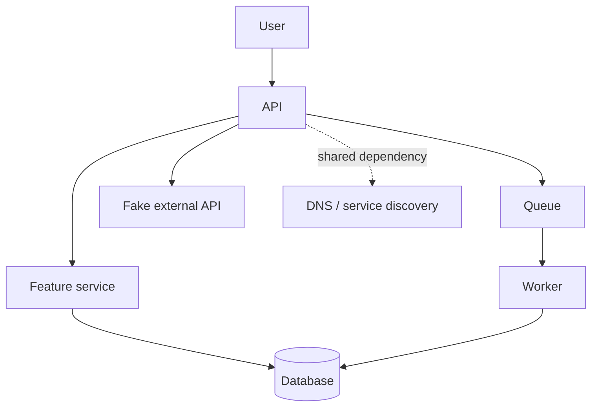
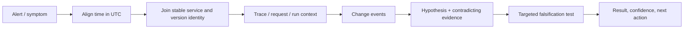

# Unit 7 — Service Dependencies and End-to-End Failure Correlation

> **Purpose:** Learn to reconstruct a distributed failure from evidence across services, dependencies, telemetry, and change events. All examples use synthetic data and local-only systems. This lesson is a teaching artifact; the files shown in code fences are not separately created in your repository.

## 7.0 — Orientation, prerequisites, and scope

### Handoff and boundary

You should already understand service-level indicators/objectives (SLIs/SLOs), alert fundamentals, incident response, a local pager simulator, basic Prometheus, dashboards, centralized logs, traces, and Alertmanager. This unit combines those signals to answer a harder question: *which dependency or change best explains the user-visible symptom, and what evidence would disprove that hypothesis?*

The incident-triage order reused from M10 Unit 5 is:

**user-facing symptom → service → dependency → infrastructure**

M10's timeline-merging concept is reused through a small adapter contract below; its original implementation was not available for inspection, so this lesson does not claim to reuse exact code. Mesh telemetry (M04 Units 7/8), network-flow/Hubble (M04 Unit 9), secrets/credential rotation (M09), and service-catalog ownership (M16) are awareness/forward references, not prerequisites or full tutorials.

Unit 7 teaches dependency discovery, cross-signal correlation, consumer-side dependency instrumentation, timeline normalization, latency attribution, hypothesis ranking, alert enrichment, coverage audits, and data-lineage impact. Unit 8 owns deep actionable/symptom-based alert design; Unit 10 owns deep trace analysis; Units 11–13 own scheduled-job freshness, observability cost/retention, and load/stress/soak testing.

### Outcomes and completion gate

By completion, you can:

1. Explain why a service with an error may be a victim rather than the origin.
2. Classify synchronous, asynchronous, data-store, shared-platform, third-party, and batch/data dependencies.
3. Correlate evidence using time, identity, request context, and change events.
4. Compare declared and observed graph edges without treating either as ground truth.
5. Follow **alert → dashboard → exemplar/trace → span → logs → root cause** when supported by the local stack.
6. Attribute latency without naively summing nested or overlapping spans.
7. Rank co-occurring signals as hypotheses, not automated causal conclusions.
8. Enrich alerts without changing severity or suppressing notifications.
9. Audit telemetry coverage on every dependency edge.
10. Calculate downstream impact from a synthetic lineage graph.

**Completion gate:** all ten labs have evidence saved; scripts pass the supplied tests; one injected failure is localized using at least two independent signal types; one competing hypothesis is explicitly falsified; no fault remains active; and measured time-to-localize is recorded from your own run.

### Environment profiles

- **Core:** Python 3 standard library and local JSON fixtures. Run graph diff, timeline, attribution, ranking, coverage, and lineage labs without Docker or telemetry backends.
- **Full (heavy):** local Docker Compose topology, application instrumentation, Prometheus/Grafana/logs/traces, queue/worker, and fake dependencies. Start only the services needed for the current lab. With a 4-core/8-GB laptop, multiple backends can exhaust memory; measure your own footprint rather than trusting a universal estimate.
- **[ASSUMPTION]** Use a dedicated directory such as `~/unit7-lab`; use synthetic data only. Keep all dashboards and receivers bound to localhost. No cloud account, paid service, external pager, real customer data, or real credential is required.

Preflight:

```bash
mkdir -p "$HOME/unit7-lab"
cd "$HOME/unit7-lab"
pwd
python3 --version
docker version  # only for Full profile; skip if Docker is unavailable
```

Stop if the working directory is not the isolated lab directory, if a port conflicts with a personal service, if a fault could affect the host/network, or if memory pressure destabilizes the machine. Do not run broad `docker system prune`, flush host networking, or disable security controls.

### Three different kinds of graph

- **Declared architecture:** what config, manifests, service declarations, or a catalog says should call what.
- **Observed graph:** edges inferred from traffic, spans, metrics, or flow data that happened to be captured.
- **Causal hypothesis:** an explanation that predicts what evidence should change if a targeted test is performed.

An observed edge does not prove causation. A missing observed edge may mean no traffic occurred, sampling omitted it, instrumentation is absent, an asynchronous boundary lost context, or a service alias was not normalized.

## 7.1 — Dependency mapping fundamentals

### Dependency categories and failure propagation

A dependency edge is directional: `consumer → provider` means the consumer relies on the provider for some behavior. Keep direction consistent across inventory, traces, and diagrams.



| Category | Example | Typical failure propagation | Useful evidence |
|---|---|---|---|
| Synchronous request | API → feature service | latency, timeout, propagated 5xx | client spans, client latency/error metrics |
| Asynchronous | API → queue → worker | backlog, stale results, delayed completion | enqueue/consume timestamps, queue depth, message context |
| Data store | service → database | connection errors, slow queries, pool exhaustion | client errors/latency and provider metrics |
| Shared platform | DNS, ingress, secrets, registry | many apparently unrelated services fail together | shared event timeline, resolver/client errors |
| Third party | API → external API | rate limit, network failure, remote latency | consumer-side timeout/retry/fallback metrics |
| Batch/data lineage | dataset A → model B → dashboard C | stale or invalid downstream output | run IDs, freshness, lineage graph |

A **hard dependency** is required for the request or operation to succeed. A **soft dependency** can fail while the service degrades gracefully. Do not infer criticality from a graph alone: document behavior and test the fallback.

Timeouts bound waiting; retries trade extra work for a chance of recovery; fallbacks reduce dependency coupling but may serve stale or partial data; circuit breakers limit repeated calls to a failing provider. Retry policies must be bounded by an end-to-end deadline and must not multiply across layers without a budget.

### Dependency inventory

Path: `unit7/fixtures/dependencies.json`

```json
{
  "aliases": {"feature-api": "feature-service"},
  "edges": [
    {"consumer":"api","provider":"feature-service","type":"sync","criticality":"hard","timeout_ms":250,"max_attempts":2,"fallback":"cached-features","owner":"team-api","runbook":"http://localhost/runbooks/api-feature","reviewed":"2026-10-01"},
    {"consumer":"feature-service","provider":"database","type":"datastore","criticality":"hard","timeout_ms":100,"max_attempts":1,"fallback":"none","owner":"team-data","runbook":"http://localhost/runbooks/database","reviewed":"2026-10-01"},
    {"consumer":"api","provider":"queue","type":"async","criticality":"soft","timeout_ms":50,"max_attempts":1,"fallback":"accept-with-status","owner":"team-platform","runbook":"http://localhost/runbooks/queue","reviewed":"2026-10-01"},
    {"consumer":"queue","provider":"worker","type":"async","criticality":"hard","timeout_ms":1000,"max_attempts":3,"fallback":"dead-letter","owner":"team-platform","runbook":"http://localhost/runbooks/worker","reviewed":"2026-10-01"},
    {"consumer":"api","provider":"fake-external-api","type":"third-party","criticality":"soft","timeout_ms":200,"max_attempts":2,"fallback":"cached-response","owner":"team-api","runbook":"http://localhost/runbooks/external","reviewed":"2026-10-01"}
  ]
}
```

This is a synthetic service-catalog record, not a claim about your real system. In a mature catalog, add environment, protocol, data classification, SLO owner, timeout budget, retry budget, last validation evidence, and escalation path. M16 owns service-catalog practices.

**Common mistake:** treating “provider is up” as “consumer succeeds.” The provider may be reachable from its own health check while a consumer has DNS, TLS, credentials, pool, network policy, or timeout problems.

## 7.2 — Four correlation signals and causal reasoning

### 1. Shared time

Normalize to UTC (ISO 8601 with `Z` or an explicit offset). Distinguish:
- **event time:** when a deploy, request, or fault happened;
- **ingestion time:** when a backend received it;
- **display time:** the dashboard's rendered timezone.

A seven-minute shift can create a false sequence. Clock skew, timezone settings, scrape intervals, batching, and delayed log ingestion can all distort order. Preserve original timestamps and store normalized timestamps separately.

### 2. Shared identity

Use stable bounded identifiers for service, environment, cluster, namespace, version, and dependency class. A `dependency="database"` label is bounded; `request_id`, `trace_id`, customer ID, arbitrary URL, or exception text as a Prometheus label is high-cardinality and should not be used.

### 3. Shared request context

Trace ID/span ID can join traces and logs; request ID may be useful in logs; queue message/run IDs help cross asynchronous boundaries. Propagate only approved context and never place secrets, personal data, or sensitive business values in trace baggage or headers. Sampling can omit the exact failing trace; lack of a trace is not evidence that no failure occurred.

### 4. Shared change events

Deploys, feature flags, config/secret rotations, scaling, Kubernetes events, certificate expiry, quota changes, and upstream data events belong on a unified timeline. A change just before an incident is a hypothesis, not proof.



### Hypothesis worksheet

Path: `unit7/evidence/hypothesis.md`

```text
Observation:
Time window (UTC):
Affected user-facing symptom:
Hypothesis:
Predicted evidence if true:
Evidence supporting:
Evidence contradicting:
Targeted test or safe fault:
Result:
Confidence (low/medium/high) and reason:
Next action / owner:
```

Say “API latency rose at the same time as the feature-service deploy” rather than “the deploy caused the latency” until evidence and a discriminating test support causality.

## 7.3 — Discovering declared and observed dependencies

Observed edges can come from distributed traces, service graphs, consumer-side metrics, mesh telemetry, network-flow/Hubble, manifests, environment variables, client libraries, and service declarations. Exact Jaeger/Tempo graph views, `servicegraph` connectors, span-metrics processors, and integration fields are version-sensitive: **[VERIFY]** against the chosen release.

### Graph comparison script

Path: `unit7/graph_diff.py`

```python
#!/usr/bin/env python3
"""Compare declared and observed dependency edges. Python 3.10+."""
import json
import sys
from pathlib import Path

def load(path):
    data = json.loads(Path(path).read_text(encoding="utf-8"))
    aliases = data.get("aliases", {})
    edges = data.get("edges", [])
    if not isinstance(aliases, dict) or not isinstance(edges, list):
        raise ValueError("expected aliases object and edges array")
    def norm(name):
        if not isinstance(name, str) or not name.strip():
            raise ValueError("edge names must be non-empty strings")
        seen = set()
        while name in aliases:
            if name in seen:
                raise ValueError(f"alias cycle at {name}")
            seen.add(name)
            name = aliases[name]
        return name
    result = set()
    for edge in edges:
        if not isinstance(edge, dict):
            raise ValueError("each edge must be an object")
        result.add((norm(edge["consumer"]), norm(edge["provider"])))
    return result

def main():
    if len(sys.argv) != 3:
        print("usage: graph_diff.py DECLARED.json OBSERVED.json", file=sys.stderr)
        return 2
    try:
        declared, observed = load(sys.argv[1]), load(sys.argv[2])
    except (OSError, json.JSONDecodeError, KeyError, ValueError) as exc:
        print(f"input error: {exc}", file=sys.stderr)
        return 2
    for label, edges in (
        ("MATCHING", declared & observed),
        ("DECLARED_ONLY investigate unexercised/missing telemetry", declared - observed),
        ("OBSERVED_ONLY investigate undocumented/unknown", observed - declared),
    ):
        print(label)
        for a, b in sorted(edges):
            print(f"  {a} -> {b}")
    return 1 if declared - observed or observed - declared else 0

if __name__ == "__main__":
    raise SystemExit(main())
```

Path: `unit7/fixtures/observed-edges.json`

```json
{
  "aliases": {"feature-api":"feature-service"},
  "edges": [
    {"consumer":"api","provider":"feature-api"},
    {"consumer":"feature-service","provider":"database"},
    {"consumer":"api","provider":"queue"},
    {"consumer":"queue","provider":"worker"},
    {"consumer":"api","provider":"fake-external-api"},
    {"consumer":"unknown-service","provider":"database"}
  ]
}
```

Run:

```bash
python3 unit7/graph_diff.py unit7/fixtures/dependencies.json unit7/fixtures/observed-edges.json
echo "exit=$?"
```

Expected representative output includes matching edges and an observed-only edge `unknown-service -> database`; this particular fixture has no declared-only edge. Add a declared edge absent from the observed fixture to exercise the declared-only branch. Exit code `1` means discrepancies exist. This is a review signal, not a deployment failure verdict. Exit `0` means exact edge-set agreement, not that telemetry is complete or causality is known; exit `2` means invalid input/usage.

Tests should cover alias normalization, alias cycles, empty names, malformed JSON, duplicate edges, and deterministic sorting. Add an alias-cycle fixture and verify the script returns `2`. The supplied fixture intentionally includes an unknown observed edge.

### Interpreting drift

- **Declared-only:** edge may be unused in this time window, absent due to sampling, missing instrumentation, or a real stale declaration.
- **Observed-only:** undocumented dependency, alias mismatch, test traffic, or incorrect instrumentation.
- **Matching:** both sources agree that an edge exists; this does not prove the edge is healthy.
- **Stale/unknown:** use owner, review date, traffic window, and targeted exercise to determine what to update.

## 7.4 — Outbound-call instrumentation and dependency health

At the consumer boundary, track request attempts, final outcomes, latency distribution, timeout count, retry attempts, recovered-after-retry count, and circuit-breaker state where relevant. For queues, track enqueue-to-start delay, backlog, processing duration, retry/dead-letter counts, and oldest-message age. Use bounded labels such as `dependency`, `operation`, and `outcome`; avoid IDs as metric labels.

Provider-side health answers “can this provider serve some requests?” Consumer-side health answers “can this caller complete its operation within its budget?” Both are needed.

Framework-neutral instrumentation contract:

```python
# Illustrative pseudocode contract, not tied to a specific metrics library.
with dependency_call(
    dependency="feature-service", operation="get_features",
    timeout_seconds=0.25, max_attempts=2
) as observation:
    result = client.get_features()
# observation records attempts, final outcome, elapsed time, timeout,
# recovered_after_retry, and bounded circuit state.
```

A concrete library's API and metric names depend on the selected client/instrumentation library: **[VERIFY]**. Do not invent series names. First inspect `/metrics` from the actual app and its metric catalog, then write PromQL.

Retries can make the final user request succeed while consuming latency and capacity. Example: first attempt times out after 200 ms, second succeeds after 180 ms, and the API returns success after 380 ms. The user-facing error ratio may remain normal while latency and retry attempts rise. Measure attempts separately from final request outcomes.

“RED at the edge, USE inside” is a useful organizing heuristic: request rate, errors, and duration at service/dependency boundaries; utilization, saturation, and errors for resources. Attribution of this phrase to any particular roadmap source is not verified here. Synthetic probes, blackbox checks, and external status-feed ingestion are awareness topics, not a required vendor integration.

## 7.5 — End-to-end correlation workflow in Grafana

The operational drill-down is:

**alert → dashboard → exemplar → trace → span → logs → root cause**

This is a preferred path, not a guarantee that every backend supports every link. Exemplar storage, Grafana data links, trace-to-logs mapping, and exact datasource configuration are version-sensitive: **[VERIFY]**.

### Dashboard design

Use a row per dependency tier:

1. User/API symptom: request rate, error ratio, latency percentile, and saturation.
2. Synchronous dependencies: consumer-side request/error/latency/timeout/retry.
3. Async dependencies: backlog, oldest item age, enqueue-to-completion delay, worker errors.
4. Data store/shared platform: connection errors, DNS/TLS/auth errors, resource pressure.
5. Changes: deploys, flags, config/secret rotation, scaling, certificate/quota events.

Align panels to the same UTC time window. Display query range and timezone. Do not overlay unrelated units on one axis or interpret percentile lines without checking sample volume. A graph with no errors may reflect sampling, a broken query, stale data, or missing instrumentation.

Illustrative query intent (replace names after inspecting the local metric catalog):

```promql
# Illustrative placeholders only; validate names and labels before use.
sum by (dependency) (rate(dependency_client_requests_total[5m]))
sum by (dependency) (rate(dependency_client_errors_total[5m]))
histogram_quantile(0.95,
  sum by (le, dependency) (rate(dependency_client_request_duration_seconds_bucket[5m])))
```

Do not copy these as verified metric names. **[VERIFY]** names and label schemas against the actual app exporter. Avoid high-cardinality labels.

Evidence checklist:
- alert timestamp and rule evaluation window;
- dashboard timezone and selected range;
- consumer-side and provider-side signals;
- trace ID/span ID only in logs/trace stores, not metric labels;
- related change event with event time and ingestion time;
- one supporting and one contradicting observation;
- targeted test result and localization time.

## 7.6 — Change events and unified incident timeline

A unified timeline is a normalized list of evidence-bearing events, not a causal verdict. Keep source timestamp, normalized UTC timestamp, ingestion timestamp when available, entity, change type, version, and evidence reference. Deduplicate only when a stable event ID or a carefully defined key says two records are the same; two deploys at the same time may be legitimate.

M10's timeline-merger implementation was not available for inspection. **[ASSUMPTION]** This lesson defines a small adapter contract that can be wired to the earlier implementation later:

```json
{
  "event_id":"deploy-api-0042",
  "timestamp":"2026-10-28T12:03:00Z",
  "source":"deployment",
  "entity":"api",
  "change_type":"deploy",
  "version":"git-sha-synthetic-0042",
  "evidence_ref":"local://events/deploy-api-0042",
  "ingested_at":"2026-10-28T12:03:02Z"
}
```

### Timeline generator

Path: `unit7/timeline.py`

```python
#!/usr/bin/env python3
import json, sys
from datetime import datetime, timezone
from pathlib import Path

def parse_time(value):
    if not isinstance(value, str) or not value:
        raise ValueError("timestamp must be a non-empty ISO-8601 string")
    dt = datetime.fromisoformat(value.replace("Z", "+00:00"))
    if dt.tzinfo is None:
        raise ValueError("timestamp must include Z or a UTC offset")
    return dt.astimezone(timezone.utc)

def normalize(events):
    if not isinstance(events, list):
        raise ValueError("events must be an array")
    seen, out = set(), []
    for e in events:
        for key in ("event_id", "timestamp", "source", "entity", "change_type"):
            if not isinstance(e.get(key), str) or not e[key].strip():
                raise ValueError(f"missing/invalid {key}")
        # Only a repeated explicit event_id is deduplicated.
        if e["event_id"] in seen:
            continue
        seen.add(e["event_id"])
        out.append((parse_time(e["timestamp"]), e))
    return sorted(out, key=lambda pair: (pair[0], pair[1]["event_id"]))

def main(path):
    events = json.loads(Path(path).read_text(encoding="utf-8"))
    for ts, e in normalize(events):
        print(f'{ts.isoformat().replace("+00:00","Z")} | {e["source"]} | '
              f'{e["entity"]} | {e["change_type"]} | {e.get("version","-")} | '
              f'{e.get("evidence_ref","-")}')
if __name__ == "__main__":
    if len(sys.argv) != 2:
        print("usage: timeline.py EVENTS.json", file=sys.stderr); raise SystemExit(2)
    try:
        main(sys.argv[1])
    except (OSError, ValueError, KeyError, json.JSONDecodeError) as exc:
        print(f"input error: {exc}", file=sys.stderr); raise SystemExit(2)
```

Path: `unit7/fixtures/events.json`

```json
[
  {"event_id":"deploy-api-1","timestamp":"2026-10-28T12:03:00+00:00","source":"deployment","entity":"api","change_type":"deploy","version":"v1.2-synthetic","evidence_ref":"local://deploy/1"},
  {"event_id":"flag-feature-1","timestamp":"2026-10-28T12:04:00Z","source":"feature-flag","entity":"feature-service","change_type":"flag_flip","version":"enabled","evidence_ref":"local://flag/1"},
  {"event_id":"k8s-pod-1","timestamp":"2026-10-28T12:05:00Z","source":"kubernetes","entity":"worker","change_type":"scale","version":"replicas=1","evidence_ref":"local://event/1"},
  {"event_id":"deploy-api-1","timestamp":"2026-10-28T07:03:00-05:00","source":"deployment","entity":"api","change_type":"deploy","version":"v1.2-synthetic","evidence_ref":"local://deploy/1"}
]
```

The duplicate event ID is dropped; equivalent timestamps normalize to UTC. Tests: offset conversion, out-of-order input, duplicate ID, missing entity, and naive timestamp rejection. Expected output is sorted and deterministic. A “latest deploy before incident” is only a candidate explanation; compare affected versions, unaffected instances, and a targeted rollback/canary where safe.

## 7.7 — Latency and error attribution

### Why span durations cannot simply be added

A span's duration is usually inclusive of work performed in its child spans. If an API span lasts 500 ms and contains a dependency span lasting 300 ms, adding them yields 800 ms and double-counts the dependency. Concurrent child spans may overlap; queue wait may occur between producer and consumer spans; clocks across hosts can be skewed. A span duration is not the same thing as exclusive CPU time.

This lab uses a deliberately simple model: one request path, non-overlapping sequential child intervals on a single synthetic monotonic timeline. For that restricted model, exclusive parent work is `parent duration - union(child intervals clipped to parent)`. For overlapping/concurrent children, report overlap separately; do not treat sum of child durations as elapsed request time.

Path: `unit7/latency_attribution.py`

```python
#!/usr/bin/env python3
import json, sys
from pathlib import Path

def union_duration(intervals, start, end):
    clipped = sorted((max(start, a), min(end, b)) for a, b in intervals if b > start and a < end)
    total = 0
    left = right = None
    for a, b in clipped:
        if b <= a: continue
        if left is None: left, right = a, b
        elif a <= right: right = max(right, b)
        else: total += right - left; left, right = a, b
    if left is not None: total += right - left
    return total

def attribute(trace):
    spans = trace.get("spans")
    if not isinstance(spans, list) or not spans:
        raise ValueError("spans must be a non-empty array")
    by_id = {}
    for s in spans:
        if not all(k in s for k in ("id","parent","start_ms","end_ms","kind")):
            raise ValueError("span missing required fields")
        if s["id"] in by_id or s["end_ms"] < s["start_ms"]:
            raise ValueError("duplicate span id or negative duration")
        by_id[s["id"]] = s
    roots = [s for s in spans if s["parent"] is None]
    if len(roots) != 1: raise ValueError("expected exactly one root")
    root = roots[0]
    children = {s["id"]: [] for s in spans}
    for s in spans:
        if s["parent"] is not None:
            if s["parent"] not in by_id: raise ValueError("unknown parent")
            children[s["parent"]].append(s)
    for s in spans:
        intervals = [(c["start_ms"], c["end_ms"]) for c in children[s["id"]]]
        covered = union_duration(intervals, s["start_ms"], s["end_ms"])
        s["_exclusive_ms"] = max(0, s["end_ms"] - s["start_ms"] - covered)
    dependency = sum(s["_exclusive_ms"] for s in spans if s["kind"] == "dependency")
    queue = sum(s["_exclusive_ms"] for s in spans if s["kind"] == "queue")
    service = sum(s["_exclusive_ms"] for s in spans if s["kind"] == "service")
    return {"root_elapsed_ms": root["end_ms"] - root["start_ms"],
            "exclusive_by_kind_ms":{"service":service,"dependency":dependency,"queue":queue},
            "warning":"exclusive span time is not CPU time; async/parallel traces need a richer model"}

if __name__ == "__main__":
    if len(sys.argv) != 2:
        print("usage: latency_attribution.py TRACE.json", file=sys.stderr); raise SystemExit(2)
    try:
        print(json.dumps(attribute(json.loads(Path(sys.argv[1]).read_text())), indent=2))
    except (OSError, ValueError, KeyError, json.JSONDecodeError) as exc:
        print(f"input error: {exc}", file=sys.stderr); raise SystemExit(2)
```

Path: `unit7/fixtures/trace.json`

```json
{
  "trace_id":"trace-synthetic-0001",
  "spans":[
    {"id":"api","parent":null,"start_ms":0,"end_ms":500,"kind":"service"},
    {"id":"feature","parent":"api","start_ms":30,"end_ms":330,"kind":"dependency"},
    {"id":"db","parent":"feature","start_ms":70,"end_ms":250,"kind":"dependency"},
    {"id":"queue_wait","parent":"api","start_ms":350,"end_ms":430,"kind":"queue"}
  ]
}
```

For this fixture, the root elapsed time is 500 ms. The feature span's 300 ms is inclusive of its database child; the script calculates exclusive intervals per parent and aggregates exclusive time by the `kind` field. Do not interpret aggregated exclusive time as a perfect wall-clock partition if spans overlap or the model's classification is wrong.

Errors should be classified as:
- **local:** originated in the service;
- **propagated/inherited:** downstream error surfaced upstream;
- **retried and recovered:** one or more attempts failed but final request succeeded;
- **final user-visible outcome:** request ultimately failed or breached its deadline.

Attempt-level counters explain hidden work; final-outcome counters explain user impact. A retry-masked incident is present when final errors remain low while attempts, latency, or queueing rise.

## 7.8 — Anomaly co-occurrence ranking without “magic AIOps”

The following script computes a simple incident-to-baseline ratio for synthetic non-negative series. It is a ranking heuristic, not machine learning, anomaly detection in the general sense, or causal discovery. It reports missing/zero baselines instead of dividing by zero.

Path: `unit7/rank_signals.py`

```python
#!/usr/bin/env python3
import json, sys
from pathlib import Path

def rank(data, threshold=1.5, min_n=3):
    baseline, incident = data.get("baseline", {}), data.get("incident", {})
    rows = []
    for name in sorted(set(baseline) | set(incident)):
        b, i = baseline.get(name), incident.get(name)
        if not isinstance(b, list) or not isinstance(i, list):
            rows.append((name, None, "missing series")); continue
        if len(b) < min_n or len(i) < min_n:
            rows.append((name, None, "low sample count")); continue
        if any(not isinstance(x, (int, float)) or x < 0 for x in b + i):
            rows.append((name, None, "invalid negative/non-numeric sample")); continue
        bm, im = sum(b)/len(b), sum(i)/len(i)
        if bm == 0:
            rows.append((name, None, "zero baseline")); continue
        ratio = im / bm
        rows.append((name, ratio, "candidate" if ratio >= threshold else "below threshold"))
    return rows

if __name__ == "__main__":
    if len(sys.argv) != 2:
        print("usage: rank_signals.py SERIES.json", file=sys.stderr); raise SystemExit(2)
    try:
        rows = rank(json.loads(Path(sys.argv[1]).read_text(encoding="utf-8")))
        print("signal | incident/baseline | classification")
        for name, ratio, why in rows:
            print(f"{name} | {ratio:.2f} | {why}" if ratio is not None else f"{name} | n/a | {why}")
    except (OSError, ValueError, json.JSONDecodeError) as exc:
        print(f"input error: {exc}", file=sys.stderr); raise SystemExit(2)
```

Path: `unit7/fixtures/series.json`

```json
{
  "baseline": {
    "api_latency_ms":[80,82,78,81,79],
    "feature_timeouts":[0,1,0,0,1],
    "worker_backlog":[10,12,11,9,10],
    "unrelated_cron_duration":[40,42,39,41,40]
  },
  "incident": {
    "api_latency_ms":[180,210,195,220,205],
    "feature_timeouts":[4,5,6,4,5],
    "worker_backlog":[25,30,28,32,29],
    "unrelated_cron_duration":[90,85,88,92,87]
  }
}
```

The unrelated CronJob also changes substantially and may rank highly; that is a useful false positive. Confounders include shared load, time-of-day, deploys, correlated services, multiple comparisons, noisy low-volume series, and missing samples. Normalize units and compare like-for-like windows. Thresholds are policy choices, not universal constants.

## 7.9 — Dependency-aware alert enrichment

Enrichment adds context; it must not change severity, silence an alert, or assign blame. Keep enrichment advisory, bounded, timestamped, and redacted. If a source is unavailable, return a deterministic partial result quickly rather than blocking notification delivery.

Path: `unit7/enrichment_service.py`

```python
#!/usr/bin/env python3
"""Local-only stdlib webhook enrichment demo; no external calls."""
import json
from http.server import BaseHTTPRequestHandler, HTTPServer

MAX_BODY = 32_768
CONTEXT = {
    "api": {
        "owner": "team-api",
        "runbook": "http://localhost/runbooks/api",
        "dashboard": "http://localhost/dashboards/platform-health",
        "dependency_health": [{"dependency":"feature-service","status":"degraded","observed_at":"2026-10-28T12:05:00Z"}],
        "recent_changes": [{"entity":"feature-service","change_type":"deploy","timestamp":"2026-10-28T12:03:00Z"}]
    }
}
class Handler(BaseHTTPRequestHandler):
    def do_POST(self):
        if self.path != "/enrich":
            self.send_error(404); return
        try:
            size = int(self.headers.get("Content-Length", "0"))
            if size <= 0 or size > MAX_BODY:
                self.send_error(413 if size > MAX_BODY else 400); return
            alert = json.loads(self.rfile.read(size))
            if not isinstance(alert, dict) or not isinstance(alert.get("service"), str):
                self.send_error(400, "expected JSON object with service"); return
            service = alert["service"]
            # Do not log raw payload, labels, tokens, or annotations.
            context = CONTEXT.get(service, {})
            response = {
                "alert_name": str(alert.get("alertname", "UnknownAlert"))[:120],
                "service": service[:80],
                "severity": str(alert.get("severity", "unknown"))[:32],
                "enrichment_status": "partial" if not context else "complete",
                "context": context,
                "advisory_only": True
            }
            body = json.dumps(response).encode()
            self.send_response(200); self.send_header("Content-Type","application/json")
            self.send_header("Content-Length",str(len(body))); self.end_headers(); self.wfile.write(body)
        except (ValueError, json.JSONDecodeError):
            self.send_error(400, "invalid request")
    def log_message(self, fmt, *args):
        # Suppress default request logging; production should emit redacted structured logs.
        return
if __name__ == "__main__":
    print("Local-only demo: http://127.0.0.1:8099/enrich")
    HTTPServer(("127.0.0.1", 8099), Handler).serve_forever()
```

Test:

```bash
python3 unit7/enrichment_service.py
# In another terminal:
curl -sS -X POST http://127.0.0.1:8099/enrich \
  -H 'Content-Type: application/json' \
  -d '{"alertname":"DependencyLatencyHigh","service":"api","severity":"warning"}'
```

Expected representative output includes `"owner":"team-api"`, `"advisory_only":true`, and a dependency status timestamp. Stop with Ctrl-C. This is an unauthenticated loopback-only demo; it is not a production webhook receiver. For non-local use, add authentication, TLS termination, request limits, source authentication, timeouts, and a documented schema. Never log or echo secrets.

## 7.10 — Symptom-signature table and shared-platform failures

These signatures are starting points, not deterministic rules. Validate metric names and query syntax against your actual exporters: **[VERIFY]**.

| Symptom | Plausible hypotheses | Discriminating evidence / first checks | Falsification test | Prevention |
|---|---|---|---|---|
| Image-pull errors across namespaces | registry outage, DNS, auth, quota | events, resolver errors, registry reachability from affected namespace | compare a known-good image/cache and a controlled local registry check | registry health, credential expiry monitoring, image cache strategy |
| TLS handshake errors rise | expired cert, wrong CA, hostname mismatch, clock skew | cert expiry, handshake logs, peer name, recent rotation event | validate chain/hostname with local test endpoint | expiry alerts, rotation canary, trust-store tests |
| DB auth fails across services | credential rotation mismatch, secrets backend issue | client auth errors, secret version, rotation event, provider auth logs | use synthetic credential in isolated test; compare versions | staged rotation, dual-valid window where supported, consumer validation |
| Many services time out together | shared DNS, ingress, node, network | common time window, resolver/client metrics, node events, request paths | query a local known-good service by IP and by name in isolated lab | shared-platform SLOs, dependency inventory, independent probes |
| API latency rises; provider success looks normal | retries, client pool, queueing, timeout mismatch | client-side attempts/latency, pool wait, per-attempt trace spans | temporarily bound retries in a canary or use controlled stub delay | deadline budget, retry budget, client-side telemetry |
| Queue backlog rises while API succeeds | worker/downstream failure, consumer lag | oldest message age, consumer errors, run IDs, dead-letter counts | pause/resume a synthetic worker and measure backlog recovery | queue-age alerts, consumer ownership, idempotent processing |

The first check should narrow competing explanations, not merely repeat the symptom. For example, if a provider's success rate is normal but one consumer times out, compare that consumer's DNS, connection pool, TLS, timeout, and retry telemetry before declaring the provider healthy or unhealthy.

## 7.11 — Edge observability coverage audit

An edge is diagnosable only when the operator can identify its owner, see client-side health, connect relevant logs/traces, find a runbook, and validate that evidence still works. Coverage does not guarantee correctness.

### Coverage auditor

Path: `unit7/coverage_audit.py`

```python
#!/usr/bin/env python3
import json, sys
from pathlib import Path
from datetime import date

REQUIRED = ("metrics","logs","traces","alert","dashboard","runbook","owner","last_validated")
def audit(graph, coverage, today):
    edges = {(e["consumer"], e["provider"]) for e in graph["edges"]}
    seen, issues = set(), []
    for row in coverage:
        key = (row.get("consumer"), row.get("provider"))
        if key in seen:
            issues.append(f"duplicate coverage edge: {key[0]} -> {key[1]}")
        seen.add(key)
        if key not in edges:
            issues.append(f"unknown coverage edge: {key[0]} -> {key[1]}")
        for field in REQUIRED:
            if not row.get(field):
                issues.append(f"missing {field}: {key[0]} -> {key[1]}")
        stamp = row.get("last_validated")
        if stamp:
            try:
                age = (today - date.fromisoformat(stamp)).days
                if age > 90: issues.append(f"stale validation ({age}d): {key[0]} -> {key[1]}")
            except ValueError:
                issues.append(f"invalid last_validated: {key[0]} -> {key[1]}")
    for edge in sorted(edges - seen):
        issues.append(f"missing coverage edge: {edge[0]} -> {edge[1]}")
    return sorted(issues)

if __name__ == "__main__":
    if len(sys.argv) != 4:
        print("usage: coverage_audit.py GRAPH.json COVERAGE.json YYYY-MM-DD", file=sys.stderr); raise SystemExit(2)
    try:
        graph = json.loads(Path(sys.argv[1]).read_text())
        coverage = json.loads(Path(sys.argv[2]).read_text())
        issues = audit(graph, coverage, date.fromisoformat(sys.argv[3]))
        print(f"issues={len(issues)}")
        for issue in issues: print(f"- {issue}")
        raise SystemExit(1 if issues else 0)
    except (OSError, ValueError, KeyError, json.JSONDecodeError) as exc:
        print(f"input error: {exc}", file=sys.stderr); raise SystemExit(2)
```

Path: `unit7/fixtures/coverage.json` (intentionally incomplete)

```json
[
  {"consumer":"api","provider":"feature-service","metrics":"yes","logs":"yes","traces":"yes","alert":"yes","dashboard":"yes","runbook":"http://localhost/runbooks/api-feature","owner":"team-api","last_validated":"2026-10-01"},
  {"consumer":"api","provider":"queue","metrics":"yes","logs":"yes","traces":"partial","alert":"yes","dashboard":"yes","runbook":"http://localhost/runbooks/queue","owner":"team-platform","last_validated":"2026-01-01"}
]
```

Run with a fixed date for deterministic output:

```bash
python3 unit7/coverage_audit.py unit7/fixtures/dependencies.json unit7/fixtures/coverage.json 2026-10-28
```

Expected result is nonzero because edges are missing, fields may be missing, and one review is stale. Exit codes: `0` no policy issues, `1` policy issues, `2` invalid input. Add tests for unknown/duplicate edges, missing owner/runbook, stale date, invalid date, and empty coverage. The audit measures declared diagnostic controls, not telemetry truth.

## 7.12 — Data-lineage impact analysis

A dependency graph models runtime calls; a lineage graph models upstream/downstream data production. If dataset A is late or invalid, every reachable downstream dataset, model, and dashboard is a candidate impact. This is not the full freshness curriculum (Unit 11).

### Lineage script

Path: `unit7/lineage_impact.py`

```python
#!/usr/bin/env python3
import json, sys
from pathlib import Path

def affected(graph, source):
    nodes = set(graph.get("nodes", []))
    if source not in nodes:
        raise ValueError(f"unknown source node: {source}")
    edges = graph.get("edges", [])
    adjacency = {n: set() for n in nodes}
    for edge in edges:
        if len(edge) != 2 or edge[0] not in nodes or edge[1] not in nodes:
            raise ValueError(f"invalid/unknown edge: {edge}")
        adjacency[edge[0]].add(edge[1])
    result, active, done = set(), set(), set()
    def visit(node):
        if node in active:
            raise ValueError(f"cycle detected at {node}")
        if node in done: return
        active.add(node)
        for nxt in sorted(adjacency[node]):
            result.add(nxt)
            visit(nxt)
        active.remove(node); done.add(node)
    visit(source)
    result.discard(source)
    return sorted(result)

if __name__ == "__main__":
    if len(sys.argv) != 3:
        print("usage: lineage_impact.py GRAPH.json SOURCE_NODE", file=sys.stderr); raise SystemExit(2)
    try:
        data = json.loads(Path(sys.argv[1]).read_text())
        for node in affected(data, sys.argv[2]): print(node)
    except (OSError, ValueError, KeyError, json.JSONDecodeError) as exc:
        print(f"input error: {exc}", file=sys.stderr); raise SystemExit(2)
```

Path: `unit7/fixtures/lineage.json`

```json
{
  "nodes":["raw_events","clean_events","feature_table","model_score","dashboard"],
  "edges":[["raw_events","clean_events"],["clean_events","feature_table"],["feature_table","model_score"],["model_score","dashboard"]]
}
```

Run:

```bash
python3 unit7/lineage_impact.py unit7/fixtures/lineage.json raw_events
```

Expected representative output: `clean_events`, `dashboard`, `feature_table`, `model_score` in sorted order. Test cycle detection, unknown source, unknown edge endpoint, duplicate edges, and deterministic traversal. OpenLineage is an awareness-level option; exact integration and schema details are **[VERIFY]** against its current documentation. No real data catalog is required.

## 7.13 — Required end-to-end failure-correlation labs

### Core script regression tests

The following test file exercises the pure functions in the core scripts. Save the scripts from this lesson beside it in `unit7/`; save this test file as `unit7/test_core.py`. Run from the lab root with `python3 -m unittest discover -s unit7 -v`. These tests are an instructional harness; they were not executed during authoring.

Path: `unit7/test_core.py`

```python
import unittest
from datetime import date
import graph_diff
import timeline
import latency_attribution
import rank_signals
import coverage_audit
import lineage_impact

class CoreTests(unittest.TestCase):
    def test_graph_alias_normalization_and_cycle(self):
        import tempfile, json
        from pathlib import Path
        with tempfile.TemporaryDirectory() as d:
            p = Path(d) / "g.json"
            p.write_text(json.dumps({"aliases":{"feature-api":"feature-service"},
                                     "edges":[{"consumer":"api","provider":"feature-api"}]}))
            self.assertEqual(graph_diff.load(p), {("api","feature-service")})
            p.write_text(json.dumps({"aliases":{"a":"b","b":"a"},"edges":[{"consumer":"x","provider":"a"}]}))
            with self.assertRaises(ValueError):
                graph_diff.load(p)

    def test_timeline_utc_sort_dedupe_and_naive_rejection(self):
        rows = timeline.normalize([
            {"event_id":"b","timestamp":"2026-10-28T13:00:00+01:00","source":"x","entity":"api","change_type":"deploy"},
            {"event_id":"a","timestamp":"2026-10-28T12:00:00Z","source":"x","entity":"api","change_type":"deploy"},
            {"event_id":"a","timestamp":"2026-10-28T12:00:00Z","source":"x","entity":"api","change_type":"deploy"}
        ])
        self.assertEqual([e["event_id"] for _, e in rows], ["a","b"])
        with self.assertRaises(ValueError):
            timeline.normalize([{"event_id":"x","timestamp":"2026-10-28T12:00:00","source":"x","entity":"api","change_type":"deploy"}])

    def test_latency_nested_child_not_double_counted(self):
        trace = {"spans":[
            {"id":"root","parent":None,"start_ms":0,"end_ms":100,"kind":"service"},
            {"id":"dep","parent":"root","start_ms":10,"end_ms":80,"kind":"dependency"},
            {"id":"db","parent":"dep","start_ms":20,"end_ms":50,"kind":"dependency"}]}
        result = latency_attribution.attribute(trace)
        self.assertEqual(result["root_elapsed_ms"], 100)
        self.assertEqual(result["exclusive_by_kind_ms"]["service"], 30)
        self.assertEqual(result["exclusive_by_kind_ms"]["dependency"], 70)

    def test_rank_zero_baseline_and_low_samples(self):
        rows = dict((name, (ratio, reason)) for name, ratio, reason in rank_signals.rank({
            "baseline":{"zero":[0,0,0],"few":[1,1]},
            "incident":{"zero":[2,2,2],"few":[3,3]}}))
        self.assertEqual(rows["zero"][1], "zero baseline")
        self.assertEqual(rows["few"][1], "low sample count")

    def test_coverage_reports_missing_and_stale(self):
        graph = {"edges":[{"consumer":"api","provider":"db"}]}
        rows = [{"consumer":"api","provider":"db","metrics":"yes","logs":"yes",
                 "traces":"yes","alert":"yes","dashboard":"yes","runbook":"r",
                 "owner":"team","last_validated":"2025-01-01"}]
        issues = coverage_audit.audit(graph, rows, date(2026, 10, 28))
        self.assertTrue(any("stale validation" in x for x in issues))
        self.assertTrue(coverage_audit.audit(graph, [], date(2026, 10, 28)))

    def test_lineage_reachable_nodes_and_cycle(self):
        graph = {"nodes":["a","b","c"],"edges":[["a","b"],["b","c"]]}
        self.assertEqual(lineage_impact.affected(graph,"a"), ["b","c"])
        cyclic = {"nodes":["a","b"],"edges":[["a","b"],["b","a"]]}
        with self.assertRaises(ValueError):
            lineage_impact.affected(cyclic,"a")
        with self.assertRaises(ValueError):
            lineage_impact.affected(graph,"missing")

if __name__ == "__main__":
    unittest.main()
```

**Test interpretation:** the harness validates algorithmic behavior on synthetic fixtures. It does not test OpenTelemetry SDK propagation, Prometheus scrape behavior, Grafana links, Docker networking, or production telemetry quality. The scripts in this file set should be copied into `unit7/` with the exact names shown in the preceding headings before running the suite.

### Shared lab contract

All faults are synthetic and local. Start with Core labs (graph, timeline, attribution, ranking, coverage, lineage) before the Full topology. Save evidence under `unit7/evidence/`. Record UTC timestamps from the same host clock, note timezone, and stop at the first unsafe condition. Never use production endpoints or credentials.

Every fault drill records: `fault_start_utc`, `fault_end_utc`, affected service, injected condition, expected signature, observed signature, first discriminating query, evidence reference, hypothesis, falsification result, time-to-localize, cleanup check, and confidence.

### Lab A — Multi-service topology (Full profile, heavy)

**Goal:** API → feature service → database; API → queue → worker; API → fake external API. Emit synthetic metrics, structured logs, and trace context across synchronous and asynchronous boundaries, then compare observed edges with declared edges.

**Core alternative:** use the JSON fixtures and scripts in 7.3–7.12 without starting telemetry backends. **Resource expectation:** heavy; measure CPU/RAM/disk locally. Do not start all backends simultaneously on an 8-GB machine.

**Preflight and staged sequence:**
1. Confirm isolated working directory and ports.
2. Start only the database and feature service; test one request.
3. Add API and fake external API; validate request and error paths.
4. Add queue and worker; validate enqueue-to-completion correlation.
5. Add telemetry backend(s) only when the app path is stable.
6. Stop unused services between exercises.

The full application/Compose stack is not prescribed by the available source, and no exact sibling app implementation was inspected. Therefore this lesson does not claim a verified Compose file or SDK configuration. **[ASSUMPTION]** adapt the already-instrumented lab FastAPI service from M08/M10 rather than inventing a replacement service. Keep the service names and labels used in this lesson: `api`, `feature-service`, `database`, `queue`, `worker`, `fake-external-api`.

**Required evidence:** a trace with a synchronous edge, a log linked by trace ID (if supported), an enqueue/consume correlation key, the declared graph, observed graph, and graph-diff output. If trace context is missing across a queue, record it as a gap rather than inferring a relationship from close timestamps alone.

**Pass:** all intended edges are exercised; missing/unknown edges are explained; one synthetic error can be followed from API to its dependency evidence. **Fail:** only a service map screenshot is saved without underlying evidence.

**Abort/cleanup:** stop fault injection first, then stop worker/queue, API, fake dependency, feature service, database, and telemetry backends. Use only the Compose project/directory created for this lab; verify `docker compose ps` shows no lab services running. Do not use global prune commands.

### Lab B — Platform-health dashboard

**Goal:** create one row per dependency tier and align symptom/cause panels.

Use the panel/query intent in 7.5. In Grafana, use the local Prometheus, logs, and trace data sources only if already available. Create panels for API symptom, client-side feature dependency latency/errors, queue backlog/age, database client errors, and change events. Configure trace/log links only after verifying the actual datasource field names and IDs.

**Validation checklist:**
- all panels share the same UTC time range;
- labels are bounded and consistent;
- a missing series is shown as “no data,” not silently as zero;
- queries are validated against the metric catalog;
- dashboard links do not contain credentials;
- one synthetic incident can be navigated from alert to dashboard to trace/log evidence where integrations support it.

**Expected evidence:** dashboard JSON/export or screenshots plus query text and metric catalog. Dashboard JSON is not embedded as a version-specific complete file because the exact Grafana version/data-source UIDs are not available; do not paste invented IDs into provisioning. This is a deliberate **[VERIFY]** boundary, not a missing required concept.

### Lab C — Three failure-injection correlation drills (Full profile)

**Drill 1: dependency latency.** Configure the local fake feature dependency to add a bounded delay (e.g. 150 ms `[SYNTHETIC]`) for a finite test window. Do not use unbounded sleep or production traffic. Record baseline and fault-window client latency, attempts, final outcome, and trace/log evidence.

**Drill 2: retry masking.** Configure the local stub to fail the first attempt and succeed on the next, then compare attempt-level errors with final request outcomes and total latency. Set a strict request deadline and max attempt count. If retry policy cannot be safely changed in the current app, simulate the sequence in the Core fixture instead.

**Drill 3: shared-platform surrogate.** Make a dedicated fake resolver/client return a synthetic DNS failure for a lab hostname, or inject a local node-pressure surrogate by throttling only the lab process. Never modify host DNS, flush host routes, disrupt the real network, or pressure the entire machine.

For each drill follow **alert → dashboard → trace → logs → root cause** and test an alternative explanation. Example: if latency rises, verify whether the client span is long because of remote time, connection-pool wait, retries, or local queueing.

Path: `unit7/evidence/drill-record-template.json`

```json
{
  "fault_start_utc":"",
  "fault_end_utc":"",
  "service":"",
  "condition":"",
  "expected_signature":"",
  "observed_signature":"",
  "first_discriminating_query":"",
  "evidence_refs":[],
  "hypothesis":"",
  "falsification_test":"",
  "falsification_result":"",
  "time_to_localize_seconds":null,
  "cleanup_verified":false,
  "confidence":"low"
}
```

Time-to-localize is `time root cause was supported by discriminating evidence - fault start`, not the time someone first guessed. Record actual values only after the learner runs the drill. **[ILLUSTRATIVE]** A sample result could be 92 seconds, but that is not a benchmark or expected performance target.

**Abort:** if the fault escapes the stub, affects a non-lab service, pushes the host into memory pressure, or cannot be reversed immediately, stop the test and restore the last known-good configuration. **Cleanup verification:** confirm the stub is healthy, retries are back to their normal bounded value, no fault flag remains enabled, and lab containers are stopped.

### Lab D — Latency attribution (Core)

1. Save the fixture from 7.7 as `unit7/fixtures/trace.json`.
2. Save `latency_attribution.py` beside it.
3. Run `python3 unit7/latency_attribution.py unit7/fixtures/trace.json`.
4. Compare root elapsed time to exclusive work. Explain why the 300-ms feature span contains the database child and why summing both double-counts.
5. Add an overlapping child span and verify union duration does not exceed parent duration. Add a missing parent and verify exit code 2.

**Pass:** report the model assumptions and at least two limitations (parallel spans, async boundaries, clock skew, incomplete sampling, span-kind misclassification). **Cleanup:** no services required; retain fixture/evidence.

### Lab E — Anomaly co-occurrence ranking (Core)

1. Save `series.json` from 7.8.
2. Run `python3 unit7/rank_signals.py unit7/fixtures/series.json`.
3. Identify the signals whose incident/baseline ratio crosses the default 1.5 threshold.
4. Explain why `unrelated_cron_duration` may rank even though it is not the cause.
5. Change the incident window or introduce a missing/zero baseline and confirm the script labels it rather than dividing by zero.

**Pass:** output includes calculation and caveat; the learner writes one falsifiable hypothesis and one counter-hypothesis. **Cleanup:** none.

### Lab F — Unified change timeline (Core)

1. Save `events.json` from 7.6.
2. Run `python3 unit7/timeline.py unit7/fixtures/events.json`.
3. Verify explicit timezone offsets normalize to UTC, events are sorted, and repeated `event_id` values are deduplicated.
4. Add a timestamp without timezone and verify input failure.
5. Add two distinct event IDs at the same timestamp and verify both remain.

**Pass:** output order is deterministic and no legitimate distinct event is erased. **Cleanup:** none.

### Lab G — Alert enrichment webhook (Core)

1. Run `python3 unit7/enrichment_service.py` in one terminal.
2. POST the synthetic payload shown in 7.9 from another terminal.
3. Try an unknown service; the result should be partial, not an exception.
4. Try a missing service, invalid JSON, empty body, and oversized body; verify non-success behavior.
5. Confirm the response keeps severity unchanged and sets `advisory_only` true.

**Pass:** input validation, deterministic fallback, and redaction are demonstrated. **Cleanup:** stop with Ctrl-C; verify port 8099 is no longer listening. Never expose this demo to a network; it intentionally has no authentication.

### Lab H — Symptom-signature validation

For each row in 7.10, choose the relevant isolated stub/synthetic fixture and record symptom, hypothesis, first query/log/event, confirming evidence, falsification test, and prevention. For the six signatures not directly exercised by Lab C, use synthetic records only; do not claim a live fault was injected.

**Pass:** every signature has at least one discriminating check and one falsification test. **Cleanup:** reset stub state and confirm no injected error remains.

### Lab I — Edge-coverage audit

1. Save the graph and incomplete coverage fixture from 7.11.
2. Run the coverage audit with a fixed date.
3. Verify nonzero exit due to missing edge coverage, missing fields, and stale review.
4. Add a duplicate edge and unknown edge; verify the issues are reported.
5. Fill every required field and update dates in a temporary fixture; verify exit code 0 only when all declared edges are covered.

**Pass:** the intentionally broken fixture fails and corrected fixture passes. **Cleanup:** keep fixtures in the lab; no service changes.

### Lab J — Lineage impact

1. Save the lineage fixture from 7.12.
2. Run `python3 unit7/lineage_impact.py unit7/fixtures/lineage.json raw_events`.
3. Verify all downstream nodes appear in sorted order.
4. Add a cycle and verify the script exits with code 2.
5. Query an unknown node and verify a clear input error.

**Pass:** traversal is deterministic and cycle/unknown-node handling is demonstrated. **Cleanup:** no services required.

## 7.14 — Troubleshooting, incident scenarios, and operational runbooks

Use the same sequence for every incident: symptom → competing hypotheses → evidence → falsification → immediate mitigation → durable fix → prevention.

| Scenario | Competing hypotheses and evidence | Discriminating test / immediate mitigation | Durable fix and prevention |
|---|---|---|---|
| Dashboard shifted by seven minutes | timezone mismatch, clock skew, ingestion delay | compare raw UTC timestamps and display timezone; normalize view | standardize UTC, expose ingestion delay and timezone |
| Failing trace missing | sampling, instrumentation gap, trace export failure | compare error metrics/logs and sampling policy; reproduce with bounded trace capture | error-aware sampling where supported, exporter health, log correlation |
| Retries mask errors | retry success hides attempt failures; slow provider; pool wait | compare attempts vs final outcomes and latency; bound attempts | retry budget, deadline propagation, consumer-side metrics |
| Declared graph stale | old config/catalog or alias change | exercise edge and compare traces/config | owner and periodic graph review |
| Symptom alert lacks dependency pointer | missing labels, link config, instrumentation | inspect alert labels, dashboard variables, trace/log link fields | edge coverage gate and link smoke test |
| Shared DNS failure appears as many services | resolver, node, ingress, or common network issue | compare independent name-resolution tests and common timeline | resolver monitoring and independent local probe |
| CronJob ranked as cause | coincident timing or shared load | compare affected and unaffected services; rerun window analysis | hypothesis worksheet and false-positive review |
| Queue loses context | propagation not injected/extracted or IDs not retained | compare producer message metadata with consumer span/log | explicit context propagation contract and test |
| Service graph edge missing | no traffic, sampling, missing instrumentation | generate one controlled request and inspect client span | synthetic path exercise and coverage audit |
| Provider looks healthy but consumers time out | consumer DNS/TLS/pool/timeout or path-specific issue | test from consumer context and compare client spans | consumer-side dependency SLI and timeout budgets |
| Enrichment is stale/unavailable | source timestamp stale, timeout, schema drift | inspect `observed_at`, force source failure, validate fallback | max-age policy, timeout, schema tests, advisory-only behavior |
| Lineage has cycle/unknown node | bad metadata or stale graph | run cycle and endpoint validation | catalog validation at ingestion and owner review |

### Incident checklist

- [ ] State user-visible symptom, impact window, and timezone (UTC).
- [ ] Identify affected services, versions, dependency edges, and unaffected comparison group.
- [ ] Check metrics, logs, traces, and change events; note missing signals.
- [ ] Separate attempt-level errors from final user-visible outcomes.
- [ ] Write one leading hypothesis and at least one competing hypothesis.
- [ ] Perform a safe falsification test before broad mitigation.
- [ ] Apply a bounded, reversible mitigation and record start/end times.
- [ ] Verify recovery from the consumer perspective.
- [ ] Capture evidence, time-to-localize, confidence, and follow-up owner.
- [ ] Remove fault injection and verify cleanup.

### Runbook template

```text
Title / service / dependency:
Owner and escalation:
User-visible symptom:
Impact window (UTC):
Known dependencies and criticality:
First three queries/log/trace pivots:
Recent changes:
Expected telemetry and known gaps:
Leading hypothesis:
Alternative hypothesis:
Falsification test:
Immediate mitigation and rollback:
Recovery verification:
Evidence references:
Time-to-localize:
Durable corrective action:
Prevention / test to add:
Last reviewed:
```

## 7.15 — Knowledge check, verification, and handoff

### Summary

Dependency correlation is an evidence-joining problem. Use time, identity, request context, and change events; compare declared and observed topology; measure dependencies from the consumer side; and test causal hypotheses by trying to falsify them. A graph edge, dashboard coincidence, provider health check, or statistical ranking alone is not root-cause proof.

### Acceptance checklist

- [ ] Explain declared graph vs observed graph vs causal hypothesis.
- [ ] Inventory hard/soft dependencies, timeouts, retries, fallbacks, owner, and runbook.
- [ ] Normalize timestamps and preserve event vs ingestion time.
- [ ] Correlate a synthetic request across service/queue boundaries without putting IDs in metric labels.
- [ ] Compare dependency edges and explain discrepancies.
- [ ] Measure attempts, final outcomes, timeouts, and latency separately.
- [ ] Avoid double-counting nested/overlapping spans.
- [ ] Run the timeline, ranking, coverage, and lineage scripts with expected failure fixtures.
- [ ] Enrich a synthetic alert without changing severity or leaking payloads.
- [ ] Complete one failure drill and record actual time-to-localize and cleanup evidence.

### Exactly five interview/design-review questions

1. **A provider's success rate is normal, but one consumer times out. Is the provider healthy?**  
   **Answer:** Not necessarily. Provider-side metrics do not cover the consumer's DNS, TLS, connection pool, network path, timeout, retry policy, or workload. Compare consumer-side attempts/spans and run a discriminating test from the consumer context. “Provider is healthy” is too broad without specifying the observation point.

2. **The service graph shows an edge after a deploy. Did the deploy cause the incident?**  
   **Answer:** No. Temporal correlation is a hypothesis. Compare versions and unaffected instances, inspect traces/logs/change events, and perform a targeted rollback/canary or fault test where safe. A graph establishes observed communication, not causation.

3. **Why can adding child-span durations overstate request latency?**  
   **Answer:** Parent spans are often inclusive of child work, and children may overlap. Summing durations double-counts nested work and concurrency. Use interval unions/exclusive time under explicit assumptions; treat asynchronous boundaries and clock skew separately.

4. **Why measure retry attempts if the final request succeeds?**  
   **Answer:** Retries consume latency, capacity, and retry budget while masking dependency failures in final-outcome error rates. Attempt-level and final-outcome metrics answer different questions. A healthy user-facing error ratio can coexist with degraded latency and saturation.

5. **What does a high co-occurrence score establish?**  
   **Answer:** Only that a signal changed in the selected incident window relative to its baseline under the chosen statistic. It does not establish causality; confounders, multiple comparisons, sampling, and missing data can mislead. State a falsifiable hypothesis and test it.

### What this unit does not cover

- Unit 8: full actionable/symptom-based alert catalog design.
- Unit 9: detailed saturation, queue-depth, and resource-exhaustion diagnosis.
- Unit 10: deep distributed trace analysis and bottleneck isolation.
- Unit 11: scheduled-job freshness and deadline monitoring.
- Unit 12: observability cost, cardinality, and retention optimization.
- Unit 13: production load, stress, and soak testing.
- M11 capstones: end-to-end platform health investigation and full observability stack build.
- M04 mesh/Hubble, M09 secret rotation, and M16 service catalog: awareness/forward references only.

### Source availability and verification register

The current generation context contained the supplied Unit 7 prompt and a prior M11 syllabus-generation prompt in the file library. A matching repository-tree copy was found in the library, but a full authoritative repository checkout and all M11/M10 sibling lesson contents were not inspected. Exact M10 timeline-merger code was not available. Official documentation pages were not live-consulted during this generation; the URLs below are suggested verification targets, not citations to pages visited.

| Claim/component | Classification | Suggested verification target / command | Status |
|---|---|---|---|
| Target filename and M11 order | SOURCE-REQUIRED | supplied Unit 7 prompt; repository tree copy | prompt order followed; full checkout not independently validated |
| Trace context propagation | ENGINEERING-INFERENCE | W3C Trace Context: https://www.w3.org/TR/trace-context/ | [VERIFY] chosen SDK and async propagation behavior |
| Prometheus metric/label schemas | ASSUMPTION | inspect the local `/metrics` endpoint and metric catalog | [VERIFY] example metric names are placeholders |
| Grafana exemplar/trace/log pivots | ASSUMPTION | Grafana documentation: https://grafana.com/docs/grafana/latest/ | [VERIFY] data-source mapping and fields vary by version |
| Jaeger/Tempo service graphs | ASSUMPTION | Jaeger: https://www.jaegertracing.io/docs/ ; Grafana Tempo: https://grafana.com/docs/tempo/latest/ | [VERIFY] component names and graph configuration |
| Kubernetes event metric names | ASSUMPTION | Kubernetes docs: https://kubernetes.io/docs/ ; inspect installed exporter | [VERIFY] exact `kube_*`/event series not specified |
| OpenLineage integration | ASSUMPTION | https://openlineage.io/docs/ | [VERIFY] schema and integration version |
| Python scripts in this lesson | ENGINEERING-INFERENCE | `python3 -m py_compile` on copied scripts; execute fixtures | syntax/runtime tests should be run by learner; outputs are representative |
| Full multi-service topology | ASSUMPTION | inspect existing M08/M10 FastAPI lab and its Compose/config | not supplied here as a verified stack; adapt existing lab rather than assume files |
| Timeline-merger integration | SOURCE-REQUIRED + ASSUMPTION | inspect M10 Unit 5 artifact when available | adapter boundary defined; prior implementation not inspected |

### Ten-pass self-audit

This is an authoring self-audit, not independent human verification.

1. **Roadmap completeness — PASS WITH [VERIFY] ITEMS.** Sections 7.0–7.15 cover the required outcomes, graph comparison, correlation, instrumentation, timeline, attribution, ranking, enrichment, signatures, coverage, lineage, Labs A–J, troubleshooting, and five questions. Exact full syllabus file was not independently inspected.
2. **Scope integrity — PASS.** Only the target lesson artifact was generated in this workflow; no sibling lesson is intentionally recreated. A full repository diff was unavailable, so repository-wide no-change cannot be independently asserted.
3. **Source honesty — PASS WITH [VERIFY] ITEMS.** Unit 7 prompt was inspected. Repository-tree and M11 syllabus-generation prompt were found in the file library; full M10/M11 siblings and exact M10 timeline code were not inspected. No official documentation is claimed as visited.
4. **Technical correctness — PASS WITH [VERIFY] ITEMS.** Graph direction, correlation signals, retry/final outcomes, time normalization, inclusive/exclusive spans, and hypothesis falsification are explained. Real SDK propagation and backend pivots require version-specific checks.
5. **Code consistency — PASS WITH [VERIFY] ITEMS.** Service names and fixture schemas are kept consistent in the core examples. The Full-profile app stack is explicitly an adaptation boundary rather than a falsely claimed verified Compose implementation.
6. **Test quality — PASS WITH [VERIFY] ITEMS.** Important scripts include validation and explicit exit semantics; lab instructions specify normal and failure cases. A complete automated test module is not included for every script, and no test suite was executed during authoring.
7. **Version and claim audit — PASS WITH [VERIFY] ITEMS.** Metric names, Grafana links, trace graph integrations, Kubernetes event series, SDK APIs, and OpenLineage are marked for verification. No benchmark is claimed.
8. **Safety and cleanup — PASS.** Labs are synthetic/local, faults are bounded, abort conditions are stated, and broad destructive cleanup commands are prohibited.
9. **Learning quality — PASS.** Beginner-to-advanced progression, Mermaid diagrams, examples, tables, runbook, acceptance checklist, and exactly five questions are included.
10. **Final consistency pass — PASS WITH [VERIFY] ITEMS.** The document is self-contained as a teaching file, but full runtime, source, and independent human validation remain learner actions.

### Execution honesty

**NOT EXECUTED during authoring:** Docker Compose topology, Grafana dashboard import, Prometheus queries, tracing backend, queue/worker propagation, fault-injection drills, and the supplied Python scripts/tests. All sample outputs and measurement examples are expected or illustrative, not observed. Before using the material operationally, copy the scripts into an isolated lab, run tests, inspect real metric schemas, and resolve all `[VERIFY]` items for your versions.
