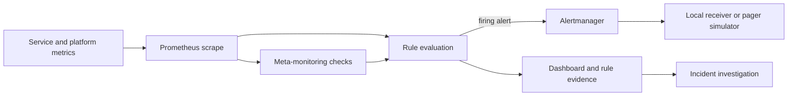
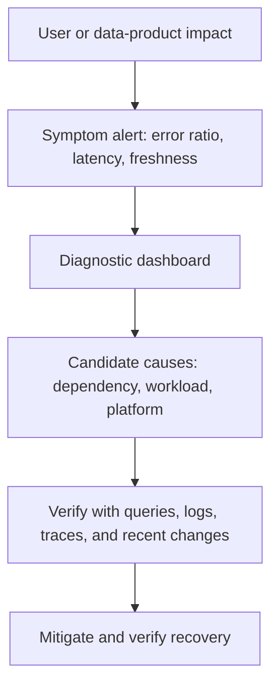
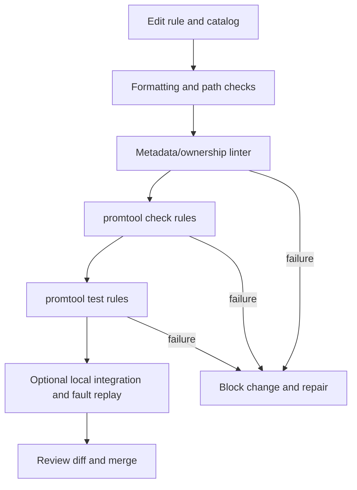

# Unit 8 — Actionable Alerts and Symptom-Based Monitoring

> **Audience:** learners who have completed Stages 0–2D and Stage 2E M01–M10.  
> **Operating context:** zero-budget local lab, primarily WSL2 Ubuntu or native Linux, with a small `kind` cluster only for optional integration.  
> **Status legend:** `[ASSUMPTION]` means a deliberate lab contract chosen because the repository-specific implementation was not available for inspection; `[VERIFY]` means check the installed version, exporter, metric schema, or local configuration before relying on it; `[SYNTHETIC]` means generated teaching data; `[ILLUSTRATIVE]` means an example value, not a recommendation.

## 8.0 — Orientation, prerequisites, and M10 handoff

### What this unit builds

This unit turns alert-design principles into a testable alert catalog that can be reviewed as code. You will define bounded metric contracts, write Prometheus rule groups, test rule states with `promtool`, lint human-facing metadata, produce an alert-quality report, and conduct safe local replay exercises. The goal is not “more alerts”; it is a smaller set of alerts that tell the right owner what action is required and provide evidence for verifying the result.

> M10 Unit 3 taught alert philosophy and quality (page vs ticket, symptom vs cause, burn-rate math, precision/recall evaluation, alert-as-code, and the local pager). This unit **implements symptom-based monitoring on the production stack** — turning those principles into a complete, tested, observable rule set and dashboards for the platform — and adds platform-specific alert catalogs, alert-quality operations at scale, and a deep treatment of alert content and context. It does not re-derive M10's math.

**Reuse from M10:** the established SLI/SLO definitions, severity and paging policy, burn-rate query definitions, incident process, alert-as-code mindset, and local pager simulator where it exists. Do not copy a new SLO formula into this unit and accidentally create a second source of truth.

**New in this unit:** the platform rule catalog, metric-contract mapping, required alert context, metadata linter, `promtool` rule fixtures, no-data design, operational quality reporting, and repeatable local fault/replay evidence.

**Unit boundaries**

- **Unit 2** owns metrics collection and PromQL fundamentals. This unit uses PromQL; it does not re-teach the full query language.
- **Unit 3** owns dashboard construction and dashboard-as-code. Here, dashboard URLs and representative queries are context links.
- **Unit 6** owns Alertmanager routing, grouping, inhibition, silence governance, notification reliability, and high availability (HA). This unit treats the notification path as a dependency and diagnoses it without duplicating the implementation course.
- **Unit 7** owns dependency maps and end-to-end correlation. This unit emits dependency symptom alerts and points responders toward that workflow.
- **Unit 9** owns saturation, queue depth, and resource-exhaustion analysis.
- **Unit 11** owns the complete scheduled-job freshness and deadline design.
- **Unit 12** owns cardinality and observability-cost controls.
- **Unit 13** owns production load, stress, and soak testing.

### Prerequisites and profiles

You should be able to read a Prometheus rule file, use `rate()` on counters, distinguish a gauge from a counter, understand the `up` metric, and navigate a Grafana dashboard. You should already have the M10 SLO query definitions and severity policy available in your learning repository.

| Profile | Scope | Resource guidance |
|---|---|---|
| **Core** | Static rule files, local `promtool` tests, Python standard-library lint/report scripts, synthetic fixtures, and a written replay | Start here; measure actual CPU, RAM, and disk use on your machine |
| **Full (optional)** | Existing local Prometheus/Grafana/Alertmanager stack, local receiver or pager simulator, plus `kind` and verified exporters | Heavier; measure your own footprint, stop unrelated containers first, and do not assume all Kubernetes metrics exist |

No SaaS alerting, cloud-managed telemetry, paid backend, public webhook, external pager, or real on-call service is required. Bind any locally launched receiver to loopback. Do not point the exercises at production or a shared cluster.

### Target architecture



The arrows are distinct failure boundaries. A rule evaluation error is not the same as an alert that never crosses its threshold. A firing alert is not proof that Alertmanager delivered a notification. A missing metric is not proof that the target is down.

### The four failure states to separate

1. **Rule evaluation failure:** the rule file failed to load, a query errored, or evaluation stopped. Evidence comes from Prometheus rule health, logs, and rule-evaluation metrics; exact self-monitoring metric names are `[VERIFY]`.
2. **Firing alert:** the expression evaluated successfully and the condition held for the configured duration. Confirm in the Prometheus Alerts page/API and inspect the evaluated expression.
3. **Notification failure:** an alert is firing, but routing, receiver configuration, retries, or downstream delivery failed. Investigate Alertmanager and the local receiver separately (Unit 6).
4. **Missing telemetry signal:** a target is reachable but an expected series disappeared, a scrape failed, traffic stopped, or instrumentation stopped exporting. These require different detection logic.

### Completion criteria

At the end, you should be able to explain why each alert exists, which owner acts, what they do, how urgency maps to M10 policy, what metric contract it assumes, how its state is tested, and how the notification path is independently verified.

---

## 8.1 — The actionability test and alert hierarchy

An alert is actionable when a known owner can perform a defined action within a useful time window and verify whether it worked. Ask these four questions for every proposed alert:

1. **Who acts?** Name a stable team or service owner—not a person who may leave.
2. **What do they do?** State the first safe action or decision, not just “investigate.”
3. **By when?** Reuse the existing M10 severity/paging policy; do not invent a competing policy here.
4. **How do they know?** Provide a query, dashboard, runbook, or recovery signal that can falsify the hypothesis.

If any answer is missing, the alert is not ready to page. It may still be useful as a dashboard panel or a tracked improvement ticket.

### Symptom versus cause

A **symptom** describes a user-visible or operationally material failure: elevated request errors, latency above the service objective, missing expected work, or loss of a critical telemetry path. A **cause signal** helps diagnose why: high CPU, a restarting pod, a slow database, a DNS error, or a certificate nearing expiry. A cause can be urgent in some contexts, but it should not automatically replace the symptom signal.



Do not suppress a user-impacting symptom just because a suspected dependency is unhealthy. If one shared DNS issue causes 12 services to fail, use the symptom alerts to establish impact and Unit 6's explicit, tested inhibition/grouping policy to reduce duplicate notifications—not to hide impact.

### Alert hierarchy

- **Page:** an urgent user-visible symptom or material immediate risk, with an owner and a safe action. Use M10's policy for severity and response timing.
- **Ticket:** a trend, capacity concern, chronic reliability issue, or actionable work that does not require immediate interruption.
- **Dashboard only:** a diagnostic cause signal that is valuable during an investigation but has no independent response action.
- **No alert:** a metric or condition that is expected, low-risk, or not actionable; keep it available for analysis if useful.

### Golden signals, RED, and USE

These are starting catalogs, not a checklist that every service must implement identically.

| Framework | Signal | Measurement location | Example question |
|---|---|---|---|
| Golden signals | Latency | Service boundary and user-facing request path | Are users waiting longer? |
| Golden signals | Traffic | Service ingress, jobs, or accepted work | Is expected demand present? |
| Golden signals | Errors | Service boundary and dependency calls | Are requests failing? |
| Golden signals | Saturation | Queue, worker pool, CPU, memory, disk, connection pool | Is capacity limiting useful work? |
| RED | Rate | Request counter at the service boundary | How many requests are being served? |
| RED | Errors | Failed requests divided by eligible requests | What fraction fails? |
| RED | Duration | Request-duration histogram | How is latency distributed? |
| USE | Utilization | Resource in-use relative to capacity | How busy is the resource? |
| USE | Saturation | Queueing or work waiting beyond service capacity | Is work accumulating? |
| USE | Errors | Resource-level errors | Is the resource rejecting or failing work? |

Do not confuse service latency with CPU utilization. CPU is often a cause signal; request latency is a user symptom. A healthy CPU graph does not prove the service is healthy.

### Worked examples

| Condition | Classification | Owner/action | Why |
|---|---|---|---|
| Error ratio exceeds the established SLO-linked threshold for the required duration | Page under M10 policy | Service owner: inspect error breakdown and recent changes; mitigate | Direct user-visible symptom |
| Request latency breaches the service SLO threshold with adequate traffic | Page or policy-defined urgent alert | Service owner: inspect latency distribution and dependency spans | Direct symptom; low traffic must be handled separately |
| A certificate is nearing expiry, with enough time for planned renewal | Ticket, unless policy says risk is urgent | Platform/security owner: renew and verify chain | Actionable prevention, not necessarily current impact |
| A node has elevated CPU but request symptoms and scheduling are healthy | Dashboard-only or ticket based on a trend | Platform owner: inspect sustained utilization and forecast | Cause signal; an instantaneous spike may be harmless |
| Expected critical scheduled job has not run by its deadline | Page/ticket per data criticality and M10 policy | Data platform owner: inspect job state and freshness | Missing expected work is a symptom; Unit 11 owns detailed design |
| A test-only debug counter changes during a local lab | No alert | Learner: inspect only if debugging | No operational action exists |
| A deployment has desired replicas 3 and available replicas 2 for a short rollout window | Dashboard or a delayed alert, depending on rollout contract | Service owner: check rollout status and deadline | Transient mismatch can be expected |
| The Prometheus scrape target for a critical service is down | Page or ticket based on service criticality and whether impact is otherwise visible | Observability owner: restore signal; service owner checks impact | Monitoring blind spot is itself operationally important |

The page decision depends on the service contract and M10 policy. Do not turn illustrative durations or thresholds into universal production defaults.

### Mini-exercise

For each candidate alert, write four answers—owner, action, deadline/policy, verification signal. If the only action is “look at a dashboard,” demote it to dashboard-only until a meaningful response is defined.

---

## 8.2 — Alert anatomy, metadata, labels, and annotations

Prometheus alert rules contain an alert name, expression, optional `for`, optional labels, and optional annotations. Labels identify and classify the alert instance; annotations explain it to a human.

- **Labels:** bounded, stable dimensions used for identity, grouping, routing, ownership, and severity. Examples: `service="checkout"`, `environment="local"`, `team="payments"`, `severity="page"`.
- **Annotations:** human-readable context such as `summary`, `description`, `runbook_url`, `dashboard_url`, and `slo`. They should not be used as high-cardinality routing keys.

A label change can create a new alert instance. A request ID, trace ID, raw URL, exception message, tenant ID, or arbitrary user-provided string can create unbounded cardinality and notification churn. Never put such values into alert labels.

### Required metadata contract

For this lesson's catalog, every alert must carry the following annotations:

- `summary`: short symptom statement.
- `description`: impact and likely-cause hints, with a safe first investigation step.
- `runbook_url`: stable local/repository-relative URL or an approved HTTPS URL.
- `dashboard_url`: stable dashboard URL or approved HTTPS URL.
- `slo`: existing SLO identifier where applicable; use `not_applicable` for platform alerts that do not map to a service SLO.
- labels: `severity`, `team`, `service`, and `environment` where applicable.

`owner` is represented by the stable `team` label in the catalog. The linter below permits a `team` label only from a bounded vocabulary. The example values are local teaching contracts, not a claim about your repository's actual teams.

### Good and poor alert content

**Good [ILLUSTRATIVE]:**

> `summary`: Checkout error ratio is elevated  
> `description`: User requests are failing above the configured threshold. Check the service error breakdown, dependency status, and recent deployment timeline; mitigate only after confirming the dominant failure mode.

**Poor examples**

- “Alert 1 is firing.” No impact, action, or context.
- “CPU is 99%, restart everything.” Premature mitigation and no evidence.
- “Failure for trace 8f3… at /customer/123.” Leaks high-cardinality identifiers and potentially sensitive data.
- “Fix immediately: https://some-random-user-input/…” Untrusted URL and unsafe link.
- “All systems down.” Too broad to falsify and likely to cause duplicate pages.

### Templating and link hygiene

Prometheus alert templates can refer to labels and query values, but exact template data and escaping behavior should be verified against the installed version. `[VERIFY]` Avoid assuming a label always exists; use a safe fallback where supported, and test rendered annotations. A URL in an annotation is still untrusted input if assembled from arbitrary labels. Prefer a static runbook/dashboard link with a small number of documented query parameters. Never include credentials or tokens in URLs.

A runbook can become stale while still returning HTTP 200. Review its owner, last-reviewed date, commands, and rollback safety. A link that resolves is not proof that its instructions remain correct.

### Example alert

**Intended path:** `Stage 2E — Production DevOps & Platform Engineering/11-Production-Observability-Stack-and-Performance-Operations/rules/service-alerts.yml`

```yaml
groups:
  - name: service-symptoms
    interval: 30s
    rules:
      - alert: ServiceHighErrorRatio
        expr: |
          (
            sum by (service, environment) (
              rate(lab_http_requests_total{outcome="error"}[5m])
            )
            /
            sum by (service, environment) (
              rate(lab_http_requests_total[5m])
            )
          ) > 0.05
          and
          sum by (service, environment) (
            rate(lab_http_requests_total[5m])
          ) > 0.1
        for: 5m
        labels:
          severity: page
          team: service-platform
        annotations:
          summary: "Error ratio is elevated for {{ $labels.service }}"
          description: "The service error ratio is above the illustrative lab threshold with sufficient traffic. Check the error breakdown, dependency dashboard, and recent changes before choosing mitigation."
          runbook_url: "https://example.invalid/runbooks/service-high-error-ratio"
          dashboard_url: "http://localhost:3000/d/service-health"
          slo: "checkout-availability"
```

This rule is deliberately illustrative. Its metric contract is defined in Section 8.4. The `example.invalid` domain is reserved and cannot be mistaken for a working runbook. Replace it only when adapting the lesson in your own repository. The exact `for` duration, traffic floor, and threshold must come from service behavior and the existing policy, not from this example.

### Metadata linter and tests

The linter below validates a small JSON catalog contract. It does not parse Prometheus YAML; `promtool` remains responsible for rule syntax and rule tests. This separation is deliberate: one tool validates rule semantics and fixtures, another validates human context and ownership.

**Intended path:** `Stage 2E — Production DevOps & Platform Engineering/11-Production-Observability-Stack-and-Performance-Operations/examples/alert-catalog.json`

```json
{
  "allowed_teams": ["service-platform", "data-platform", "observability"],
  "allowed_severities": ["page", "ticket", "info"],
  "alerts": [
    {
      "name": "ServiceHighErrorRatio",
      "service": "checkout",
      "environment": "local",
      "severity": "page",
      "team": "service-platform",
      "summary": "Error ratio is elevated for checkout",
      "description": "User requests are failing above the lab threshold. Inspect error breakdown and recent changes.",
      "runbook_url": "https://example.invalid/runbooks/service-high-error-ratio",
      "dashboard_url": "http://localhost:3000/d/service-health",
      "slo": "checkout-availability",
      "labels": ["service", "environment", "severity", "team"]
    }
  ]
}
```

**Intended path:** `Stage 2E — Production DevOps & Platform Engineering/11-Production-Observability-Stack-and-Performance-Operations/scripts/lint_alert_catalog.py`

```python
#!/usr/bin/env python3
"""Dependency-free validator for the lesson's JSON alert catalog."""
import json
import re
import sys
from pathlib import Path
from urllib.parse import urlparse

REQUIRED = {
    "name", "service", "environment", "severity", "team", "summary",
    "description", "runbook_url", "dashboard_url", "slo", "labels",
}
FORBIDDEN_LABEL_PATTERNS = (
    re.compile(r"(^|_)(request|trace|span|user|customer|tenant|session|exception|raw_url|path_id)(_|$)", re.I),
    re.compile(r"(request_id|trace_id|user_id|customer_id|session_id)", re.I),
)
ALLOWED_SCHEMES = {"http", "https"}

def valid_url(value):
    try:
        parsed = urlparse(value)
        return (
            parsed.scheme in ALLOWED_SCHEMES
            and bool(parsed.netloc)
            and parsed.username is None
            and parsed.password is None
            and not any(ch.isspace() for ch in value)
        )
    except (TypeError, ValueError):
        return False

def lint_catalog(data):
    errors = []
    allowed_teams = set(data.get("allowed_teams", []))
    allowed_severities = set(data.get("allowed_severities", []))
    alerts = data.get("alerts")
    if not isinstance(alerts, list):
        return ["alerts must be a list"]

    seen = set()
    for index, alert in enumerate(alerts):
        prefix = f"alerts[{index}]"
        if not isinstance(alert, dict):
            errors.append(f"{prefix}: entry must be an object")
            continue
        missing = sorted(REQUIRED - set(alert))
        for field in missing:
            errors.append(f"{prefix}: missing required field {field}")
        name = alert.get("name")
        if isinstance(name, str) and name:
            if name in seen:
                errors.append(f"{prefix}: duplicate alert name {name}")
            seen.add(name)
        severity = alert.get("severity")
        if severity is not None and severity not in allowed_severities:
            errors.append(f"{prefix}: invalid severity {severity!r}")
        team = alert.get("team")
        if team is not None and team not in allowed_teams:
            errors.append(f"{prefix}: unknown team/owner {team!r}")
        for field in ("summary", "description", "slo"):
            value = alert.get(field)
            if not isinstance(value, str) or not value.strip():
                errors.append(f"{prefix}: {field} must be nonblank text")
        for field in ("runbook_url", "dashboard_url"):
            if field in alert and not valid_url(alert[field]):
                errors.append(f"{prefix}: invalid {field}")
        labels = alert.get("labels", [])
        if not isinstance(labels, list):
            errors.append(f"{prefix}: labels must be a list")
            continue
        for label in labels:
            if not isinstance(label, str):
                errors.append(f"{prefix}: label names must be strings")
                continue
            if any(pattern.search(label) for pattern in FORBIDDEN_LABEL_PATTERNS):
                errors.append(f"{prefix}: forbidden/high-cardinality label {label!r}")
    return sorted(errors)

def main(argv):
    if len(argv) != 2:
        print("usage: lint_alert_catalog.py CATALOG.json", file=sys.stderr)
        return 2
    try:
        data = json.loads(Path(argv[1]).read_text(encoding="utf-8"))
    except (OSError, json.JSONDecodeError) as exc:
        print(f"input error: {exc}", file=sys.stderr)
        return 2
    errors = lint_catalog(data)
    if errors:
        for error in errors:
            print(f"ERROR: {error}")
        return 1
    print(f"OK: {len(data['alerts'])} alert catalog entries validated")
    return 0

if __name__ == "__main__":
    raise SystemExit(main(sys.argv))
```

**Intended path:** `Stage 2E — Production DevOps & Platform Engineering/11-Production-Observability-Stack-and-Performance-Operations/tests/test_alert_catalog_lint.py`

```python
import unittest
from scripts.lint_alert_catalog import lint_catalog

BASE = {
    "name": "ServiceHighErrorRatio", "service": "checkout",
    "environment": "local", "severity": "page", "team": "service-platform",
    "summary": "Error ratio is elevated", "description": "Inspect the error breakdown.",
    "runbook_url": "https://example.invalid/runbook",
    "dashboard_url": "http://localhost:3000/d/service", "slo": "checkout-availability",
    "labels": ["service", "environment", "severity", "team"],
}
DATA = {
    "allowed_teams": ["service-platform", "observability"],
    "allowed_severities": ["page", "ticket", "info"],
}

class CatalogLintTests(unittest.TestCase):
    def test_clean_entry(self):
        self.assertEqual(lint_catalog({**DATA, "alerts": [BASE]}), [])

    def test_missing_required_context(self):
        bad = dict(BASE)
        del bad["runbook_url"]
        self.assertTrue(any("missing required field runbook_url" in e
                            for e in lint_catalog({**DATA, "alerts": [bad]})))

    def test_invalid_severity_and_owner(self):
        bad = {**BASE, "severity": "urgent", "team": "unknown"}
        errors = lint_catalog({**DATA, "alerts": [bad]})
        self.assertTrue(any("invalid severity" in e for e in errors))
        self.assertTrue(any("unknown team/owner" in e for e in errors))

    def test_bad_urls_and_blank_context(self):
        bad = {**BASE, "runbook_url": "javascript:alert(1)",
               "dashboard_url": "not a url", "description": " "}
        errors = lint_catalog({**DATA, "alerts": [bad]})
        self.assertTrue(any("invalid runbook_url" in e for e in errors))
        self.assertTrue(any("invalid dashboard_url" in e for e in errors))
        self.assertTrue(any("description must be nonblank" in e for e in errors))

    def test_duplicate_names_and_forbidden_label(self):
        bad = {**BASE, "labels": ["service", "trace_id"]}
        errors = lint_catalog({**DATA, "alerts": [BASE, bad]})
        self.assertTrue(any("duplicate alert name" in e for e in errors))
        self.assertTrue(any("forbidden/high-cardinality" in e for e in errors))

if __name__ == "__main__":
    unittest.main()
```

The test imports assume the repository lesson is copied into a Python package layout where `scripts` is importable; alternatively run the tests from the M11 directory with a suitable `PYTHONPATH`. The examples above are teaching artifacts and are not written into a repository by this lesson-generation step.

---

## 8.3 — No-data, absence, staleness, and silent failures

“No data” is not one condition. Decide what was expected, at what scope, and during which time window.

- **Target down:** Prometheus knows the target and reports `up == 0`.
- **Target missing:** the target is no longer in service discovery; an `up` selector for that target may return no series rather than zero.
- **Metric disappeared:** the target may still be scraped, but one expected metric is no longer emitted.
- **Traffic absent:** the target is up, but no requests arrived. This may be normal for an idle service or a serious failure for a continuously active workload.
- **Rule evaluation stopped:** no new rule state is produced. Use Prometheus's own rule/evaluation health and an independent check where possible.
- **Notification missing:** Prometheus has a firing alert, but the notification receiver has no event. Inspect Alertmanager separately.
- **Expected work missing:** a heartbeat, job completion marker, or freshness signal has not advanced. Unit 11 owns the complete scheduled-job design.

### `up`, `absent()`, and staleness

`up` is generated by Prometheus for discovered scrape targets: `1` means the most recent scrape succeeded, `0` means it failed. If the target disappears from discovery, the series can disappear too. Thus, `up == 0` detects a known failed target, not every missing-target case.

PromQL `absent(v)` returns a result when the selector `v` has no series; `absent_over_time(v[range])` tests whether a range contains no samples. Exact behavior, label inference, staleness behavior, and function availability must be checked against the installed Prometheus version and query context: `[VERIFY]`. A single `absent()` expression cannot discover every dynamic target that should exist unless expected targets are represented in a separate inventory/contract.

### Detection matrix

| Failure | Suitable evidence | Common trap |
|---|---|---|
| Known scrape target down | `up == 0` | Treating it as proof that the service itself is unavailable |
| Expected target removed from discovery | Inventory-versus-target comparison, or expected-target heartbeat | `up == 0` cannot match a series that no longer exists |
| One metric vanished | `absent(expected_metric{bounded_labels...})` or inventory-backed check | Selector too broad or labels inferred differently than expected |
| No requests received | Request-rate signal plus an expected-traffic contract and time-of-day context | Paging during planned idle periods |
| Exporter process down | Target `up`, exporter self-health, and expected metric contract | Exporter can be up but no longer collect the needed source |
| Rule evaluation stopped | Prometheus self-metrics/logs plus independent heartbeat/monitoring | The same broken Prometheus cannot reliably report every failure of itself |
| Notification delivery failed | Firing alert evidence compared with receiver arrival and Alertmanager logs/metrics | Assuming “firing” means “delivered” |

### Synthetic examples

Known target down:

```promql
up{job="lab-api"} == 0
```

Expected metric absent (example selector; labels must match the actual series contract):

```promql
absent(lab_http_requests_total{service="checkout", environment="local"})
```

No request traffic for a continuously active service, with a traffic expectation explicitly established by the service contract:

```promql
sum(rate(lab_http_requests_total{service="checkout"}[10m])) == 0
```

The last expression is **not** a universal alert. It needs a known expected-traffic schedule, an idle-period exemption, and an independent service-health check. If the counter series has never existed, the expression may return no series; combine it with a contract/heartbeat or a verified absence check.

### Heartbeat and meta-monitoring

A `Watchdog`/heartbeat alert is typically designed to remain firing so the receiver can demonstrate that the path is alive. Its usefulness depends on where it is observed: a green alert in the same local Prometheus does not prove the receiver or any external heartbeat collector saw it. Reuse Unit 6's Watchdog and local pager concepts; do not claim an external heartbeat unless you actually have one.

A practical design has independent evidence at each boundary:

1. **Scrape:** target inventory and `up`.
2. **Rule evaluation:** Prometheus rule health and logs.
3. **Alert state:** Prometheus alert list/state.
4. **Routing:** Alertmanager route/matcher inspection and logs.
5. **Delivery:** local receiver or pager-simulator event record.
6. **Independent heartbeat:** only if a separate observer actually receives it.

For a small local lab, the last boundary may be documented as “not externally verified.” That is more honest than claiming full meta-monitoring.

### No-data lab

- **Profile:** Core.
- **Footprint:** run the tests and a small local Prometheus only if already available; measure your own use.
- **Prerequisites:** understand the difference between `up == 0` and an absent series.
- **Safety/context:** use a synthetic job label, loopback-only endpoints, and no shared/production targets.
- **Steps:** evaluate the three expressions above against a test fixture; then remove one expected series and compare outcomes.
- **Expected evidence:** one known-target-down case, one absent-series case, and one zero-traffic case with an explicit expected-traffic contract.
- **Failure interpretation:** an empty query result is not automatically healthy; it may mean the expression's input series disappeared.
- **Cleanup:** stop only the process/container started for the exercise and remove its temporary fixture.
- **Cleanup verification:** confirm no lab target or injected fault remains active.
- **Abort conditions:** stop if the target selector matches anything outside the local lab or if the command would alter a shared Prometheus configuration.

---

## 8.4 — Platform alert catalog and rule implementation

This section defines a coherent sample contract and rule set. It is deliberately split into portable lab rules and optional Kubernetes/exporter rules. Exact metric names supplied by optional exporters are `[VERIFY]`; do not enable a rule merely because its name appears in a lesson.

### Synthetic metric contract

**[ASSUMPTION]** The local service exposes finite, bounded metrics:

- `lab_http_requests_total{service,environment,outcome,method}` — monotonically increasing counter; `outcome` is from a finite set such as `success|error`.
- `lab_http_request_duration_seconds_bucket{service,environment,le}` — histogram buckets.
- `lab_dependency_requests_total{service,environment,dependency,outcome}` — counter; `dependency` comes from a fixed allow-list.
- `lab_dependency_request_duration_seconds_bucket{service,environment,dependency,le}` — histogram buckets.
- `lab_circuit_breaker_open{service,environment,dependency}` — gauge `0|1`.
- `lab_expected_traffic{service,environment}` — gauge `0|1` from a controlled contract, not inferred from request traffic.
- `lab_service_heartbeat_timestamp_seconds{service,environment}` — timestamp gauge updated by instrumentation or a synthetic heartbeat.
- `lab_expected_job_last_success_timestamp_seconds{job,environment}` — timestamp gauge; the detailed freshness model belongs to Unit 11.

All names beginning `lab_` are synthetic teaching names, not standard Prometheus metrics. Your real application may use different names and label schemas. Map these contracts to actual instrumentation before adapting rules.

### Portable service and dependency rules

**Intended path:** `Stage 2E — Production DevOps & Platform Engineering/11-Production-Observability-Stack-and-Performance-Operations/rules/lab-alerts.yml`

```yaml
groups:
  - name: lab-service-symptoms
    interval: 30s
    rules:
      - alert: ServiceHighErrorRatio
        expr: |
          (
            sum by (service, environment) (rate(lab_http_requests_total{outcome="error"}[5m]))
            /
            sum by (service, environment) (rate(lab_http_requests_total[5m]))
          ) > 0.05
          and
          sum by (service, environment) (rate(lab_http_requests_total[5m])) > 0.1
        for: 2m
        labels:
          severity: page
          team: service-platform
        annotations:
          summary: "Error ratio elevated for {{ $labels.service }}"
          description: "Requests are failing above the synthetic lab threshold. Check error classes, dependency status, and recent changes; confirm impact before mitigation."
          runbook_url: "https://example.invalid/runbooks/service-errors"
          dashboard_url: "http://localhost:3000/d/service-health"
          slo: "checkout-availability"

      - alert: ServiceLatencyHigh
        expr: |
          histogram_quantile(
            0.95,
            sum by (service, environment, le) (
              rate(lab_http_request_duration_seconds_bucket[5m])
            )
          ) > 0.5
          and
          sum by (service, environment) (rate(lab_http_requests_total[5m])) > 0.1
        for: 5m
        labels:
          severity: page
          team: service-platform
        annotations:
          summary: "Request latency is high for {{ $labels.service }}"
          description: "Synthetic p95 latency is above the lab threshold with sufficient traffic. Inspect trace spans and dependency latency before changing capacity."
          runbook_url: "https://example.invalid/runbooks/service-latency"
          dashboard_url: "http://localhost:3000/d/service-health"
          slo: "checkout-latency"

      - alert: ServiceTrafficUnexpectedlyAbsent
        expr: |
          lab_expected_traffic == 1
          and
          sum by (service, environment) (rate(lab_http_requests_total[10m])) == 0
        for: 10m
        labels:
          severity: ticket
          team: service-platform
        annotations:
          summary: "Expected traffic is absent for {{ $labels.service }}"
          description: "The lab contract expects traffic but the request rate is zero. Verify routing, caller health, and instrumentation; exempt known maintenance or quiet periods."
          runbook_url: "https://example.invalid/runbooks/traffic-absence"
          dashboard_url: "http://localhost:3000/d/service-health"
          slo: "not_applicable"

      - alert: ServiceHeartbeatStale
        expr: |
          time() - lab_service_heartbeat_timestamp_seconds > 120
        for: 1m
        labels:
          severity: ticket
          team: observability
        annotations:
          summary: "Service heartbeat is stale for {{ $labels.service }}"
          description: "The expected service heartbeat timestamp is older than the synthetic lab window. Determine whether the service, exporter, or scrape path stopped reporting."
          runbook_url: "https://example.invalid/runbooks/heartbeat-stale"
          dashboard_url: "http://localhost:3000/d/telemetry-health"
          slo: "not_applicable"

  - name: lab-dependency-symptoms
    interval: 30s
    rules:
      - alert: DependencyHighErrorRatio
        expr: |
          (
            sum by (service, environment, dependency) (
              rate(lab_dependency_requests_total{outcome="error"}[5m])
            )
            /
            sum by (service, environment, dependency) (
              rate(lab_dependency_requests_total[5m])
            )
          ) > 0.1
          and
          sum by (service, environment, dependency) (
            rate(lab_dependency_requests_total[5m])
          ) > 0.05
        for: 3m
        labels:
          severity: ticket
          team: service-platform
        annotations:
          summary: "Outbound errors elevated for {{ $labels.dependency }}"
          description: "The service reports an elevated dependency error ratio. Check Unit 7's dependency correlation workflow and confirm whether retries mask user impact."
          runbook_url: "https://example.invalid/runbooks/dependency-errors"
          dashboard_url: "http://localhost:3000/d/dependencies"
          slo: "not_applicable"

      - alert: DependencyLatencyHigh
        expr: |
          histogram_quantile(
            0.95,
            sum by (service, environment, dependency, le) (
              rate(lab_dependency_request_duration_seconds_bucket[5m])
            )
          ) > 0.25
        for: 3m
        labels:
          severity: ticket
          team: service-platform
        annotations:
          summary: "Dependency latency elevated for {{ $labels.dependency }}"
          description: "Synthetic dependency p95 is above the lab threshold. Check whether the delay is isolated to this dependency and compare trace spans."
          runbook_url: "https://example.invalid/runbooks/dependency-latency"
          dashboard_url: "http://localhost:3000/d/dependencies"
          slo: "not_applicable"

      - alert: CircuitBreakerOpen
        expr: lab_circuit_breaker_open == 1
        for: 1m
        labels:
          severity: ticket
          team: service-platform
        annotations:
          summary: "Circuit breaker is open for {{ $labels.dependency }}"
          description: "A dependency circuit breaker is open. Verify the dependency state and retry behavior; do not force-close it without understanding the failure mode."
          runbook_url: "https://example.invalid/runbooks/circuit-breaker"
          dashboard_url: "http://localhost:3000/d/dependencies"
          slo: "not_applicable"

  - name: lab-telemetry-health
    interval: 30s
    rules:
      - alert: LabTargetDown
        expr: up{job="lab-api"} == 0
        for: 2m
        labels:
          severity: ticket
          team: observability
        annotations:
          summary: "Prometheus cannot scrape lab-api"
          description: "The known local target has failed scraping. Check the target endpoint and scrape errors; do not infer user impact from scrape state alone."
          runbook_url: "https://example.invalid/runbooks/target-down"
          dashboard_url: "http://localhost:3000/d/telemetry-health"
          slo: "not_applicable"

      - alert: ExpectedLabMetricMissing
        expr: absent(lab_http_requests_total{service="checkout", environment="local"})
        for: 5m
        labels:
          severity: ticket
          team: observability
          service: checkout
          environment: local
        annotations:
          summary: "Expected request metric is missing"
          description: "The expected checkout series is absent. Check target discovery, scrape health, instrumentation, and selector labels."
          runbook_url: "https://example.invalid/runbooks/missing-metric"
          dashboard_url: "http://localhost:3000/d/telemetry-health"
          slo: "not_applicable"
```

**Interpretation notes**

- These are local teaching rules, not production thresholds. The `for` durations, traffic floors, and ratio cutoffs are `[ILLUSTRATIVE]`.
- The ratio denominator must be nonzero. The traffic floor prevents low-volume noise but is not a universal solution; choose a floor from real traffic characteristics and SLO policy.
- Counter resets are handled by applying `rate()` before aggregation. Do not sum raw counters and then attempt to derive a rate.
- Histograms must be aggregated with `le` retained before `histogram_quantile()`. The histogram metric contract must match the instrumented client.
- `ServiceTrafficUnexpectedlyAbsent` assumes the `lab_expected_traffic` gauge exists and is set correctly. A zero request rate by itself is not enough to page.
- `ExpectedLabMetricMissing` checks one explicitly expected label set. A dynamic fleet needs an inventory/heartbeat contract; one fixed selector cannot discover every missing service.
- Fast and slow SLO burn-rate rules are intentionally not re-derived. Import the exact M10 expressions and tests; map the M10 SLI names to the metric contract. Do not replace them with the illustrative error-ratio rule.
- Traffic-drop-versus-baseline comparisons using `offset` are `[VERIFY]` and need seasonality-aware controls. Same-hour-yesterday or same-weekday comparisons can still be misleading during deployments, holidays, backfills, or low-traffic periods.

### Fast/slow SLO burn alerts: reuse the M10 source of truth

**Intended path:** `Stage 2E — Production DevOps & Platform Engineering/11-Production-Observability-Stack-and-Performance-Operations/rules/m10-burn-rate-adapter.example.yml`

```yaml
# TEMPLATE ONLY: replace every placeholder with the exact tested M10 expression.
# Do not deploy this file unchanged.
groups:
  - name: m10-slo-burn-adapter
    rules:
      - alert: ExistingM10FastBurn
        expr: <PASTE_EXACT_M10_FAST_BURN_EXPRESSION>
        for: <PASTE_M10_FAST_BURN_FOR_DURATION>
        labels:
          severity: <M10_POLICY_SEVERITY>
          team: service-platform
        annotations:
          summary: "Fast SLO burn for {{ $labels.service }}"
          description: "The established M10 fast-burn rule is firing. Follow the M10 SLO runbook and verify impact using the service dashboard."
          runbook_url: "https://example.invalid/runbooks/m10-fast-burn"
          dashboard_url: "http://localhost:3000/d/service-slo"
          slo: "<EXISTING_M10_SLO_ID>"
      - alert: ExistingM10SlowBurn
        expr: <PASTE_EXACT_M10_SLOW_BURN_EXPRESSION>
        for: <PASTE_M10_SLOW_BURN_FOR_DURATION>
        labels:
          severity: <M10_POLICY_SEVERITY>
          team: service-platform
        annotations:
          summary: "Slow SLO burn for {{ $labels.service }}"
          description: "The established M10 slow-burn rule is firing. Follow the M10 SLO runbook and verify impact using the service dashboard."
          runbook_url: "https://example.invalid/runbooks/m10-slow-burn"
          dashboard_url: "http://localhost:3000/d/service-slo"
          slo: "<EXISTING_M10_SLO_ID>"
```

The angle-bracket placeholders intentionally make this an invalid deployable rule file until filled. That prevents a learner from accidentally shipping a made-up burn-rate formula. Copy the actual M10 query and tests, preserve the existing severity mapping, then run `promtool check rules` and `promtool test rules`.

### Traffic drop against a baseline

**[VERIFY]** `offset` is standard PromQL syntax, but the exact baseline window and comparison query must be validated against the installed Prometheus version and your metric labels. A sketch for investigation—not a ready-to-page rule—is:

```promql
sum(rate(lab_http_requests_total{service="checkout"}[10m]))
/
sum(rate(lab_http_requests_total{service="checkout"}[10m] offset 1d))
```

A ratio well below one may mean demand fell, a caller failed, the service stopped, or the comparison period was atypical. Guard against a zero/missing baseline, planned quiet periods, deployment windows, and seasonal traffic. A baseline alert should normally start as a ticket until replay evidence demonstrates useful detection without excessive false positives.

### Optional Kubernetes and infrastructure catalog

These rules are examples of the categories to implement, not a promise that a fresh `kind` cluster exposes the required metrics. Metric names and label schemas from kube-state-metrics, kubelet, cAdvisor, CoreDNS, ingress controllers, blackbox exporter, cert-manager, and event exporters are `[VERIFY]`. Confirm the installed exporter version, scrape target, metric name, and labels before enabling any rule.

| Alert name | Contract / example query | Default disposition | Required verification |
|---|---|---|---|
| `KubernetesContainerRestarting` | `increase(kube_pod_container_status_restarts_total[10m]) > 2` | Ticket or page per impact | `[VERIFY]` metric, namespace/pod labels, scrape job |
| `KubernetesPodNotReady` | `kube_pod_status_ready{condition="false"} == 1` | Ticket during sustained failure | `[VERIFY]` metric semantics and rollout exclusions |
| `DeploymentReplicasMismatch` | `kube_deployment_spec_replicas != kube_deployment_status_replicas_available` | Ticket after rollout grace | `[VERIFY]` metrics and labels |
| `HPAAtMaximum` | `kube_horizontalpodautoscaler_status_current_replicas == kube_horizontalpodautoscaler_spec_max_replicas` | Ticket unless user impact/capacity risk is demonstrated | `[VERIFY]` metric names; HPA may be absent in the lab |
| `KubernetesNodeNotReady` | `kube_node_status_condition{condition="Ready",status="true"} == 0` | Platform page/ticket by cluster contract | `[VERIFY]` metric and condition labels |
| `KubeletRequestErrors` | error-rate ratio over kubelet request counters | Diagnostic/ticket | `[VERIFY]` exact counters; local `kind` visibility is limited |
| `APIServerRequestErrors` | error ratio by API status code | Diagnostic/ticket | `[VERIFY]` API server scrape availability in `kind` |
| `CoreDNSHighErrorRatio` | error counter rate divided by request counter rate | Ticket or page if name resolution impacts users | `[VERIFY]` CoreDNS metric schema and labels |
| `IngressHigh5xxRatio` | ingress 5xx / all ingress requests | Page if user symptom is confirmed | `[VERIFY]` controller-specific metric contract |
| `CertificateExpirySoon` | remaining certificate lifetime below a defined lead time | Ticket/page according to renewal window | `[VERIFY]` cert-manager or blackbox metric source |
| `PersistentVolumeNearlyFull` | used bytes / capacity bytes above a reviewed threshold | Ticket; page if imminent write failure | `[VERIFY]` filesystem/PVC metrics and semantics |
| `ImagePullFailures` | event-exporter metric or Kubernetes events | Ticket; page only for blocked critical rollout | `[VERIFY]` event exporter; not a universal core metric |
| `CronJobMissedRun` | expected-run contract plus last-success timestamp | Link to Unit 11 | `[VERIFY]` metric contract; do not rely on one event counter alone |

A typical optional rule, shown as a **schema template only**, is:

```yaml
# TEMPLATE ONLY — metric names/labels are [VERIFY] for your installed exporter.
groups:
  - name: optional-kubernetes-health
    rules:
      - alert: KubernetesContainerRestarting
        expr: increase(kube_pod_container_status_restarts_total[10m]) > 2
        for: 5m
        labels:
          severity: ticket
          team: observability
        annotations:
          summary: "Container restart activity is elevated"
          description: "A container restart counter increased repeatedly. Check pod events, rollout state, and recent image/config changes."
          runbook_url: "https://example.invalid/runbooks/container-restarts"
          dashboard_url: "http://localhost:3000/d/kubernetes-health"
          slo: "not_applicable"
```

### Rule group contract

For every rule group, document the following in review:

1. **Intent:** what symptom or blind spot the group detects.
2. **Source contract:** metric type, finite labels, exporter/instrumentation owner, and expected scrape interval.
3. **Expression:** explain numerator, denominator, grouping, and missing-data behavior.
4. **`for` duration:** why transient noise should be filtered; tie the value to detection objectives and measured behavior.
5. **Severity:** map to the existing M10 policy and service criticality.
6. **Metadata:** all required annotations and stable team ownership.
7. **Links:** runbook and dashboard are reviewed, safe, and maintained.
8. **False positives:** low traffic, rollout, maintenance, baseline seasonality, scrape lag, and partial instrumentation.
9. **Tests:** firing, non-firing, boundary, missing series, counter reset, and labels/annotations.
10. **Rollback:** a reviewed way to revert a bad rule without hiding a real symptom.

### Alert catalog index

| Alert | Symptom | Owner | Severity policy reference | Runbook | Dashboard | Test evidence |
|---|---|---|---|---|---|---|
| `ServiceHighErrorRatio` | Elevated service errors | `service-platform` | M10 policy; sample disposition is illustrative | `service-errors` | `service-health` | firing, low traffic, zero denominator |
| `ServiceLatencyHigh` | p95 exceeds lab threshold | `service-platform` | M10 policy; sample disposition is illustrative | `service-latency` | `service-health` | firing, adequate traffic |
| `ServiceTrafficUnexpectedlyAbsent` | Expected requests stop | `service-platform` | Use expected-traffic contract | `traffic-absence` | `service-health` | expected idle vs unexpected silence |
| `ServiceHeartbeatStale` | Instrumentation heartbeat stale | `observability` | Monitoring blind spot policy | `heartbeat-stale` | `telemetry-health` | stale/fresh timestamp |
| `DependencyHighErrorRatio` | Outbound failures rise | `service-platform` | Ticket until impact is established | `dependency-errors` | `dependencies` | dependency label grouping |
| `DependencyLatencyHigh` | Dependency p95 rises | `service-platform` | Ticket until impact is established | `dependency-latency` | `dependencies` | per-dependency series |
| `CircuitBreakerOpen` | Breaker remains open | `service-platform` | Existing M10 policy | `circuit-breaker` | `dependencies` | gauge 0/1 |
| `LabTargetDown` | Scrape target fails | `observability` | Local lab only | `target-down` | `telemetry-health` | `up=0` |
| `ExpectedLabMetricMissing` | Expected series disappears | `observability` | Local lab only | `missing-metric` | `telemetry-health` | absent series |
| M10 fast/slow burn | SLO budget burns | Existing service owner | Exact M10 policy | Existing M10 runbook | Existing SLO dashboard | Reuse M10 fixtures |
| Optional Kubernetes alerts | Workload/platform symptom | Platform/observability owner | Existing policy | Verified runbook | Kubernetes/platform dashboard | Exporter-specific fixtures |

---

## 8.5 — `promtool` tests and rule behavior

Rule tests evaluate rules against supplied synthetic time series. They can catch expression mistakes, threshold boundaries, label/annotation regressions, and missing-series behavior. They cannot establish whether the threshold is useful in production, whether an owner responds correctly, or whether the notification receiver works.

### Portable testable subset

For reproducible rule tests, use a small separate rule file with only the synthetic rules needed by the fixtures. The full `lab-alerts.yml` above includes `up` and metric selectors that require their series in the fixture. Ensure that all expressions use the same metric names and labels as the fixtures.

**Intended path:** `Stage 2E — Production DevOps & Platform Engineering/11-Production-Observability-Stack-and-Performance-Operations/tests/rules-test.yml`

```yaml
rule_files:
  - rules/lab-alerts-testable.yml
evaluation_interval: 30s
tests:
  - name: error-ratio-fires-after-for
    interval: 30s
    input_series:
      - series: 'lab_http_requests_total{service="checkout",environment="local",outcome="success",method="GET"}'
        values: '0+10x20'
      - series: 'lab_http_requests_total{service="checkout",environment="local",outcome="error",method="GET"}'
        values: '0+2x20'
    alert_rule_test:
      - eval_time: 10m
        alertname: ServiceHighErrorRatio
        exp_alerts:
          - exp_labels:
              service: checkout
              environment: local
              severity: page
              team: service-platform
            exp_annotations:
              summary: "Error ratio elevated for checkout"
              description: "Requests are failing above the synthetic lab threshold. Check error classes, dependency status, and recent changes; confirm impact before mitigation."
              runbook_url: "https://example.invalid/runbooks/service-errors"
              dashboard_url: "http://localhost:3000/d/service-health"
              slo: "checkout-availability"

  - name: low-traffic-does-not-fire-error-ratio
    interval: 30s
    input_series:
      - series: 'lab_http_requests_total{service="checkout",environment="local",outcome="success",method="GET"}'
        values: '0+0x20'
      - series: 'lab_http_requests_total{service="checkout",environment="local",outcome="error",method="GET"}'
        values: '0+0x20'
    alert_rule_test:
      - eval_time: 10m
        alertname: ServiceHighErrorRatio
        exp_alerts: []

  - name: missing-request-series-fires-absence-rule
    interval: 30s
    input_series: []
    alert_rule_test:
      - eval_time: 10m
        alertname: ExpectedLabMetricMissing
        exp_alerts:
          - exp_labels:
              service: checkout
              environment: local
              severity: ticket
              team: observability
            exp_annotations:
              summary: "Expected request metric is missing"
              description: "The expected checkout series is absent. Check target discovery, scrape health, instrumentation, and selector labels."
              runbook_url: "https://example.invalid/runbooks/missing-metric"
              dashboard_url: "http://localhost:3000/d/telemetry-health"
              slo: "not_applicable"
```

**Intended path:** `Stage 2E — Production DevOps & Platform Engineering/11-Production-Observability-Stack-and-Performance-Operations/rules/lab-alerts-testable.yml`

```yaml
groups:
  - name: lab-service-symptoms
    rules:
      - alert: ServiceHighErrorRatio
        expr: |
          (
            sum by (service, environment) (rate(lab_http_requests_total{outcome="error"}[5m]))
            /
            sum by (service, environment) (rate(lab_http_requests_total[5m]))
          ) > 0.05
          and
          sum by (service, environment) (rate(lab_http_requests_total[5m])) > 0.1
        for: 2m
        labels:
          severity: page
          team: service-platform
        annotations:
          summary: "Error ratio elevated for {{ $labels.service }}"
          description: "Requests are failing above the synthetic lab threshold. Check error classes, dependency status, and recent changes; confirm impact before mitigation."
          runbook_url: "https://example.invalid/runbooks/service-errors"
          dashboard_url: "http://localhost:3000/d/service-health"
          slo: "checkout-availability"
      - alert: ExpectedLabMetricMissing
        expr: absent(lab_http_requests_total{service="checkout", environment="local"})
        for: 5m
        labels:
          severity: ticket
          team: observability
          service: checkout
          environment: local
        annotations:
          summary: "Expected request metric is missing"
          description: "The expected checkout series is absent. Check target discovery, scrape health, instrumentation, and selector labels."
          runbook_url: "https://example.invalid/runbooks/missing-metric"
          dashboard_url: "http://localhost:3000/d/telemetry-health"
          slo: "not_applicable"
```

**[VERIFY]** The exact `promtool test rules` fixture schema, duration parsing, and annotation comparison behavior are version-sensitive. Check the installed `promtool` documentation and run the tests before adapting. The fixture is a complete example for the stated schema, not a claim of execution.

### Commands and working directory

From the M11 directory after copying the lesson's intended artifacts into the corresponding paths:

```bash
promtool check rules rules/lab-alerts-testable.yml
promtool test rules tests/rules-test.yml
```

If `promtool` is not installed, do not install an unpinned binary from an unknown source. Check the Prometheus installation/version used by your lab and obtain the matching tool from the official distribution. Record `promtool --version` with the test evidence.

### Counter reset, boundaries, and grouping

A robust test suite should include:

- **Firing:** enough samples for `rate()` and the configured `for`.
- **Non-firing:** error ratio below threshold.
- **Boundary:** ratio exactly equal to threshold; with `>` it should not fire, whereas `>=` would have different semantics.
- **Low traffic:** ratio is high but denominator is below the traffic floor.
- **Counter reset:** a counter drops; `rate()` should handle resets according to Prometheus semantics.
- **Missing series:** expected series disappears; test absence separately from `up == 0`.
- **Grouping:** two services or dependencies produce distinct alert instances without leaking unbounded labels.
- **Annotation contract:** summary, description, links, and SLO identifier remain nonblank and stable.

A test's `eval_time` must be late enough to satisfy the range window and `for` duration. For counter rates, a single sample is insufficient. Always inspect the input series and evaluation time when a test unexpectedly stays pending or inactive.

### Intentionally broken rule

**[EXPECTED EXAMPLE OUTPUT — not observed execution]** If `rate(lab_http_request_total[5m])` uses a misspelled metric name, `promtool check rules` may still accept syntactically valid PromQL because an unknown metric name is syntactically legal. The unit test should then fail to observe the expected alert, for example with an expected-versus-actual alert mismatch. This demonstrates why syntax validation alone is insufficient.

If the expression has a syntax error such as an unclosed parenthesis, `promtool check rules` should report a parse error. Exact wording varies by version `[VERIFY]`.

---

## 8.6 — Catalog linting, alert-as-code, and CI-style validation

Alert-as-code means the rule, metadata, tests, and review history are version-controlled together. It does not mean every alert needs a complicated deployment framework. The important property is that a change is validated before it reaches the monitoring system.

### Validation pipeline



A catalog entry and a Prometheus rule are related but not identical artifacts. The JSON catalog linter validates ownership and human context; `promtool` validates rule syntax and fixture behavior. A `PrometheusRule` Kubernetes custom resource is a separate schema layer: validate the Operator CRD and installed Operator version independently `[VERIFY]`. A plain Prometheus rule file does not validate as an Operator resource simply because the `groups` field looks similar.

### Local CI-style shell script

**Intended path:** `Stage 2E — Production DevOps & Platform Engineering/11-Production-Observability-Stack-and-Performance-Operations/scripts/validate-alerts.sh`

```bash
#!/usr/bin/env bash
set -euo pipefail

# Run from the M11 directory. Set CATALOG and RULES explicitly if paths differ.
CATALOG="${CATALOG:-examples/alert-catalog.json}"
RULES="${RULES:-rules/lab-alerts-testable.yml}"
TESTS="${TESTS:-tests/rules-test.yml}"

echo "[1/4] Python syntax"
python -m py_compile scripts/lint_alert_catalog.py

echo "[2/4] Metadata and ownership lint"
python scripts/lint_alert_catalog.py "$CATALOG"

echo "[3/4] Prometheus rule syntax"
promtool check rules "$RULES"

echo "[4/4] Prometheus rule fixtures"
promtool test rules "$TESTS"

echo "PASS: local alert validation sequence completed"
```

This script intentionally stops at the first failed stage. Do not report success if any earlier command failed. Add formatting or repository-specific schema checks only after choosing and pinning the relevant tools.

### Deliberately planted metadata defect

For a safe negative test, copy the JSON fixture to a temporary file, remove `team`, set `severity` to `urgent`, and change `runbook_url` to `javascript:...`. The linter should exit nonzero and report the missing field, invalid severity, and invalid URL. Do not commit the broken fixture as the clean catalog.

**[EXPECTED EXAMPLE OUTPUT — not observed execution]**

```text
ERROR: alerts[0]: missing required field team
ERROR: alerts[0]: invalid runbook_url
ERROR: alerts[0]: invalid severity 'urgent'
```

Exact error ordering is deterministic for the supplied linter because the missing-field list and final error list are sorted. This output assumes the input contains those defects and is illustrative until run.

---

## 8.7 — Alert quality operations at scale

Rule correctness is necessary but not sufficient. An alert can pass every fixture and still be noisy, late, redundant, or useless in a real incident. Alert quality is an operating discipline: measure outcomes, review misses, and change rules with evidence.

### Quality indicators

| Indicator | Definition for this lesson | Evidence source | Interpretation |
|---|---|---|---|
| Actionable rate | Actionable alert episodes / reviewed alert episodes | Incident/review log | High volume alone is not success |
| False-positive rate | Non-actionable firings / reviewed firings | Replay and incident review | Requires a defined label for “non-actionable” |
| Duplicate/page volume | Notifications that represent the same incident or symptom | Alertmanager/receiver event log | Grouping/inhibition are Unit 6 mechanisms |
| Flapping | Alert state transitions that repeatedly cross firing/resolved within a review window | Rule state history or receiver events | Often threshold noise, short `for`, or unstable instrumentation |
| Time-to-detect | Fault start to first qualifying alert firing | Fault start and alert-state timestamps | Measure it; do not infer it from configured `for` |
| Missing-alert rate | Known injected/reviewed incidents with no expected alert / all known incidents | Incident replay table | The incident set is a sample, not all possible failures |
| Missing context | Firing alerts without owner, runbook, dashboard, or meaningful description | Catalog lint and receiver payload | Metadata completeness is measurable |
| Delivery latency | Alert firing time to receiver-arrival time | Prometheus state plus receiver event | This measures a different boundary than time-to-detect |

Do not prescribe a universal target for these indicators. Establish a baseline, define a review population, and agree on acceptable risk with the service owner. Precision/recall are reused from M10: this unit applies them to replay and reviewed incident data rather than repeating the math lesson.

### Synthetic incident replay data

**Intended path:** `Stage 2E — Production DevOps & Platform Engineering/11-Production-Observability-Stack-and-Performance-Operations/examples/incident-replay.json`

```json
{
  "label": "SYNTHETIC",
  "events": [
    {"incident_id":"INC-001","fault":"error-ratio-spike","expected_alert":"ServiceHighErrorRatio","alert_fired":true,"actionable":true,"duplicate_pages":1,"flaps":0,"detect_seconds":75,"delivery_seconds":4},
    {"incident_id":"INC-002","fault":"quiet-period-traffic-drop","expected_alert":"ServiceTrafficUnexpectedlyAbsent","alert_fired":true,"actionable":false,"duplicate_pages":2,"flaps":3,"detect_seconds":40,"delivery_seconds":3},
    {"incident_id":"INC-003","fault":"exporter-metric-disappeared","expected_alert":"ExpectedLabMetricMissing","alert_fired":false,"actionable":false,"duplicate_pages":0,"flaps":0,"detect_seconds":null,"delivery_seconds":null},
    {"incident_id":"INC-004","fault":"dependency-latency","expected_alert":"DependencyLatencyHigh","alert_fired":true,"actionable":true,"duplicate_pages":1,"flaps":1,"detect_seconds":110,"delivery_seconds":6},
    {"incident_id":"INC-005","fault":"short-deployment-spike","expected_alert":"ServiceHighErrorRatio","alert_fired":true,"actionable":false,"duplicate_pages":1,"flaps":2,"detect_seconds":20,"delivery_seconds":2}
  ]
}
```

All values above are synthetic and should never be represented as measured results from your laptop.

### Quality report script

**Intended path:** `Stage 2E — Production DevOps & Platform Engineering/11-Production-Observability-Stack-and-Performance-Operations/scripts/report_alert_quality.py`

```python
#!/usr/bin/env python3
"""Deterministic summary of an incident-replay JSON fixture."""
import json
import statistics
import sys
from pathlib import Path

REQUIRED = {
    "incident_id", "fault", "expected_alert", "alert_fired", "actionable",
    "duplicate_pages", "flaps", "detect_seconds", "delivery_seconds",
}

def build_report(data):
    events = data.get("events")
    if not isinstance(events, list):
        raise ValueError("events must be a list")
    errors = []
    seen = set()
    for i, event in enumerate(events):
        if not isinstance(event, dict):
            errors.append(f"events[{i}] must be an object")
            continue
        missing = REQUIRED - set(event)
        if missing:
            errors.append(f"events[{i}] missing {','.join(sorted(missing))}")
        incident_id = event.get("incident_id")
        if incident_id in seen:
            errors.append(f"duplicate incident_id {incident_id}")
        seen.add(incident_id)
        if not isinstance(event.get("alert_fired"), bool):
            errors.append(f"events[{i}].alert_fired must be boolean")
        if not isinstance(event.get("actionable"), bool):
            errors.append(f"events[{i}].actionable must be boolean")
        for key in ("duplicate_pages", "flaps"):
            value = event.get(key)
            if not isinstance(value, int) or value < 0:
                errors.append(f"events[{i}].{key} must be a nonnegative integer")
        for key in ("detect_seconds", "delivery_seconds"):
            value = event.get(key)
            if value is not None and (not isinstance(value, (int, float)) or value < 0):
                errors.append(f"events[{i}].{key} must be nonnegative or null")
    if errors:
        raise ValueError("; ".join(sorted(errors)))

    n = len(events)
    fired = sum(e["alert_fired"] for e in events)
    actionable_fired = sum(e["alert_fired"] and e["actionable"] for e in events)
    missed = sum(not e["alert_fired"] for e in events)
    actionable = sum(e["actionable"] for e in events)
    detected_times = [e["detect_seconds"] for e in events if e["alert_fired"] and e["detect_seconds"] is not None]
    delivery_times = [e["delivery_seconds"] for e in events if e["alert_fired"] and e["delivery_seconds"] is not None]
    return {
        "label": data.get("label", "UNLABELLED"),
        "incidents": n,
        "alerts_fired": fired,
        "actionable_firings": actionable_fired,
        "actionable_rate_among_firings": round(actionable_fired / fired, 3) if fired else None,
        "missed_expected_alerts": missed,
        "mean_detect_seconds_for_fired": round(statistics.mean(detected_times), 2) if detected_times else None,
        "mean_delivery_seconds_for_fired": round(statistics.mean(delivery_times), 2) if delivery_times else None,
        "duplicate_pages": sum(e["duplicate_pages"] for e in events),
        "flaps": sum(e["flaps"] for e in events),
        "interpretation": "Descriptive replay sample only; not a production target or unbiased estimate."
    }

def main(argv):
    if len(argv) != 2:
        print("usage: report_alert_quality.py REPLAY.json", file=sys.stderr)
        return 2
    try:
        data = json.loads(Path(argv[1]).read_text(encoding="utf-8"))
        report = build_report(data)
    except (OSError, json.JSONDecodeError, ValueError) as exc:
        print(f"ERROR: {exc}", file=sys.stderr)
        return 1
    print(json.dumps(report, indent=2, sort_keys=True))
    return 0

if __name__ == "__main__":
    raise SystemExit(main(sys.argv))
```

**Intended path:** `Stage 2E — Production DevOps & Platform Engineering/11-Production-Observability-Stack-and-Performance-Operations/tests/test_alert_quality_report.py`

```python
import unittest
from scripts.report_alert_quality import build_report

class QualityReportTests(unittest.TestCase):
    def test_synthetic_metrics(self):
        data = {"label": "SYNTHETIC", "events": [
            {"incident_id":"1","fault":"x","expected_alert":"A","alert_fired":True,"actionable":True,"duplicate_pages":1,"flaps":0,"detect_seconds":10,"delivery_seconds":2},
            {"incident_id":"2","fault":"y","expected_alert":"B","alert_fired":True,"actionable":False,"duplicate_pages":2,"flaps":1,"detect_seconds":20,"delivery_seconds":3},
            {"incident_id":"3","fault":"z","expected_alert":"C","alert_fired":False,"actionable":False,"duplicate_pages":0,"flaps":0,"detect_seconds":None,"delivery_seconds":None}
        ]}
        report = build_report(data)
        self.assertEqual(report["incidents"], 3)
        self.assertEqual(report["alerts_fired"], 2)
        self.assertEqual(report["actionable_firings"], 1)
        self.assertEqual(report["actionable_rate_among_firings"], 0.5)
        self.assertEqual(report["missed_expected_alerts"], 1)
        self.assertEqual(report["mean_detect_seconds_for_fired"], 15)
        self.assertEqual(report["duplicate_pages"], 3)

    def test_bad_duplicate_and_negative_values(self):
        event = {"incident_id":"1","fault":"x","expected_alert":"A","alert_fired":True,"actionable":True,"duplicate_pages":-1,"flaps":0,"detect_seconds":0,"delivery_seconds":0}
        with self.assertRaises(ValueError):
            build_report({"events": [event, event]})

    def test_missing_fields(self):
        with self.assertRaises(ValueError):
            build_report({"events": [{"incident_id":"only"}]})

if __name__ == "__main__":
    unittest.main()
```

The “actionable rate among firings” is a review label, not the formal precision measure unless the dataset's ground-truth labeling rules define it that way. Missed expected alerts are a recall-like view over the known replay set. A small handpicked replay suite is not an unbiased estimate of production performance.

### Operational triage rules

- **Noisy:** identify whether the signal is useful but too sensitive; review denominator, traffic floor, aggregation, threshold, and expected operating cycle.
- **Flapping:** graph the raw signal and alert state; check threshold oscillation, scrape gaps, short `for`, and counter resets.
- **Stale:** verify runbook/dashboard links, owner, labels, and whether the metric contract still matches instrumentation.
- **Redundant:** compare whether multiple alerts represent one incident. Fix grouping/inhibition in Unit 6 only under an explicit policy that preserves the user-impacting symptom.
- **Non-actionable:** demote to dashboard or ticket, or define a concrete owner/action/verification step.
- **Missing:** add a deterministic replay fixture, validate the metric contract, and test the absence path rather than merely adding another alert.
- **Late:** measure fault start, rule firing, and receiver arrival separately; investigate scrape interval, query window, `for`, evaluation interval, routing delay, and receiver delay.

### Feedback loop

```text
Incident/replay review
  -> identify detection or context gap
  -> assign an owner and proposed change
  -> update rule/catalog/runbook
  -> add or repair rule tests
  -> replay the same scenario
  -> compare quality report
  -> review the diff and close the loop
```

Unit 6 owns grouping, deduplication, inhibition, silencing, and routing behavior. This unit records their operational effect but does not replace their tests.

---

## 8.8 — Dashboards and alert context

An alert is a decision signal; a dashboard is an investigation surface. Do not make responders infer the first query from an alert name alone. Link to a dashboard whose filters are bounded and whose default time window covers the alert's lookback plus the alert's `for` duration.

### Suggested dashboard panels and filters

| Panel | Query idea | Purpose |
|---|---|---|
| Request rate | `sum by (service) (rate(lab_http_requests_total[5m]))` | Establish whether enough traffic exists to interpret a ratio |
| Error ratio | `sum by (service) (rate(lab_http_requests_total{outcome="error"}[5m])) / sum by (service) (rate(lab_http_requests_total[5m]))` | Verify the user-facing symptom |
| p95 latency | Histogram quantile with `le` preserved | Check duration against the service threshold |
| Dependency status | Group dependency error/latency by bounded `dependency` | Connect symptom to Unit 7's correlation workflow |
| Target health | `up{job="lab-api"}` | Separate scrape failure from service symptom |
| Telemetry stack health | Rule evaluation, target count, scrape errors, receiver evidence | Identify blind spots in monitoring itself |
| Saturation reference | Queue depth, worker utilization, CPU/memory panels | Link to Unit 9; do not rebuild saturation analysis here |
| Job freshness reference | Last successful job timestamp and expected deadline | Link to Unit 11; do not build a parallel freshness model |

**[VERIFY]** Grafana variable syntax, data-source configuration, dashboard URL behavior, and alert-to-dashboard linking vary by deployment and version. The URL in an annotation should be a stable dashboard URL in your own stack. Do not invent a dashboard UID or claim a dashboard exists until you have provisioned and tested it.

### Representative PromQL snippets

Request rate:

```promql
sum by (service, environment) (
  rate(lab_http_requests_total[5m])
)
```

Error ratio with a traffic guard:

```promql
(
  sum by (service, environment) (
    rate(lab_http_requests_total{outcome="error"}[5m])
  )
  /
  sum by (service, environment) (
    rate(lab_http_requests_total[5m])
  )
)
and
sum by (service, environment) (
  rate(lab_http_requests_total[5m])
) > 0.1
```

Dependency p95 latency:

```promql
histogram_quantile(
  0.95,
  sum by (service, environment, dependency, le) (
    rate(lab_dependency_request_duration_seconds_bucket[5m])
  )
)
```

Expected target scrape state:

```promql
up{job="lab-api"}
```

The expressions assume the synthetic metric contract in Section 8.4. They are not drop-in queries for a service with different metric names or label conventions.

### Runbook skeleton

**Intended path:** `Stage 2E — Production DevOps & Platform Engineering/11-Production-Observability-Stack-and-Performance-Operations/runbooks/template.md`

```markdown
# <Alert name> — <symptom>

- Owner/team:
- Severity policy reference (M10):
- Last reviewed:
- Related SLO:
- Dashboard:
- Dependencies / Unit 7 workflow:

## Symptom and impact
Describe the observable failure and how to determine whether users or data products are affected.

## Immediate safety checks
- Confirm environment and target identity.
- Check whether a rollout, maintenance window, or known quiet period explains the signal.
- Do not run destructive commands or suppress a user-impacting symptom without evidence.

## First queries
1. Check the alert expression and labels.
2. Check traffic/denominator and target health.
3. Check the linked service/dependency/platform dashboard.
4. Compare recent changes and logs/traces where available.

## Decision tree
- If impact is confirmed: follow the existing M10 response policy.
- If only telemetry is missing: restore the signal and verify independent service health.
- If the metric contract is wrong: preserve evidence and fix instrumentation/selector mapping.
- If the alert is false-positive: record the evidence and create a tested change.

## Mitigation and verification
State the safe mitigation, expected signal change, and rollback path. Verify with the same query that detected the symptom plus a user-facing check.

## Escalation and ownership
Use the existing M10 policy and Unit 6 notification path. Record handoff time and current hypothesis.

## Rollback / cleanup
Undo only the change made for this incident. Confirm no fault injection, temporary route, or debug setting remains.

## Evidence to capture
Alert payload, query/time range, dashboard link, change timeline, relevant trace/log references, mitigation, and verification result. Do not include secrets or personal data.
```

### Why context can mislead

- A dashboard can have a stale default time range or a timezone mismatch.
- A dashboard link can point to a service but not preserve the alert's labels.
- A query can return no data because the label contract changed, not because the system is healthy.
- A trace sample can omit the failing request; absence of a trace is not proof that the dependency was healthy.
- A likely-cause hint is a hypothesis, not a diagnosis. The runbook should state how to falsify it.

---

## 8.9 — Fault injection, incident replay, and detection-gap analysis

The Core profile can run deterministic Python report/lint tests and `promtool` fixtures without launching the whole stack. The Full profile uses the existing local observability stack and, where already available, the instrumented lab service and fault-injection hooks. Do not fabricate an adapter to an M08/M10 service whose implementation has not been inspected.

### Safe lab envelope

- **Profile:** Core for fixtures; Full for live scrape/alert/receiver evidence.
- **Footprint:** measure your own CPU, memory, and disk before and during the lab; do not rely on made-up resource estimates.
- **Prerequisites:** the service is disposable, the Prometheus target is local, rules are loaded from a lab-only file, and you know how to stop the injected fault.
- **Safety/context:** use synthetic data and bounded labels; bind endpoints to loopback; never expose Prometheus or Alertmanager publicly; do not alter shared cluster resources.
- **Startup order (Full):** service/metrics endpoint → Prometheus scrape and rule evaluation → Alertmanager → local receiver/pager simulator → dashboard. Confirm each layer before injecting faults.
- **Abort conditions:** stop immediately if the target is not the intended local lab, if any production/shared target is selected, if disk or memory pressure becomes concerning, if the fault is not bounded, or if cleanup behavior is uncertain.
- **Cleanup:** stop the fault first, verify service recovery, then stop only containers/processes started for the exercise.
- **Cleanup verification:** confirm the fault flag is off, metrics return to baseline, no test route remains, and no lab-only rule is loaded into a shared Prometheus.

### Replay contract

**Intended path:** `Stage 2E — Production DevOps & Platform Engineering/11-Production-Observability-Stack-and-Performance-Operations/examples/detection-gap.csv`

```csv
scenario_id,fault_start_utc,first_signal_utc,alert_firing_utc,receiver_arrival_utc,expected_alert,observed_result,evidence_link,notes
error-ratio,,,,,ServiceHighErrorRatio,,,Leave timestamps blank until measured
latency-low-rate,,,,,ServiceLatencyHigh,,,Record whether traffic guard prevented firing
traffic-disappears-target-up,,,,,ServiceTrafficUnexpectedlyAbsent,,,Verify expected-traffic contract
target-down,,,,,LabTargetDown,,,Separate target-down from missing-series
dependency-latency,,,,,DependencyLatencyHigh,,,Follow Unit 7 correlation
workload-readiness,,,,,DeploymentReplicasMismatch,,,Only if verified exporter metrics exist
scheduled-job-missed,,,,,Unit11-freshness-rule,,,Unit 11 owns detailed job design
notification-path-failure,,,,,Watchdog-or-local-receiver-check,,,Record firing state and receiver evidence separately
```

The time fields intentionally remain blank until you measure them. If you add sample numbers for a demonstration, mark each `[ILLUSTRATIVE]` and do not merge them into the measured results.

### Eight controlled scenarios

Each scenario below specifies a hypothesis, safe injection, expected evidence, caveat, and cleanup. In the Full profile, perform only one fault at a time so the first signal can be attributed.

#### Scenario 1 — Error ratio crosses the synthetic threshold

- **Hypothesis:** sustained errors with sufficient request volume fire `ServiceHighErrorRatio`.
- **Injection:** use the existing lab service's documented fault flag to return a bounded fraction of synthetic 5xx responses. If no such hook exists, replay fixture series with `promtool`; do not invent an API endpoint.
- **Expected state:** rule transitions pending then firing after the `for` duration and evaluation cadence.
- **First query:** error counter rate divided by total request rate, with the same labels and time window as the rule.
- **Context:** service-health dashboard, recent change timeline, error classes.
- **Evidence:** start timestamp, first qualifying sample, pending/firing transition, receiver arrival if configured.
- **Caveat:** low volume and scrape/evaluation cadence affect observed detection time.
- **Cleanup/pass:** disable fault, confirm error ratio returns below threshold, then verify the alert resolves after the configured behavior. Pass only if the firing and recovery states match the test contract.

#### Scenario 2 — Latency rises while request rate is low

- **Hypothesis:** a latency-only signal can become noisy or meaningless when the sample volume is too low.
- **Injection:** use a bounded latency fault in the disposable lab or synthetic histogram fixture; keep request count low.
- **Expected state:** traffic guard prevents the sample rule from firing if rate remains below its floor.
- **First query:** request rate and histogram quantile side by side.
- **Context:** service latency panel plus request count; inspect traces if present.
- **Evidence:** histogram samples, request count, rule result.
- **Caveat:** quantiles at low sample counts are unstable and may be absent.
- **Cleanup/pass:** remove the delay and confirm latency returns to baseline; pass if the guard's behavior is documented and deterministic.

#### Scenario 3 — Traffic disappears but target remains up

- **Hypothesis:** `up == 1` alone does not detect an idle service or missing callers.
- **Injection:** stop only the synthetic traffic generator, not the service/metrics endpoint; preserve `lab_expected_traffic=1` for the test.
- **Expected state:** after the defined observation window, the expected-traffic rule may fire; a target-down rule should not.
- **First query:** `up{job="lab-api"}` and request rate.
- **Context:** caller/traffic dashboard and service logs.
- **Evidence:** target remains up, traffic rate falls, expected-traffic contract remains enabled.
- **Caveat:** a legitimate quiet period must set the expected-traffic contract to zero or otherwise be excluded.
- **Cleanup/pass:** restart the generator and verify traffic resumes; restore the expected-traffic flag to the correct normal state.

#### Scenario 4 — Exporter/target goes down

- **Hypothesis:** a known target failure yields `up == 0`; target removal from discovery is a separate case.
- **Injection:** stop the disposable metrics service or block only its local lab endpoint. Do not change host firewall rules.
- **Expected state:** `LabTargetDown` fires after its `for`; absence alert behavior depends on whether expected series remain in Prometheus's queryable data.
- **First query:** `up{job="lab-api"}` and the target page.
- **Context:** telemetry-health dashboard and local process/container logs.
- **Evidence:** target scrape status and timestamps.
- **Caveat:** stopping a target may cause series staleness; do not assume all expressions behave the same way.
- **Cleanup/pass:** restart the exact service/container and verify scrape recovery and alert resolution.

#### Scenario 5 — Dependency latency/error or circuit breaker changes

- **Hypothesis:** bounded `dependency` labels isolate the affected dependency while preserving service-level symptom alerts.
- **Injection:** use an existing dependency stub or replay fixture; change only one dependency's synthetic latency/error behavior.
- **Expected state:** dependency alert identifies the dependency; a service symptom may or may not fire depending on retries and user impact.
- **First query:** `lab_dependency_requests_total` grouped by `dependency`, plus user-facing error ratio/latency.
- **Context:** Unit 7 dependency map, traces, and change timeline.
- **Evidence:** dependency label, state transition, and whether user-facing impact is present.
- **Caveat:** retries may mask dependency errors but increase latency or resource use.
- **Cleanup/pass:** restore the stub/breaker state and verify both dependency and service metrics recover.

#### Scenario 6 — Workload readiness/replica mismatch

- **Hypothesis:** an optional workload rule detects sustained desired-versus-available mismatch.
- **Injection:** Full profile only; use a disposable namespace and a lab Deployment. Never scale or delete a shared workload.
- **Expected state:** rule fires only if the required exporter metric is present and the mismatch persists beyond rollout grace.
- **First query:** verify metric existence and label schema before using the expression.
- **Context:** workload events, rollout state, pod readiness dashboard.
- **Evidence:** desired/available replicas, rollout timestamps, rule state.
- **Caveat:** short deployment windows are expected; `kind` may not expose control-plane metrics.
- **Cleanup/pass:** restore the original replica count and delete only the disposable resources created for this scenario; verify namespace resources are gone.

#### Scenario 7 — Scheduled job fails or does not run

- **Hypothesis:** a missing expected completion is detected by a freshness/deadline contract, not just by a generic failed-Job event.
- **Injection:** Core profile uses a synthetic timestamp fixture; Full profile may use a disposable job only if its cleanup and expected schedule are known.
- **Expected state:** Unit 11's rule fires according to its expected-run contract.
- **First query:** last successful completion timestamp, expected deadline, and current time.
- **Context:** job history and freshness dashboard.
- **Evidence:** expected schedule, last success, alert state.
- **Caveat:** a CronJob suspended intentionally or scheduled in a different timezone must not be treated as a missed run.
- **Cleanup/pass:** restore schedule/contract and verify next successful run; use Unit 11 for the full design.

#### Scenario 8 — Rule/notification pipeline failure

- **Hypothesis:** a firing alert and receiver arrival are distinct observations.
- **Injection:** Core profile: inspect expected-state fixtures. Full profile: in a disposable local configuration, temporarily point the receiver at a deliberately unavailable loopback port or disable only the test receiver; do not modify shared Alertmanager config.
- **Expected state:** Prometheus alert may be firing while receiver arrival is absent; Alertmanager logs/status should provide separate evidence.
- **First query:** Prometheus alert state, then Alertmanager status/logs, then receiver event log.
- **Context:** telemetry-health dashboard and Unit 6 notification runbook.
- **Evidence:** timestamps at rule firing and delivery attempt/arrival.
- **Caveat:** a local receiver's absence does not prove an external notification service failed; this lab has no external pager.
- **Cleanup/pass:** restore the original receiver config, reload safely, send a test event, and verify receipt. If restoration cannot be verified, abort and leave the lab stopped.

### Detection-gap analysis

Time-to-detect is the measured difference between fault start and first qualifying alert firing. Delivery latency is the measured difference between firing and receiver arrival. Do not use the alert's `for` value as measured time-to-detect: scrape interval, evaluation interval, range window, and ingestion delays affect observed timing.

| Fault | Fault start | First signal | Alert firing | Receiver arrival | Time-to-detect | Delivery latency | Evidence |
|---|---|---|---|---|---|---|---|
| Error ratio | blank until measured | blank | blank | blank | blank | blank | query/receiver record |
| Traffic disappearance | blank until measured | blank | blank | blank | blank | blank | `up`, rate, expected flag |
| Target down | blank until measured | blank | blank | blank | blank | blank | target status |
| Dependency latency | blank until measured | blank | blank | blank | blank | blank | dependency query and trace |
| Notification failure | blank until measured | blank | blank | blank/not received | not applicable if no firing | not applicable if no receipt | Prometheus + Alertmanager + receiver evidence |

A test passes when the expected rule state and required evidence are present, the false-positive caveat is accounted for, and cleanup is verified. A test fails if the alert is absent when expected, fires under an explicitly excluded condition, lacks required context, or the result cannot be attributed to the intended fault.

---

## 8.10 — Troubleshooting and operational scenarios

Use the same disciplined loop: **symptom → hypotheses → evidence → falsification → fix → prevention**. Start with the state boundary rather than changing the threshold immediately.

### 1. Alert fires without an owner or runbook

- **Symptom:** receiver payload lacks `team` or a valid runbook.
- **Hypotheses:** legacy rule bypassed the catalog, template removed a field, catalog and rule drifted.
- **Evidence:** inspect raw rule labels/annotations and the exact receiver payload; run the metadata linter.
- **Falsification:** if the rule and payload contain the fields, check whether a downstream template discarded them.
- **Fix:** add owner and stable runbook context; validate URL and actionability.
- **Prevention:** block catalog lint failures before merge and review rendered payloads in a local test.

### 2. Rule syntax is valid but it never fires

- **Symptom:** `promtool check rules` passes, but alert remains inactive.
- **Hypotheses:** selector matches no series, denominator guard excludes the series, threshold is not crossed, `for` has not elapsed, wrong labels, or rule group is not loaded.
- **Evidence:** query the exact expression and each component; inspect active rules, series labels, evaluation time, and logs.
- **Falsification:** if the expression returns a qualifying vector for longer than `for`, check loaded rule path and evaluation errors.
- **Fix:** correct the metric/label contract or test fixture; change thresholds only with evidence.
- **Prevention:** include a firing fixture, boundary fixture, and a test that verifies the rule is loaded.

### 3. Alert fires continuously because traffic is near zero

- **Symptom:** error ratio is 100% or unstable with very few requests.
- **Hypotheses:** denominator is tiny, counter series are sparse, or numerator and denominator selectors differ.
- **Evidence:** plot request rate, error rate, and denominator using identical labels/window.
- **Falsification:** if traffic is adequate and the ratio remains high, low volume is not the explanation.
- **Fix:** use a service-appropriate traffic floor or a separate low-volume policy; do not silently drop critical low-volume endpoints.
- **Prevention:** test zero traffic, one request, and normal traffic. Consider absolute error counts or SLO signals where appropriate.

### 4. Traffic-drop alert pages during a normal quiet period

- **Symptom:** traffic is below yesterday's baseline, but service and callers are healthy.
- **Hypotheses:** seasonality, maintenance, deployment, backfill completion, or baseline zero/missing.
- **Evidence:** compare expected-traffic schedule, current caller health, recent change timeline, and historical periods.
- **Falsification:** confirm whether a known traffic contract required activity in this interval.
- **Fix:** use an explicit expectation/maintenance contract and start baseline comparison as a ticket until replay proves it useful.
- **Prevention:** include quiet-period fixtures and avoid treating `offset` as a universal anomaly detector.

### 5. Absent-series alert never catches a vanished exporter

- **Symptom:** expected metric disappears without a firing alert.
- **Hypotheses:** selector labels are wrong, no static expected contract exists, `absent()` is scoped too broadly, or the alerting rule itself is not loaded.
- **Evidence:** query the raw selector, inspect target inventory and `up`, then inspect active rule state.
- **Falsification:** if the selector truly returns no series and the rule is loaded/evaluated, examine `for` and label behavior.
- **Fix:** use an explicit expected series/inventory/heartbeat and test the exact missing-target scenario.
- **Prevention:** test both `up == 0` and target disappearance; one does not substitute for the other.

### 6. Alert fires but no notification arrives

- **Symptom:** Prometheus shows firing, local receiver has no event.
- **Hypotheses:** Alertmanager target unavailable, route mismatch, inhibition/silence, receiver failure, retry delay, or receiver event logging issue.
- **Evidence:** record Prometheus firing time; inspect Alertmanager status/logs and route; inspect receiver health.
- **Falsification:** if receiver recorded the event, delivery happened and the downstream presentation may be the issue.
- **Fix:** follow Unit 6's routing/notification runbook and test the route independently.
- **Prevention:** keep a local notification-path integration test and separate firing-state from delivery evidence.

### 7. Notification contains blank or broken template fields

- **Symptom:** `summary`, team, or link is blank or malformed.
- **Hypotheses:** missing labels, incorrect template variable, unsafe URL assembly, or receiver template expects a different field.
- **Evidence:** compare the raw alert labels/annotations to the rendered payload and installed template.
- **Falsification:** if source annotation is correct, the defect is in rendering or delivery transformation.
- **Fix:** use stable fields, safe fallbacks supported by the installed version, and test payload output.
- **Prevention:** maintain a fixture with missing optional labels and verify required metadata before delivery.

### 8. Kubernetes alert refers to a metric absent from the lab

- **Symptom:** query returns empty vector and no alert fires.
- **Hypotheses:** exporter is not installed, scrape job is missing, metric name changed, labels differ, or `kind` control-plane visibility is limited.
- **Evidence:** inspect Prometheus targets and search available series; verify exporter version/schema.
- **Falsification:** if the exact metric exists with expected labels, investigate the expression itself.
- **Fix:** install/configure only the intended local exporter or leave the optional rule disabled until verified.
- **Prevention:** make exporter presence a prerequisite and keep `[VERIFY]` in the catalog until validated.

### 9. Alert flaps around a threshold

- **Symptom:** frequent firing/resolved transitions.
- **Hypotheses:** signal noise, threshold too close to normal variation, scrape gaps, short `for`, or low sample volume.
- **Evidence:** graph raw metric and alert state on the same timeline.
- **Falsification:** if the raw signal is stable, investigate evaluation/label changes rather than threshold tuning.
- **Fix:** review aggregation, traffic floor, `for`, and threshold using replay data.
- **Prevention:** include threshold-boundary and noisy-series fixtures; record false-positive trade-offs.

### 10. Deployment causes a short transient spike

- **Symptom:** error/latency alert fires during a rollout and resolves quickly.
- **Hypotheses:** expected startup failures, readiness misconfiguration, or real regression.
- **Evidence:** correlate rollout events, request symptoms, duration, and user impact.
- **Falsification:** if impact persists after rollout, do not classify it as harmless merely because a deployment occurred.
- **Fix:** use a rollout grace only where supported by the service contract; keep user-impacting symptom detection.
- **Prevention:** replay both benign rollout spikes and a sustained regression.

### 11. Many alerts fire for one shared dependency failure

- **Symptom:** multiple service alerts page simultaneously.
- **Hypotheses:** shared DNS, database, network, or identity dependency; duplicate rules; broad label grouping.
- **Evidence:** Unit 7 dependency graph, service symptoms, trace/log evidence, and change timeline.
- **Falsification:** if services fail independently, do not assume a shared cause.
- **Fix:** preserve service symptom visibility; use Unit 6's tested grouping/inhibition policy to reduce redundant notifications.
- **Prevention:** inject a shared dependency failure and verify both impact coverage and notification deduplication.

### 12. Local Watchdog is green but external heartbeat evidence is missing

- **Symptom:** local Prometheus has a Watchdog firing, but no independent observer records it.
- **Hypotheses:** receiver route missing, receiver down, no external heartbeat collector exists, or the local view is mistaken for end-to-end proof.
- **Evidence:** inspect local alert state, Alertmanager route, receiver logs, and any genuinely independent heartbeat source.
- **Falsification:** if no independent observer is configured, there is no external evidence to inspect.
- **Fix:** verify the local path and explicitly document the unverified external boundary.
- **Prevention:** define the heartbeat's observation point; never claim external delivery from local firing state alone.

### 13. Rule test passes but production metric labels differ

- **Symptom:** synthetic fixture passes while production query returns no series or merges the wrong series.
- **Hypotheses:** exporter schema drift, different label names, missing `outcome`, different job/service labels, or scrape relabeling.
- **Evidence:** inspect actual label sets and metric exposition; compare to the metric contract.
- **Falsification:** if the actual series matches the contract, test the query against a captured sanitized fixture.
- **Fix:** update the contract and fixtures together; review impact of any changed alert identity labels.
- **Prevention:** add a metric-contract integration check and record exporter versions.

### First five minutes checklist

1. Confirm the alert name, firing time, labels, severity, team, runbook, and dashboard.
2. Confirm environment and target; do not run commands against production by accident.
3. Verify whether the symptom is real using the alert expression and a user-facing or workload signal.
4. Separate rule evaluation, alert state, Alertmanager routing, receiver arrival, and missing telemetry.
5. Check recent changes and dependency context; state the current hypothesis and one falsification test.
6. Apply the existing M10 response policy; do not invent escalation timing.
7. Capture query/time range, alert payload, relevant dashboard/log/trace references, and action taken.
8. Avoid broad restarts, blanket silences, or threshold changes without evidence.

### Blameless alert-review template

```markdown
# Alert review: <alert name>

- Review date:
- Owner/team:
- Incident or replay reference:
- Reviewer(s):
- Was user/data impact confirmed?:
- Did the alert fire?:
- Was the alert actionable?:
- Was the notification delivered?:
- Detection time (measured):
- Delivery latency (measured):
- False positives / missed detection:
- Missing context or stale links:
- What worked:
- What made diagnosis harder:
- Hypotheses and evidence:
- Proposed rule/catalog/runbook change:
- New regression test:
- Replay result:
- Follow-up owner and due date:
```

The review focuses on system design and evidence, not blame. Every proposed alert change should have a test that would have caught the problem.

---

## 8.11 — Knowledge check, verification, and handoff

### Operational principles to retain

1. Alert on a symptom when it creates a defined response; use cause metrics to diagnose.
2. Every alert must identify an owner, action, urgency policy, and verification signal.
3. Keep alert labels stable and bounded; put human context in annotations.
4. Treat no-data as a contract problem: known target failure, missing target, vanished metric, idle traffic, stopped evaluation, and failed notification are different states.
5. Reuse M10's exact SLO and severity definitions; do not fork policy or burn-rate math.
6. Validate both rule behavior and metadata. A syntactically valid rule can still be useless.
7. Measure alert firing and notification delivery separately.
8. Use replay data to learn, but label synthetic values and avoid treating a small sample as a production estimate.
9. Never suppress a user-impacting symptom solely because a suspected cause is unhealthy.
10. Prefer safe local reproduction, bounded faults, and verified cleanup.

### Acceptance checklist mapped to outcomes

- [ ] For every catalog entry, answer “who acts, what do they do, by when, and how do they know?”
- [ ] Classify alerts as user symptom, service symptom, dependency, workload, infrastructure, or telemetry health.
- [ ] Explain page/ticket/dashboard-only/no-alert decisions with owner/action rationale.
- [ ] Identify where golden signals, RED, and USE are measured.
- [ ] Validate summary, description, severity, team/owner, runbook, dashboard, and SLO reference where applicable.
- [ ] Map severity to M10's existing policy without deriving a new policy.
- [ ] Distinguish target down, target absent, metric absent, expected traffic absent, rule evaluation failure, and notification failure.
- [ ] Keep service fast/slow burn rules linked to the exact M10 query source.
- [ ] Cover service errors, latency, traffic expectations, dependency errors/latency, and circuit-breaker state.
- [ ] Identify workload/platform alerts whose metrics require exporter/schema verification.
- [ ] Validate rule syntax and fixture behavior with the installed `promtool`.
- [ ] Test firing, non-firing, threshold boundary, missing series, low traffic, reset behavior, grouping, and annotations.
- [ ] Run the metadata linter and deliberately verify that a planted defect blocks validation.
- [ ] Generate the quality report from a labelled replay fixture.
- [ ] Measure fault start, first signal, alert firing, and receiver arrival independently.
- [ ] Demonstrate a safe cleanup and verify that no fault remains active.
- [ ] Record unresolved `[VERIFY]` items and do not overstate test coverage.

### Exactly five interview/practice questions

**1. Why is a high CPU alert often diagnostic while a high error-ratio alert is a symptom alert?**

**Model answer:** CPU utilization is usually a resource/cause signal that helps explain a failure; a high error ratio directly describes failed requests. CPU can be high without user impact, and errors can rise while CPU is low. The alert hierarchy should reflect the service contract and actionability, not a fixed rule that CPU can never page.

**Common wrong answer:** “CPU is never actionable.” It can be urgent if the resource is at imminent risk or the service's operational contract makes it actionable; evidence and policy determine the disposition.

**2. What is the difference between `up == 0` and `absent(metric)`?**

**Model answer:** `up == 0` means a known target's scrape failed. `absent(metric)` detects that a selector returns no series. A target removed from discovery can cause its `up` series to disappear, so `up == 0` alone does not detect every missing-target case. Expected inventory and label contracts matter.

**Common wrong answer:** “Both mean the service is down.” They indicate different telemetry states and neither alone proves user impact.

**3. Why should fast/slow SLO burn expressions be reused from M10 instead of recreated here?**

**Model answer:** M10 owns the established SLI/SLO and burn-rate policy. Reusing its tested query and severity mapping avoids policy drift and inconsistent budget math. This unit adds platform-specific rule implementation, tests, metadata, and operations around that source of truth.

**Common wrong answer:** “The formula is simple enough to copy from memory.” That creates two competing definitions and weakens auditability.

**4. A Prometheus alert is firing but the local receiver has no event. What do you inspect first?**

**Model answer:** Confirm the firing state and timestamp in Prometheus, then inspect Alertmanager route/matchers, inhibition/silence, receiver configuration, and logs, then the receiver's own health and event log. Keep the alert-state and notification-delivery evidence separate.

**Common wrong answer:** “Increase the rule threshold or restart Prometheus.” Neither addresses the delivery boundary without evidence.

**5. Why can a `promtool` test pass while the production alert never fires?**

**Model answer:** Fixtures may use a different metric name, label set, counter behavior, or scrape context than production. Tests validate supplied data and rule logic, not the live instrumentation contract or notification path. Verify real series, loaded rules, query result, rule evaluation health, and receiver delivery.

**Common wrong answer:** “The test proves production is correct.” It proves only the behavior exercised by that fixture and tool version.

### Deferred work and handoff

- **Unit 6:** Alertmanager routing, grouping, inhibition, silence governance, HA, templating, and notification reliability.
- **Unit 7:** dependency graph, change timeline, trace/log correlation, and end-to-end root-cause workflow.
- **Unit 9:** saturation, queue depth, resource exhaustion, and capacity signals.
- **Unit 11:** complete scheduled-job freshness, expected-run contracts, and deadlines.
- **Unit 12:** cardinality budgets, label policy at scale, retention, and telemetry cost.
- **Unit 13:** load, stress, and soak testing under controlled resource limits.
- **M11 capstones:** integrate alert catalog, dashboards, dependency correlation, job freshness, cost/cardinality controls, and measured failure exercises. Do not treat this single unit as completion of the entire observability platform.

### Source and version verification register

The authoritative Unit 8 prompt and the M11 syllabus-generation prompt were inspected through the available file library. A complete `Roadmap_ptree.md`, all sibling lesson bodies, the M10 local pager implementation, and current official product documentation were not independently inspected in this generation pass. Therefore this lesson preserves the supplied prompt's stated order and scope but does not claim full repository integration verification. The official links below are verification targets, not pages claimed to have been visited.

| Claim/component | What to check before using in a real lab | Official documentation / command | Status |
|---|---|---|---|
| PromQL `absent()` / `absent_over_time()` and staleness | Installed Prometheus version and exact selector/label behavior | Prometheus PromQL functions documentation; query in the local server | `[VERIFY]` |
| `rate()` and counter reset semantics | Counter type, scrape interval, minimum samples, and aggregation order | Prometheus functions documentation; run the query on a fixture | `[VERIFY]` |
| Rule file syntax and `for` behavior | Installed rule schema, evaluation interval, pending/firing transitions | `promtool --version`; `promtool check rules`; `promtool test rules` | `[VERIFY]` |
| Rule test fixture syntax | Exact installed `promtool` test schema and expected annotations | Prometheus unit-testing documentation | `[VERIFY]` |
| Prometheus self-monitoring metrics | Exact metric names/labels in the installed build | Prometheus `/metrics`, rule page, logs | `[VERIFY]` |
| Alertmanager route/delivery signals | Route configuration, grouping/inhibition/silence state, notification metrics/logs | Alertmanager documentation and local status/logs | `[VERIFY]` |
| Grafana dashboard URLs and variables | Dashboard UID, datasource, variable syntax, alert link behavior | Grafana documentation and provisioned local dashboard | `[VERIFY]` |
| Kubernetes workload metrics | Exporter installation/version, metric names, labels, scrape target | kube-state-metrics, Kubernetes, and installed exporter docs | `[VERIFY]` |
| Node/kubelet/API server signals in `kind` | Whether the control-plane endpoint is exposed and scraped | `kind` configuration plus actual Prometheus target/series inspection | `[VERIFY]` |
| CoreDNS metrics | Enabled metrics endpoint and exact labels/counters | CoreDNS and local scrape configuration | `[VERIFY]` |
| Ingress 5xx metrics | Controller type and metric schema | Installed ingress controller docs | `[VERIFY]` |
| Certificate expiry | Whether blackbox exporter, cert-manager, or another exporter exists | Installed exporter docs and scrape target | `[VERIFY]` |
| PVC capacity | Source of capacity/used metrics and volume semantics | Installed kubelet/cAdvisor/exporter documentation | `[VERIFY]` |
| `PrometheusRule` resource | Operator CRD schema and compatibility | Installed Prometheus Operator CRD/schema validation | `[VERIFY]` |
| Runbook/dashboard link health | Link resolves, correct environment, current instructions, owner review | Local HTTP check plus human review | `[VERIFY]` |
| M10 burn-rate and severity policy | Exact query definitions, SLI names, thresholds, labels, tests | Existing M10 source files in the learner's repository | Reuse source; not independently verified here |

### Ten-pass self-audit

1. **Roadmap completeness:** Sections 8.0–8.11 cover actionability, hierarchy, metadata, no-data, service/dependency/workload/platform/telemetry catalog, rule tests, lint/CI, quality report, dashboards, fault scenarios, troubleshooting, acceptance, and five questions. The supplied prompt's explicit categories are represented. This is a prompt-to-lesson audit, not a verified full repository-tree diff.
2. **Scope:** The generated deliverable is this one Markdown lesson. The lesson includes intended repository paths as code-block labels; those are teaching instructions, not files created by this generation step. No other repository file was intentionally created or modified.
3. **Source honesty:** Inspected the supplied Unit 8 prompt and relevant M11 syllabus prompt excerpts from the file library. Full `Roadmap_ptree.md`, all M10 artifacts, sibling lesson bodies, and official docs were not independently inspected. Limitations are stated above.
4. **Technical correctness:** Reviewed the PromQL patterns for counter `rate()` before aggregation, retained histogram `le`, traffic guards, `up` versus absence, and `for` semantics. Exact tool-version behavior remains `[VERIFY]`; no Prometheus binary was executed in this generation pass.
5. **Consistency:** Reused the synthetic metric names, bounded labels, team/severity vocabulary, alert names, URLs, and catalog mapping consistently across the main examples. Before copying, reconcile the JSON catalog and rule files to your actual repository contracts.
6. **Test quality:** Supplied `promtool` fixtures plus Python unit tests for catalog linting and quality reporting. The fixtures cover firing, low traffic, missing series, metadata defects, duplicate names, forbidden labels, invalid URL/severity/owner, malformed fields, and deterministic quality metrics. These tests are supplied but have not been executed here.
7. **Version/claim audit:** Optional Kubernetes/exporter metrics, Grafana integrations, `PrometheusRule` CRDs, and exact `promtool` syntax are marked `[VERIFY]`. Thresholds and incident data are synthetic/illustrative. No official docs or live test results are claimed.
8. **Safety:** Labs are local-only, bounded, and require explicit cleanup/abort conditions. No secrets, public webhooks, external pagers, unbounded series, or production targets are used. Fault injection is conditional on a documented disposable-lab hook.
9. **Pedagogy:** The lesson moves from basic actionability to metadata, missing data, rule implementation, tests, CI, quality operations, dashboard context, replay, and troubleshooting. It includes the verbatim M10 handoff, forward references, runbook, acceptance checklist, and exactly five practice questions.
10. **Final repair and verification:** Self-audit cross-checked section ordering, required handoff wording, named rule categories, code artifact paths, and the five-question count. This is a model self-audit, not independent external validation. Prometheus, Alertmanager, Grafana, Kubernetes, and optional exporter integration remain unexecuted/unverified.

### Final acceptance gate

Do not call the catalog production-ready until all of the following are true:

- the exact M10 burn-rate expressions and severity policy are reused;
- actual metric names and label contracts are confirmed against the running stack;
- all clean rule files pass the installed `promtool check rules`;
- all fixtures pass `promtool test rules`;
- the metadata linter and quality report tests pass;
- at least one firing and one non-firing scenario are replayed in the local stack;
- alert firing, notification delivery, and receiver arrival are recorded separately;
- runbooks and dashboards are real, reviewed, and owned;
- all fault injections are stopped and cleanup is verified;
- unresolved `[VERIFY]` items are documented rather than silently treated as complete.
