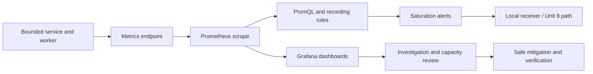

# Unit 9 — Saturation, Queue Depth, and Resource Exhaustion

> **Audience:** learners who completed Stages 0–2D and Stage 2E M01–M10.  
> **Primary environment:** WSL2 Ubuntu or native Linux; optional `kind` and local Prometheus/Grafana.  
> **Safety profile:** Core labs first, synthetic data, bounded workloads, throwaway resources, explicit stop and cleanup.  
> **Evidence labels:** `[SYNTHETIC]` generated teaching data; `[ASSUMPTION]` a lab contract to confirm; `[ILLUSTRATIVE]` a non-production example; `[VERIFY]` a version- or environment-dependent claim that must be checked.

## 0. Unit purpose, prerequisites, and handoff

### Required M10 handoff

> M10 Unit 6 taught the theory and the failure patterns (Little's Law, the latency knee, retry amplification, load shedding, cascades, capacity planning) and ran overload labs. This unit teaches **how to observe and alert on saturation and exhaustion on the production stack** — which metrics exist at each layer, how to read them correctly, how to forecast exhaustion, and how to build dashboards and alerts that catch saturation **before** it becomes an incident — without re-deriving the theory.

This unit is about observability implementation and operations: discovering metric contracts, selecting the correct scope and unit, interpreting saturation, building dashboards and alerts, validating `predict_linear`, measuring lead time, producing a weekly capacity report, and practicing safe response. It does **not** re-derive Little's Law, the latency knee, retry amplification, load shedding, cascading failure, or capacity-planning theory.

### Prerequisite check

Before starting, confirm that you can:

- query Prometheus and inspect actual series/labels;
- distinguish counters, gauges, histograms, units, and scrape gaps;
- read a Grafana dashboard and understand dashboard-as-code from M11 Unit 3;
- interpret service errors, latency, and dependency context from M11 Units 5 and 7;
- write and test an alert rule using the practices in Unit 8;
- use a disposable container or namespace and stop a local fault safely;
- follow the M10 incident/game-day process without targeting production.

If any item is missing, complete the relevant prerequisite before running the Full profile.

### Dependency map

| Prior unit | Reuse here | Do not duplicate |
|---|---|---|
| M11 Unit 2 — Prometheus and PromQL | Raw-series inspection, rate windows, labels, query evaluation | Full PromQL introduction |
| M11 Unit 3 — Grafana/dashboard-as-code | Dashboard provisioning, variables, annotations, review | Entire dashboard-as-code module |
| M11 Unit 5 — OTel/service instrumentation | Service metrics and trace context where available | Full instrumentation design |
| M11 Unit 7 — dependency correlation | Timeline and dependency diagnosis when local resources look healthy | Dependency graph implementation |
| M11 Unit 8 — actionable alerts | Owner, action, severity, runbook, metadata linting, no-data handling | General alert philosophy |
| M03 Unit 2 | CPU limits and throttling behavior | Container CPU-limit theory |
| M04 Unit 10 | Conntrack and network pressure | Network/conntrack fundamentals |
| M05 | PVCs and Kubernetes metric availability | Kubernetes/storage introduction |
| M10 Unit 6 | Overload/game-day safety and interpretation | Theory named in the handoff |

### Profiles and resource budget

| Profile | Work | When to choose it |
|---|---|---|
| **Core** | PromQL review, synthetic fixtures, Python instrumentation, report-script tests, alert tests, written fault timeline | Default for a laptop with limited resources or no local cluster |
| **Full (optional)** | Existing local Prometheus/Grafana, one service/worker, bounded containers, optional `kind` and exporters | Only when the stack already runs comfortably and all targets are local |

The stated host budget (4 CPU cores, 8 GB RAM, 30 GB free disk) is a planning envelope, not a guarantee. Measure your own usage. Do not run every component at once. No paid service, cloud-managed telemetry, SaaS vendor, external pager, or production system is required.

### Target flow



### Completion criteria

You will finish with: a resource/metric inventory; a verified metric contract for the lab; a service/worker exposing pool, queue, in-flight, age, and time-to-drain signals; dashboard panel specifications; tested alert rules; a four-pattern forecast validation plan; a tested weekly report script; five bounded exhaustion-drill records; eight interpretation-trap answers; and a runbook. A lab that cannot be run safely must use the fixture fallback and state that limitation.

---

## 1. Mental model: saturation versus utilization versus errors

**Utilization** is the fraction of a resource's measured time or capacity that is busy or in use. **Saturation** is pressure or fullness, often visible as queued work, waits, throttling, blocked operations, or lack of remaining capacity. **Errors** are failures, rejects, timeouts, resets, or work that cannot complete. **Capacity** is the relevant available limit for a clearly defined scope. **Headroom** is the remaining margin under that limit, with a stated unit and denominator.

They are related but not interchangeable. High utilization may be harmless if latency and queues are stable and the system has enough margin. Low aggregate utilization can coexist with a saturated per-container CPU quota, one exhausted connection pool, one hot disk, one full inode table, or a single hot zone.

### USE method

The USE method asks about **Utilization, Saturation, and Errors** for each resource. Treat it as a diagnostic checklist, not a promise that every resource exposes three clean metrics. The exact attribution and implementation depend on the resource and exporter `[VERIFY]`.

| Question | Example signal | What it can tell you | What it cannot prove alone |
|---|---|---|---|
| Utilization: how busy/full? | CPU busy time, pool in-use/max, filesystem bytes used | Current demand relative to a measured resource | That user requests are healthy or unhealthy |
| Saturation: how much work waits or is constrained? | CPU throttling, queue age, pool wait, disk queue/latency | Demand is exceeding immediate service capacity or margin is shrinking | The root cause without correlated evidence |
| Errors: what fails? | rejected requests, OOM events, socket drops, failed queries | Work is being lost, rejected, or interrupted | Which layer caused it without a timeline |

### Leading and lagging indicators

A **leading indicator** tends to move before a defined user impact—for example, queue age rising while the worker is still completing jobs, or memory headroom declining before OOM. A **lagging indicator** records impact already occurring, such as elevated request latency, timeouts, or a failed freshness deadline. “Leading” is empirical: a metric is not a leading indicator until replay or incident evidence shows it precedes the chosen impact.

**Headroom** must be scoped: remaining bytes on a filesystem, remaining connections in a pool, allocatable CPU in a zone, or seconds remaining before a freshness deadline. **Time-to-exhaustion** estimates when a resource reaches a specified limit under an explicit trend assumption. Both can be misleading if the limit is unknown, demand changes, metrics disappear, or a forecast crosses an invalid boundary.

### Queue depth versus queue age

Depth counts items waiting. Age measures how long the oldest item has waited. A stable depth can hide worsening service if items are being replaced at the front, retries re-enter the queue, or one old item is stuck while newer items complete. For user-facing freshness, the age of the oldest eligible item or a suitably defined age percentile can be more informative than depth alone. Define which messages count, how poison/retry messages are treated, and whether age resets when an item is retried.

### Worked example [SYNTHETIC]

A local worker has 20 queued jobs at 10:00 and 20 queued jobs at 10:10. The depth looks stable. However, the oldest eligible job's age rises from 45 seconds to 9 minutes, arrivals average 4 jobs/minute, and completions average 4 jobs/minute. The equal average rates explain the stable depth but do not show that the oldest item is progressing; it may be stuck, repeatedly retried, or starved by scheduling.

Inference: investigate per-message age, retry/dead-letter counts, consumer concurrency, and completion latency—not just depth. Limits: these values are synthetic; they do not establish a production threshold or prove which failure mode is present.

---

## 2. Resource map and metric semantics

Metric names below are **examples**, not universal contracts. Verify the installed exporter/runtime and the actual series before copying any query. If a metric is unavailable, use a recorded fixture or a local diagnostic appropriate to the platform; do not substitute a guessed name.

| Resource/layer | Signal to observe | Example metric or measurement | What it tells you | Common misreading | Verification/fallback |
|---|---|---|---|---|---|
| Node CPU | Busy time by mode | `node_cpu_seconds_total` `[VERIFY]` | CPU time accumulation | “CPU busy = queueing” | Inspect labels and mode semantics; fallback to `top`/`mpstat` |
| Container CPU | Throttled periods/time | `container_cpu_cfs_throttled_periods_total`, `container_cpu_cfs_periods_total` `[VERIFY]` | CPU quota is constraining a container | Node CPU must also be high | Inspect container metrics and configured limits |
| Scheduler | Load/run queue | load average, runnable tasks | Runnable work relative to CPU availability | Load average equals CPU percent | Use `uptime`, `vmstat`, `pidstat` |
| Memory | Working set/RSS/cache | `container_memory_working_set_bytes` `[VERIFY]` | Runtime-specific memory view | Working set equals process RSS on every runtime | Inspect exporter docs and cgroup files |
| OOM | Termination reason/events | `kube_pod_container_status_last_terminated_reason` `[VERIFY]`, events, exit status | Recent memory-related termination evidence | Current readiness proves no recurring OOM | Inspect events, restarts, previous container state |
| Node memory | Available memory, pressure, swap | `/proc/meminfo`, PSI if supported `[VERIFY]` | Host memory margin and stalls | Free memory excludes useful page cache | Use `free -h`, `/proc/pressure/memory` where present |
| Filesystem | Bytes used/free | `node_filesystem_*` family `[VERIFY]` | Space remaining on a mount | Bytes available imply writes will succeed | Check mount, reserved blocks, read-only state |
| Inodes | Inodes used/free | `node_filesystem_files*` family `[VERIFY]` | Ability to create additional files | Disk bytes free means no disk exhaustion | `df -i` |
| Disk I/O | Busy time, operations, latency/await, queue | `node_disk_*` family `[VERIFY]` | Device pressure and latency | High throughput always means saturation | `iostat -xz` where installed; identify device mapping |
| PVC | Used bytes and capacity | `kubelet_volume_stats_*` `[VERIFY]` | Filesystem stats for a mounted volume where exposed | PVC request equals actual filesystem capacity | Inspect PVC, storage class, exporter series |
| Network | Bytes, drops, errors, retransmits | interface counters, TCP diagnostics | Delivery and transport symptoms | Normal throughput proves network health | `ip -s link`, `ss -s`, TCP counters |
| Conntrack | Entries versus limit | `node_nf_conntrack_entries` and a limit metric `[VERIFY]` | Connection tracking pressure | Every kernel/exporter exposes the same series | Inspect `/proc/sys/net/netfilter/` and conntrack counters |
| Sockets/ports | Socket states, ephemeral port range, TIME_WAIT | `ss -s`, `/proc/sys/net/ipv4/ip_local_port_range` | Churn and local endpoint pressure | Connection count alone explains port exhaustion | Inspect socket states and bind/connect errors |
| File descriptors | Open/max descriptors | `process_open_fds`, `process_max_fds` `[VERIFY]` | Process descriptor headroom | Metric exists for every process | `/proc/<pid>/fd` and `/proc/<pid>/limits` |
| Processes/PIDs | Process/thread counts, PID limit | `/proc`, cgroup pids controller `[VERIFY]` | Ability to create processes/threads | Low CPU means no process pressure | `ps -eLf`, `pids.current`, `pids.max` where available |
| Application pool | In-use/max/wait time | Instrumentation-defined gauges/histograms | Local connection/thread pool pressure | Database is slow because requests wait for a pool | Compare pool wait with database-side evidence |
| Application queue | Depth, oldest age, enqueue/dequeue | Instrumentation-defined gauges/counters | Work backlog and freshness risk | Stable depth means no stuck work | Track age and completions per bounded queue |
| Database | Connections, locks, replication lag, WAL/disk, cache, query waits | Engine/exporter-specific series `[VERIFY]` | Database or client-pool constraints | Pool saturation is the same as engine saturation | Discover actual exporter metrics; use read-only DB stats |
| Kubernetes scheduler | Pending pods and scheduling events | kube-state-metrics/API events `[VERIFY]` | Pods cannot be scheduled | Pending always means CPU exhaustion | Inspect events, quotas, affinity, taints, PVCs |
| Quotas | Used versus hard quota | `kube_resourcequota` `[VERIFY]` | Namespace resource quota margin | Quota metrics exist in every setup | Inspect ResourceQuota and exporter series |
| HPA | Current versus max replicas | HPA API / exporter series `[VERIFY]` | Autoscaler has reached configured ceiling | Max replicas proves capacity shortage | Correlate demand, pending work, latency, and HPA conditions |
| Queue freshness | Age and deadline remaining | Instrumentation-defined timestamps/gauges | Time before an objective is breached | Depth is a freshness SLI | Define eligibility, deadline, units, and reset semantics |

### 2.1 CPU and scheduler

`node_cpu_seconds_total` is commonly a counter of CPU time by CPU and mode in node-exporter environments `[VERIFY]`. A typical utilization calculation derives the fraction of non-idle time over a window. Inspect the actual `mode` labels before deciding which modes count as idle; guest/iowait treatment and exporter behavior should be documented for your chosen interpretation.

```promql
# Example only: verify metric labels and mode semantics first.
1 - avg by (instance) (
  rate(node_cpu_seconds_total{mode="idle"}[5m])
)
```

This returns a ratio, usually displayed as percent after multiplying by 100. It is a node-level average and can hide a single saturated CPU or a constrained container.

Container throttling examples:

```promql
# Example only; exact names and counter semantics are [VERIFY].
sum by (namespace, pod, container) (
  rate(container_cpu_cfs_throttled_periods_total[5m])
)
/
sum by (namespace, pod, container) (
  rate(container_cpu_cfs_periods_total[5m])
)
```

This is the fraction of observed CFS periods that were throttled only if the installed metric definitions support that interpretation. It is not necessarily the fraction of wall-clock time lost. Pair it with throttled seconds if a verified metric exists, container CPU usage, configured CPU limit, and request latency. Node utilization can be moderate while one container hits its own quota.

Load average is a count-like exponentially smoothed measure of runnable and, on Linux, uninterruptible tasks—not a CPU percentage. Compare it with available CPUs and runnable queue observations. Use `uptime`, `vmstat 1`, or `pidstat` as a local fallback `[VERIFY]` for command availability.

### 2.2 Memory and OOM

- **RSS** generally represents resident pages attributed to a process.
- **Working set** is runtime/exporter-specific and may exclude some reclaimable memory; do not assume it equals RSS.
- **Page cache** can be reclaimable, but reclaimability depends on the actual workload and kernel state.
- **OOM evidence** includes termination reason, exit status, kernel/runtime events, and restart history. It is historical evidence, not the same as current readiness.

Example ratio, only when the numerator and limit are from the same container scope:

```promql
# [VERIFY] both series, labels, and units in your exporter.
container_memory_working_set_bytes
/
container_spec_memory_limit_bytes
```

Exclude absent/zero/unlimited limit values according to the actual metric contract. Do not divide node working set by a pod limit or compare metrics at mismatched scopes. `kube_pod_container_status_last_terminated_reason` is an example from some kube-state-metrics schemas `[VERIFY]`; inspect the installed version. A restart counter can increase while the pod is currently Ready, so correlate restart deltas, previous termination reason, and events.

Node memory pressure and swap availability vary by host and kernel. PSI files such as `/proc/pressure/memory` may be available on Linux `[VERIFY]`; if not, use `vmstat`, memory statistics, and a recorded fixture. Do not create an actual host memory leak for this unit.

### 2.3 Disk, filesystem, inodes, and persistent volumes

Bytes and inodes are separate finite resources. A filesystem can have free bytes but no free inodes, preventing new file creation. Conversely, inode headroom can remain while a large file consumes all free blocks. Inspect both `df -h` and `df -i`.

Example filesystem byte ratio:

```promql
# [VERIFY] node-exporter metric names and device/mount labels.
1 -
(
  node_filesystem_avail_bytes{fstype!~"tmpfs|overlay"}
  /
  node_filesystem_size_bytes{fstype!~"tmpfs|overlay"}
)
```

This computes the fraction unavailable to unprivileged writes when `avail` semantics apply; it is not necessarily exactly “used bytes / total bytes” because reserved blocks and filesystem semantics matter. Filter pseudo-filesystems using your actual exporter labels, not a universal regex.

Example inode-use ratio:

```promql
# [VERIFY] exact metric names and mount labels.
1 -
(
  node_filesystem_files_free
  /
  node_filesystem_files
)
```

Disk I/O metrics in `node_disk_*` families vary by exporter and platform `[VERIFY]`. Use `iostat -xz` if installed to inspect per-device utilization, await/latency, and queue fields, and map the device to the container/volume. Do not equate high throughput with high latency or assume one device-level metric describes a network-backed PVC.

For PVCs, `kubelet_volume_stats_*` examples may expose capacity/used/inode statistics `[VERIFY]`. A PVC requested size, a storage-provider allocation, and filesystem capacity are not necessarily identical. Use a throwaway volume with a strict size cap for the fill exercise; never write test files to the host root filesystem.

### 2.4 Network, connections, sockets, and conntrack

Observe throughput **and** errors, drops, retransmissions, connection setup failures, socket state, and connection-tracking pressure where available. Normal throughput can coexist with drops or a small number of blocked connections.

`node_nf_conntrack_entries` and a corresponding limit metric are exporter-dependent `[VERIFY]`. Inspect local kernel interfaces such as `/proc/sys/net/netfilter/` and available conntrack statistics before building a query. A safe fallback is a saved metric fixture plus `ss -s` and `ip -s link`; do not flush conntrack or change host firewall rules during this lesson.

Ephemeral port exhaustion and socket pressure may show up as connect/bind failures, high TIME_WAIT counts, or a narrow ephemeral port range under high connection churn. `ss -s`, `ss -tan state time-wait`, and `/proc/sys/net/ipv4/ip_local_port_range` are diagnostic examples; availability and permissions are `[VERIFY]`. Do not conclude “network healthy” from bytes-per-second alone.

### 2.5 File descriptors, threads, processes, and PID pressure

`process_open_fds` and `process_max_fds` are examples in some process exporters `[VERIFY]`. A ratio is meaningful only when both series refer to the same process and the max is finite/nonzero. For a local process, inspect `/proc/<PID>/fd`, `/proc/<PID>/limits`, `ps -eLf`, and the cgroup PID controller where available. A file-descriptor leak can produce `EMFILE` even when CPU and memory look fine. Thread/process creation can fail due to PID limits or host constraints. Do not assume node-exporter has per-process metrics for every service.

### 2.6 Application pools, in-flight work, and queues

Instrument these as bounded, service-owned metrics:

- pool in-use and configured maximum;
- pool wait duration;
- in-flight requests or jobs;
- queue depth;
- age of oldest eligible item;
- enqueue and completion counters;
- rejected work, retries, and dead-letter count where relevant;
- time-to-drain estimate, with its assumptions documented.

Metric names in the sample implementation below begin with `lab_`; they are synthetic and not standard Prometheus metrics. Use finite labels such as `service`, `environment`, and a fixed queue name. Never label by request ID, user ID, message ID, or arbitrary URL.

Queue depth is an instantaneous count. Queue age is a time measure and must define which item is oldest and whether retry time counts. Time-to-drain estimates the time to clear current backlog only if the arrival/departure assumptions hold. A simple estimate is invalid if arrival rate changes rapidly, the consumer fails, jobs have different costs, or retries create more work.

### 2.7 Databases and data stores

Useful dimensions include engine connections used/max, lock waits, replication lag, WAL/log growth, disk pressure, cache behavior, query duration, and client pool wait. PostgreSQL exporter names and labels depend on exporter version/configuration `[VERIFY]`; do not guess a metric name.

Discovery workflow:

1. Inspect Prometheus **Status → Targets** and confirm the exporter is actually scraped.
2. Query a broad, bounded selector or inspect the target's `/metrics` output locally.
3. Search the installed exporter documentation for connection, lock, replication, WAL, and cache metrics.
4. Record metric name, type, unit, labels, source/version, and reset semantics in the metric inventory.
5. Build the query against the discovered series and test with a fixture.

Distinguish app-side pool saturation from engine saturation. If client requests wait for a connection while the database has spare capacity, increasing database capacity may not address a pool configuration or leak. Conversely, a pool can be full because queries are blocked on engine locks; inspect both sides before acting.

### 2.8 Kubernetes and autoscaling

Relevant signals include Pending pods, scheduling events, quota usage versus hard limits, HPA current/max replicas and conditions, container throttling, restarts/OOM, node pressure, and workload queue/latency. `kube_resourcequota` and HPA metric names vary by exporter and version `[VERIFY]`.

An HPA at max replicas is a **state**, not a complete diagnosis. It becomes meaningful saturation evidence when demand remains high and a user-impact or backlog signal is worsening, or when pending pods and resource constraints show that more replicas cannot be scheduled. Check whether the HPA's target metric is available, whether desired replicas are capped, whether quota/resources prevent scheduling, and whether new replicas would help the bottleneck.

Separate four scopes:

- **Node:** physical/virtual host capacity and pressure.
- **Pod/container:** cgroup limits, memory, restarts, throttling.
- **Workload/service:** request rate, errors, queue/pool, replicas.
- **Cluster/zone:** allocatable capacity, quotas, skew, and N−1 margin.

### 2.9 Queue age, time-to-drain, and freshness deadlines

Define each measure before alerting:

- **Queue depth:** number of eligible items waiting at the sample time.
- **Oldest-item age:** current time minus enqueue timestamp of the oldest eligible item, with a documented policy for retries/dead letters.
- **Arrival rate:** newly eligible items per second/minute.
- **Completion rate:** completed items per second/minute.
- **Net drain rate:** completion rate minus arrival rate, only meaningful over a specified window.
- **Time-to-drain:** backlog divided by positive net drain rate. If net drain rate is zero/negative, estimate is infinite/undefined—not zero.
- **Freshness deadline:** maximum permitted age or completion time for the workload, from an explicit contract.

Example [SYNTHETIC]: backlog = 600 jobs, completions = 8 jobs/min, arrivals = 5 jobs/min. Net drain = 3 jobs/min; estimated time to drain = 200 minutes. If arrivals rise to 8 jobs/min, net drain is zero and the queue will not clear under the current rates. This estimate assumes stable rates and comparable jobs. It is not a promise about completion time.

A useful alert compares oldest age or time-to-drain against the remaining freshness budget. The alert must state how age and deadline are computed, and must be tested under changing arrivals and consumer failure.

---

## 3. PromQL and signal interpretation

### Query workflow

For every query:

1. Inspect the raw series and actual labels.
2. Confirm metric type and unit from instrumentation/exporter documentation.
3. Choose a window long enough for the scrape cadence and the behavior being measured.
4. Aggregate at the correct scope before comparing numerator and denominator.
5. Check for zero denominator, missing series, stale data, counter reset, and mismatched labels.
6. Compare the signal with a second layer and a user-impact measure.
7. Record the query and its assumptions in the dashboard/runbook.

Commands and UI paths depend on the installation. Use Prometheus's expression browser, target page, `/metrics`, and installed-tool help. The queries below are patterns, not universal drop-in rules.

### CPU utilization

```promql
1 - avg by (instance) (
  rate(node_cpu_seconds_total{mode="idle"}[5m])
)
```

- `rate()` converts a cumulative CPU-time counter into a per-second rate.
- `avg by (instance)` combines CPU series for the node.
- `1 - idle` estimates non-idle fraction under the chosen mode semantics.
- Unit is a ratio; multiply by 100 for percent.
- Assumptions: `instance` and `mode` labels exist and the idle mode is defined as expected `[VERIFY]`.
- Trap: node average can hide a throttled container or one hot CPU.

### CPU throttling ratio

```promql
sum by (namespace, pod, container) (
  rate(container_cpu_cfs_throttled_periods_total[5m])
)
/
sum by (namespace, pod, container) (
  rate(container_cpu_cfs_periods_total[5m])
)
```

Assumptions: both counters exist and share the same labels/semantics `[VERIFY]`. This measures throttled periods relative to observed periods, not necessarily lost CPU time. Inspect configured CPU limits and correlate with p99 latency. If the metrics are absent, use a synthetic fixture or container runtime diagnostics.

### Memory relative to a limit

```promql
container_memory_working_set_bytes
/
container_spec_memory_limit_bytes
```

Assumptions: both series refer to the same container and use bytes; the limit is finite and nonzero `[VERIFY]`. Add label matching/filters based on actual series. Do not use this raw expression if the runtime exports unlimited/zero limits or labels differ. Pair with restart/OOM evidence:

```promql
increase(kube_pod_container_status_restarts_total[15m])
```

The restart counter family is exporter-dependent `[VERIFY]`; an increase is not proof of OOM. Inspect termination reason/events and the previous container state.

### Filesystem bytes and inodes

```promql
1 - (
  node_filesystem_avail_bytes{mountpoint="/", fstype!~"tmpfs|overlay"}
  /
  node_filesystem_size_bytes{mountpoint="/", fstype!~"tmpfs|overlay"}
)
```

This is a mount-specific fraction of unavailable space using `avail` semantics. Verify mount labels, filesystem type, and whether reserved space is included. For inode use:

```promql
1 - (
  node_filesystem_files_free{mountpoint="/"}
  /
  node_filesystem_files{mountpoint="/"}
)
```

Metric names are `[VERIFY]`. Use `df -h` and `df -i` to validate the same mount. Do not use the host root mount as a fill target.

### Disk I/O pressure

No single `node_disk_*` query is portable across all exporter versions. First discover available metrics and labels. If the exporter exposes time spent doing I/O and operation counters, construct a device-level view using the documented units and semantics; compare it with `iostat -xz` if available. Do not label a device “saturated” solely because bytes/sec are high. Consider latency/await, queue depth, workload, and storage type. If the metric schema cannot be confirmed, use a recorded fixture and mark the live panel `[VERIFY]`.

### Queue depth, age, and rates

For the synthetic metric contract in Section 2.6:

```promql
lab_queue_depth{queue="orders"}
```

Unit: jobs. It is an instantaneous gauge.

```promql
lab_queue_oldest_age_seconds{queue="orders"}
```

Unit: seconds. The instrumentation must update the age from the oldest eligible enqueue timestamp; if the queue is empty, define whether the gauge is zero or absent.

```promql
sum by (queue) (rate(lab_queue_enqueued_total[5m]))
```

Unit: jobs/second. Counter reset behavior is handled by `rate()` before aggregation.

```promql
sum by (queue) (rate(lab_queue_completed_total[5m]))
```

Unit: jobs/second. This is completions, not necessarily successful business outcomes; define the completion contract.

A naive time-to-drain query might use backlog divided by completion rate, but it ignores incoming work. Prefer an instrumentation-defined `lab_queue_net_drain_rate_per_second` only if the calculation, unit, negative/zero behavior, and window are documented. Otherwise calculate in a script from compatible rate queries and emit no finite estimate when net drain is non-positive.

### Connection-pool utilization and wait

```promql
lab_db_pool_in_use
/
lab_db_pool_max
```

Unit: ratio. Assumptions: gauges are instrumented from the same pool, use the same labels, and `max` is nonzero. Add a histogram for pool wait time if available; pool utilization alone does not tell how long callers wait. A tempting but misleading query is “database CPU low, therefore database is healthy.” Replace it with a joint view of pool wait, active/idle connections, lock/query wait, and request latency.

### File descriptor ratio

```promql
process_open_fds
/
process_max_fds
```

Both names and per-process label semantics are `[VERIFY]`. The ratio is only valid for matching process identity and a nonzero finite max. If the metrics are unavailable, inspect `/proc/<PID>/fd` and `/proc/<PID>/limits` on the same host.

### HPA at maximum replicas

The exact exported metric names vary `[VERIFY]`. If verified series represent current and max replicas, compare them at the same workload identity, then correlate with demand and impact. A schematic query cannot be copied until metric labels are discovered:

```promql
# SCHEMA TEMPLATE ONLY — replace with verified metric names and labels.
<current_replicas_metric>{namespace="<NAMESPACE>", workload="<WORKLOAD>"}
==
<max_replicas_metric>{namespace="<NAMESPACE>", workload="<WORKLOAD>"}
```

Fallback: inspect the HPA object and conditions with `kubectl describe hpa <HPA> -n <NAMESPACE>` `[VERIFY]`. Never assume the HPA has reached max just because the replica count is high.

### N−1 headroom

For a simple, homogeneous node pool, if total allocatable CPU is 24 cores, one node contributes 8 cores, and measured peak demand is 12 cores, then after losing one node remaining capacity is 16 cores and arithmetic headroom is 4 cores. These values are `[SYNTHETIC]`; real N−1 analysis must consider scheduling constraints, requests/limits, zone placement, memory, quotas, and workload skew. Do not calculate cluster-wide CPU headroom if one zone or storage/connection bottleneck is already saturated.

### Two misleading queries and better alternatives

**Trap A: “Average CPU below 50%, so no CPU problem.”** Node average hides cgroup throttling and skew. Check per-container throttling and request latency:

```promql
# First query node view, then container-level throttling using verified series.
sum by (namespace, pod, container) (
  rate(container_cpu_cfs_throttled_periods_total[5m])
)
/
sum by (namespace, pod, container) (
  rate(container_cpu_cfs_periods_total[5m])
)
```

**Trap B: “Queue depth did not increase, so freshness is fine.”** Depth is only a count. Query oldest age and compare it with the deadline:

```promql
lab_queue_oldest_age_seconds{queue="orders"}
```

A third common trap is treating `predict_linear` output as a guaranteed exhaustion time. Validate against sawtooth, step changes, resets, and missing intervals before promoting a forecast alert.

---

## 4. Dashboards and headroom

Build one dashboard with clear scope and units, then split it if the stack is too heavy. Each panel should answer a specific question and have a time range that shows the precursor plus the impact window.

| Panel | Question | Scope/aggregation | Unit and useful range | Trap avoided |
|---|---|---|---|---|
| Node CPU and scheduler | Is the node busy or is runnable work waiting? | Per node; optionally per CPU | Ratio/percent; 15m–6h | Average hides one hot CPU |
| Per-pod CPU/throttling | Is a cgroup constrained despite node headroom? | Namespace/pod/container | CPU cores, throttled-period ratio; 15m–6h | Node average masks quota |
| Memory and OOM | Is working set approaching limit, with recurring terminations? | Container and node | Bytes/ratio, restart delta; 1h–24h | Current readiness hides previous OOM |
| Filesystem bytes and inodes | Which finite filesystem resource is low? | Mount/device/PVC | Bytes and inode ratio; 1h–7d | Bytes hide inode exhaustion |
| Disk I/O | Is device latency/queue rising? | Device and workload | Exporter-defined units; 15m–24h | Throughput is not latency |
| Pool in-use and wait | Are callers waiting for local pool capacity? | Service/pool | Connections, ratio, seconds; 15m–24h | Database metrics alone miss client wait |
| Queue depth and oldest age | Is work accumulating or getting stale? | Queue | Jobs and seconds; 15m–24h | Stable depth hides old work |
| Enqueue/completion rates | Is net drain positive? | Queue | Jobs/s; 15m–24h | Depth alone hides rate changes |
| Database connections/locks/lag | Is the engine or replication constrained? | DB instance/database | Connections, seconds, bytes; 1h–7d | Client pool and engine conflated |
| Pending pods/quota/HPA | Can the workload add capacity? | Namespace/workload/cluster | Pods, resource units, replicas; 15m–24h | Max replicas is not root cause |
| Headroom | How much remains under the declared capacity? | One resource, zone, or pool | Unit + denominator + scope; 1h–7d | Generic percentage hides scope |
| Fleet heatmap | Is pressure concentrated on a subset of nodes/zones? | Node/zone grid | Consistent ratio or normalized metric; 1h–24h | Fleet average hides skew |
| N−1 headroom | Can remaining nodes/zones absorb loss? | Zone/node pool | CPU/memory/request budget; weekly and after changes | Aggregate capacity overstates resilience |
| Fault/deploy annotations | Did a known change precede the signal? | Dashboard timeline | Timestamped event | Correlation alone is not causation |

### Headroom panel contract

Every headroom panel must display:

- **Resource:** CPU, bytes, connections, inodes, queue time, or another explicit unit.
- **Scope:** one container, pool, node, zone, or fleet.
- **Capacity denominator:** configured limit, allocatable resource, measured pool max, or agreed safe budget.
- **Current use:** measured at the same scope and compatible unit.
- **Remaining margin:** capacity minus current use, or a clearly defined ratio.
- **Caveat:** reservations, quotas, scheduling constraints, burst behavior, or unknown exporter semantics.

Example [SYNTHETIC]: pool max = 80 connections; in-use = 60; raw arithmetic margin = 20 connections (25% of configured max). This does not establish safe headroom if long-lived transactions, burst demand, or connection limits at another layer constrain actual throughput.

### Fleet and zone-aware view

A fleet heatmap should show the distribution, not just the mean. A zone-aware N−1 panel should calculate the remaining capacity after the largest relevant node/zone loss under the chosen demand scenario. If topology and workload-placement data are unavailable, do not display a fake N−1 number; show “insufficient topology data” and document the missing input.

Dashboard annotations can mark deployment and fault-injection start/stop events if the existing lab supports them. Use the existing M11 Unit 3 dashboard-as-code conventions; `[VERIFY]` Grafana panel fields and provisioning schema against the installed version.

ASCII sketch:

```text
+----------------------- Saturation overview ------------------------+
| Node CPU / run queue | Pod throttling | Memory / OOM / restarts    |
+----------------------- Storage and network -----------------------+
| Bytes + inodes       | Disk latency  | Drops / conntrack / sockets|
+----------------------- Application work --------------------------+
| Pool in-use + wait   | Queue depth + age | Enqueue / complete rate|
+----------------------- Capacity and impact -----------------------+
| HPA/max + pending    | Headroom by zone | Latency / freshness SLI |
+--------------------------------------------------------------------+
```

---

## 5. Alert design and alert-fatigue controls

High-but-stable utilization alone often deserves a ticket or trend review rather than a page. Page when saturation is threatening a user-facing SLO, an explicit freshness deadline, or a safety boundary within the time needed to respond. A page should have impact evidence or a well-supported near-term risk, an owner, a concrete action, a runbook, and a verification signal.

Use Unit 8's alert metadata and severity policy. Do not invent universal thresholds. The values below are `[ILLUSTRATIVE]`; choose real thresholds from workload behavior, SLO/deadline, response lead time, and replay.

### Example rule catalog

The following snippets use synthetic `lab_` metrics from this lesson. They require those metrics to exist with the stated types/labels. Prometheus rule syntax and `promtool` test schema must be checked against the installed version `[VERIFY]`.

```yaml
groups:
  - name: lab-saturation
    interval: 30s
    rules:
      - alert: LabQueueAgeThreatensFreshness
        expr: lab_queue_oldest_age_seconds{queue="orders"} > 240
        for: 2m
        labels:
          severity: ticket
          team: service-platform
        annotations:
          summary: "Oldest eligible order has waited too long"
          description: "Queue age is above the synthetic warning level. Inspect consumer health, enqueue/completion rates, retry behavior, and the freshness deadline. Scale only after confirming the bottleneck."
          runbook_url: "https://example.invalid/runbooks/queue-age"
          dashboard_url: "http://localhost:3000/d/queue-health"
          required_action: "Check consumer progress and deadline budget; record queue age and net drain rate."
      - alert: LabQueueDrainCannotMeetDeadline
        expr: |
          lab_queue_time_to_drain_seconds{queue="orders"} >
          lab_queue_freshness_budget_remaining_seconds{queue="orders"}
        for: 2m
        labels:
          severity: page
          team: service-platform
        annotations:
          summary: "Estimated drain time exceeds remaining freshness budget"
          description: "The synthetic estimate suggests the current queue may miss its deadline. Verify arrivals, completions, retries, and the estimate's assumptions before mitigation."
          runbook_url: "https://example.invalid/runbooks/queue-deadline"
          dashboard_url: "http://localhost:3000/d/queue-health"
          required_action: "Confirm net drain estimate and freshness impact; take the bounded mitigation in the runbook."
      - alert: LabContainerCpuThrottlingWithLatency
        expr: |
          (
            sum by (namespace, pod, container) (rate(container_cpu_cfs_throttled_periods_total[5m]))
            /
            sum by (namespace, pod, container) (rate(container_cpu_cfs_periods_total[5m]))
          ) > 0.2
          and on (namespace, pod, container)
          lab_service_p99_latency_seconds > 0.5
        for: 5m
        labels:
          severity: ticket
          team: observability
        annotations:
          summary: "Container throttling coincides with elevated service latency"
          description: "Illustrative joint condition. Verify metric schemas, CPU limits, and user impact; node CPU alone may hide per-container throttling."
          runbook_url: "https://example.invalid/runbooks/cpu-throttling"
          dashboard_url: "http://localhost:3000/d/saturation"
          required_action: "Compare throttling, limit, and latency; adjust only after bounded replay."
      - alert: LabFilesystemInodesLow
        expr: |
          1 - (
            node_filesystem_files_free{mountpoint="/"}
            /
            node_filesystem_files{mountpoint="/"}
          ) > 0.9
        for: 10m
        labels:
          severity: ticket
          team: observability
        annotations:
          summary: "Filesystem inode headroom is low"
          description: "Illustrative inode condition. Verify the exact mount and inode metric; free bytes do not guarantee free inodes."
          runbook_url: "https://example.invalid/runbooks/inodes"
          dashboard_url: "http://localhost:3000/d/storage"
          required_action: "Identify file-count growth and approved cleanup/rotation; never delete data blindly."
      - alert: LabPoolNearLimitWithWait
        expr: |
          (lab_db_pool_in_use / lab_db_pool_max) > 0.9
          and
          lab_db_pool_wait_seconds > 0.1
        for: 3m
        labels:
          severity: ticket
          team: service-platform
        annotations:
          summary: "Connection pool is constrained and callers are waiting"
          description: "Illustrative pool condition. Compare client wait with database-side locks, connections, and query latency."
          runbook_url: "https://example.invalid/runbooks/pool-saturation"
          dashboard_url: "http://localhost:3000/d/database"
          required_action: "Determine whether the pool, query, or database is the bottleneck before changing pool size."
      - alert: LabTelemetrySignalMissing
        expr: absent(lab_queue_depth{queue="orders"})
        for: 5m
        labels:
          severity: ticket
          team: observability
        annotations:
          summary: "Expected queue-depth telemetry is missing"
          description: "The expected series is absent. Inspect target health, instrumentation, labels, and rule evaluation."
          runbook_url: "https://example.invalid/runbooks/missing-queue-metric"
          dashboard_url: "http://localhost:3000/d/telemetry-health"
          required_action: "Restore or explain the signal; do not interpret missing data as zero backlog."
```

These are examples, not a complete production rule file. The CPU rule combines metrics with different origins; `and on(...)` label matching is valid only if both sides expose compatible labels. Confirm labels and units first. A queue time-to-drain metric must have defined behavior when net drain is zero/negative; it should not report a misleading finite value.

### Required alert design elements

For each alert, record: metric contract; aggregation scope; threshold source; `for` duration rationale; owner/team; severity mapped to Unit 8/M10 policy; summary and description; runbook/dashboard link; required action; missing-data behavior; no-data test; expected false-positive cases; and a recovery condition. Test fire, no-fire, threshold boundary, flap/noise, and absent-series behavior.

### `predict_linear` false positives and staged promotion

Do not page directly on a linear forecast until it has been replayed against realistic history. Log rotation can produce a sawtooth disk-use pattern: linear regression over a window may extrapolate a rising segment and predict imminent exhaustion even though rotation soon frees space. Prefer a forecast plus sustained level/trend condition, or a ticket-only observation, until replay shows acceptable false positives and useful lead time.

Promotion sequence:

1. **Dashboard-only:** graph the signal and forecast.
2. **Non-paging alert / ticket:** run against recorded history and label false positives.
3. **Soak:** observe across normal cycles, rotations, deploys, and load changes.
4. **Review:** compare missed cases, noise, detection lead time, and actionability.
5. **Promote only with evidence:** map severity to existing policy and keep a rollback path.

---

## 6. Forecasting and `predict_linear` validation

`predict_linear(v range-vector, t seconds)` performs linear extrapolation from a range of samples to a future time. It is not a general forecasting model. Verify function availability and behavior in the installed Prometheus version `[VERIFY]`; inspect the official Prometheus PromQL functions documentation and run `promtool --version`.

It can be fooled by:

- periodic sawtooth patterns such as log rotation;
- sudden step changes after deployment or configuration changes;
- counter resets or gauge resets;
- missing/stale intervals;
- a lookback dominated by a short transient;
- changing demand or cleanup schedules;
- forecast horizons longer than the process remains stationary.

### Controlled fixture set

Create four labelled series in a local fixture or a `promtool` test:

1. **Steady trend:** gauge grows steadily toward a known synthetic limit.
2. **Sawtooth:** gauge grows and periodically drops after simulated rotation.
3. **Step change:** gauge jumps after a synthetic deployment/config change.
4. **Reset/missing interval:** series resets or has a gap; observe how the selected test/query handles it.

Do not fabricate test results. Fill the table after running the queries/rule tests.

| Fixture | Lookback | Forecast horizon | Forecast crossed limit? | False positive/negative? | Evidence |
|---|---|---|---|---|---|
| Steady trend | `<measured>` | `<measured>` | `<fill>` | `<fill>` | `<query/result>` |
| Sawtooth | `<measured>` | `<measured>` | `<fill>` | `<fill>` | `<query/result>` |
| Step change | `<measured>` | `<measured>` | `<fill>` | `<fill>` | `<query/result>` |
| Reset/missing | `<measured>` | `<measured>` | `<fill>` | `<fill>` | `<query/result>` |

Example expression template:

```promql
predict_linear(lab_filesystem_used_bytes{volume="throwaway"}[6h], 4 * 3600)
```

The example forecasts four hours ahead from a six-hour range. It assumes a gauge with byte units and a meaningful continuous history. The label and metric are synthetic. Validate the selected range and horizon rather than adopting these values as defaults.

A candidate alert might require both a forecast crossing a declared limit and sustained current pressure, but exact PromQL depends on the verified metric and intended false-positive behavior. For a sawtooth resource, compare forecasts at different lookback windows and check whether the forecast repeatedly flips around rotation. A trend-only ticket is appropriate if forecast accuracy or actionability is weak.

The forecast horizon should exceed the time needed to investigate and safely remediate, while remaining short enough that the trend assumption is credible. Define the action lead time from the actual response process; do not infer it from a forecast query alone.

---

## 7. Capacity and headroom reasoning

Headroom is unit-aware and scoped. Do not report a generic “20% capacity left” without naming the resource, denominator, placement constraint, and time window.

Distinguish:

- **Configured capacity:** limit or maximum configured in the resource.
- **Allocatable capacity:** what the scheduler/runtime can actually allocate after reservations and system overhead.
- **Requested resources:** declared requests or commitments, not the same as observed use.
- **Observed use:** measured demand over a defined window and percentile.
- **Safe operating budget:** locally reviewed capacity intended to preserve response margin.
- **Remaining margin:** difference between compatible quantities at the same scope.

Use percentiles as well as averages. An average can hide a burst, hot node, hot zone, long tail, or single pool. Recalibrate after releases, traffic mix changes, schema changes, pool changes, or storage changes.

### Synthetic N−1 calculation

Assume a synthetic zone has three nodes, each with 8 allocatable CPU cores. Total allocatable CPU is 24 cores. The observed peak demand used for the scenario is 13 cores. If one node (8 cores) is lost and workloads can be rescheduled without other constraints, remaining allocatable capacity is 16 cores and arithmetic margin is 3 cores.

This is `[SYNTHETIC]`, not a production recommendation. It ignores memory, pod placement, affinity, disruption budgets, per-node skew, CPU throttling, quota, network, storage, and workload restart overhead. If all hot replicas were concentrated on the lost node or the remaining zone cannot schedule them, the arithmetic margin overstates real headroom.

### Capacity review checklist

1. State the resource, unit, and scope.
2. Identify configured and allocatable capacity separately.
3. Inspect observed distribution and peak/percentile demand.
4. Calculate margin under the normal scenario and the required N−1 loss scenario.
5. Include workload placement, quotas, requests, and bottlenecks outside the resource being calculated.
6. Compare the margin with the response lead time and business deadline.
7. Record uncertainty and missing metrics.
8. Re-run after material workload or platform changes.

No universal production threshold is prescribed in this unit. Any threshold used in a lab is `[ILLUSTRATIVE]` until calibrated against a real workload and policy.

---

## 8. Required practical labs

All labs are local-only and bounded. If the required exporter, cluster, or safe fault hook is absent, use the fixture fallback and document what was not measured. Do not create unbounded load, fill the host filesystem, or exhaust real host memory.

### Lab A — Saturation dashboards

**Purpose:** build a set of panels that make scope, unit, headroom, and symptom explicit.

**Prerequisites:** Core profile, metric inventory, local Grafana/Prometheus only if already available.  
**Steps:**
1. Create a node CPU/scheduler panel and a per-container throttling panel.
2. Add container memory/limit and restart/OOM evidence where available.
3. Add filesystem bytes and inodes as separate panels; add disk I/O only after verifying the metric schema.
4. Add pool in-use/max and wait time, plus queue depth, oldest age, enqueue/dequeue rates, and time-to-drain.
5. Add database signals only after exporter discovery.
6. Add Pending pods, quota, HPA current/max, and node/zone views only when the data exists.
7. Add a headroom panel with capacity denominator and scope; do not show N−1 if topology inputs are missing.
8. Annotate fault/deploy events if the existing lab supports it.

**Expected evidence:** dashboard export or screenshot descriptions, each panel's query, unit, aggregation, useful range, and known trap.  
**Validation checklist:** query returns the expected series; units are correct; empty data is visible as missing rather than silently zero; labels match the intended scope; dashboard link opens the intended environment.  
**Cleanup:** remove only dashboards created for this lab if desired; do not delete shared dashboards.  
**Troubleshooting:** if no series exists, inspect Targets and actual labels before changing the query.  
**Acceptance:** all required panels are either verified live or explicitly marked fixture-only/`[VERIFY]`.

### Lab B — Instrument a service and worker

**Purpose:** expose pool, queue, in-flight, queue age, and time-to-drain metrics with bounded labels.

**Prerequisites:** Python 3; a local Prometheus client library if installed. Python client APIs and metric types are `[VERIFY]` against the selected package version.  
**Core fallback:** run the standard-library simulator below and use its JSON output as fixture input. It does not expose Prometheus metrics by itself.

**Intended path:** `examples/saturation_simulator.py`

```python
#!/usr/bin/env python3
"""Bounded synthetic queue/pool simulator; standard library only."""
from dataclasses import dataclass
import json
import time

@dataclass
class Snapshot:
    queue_depth: int
    oldest_age_seconds: float
    in_flight: int
    pool_in_use: int
    pool_max: int
    arrival_rate_per_second: float
    completion_rate_per_second: float
    time_to_drain_seconds: float | None

def snapshot(depth, oldest_age, in_flight, pool_in_use, pool_max, arrivals, completions):
    net = completions - arrivals
    drain = depth / net if net > 0 else None
    return Snapshot(depth, oldest_age, in_flight, pool_in_use, pool_max,
                    arrivals, completions, drain)

def main():
    # Bounded synthetic sample; no workload or host resource is consumed.
    samples = [
        snapshot(10, 5, 2, 2, 8, 1.0, 1.5),
        snapshot(25, 45, 4, 7, 8, 2.0, 1.0),
        snapshot(25, 120, 4, 8, 8, 2.0, 2.0),
    ]
    print(json.dumps([s.__dict__ for s in samples], indent=2))
    print("SYNTHETIC fixture only; no live service was measured.")

if __name__ == "__main__":
    main()
```

To expose metrics in a real local API/worker, use the selected Python Prometheus client documentation and pin a compatible version in your own environment. Define gauges for current queue depth, oldest age, in-flight work, pool in-use/max, and counters for enqueued/completed/rejected jobs. Use a histogram for pool wait and processing duration where appropriate. Do not label by per-request identifiers. Verify each metric at the local `/metrics` endpoint and in Prometheus before writing rules.

**Expected evidence:** actual metric exposition or synthetic JSON fixture; metric type/unit/label table; query results.  
**Cleanup:** stop only the local process you started.  
**Failure recovery:** if client API differs, do not guess; use the standard-library fixture and record the package/version verification needed.  
**Acceptance:** all required measures have a defined unit, scope, reset/empty behavior, and bounded labels.

### Lab C — Five bounded resource-exhaustion drills

For each drill record the fault-start timestamp, first reliable leading-indicator timestamp, impact timestamp (if any), alert state, receiver arrival (if available), stop reason, cleanup result, and laptop-specific caveats. If no user impact occurs, record “lead time not observed”—never invent it.

#### Drill 1: CPU throttling from a low container limit

- **Injector:** a disposable container with a deliberately low CPU limit and a bounded CPU loop. Use only the local container runtime and confirm the container name before running. Do not run the loop on the host.
- **Example command:** adapt the image and runtime syntax to your installed runtime `[VERIFY]`; placeholders are intentional.
  ```bash
  # TEMPLATE ONLY. Confirm runtime and image before running.
  docker run --rm --name <LAB_CONTAINER> --cpus="0.25" \
    --memory="128m" --pids-limit=64 <LOCAL_OR_VERIFIED_IMAGE> \
    <BOUNDED_CPU_WORKLOAD_COMMAND>
  ```
- **Leading indicator:** verified throttled-period ratio or throttled-time signal.
- **Impact definition:** p99 latency or request deadline breach in the paired disposable service; if no service is connected, use a fixture and report no measured user impact.
- **Alert:** joint throttling plus latency rule, initially ticket-only.
- **Stop condition:** fixed short timeout or manual interrupt; never let the workload run indefinitely.
- **Cleanup:** `docker stop <LAB_CONTAINER>` only after verifying the exact lab container; `--rm` removes it after exit.
- **Acceptance:** demonstrate node CPU can remain moderate while the constrained container is throttled, or state that the runtime metric was unavailable and use fixtures.

#### Drill 2: Bounded memory growth / OOM

- **Preferred safe path:** use a synthetic OOM/restart fixture or a disposable container with a strict memory cap and a small, bounded allocation that stops before threatening the host.
- **Do not** run an unbounded memory leak, disable host safeguards, or exhaust host memory.
- **Leading indicator:** working-set/limit ratio or memory pressure, if the metric exists.
- **Impact definition:** a disposable process is terminated or a fixture records the configured impact; do not imply a live service impact if none exists.
- **Alert:** memory headroom plus termination/restart evidence, not readiness alone.
- **Stop condition:** stop at the configured allocation cap, on host pressure, or if memory behavior differs from the expected container limit.
- **Cleanup:** stop and remove only the disposable container/fixture; confirm host memory returns to baseline.
- **Acceptance:** explain why current Ready state does not exclude a recent OOM; report fixture-only if a live drill would be unsafe.

#### Drill 3: PVC fill using a throwaway volume

- **Prerequisites:** a disposable namespace and PVC with a strict size cap; verify storage class and volume size first `[VERIFY]`.
- **Injector:** write a small bounded test file only inside `<THROWAWAY_PVC>`. Use a loop that stops at a preselected cap well below the PVC size; never write to `/`, the host home directory, or a production/shared volume.
- **Example:** the exact mount path and storage behavior depend on the lab; use a purpose-built test pod and a bounded file size.
- **Leading indicator:** free bytes/inodes decline in the mounted test volume.
- **Impact definition:** a test write fails or a synthetic application reports insufficient storage; do not fill the volume to the absolute limit.
- **Alert:** bytes and inode alerts are separate.
- **Stop condition:** stop at the configured cap, unexpected mount identity, any shared volume, or any host disk warning.
- **Cleanup:** delete the test file and only the lab pod/PVC after confirming their names and namespace.
- **Acceptance:** demonstrate the separate bytes/inodes signals, or use fixtures if the storage environment is not safe.

#### Drill 4: Connection-pool exhaustion

- **Injector:** use a disposable API and local test database/pool or deterministic simulator with a small configured pool and a bounded number of concurrent clients. Never point it at a shared database.
- **Leading indicator:** pool in-use/max and pool wait duration rise.
- **Impact definition:** controlled test requests exceed a specified local timeout or queue; record the timeout configuration rather than inventing observed latency.
- **Alert:** pool saturation with wait time; diagnose client pool separately from database engine load.
- **Stop condition:** cap concurrency and duration; stop clients when the first safety limit is reached.
- **Cleanup:** close test clients and stop only the lab service/database; verify pool connections are released.
- **Acceptance:** show pool wait evidence and a diagnostic that distinguishes pool saturation from engine locks/CPU.

#### Drill 5: Queue backlog by slowing the consumer

- **Injector:** use the synthetic queue simulator or a disposable worker with a fixed maximum number of synthetic jobs; reduce consumer throughput for a short bounded interval.
- **Leading indicator:** oldest age rises, net drain rate falls, and estimated time-to-drain increases.
- **Impact definition:** a synthetic freshness deadline is crossed; if no deadline is crossed, record that no impact occurred.
- **Alert:** queue age and time-to-drain versus remaining freshness budget.
- **Stop condition:** stop at a fixed maximum queue size, a fixed duration, or when the synthetic deadline is reached.
- **Cleanup:** restore consumer rate and drain/clear only synthetic jobs; verify queue age returns to normal.
- **Acceptance:** show a stable-depth/age-growth case or fixture, and explain why a negative/zero net drain rate has no finite time-to-drain.

**Common evidence checklist:** scenario ID; metric contract; fault start; leading indicator; impact definition; alert state; measured lead time or “not observed”; laptop CPU/memory/disk context; cleanup confirmation; remaining verification gaps.

### Lab D — `predict_linear` validation

Use the four fixture patterns in Section 6. Test at least two lookback windows and two horizons, and record false positives/false negatives. Where supported, create `promtool test rules` fixtures `[VERIFY]`. Do not publish fabricated results.

**Acceptance:** a result table is complete from actual fixture runs; sawtooth behavior is discussed; the candidate alert remains ticket-only unless the evidence supports promotion.

### Lab E — Eight interpretation traps

Read each series description and write the misleading interpretation, correct diagnostic, and next safe action before reading the answer key.

1. **CPU throttling at low node utilization:** node CPU averages 20%; one container shows rising throttled periods and p99 latency increases. What is the first check?
2. **Inodes exhausted with bytes free:** `df -h` reports 40% used, while `df -i` reports no free inodes on the application mount. What failed?
3. **Stable queue depth, rising age:** depth remains near 100 but oldest eligible age grows from seconds to hours. What should be alerted on?
4. **Pool saturation misdiagnosed as database slowness:** application pool is full and pool wait rises, while database CPU appears low. What evidence separates pool and engine bottlenecks?
5. **Conntrack pressure with normal throughput:** throughput looks normal but conntrack entries approach the verified limit and connection errors/drops rise. Why is throughput insufficient?
6. **HPA at max:** desired/current replicas remain at the configured maximum while queue age and latency rise. What else must be checked?
7. **Quiet OOM/restart pattern:** the pod is Ready now, but restart deltas and prior termination evidence show repeated OOMs. Why is readiness insufficient?
8. **Forecast sawtooth:** a forecast predicts disk exhaustion every night, but logs rotate and free space recovers. How should the alert be redesigned?

#### Answer key and reasoning

1. Inspect the verified container throttling metrics, CPU limit, and request latency. Node average is a different scope and can conceal cgroup pressure.
2. Inode exhaustion prevents creating additional files even if blocks remain. Inspect file-count growth and approved rotation/cleanup; never delete blindly.
3. Alert on age and deadline budget, with depth and rates as context. A stable count does not prove old work is progressing.
4. Inspect pool in-use/max and wait, then database connections, locks, query waits, and engine metrics. Low database CPU does not prove there are no lock or connection bottlenecks.
5. Connection tracking and packet drops are different from throughput. Verify the actual conntrack counters/limit and inspect socket/network diagnostics; do not flush the host table.
6. Check demand, HPA conditions/target metric, pending pods, quota, scheduling constraints, queue age, and SLO impact. Max replicas is a state, not root cause.
7. Readiness is current state; restart deltas and previous termination reasons reveal history. Alert on OOM/restart patterns and correlate memory-to-limit.
8. Replay the sawtooth, tune lookback/horizon, and require sustained level/trend or a corroborating condition; keep ticket-only until false positives are acceptable.

### Lab F — Time-to-drain and freshness deadline

**Purpose:** test whether a backlog estimate is useful relative to an explicit deadline.

1. Define the synthetic queue, eligibility rule, oldest-age metric, arrivals, completions, and freshness deadline.
2. Record depth, oldest age, arrival rate, completion rate, and net drain rate over a bounded window.
3. Calculate time-to-drain only if net drain is positive; otherwise record “no finite estimate under current rates.”
4. Repeat with arrivals rising and with consumer completion set to zero.
5. Compare the estimate to remaining deadline budget.
6. Document the estimate's failure modes: varying job costs, retries, arrivals changing, consumer failures, and stale/missing metrics.

**Expected evidence:** a table with measured/synthetic values clearly labelled, formula, units, assumptions, deadline comparison, and cleanup.  
**Cleanup:** restore normal consumer behavior and clear only synthetic jobs.  
**Acceptance:** the learner never emits a finite drain estimate when the defined net drain rate is zero or negative.

### Lab G — Weekly capacity report

Use the tested script in Section 9. Configure a local Prometheus base URL, a time range, query set, and output path. It must report top-N signals with units and scope, forecast candidates and windows, requests versus usage where available, headroom/N−1 only when inputs support it, missing metrics, and assumptions. No paid service is required.

**Expected evidence:** JSON and Markdown report from actual API responses or a clearly labelled fixture run. Do not populate sample values as if measured.  
**Cleanup:** remove temporary reports/fixtures if they contain unwanted local details; no credentials should be written to output.  
**Acceptance:** tests cover success, empty response, HTTP failure, malformed JSON, and missing series.

### Lab H — Leading versus lagging study

Create a table with event, leading signal, impact signal, detection timestamp, impact timestamp, lead time, and caveats. Use recorded or synthetic fixtures; mark all synthetic values. A signal counts as “leading” only if the event sequence shows it preceding the chosen impact. If no impact occurs, write “not observed.”

| Event | Leading signal | Impact signal | Detection timestamp | Impact timestamp | Lead time | Caveat |
|---|---|---|---|---|---|---|
| CPU quota pressure | `<metric/fixture>` | `<latency/error>` | `<fill>` | `<fill or not observed>` | `<measured or not observed>` | Laptop/runtime-specific |
| Queue backlog | `<oldest age/net drain>` | `<freshness deadline>` | `<fill>` | `<fill or not observed>` | `<measured or not observed>` | Arrival pattern |
| Memory growth | `<working set/headroom>` | `<OOM/latency>` | `<fill>` | `<fill or not observed>` | `<measured or not observed>` | Runtime semantics |
| PVC growth | `<bytes/inodes forecast>` | `<test write/freshness impact>` | `<fill>` | `<fill or not observed>` | `<measured or not observed>` | Throwaway volume only |

**Acceptance:** timestamps are measured or explicitly marked synthetic; lead time is never inferred from alert `for` alone.

### Lab I — Noisy-neighbor contention

**Core fallback:** compare two synthetic series representing a baseline workload and a competing workload. **Full profile:** only if the runtime has enough spare capacity, run one bounded competitor in a disposable container while observing another disposable workload. Do not saturate the host or shared cluster.

1. Record baseline latency/throughput and CPU/I/O signals.
2. Start a time-limited, resource-limited competing workload.
3. Observe per-container and node-level signals; compare before/after.
4. Apply an isolation control such as CPU quota/limit where supported, using M03 concepts.
5. Repeat for a short bounded interval and compare results.
6. Stop both workloads and verify the host returns to baseline.

**Expected evidence:** before/after table, workload limits, metrics used, duration, and caveats.  
**Abort:** host pressure, unexpected target, or any effect outside the disposable workload.  
**Acceptance:** explain what isolation changed and what it did not prove. If the host cannot safely run the drill, use fixtures.

### Lab J — Autoscaler observability

1. Inspect HPA status/conditions and verify the exported metric names/labels.
2. Build a panel for current/max replicas and target metric state.
3. Add queue age, pending pods, quota/scheduling events, request latency, and SLO impact where available.
4. Test a synthetic fixture where replicas are at max but demand is normal; alert should not page solely on max state.
5. Test a fixture where max state coincides with rising queue age/latency or pending demand; route according to the existing policy.
6. Verify the HPA target metric is present and fresh. Missing metrics must be distinguished from a genuine maximum.
7. Do not scale beyond configured caps or alter a shared cluster.

**Acceptance:** panel and alert distinguish max-replica state from confirmed capacity risk, and missing telemetry is visible.

---

## 9. Capacity report script design and tests

This implementation uses only the Python standard library. It queries Prometheus's HTTP API endpoint `/api/v1/query_range` with bounded requests and explicit timeouts, writes machine-readable JSON and readable Markdown, records missing/failed queries, and does not fabricate measurements. The API response schema and Prometheus behavior should be checked against the installed version `[VERIFY]`. The script is a starter report, not a complete capacity planner.

### Design

- Configuration: base URL, start/end RFC3339 timestamps, step, top-N, forecast query list, output paths, timeout.
- Query limits: a fixed configured list; do not let untrusted input create arbitrary query fan-out.
- Errors: HTTP status, URL errors, timeouts, malformed JSON, API-level errors, and empty results are captured per query.
- Units: each query includes a declared unit and scope. Conversion is explicit and conservative.
- Ranking: rank by maximum absolute sample value in the requested range, normalized only when a normalization factor is explicitly provided. Never compare bytes to seconds as if they were equivalent.
- Forecast metadata: include expression, lookback/horizon, warning, and whether the result was actually returned.
- Missing data: report it as missing, never as zero.
- Secrets: no auth header/token is printed or included in the report. Use local unauthenticated Prometheus unless your environment requires a securely configured client.

### Script

**Intended path:** `scripts/weekly_capacity_report.py`

```python
#!/usr/bin/env python3
"""Weekly Prometheus capacity report; standard library only.

The query list is deliberately configured in code. Each query must declare
its unit and scope. Empty results and failed queries are reported as missing,
not converted to zero. Values are measurements only when returned by a live
Prometheus API; fixture runs must be labelled as synthetic.
"""
import argparse
import datetime as dt
import json
import math
import sys
import urllib.error
import urllib.parse
import urllib.request
from pathlib import Path

DEFAULT_QUERIES = [
    {
        "name": "node_cpu_non_idle_ratio",
        "query": '1 - avg by (instance) (rate(node_cpu_seconds_total{mode="idle"}[5m]))',
        "unit": "ratio",
        "scope": "instance",
        "normalization": 1.0,
        "forecast": False,
    },
    {
        "name": "queue_oldest_age",
        "query": 'lab_queue_oldest_age_seconds{queue="orders"}',
        "unit": "seconds",
        "scope": "queue",
        "normalization": 1.0,
        "forecast": False,
    },
    {
        "name": "filesystem_forecast_candidate",
        "query": 'predict_linear(lab_filesystem_used_bytes{volume="throwaway"}[6h], 14400)',
        "unit": "bytes",
        "scope": "volume",
        "normalization": 1.0,
        "forecast": True,
        "lookback": "6h",
        "horizon_seconds": 14400,
        "warning": "Linear extrapolation is sensitive to sawtooth, resets, missing data, and step changes.",
    },
]

def parse_time(value):
    """Parse ISO-8601/RFC3339 timestamp; accept Z for UTC."""
    if value.endswith("Z"):
        value = value[:-1] + "+00:00"
    parsed = dt.datetime.fromisoformat(value)
    if parsed.tzinfo is None:
        raise ValueError("timestamps must include a timezone offset")
    return parsed.timestamp()

def api_query(base_url, query, start, end, step, timeout=5, opener=None):
    """Return a parsed Prometheus range-query response or raise a clear error."""
    if not base_url.startswith(("http://", "https://")):
        raise ValueError("base URL must use http:// or https://")
    url = base_url.rstrip("/") + "/api/v1/query_range"
    params = urllib.parse.urlencode({
        "query": query,
        "start": start,
        "end": end,
        "step": step,
    })
    request = urllib.request.Request(url + "?" + params, headers={"Accept": "application/json"})
    open_fn = opener or urllib.request.urlopen
    try:
        with open_fn(request, timeout=timeout) as response:
            status = getattr(response, "status", 200)
            body = response.read()
    except urllib.error.HTTPError as exc:
        raise RuntimeError(f"HTTP status {exc.code}") from exc
    except urllib.error.URLError as exc:
        raise RuntimeError(f"connection error: {exc.reason}") from exc
    except TimeoutError as exc:
        raise RuntimeError("request timed out") from exc
    if status < 200 or status >= 300:
        raise RuntimeError(f"HTTP status {status}")
    try:
        payload = json.loads(body.decode("utf-8"))
    except (UnicodeDecodeError, json.JSONDecodeError) as exc:
        raise RuntimeError("malformed JSON response") from exc
    if payload.get("status") != "success":
        raise RuntimeError("Prometheus API returned status other than success")
    data = payload.get("data")
    if not isinstance(data, dict) or not isinstance(data.get("result"), list):
        raise RuntimeError("response missing data.result list")
    return data["result"]

def numeric_samples(result):
    values = []
    for series in result:
        if not isinstance(series, dict):
            continue
        for sample in series.get("values", []):
            if not isinstance(sample, (list, tuple)) or len(sample) < 2:
                continue
            try:
                value = float(sample[1])
            except (TypeError, ValueError):
                continue
            if math.isfinite(value):
                values.append({"timestamp": sample[0], "value": value, "labels": series.get("metric", {})})
    return values

def build_report(query_specs, query_results, start, end, top_n=5, source_label="LIVE_API"):
    """Pure function so report behavior can be tested without a server."""
    records = []
    for spec in query_specs:
        raw = query_results.get(spec["name"])
        record = {
            "name": spec["name"],
            "query": spec["query"],
            "unit": spec["unit"],
            "scope": spec["scope"],
            "forecast": bool(spec.get("forecast", False)),
            "lookback": spec.get("lookback"),
            "horizon_seconds": spec.get("horizon_seconds"),
            "warning": spec.get("warning"),
        }
        if isinstance(raw, dict) and raw.get("error"):
            record.update({"status": "error", "error": str(raw["error"]), "samples": [], "top": []})
        elif raw is None:
            record.update({"status": "missing", "error": "query result not supplied", "samples": [], "top": []})
        else:
            samples = numeric_samples(raw)
            if not samples:
                record.update({"status": "missing", "error": "empty or non-numeric result", "samples": [], "top": []})
            else:
                ranked = sorted(samples, key=lambda item: abs(item["value"]) / float(spec.get("normalization", 1.0)), reverse=True)
                record.update({"status": "ok", "error": None, "samples": samples, "top": ranked[:top_n]})
        records.append(record)
    ranked_signals = []
    for record in records:
        if record["status"] != "ok":
            continue
        for item in record["top"]:
            ranked_signals.append({
                "name": record["name"], "scope": record["scope"], "unit": record["unit"],
                "labels": item["labels"], "value": item["value"], "timestamp": item["timestamp"],
                "ranking_basis": "descending absolute value divided by explicitly declared normalization",
            })
    return {
        "report_type": "weekly_capacity_observability",
        "source_label": source_label,
        "range": {"start": start, "end": end},
        "queries_total": len(query_specs),
        "queries_ok": sum(r["status"] == "ok" for r in records),
        "queries_missing": sum(r["status"] == "missing" for r in records),
        "queries_error": sum(r["status"] == "error" for r in records),
        "ranking_method": "Within each declared query, rank series by max absolute numeric sample / explicit normalization. Values across different units are not comparable.",
        "signals": ranked_signals,
        "queries": records,
        "assumptions": [
            "Query units and scopes are declared by the operator and must be verified.",
            "A missing series is not interpreted as zero.",
            "Forecast output is a candidate only; validate predict_linear against historical fixtures.",
            "N-1 headroom is omitted unless topology and allocatable-capacity inputs are explicitly provided.",
            "Laptop measurements are not production capacity guarantees."
        ]
    }

def render_markdown(report):
    lines = [
        "# Weekly capacity report",
        "",
        f"- Source label: `{report['source_label']}`",
        f"- Range: `{report['range']['start']}` to `{report['range']['end']}`",
        f"- Queries: {report['queries_ok']} OK, {report['queries_missing']} missing, {report['queries_error']} error out of {report['queries_total']}",
        "",
        "> Laptop measurements—not production capacity guarantees. Missing data is not zero.",
        "",
        "## Ranked signals",
        "",
        "| Query | Scope | Unit | Value | Labels | Timestamp |",
        "|---|---|---|---:|---|---|",
    ]
    if not report["signals"]:
        lines.append("| `<none>` | — | — | — | — | — |")
    for item in report["signals"]:
        labels = json.dumps(item["labels"], sort_keys=True, ensure_ascii=False)
        lines.append(f"| `{item['name']}` | `{item['scope']}` | `{item['unit']}` | {item['value']} | `{labels}` | `{item['timestamp']}` |")
    lines += ["", "## Query status", "", "| Query | Status | Forecast | Lookback | Horizon (s) | Details |", "|---|---|---:|---|---:|---|"]
    for item in report["queries"]:
        details = item.get("error") or item.get("warning") or ""
        lines.append(f"| `{item['name']}` | {item['status']} | {item['forecast']} | {item.get('lookback') or '—'} | {item.get('horizon_seconds') or '—'} | {details} |")
    lines += ["", "## Assumptions and warnings", ""]
    lines.extend(f"- {assumption}" for assumption in report["assumptions"])
    lines += ["", "## Forecast candidates", ""]
    forecasts = [q for q in report["queries"] if q["forecast"]]
    if not forecasts:
        lines.append("No forecast queries configured.")
    for item in forecasts:
        lines.append(f"- `{item['name']}`: status `{item['status']}`, lookback `{item.get('lookback')}`, horizon `{item.get('horizon_seconds')}` seconds. {item.get('warning') or ''}")
    return "\n".join(lines) + "\n"

def main():
    parser = argparse.ArgumentParser(description=__doc__)
    parser.add_argument("--url", default="http://127.0.0.1:9090", help="local Prometheus base URL")
    parser.add_argument("--start", required=True, help="ISO-8601 start timestamp with timezone")
    parser.add_argument("--end", required=True, help="ISO-8601 end timestamp with timezone")
    parser.add_argument("--step", default="60s", help="Prometheus range-query step")
    parser.add_argument("--top-n", type=int, default=5)
    parser.add_argument("--timeout", type=float, default=5.0)
    parser.add_argument("--json-out", default="weekly-capacity-report.json")
    parser.add_argument("--md-out", default="weekly-capacity-report.md")
    parser.add_argument("--source-label", default="LIVE_API", choices=("LIVE_API", "SYNTHETIC_FIXTURE"))
    args = parser.parse_args()
    if args.top_n < 1 or args.top_n > 50:
        parser.error("--top-n must be between 1 and 50")
    if args.timeout <= 0 or args.timeout > 30:
        parser.error("--timeout must be >0 and <=30 seconds")
    try:
        start_ts, end_ts = parse_time(args.start), parse_time(args.end)
    except (ValueError, OverflowError) as exc:
        parser.error(str(exc))
    if end_ts <= start_ts:
        parser.error("--end must be later than --start")
    results = {}
    for spec in DEFAULT_QUERIES:
        try:
            results[spec["name"]] = api_query(args.url, spec["query"], args.start, args.end, args.step, args.timeout)
        except (ValueError, RuntimeError) as exc:
            results[spec["name"]] = {"error": str(exc)}
    report = build_report(DEFAULT_QUERIES, results, args.start, args.end, args.top_n, args.source_label)
    Path(args.json_out).write_text(json.dumps(report, indent=2, sort_keys=True) + "\n", encoding="utf-8")
    Path(args.md_out).write_text(render_markdown(report), encoding="utf-8")
    print(f"Report written: {args.json_out} and {args.md_out}")
    print(f"Query status: {report['queries_ok']} OK, {report['queries_missing']} missing, {report['queries_error']} error")
    return 0 if report["queries_error"] == 0 else 1

if __name__ == "__main__":
    raise SystemExit(main())
```

### Tests for report logic and API failures

**Intended path:** `tests/test_weekly_capacity_report.py`

```python
import io
import json
import unittest
import urllib.error
from scripts.weekly_capacity_report import (
    api_query, build_report, numeric_samples, parse_time, render_markdown
)

class FakeResponse:
    def __init__(self, body, status=200):
        self.body = body
        self.status = status
    def read(self):
        return self.body
    def __enter__(self):
        return self
    def __exit__(self, *args):
        return False

def opener_for(body, status=200):
    def opener(request, timeout=5):
        return FakeResponse(body, status)
    return opener

class WeeklyCapacityReportTests(unittest.TestCase):
    def test_success_api_response(self):
        body = json.dumps({"status":"success","data":{"resultType":"matrix","result":[
            {"metric":{"instance":"fixture-node"},"values":[[1000,"0.4"],[1060,"0.5"]]}
        ]}}).encode()
        result = api_query("http://127.0.0.1:9090", "up", "1000", "1060", "60s", opener=opener_for(body))
        self.assertEqual(len(result), 1)
        self.assertEqual(numeric_samples(result)[-1]["value"], 0.5)

    def test_empty_result_is_missing(self):
        specs = [{"name":"q","query":"up","unit":"ratio","scope":"node"}]
        report = build_report(specs, {"q":[]}, "start", "end")
        self.assertEqual(report["queries"][0]["status"], "missing")
        self.assertEqual(report["signals"], [])

    def test_http_failure(self):
        def fail(request, timeout=5):
            raise urllib.error.HTTPError(request.full_url, 503, "unavailable", {}, None)
        with self.assertRaisesRegex(RuntimeError, "HTTP status 503"):
            api_query("http://127.0.0.1:9090", "up", "1", "2", "1s", opener=fail)

    def test_malformed_json(self):
        with self.assertRaisesRegex(RuntimeError, "malformed JSON"):
            api_query("http://127.0.0.1:9090", "up", "1", "2", "1s", opener=opener_for(b"{bad"))

    def test_missing_series_and_partial_error(self):
        specs = [
            {"name":"missing","query":"x","unit":"bytes","scope":"volume"},
            {"name":"failed","query":"y","unit":"seconds","scope":"queue"},
        ]
        report = build_report(specs, {"missing": [], "failed": {"error":"timeout"}}, "a", "b")
        self.assertEqual(report["queries_missing"], 1)
        self.assertEqual(report["queries_error"], 1)

    def test_markdown_output_has_units_and_warning(self):
        specs = [{"name":"queue_age","query":"q","unit":"seconds","scope":"queue"}]
        raw = [{"metric":{"queue":"orders"},"values":[[100,"42"]]}]
        report = build_report(specs, {"queue_age":raw}, "a", "b", source_label="SYNTHETIC_FIXTURE")
        md = render_markdown(report)
        self.assertIn("seconds", md)
        self.assertIn("not zero", md)
        self.assertIn("SYNTHETIC_FIXTURE", md)

if __name__ == "__main__":
    unittest.main()
```

### Run, interpret, and accept the report

From the directory containing `scripts/` and `tests/`:

```bash
python -m unittest tests.test_weekly_capacity_report -v
python scripts/weekly_capacity_report.py \
  --url http://127.0.0.1:9090 \
  --start 2026-10-20T00:00:00Z \
  --end 2026-10-27T00:00:00Z \
  --step 60s \
  --top-n 5 \
  --json-out weekly-capacity-report.json \
  --md-out weekly-capacity-report.md
```

The date range is an example command only; choose a real completed range. The report's query set contains example metric names that may not exist in your Prometheus. Missing metrics are reported rather than converted to zero. The script is intentionally bounded by a fixed query list, per-request timeout, and top-N cap. For a larger deployment, add API query limits, authentication from a secure environment-specific mechanism, rate limiting, and report retention policy without logging secrets.

**Sample report template (no fabricated measurements):**

```markdown
# Weekly capacity report

- Source label: `<LIVE_API or SYNTHETIC_FIXTURE>`
- Range: `<start>` to `<end>`
- Queries: `<ok>` OK, `<missing>` missing, `<error>` error

| Query | Scope | Unit | Value | Labels | Timestamp |
|---|---|---|---|---|---|
| `<query-name>` | `<scope>` | `<unit>` | `<fill from API>` | `<labels>` | `<timestamp>` |

## Forecast candidates
- Query: `<query-name>`
- Lookback: `<window>`
- Horizon: `<seconds>`
- Result: `<fill from API>`
- Validation warning: `<sawtooth/reset/missing-data analysis>`

## Headroom and N−1
- Status: `<calculated only when verified capacity/topology inputs exist>`
- Inputs: `<capacity, demand, units, placement assumptions>`
- Missing inputs: `<list>`
```

**Acceptance checklist:** API timeout and HTTP errors are explicit; malformed JSON is handled; empty results are marked missing; units/scope are included; ranking is transparent and per query; forecast metadata/warnings are included; N−1 is omitted without topology inputs; JSON and Markdown are both written; fixture tests pass in the learner's environment; live results are labelled laptop measurements—not production capacity guarantees.

---

## 10. Troubleshooting and incident reasoning

### Diagnostic workflow: latency rising while CPU looks fine

1. **Confirm impact and scope.** Compare request p95/p99, error ratio, queue age/freshness, and the affected service/zone. Confirm the metric timestamps are current.
2. **Check CPU throttling and scheduler pressure.** Inspect per-container limits, throttled periods/time, runnable tasks, and per-CPU skew. A moderate node average does not rule out a cgroup quota.
3. **Check memory pressure, GC, and OOM.** Inspect working set/RSS semantics, memory limit, GC pauses if instrumented, restarts, prior termination reasons, and kernel/runtime events.
4. **Check disk I/O and inodes.** Inspect mount bytes and inodes separately, disk latency/await and queue where supported, logs/temp files, and volume mapping.
5. **Separate pool wait from database engine saturation.** Compare pool in-use/max, pool wait, DB connections, locks, query duration, replication/WAL, and DB-side resource evidence.
6. **Inspect queue age, not only depth.** Check arrivals, completions, retries, oldest eligible item, net drain, and remaining freshness budget.
7. **Check network drops/conntrack/sockets/ports.** Inspect interface counters, retransmissions, conntrack occupancy versus verified limit, TIME_WAIT, and connection errors.
8. **Check HPA/quota/scheduling.** Inspect HPA conditions/current/max, pending pods/events, ResourceQuota, affinity/taints, and whether new replicas can schedule and relieve the bottleneck.
9. **Validate telemetry.** Check target health, last sample timestamp, label/schema changes, rule evaluation errors, and missing-series behavior. Empty data is not healthy data.
10. **Check dependencies.** Use Unit 7 correlation, traces/logs, and change timeline. A dependency can be slow while local CPU is fine; validate before changing local capacity.
11. **Choose the smallest safe mitigation.** Follow the runbook and existing policy; avoid broad restarts, unbounded scaling, blanket silences, or destructive cleanup.
12. **Verify recovery.** Re-run the same queries and user-facing checks; capture evidence and prevent recurrence with a test.

### Incident patterns: diagnose → fix → prevent

#### Pattern 1 — CPU throttling at 20% node utilization with p99 spikes

**Scenario fact supplied by this lesson prompt:** node utilization is 20% and p99 latency spikes; no throttling alert existed. This is an illustrative scenario, not a measured incident.

- **Diagnose:** inspect per-container throttling, CPU limit, request latency, and runnable work. Verify metric names and labels.
- **Likely false conclusion:** “The node has spare CPU, so CPU cannot be the issue.”
- **Fix:** follow the service's reviewed resource policy; adjust limits only after a bounded replay and impact assessment.
- **Prevent:** add a tested throttling-plus-latency alert and a per-container dashboard panel.

#### Pattern 2 — Inode exhaustion with 40% disk space free

The 40% value is part of the supplied scenario, not a universal threshold.

- **Diagnose:** compare `df -h` and `df -i` on the exact mount; inspect file-count growth and logs/temp files.
- **Likely false conclusion:** “Disk is only 60% used, so writes should work.”
- **Fix:** use approved rotation/cleanup or storage remediation; do not delete unknown files.
- **Prevent:** separate inode and byte panels/alerts; test both in a throwaway filesystem.

#### Pattern 3 — Queue-depth alert stays quiet while oldest age reaches four hours

The four-hour value is a supplied scenario fact, not a recommended threshold.

- **Diagnose:** inspect oldest eligible age, arrivals/completions, retries, poison messages, and freshness deadline.
- **Likely false conclusion:** “Depth is stable, so the consumer is keeping up.”
- **Fix:** investigate stuck work and consumer progress; follow the bounded queue runbook.
- **Prevent:** alert on age/deadline and test a fixture with stable depth but increasing age.

#### Pattern 4 — `predict_linear` pages nightly because log rotation creates a sawtooth

- **Diagnose:** plot raw filesystem usage and forecast on the same timeline; identify rotation drops and forecast window.
- **Likely false conclusion:** “The linear forecast is a guaranteed exhaustion time.”
- **Fix:** keep it ticket-only, tune window/horizon, or require corroborating sustained pressure.
- **Prevent:** include a sawtooth fixture in `promtool` tests and review false-positive rate before promotion.

#### Pattern 5 — Connection-pool saturation mistaken for database slowness

- **Diagnose:** inspect application pool in-use/max and wait, then database connections/locks/query waits and engine utilization.
- **Likely false conclusion:** “All waiting at the application means the DB engine is saturated.”
- **Fix:** identify whether the bottleneck is pool size/leak, slow query, lock, or engine capacity before changing pool size.
- **Prevent:** dashboard pool wait and DB engine signals separately; add a synthetic test for pool-full/DB-low-CPU.

#### Pattern 6 — Conntrack fills and drops packets without an alert

- **Diagnose:** verify the installed conntrack counters/limit; inspect connection errors, interface drops, socket states, and workload churn.
- **Likely false conclusion:** “Throughput is normal, so the network is healthy.”
- **Fix:** follow the platform networking runbook; do not flush host conntrack as a lab shortcut.
- **Prevent:** add a verified metric contract and fixture; record the platform/kernel dependency.

#### Pattern 7 — Autoscaler stays at max replicas for a week without notice

The week is a supplied scenario fact, not a universal duration.

- **Diagnose:** inspect HPA current/max, target metric freshness, desired replicas, Pending pods, quota, queue age, latency, and scheduling constraints.
- **Likely false conclusion:** “HPA at max proves the workload needs more replicas.”
- **Fix:** determine whether the limit is capacity, quota, missing metric, bad target, or a downstream bottleneck; use bounded scaling policy.
- **Prevent:** alert on max state only with demand/impact evidence and add a missing-metric test.

#### Pattern 8 — OOMKilled containers restart quietly; alert only checks readiness

- **Diagnose:** inspect restart delta, prior termination reason, memory-to-limit history, and events.
- **Likely false conclusion:** “The pod is Ready now, so there was no memory incident.”
- **Fix:** address the measured memory growth/limit/working-set issue and verify recovery.
- **Prevent:** add a tested OOM/restart pattern alert and history panel; readiness remains a current-state signal.

### Troubleshooting table

| Scenario | First evidence | Validating query/command | False conclusion to avoid | Next safe action |
|---|---|---|---|---|
| CPU throttling | Container limit + throttling + p99 | Verified CFS counters; `kubectl describe pod` `[VERIFY]` | Node average rules out CPU pressure | Bounded replay; review limit |
| Memory/GC/OOM | Working set, limit, GC, termination history | Verified container series; pod events | Ready now means no OOM | Inspect prior termination and trend |
| Disk/inodes | Exact mount, bytes, inodes, I/O latency | `df -h`, `df -i`, `iostat -xz` `[VERIFY]` | Free bytes means writes work | Identify growth source; safe rotation |
| Pool vs DB | Pool wait and engine lock/query evidence | Verified pool metrics + DB stats | Low DB CPU means no DB issue | Isolate pool/engine cause |
| Queue | Oldest age, arrivals/completions, retries | `lab_queue_oldest_age_seconds` fixture/query | Stable depth means freshness OK | Check oldest eligible work and deadline |
| Network/conntrack | Drops, conntrack, socket state | `ip -s link`, `ss -s`, verified conntrack series | Normal throughput means healthy | Follow network runbook; no host flush |
| HPA/quota | HPA conditions, Pending events, quota | `kubectl describe hpa`/pod `[VERIFY]` | Max replicas always means scale up | Verify demand and schedulability |
| Telemetry stale | Target state, sample timestamp, rule health | Prometheus Targets and exact selector | Empty vector means zero | Restore/repair signal contract |
| Dependency bottleneck | Trace spans and Unit 7 timeline | Existing dependency queries | Local CPU fine means service is fine | Correlate and mitigate verified cause |

---

## 11. Operational runbook and automation guardrails

### Saturation runbook template

```markdown
# <Signal/alert name> — saturation or exhaustion

- Owner/team:
- Service/workload:
- Environment and scope:
- Severity policy reference (Unit 8/M10):
- Related SLO or freshness deadline:
- Last reviewed:
- Dashboard/runbook links:

## Symptom and user impact
What is rising, what resource is constrained, and what user/data outcome may be affected?

## First three checks
1. Confirm the metric is fresh and the labels/scope match the target.
2. Compare the leading signal with the lagging user-impact signal.
3. Inspect the closest competing layer: pool/DB, pod/node, queue/consumer, or network/dependency.

## Queries and evidence
Record exact query, time range, units, labels, events, logs/traces, and deployment timeline.

## Decision points
- If impact is confirmed: follow the established response policy.
- If only high-but-stable utilization exists: evaluate trend and headroom; do not page solely on a generic percentage.
- If telemetry is missing: restore/validate the signal before assuming zero pressure.
- If a forecast fires: check raw history, sawtooth/reset/step changes, and action lead time.
- If queue drain is non-positive: treat finite drain time as unavailable.

## Mitigation
Use only approved bounded actions. State expected signal change and how to verify it.

## Stop/rollback conditions
Stop if target identity is uncertain, impact spreads beyond the lab, resource use is unsafe, or cleanup cannot be verified. Roll back only the change made for this incident.

## Verification
Repeat the detection query and a user-facing/freshness check. Record recovery timestamps.

## Evidence and prevention
Capture alert payload, query/time range, measured lead time, impact, action, cleanup, and a regression test/follow-up owner.
```

### Automation guardrails

Automation can help, but it can also amplify a bad diagnosis.

- **PVC expansion:** approval required; verify storage class, quota, provider constraints, cost, and whether expansion is reversible. Never auto-expand without bounds and an audit trail.
- **Consumer scaling:** scale based on queue age only after validating that extra consumers help and downstream capacity exists. Use bounded min/max, cooldown, and a rollback plan. KEDA is optional awareness/context, not a required dependency.
- **Restarting a suspected leak:** cap restart count, analyze impact, preserve logs/evidence, and ensure the restart does not create a retry storm. Restarting is not a substitute for measuring the leak.
- **Automation observability:** monitor action success/failure, duration, loops, permission errors, and resulting system state. A remediation controller can itself become a failure mode.
- **Human approval:** required for destructive, costly, broad, or hard-to-reverse actions.
- **Never automate:** data deletion, unbounded scaling, host conntrack flushes, or filesystem cleanup based only on a generic alert.

---

## 12. Verification and source hygiene

Metric names and semantics depend on the host, kernel, cgroup version, container runtime, exporter, Kubernetes distribution, and installed library. Verify before treating a pattern as operational.

### Verification checklist

- [ ] Run `prometheus --version` and `promtool --version` where installed.
- [ ] Run `promtool check rules <RULE_FILE>` and `promtool test rules <TEST_FILE>` with the matching tool version.
- [ ] Inspect Prometheus Targets and confirm the intended scrape endpoint is up.
- [ ] Inspect actual `/metrics` exposition or query the raw series; record exact names and labels.
- [ ] Confirm counter/gauge/histogram type, unit, reset behavior, and scrape cadence.
- [ ] Confirm node-exporter CPU mode and filesystem semantics.
- [ ] Confirm container throttling/working-set metric names and cgroup/runtime behavior.
- [ ] Confirm PSI, swap, disk I/O, conntrack, PID, and process metrics exist on this host.
- [ ] Confirm PVC and Kubernetes workload metrics exist with expected labels.
- [ ] Confirm database exporter version/configuration and metric names.
- [ ] Confirm Python Prometheus client API and histogram/gauge behavior against installed docs.
- [ ] Confirm Grafana dashboard schema/panel fields for the installed version.
- [ ] Confirm PromQL functions such as `predict_linear`, `absent`, `rate`, and label matching behavior.
- [ ] Verify every threshold against service behavior, SLO/freshness deadline, action lead time, and replay.
- [ ] Record missing metrics as missing; do not silently replace them with guessed equivalents.

Useful verification commands, where installed and appropriate:

```bash
prometheus --version
promtool --version
promtool check rules <RULE_FILE>
promtool test rules <TEST_FILE>

# Inspect Linux filesystems; run only on the intended host/mount.
df -h
df -i

# Inspect sockets and interfaces; availability varies.
ss -s
ip -s link

# Inspect the actual target and metric exposition through your local Prometheus/exporter.
# Use the configured local URL and never publish credentials.
```

`<RULE_FILE>` and `<TEST_FILE>` are placeholders. Do not paste them literally. `kubectl`, exporter endpoints, and filesystem diagnostics are environment-dependent `[VERIFY]`.

### Source/verification note

This lesson was generated from the supplied Unit 9 prompt. The complete `Roadmap_ptree.md`, full M11 syllabus source, sibling lesson bodies, and live official documentation were not independently inspected in this pass. The metric names listed as examples are marked `[VERIFY]`; official documentation search targets include the Prometheus PromQL functions/rule unit-testing docs, node-exporter collector documentation, kube-state-metrics metric documentation, Kubernetes resource metrics/HPA docs, and the installed Python Prometheus client documentation. These are verification targets, not sources claimed to have been visited. Do not infer that a metric exists because it appears in this lesson.

---

## 13. Practice questions and answers

Answer all five questions before reading the answer key.

1. **Metric semantics:** A node reports moderate CPU utilization, but one container has rising throttled periods and p99 latency is increasing. Why can these signals coexist, and what evidence would you inspect next?

2. **Queue health:** Queue depth is stable while oldest-message age increases. What does each metric measure, and which additional measurements help determine whether a freshness deadline is at risk?

3. **Forecast interpretation:** `predict_linear` predicts filesystem exhaustion every night, but usage drops after log rotation. What does the forecast assume, what evidence would you gather, and what would justify promoting the alert?

4. **N−1 headroom:** A synthetic pool has 24 allocatable CPU cores across three equal nodes, peak demand is 13 cores, and one 8-core node is lost. Calculate the simple remaining arithmetic headroom and name at least three reasons this is not a production guarantee.

5. **Integrated diagnosis:** API latency rises while node CPU is moderate. The connection pool is full, pool wait is rising, queue age is increasing, and database CPU is low. Describe a safe diagnostic sequence that considers at least two resource layers and avoids assuming the database engine is the root cause.

### Answer key

1. Node utilization is an aggregate node-level measure; a container can be constrained by its own CPU quota. Inspect the verified throttling counters/seconds, container CPU limit, runnable work, and request latency over the same interval. Confirm metric semantics and labels. Do not increase limits until a bounded replay and impact assessment support the change.
2. Depth is the number of queued items at a sample time; age is elapsed time since the oldest eligible item was enqueued. Inspect enqueue/completion rates, retries/dead letters, consumer health, net drain rate, remaining freshness budget, and timestamp freshness. A finite time-to-drain estimate is invalid when net drain is zero or negative or when assumptions change.
3. Linear extrapolation assumes the selected history's trend remains useful over the horizon. Gather raw filesystem history, forecast values, rotation events, lookback/horizon comparisons, resets, missing samples, and impact/response lead time. Keep it ticket-only until fixture/replay tests demonstrate acceptable false positives and useful early warning; add sustained-pressure or corroborating conditions if supported by evidence.
4. After losing one node, remaining capacity is 24 − 8 = 16 cores; simple arithmetic headroom is 16 − 13 = **3 cores**. This ignores memory, workload placement/affinity, per-node skew, zone loss, quotas, requests, CPU throttling, storage/network bottlenecks, and rescheduling overhead. All values are synthetic.
5. Confirm latency impact and telemetry freshness; inspect application pool in-use/max and wait, then database-side connections, locks, query latency, and resource evidence. Inspect queue age, arrivals/completions, retries, and freshness budget. Check CPU throttling, memory/GC, network, and dependencies if pool/DB evidence does not explain the symptom. Avoid assuming low DB CPU means the DB is healthy or that increasing pool size is safe. Choose a bounded mitigation from the runbook and verify using the same queries plus a user-facing check.

---

## 14. Completion checklist and ten-pass audit

### Learner self-assessment

- [ ] I can distinguish utilization, saturation, errors, capacity, and headroom.
- [ ] I can explain why a healthy aggregate metric may hide a local bottleneck.
- [ ] I have documented metric name, type, unit, labels, scope, and verification source for the metrics I use.
- [ ] I can query CPU throttling, memory/limit, bytes/inodes, pool wait, queue depth/age, and HPA state where the required series exist.
- [ ] I can distinguish queue depth, oldest age, and time-to-drain.
- [ ] I have tested forecast behavior on steady, sawtooth, step-change, and reset/missing fixtures.
- [ ] I can explain the limits of N−1 arithmetic and show scope/unit assumptions.
- [ ] I have a dashboard panel inventory and a saturation runbook.
- [ ] Alert examples include owner, action, `for`, missing-data behavior, and tests.
- [ ] The weekly capacity report has deterministic tests and labels missing metrics.
- [ ] I have run or fixture-simulated all five resource drills with stop/cleanup evidence.
- [ ] I have answered all eight interpretation traps and all five practice questions.
- [ ] I have not represented laptop measurements as production capacity guarantees.

### Lab and artifact acceptance criteria

| Artifact/lab | Acceptance criteria |
|---|---|
| Metric inventory | Covers CPU, memory/OOM, filesystem/inodes/PVC, disk I/O, network/conntrack/sockets, FDs/PIDs, pools/queues, databases, Kubernetes/autoscaling, freshness |
| Lab A dashboards | Every panel has scope, unit, query, useful range, trap, and live/fixture/verify status |
| Lab B instrumentation | Pool, queue, in-flight, age, and drain measures have explicit contracts and bounded labels |
| Lab C drill 1 CPU | Throttling and latency evidence; stop and cleanup confirmed or fixture fallback documented |
| Lab C drill 2 memory | Bounded/fixture evidence; no host memory exhaustion; OOM history distinguished from readiness |
| Lab C drill 3 PVC | Throwaway capped volume only; bytes and inodes treated separately; cleanup confirmed |
| Lab C drill 4 pool | Bounded concurrency; pool wait distinguished from engine saturation |
| Lab C drill 5 queue | Oldest age/net drain/deadline evidence; queue cap and cleanup confirmed |
| Lab D forecast | Four patterns, multiple windows/horizons, false-positive/negative analysis, no fabricated results |
| Lab E traps | Eight written diagnoses with reasoning |
| Lab F time-to-drain | Positive/zero/negative net-drain cases and deadline comparison |
| Lab G capacity report | JSON + Markdown, API timeouts/errors, missing data, units, forecast warnings, tested fixtures |
| Lab H lead-time study | Timestamp definitions and measured/synthetic labels; “not observed” used honestly |
| Lab I noisy neighbor | Bounded before/after evidence or fixture fallback; host recovery verified |
| Lab J autoscaler | Max replicas correlated with demand/impact; missing metrics and scheduling constraints checked |
| Runbook | Symptom, impact, scope, first checks, queries, decisions, mitigation, rollback, verification, evidence, prevention |
| Alerts | Tested fire/no-fire/noise/no-data cases; action and owner present; thresholds locally validated |

### Evidence to retain

- metric inventory and exporter/runtime versions;
- raw series/labels and query expressions;
- dashboard JSON or screenshots/series descriptions;
- rule files and `promtool` output from the installed version;
- Python report-script test output;
- weekly report JSON/Markdown with source label and time range;
- fault start, leading signal, impact, alert firing, receiver arrival, and measured lead time—or explicit “not observed”;
- cleanup verification and remaining `[VERIFY]` items;
- post-change replay evidence and assigned follow-up.

### Ten-pass content audit

1. **Roadmap fidelity:** target filename is `09-saturation-queue-depth-and-resource-exhaustion.md`; scope is Unit 9 between Units 8 and 10; the exact M10 handoff is included verbatim. The full roadmap tree was not independently inspected, so repository placement is based on the supplied prompt.
2. **Coverage:** all required resource groups and Labs A–J, including five exhaustion drills and eight interpretation traps, are represented. Live availability of platform-specific metrics remains `[VERIFY]`.
3. **Beginner-to-advanced progression:** definitions precede metric inventory, PromQL, dashboards, alerts, forecasts, capacity reasoning, labs, report implementation, and incident analysis.
4. **Technical authenticity:** exporter-specific metric names and Python/Prometheus/Kubernetes/Grafana behavior are marked `[VERIFY]` where not grounded in the current environment. Queries are examples with assumptions, not universal guarantees.
5. **Runnable-lab safety:** CPU/memory/volume/pool/queue work is bounded, local-only, stoppable, and includes cleanup. Host filesystem filling and unbounded memory/load are explicitly prohibited. Runtime-specific commands remain templates.
6. **Evidence integrity:** no live measurements, screenshots, benchmarks, command outputs, or test passes are claimed. Synthetic examples and sample templates are labelled.
7. **Alert quality:** alerts include owner, action, context, `for`, no-data considerations, noise controls, runbook placeholders, and test requirements; staged non-paging soak is described.
8. **Forecast/capacity correctness:** `predict_linear` limitations and four fixture patterns are covered; N−1 headroom is worked with synthetic units and caveats; lead time is defined using separate timestamps.
9. **Assessment:** exactly five practice questions appear in Section 13 with a complete answer key. Each lab has explicit acceptance criteria and evidence expectations.
10. **Single-file/scope integrity:** this artifact is the requested standalone lesson. Intended repository paths inside the lesson are instructional labels; no repository files were intentionally modified. A full repository diff was not available.

### Final acceptance gate

Do not label the saturation-observability implementation production-ready until:

- metric names, units, labels, exporter/runtime versions, and scope are verified;
- dashboards show missing data explicitly and headroom denominators are documented;
- forecast fixtures cover steady trend, sawtooth, step change, and reset/missing data;
- alert rules pass the installed `promtool` checks and tests;
- the weekly report script's tests pass and live API failures are handled;
- each exhaustion drill has bounded scope, a stop condition, cleanup evidence, and measured lead time or “not observed”;
- N−1 calculations include topology, placement, resource dimensions, and uncertainty;
- thresholds are calibrated to service behavior and response lead time;
- automation is bounded, observable, reversible where possible, and approved where destructive/costly;
- all unresolved `[VERIFY]` items are recorded rather than treated as complete.
