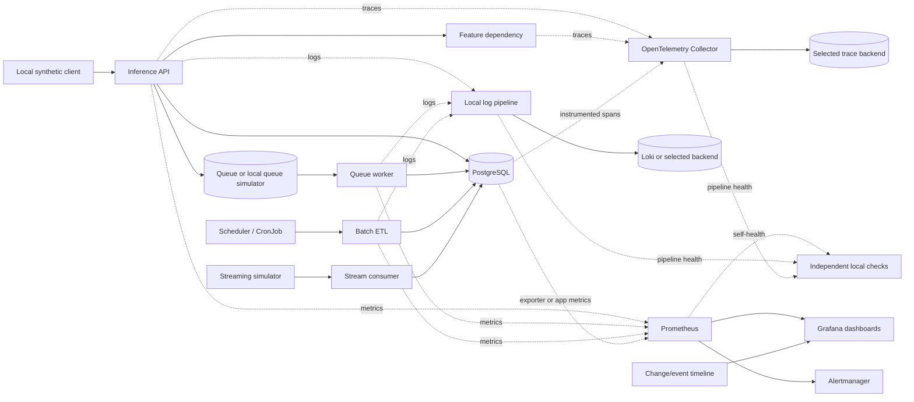

# Project 01 — Platform Health and Bottleneck Investigation

> **Project status:** Self-contained project specification; not a claim that the lab has been executed. All numeric incident data and representative outputs are `[SYNTHETIC]` or `[ILLUSTRATIVE]`.  
> **Safety contract:** Use only learner-owned local services, disposable local containers, or a local `kind` cluster. Never target production, public endpoints, third-party services, or shared clusters. Every mutation is opt-in, bounded, reversible, and followed by recovery verification.

| Metadata | Value |
|---|---|
| Module / stage | M11 — Production Observability Stack and Performance Operations / Stage 2E — Production DevOps & Platform Engineering |
| Project | Project 01 — Platform Health and Bottleneck Investigation |
| Exact target filename | `01-platform-health-and-bottleneck-investigation.md` |
| Difficulty | Intermediate → Advanced → Expert/operator |
| Prerequisites | Stages 0–2D; Stage 2E M01–M10; local service, Kubernetes/container, metrics, logs, traces, SLO and incident foundations |
| Dependency | **Complete Project 02 first** where possible; Project 02 builds the platform, Project 01 investigates it |
| Estimated effort | `[ASSUMPTION]` 25–40 focused hours, excluding repeated experiments and troubleshooting |
| Budget | Zero-budget local lab; no cloud service or paid SaaS required |
| Primary profile | Core for baseline; Core + Logs and Full only when laptop headroom permits |
| Primary topology | `[ASSUMPTION]` Reuse the topology selected in Project 02. If unavailable, use a single local Compose project or one disposable `kind` cluster, not both simultaneously |
| Tool versions | Inherit and pin the Project 02 version set. Do not use floating `latest` tags in reproducible runs. Record actual versions in evidence |
| Last reviewed | 2026-10-29; this date is not a claim that all version-specific behavior was tested |
| Execution status | Not run in the learner's environment; examples below are specifications and representative fixtures |

## 1. Project Purpose and Production Scenario

You are the on-call platform engineer for a small synthetic data/ML platform. Users report slow inference requests and intermittent failures. A nightly ETL job sometimes misses its freshness target. A queue grows unexpectedly. Memory rises during longer runs. At the same time, the observability platform may be overloaded, so some evidence may be stale or missing.

Your task is to investigate rather than guess. You must establish a trusted baseline, state hypotheses, correlate metrics/logs/traces/change events, perform bounded discriminating experiments, mitigate the confirmed fault, compare before and after under comparable conditions, add regression protection, and prove cleanup.

The lab system includes these logical components:

- **Inference API:** FastAPI or the API already created in earlier stages.
- **Feature dependency:** a local feature-fetch service or deterministic stub.
- **Queue worker:** consumes synthetic tasks and reports progress.
- **Batch ETL:** local scheduled process or a disposable Kubernetes CronJob.
- **Streaming simulator:** emits synthetic events and exposes lag/progress.
- **PostgreSQL:** disposable database populated only with synthetic records.
- **Observability platform:** Project 02's Prometheus, Grafana, Alertmanager, centralized logs (for example Loki), OpenTelemetry Collector, and one trace backend as supported by the chosen profile.
- **Self-monitoring:** signals for the observability components and checks that detect missing expected data.

The project deliberately includes decoys. For example, a deployment can occur near a latency spike without causing it; memory can rise during cache warming without representing a leak; a green job exit can still produce stale or incomplete output; and a dashboard can look calm because its source data stopped updating.

### Project question

> Which component or interaction explains the observed user/pipeline impact, what evidence distinguishes it from competing explanations, what reversible change improves the outcome, and what evidence proves the improvement did not merely hide the symptom?

### Evidence labels

- `[SYNTHETIC]`: generated scenario or fixture data.
- `[ILLUSTRATIVE]`: example arithmetic or representative output, not a measured result.
- `[ASSUMPTION]`: a local integration choice made because the actual Project 02 interface or repository file was unavailable.
- `[VERIFY]`: version-, exporter-, environment-, or configuration-sensitive item to check against the pinned stack.
- `[OPEN]`: unresolved question that requires human or environment-specific verification.

## 2. Learning Outcomes

### L1 — Foundation

The learner can explain the platform topology, define a symptom precisely, record a baseline, distinguish RED from USE, use UTC for an event timeline, and explain why a green dashboard or process exit is not sufficient proof.

**Evidence:** completed preflight; component inventory; baseline distributions; blank hypothesis log filled with at least three competing hypotheses.

### L2 — Independent investigation

The learner can use metrics, structured logs, traces, and change events to narrow a fault; calculate latency contributions on a critical path; inspect queue/pool saturation; and distinguish schedule delay from job runtime and valid-output freshness.

**Evidence:** one end-to-end investigation with query context, raw samples or exports, at least one falsification test, and a before/after comparison.

### L3 — Advanced diagnosis

The learner can diagnose N+1 queries, pool saturation, CPU throttling, retry amplification, DNS overhead, a freshness miss, and telemetry volume/cardinality problems in controlled scenarios; identify a misleading correlation; and preserve essential incident evidence while reducing unnecessary telemetry.

**Evidence:** fault playbooks, variant A/B findings, metric/log/trace/change-event correlation, guardrail tests and cleanup proof.

### L4 — Expert/operator judgment

The learner can reason under telemetry loss, report confidence and remaining uncertainty, design safe and repeatable fault injection, distinguish a proximate bottleneck from an upstream cause, critique load-test validity, and produce an auditable report that another engineer can reproduce.

**Evidence:** evidence bundle, blind-spot matrix, facilitator answer-key review, ten-pass audit, and sign-off with open verification items.

## 3. Prerequisites and Project 02 Dependency

Project 02, `02-end-to-end-observability-stack-build.md`, is the platform-building capstone. Project 01 is the investigation performed on that platform. **Recommended order: Project 02 first**, even if the repository tree lists Project 01 before Project 02. Do not rename or reorder repository files.

The Project 02 specification and actual repository tree were not available for direct inspection while this file was authored. Therefore, the following integration contract is `[ASSUMPTION]` and must be reconciled with Project 02 before execution:

1. One primary local topology is chosen: Compose **or** a small `kind` cluster.
2. Component versions are pinned in a version record.
3. The API exposes a health endpoint and bounded synthetic workload.
4. Metrics are scraped by Prometheus; Grafana datasource identifiers are stable.
5. Logs and traces are enabled only in the chosen resource profile.
6. Correlation fields include a request identifier and, where available, trace identifier.
7. Alert rules are evaluated by Prometheus; Alertmanager routes notifications.
8. All endpoints bind locally or are accessed through local port forwarding.
9. Existing M10 SLO targets are recorded as inputs, not recreated here.
10. A verification command exists, or the portable checks in Section 21 are used.

Do not fabricate exact Project 02 ports, datasource UIDs, metric names, namespaces, or configuration keys. Replace the `[VERIFY]` placeholders with the values in the actual lab. Keep a translation table when names differ.

## 4. Scope, Non-Goals, and Handoffs

### In scope

- Platform health and dependency diagnosis.
- Hypothesis log and unified UTC change/event timeline.
- RED, USE, queue, freshness, data validity and observability-stack self-health.
- Critical-path/exclusive-time analysis.
- Bounded baseline, load, stress, spike and soak experiments.
- Cardinality, log-volume, span-volume and relative-cost reasoning without prices.
- Hidden fault variants, facilitator harness specification and answer keys.
- Dashboard-as-code and alert evidence checks.
- Evidence bundle, mitigation, regression prevention and cleanup verification.

### Out of scope

- Re-teaching M10 SLO mathematics, burn-rate derivations, incident roles or postmortem methodology.
- Rebuilding the full platform from scratch; that is Project 02.
- Real cloud deployment, production load testing, real customer data or third-party endpoints.
- Real vendor prices or financial modeling; M15 owns FinOps.
- Full disaster-recovery/failover design (M13/M14), security platform design (M12), multi-cluster aggregation (M14), or golden-path templates (M16).

### Handoffs

| Upstream/downstream module | Use here | Do not duplicate |
|---|---|---|
| M03 Kubernetes/CronJobs | Pod/container events, scheduling, job lifecycle | Full Kubernetes curriculum |
| M04 networking/ingress/mesh | Name resolution, request path and network symptoms | Full network/mesh setup |
| M05 PostgreSQL/storage | Pool, query, I/O evidence | Full database operations course |
| M08 deployment/change events | Change annotations and release context | Full GitOps release process |
| M09 secrets | Metadata-only rotation events; redaction | Secret-management curriculum |
| M10 SRE foundations | Existing SLOs, alert/incident practice | SLO math and incident-process basics |
| M11 Units 1–13 | Telemetry, PromQL, dashboards, logs, traces, alerts, dependencies, saturation, trace analysis, freshness, cost and load testing | Rewriting the lessons |
| M12–M16 | Security telemetry, DR, aggregation, FinOps, platform templates | Those modules' complete projects |

## 5. Architecture and Investigation Data Flow

`[ASSUMPTION]` Logical topology; ports and protocols are intentionally omitted until verified against Project 02.



The diagram represents logical flows, not a verified deployment manifest. A dotted line means a telemetry path that must be confirmed in the selected profile.

### Correlation contract

Use these fields only if the chosen instrumentation emits them; otherwise implement a consistent local equivalent:

| Field | Purpose | Safety rule |
|---|---|---|
| `event_time` | When the event occurred, UTC | Preserve source precision; do not silently rewrite timestamps |
| `ingest_time` | When the event entered the pipeline | Needed to measure pipeline delay |
| `service.name` or local service field | Service attribution | Bounded values only |
| `request_id` | Join logs within a request | Do not use as a metric label |
| `trace_id` / `span_id` | Link log events to traces | Treat as high-cardinality fields; not metric labels |
| `deployment_id` / `change_id` | Correlate with changes | Use stable, bounded identifiers |
| `job_run_id` | Identify one ETL execution | Keep out of metric labels unless intentionally bounded |
| `scenario_id` / `fault_id` | Lab experiment identity | Synthetic and explicit; avoid user-controlled arbitrary values |

**Operational principle:** metrics show the shape and timing of a symptom; logs explain particular events; traces show the request path and time attribution; change events create testable hypotheses. None is a substitute for the others.

## 6. Environment, Stack Profiles, and Resource Plan

### Profiles

| Profile | Components | Use | Entry/exit gate |
|---|---|---|---|
| **Core** | Prometheus, Alertmanager, Grafana, exporters, API, worker/ETL simulators and database as needed | Baseline, metrics, saturation and core alert tests | Start first; verify headroom and targets before continuing |
| **Core + Logs** | Core plus Loki and the selected log pipeline | Log-volume, event correlation and redaction | Start only after Core baseline passes; stop log pipeline before switching profiles |
| **Full** | Core + Logs plus OpenTelemetry Collector and one trace backend | Trace critical path and cross-signal investigations | Use only if measured laptop headroom permits; no fixed RAM guarantee |

Resource footprint: **measure yours**. Before each phase, record free memory, disk headroom, CPU pressure and active containers/pods. Stop if the host becomes unstable, disk headroom is unexpectedly low, the laptop swaps heavily, or telemetry ingestion affects the experiment enough to invalidate it.

### Phase protocol

For every phase:

1. Record the profile and actual component versions.
2. Confirm all target services are local and owned by this lab.
3. Start only the services needed for that phase.
4. Confirm readiness, expected targets/series and telemetry freshness.
5. Run one bounded experiment.
6. Stop the generator and injected fault before examining long-term effects.
7. Capture evidence and run recovery checks.
8. Stop optional services and confirm disk/RAM recovery where feasible.

### Version record template

```text
recorded_at_utc:
host_os:
topology: compose | kind
repository_commit_or_config_hash:
profile: Core | Core+Logs | Full
prometheus_version:
grafana_version:
alertmanager_version:
loki_version_or_not_used:
otel_collector_version_or_not_used:
trace_backend_and_version_or_not_used:
api_image_or_commit:
postgres_version:
load_tool_and_version:
kernel_or_wsl_version:
notes_and_unverified_items:
```

Never paste credentials or secret values into this record.

## 7. Safety, Privacy, and Lab-Only Guardrails

- Bind service ports to loopback where possible; use local port forwarding for `kind`.
- Do not accept arbitrary target URLs in the fault harness. The target must be a named local service created by the lab.
- Fault toggles default to **off**. A mutation must fail closed if the expected context cannot be proved.
- Every load/fault run has a fixed duration, a rate/concurrency ceiling, a manual stop command and a recovery check.
- No destructive database operations. Use disposable synthetic rows and reversible flags.
- Never inject faults into shared clusters, public services, or production.
- No real secrets, PII, customer payloads, or authentication tokens in logs, traces, screenshots or evidence.
- Redaction is defense in depth, not proof that all sensitive content is removed. Inspect samples before sharing.
- Do not disable alerting or delete telemetry to make a dashboard look healthy.
- Do not use a cardinality or log flood as an unbounded denial-of-service exercise. Simulate a small, controlled label set and stop at the declared cap.
- If context, namespace, endpoint, or profile is ambiguous, abort.

### Mandatory stop conditions

Stop immediately if any of the following occurs: target ownership cannot be demonstrated; a command would reach a non-local address; resource headroom crosses the learner-defined safety floor; error rate or latency exceeds the lab's predeclared abort threshold; the observability platform becomes too degraded to observe the test; test duration expires; or the stop switch fails.

Before the first experiment, the learner must fill in concrete local abort thresholds derived from the machine baseline and existing lab policy. Do not copy universal thresholds from this guide.

## 8. Investigation Rules and Evidence Standard

### 8.1 Hypothesis log — sample

All values in this table are `[SYNTHETIC]`; they demonstrate method, not a diagnosis of a real service.

| ID | Symptom/scope | Suspected cause | Supporting evidence | Contradictory evidence | Next discriminating test | Prediction if true | Observed result | Conclusion/confidence | Falsifier | Mitigation/verification |
|---|---|---|---|---|---|---|---|---|---|---|
| H-01 | API p99 rises 10:02–10:07 UTC | Feature dependency slow | Trace shows feature span rises with API tail | Some slow requests have no feature span | Compare matched slow/healthy traces and dependency latency | Feature span is on critical path for affected requests | `[OPEN]` | Open / low | Feature latency normal on affected requests | None yet |
| H-02 | API errors rise after deploy | New retry behavior | Change event at 10:00; attempts/request increase | Deployment timing alone is not causal | Toggle retries off in local variant with same load | Downstream attempts and queue growth fall | `[OPEN]` | Open / low | Attempts unchanged under controlled toggle | Reversible flag, then repeat |
| H-03 | Memory rises during warm-up | Leak | Working set trends upward | Cache hit rate also rises | Hold traffic mix constant after warm-up; compare slope windows | Positive slope persists beyond warm-up | `[OPEN]` | Open / low | Slope stabilizes with cache plateau | No restart-only “fix” |

### 8.2 Blank hypothesis log template

| ID | Symptom and scope | Candidate cause | Supporting evidence | Contradictory evidence | Discriminating test | Predicted result if true | Observed result + artifact link | Conclusion | Confidence | Falsifier | Mitigation + verification | Owner/follow-up |
|---|---|---|---|---|---|---|---|---|---|---|---|---|
| H-___ | | | | | | | | Open | Low/Med/High | | | |

### 8.3 Hypothesis discipline

1. Describe the observable symptom before naming a cause.
2. Keep at least two plausible explanations until a test distinguishes them.
3. Write the prediction before running the test.
4. Prefer the smallest experiment that can falsify the leading hypothesis.
5. Separate direct evidence from interpretation and assumptions.
6. Prioritize by impact, plausibility and test cost. High impact plus low-cost discriminating test usually goes first; do not rank solely by familiarity.
7. Record contradictory evidence and failed hypotheses. Do not erase them after the root cause is found.
8. State what evidence would change the conclusion.
9. A before/after improvement supports a causal claim only if workload, environment and measurement conditions are sufficiently comparable and confounders are disclosed.
10. If telemetry is missing, classify the state as **unknown**, not healthy.

### 8.4 Evidence quality levels

- **E0 — assertion:** an untested opinion; not sufficient for a finding.
- **E1 — single signal:** one metric, log, trace or event; useful for triage, usually not causal proof.
- **E2 — correlated evidence:** multiple independent signal types with consistent timestamps and identifiers.
- **E3 — discriminating experiment:** a prediction is tested with controls and a bounded change.
- **E4 — repeatable confirmation:** repeat run or independent evidence, before/after comparison, falsifier and regression check.

A critical root-cause claim should normally reach E3/E4. If it cannot, state the limitation.

## 9. Scenario Variants and Hidden Faults

The facilitator selects one variant and keeps the answer key private until the learner submits findings. All fault controls are opt-in. Do not activate every fault simultaneously.

### Variant A — dependency pressure and freshness miss

| Fault ID | Planted fault | Main expected symptom | Required distinguishing evidence |
|---|---|---|---|
| A-01 | N+1 query regression | API duration and query count rise | Trace/database spans plus query count per request |
| A-02 | Pool too small or acquisition wait | Request queueing and pool wait rise | Pool active/waiting, DB execution time, controlled pool-size test |
| A-03 | CPU quota throttling | Tail latency rises despite moderate average CPU usage | Throttling counters/CPU pressure plus controlled limit experiment |
| A-04 | Scheduler delayed start | Freshness/deadline misses although job runtime is ordinary | Scheduled/start/finish/commit timeline |
| A-05 | Benign cache warming decoy | Memory rises early and then plateaus | Memory slope across phases and cache-hit behavior |

### Variant B — amplification and telemetry pressure

| Fault ID | Planted fault | Main expected symptom | Required distinguishing evidence |
|---|---|---|---|
| B-01 | Retry amplification | Dependency load and queue depth grow | Attempts versus final requests, retry events, downstream latency |
| B-02 | Local DNS/`ndots` overhead | Intermittent name-resolution delay | Resolver timing, controlled lookup comparison, trace span where instrumented |
| B-03 | Log-volume explosion | Disk/ingestion/query pressure | Bytes per time window, repeated log signatures, I/O and pipeline health |
| B-04 | High-cardinality metric label | Series growth and monitoring load | Label-value combinations, series count, safe cardinality investigation |
| B-05 | Slow memory leak | Memory slope persists after warm-up | Bounded soak, slope and uncertainty, stable workload |
| B-06 | Cross-signal fault: changed feature timeout plus retry policy | p99 and errors spike; downstream queue grows | Metrics identify symptom, trace shows dependency wait/retry path, logs show timeout, change event gives testable lead |

### Fault coverage

| Required family | Covered by |
|---|---|
| N+1 query | A-01 |
| Connection-pool saturation / poor sizing | A-02 |
| CPU throttling | A-03 |
| Leak versus cache warming | A-05 and B-05 |
| Retry amplification | B-01 and B-06 |
| DNS / `ndots` overhead | B-02 |
| Scheduler hang/delayed start and deadline miss | A-04; optional local scheduler-hang variant |
| Log-volume explosion | B-03 |
| High-cardinality label | B-04 |
| Cross-signal metrics + traces + logs + change event | B-06 |
| Misleading correlation / benign decoy | A-05 and deployment event decoy |

### Facilitator controls

The facilitator must define a manifest mapping each `fault_id` to a reversible toggle in the lab implementation. The specific environment variables or API endpoints are not standardized here because Project 02's actual implementation was unavailable. Do not invent a runnable fault-control URL. A safe adapter should expose named operations such as `assert_context`, `enable_fault(fault_id, duration)`, `disable_fault(fault_id)`, and `assert_all_faults_off`, and should refuse unknown IDs.

## 10. Investigation Workflow

Every stage includes an objective, actions, outputs, pass gate and common failures.

### Stage A — Preflight and safety gate

**Objective:** prove the experiment will touch only the intended local lab.

Actions:
- Confirm local topology, project/namespace/context, profile and selected variant.
- Verify all targets are lab-created; reject arbitrary URLs.
- Check disk/RAM headroom and ensure fault/load switches are off.
- Record UTC time, versions, config commit/hash, baseline health and existing M10 SLO targets.
- Run the safety assertions and test the abort path without injecting a fault.

Outputs: `run-metadata.md`, `preflight.txt`, selected `scenario_id`.

Pass gate: all target ownership and context checks pass; abort and cleanup paths are known.

Common failures: ambiguous kube context, wrong Compose project, stale process, unexpected exposed port, hidden load generator. Abort rather than infer.

### Stage B — Baseline and instrumentation trust

**Objective:** establish whether the evidence system itself is trustworthy.

Actions:
- Check scrape targets, expected series, dashboard query freshness, log flow, trace flow and alert delivery.
- Issue one benign control request and one known synthetic error.
- Verify both positive and negative detection; capture a trace if tracing is enabled.
- Record latency distribution, request rate, error rate, queue age/depth, memory, DB pool and job freshness.
- Record known blind spots before fault injection.

Outputs: baseline samples, query exports, trace/log exemplars, self-health report.

Pass gate: expected signals update within the chosen scrape/export interval; missing signals are explicitly marked unknown.

Common failures: treating a stale graph as zero, assuming a trace must exist despite sampling, relying on a notification screenshot without verifying delivery.

### Stage C — Symptom triage and hypothesis generation

**Objective:** define impact and a testable hypothesis set.

Actions:
- Mark start/end times in UTC and the affected API routes, worker groups or job outputs.
- Distinguish user-visible symptoms from internal saturation and data correctness.
- Build at least three competing hypotheses for the primary symptom.
- Prioritize hypotheses by impact, plausibility and discriminating-test cost.

Outputs: initial report, hypothesis log, affected-component map.

Pass gate: every leading hypothesis has a prediction and falsifier.

Common failures: writing “database issue” without evidence, anchoring on the most recent deploy, ignoring contradictory evidence.

### Stage D — Correlation and dependency analysis

**Objective:** connect symptoms to request paths and changes.

Actions:
- Correlate metrics, logs, traces, deployment/config/Kubernetes/job events on a shared UTC timeline.
- Select one slow request and one healthy/median request from comparable workload windows.
- Inspect retries, queue waits, connection acquisition, DNS, DB execution and parallel branches.
- Check event time and ingestion time; document clock skew or missing events.

Outputs: timeline, trace comparison, query/log pivots.

Pass gate: the causal hypothesis explains the observed symptom better than alternatives; correlation alone is not called causation.

Common failures: summing overlapping spans, treating a sampled trace as representative of all traffic, assuming a deploy event caused a spike.

### Stage E — Controlled fault experiments

**Objective:** test one fault at a time unless the variant explicitly requires an interaction.

Actions:
- Record the prediction and negative-control signals before mutation.
- Confirm target and safety bounds.
- Enable the selected fault for a bounded period, capture evidence, then disable it.
- Avoid combining stress and fault injection unless the playbook justifies it.
- Verify recovery and preserve evidence before starting the next fault.

Outputs: experiment record, before/during/after series, fault state log.

Pass gate: the fault is off, the service recovered or residual impact is documented, and cleanup assertions pass.

Common failures: no stop command, multiple simultaneous changes, unbounded retries, interpreting a test after the generator saturated.

### Stage F — Root cause and bottleneck confirmation

**Objective:** distinguish the proximate bottleneck from upstream cause and downstream symptoms.

Actions:
- Use a discriminating experiment.
- Seek at least two independent evidence types where feasible.
- Identify the affected critical path and causal mechanism.
- Record confidence, remaining uncertainty and falsifier.

Outputs: one finding per fault, with links to raw evidence.

Pass gate: finding has a reproducible evidence chain or is explicitly marked likely/inconclusive.

### Stage G — Mitigation and before/after verification

**Objective:** make the smallest safe reversible change and evaluate it.

Actions:
- Predict which signals should improve and which should remain unchanged.
- Repeat the same workload mix, duration, warm-up and environment where possible.
- Compare distributions, errors, resource signals and telemetry health.
- Report confounders, sample sizes and uncertainty; repeat if practical.

Outputs: before/after comparison, mitigation diff/config hash, regression test.

Pass gate: improvement is not solely a lower average; error rate, correctness and observability remain acceptable against the existing lab policy.

### Stage H — Prevention and observability improvement

**Objective:** make recurrence detectable and harder.

Actions:
- Add a regression test, alert fixture, dashboard check, instrumentation contract or safe guardrail.
- Test the guardrail with both a planted defect and benign negative control.
- Assign an owner and follow-up; update the runbook.

Outputs: test evidence, dashboard/alert export, follow-up record.

Pass gate: planted defect is detected and benign case does not falsely fire, within the declared lab policy.

### Stage I — Report, cleanup, and sign-off

**Objective:** preserve a reproducible record and return the lab to a safe state.

Actions:
- Assemble evidence bundle and final report.
- Stop faults, load generators, temporary jobs and optional stack profiles.
- Verify no unexpected silences, temporary credentials, background jobs or mutated settings remain.
- Confirm temporary storage is removed or its retention is documented.
- Classify findings as confirmed, likely, inconclusive or falsified.

Outputs: final report, cleanup verification, sign-off.

Pass gate: cleanup assertions pass and every remaining risk is explicit.

## 11. Required Deliverables and Evidence Bundle

Create these artifacts within the project implementation/evidence directory according to the repository's conventions. This guide does not create them as separate deliverables; their schemas and examples are inline here.

```text
evidence/
  run-metadata.md
  investigation-plan.md
  hypothesis-log.csv
  change-timeline.jsonl
  platform-health-report.md
  dashboard-exports/
  query-results/
  trace-examples/
  redacted-log-samples/
  experiment-results/
  before-after/
  cardinality-cost-report.md
  freshness-report.md
  blind-spot-matrix.md
  findings/
  cleanup-verification.md
  final-report.md
```

Every screenshot/export must include the UTC time range, timezone, datasource/query context, profile, relevant version/commit and whether the data is synthetic. Preserve raw evidence where safe. Do not include secrets or PII.

### 11.1 Hypothesis log CSV header

```csv
hypothesis_id,symptom_scope,candidate_cause,supporting_evidence,contradictory_evidence,discriminating_test,prediction,observed_result,artifact_link,conclusion,confidence,falsifier,mitigation,verification,owner
```

### 11.2 Unified change/event timeline

Use a stable JSONL schema. Fields not applicable to a specific event may be omitted; do not invent values.

```json
{"event_time":"2026-10-29T10:00:00Z","ingest_time":"2026-10-29T10:00:01Z","event_type":"deployment","change_id":"chg-syn-001","service":"inference-api","environment":"local-lab","scenario_id":"variant-b","actor_type":"facilitator","summary":"Synthetic image/config revision selected","metadata":{"config_hash":"sha256:synthetic-example","secret_value_included":false},"evidence_label":"SYNTHETIC"}
{"event_time":"2026-10-29T10:02:00Z","ingest_time":"2026-10-29T10:02:02Z","event_type":"fault_enabled","change_id":"fault-syn-006","service":"inference-api","environment":"local-lab","scenario_id":"variant-b","actor_type":"facilitator","summary":"Bounded retry/timeout scenario enabled","metadata":{"duration_seconds":60,"target":"named-local-service"},"evidence_label":"SYNTHETIC"}
{"event_time":"2026-10-29T10:03:00Z","ingest_time":"2026-10-29T10:03:01Z","event_type":"fault_disabled","change_id":"fault-syn-006","service":"inference-api","environment":"local-lab","scenario_id":"variant-b","actor_type":"facilitator","summary":"Scenario disabled; recovery check started","metadata":{"cleanup_check":"pending"},"evidence_label":"SYNTHETIC"}
```

The timestamps above are representative fixture values only. A real run must use the actual UTC clock and actual event data.

Required event types include deployment/rollback, feature-flag changes, config or secret rotation metadata, scaling/resource changes, Kubernetes events, database changes, job starts/completions, fault injection, load-test phases, observability component restarts, and dropped/rejected telemetry events.

### Timeline interpretation

- **Event time** is when the event occurred at its source.
- **Ingestion time** is when the event arrived in the observability pipeline.
- A large gap may mean pipeline delay, clock skew or a buffering problem.
- Missing events may be an instrumentation/pipeline blind spot; absence is not proof that a change did not occur.
- Temporal overlap narrows hypotheses but does not prove causation.
- Dashboard annotations should use a consistent timestamp and event identifier. Verify the annotation API/config against the chosen Grafana version `[VERIFY]`.

## 12. Platform Health Report and Dashboard Specification

Every panel/report row must state: operational question, source, expected healthy pattern, degraded pattern, window, limitation and next action.

| Area | Operational question | Source / evidence | Healthy pattern | Degraded or unknown pattern | Window and limitation | Next action |
|---|---|---|---|---|---|---|
| API RED | Are requests slow or failing? | API metrics, traces, structured logs | Stable rate/errors/latency against existing policy | Tail latency/error burst; stale or absent data is unknown | Short incident window plus baseline; percentiles need enough samples | Select a slow request and compare trace |
| Feature dependency | Is dependency wait on critical path? | Dependency metrics and child spans | Bounded duration and error rate | Duration/errors rise with API tail | Sampling can hide examples | Compare matched requests |
| PostgreSQL | Is time spent waiting for a connection or executing SQL? | Pool instrumentation, DB metrics/logs/traces where available | Pool wait low relative to service time; stable query behavior | Wait rises, pool exhausted, slow SQL or I/O | Names depend on exporter/instrumentation `[VERIFY]` | Separate acquisition wait from execution time |
| CPU | Is compute saturated or throttled? | Container/host metrics and platform events | No sustained pressure that violates lab policy | Throttling/pressure correlates with tail latency | Usage alone does not prove throttling | Controlled limit experiment |
| Memory | Is growth persistent after warm-up? | Working set, restarts/OOM events, cache metrics | Stabilizes under stable workload | Positive slope persists or restarts increase | Short soak cannot prove absence of leak | Compare windows and fit slope |
| Queue/worker | Is work arriving faster than it is completed? | Depth, oldest age, enqueue/dequeue, retries, DLQ | Stable age/depth and progress | Age/depth/lag increases | Metric availability depends on queue implementation | Compare arrival/completion rates |
| Batch freshness | Is valid committed output current and on time? | Job events, output watermark, validation/commit marker | Freshness and deadline slack within existing target | Late start, stale input, partial/invalid output | Exit code alone insufficient | Inspect job timeline and partition coverage |
| Streaming | Is consumer progress keeping up? | Lag, processed events, retries, watermark | Lag stable and progress advances | Lag grows, watermark stalls | Simulator is not production-scale evidence | Inspect backpressure and downstream wait |
| Prometheus | Is metrics ingestion/querying healthy? | Target health, sample/series growth, rule evaluation, disk | Expected targets and fresh series | Missing targets/series, ingestion or rule failures | Exact self-metrics `[VERIFY]` | Inspect target state and logs |
| Logs | Are logs arriving and queryable without overwhelming the platform? | Pipeline health, bytes, drops/rejections, Loki storage | Expected event coverage and bounded volume | Gaps, drop signals, volume spike or query pressure | Label/metadata support is version-dependent | Compare source output with backend counts |
| Traces | Are spans being accepted and useful? | Collector receiver/exporter health, trace backend | Representative traces searchable | Queue/rejection/export failures or gaps | Sampling means not every request has a trace | Check collector/backend health and sampling |
| Alert delivery | Are alerts evaluated and routed? | Prometheus rule state, Alertmanager status, test notification | Positive fixture delivered; negative fixture stays quiet | Evaluation/delivery failure or absent-data ambiguity | A screenshot alone does not prove delivery | Inspect rule and receiver evidence |
| Cardinality/volume | Which signal consumes series, bytes, spans or query work? | Series inventory, log volume, span counts, storage | Bounded expected growth | Sudden increase or high-cardinality labels | No real prices; use units and relative changes | Narrow query scope and identify label source |
| Change timeline | Did a change coincide with the symptom? | JSONL events and annotations | Events complete and aligned | Missing events, clock skew, ingestion delay | Correlation is not causation | Test the change hypothesis |
| SLO status | Is existing user-facing policy breached? | Existing M10 SLI/SLO views | Within current policy | Existing policy indicates breach or burn | Do not invent new target | Follow existing runbook |

### Dashboard layout

1. **Overview:** request rate, errors, latency distribution, existing SLO status, telemetry freshness and change markers.
2. **Dependency tier:** feature service, database, queue/worker and streaming consumer.
3. **Critical path:** trace links and latency contribution comparisons.
4. **Saturation:** CPU usage and throttling, memory slope/restarts, pool wait, queue depth/age, disk.
5. **Batch freshness:** scheduled/start/finish/validation/commit timestamps, watermark and deadline slack.
6. **Telemetry self-health:** scrape state, expected-series presence, rule evaluation, alert delivery, log/trace pipeline drops/rejections, storage headroom.
7. **Volume/cardinality:** series count/growth, log bytes/event rates, span rates and query cost proxies.
8. **Change timeline:** deployments, config changes, fault toggles, job events and observability restarts.

For every panel, label the timezone, window and units. Expose stale/no-data state rather than painting missing data green. Export/provision dashboards as code using the Project 02 interface; datasource UIDs and schema are `[VERIFY]` until inspected.

## 13. Fault Investigation Playbooks

Each playbook follows: symptom → metrics → traces → logs → change/event → discriminating experiment → mitigation → verification → prevention. If a signal is not instrumented, state the gap and use a valid alternative; do not fabricate evidence.

### Playbook A-01 — N+1 database query regression

1. **Objective:** determine whether repeated small queries increase total request time.
2. **Learner-facing symptom:** `[SYNTHETIC]` p99 latency rises on requests that load a collection of records; database query count per request rises.
3. **Competing causes/decoys:** slow SQL plan, pool wait, DB CPU pressure, unrelated deploy, larger request payload.
4. **Preflight:** Core profile plus Full traces if available; check local DB, bounded request mix and fault toggle off.
5. **Baseline:** query count/request, total DB span time, pool wait, API latency distribution, error rate.
6. **Hypothesis:** query count scales with number of returned objects rather than remaining approximately constant.
7. **Queries/artifacts:** compare representative trace waterfall; inspect app-level query counter if defined; compare DB duration and query count separately. Metric names depend on the project instrumentation `[VERIFY]`.
8. **Expected evidence `[SYNTHETIC]`:** healthy path: 1 collection query plus bounded related queries; faulty path: one parent query and N child lookups. Example: 1 + 20 = 21 statements for 20 objects. This arithmetic is a teaching fixture, not an observed DB result.
9. **Interpretation:** query count is not the same as database time. Twenty fast queries can be less costly than one badly blocked query; measure both count and duration.
10. **Logs:** correlate query/operation summaries with request ID; do not log full SQL parameters or secrets.
11. **Trace:** repeated DB child spans appear serially or on the critical path. Account for pooling and parallel execution.
12. **Change event:** look for a query-path/code revision; temporal alignment is a lead only.
13. **Discriminating experiment:** use fixed synthetic record count, compare faulty and corrected query paths, same load and warm-up. Stop on lab abort threshold.
14. **Root-cause criterion:** query count rises with object count and controlled batching/prefetch reduces count and request tail without worsening correctness.
15. **Mitigation:** batch related reads, eager-load only required relations, or use a bounded join. Avoid indiscriminate joins that duplicate rows or explode payloads.
16. **Before/after:** compare query count/request, DB time/request, API p50/p95/p99, errors and output correctness.
17. **Prevention:** test query-count bounds on representative fixtures; dashboard query count and DB duration.
18. **Falsifier:** same query count and duration under both paths, or latency remains after query count is corrected.
19. **Cleanup:** disable fault; reset synthetic dataset; verify no background load.
20. **Facilitator key:** A-01 is confirmed only when controlled query-path comparison supports it; otherwise accept a falsified/inconclusive conclusion.

### Playbook A-02 — Connection-pool saturation or poor sizing

1. **Objective:** distinguish pool acquisition wait from slow SQL execution.
2. **Symptom:** API requests queue while active connections remain at the configured pool ceiling; errors/timeouts may rise.
3. **Competing causes:** slow query, DB max-connection limit, leaked sessions, traffic burst, application concurrency.
4. **Preflight/baseline:** record pool maximum, active/idle/waiting if instrumented, DB connection state, query duration, API latency and queue depth.
5. **Hypothesis log:** predict that acquisition wait rises before or alongside request tail latency.
6. **Evidence:** use actual app instrumentation/DB exporter fields `[VERIFY]`. Do not assume a particular pool metric exists.
7. **Trace:** distinguish connection-acquisition span from SQL execution span where instrumented.
8. **Logs/events:** inspect timeout and pool-acquisition events; correlate pool/config changes.
9. **Discriminating experiment:** in a disposable lab, hold query cost and request mix stable; change concurrency or pool size by one bounded step. Do not raise pool size without checking the DB connection budget.
10. **Synthetic calculation:** if 8 pool slots are all occupied and 12 requests are waiting, the waiting count is 12 at that instant; it does not by itself establish whether the pool is undersized or queries are slow. Measure wait duration and DB execution.
11. **Mitigation:** fix long-held connections/query time first; tune pool size only against database limits and observed concurrency.
12. **Before/after:** pool wait, SQL duration, DB connections, request latency, errors and queue depth.
13. **Prevention:** alert on pool wait/timeout and DB connection headroom; test bounded concurrency.
14. **Falsifier:** pool wait remains low while SQL execution dominates latency.
15. **Cleanup:** restore original pool configuration and verify connection counts recover.
16. **Facilitator key:** poor sizing is not proven by “pool full” alone; the discriminating test must separate slow work from insufficient pool capacity.

### Playbook A-03 — CPU throttling due to container limits

1. **Objective:** separate CPU usage from CPU throttling and scheduling pressure.
2. **Symptom:** tail latency rises under concurrency; average CPU utilization may look moderate.
3. **Competing causes:** lock contention, downstream wait, generator saturation, memory pressure, actual CPU demand.
4. **Baseline:** CPU usage, throttling counters if available, CPU pressure, container limit, request latency and throughput. Metric names vary by runtime/exporter `[VERIFY]`.
5. **Trace/log:** look for increased application compute spans or request duration; logs may show deadline overruns but do not prove throttling.
6. **Change timeline:** record the configured CPU limit and rollout/restart time.
7. **Experiment:** use a local container only; compare two predeclared CPU-limit settings with same input mix and fixed duration. Abort if host pressure crosses the safety floor.
8. **Interpretation:** CPU usage answers how much CPU was consumed; throttling evidence indicates execution was denied/deferred by the quota. Neither alone proves it caused the user symptom.
9. **Mitigation:** profile hot code, right-size the limit from measured behavior, or reduce work. Do not remove limits blindly.
10. **Before/after:** throttled time/counter delta, latency distribution, throughput, host CPU pressure and errors.
11. **Prevention:** capacity review and regression load fixture.
12. **Falsifier:** throttling does not change under the experiment or latency remains dominated by dependency wait.
13. **Cleanup:** restore original limit and confirm steady state.
14. **Facilitator key:** require a correlated throttling signal and controlled limit experiment; moderate CPU usage alone is insufficient.

### Playbook A-04 — Scheduler delay or freshness/deadline miss

1. **Objective:** determine whether valid output is late, stale, incomplete or merely reported successful.
2. **Symptom:** the scheduled job may finish with exit code zero, yet the downstream freshness target is missed.
3. **Required timeline:** scheduled time → actual start → actual finish → validation → commit → deadline.
4. **Definitions:** job state is process/controller status; last successful run is not necessarily last successful valid output; watermark represents event-time progress; freshness measures how current usable output is; deadline slack is deadline minus valid-commit time.
5. **Evidence:** schedule/controller events, job heartbeat/progress, input watermark, partition coverage, validation and commit markers. External metric names `[VERIFY]`; define project-owned instrumentation if absent.
6. **Fault tree:** not started; late start; failed; hung; empty output; partial output; duplicate output; stale input; process succeeded but validation/commit failed; exporter unavailable.
7. **Discriminating experiment:** delay a local scheduler start by a bounded interval while leaving ETL runtime unchanged. Predict start delay and freshness degradation with normal runtime.
8. **Synthetic example:** scheduled 02:00Z, actual start 02:12Z, finish 02:20Z, validation/commit 02:22Z, deadline 02:15Z. Valid output misses deadline by 7 minutes. These are illustrative timestamps.
9. **Mitigation:** correct scheduler contention/dependency or deadline policy based on existing requirements; make retries idempotent; preserve prior valid output until new output validates.
10. **Pushgateway pitfall:** pushed batch metrics can remain after a job stops, so a stale success series may be mistaken for a recent run. If Pushgateway is used, use a deliberate lifecycle/cleanup policy and verify stale series behavior against the chosen version `[VERIFY]`. Alternative: node-exporter textfile collector or a last-success registry, if compatible with Project 02.
11. **Prevention:** alert on freshness/watermark/deadline slack and scheduler heartbeat; include partition coverage and duplicate-run detection.
12. **Falsifier:** start time is normal and valid output is committed on time; investigate data watermark or validation instead.
13. **Cleanup:** remove test job and verify last-success state reflects actual valid output.
14. **Facilitator key:** success exit code alone is never sufficient evidence of freshness or data validity.

### Playbook A-05 / B-05 — Memory leak versus cache warming

1. **Objective:** distinguish transient warm-up from persistent growth under stable workload.
2. **Symptom:** working set rises during a bounded run.
3. **Competing causes:** cache warming, retained objects, allocator behavior, workload mix, page cache, memory leak, telemetry overhead.
4. **Baseline:** memory working set, restart/OOM events, request mix, cache-hit signal if available, throughput and elapsed time.
5. **Method:** record at regular intervals; split into warm-up and steady-state windows; fit a simple slope to the latter; inspect residual variability and confidence rather than relying on two points.
6. **Synthetic calculation:** if working set changes from 420 MiB to 450 MiB over 10 minutes in a steady-state window, the observed slope is `(450−420)/10 = 3 MiB/min`. This is illustrative and cannot be extrapolated as a production leak rate without validating workload and measurement stability.
7. **Trace/log:** correlate growth with request types, cache insertions, object retention or repeated task processing if instrumented. No trace is required for every memory event.
8. **Experiment:** warm the cache, hold request mix and concurrency stable, run only for a predeclared bounded duration, and compare multiple windows. Stop at the resource safety floor.
9. **Interpretation:** cache warming often approaches a plateau as the working set stabilizes; a leak hypothesis gains support if positive slope persists under stable workload and cache behavior. A short run cannot prove no leak.
10. **Mitigation:** correct retained references/unbounded caches or configure bounded cache eviction; do not rely on restarts as the only solution.
11. **Before/after:** memory slope, restart/OOM count, latency, correctness and cache-hit behavior.
12. **Prevention:** bounded cache, soak test and slope-based review with uncertainty.
13. **Falsifier:** memory plateaus after warm-up and repeats across runs.
14. **Cleanup:** stop the soak generator and restore resource settings.
15. **Facilitator key:** a rising line is not by itself proof of a leak; require steady-state controls and a stated falsifier.

### Playbook B-01 — Retry amplification

1. **Objective:** determine whether retries multiply downstream work and worsen a partial failure.
2. **Symptom:** API errors may stay deceptively low while dependency attempts, queue depth and tail latency grow.
3. **Competing causes:** increased user traffic, slow dependency, duplicate messages, queue consumer slowdown.
4. **Baseline:** logical request rate, attempts per logical request, final success/failure, retry reason, downstream rate/latency, queue depth and oldest age.
5. **Synthetic arithmetic:** 100 logical requests with 1.0 attempt/request means 100 downstream attempts. If retry amplification raises this to 2.5 attempts/request, the dependency sees about 250 attempts for the same logical request volume. This is arithmetic for a fixture, not a measured rate.
6. **Trace/log:** inspect repeated dependency spans and retry reason events; use request/correlation IDs without metric labels containing IDs.
7. **Change event:** inspect retry/timeout configuration change; temporal coincidence is not enough.
8. **Experiment:** use a local dependency stub that fails deterministically for a bounded interval; compare retry policy variants under the same logical request schedule. Set a maximum duration/attempt ceiling and abort switch.
9. **Mitigation:** bounded retries, exponential backoff with jitter, deadlines, circuit breaking where already supported, and idempotency keys where appropriate.
10. **Before/after:** attempts/logical request, dependency throughput, queue age/depth, final success, latency and errors.
11. **Prevention:** alert on attempts/request and downstream pressure; test both transient failure and healthy negative control.
12. **Falsifier:** attempts/request stays stable while the queue grows for another reason.
13. **Cleanup:** turn off fault and retry variant; verify attempts normalize.
14. **Facilitator key:** count logical requests and attempts separately; retries can hide user-facing errors temporarily while increasing system load.

### Playbook B-02 — DNS / `ndots` name-resolution overhead

1. **Objective:** test whether name resolution adds latency without changing external DNS or shared configuration.
2. **Symptom:** intermittent connection-start delays; application and DB spans do not explain all request time.
3. **Competing causes:** TCP connect delay, TLS handshake, connection-pool misses, network contention, slow service.
4. **Safety:** only local test names and a disposable local resolver/container context; no public DNS flood, no editing host-wide resolver configuration, no changes to shared cluster DNS.
5. **Evidence:** resolver lookup timings or instrumented name-resolution span if available; compare fresh-connection path with connection reuse; inspect local resolver config read-only.
6. **`ndots` explanation:** resolver search-domain behavior can cause additional queries for names that do not meet the configured dot threshold. Actual behavior depends on libc/runtime, resolver and cluster configuration `[VERIFY]`.
7. **Experiment:** use a local-only name and bounded request count; compare fully qualified local name versus the lab's configured search behavior without changing host-wide settings. Record query count/timing if observable.
8. **Mitigation:** use appropriate service names/FQDNs for the environment, reduce unnecessary lookups, or reuse connections where safe. Do not blindly change cluster-wide DNS settings.
9. **Falsifier:** resolution is fast and the missing time lies elsewhere.
10. **Cleanup:** revert local resolver/config change and verify only local resources were touched.
11. **Facilitator key:** if resolver timing is not instrumented, the result may remain inconclusive; do not invent a DNS trace span.

### Playbook B-03 — Log-volume explosion

1. **Objective:** identify repeated/noisy events that create I/O, ingestion, storage and query pressure.
2. **Symptom:** disk or log pipeline pressure rises, query latency worsens, or logs disappear.
3. **Competing causes:** real incident burst, increased traffic, changed sampling/retention, pipeline backpressure.
4. **Baseline:** source log bytes, event count, repeated signatures, pipeline accepted/dropped/rejected evidence where available, storage headroom and query latency.
5. **Synthetic arithmetic:** 50 events/s × 2 KiB/event ≈ 100 KiB/s decimal, or about 6,000 KiB/min. This is a unit calculation using a synthetic rate and size; actual serialization and compression differ.
6. **Evidence:** aggregate repeated message templates locally; compare source-side output to backend ingestion; redact payloads before sampling.
7. **Experiment:** enable a bounded noisy-log fixture with a maximum event count and duration. Stop immediately if disk or pipeline headroom crosses the declared floor.
8. **Mitigation:** rate-limit repetitive messages, lower verbosity for expected conditions, aggregate counts, and retain representative error context. Preserve incident-critical events and audit/security evidence.
9. **Before/after:** bytes/time, event rate, query responsiveness, error/alert visibility and pipeline drops.
10. **Prevention:** volume guardrail and noisy-event alert; positive and negative fixtures.
11. **Falsifier:** source volume is stable while backend volume or query cost changes due to another stage.
12. **Cleanup:** disable fixture and verify log rate returns to baseline.
13. **Facilitator key:** never solve volume by silently dropping the only evidence needed to diagnose the incident.

### Playbook B-04 — High-cardinality metric label

1. **Objective:** identify a label whose value space multiplies time series.
2. **Symptom:** series count/storage/query load grows after instrumentation or label changes.
3. **Competing causes:** legitimate new services, increased scrape targets, changed scrape interval, duplicate target discovery.
4. **Cardinality arithmetic:** if a metric has label dimensions with 5 service values, 4 regions, 3 status values and 1,000 request IDs, the theoretical combination count is `5 × 4 × 3 × 1,000 = 60,000` series for that metric family before other labels or histogram buckets. `[ILLUSTRATIVE]` actual series depend on observed combinations and metric type.
5. **Investigation:** narrow query time range and label scope first; inspect series growth by job/service/namespace if supported. Avoid huge unbounded queries during the incident.
6. **Mitigation:** remove request/trace/user IDs from metric labels; use bounded labels and put high-cardinality identifiers in logs/traces/structured metadata where supported `[VERIFY]`.
7. **Before/after:** active series or series-growth proxy, query latency, scrape health and retained alert/dashboard behavior.
8. **Visibility preservation:** rerun the positive fault fixture and confirm the essential error/latency/health signals still work.
9. **Falsifier:** growth is explained by target count or legitimate new label combinations, not the suspected label.
10. **Cleanup:** restore only required bounded telemetry; verify no essential metric was removed.
11. **Facilitator key:** distinguish cardinality (series/label combinations) from log bytes and span volume; these are different resource dimensions.

### Playbook B-06 — Cross-signal timeout/retry/change-event incident

1. **Objective:** correlate metrics, traces, logs and change events to test a causal explanation.
2. **Learner-facing symptom:** `[SYNTHETIC]` API p99 and errors increase; queue age grows; a configuration change occurred shortly before the first spike.
3. **Competing causes:** feature dependency latency, DB pool wait, CPU throttling, traffic mix change, stale dashboard.
4. **Metrics:** show API rate/error/latency and downstream attempts/queue age. Confirm data freshness first.
5. **Trace:** compare slow and healthy requests; identify whether feature wait, retry spans or pool acquisition lie on the critical path.
6. **Logs:** find timeout/retry reason using request/trace identifiers; redact payloads.
7. **Change event:** verify timeout/retry config revision and exact event time/ingestion time.
8. **Discriminating experiment:** in the local lab, toggle one setting at a time with fixed request mix and a deterministic feature stub; predict which spans and queue signals should change.
9. **Mitigation:** revert the harmful setting or bound retry/deadline behavior, then repeat the same workload.
10. **Before/after:** API distribution/errors, downstream attempts, queue age, feature latency, and data correctness.
11. **Confidence:** high only if the controlled toggle produces the predicted signal changes and a repeat run supports it.
12. **Falsifier:** symptom persists with the suspect change reverted or the feature dependency is not on the affected critical path.
13. **Cleanup:** reset configuration and verify no test traffic remains.
14. **Facilitator key:** this is the required multi-signal scenario. No single signal is sufficient; the change event is a lead, not proof.

### Additional fault — Scheduler hang (optional extension)

Use a disposable local job simulator or a local CronJob. Introduce a bounded delay or pause that can be reliably cleared. Do not suspend a shared controller or cluster component. Verify the scheduler heartbeat, actual start and progress marker. If the lab cannot safely inject a hang, simulate it as an explicit event fixture and label it `[SYNTHETIC]`; do not claim an actual hang was tested.

## 14. Critical-Path and Exclusive-Time Analysis

### Terms

- **Inclusive duration:** total duration of a span including child work.
- **Exclusive/self time:** time attributed to the span itself, excluding child intervals according to the tracing model.
- **Critical path:** the longest dependency chain that determines end-to-end completion, accounting for parallel/concurrent work.
- **Parallel spans:** can overlap; adding their durations as if sequential overstates total latency.
- **Missing spans:** can hide work. A sampled trace is an example, not necessarily the population.
- **Clock/timestamp issues:** cross-process timing can be distorted by clock skew; prefer same-trace duration measurements and documented instrumentation semantics.

### Worked example 1 — straightforward serial bottleneck

`[SYNTHETIC]` Slow request spans:

| Span | Start offset | End offset | Inclusive duration | Interpretation |
|---|---:|---:|---:|---|
| API request | 0 ms | 300 ms | 300 ms | End-to-end |
| Feature call | 10 ms | 70 ms | 60 ms | Serial dependency |
| DB query | 80 ms | 260 ms | 180 ms | Dominant serial dependency |
| Serialization | 270 ms | 295 ms | 25 ms | Application work |

The request is 300 ms. Approximate non-overlapping observed segments are feature 60 ms + DB 180 ms + other gaps/work 60 ms = 300 ms. DB accounts for 180/300 = 60% of end-to-end duration in this synthetic example. That makes DB behavior a strong candidate, not proof that the SQL itself is slow: DB span may include pool wait, network wait or driver overhead. Inspect subspans/instrumentation and compare a healthy trace.

### Worked example 2 — largest span is not the sole cause

`[SYNTHETIC]` End-to-end request duration is 240 ms. Two concurrent children start at 20 ms:

- Feature branch: 20–220 ms (200 ms inclusive).
- Policy branch: 20–110 ms (90 ms inclusive).
- Final merge/serialization: 220–240 ms (20 ms).

The branches overlap. Do **not** add `200 + 90 + 20 = 310 ms` and claim a 310 ms request. The wall-clock critical path is approximately 200 ms for the feature branch plus 20 ms final work, after the initial 20 ms pre-branch segment: `20 + 200 + 20 = 240 ms`. The policy branch's 90 ms is not on the longest branch for this example. It may still consume resources or affect other requests, but shaving it alone cannot reduce this request below the feature-branch path unless it changes scheduling/contention.

### Comparison protocol

1. Select a slow trace and a healthy/median trace from similar route, payload, concurrency and time window.
2. Compare span tree, durations, retry count, pool wait, DNS and queue waits.
3. Mark missing or sampled spans.
4. Calculate critical-path contribution without double-counting parallel intervals.
5. Distinguish exclusive application work from inclusive dependency time.
6. Form a falsifiable hypothesis and test it under a bounded repeatable workload.
7. If trace data is unavailable, state that limitation and use metrics/logs or local instrumentation; do not manufacture a trace.

## 15. Saturation, Queue, Memory, and Resource Analysis

### CPU and throttling

CPU utilization is not throttling. Compare actual CPU use with limit/quota behavior, throttling counters where available `[VERIFY]`, latency, throughput and host pressure. A container can have moderate average CPU use but experience quota periods that affect tail latency. A controlled limit change in a disposable lab is more informative than a dashboard correlation alone.

### Memory and leak slope

Record memory at regular intervals and hold workload mix stable. Separate warm-up from steady state. Calculate slope as:

\[
\text{slope}=\frac{\text{memory}_{end}-\text{memory}_{start}}{\text{elapsed time}}
\]

Report units, window, sample count and uncertainty. A linear fit can be useful but does not eliminate confounding from cache growth, allocator behavior or workload changes. Record OOM/restart evidence and whether memory plateaus after load stops.

### Queue and backpressure

Record enqueue rate, dequeue/complete rate, depth, oldest-message age, retries, dead-letter count and consumer lag where available. If arrivals exceed completions for a sustained interval, backlog tends to grow. A single depth sample does not reveal trend or age. A queue can be shallow but contain one very old message; depth and age answer different questions.

### Synthetic queue calculation

`[ILLUSTRATIVE]` If 40 tasks/min arrive and 32 tasks/min complete for 5 minutes, net backlog grows by `(40−32) × 5 = 40 tasks`, assuming rates remain constant and no drops/retries alter the accounting. This is a derived scenario, not production capacity evidence.

### Capacity knee and recovery

A capacity knee is the region where incremental offered load produces disproportionately worse latency/errors or saturation. Measure offered load, achieved throughput, goodput, client latency, generator health and service saturation. Stop before the lab safety boundary. After stopping load, verify queues drain and service signals return toward baseline. A short laptop test does not predict production capacity.

### Resource triage order

1. Validate generator health and offered schedule.
2. Validate telemetry freshness and sample coverage.
3. Inspect user-facing RED symptoms.
4. Follow dependency path and queue/pool waits.
5. Inspect resource saturation (CPU throttling, memory, disk, connections).
6. Test the smallest discriminating hypothesis.
7. Re-run under comparable conditions.

## 16. Freshness, Deadline, and Data-Validity Analysis

### Lifecycle timeline

```text
scheduled_time
    |
    v
actual_start ---- schedule_delay
    |
    v
actual_finish ---- runtime
    |
    v
validation_pass ---- completeness / schema / partition coverage
    |
    v
commit_or_publish ---- last successful valid output
    |
    v
deadline
```

A run can be `Succeeded` while output is empty, partial, stale-input, duplicated or not committed. Define success at the data contract level: output validated and committed, with the expected partition/watermark coverage.

### Required distinctions

- **Schedule delay:** actual start minus scheduled time.
- **Runtime:** finish minus actual start.
- **Validation/commit delay:** commit minus finish.
- **Deadline slack:** deadline minus valid commit time; negative means late.
- **Freshness:** how current the last valid output is relative to the business/data contract.
- **Watermark delay:** event-time progress lag.
- **Completeness:** expected partitions/records covered.
- **Duplicate-run check:** detect overlapping or repeated processing that violates idempotency.

### Fault tree

| Observed outcome | Candidate explanation | Evidence to inspect |
|---|---|---|
| No start | Scheduler/controller failure, missed schedule, disabled job | Scheduler heartbeat, expected schedule event, controller events |
| Late start | Resource contention, concurrency policy, dependency unavailable | Scheduled/start timestamps, cluster events |
| Started but no progress | Hung task, deadlock, blocked dependency | Progress heartbeat, logs, traces, worker state |
| Failed | Application/DB/input error | Exit state plus logs and dependency evidence |
| Green exit, empty output | Empty input or validation gap | Input watermark, row/partition counts, validation marker |
| Green exit, partial output | Partial task completion or dropped partitions | Partition coverage and commit metadata |
| Green exit, stale output | Stale input or no valid commit | Input watermark and last valid commit |
| Duplicate output | Retry/backfill not idempotent | Run IDs, partition keys, duplicate checks |
| No job metric | Exporter/pipeline down or job not running | Independent scheduler heartbeat and target health |

### Safe retry/backfill runbook

1. Identify the exact affected time/partition range and last valid committed output.
2. Check idempotency and duplicate-run protections.
3. Confirm dependencies and available storage.
4. Use a local synthetic partition and bounded replay.
5. Verify row/partition counts, watermark and validation before commit.
6. Commit atomically where the lab supports it; otherwise document the weaker semantics.
7. Verify downstream freshness and duplicate absence.
8. Record the run ID and cleanup outcome.

If Pushgateway is used, test stale-series behavior and deletion/cleanup semantics for the pinned version `[VERIFY]`. Do not assume a pushed “last success” metric expires automatically. A textfile collector or last-success registry may be more appropriate depending on the selected architecture.

## 17. Cardinality, Telemetry Volume, and Relative Cost Analysis

### Distinguish the resource dimensions

- **Metric cardinality:** number of distinct time series generated by metric names and label combinations.
- **Sample volume:** observations ingested over time; depends on series and scrape/recording frequency.
- **Log volume:** bytes/events ingested, stored and queried.
- **Span volume:** spans accepted/stored; depends on traffic, instrumentation and sampling.
- **Query work:** scan range, series touched, filters, joins/aggregations and backend implementation.
- **Storage-days:** volume retained over time, not a monetary price.

Do not treat these units as interchangeable. A metric cardinality problem can exist with low log volume; a repeated log storm can cause disk pressure without a new metric label; a high span count may be a separate pipeline issue.

### Investigation sequence

1. Confirm that series/volume data is fresh and the monitoring backend is healthy.
2. Use a narrow time window and bounded query scope.
3. Compare by job/service/namespace or other bounded dimensions available in the stack.
4. Identify recent label/schema/config changes and correlate them with event timeline.
5. Find the originating instrumentation code or exporter; do not delete data based on a dashboard guess.
6. Remove or bound the high-cardinality dimension at the source where possible.
7. Re-run the known fault fixture and verify essential alerts/dashboards still work.
8. Record before/after series, sample, byte, span and query-work proxies separately.

### Relative-cost report template

| Dimension | Baseline | During incident | After mitigation | Unit/window | Visibility preserved? |
|---|---:|---:|---:|---|---|
| Active series or supported proxy | | | | series / time | |
| Sample ingestion | | | | samples/min | |
| Log source volume | | | | bytes/min | |
| Log event rate | | | | events/s | |
| Span acceptance | | | | spans/min | |
| Query response/work proxy | | | | query duration/range | |
| Storage used | | | | bytes and retention window | |

No real prices or vendor cost claims belong in this project. Report units and relative comparisons only. Never silently remove incident-critical telemetry.

## 18. Controlled Load, Stress, and Soak Experiments

Reuse Project 02's chosen load tool and local topology. If unavailable, the choice of tool is `[ASSUMPTION]`; reconcile before running. Do not run a load test against a public or production endpoint.

### Experiment record

```text
experiment_id:
hypothesis:
target_service_name:                 # named local service; no arbitrary URL
profile:
request_mix_and_payload:
load_model: closed-loop | open-loop | bounded-spike | soak
offered_rate_or_concurrency:
duration_and_warmup:
sample_window:
generator_cpu_memory_and_error_state:
abort_conditions:
stop_command:
required_metrics_logs_traces:
expected_result_if_hypothesis_true:
negative_control:
observed_result:
raw_artifact_paths:
recovery_check:
cleanup_result:
limitations_and_confounders:
```

### Required experiments

| Experiment | Question | Bound and abort policy | Required evidence |
|---|---|---|---|
| Baseline/smoke | Does the lab behave normally? | Small fixed request count; stop on any non-local target or unexpected error | RED, expected telemetry, generator health |
| Open-loop/equivalent arrival-rate model | Can the service keep up with scheduled arrivals? | Fixed low starting rate and short duration; ramp only after a pass | Offered starts, completions, dropped/late starts, latency |
| Capacity knee | Where do latency/errors or saturation change nonlinearly? | Increment in small predeclared steps; stop before safety threshold | Throughput, goodput, tails, resource and generator signals |
| Stress/recovery | How does the local service degrade and recover? | One bounded step beyond normal lab load; no resource exhaustion | Error/latency curve and recovery timeline |
| Spike | What happens under a short burst? | Short duration and explicit max rate; immediate stop command | Tail latency, queue, retry and recovery |
| Soak | Does memory/resource growth persist? | Time-limited; host safety floor; periodic checkpoints | Memory slope, restarts, cache signals, latency |
| Leak vs warming | Does steady-state slope persist after warm-up? | Stable mix, multiple windows, bounded duration | Slope, uncertainty, memory/traffic time series |
| Planted regression gate | Does a guardrail detect a known slowdown? | Local fixture only; no CI gate against live service | Positive regression and benign negative control |
| A/A noise check | Does the comparison falsely flag identical fixtures? | Repeated comparable runs; fixed seeds if applicable | False-positive behavior and confidence intervals |

### Load-model cautions

- **Closed-loop:** clients send a new request after the previous one completes. When the service slows, offered rate may fall, masking overload.
- **Open-loop:** arrivals are scheduled independently of completion. This better represents fixed arrival rates but requires a generator that can sustain the schedule.
- **Coordinated omission:** a closed-loop or delayed generator can fail to record the latency that would have occurred for requests that were never started during a stall.
- **Generator saturation:** CPU, socket, connection or scheduling limits on the client can create false service conclusions. Monitor generator health.
- **Warm-up:** record and exclude it only by a predeclared rule; do not selectively discard unfavorable samples.
- **Percentiles:** do not average per-instance p99 values to derive a global p99. Aggregate compatible histogram buckets or compute from raw request samples using a valid method.
- **Uncertainty:** repeat trials and report sample count, effect size and confidence interval where appropriate. A bootstrap interval cannot fix biased or unrepresentative input.
- **A/A checks:** compare identical candidates to estimate noise; a gate that flags many no-change pairs is not trustworthy.
- **Capacity interpretation:** a laptop run describes that lab environment and workload, not production scale.

### Safe stop protocol

1. Stop the generator using the actual tool's documented stop command `[VERIFY]`.
2. Disable the fault toggle.
3. Confirm no background process/job remains.
4. Wait for local queues to drain or document residual state.
5. Check API errors, latency, CPU/memory, disk and telemetry health.
6. Verify fault state is off and restore configuration.
7. Save raw output and mark it synthetic/observed accurately.

## 19. Game-Master Harness and Facilitator Answer Keys

The harness is a design specification for a local `sim/` implementation. Supporting files are shown inline only; this document does not create separate scripts or configs.

### 19.1 Scenario manifest example

```yaml
# [ILLUSTRATIVE] Adapt to Project 02. This is a manifest schema, not a verified runnable config.
schema_version: 1
target:
  name: local-observability-lab
  topology: compose-or-kind
  allowed_scope: local-only
safety:
  faults_default_off: true
  max_duration_seconds: 60
  require_context_assertion: true
  require_manual_abort: true
  refuse_unknown_fault_ids: true
variants:
  A:
    faults: [A-01, A-02, A-03, A-04]
    decoys: [A-05]
  B:
    faults: [B-01, B-02, B-03, B-04, B-05, B-06]
    decoys: [deployment-timing-decoy]
```

This is not executable until the learner maps fault IDs to actual lab controls. Never implement arbitrary command execution from the manifest.

### 19.2 Fail-closed control contract

The following Python is a **safe interface sketch**, not a complete service-specific controller. It deliberately contains no network target or shell execution.

```python
from dataclasses import dataclass
from time import monotonic

ALLOWED_FAULTS = {
    "A-01", "A-02", "A-03", "A-04", "A-05",
    "B-01", "B-02", "B-03", "B-04", "B-05", "B-06",
}
MAX_DURATION_SECONDS = 60

@dataclass
class FaultState:
    enabled_faults: set[str]
    deadline_by_fault: dict[str, float]

class UnsafeContext(RuntimeError):
    pass

def assert_local_context(context: dict) -> None:
    """Require explicit proof from the adapter; missing values fail closed."""
    if context.get("owned_by_lab") is not True:
        raise UnsafeContext("target ownership not proven")
    if context.get("local_only") is not True:
        raise UnsafeContext("target is not proven local-only")
    if not context.get("named_target"):
        raise UnsafeContext("named target is required")
    if context.get("external_target_configured") is not False:
        raise UnsafeContext("external target must be explicitly absent")

def enable_fault(state: FaultState, fault_id: str, duration_seconds: int,
                 context: dict) -> None:
    assert_local_context(context)
    if fault_id not in ALLOWED_FAULTS:
        raise ValueError("unknown fault ID")
    if not isinstance(duration_seconds, int) or not 1 <= duration_seconds <= MAX_DURATION_SECONDS:
        raise ValueError("duration must be within the fixed safe bound")
    if state.enabled_faults:
        raise UnsafeContext("one fault at a time; clear existing fault first")
    state.enabled_faults.add(fault_id)
    state.deadline_by_fault[fault_id] = monotonic() + duration_seconds

def disable_fault(state: FaultState, fault_id: str, context: dict) -> None:
    assert_local_context(context)
    state.enabled_faults.discard(fault_id)
    state.deadline_by_fault.pop(fault_id, None)

def assert_all_faults_off(state: FaultState) -> None:
    if state.enabled_faults or state.deadline_by_fault:
        raise AssertionError("fault state is not clean")
```

The adapter that changes the actual local service must enforce the deadline even if the caller crashes. Do not claim this in-memory sketch alone provides a durable watchdog. A production-quality local implementation should have a separately verified auto-expiry path, a manual abort, and a cleanup assertion.

### 19.3 Control sequence

1. `assert_context` — confirm the named lab target, local-only routing, profile and resource headroom.
2. `assert_all_faults_off` — verify baseline.
3. `capture_baseline` — save current metrics/log/trace and config hash.
4. `enable_fault(fault_id, duration)` — one allow-listed fault only.
5. `capture_during` — record exact start/end times and expected signals.
6. `disable_fault(fault_id)` — clear the toggle.
7. `assert_all_faults_off` — fail if any toggle remains active.
8. `capture_recovery` — verify return toward baseline and check telemetry pipeline health.
9. `write_evidence_manifest` — list artifacts, labels and limitations.

### 19.4 Reset/cleanup contract

A cleanup operation must:
- disable every allow-listed fault through the lab adapter;
- stop the local generator and test jobs;
- restore saved configuration or explicitly report restoration failure;
- verify no temporary test resource remains;
- verify all toggles are off;
- return a non-zero status if any assertion fails.

Do not implement cleanup as “ignore errors and exit zero.” If context is ambiguous, refuse mutation and require a human to inspect the local environment.

### 19.5 Fault-to-signal visibility matrix

| Fault | Metrics | Logs | Traces | Change events | Main limitation |
|---|---|---|---|---|---|
| N+1 | Query count/duration, API tail | Query summaries | Repeated DB spans | Code/config revision | Query count may not be instrumented |
| Pool saturation | Pool wait/active, request queue | Acquisition timeout | Pool acquisition span if available | Pool config | External metric names `[VERIFY]` |
| CPU throttling | Usage/throttle/pressure | Runtime warnings | Compute-heavy path | Resource-limit change | Usage alone is insufficient |
| Leak/warming | Working set, restarts | Cache/allocation clues | Request mix context | Release/config | Short soak inconclusive |
| Retry amplification | Attempts, queue, downstream rate | Retry reason | Repeated child spans | Retry policy change | Sampling can hide attempts |
| DNS | Lookup timing if instrumented | Resolver errors | DNS span if supported | Local resolver setting | Signal may not exist |
| Freshness | Start/finish/watermark/commit | Job outcome | Dependency spans where available | Scheduler/job change | Green exit may be invalid |
| Log explosion | Pipeline rate/drop/disk | Repeated signatures | Trace context if sampled | Log-level change | Backend loss may hide volume |
| Cardinality | Series growth | Instrumentation changes | Usually not primary | Label/schema change | Cardinality metrics are version-specific |
| Cross-signal | RED/queue/attempts | Timeout details | Dependency/retry path | Config revision | No one signal proves cause |

### 19.6 Facilitator answer keys (keep separate from learner-facing tasks)

- **Variant A expected pattern:** A-01 increases query count and DB contribution; A-02 produces acquisition wait distinguishable from execution time; A-03 requires throttling evidence plus a controlled limit change; A-04 produces a late valid commit even if runtime is normal; A-05 plateaus after warm-up and acts as a decoy.
- **Variant B expected pattern:** B-01 increases attempts per logical request; B-02 only confirms when local resolver evidence supports it; B-03 raises source log volume and may affect pipeline/storage; B-04 increases series through a high-cardinality label; B-05 retains a positive steady-state memory slope; B-06 requires metrics, traces, logs and a change-event hypothesis tested by a controlled toggle.
- A learner may reach **inconclusive** where the required signal is not instrumented. Award credit for honest uncertainty and a valid alternate test, not for inventing evidence.
- A diagnosis is not accepted merely because the learner guessed the planted fault ID. Require evidence and falsification.

## 20. Implementation Artifacts

These are complete illustrative contracts and examples to be adapted to the actual Project 02 stack. They are not separate files created by this document.

### 20.1 Portable local-only preflight pseudocode

```text
assert topology is exactly one of {approved local Compose project, approved local kind context}
assert selected profile is declared
assert target service is a named lab-owned resource
assert no external target is configured
assert fault state is empty
assert generator state is stopped
record UTC start, config hash, versions, host headroom
verify expected telemetry is fresh
if any assertion fails: exit non-zero and do not mutate
```

### 20.2 Event schema validator (Python)

```python
from datetime import datetime
import json
import sys

REQUIRED = {"event_time", "event_type", "environment", "summary", "evidence_label"}
ALLOWED_LABELS = {"SYNTHETIC", "ILLUSTRATIVE", "OBSERVED"}

def valid_utc(value: str) -> bool:
    try:
        dt = datetime.fromisoformat(value.replace("Z", "+00:00"))
        return dt.tzinfo is not None and dt.utcoffset().total_seconds() == 0
    except (TypeError, ValueError):
        return False

def validate_event(event: dict) -> list[str]:
    errors = []
    missing = REQUIRED - event.keys()
    if missing:
        errors.append(f"missing required fields: {sorted(missing)}")
    if "event_time" in event and not valid_utc(event["event_time"]):
        errors.append("event_time must be timezone-aware UTC")
    if event.get("evidence_label") not in ALLOWED_LABELS:
        errors.append("invalid evidence_label")
    if "secret_value" in event or "password" in event:
        errors.append("possible secret field is forbidden")
    return errors

def main() -> int:
    failures = 0
    for line_no, line in enumerate(sys.stdin, 1):
        if not line.strip():
            continue
        try:
            event = json.loads(line)
        except json.JSONDecodeError as exc:
            print(f"line {line_no}: invalid JSON: {exc}", file=sys.stderr)
            failures += 1
            continue
        errors = validate_event(event)
        for error in errors:
            print(f"line {line_no}: {error}", file=sys.stderr)
            failures += 1
    return 1 if failures else 0

if __name__ == "__main__":
    raise SystemExit(main())
```

Run locally with `python validate_events.py < change-timeline.jsonl` after saving the example to a local working file. This code block is a proposed artifact; it was not executed as part of authoring. It rejects obvious secret field names but is not a full data-loss-prevention scanner.

### 20.3 Example bounded experiment manifest

```yaml
# [ILLUSTRATIVE] This schema must be wired to the actual Project 02 tool.
experiment_id: smoke-001
target_service: inference-api-local
profile: Core
load_model: fixed-count
request_count: 20
max_duration_seconds: 30
max_concurrency: 2
synthetic_payloads_only: true
abort:
  on_external_target: true
  on_host_safety_floor: true
  on_unexpected_fault_state: true
cleanup:
  stop_generator: true
  disable_faults: true
  assert_faults_off: true
evidence:
  record_utc: true
  include_config_hash: true
  include_generator_health: true
```

Do not treat a manifest as a safety mechanism until the runner validates every field and enforces the bounds.

### 20.4 Prometheus query templates

These examples intentionally use generic placeholders; replace them with actual instrumented metric names and labels from Project 02. All unresolved names are `[VERIFY]`.

```promql
# [VERIFY] Request rate: substitute the project's request counter.
sum by (service) (rate(<request_counter_total>[5m]))

# [VERIFY] Error ratio: numerator and denominator must have compatible labels.
sum(rate(<request_error_counter_total>[5m]))
/
clamp_min(sum(rate(<request_counter_total>[5m])), 1)

# [VERIFY] Classic histogram quantile: preserve le in bucket aggregation.
histogram_quantile(
  0.99,
  sum by (le, service) (rate(<request_duration_seconds_bucket>[5m]))
)

# [VERIFY] Expected target/series presence must be checked against the actual
# scrape configuration; absent series is not the same as a zero-valued series.
up{job="<declared_local_job>"}
```

Do not run broad series-discovery queries during a cardinality incident without a bounded time range and scope. Do not apply `rate()` to a gauge. Do not average per-instance quantiles to claim a global percentile.

### 20.5 Dashboard-as-code and alert verification contract

- Export the dashboard/provisioning files using the Project 02 mechanism.
- Record dashboard UID, datasource UID, schema/version and config hash.
- Verify every query references an emitted metric and has a unit/time window.
- Include an explicit no-data/stale-data state.
- For each alert, record its condition, owner/runbook context, positive fixture, negative fixture, expected evaluation state and delivery verification.
- Prometheus evaluates Prometheus alert rules; Alertmanager routes/deduplicates/groups notifications. Do not conflate these roles.
- Verify receiver delivery through the actual local notification fixture supported by the stack. Do not count “alert is firing” as proof that notification was delivered.

## 21. Verification and Acceptance Tests

### Portable verification checklist

Run only after reconciling commands with the actual topology. The list is a checklist, not a claim of execution.

1. **Context:** assert local Compose project or approved `kind` context; fail closed otherwise.
2. **Profile:** verify only intended profile services are running.
3. **Health:** check API and dependency readiness using local service names.
4. **Metrics:** confirm expected targets are healthy and expected series update over the declared window.
5. **Logs:** send one synthetic control event and one synthetic error; confirm queryability and redaction.
6. **Traces:** send one request and confirm a representative trace if Full profile is enabled; absence can be sampling or pipeline failure.
7. **Alerts:** trigger a known positive fixture and verify routing/delivery; then run a negative fixture.
8. **Dashboard:** check query results, units, time range, datasource and no-data behavior.
9. **Game master:** prove fault toggles default off, reject unknown fault IDs, enforce max duration and clear on abort.
10. **Experiment:** capture offered schedule, generator health, request samples and service telemetry.
11. **Freshness:** verify a job is considered successful only after valid output is committed.
12. **Cardinality:** demonstrate detection and remediation without removing essential evidence.
13. **Before/after:** repeat under comparable conditions and document confounders.
14. **Cleanup:** stop generator/jobs, clear toggles, restore config and verify no unexpected resource remains.

### Acceptance criteria

The project is accepted only when the learner can:

- Complete a safe preflight and record exact lab context and versions.
- Demonstrate expected metrics, logs, traces, dashboards and alert notifications are flowing before investigation, or explicitly scope out unavailable signals.
- Capture baseline distributions and record existing M10 SLO targets.
- Maintain a hypothesis log and unified UTC event timeline.
- Diagnose each active planted fault with a defensible evidence chain.
- Analyze at least one critical path with exclusive-time reasoning.
- Distinguish CPU utilization from throttling and leak from cache warming with uncertainty.
- Diagnose scheduled-job freshness/deadline failure using valid-output semantics.
- Identify and mitigate a cardinality or log-volume issue while preserving essential evidence.
- Demonstrate a cross-signal diagnosis using metrics, traces, logs and change events.
- Produce platform-health report, dashboard-as-code evidence, findings report and evidence bundle.
- Verify observability-stack self-health and document blind spots.
- Run bounded local experiments with explicit abort and cleanup verification.
- Demonstrate that prevention checks catch the planted regression and do not fire for the benign control.
- Stop all faults/generators and verify cleanup.

### 100-point rubric

| Category | Points | Full-credit evidence |
|---|---:|---|
| Investigation method and hypothesis discipline | 15 | Competing hypotheses, predictions, contradictions, discriminating tests and audit trail |
| Diagnostic accuracy and evidence chains | 25 | Root causes supported by raw evidence, controlled experiments and falsifiers |
| Correlation, critical path and bottleneck reasoning | 15 | Correct span arithmetic, dependency attribution and causal caution |
| Saturation, freshness and data validity | 10 | Queue/pool/CPU/memory reasoning; valid commit/watermark/deadline semantics |
| Telemetry cost/cardinality with evidence preservation | 10 | Separate units, identify cause, demonstrate visibility remains |
| Reproducible tests, dashboards/alerts and regression prevention | 10 | Repeatable evidence, positive and negative fixtures, code/config exports |
| Final report, uncertainty and falsifiability | 10 | Clear confidence, limitations, remaining unknowns and reproducibility |
| Safety, privacy and cleanup | 5 | Local-only bounds, secret-free artifacts, verified cleanup |

- **80–100:** pass; findings are defensible and reproducible.
- **60–79:** remediation required; identify missing evidence and repeat affected experiments.
- **Below 60:** repeat the investigation with facilitator guidance.
- **Automatic safety failure regardless of score:** unsafe target, unbounded load/fault, secret/PII exposure, or unverified cleanup.

## 22. Mitigation, Regression Prevention, and Follow-Up

For every confirmed finding, record:

| Field | Required content |
|---|---|
| Finding ID | Stable identifier, e.g. `F-01` |
| Root cause | Mechanism supported by evidence, not just symptom |
| Proximate bottleneck | Component/span/resource directly constraining progress |
| Upstream cause | Trigger or condition that created the bottleneck, if known |
| Mitigation | Smallest safe reversible change |
| Predicted signals | Which metrics/logs/traces should change and which should not |
| Verification | Same workload and window; before/after distribution, errors, correctness |
| Regression control | Test, dashboard, alert or instrumentation contract |
| Owner and due date | Named role/person in learner's local plan |
| Residual risk | What remains unknown or untested |
| Rollback | Exact restoration method for the lab configuration |

Do not “fix” a dashboard by hiding a panel, suppressing an alert, increasing sampling without understanding impact, deleting all noisy logs, or raising resource limits without a bounded experiment. A successful mitigation must preserve correctness and the ability to detect recurrence.

## 23. Final Findings Report Template

Copy and complete this template. Do not leave required fields as TODO in a submitted project.

```markdown
# Platform Health and Bottleneck Investigation — Final Report

## Executive summary
- Observed impact:
- Confirmed / likely / inconclusive findings:
- Confidence and evidence grade:
- Important limitations:

## Scope and environment
- Topology/profile:
- Component versions:
- Config commit/hash:
- Scenario variant:
- Time range (UTC):
- Synthetic/observed data distinction:
- Fidelity limitations:

## Incident timeline (UTC)
| Event time | Ingest time | Event | Source | Evidence link | Interpretation |
|---|---|---|---|---|---|

## User and pipeline symptoms
- API RED:
- Existing M10 SLO status:
- Queue/worker:
- Batch freshness and valid output:
- Data correctness/completeness:

## Hypotheses and tests
| Hypothesis | Supporting evidence | Contradictory evidence | Discriminating test | Conclusion | Confidence | Falsifier |
|---|---|---|---|---|---|---|

## Findings
| ID | Root cause | Component | Evidence links | Confidence | Falsifier | Mitigation | Verification | Residual risk |
|---|---|---|---|---|---|---|---|---|

## Critical path and exclusive time
- Slow trace:
- Healthy/median comparison:
- Parallel branches and overlap:
- Missing/sampled spans:
- Arithmetic and interpretation:

## Saturation, queue and memory
- CPU usage/throttling:
- Pool wait vs SQL time:
- Queue depth/age/arrival/completion:
- Memory slope and uncertainty:
- Recovery after load stops:

## Freshness, deadline and validity
- Scheduled/start/finish/validation/commit/deadline:
- Watermark and partition coverage:
- Last successful valid output:
- Duplicate/idempotency check:

## Telemetry volume and relative cost
- Series/samples:
- Log bytes/events:
- Spans:
- Query/storage proxies:
- Mitigation and essential visibility checks:

## Observability self-health and blind spots
- Scrape/expected-series:
- Rule/alert delivery:
- Log/trace pipeline:
- Disk/queue/drop/rejection:
- Signals unavailable during failure:
- Independent fallback and limits:

## Before/after comparison
| Metric | Before | After | Unit/window/sample count | Confounders | Conclusion |
|---|---:|---:|---|---|---|

## Prevention and regression tests
- Positive fixture:
- Negative fixture:
- Dashboard/alert code evidence:
- Runbook and owner:

## What remains unknown
- Unknown:
- Why unknown:
- Safest next test:

## Cleanup verification
- Fault toggles off:
- Generator/jobs stopped:
- Configuration restored:
- Temporary resources handled:
- No unexpected silences/credentials:
- Verification evidence:

## Reproduction appendix
- Exact queries and commands:
- Config commit/hash:
- Evidence file list:
- [VERIFY]/[OPEN] items:
```

## 24. Cleanup and Recovery Verification

Cleanup is a required acceptance gate, not an optional final note.

### Checklist

- [ ] All fault toggles disabled; assert programmatically where supported.
- [ ] Load generator and soak process stopped.
- [ ] Temporary jobs/CronJobs and synthetic event producers stopped.
- [ ] Local configuration restored or remaining change explicitly documented.
- [ ] No accidental alert silences or notification overrides remain.
- [ ] No secrets or test tokens were written to logs/evidence.
- [ ] Temporary containers/pods/volumes removed where intended; persistent data handled deliberately.
- [ ] Queue is drained or residual messages documented.
- [ ] API/dependencies return to baseline health.
- [ ] Metrics/logs/traces are fresh enough to verify recovery.
- [ ] Host resource use has stabilized; no unexpected background process remains.
- [ ] Cleanup evidence saved with UTC time and profile.
- [ ] Any failed cleanup assertion returns non-zero and blocks sign-off.

### Recovery report

```text
cleanup_started_utc:
cleanup_finished_utc:
profile:
faults_expected_off:
faults_observed_off:
generator_stopped:
jobs_stopped:
config_restored:
temporary_resources_removed_or_retained_with_reason:
queue_state:
api_health:
telemetry_health:
host_resource_state:
unexpected_changes:
verification_artifact:
status: PASS | FAIL | OPEN
```

Never mark cleanup `PASS` if the control plane was unavailable and fault state could not be checked. Use `OPEN` and require human verification.

## 25. Acceptance Criteria and Scoring Rubric

Use the criteria in Section 21 and the 100-point rubric without double-counting the same evidence. The evaluator should score **diagnostic accuracy, evidence quality, reproducibility, falsifiability and safety**, not the number of dashboards or lines of code.

### Review gates

1. **Safety gate:** must pass before any numeric score is considered.
2. **Evidence gate:** each root-cause claim links to raw evidence and a falsifier.
3. **Correctness gate:** trace arithmetic, rates, queue calculations and freshness definitions are correct.
4. **Reproducibility gate:** another learner can repeat the test using the evidence bundle and pinned config.
5. **Prevention gate:** planted regression is detected; benign control does not falsely fire.
6. **Cleanup gate:** all faults and generators are stopped and verified.

## 26. Stretch Goals

Only attempt after the core acceptance criteria pass.

1. Compare two different local request mixes and explain how the bottleneck changes.
2. Add a low-cardinality service/route breakdown without introducing request IDs as metric labels.
3. Test whether a dashboard query remains usable under a bounded series-growth fixture.
4. Compare trace sampling policies using synthetic requests and document selection bias.
5. Add a job-watermark validation test for partial output.
6. Create an A/A comparison report and quantify false-positive behavior.
7. Compare two safe retry policies with a deterministic local dependency failure.
8. Add a “telemetry is unknown” alert fixture when expected data disappears.
9. Produce a small capacity-knee chart with raw samples, confidence notes and generator-health evidence.
10. Run the investigation with Core profile only and state exactly which conclusions are weaker without logs/traces.

## 27. Common Failure Modes and Troubleshooting

| Failure | Why it misleads | Diagnostic action |
|---|---|---|
| Dashboard is green but stale | Missing data may be rendered as no issue | Check query time range, last sample and expected-series presence |
| No trace for a slow request | Sampling, instrumentation gap or pipeline loss | Check sampling policy and collector/backend health; use logs/metrics as alternatives |
| Biggest span selected as root cause | Inclusive time or off-critical-path branch can mislead | Draw dependency graph and compute critical path |
| Retry hides user errors temporarily | More attempts amplify downstream load | Compare logical requests with attempts and final outcomes |
| Memory rises and is called a leak | Cache warming or allocator behavior may explain growth | Hold workload stable and compare post-warm-up slope |
| Deployment coincides with spike | Temporal correlation is not causation | Revert/toggle in controlled local test and predict changes |
| Average latency improves but errors rise | Mean hides tail and correctness degradation | Compare full distribution, error ratio and output correctness |
| Pool increase appears to fix wait | May overload database connection budget | Measure DB execution, connection ceiling and pool wait separately |
| CPU usage is moderate | Quota throttling or pressure may still affect tails | Inspect throttling and controlled limit experiment |
| Job exit code is zero | Output may be stale, empty, partial or uncommitted | Verify valid commit, watermark, partitions and deadline |
| Cardinality query times out | Query itself may worsen the incident | Narrow range/scope and inspect recent label changes |
| Logs disappear after volume reduction | Mitigation may drop essential evidence | Run positive fixture and verify error/security signals remain |
| Alert fires but no notification arrives | Rule evaluation and delivery are separate | Inspect Prometheus rule state and Alertmanager route/delivery |
| Generator saturates | Measured latency/throughput may describe client bottleneck | Monitor client CPU, start schedule, dropped/late starts |
| Recovery is assumed after disabling fault | Queues or retries may continue after toggle clears | Observe recovery window and assert background jobs stopped |
| Test code returns zero | Assertions may be missing or skipped | Add negative tests and fail-closed assertions |
| Event timestamps disagree | Clock skew or ingestion delay may distort ordering | Compare event and ingest times; document clock source |
| One signal missing | Could be pipeline failure, not symptom absence | Use self-health and independent fallback checks |
| Query uses `rate()` on gauge | Semantics are invalid | Confirm metric type and use appropriate transformation |
| Per-instance p99 values averaged | Does not produce global p99 | Aggregate compatible histogram buckets or raw samples |
| Cleanup command fails silently | Fault may remain active | Make cleanup assertions fail non-zero; require human sign-off |

## 28. Learner Self-Review Checklist

- [ ] I recorded the actual topology, profile, versions, config hash and UTC time.
- [ ] I verified target ownership and local-only scope before mutations.
- [ ] I tested the abort path and cleanup assertion.
- [ ] I established telemetry trust and known blind spots before injection.
- [ ] My hypothesis log contains competing explanations, contradictions, predictions and falsifiers.
- [ ] I used a unified UTC timeline and distinguished event time from ingest time.
- [ ] I did not treat temporal correlation as proof of cause.
- [ ] I compared slow and healthy/median traces where available.
- [ ] I calculated critical path without summing parallel spans.
- [ ] I distinguished pool wait from SQL execution and CPU usage from throttling.
- [ ] I evaluated leak versus cache warming with stable workload and uncertainty.
- [ ] I checked queue depth and age, retries and completion progress.
- [ ] I defined freshness using valid committed output and watermark semantics.
- [ ] I separated series cardinality, sample volume, log bytes, spans and query work.
- [ ] I preserved essential incident evidence after telemetry mitigation.
- [ ] I checked observability-stack self-health and missing expected data.
- [ ] I repeated comparable before/after tests and reported confounders.
- [ ] I tested positive and negative regression/alert fixtures.
- [ ] I stated confidence, remaining uncertainty and what would falsify each finding.
- [ ] I stopped generators, cleared faults and verified cleanup.

## 29. Facilitator Review Checklist

- [ ] Variant chosen and answer key kept separate from learner-facing prompt.
- [ ] Lab target and resource profile validated before the session.
- [ ] Fault controls default off and refuse ambiguous contexts.
- [ ] One fault at a time unless the scenario explicitly requires an interaction.
- [ ] Every active fault has a visible evidence path or a disclosed instrumentation gap.
- [ ] At least one benign decoy requires hypothesis testing.
- [ ] Cross-signal scenario requires metrics, traces, logs and change-event correlation.
- [ ] Facilitator did not reveal fault IDs through labels, logs or dashboard titles.
- [ ] Learner recorded prediction before injection.
- [ ] Fault was disabled and recovery verified before next scenario.
- [ ] Learner was allowed to conclude inconclusive where evidence was missing.
- [ ] Evaluation rewarded falsification and uncertainty rather than guessing the planted answer.
- [ ] Cleanup gate passed before sign-off.

## 30. Audit, Assumptions, Known Limitations, and Human Verification

### Source availability and assumptions

- `[OPEN]` The actual `Roadmap_ptree.md` was not directly available for inspection in this authoring environment.
- `[OPEN]` The authoritative M11 syllabus-generation prompt was not fully available for direct inspection.
- `[OPEN]` Project 02, Projects README, sibling lessons and capstone artifacts were not fully inspected. No claim is made that their contents were read.
- `[ASSUMPTION]` The unit sequence, module boundaries and required faults are taken from the supplied Project 01 prompt.
- `[ASSUMPTION]` The actual stack topology, component versions, ports, datasource UIDs, metric names, alert labels and fault-control API must be inherited from Project 02.
- `[VERIFY]` All exporter metrics, tracing attributes, config fields, dashboard schema, notification delivery and Pushgateway cleanup behavior must be checked against the pinned versions.
- This document's illustrative scripts and configuration contracts were not executed against the learner's stack. They are teaching artifacts, not execution evidence.
- Numeric examples are synthetic/illustrative calculations. No performance or capacity guarantee is asserted.
- An AI self-audit is not independent human review. The ten-pass report below distinguishes content checks from checks requiring the actual environment.

### Ten-pass audit report

| Pass | Audit question | Status | Finding / action |
|---|---|---|---|
| 1 — Roadmap/completeness traceability | Are requirements mapped to sections and artifacts? | PARTIAL | Prompt requirements mapped below; actual roadmap and syllabus not inspected |
| 2 — Technical semantics | Are calculations and signal distinctions internally consistent? | STATIC REVIEW | Worked arithmetic and trace overlap reviewed in text; no external environment measurements |
| 3 — Artifact consistency | Are code/config examples internally aligned? | PARTIAL | Schemas and identifiers align conceptually; Project 02 ports/metric names unresolved |
| 4 — Safety/blast radius | Are mutations local, bounded, abortable and cleanable? | SPECIFIED; HUMAN VERIFY | Guardrails and fail-closed contract included; actual adapter must be implemented/tested |
| 5 — Version/source integrity | Are version-sensitive claims verified? | OPEN | Exact versions and official docs were not inspected; `[VERIFY]` markers retained |
| 6 — Pedagogical quality | Does the sequence support L1–L4 learning? | SELF-REVIEWED | Progression from preflight through evidence and operator judgment included |
| 7 — Cross-module/project consistency | Are M10/M15 boundaries and Project 02 dependency respected? | PARTIAL | Boundaries stated; Project 02 integration remains an assumption |
| 8 — Adversarial SRE review | Are likely objections addressed? | SELF-REVIEWED | Objections and responses below; real-stack validation remains open |
| 9 — Claim/uncertainty register | Are nontrivial claims tagged and qualified? | PARTIAL | Register below; actual metric/config verification remains open |
| 10 — Release gate | Is this complete and execution status truthful? | CONTENT DRAFT | Required sections and fault families included; no project run claimed |

### Adversarial SRE review

| Objection | Resolution or residual limitation |
|---|---|
| What if the dashboard is stale? | Check sample freshness and expected-series presence; classify missing data as unknown |
| What if the trace is unsampled? | Check sampling/pipeline health and use other signals; absence of trace is not absence of latency |
| What if the collector drops telemetry? | Inspect receiver/exporter/queue/drop evidence where supported; document lost intervals |
| What if a metric disappears instead of going to zero? | Use expected-series checks and explicit no-data logic |
| What if the largest span is not on the critical path? | Worked parallel-span example and critical-path calculation included |
| What if retries mask dependency failure? | Compare logical request rate, attempts, final outcome, queue and dependency pressure |
| What if memory growth is cache warming? | Stable workload, post-warm-up slope, plateau test and uncertainty required |
| What if the change event is correlated but not causal? | Require a discriminating controlled toggle and falsifier |
| What if latency improves but errors/data correctness worsen? | Compare errors, correctness and distributions, not just average latency |
| What if cardinality reduction removes incident evidence? | Positive fixture and visibility-preservation check required after mitigation |
| What if the load generator is the bottleneck? | Generator health, offered schedule and achieved starts are required |
| What if cleanup cannot be proven? | Cleanup is a release gate; status must remain OPEN and sign-off is blocked |
| What if pool saturation is caused by slow SQL rather than pool size? | Separate acquisition wait from execution and run controlled pool/concurrency test |
| What if a green job exit contains stale output? | Require valid commit, watermark and partition coverage |
| What if DNS timing is not instrumented? | State inconclusive; use safe local resolver comparison or add local instrumentation |
| What if the observability stack is down? | Use independent local process/context checks with explicit limits; do not claim full diagnosis from absent data |

### Claim and uncertainty register

| ID | Claim | Basis | Confidence | Tag | Human verification |
|---|---|---|---|---|---|
| C-01 | Project 02 should precede investigation operationally | Dependency described in supplied prompt | High for intended workflow | `[ASSUMPTION]` until repository checked | Confirm project index |
| C-02 | Metrics, logs, traces and change events provide complementary evidence | General observability method and prompt requirements | High | General technical guidance | Match actual instrumentation |
| C-03 | Pool wait differs from SQL execution time | Measurement semantics | High | General technical guidance | Verify local spans/metrics |
| C-04 | Average per-instance p99 is not global p99 | Quantile aggregation semantics | High | General technical guidance | Confirm histogram type |
| C-05 | `ndots`/search-list behavior depends on resolver/runtime | Environment-sensitive DNS behavior | High-level only | `[VERIFY]` | Inspect local resolver/runtime docs |
| C-06 | Pushgateway metrics can persist and need lifecycle handling | Version/config-sensitive integration detail | High-level only | `[VERIFY]` | Check selected Pushgateway version/docs |
| C-07 | Memory slope can indicate growth but not prove a leak alone | Measurement caveat | High | `[ILLUSTRATIVE]` method | Run repeated controlled soak |
| C-08 | Exact metric names and exporter signals | Project 02 not inspected | Unknown | `[OPEN]` / `[VERIFY]` | Inspect pinned exporters/instrumentation |
| C-09 | Dashboard schema/datasource UID | Project 02 not inspected | Unknown | `[OPEN]` / `[VERIFY]` | Validate against actual Grafana setup |
| C-10 | Example timings, rates, counts and sizes | Explicit teaching fixtures and shown arithmetic | Not an empirical claim | `[SYNTHETIC]` / `[ILLUSTRATIVE]` | Replace with measured evidence |
| C-11 | Local-only fault harness is safe when adapted as specified | Design contract only | Not yet proven | `[OPEN]` | Test context guard, expiry and cleanup |
| C-12 | Ten-pass audit establishes project correctness | It does not; this is an AI self-audit | Not claimed | Audit limitation | Independent human and runtime review |

### Requirement traceability matrix

| Source requirement | Target section | Evidence/artifact | Status | Gap or assumption |
|---|---|---|---|---|
| Scenario and variants A/B | 1, 9, 19 | Fault manifest and variants | COVERED IN SPEC | Actual toggles require implementation |
| All required fault families | 9, 13 | Playbooks A-01–B-06 plus scheduler extension | COVERED IN SPEC | Some signals may not exist in chosen stack |
| Hypothesis log | 8, 11 | Sample and blank table/CSV schema | COVERED | Actual observations not supplied |
| Unified change/event timeline | 11 | JSONL schema and examples | COVERED | Actual event integrations `[VERIFY]` |
| RED/USE/saturation/freshness health report | 12, 15, 16 | Dashboard/report matrix | COVERED | Metric names inherit Project 02 |
| Existing M10 SLO status | 3, 12 | SLO status report row | COVERED | Learner must record existing target |
| Observability self-health | 12, 19, 21 | Self-health panel and blind-spot matrix | COVERED | Exact self-metrics `[VERIFY]` |
| Metric → trace → log → experiment → fix → before/after | 13 | Per-fault playbooks | COVERED IN SPEC | Requires signal availability |
| Critical path/exclusive time | 14 | Two worked examples with arithmetic | COVERED | Synthetic timings only |
| Saturation and leak slope | 15, 13 | Queue calculation and memory method | COVERED | Must measure actual environment |
| Freshness/deadline | 16, A-04 | Timeline, fault tree and runbook | COVERED | Actual job metrics are local contract |
| Cardinality/relative cost | 17, B-03/B-04 | Arithmetic and unit-based report | COVERED | No prices included |
| Confidence and falsification | 8, 13, 23 | Hypothesis/finding fields | COVERED | Learner must complete them |
| Dashboard exports as code | 12, 20 | Dashboard contract | COVERED IN SPEC | Actual export mechanism inherited |
| Acceptance/rubric/game-master keys | 19, 21, 25 | Harness, answer keys, rubric | COVERED IN SPEC | Runtime controls not implemented here |
| `make verify` or portable alternative | 21 | Portable verification checklist | COVERED | Actual commands depend on topology |
| Blank measurement template | 8, 11, 18 | Hypothesis, experiment and report templates | COVERED | None |
| Resource sequencing and cleanup | 6, 7, 24 | Profiles, phase gates, cleanup report | COVERED IN SPEC | Actual headroom must be measured |
| Adversarial review | 30 | 16 objections and resolutions | COVERED | Runtime-specific issues remain |
| Claim/uncertainty register | 30 | C-01–C-12 | COVERED | Version claims still require verification |

### Human verification checklist

Before running:
- [ ] Read actual `Roadmap_ptree.md` and M11 syllabus-generation prompt.
- [ ] Inspect Project 02 and align topology, ports, versions, labels, datasource IDs and instrumentation.
- [ ] Pin compatible tool versions and consult official documentation for all `[VERIFY]` items.
- [ ] Implement the actual local fault adapter with enforced expiry, manual abort and non-zero cleanup failures.
- [ ] Test local-only context guard against wrong and ambiguous contexts.
- [ ] Measure laptop headroom and set environment-specific abort floors.
- [ ] Verify alert notification delivery and no-data behavior.
- [ ] Run each fault individually and capture real evidence.
- [ ] Review the evidence bundle for secrets/PII.
- [ ] Obtain human review of the diagnosis and safety behavior.

### Sign-off

`Content status: DRAFT-AUDITED | Audit date: 2026-10-29 | Auditor: AI self-audit; human verification required | Execution status: not run | Open [VERIFY]/[OPEN] items: 12 claim-register items include source/version/environment checks`

## 31. References and Version-Sensitive Items

No external documentation was consulted during authoring, so no live documentation claims or URLs are presented as verified. Use the official documentation matching the exact pinned versions in Project 02 before executing version-sensitive examples.

Reference areas to verify:
- Prometheus documentation: metric types, PromQL functions, histogram aggregation, target health, rule evaluation and staleness.
- Grafana documentation: dashboard provisioning/export, datasource UIDs, no-data behavior and annotations.
- Alertmanager documentation: routing, receivers, grouping, inhibition and notification status.
- Loki documentation: label cardinality, structured metadata support, ingestion limits and query behavior.
- OpenTelemetry Collector documentation: receiver/exporter pipelines, queueing, retries, dropped data and health reporting.
- Selected trace backend documentation: trace search, sampling visibility and storage/retention.
- Kubernetes documentation: CronJob scheduling/concurrency semantics, job state and events, only if the selected topology uses Kubernetes.
- Pushgateway or node-exporter textfile collector documentation if either is used for batch job status.
- Load tool documentation: arrival-rate model, duration/rate limits, stop behavior, percentile output and raw sample export.

All exact metric names, exporter metrics, config fields, command flags, ports, hostnames, datasource identifiers, sampling behavior and retention defaults must be reconciled with the selected version. If a detail cannot be verified, leave it tagged `[VERIFY]` and use a locally defined instrumentation contract instead of inventing a name.

---

**End of project specification.** The file is a standalone implementation guide and audit scaffold, not evidence that the learner's lab has been built or tested.
