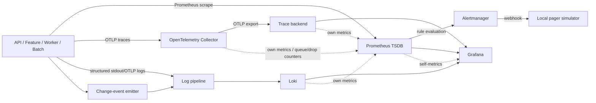
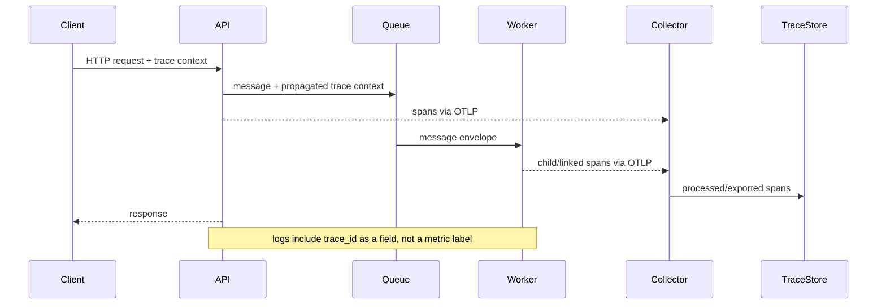

# Project 02 — End-to-End Observability Stack Build

> **Status:** `DRAFT-AUDITED`; implementation specification, not a claim that the stack has been deployed. All representative values are `[ILLUSTRATIVE]` unless explicitly marked `[SYNTHETIC]`. Version-sensitive component names and schemas are `[VERIFY]` against the exact pinned release.
>
> **Safety contract:** Local learner-owned lab only. No public, production, shared, or third-party targets. No real credentials, customer data, PII, or monetary prices. Mutating actions require explicit `--apply` where the example exposes a mutation. Every load/fault drill is bounded and has a stop/recovery path.

| Metadata | Value |
|---|---|
| Stage / module | Stage 2E — Production DevOps & Platform Engineering / M11 — Production Observability Stack and Performance Operations |
| Difficulty | Intermediate → Advanced → Operator |
| Prerequisites | Stages 0–2D and Stage 2E M01–M10; basic Kubernetes/containers, Python services, metrics, logs, SLOs, incident response |
| Dependency | **Recommended before Project 01.** Project 02 builds the platform; Project 01 uses it to investigate hidden faults. |
| Estimated effort | `[ASSUMPTION]` 35–55 focused hours, excluding repeated tuning and version-specific troubleshooting |
| Primary platform | `[ASSUMPTION]` Docker Compose on WSL2 Ubuntu/native Linux for the main implementation; use existing `kind` only if earlier-stage interfaces require Kubernetes signals. Do not maintain two complete stacks. |
| Profiles | Core; Core + Logs; Full (Core + Logs + traces) |
| Resource budget | Approximately 4 CPU cores, 8 GB RAM, 30 GB disk; measured local results are required |
| Cost | Zero-budget, local-only; no paid SaaS or required cloud resources |
| Version baseline | Explicit pinned versions or `<VERSION>` placeholders in `versions.txt`; never use floating `latest` for reproducible runs |
| Last reviewed | 2026-10-29; not a claim that every component schema was checked against current upstream docs |
| Execution status | NOT RUN as a complete stack in this authoring environment; snippets are implementation-level examples with `[VERIFY]` items, not an executed deployment |

## 1. Project Purpose and Scenario

The lab platform currently depends on ad hoc `kubectl logs`, one unlabeled Prometheus instance, manually edited dashboards, CPU-threshold pages, no distributed traces, no reliable log correlation, no tested notification path, no telemetry-volume visibility, and no performance baseline. Build a reproducible local observability platform as code that is itself observable, tests known conditions, correlates telemetry, bounds resource consumption, and fails loudly when required evidence disappears.

The platform should answer operational questions before presenting charts:

- Are users experiencing errors or latency, and is the SLO from M10 at risk?
- Which dependency, queue, pool, scheduler, or resource is saturated?
- Is the pipeline producing fresh, valid, committed data by its deadline?
- Did the telemetry itself become stale, drop data, or lose a route to notify someone?
- Can one synthetic request be followed from metrics to trace to structured logs and a change event?
- What is the measured telemetry footprint in series, samples, bytes, spans, query work, and storage-days?
- Can another learner reproduce the stack from Git and prove cleanup?

The running example is a synthetic data/ML platform: API, feature service, worker/queue, batch job, stream simulator, and disposable PostgreSQL. Use the services already built in M08 where their interfaces are available; otherwise use deterministic local stubs and record the substitution as `[ASSUMPTION]`.

**Boundary:** M10 owns SLI/SLO policy, error-budget policy, incident roles, and process. M11 implements telemetry, tests, dashboards, routes, diagnostics, and evidence. M11 measures technical telemetry volume; M15 owns financial budgets, chargeback, and vendor-cost modelling.

## 2. Learning Outcomes

- **L1 — Foundation:** explain the architecture, choose a profile, pin versions, start/stop safely, and expose project-owned RED, domain, saturation, and freshness metrics. Evidence: versions record, preflight, targets, and metric catalog.
- **L2 — Integration:** provision dashboards, route alerts, ingest redacted structured logs, and collect traces through HTTP and worker boundaries. Evidence: config validation, positive/negative fixtures, canaries, and correlation drill.
- **L3 — Reliability:** test missing data, notification failure, queue pressure, telemetry loss, cardinality growth, and recovery; report measured CPU/RAM/disk and telemetry-volume units. Evidence: fault matrix, cost-driver report, and cleanup verification.
- **L4 — Operator judgment:** produce a reproducible evidence bundle, identify blind spots and profile skips, distinguish lab evidence from production claims, and hand a stable platform interface to Project 01. Evidence: `make verify` report, ADRs, runbooks, readiness review, and uncertainty register.

## 3. Prerequisites and Project 01 Dependency

Complete M01–M10 first, especially telemetry architecture, service instrumentation, networking, secret handling, SLOs, alert design, and incident process. You should already be able to run a small local service and identify its intended lab endpoint.

**Recommended learning order differs from filename order:** Project 02 is the platform-building capstone; Project 01 is the investigation capstone. Complete Project 02 first so Project 01 can consume stable dashboards, alert rules, test hooks, correlation fields, fault controls, and evidence interfaces. Keep Project 01 focused on diagnosis and fixes; do not duplicate its full investigation report here.

Project 01 handoff contract:

- stable service identity: `service`, `environment`, `version` labels/attributes;
- project-owned metrics catalog with types, units, help text, and bounded labels;
- request/trace identifiers in logs and spans, never as metric labels;
- dashboard UIDs and Prometheus data source UID documented;
- alert catalog and route tests;
- fault-control API limited to the local lab and explicit allowlist;
- timestamped change events in UTC;
- a documented profile and version record;
- evidence templates and commands for target health, pipeline canaries, and cleanup.

## 4. Scope, Non-Goals, and Cross-Module Boundaries

**In scope:** local metrics, logs, traces, alerting, dashboards as code, telemetry linting, pipeline tests, bounded fault/load drills, freshness and capacity signals, telemetry-volume guardrails, and rebuild-from-Git verification.

**Out of scope:** proof of production-scale capacity, true multi-node HA, cloud-managed telemetry, financial chargeback, multi-cluster federation, full disaster recovery, organization-wide identity, or legal/compliance certification. Implement necessary security and recovery safeguards without replacing M12 (security), M13 (DR), M14 (multi-cluster), M15 (financial modelling), or M16 (golden-path platform templates).

| Upstream/downstream | Contract |
|---|---|
| M03 Kubernetes | Use CronJob/Job state only when using `kind`; verify kube-state-metrics names for the pinned release. |
| M04 networking | Use existing service/network assumptions; mesh telemetry is a stretch goal. |
| M05 storage | Disposable PostgreSQL metrics where resource-feasible; never infer external exporter metric names without checking. |
| M08 services | Reuse service instrumentation and safe fault injection; otherwise use local stubs. |
| M09 secrets | Fake credentials for redaction tests; never commit real secrets. |
| M10 SRE | Reuse SLOs, alert policy, local pager interface, incident roles. |
| M12–M16 | Security telemetry, DR, federation, financial model, reusable platform templates are handoffs. |

## 5. Architecture and Data Flow

`[ASSUMPTION]` Primary topology is one local Compose project. Port values below are examples for container-to-container traffic; verify them against the pinned images and do not bind administrative endpoints publicly. When using `kind`, replace service discovery and endpoint assumptions deliberately rather than mixing both topologies.



A signal has a lifecycle: **emit → collect → process → buffer (if configured) → export → store → query/rule → route → notify → investigate**. Each hop can reject, delay, redact, sample, or drop data. Never assume a backend outage implies durable buffering or zero application impact; test the actual configured queue and retry behavior.

| Profile | Started | Omitted | Intended use |
|---|---|---|---|
| `core` | Prometheus, Alertmanager, Grafana, service metrics, selected lightweight exporters, pager simulator | Loki and trace backend/Collector trace pipeline | First bootstrap, metrics/rules/dashboards, alert-route tests |
| `logs` | Core + Loki + chosen log collection/processing path | Trace backend and trace pipeline | Structured log, redaction, log canary, log-volume and label labs |
| `full` | Core + Logs + Collector trace pipeline + one trace backend | Optional heavy exporters not needed for current lab | End-to-end trace/log correlation and bounded failure drills |

**Resource sequencing:** start Core first. Stop it before testing optional exporters if the machine is near its memory/disk ceiling. Run Logs next; stop before Full. Run load tests with the minimum profile needed and one bounded workload. Do not leave Full or a soak test unattended. Measure actual resource usage rather than relying on guessed per-container budgets.

## 6. Platform Decision Records and Version Baseline

### 6.1 Baseline rules

- Use exact image tags/digests and package versions after the learner verifies upstream installation guidance. Keep placeholders until resolved; a placeholder is not a runnable pin.
- Never use `latest` in the committed reproducible stack.
- Record `docker version`, `docker compose version`, `prometheus --version` (where available), `promtool --version`, `amtool --version`, Collector version, Grafana/Loki/trace backend image versions, Python version, and load-tool version.
- Verify whether the selected Collector build includes each receiver, processor, exporter, and connector. Components differ between distributions.
- Verify current Loki ingestion guidance; do not assume Promtail remains the preferred agent. Compare Grafana Alloy only as a documented alternative unless the roadmap requires it.
- `metrics-server` serves Kubernetes resource metrics for APIs such as `kubectl top`/HPA; it is not a long-term metrics store or a substitute for Prometheus.

Example `versions.txt` (replace every placeholder before a reproducible run):

```text
# File: versions.txt
# Every <VERSION> is unresolved until checked against official release/install docs.
platform=compose
prometheus=<VERSION> [VERIFY]
alertmanager=<VERSION> [VERIFY]
grafana=<VERSION> [VERIFY]
loki=<VERSION> [VERIFY]
otel_collector_distribution=<DISTRIBUTION> [VERIFY]
otel_collector=<VERSION> [VERIFY]
trace_backend=jaeger-or-tempo [ASSUMPTION: choose one]
trace_backend_version=<VERSION> [VERIFY]
python=<VERSION> [VERIFY]
load_tool=k6-or-locust [ASSUMPTION: choose one]
load_tool_version=<VERSION> [VERIFY]
node_exporter=<VERSION> [VERIFY]
postgres_exporter=<VERSION> [VERIFY if used]
kube_state_metrics=<VERSION> [VERIFY if kind]
```

The file above is intentionally not a deployable version lock until placeholders are replaced. `make verify` must fail while required placeholders remain.

### 6.2 ADR summaries

Full ADR template and eight required decisions are in Section 24. Initial recommendation: Compose for the primary stack because the stated goal is a bounded laptop lab and one coherent implementation; retain `kind` only where Kubernetes-specific monitoring is part of a defined lab. Choose Jaeger as the roadmap's preferred hands-on trace-backend candidate only after verifying current deployment architecture and image configuration. Tempo is a comparison option, not a second simultaneous backend.

## 7. Resource Budget and Three Stack Profiles

Resource figures are **measurements to collect**, not promises. The machine envelope is approximately 4 CPU / 8 GB RAM / 30 GB disk. Use short retention and synthetic bounded data. Set local container limits only after confirming Compose syntax and platform behavior for the chosen version.

### 7.1 Preflight and footprint log

```bash
# File: scripts/preflight.sh
#!/usr/bin/env bash
set -euo pipefail

PROFILE="${1:-core}"
case "$PROFILE" in core|logs|full) ;; *) echo "invalid profile: $PROFILE" >&2; exit 2;; esac
command -v docker >/dev/null || { echo "docker missing" >&2; exit 10; }
docker compose version >/dev/null || { echo "Compose plugin missing" >&2; exit 11; }
df -Pk . | awk 'NR==2 {printf "disk_available_kib=%s\n", $4}'
if command -v free >/dev/null; then free -h; fi
docker info --format 'docker_server={{.ServerVersion}}'
printf 'profile=%s\n' "$PROFILE"
printf 'context=%s\n' "$(docker context show)"
# This project requires the operator to confirm the expected local context explicitly.
[[ "$(docker context show)" == "default" ]] || {
  echo "Refusing non-default Docker context; inspect and adapt the explicit allowlist." >&2; exit 12;
}
```

Representative output (example — yours will differ): `profile=core`, a local Docker server version, and disk/RAM values. Interpretation: this confirms basic tooling and context selection only; it does not prove available resources are sufficient. WSL2 can allocate disk dynamically and may retain disk usage after containers stop.

Measure after each profile using `docker stats --no-stream`, `docker system df`, `df -h`, and the host's memory tools. Save a timestamped row in `evidence/profile-footprints.csv` with profile, host/WSL2, active containers, CPU sample, memory, disk before/after, run duration, and caveats. Do not copy sample numbers as results.

### 7.2 Retention and volume guardrails

Use the smallest useful retention supported by the pinned versions and verify the actual config schema. `[ASSUMPTION]` Start with a short metrics retention window (for example, a few hours for a focused lab), a bounded Loki retention policy, and a disposable trace store. Any example duration must be treated as a lab setting, not a production recommendation. Check disk before and after every run; cap generated log volume and stop the emitter at the end.

| Profile | Preflight | Post-run checks | Capability lost |
|---|---|---|---|
| Core | disk/RAM check; verify no unrelated stack running | target health, rule tests, footprint, container/volume list | no centralized log query or trace drill-down |
| Logs | Core preflight plus Loki storage path and retention check | canary present, redaction test, log bytes, disk delta | no distributed trace backend; request IDs alone are not full traces |
| Full | Logs checks plus Collector/backend readiness and trace-volume limit | trace canary, correlation IDs, dropped/export-failure signals, disk delta | still no real HA, long retention, or production traffic fidelity |

### 7.3 Cleanup contract

`down` stops only the named project. Volume deletion must be a separate dry-run-first operation with explicit project-name assertion and `--apply`; never run `docker system prune -a` or broad cluster deletion as routine cleanup. Confirm no test generator, fault toggle, silence, temporary volume, or background process remains. WSL2 disk reclamation may require host-side steps that vary by version; `[VERIFY]` using current Microsoft/WSL documentation before attempting compaction.

## 8. Repository Layout and Implementation Manifest

This is the proposed layout inside the learner's repository; all contents below are embedded teaching examples. This authoring task creates only this Markdown artifact.

```text
stack/
  compose.yml
  prometheus/prometheus.yml
  prometheus/rules.yml
  alertmanager/alertmanager.yml
  alertmanager/templates.tmpl
  grafana/provisioning/datasources/datasources.yml
  grafana/provisioning/dashboards/dashboards.yml
  loki/loki.yml
  otel-collector/config.yml
  trace-backend/config.yml
instrumentation/
  api/app.py
  feature-service/
  worker/
  batch/
  stream-simulator/
dashboards/
  service-template.json
  service-red.json
  platform-health.json
alerts/
  rules.yml
  tests.yml
slo/
  service-slo.yml
loadtest/
  smoke.js
  results/README.md
scripts/
  preflight.sh
  lifecycle.sh
  telemetry_lint.py
  log_lint.py
  dashboard_validate.py
  metric_compat.py
  dependency_graph.py
  freshness_dag.py
  cardinality_report.py
  capacity_report.py
  alert_quality.py
  silence_lint.py
  cleanup_verify.sh
tests/
  test_telemetry_lint.py
  test_log_lint.py
  test_safety_contract.py
  pipeline/
docs/
  architecture.md
  adr/
runbooks/
sim/
versions.txt
Makefile
```

## 9. Safety, Privacy, and Lab-Only Guardrails

1. **Target assertion:** confirm the Compose project name, Docker context, and service endpoint before any mutation. If using Kubernetes, assert exact context and namespace; reject any value not on an explicit local allowlist.
2. **Default-deny mutation:** configuration validation and dry-run are the defaults. Explicit `--apply` is required for destructive cleanup or fault activation.
3. **Bounded operations:** every load/fault run has a target allowlist, rate/duration limit, abort switch, stop command, and recovery verification.
4. **Telemetry endpoints:** bind dashboards and admin/debug endpoints to loopback or an isolated container network. Do not publish Prometheus admin API, Collector pprof/zpages, or debug endpoints to public interfaces.
5. **Data hygiene:** synthetic payloads only. Redact at the earliest feasible point, but explain that field-based redaction cannot guarantee every secret/PII variant is removed.
6. **Cardinality:** never label metrics with request IDs, user IDs, arbitrary paths, raw exception text, timestamps, or trace IDs. Hashing an unbounded ID still creates an unbounded number of distinct values.
7. **Cleanup:** verify stopped processes, inactive fault flags, no active load generators, no temporary resources, and measured disk reclamation. Keep evidence but scrub it of secrets/PII.
8. **WSL2/native Linux:** verify networking, volume permissions, cgroup/PSI metrics, Docker log paths, inotify limits, and disk-growth behavior in the actual environment. Use UTC in all event records.

### Safe lifecycle script contract

```bash
# File: scripts/lifecycle.sh
#!/usr/bin/env bash
set -euo pipefail

ACTION="${1:-}"
PROFILE="${2:-core}"
APPLY="${3:-}"
PROJECT="observability-lab"
[[ "$PROJECT" == "observability-lab" ]] || exit 20
case "$ACTION" in up|down|deploy) ;; *) echo "usage: $0 {up|down|deploy} {core|logs|full} [--apply]" >&2; exit 2;; esac
case "$PROFILE" in core|logs|full) ;; *) echo "invalid profile" >&2; exit 2;; esac
command -v docker >/dev/null || exit 10
[[ "$(docker context show)" == "default" ]] || { echo "wrong Docker context" >&2; exit 12; }
# Confirm this repository is explicitly the lab root; do not accept arbitrary endpoints.
[[ -f stack/compose.yml ]] || { echo "missing stack/compose.yml; run from project root" >&2; exit 13; }
export COMPOSE_PROJECT_NAME="$PROJECT"
case "$ACTION" in
  up)
    docker compose -f stack/compose.yml --profile "$PROFILE" config --quiet
    docker compose -f stack/compose.yml --profile "$PROFILE" up -d
    ;;
  deploy)
    docker compose -f stack/compose.yml --profile "$PROFILE" config --quiet
    echo "Validated local config. Deployment is explicit; call up after reviewing diff." >&2
    exit 0
    ;;
  down)
    if [[ "$APPLY" != "--apply" ]]; then
      echo "DRY-RUN: would stop only Compose project $PROJECT; pass --apply to proceed"
      docker compose -f stack/compose.yml ps
      exit 0
    fi
    docker compose -f stack/compose.yml down --remove-orphans
    ;;
esac
```

**Important limitation:** the script above is an illustrative lifecycle skeleton. Compose profiles and service profile names must match `stack/compose.yml`; `up PROFILE=...` in the Makefile is the user-facing interface. Do not assume `docker compose down` removes named volumes; it does not unless explicitly requested. Persistent-volume removal is a separate dry-run-first step.

## 10. Telemetry Standard and Instrumentation Contract

### 10.1 Metric contract

- Use lowercase snake_case metric names with units in the name when practical (`_seconds`, `_bytes`, `_total` for counters). Define type, unit, help, owner, expected labels, cardinality budget, and removal/deprecation policy in a catalog.
- Counters are monotonic event totals; use `rate()`/`increase()` for rates/deltas. Gauges represent current state and are not passed to `rate()`.
- Histograms aggregate bucket counts; preserve `le` when computing classic histogram quantiles. Do not average per-instance p95/p99 values to estimate a fleet percentile.
- Labels are bounded enums: `service`, `environment`, `route_template`, `method`, `status_class`, `dependency`, `job`, `result`. `route_template` must be a template such as `/items/{item_id}`, not the raw path.
- Units and semantics should be stable across service versions. Include owner and deprecation notes. A label rename is a schema change.

| Valid project-owned metric | Type | Labels | Operational question |
|---|---|---|---|
| `lab_http_requests_total` | Counter | `service,route_template,method,status_class` | Request volume and error ratio? |
| `lab_http_request_duration_seconds_bucket` | Histogram | same bounded labels plus `le` | Latency distribution under load? |
| `lab_worker_queue_depth` | Gauge | `queue` from fixed allowlist | Is work accumulating? |
| `lab_worker_oldest_message_age_seconds` | Gauge | `queue` | Is the oldest item becoming stale? |
| `lab_batch_last_valid_commit_timestamp_seconds` | Gauge | `job` from fixed allowlist | When was valid output last committed? |
| `lab_telemetry_canary_last_seen_timestamp_seconds` | Gauge | `signal` from fixed allowlist | Is a canary arriving? |
| `lab_dependency_request_failures_total` | Counter | `dependency,result` | Which dependency is failing? |

Invalid labels include `request_id`, `trace_id`, `user_id`, `email`, raw URL, exception message, SQL text, and current timestamp. Hashing these IDs is not a fix: the number of distinct hashes can still grow with the number of requests.

### 10.2 Structured log schema

Every log record should contain UTC timestamp, severity, service, environment, version, event name, and optionally `request_id`, `trace_id`, `span_id`, route template, and a bounded error class. Never include authorization headers, cookies, raw request bodies, credentials, or unredacted database connection strings.

```json
{
  "timestamp": "2026-10-29T12:00:00Z",
  "severity": "INFO",
  "service": "api",
  "environment": "local-lab",
  "version": "dev",
  "event": "request_completed",
  "request_id": "req-synth-0007",
  "trace_id": "0123456789abcdef0123456789abcdef",
  "span_id": "0123456789abcdef",
  "route_template": "/items/{item_id}",
  "duration_ms": 12.4,
  "result": "success"
}
```

This is `[SYNTHETIC]` example data. IDs are acceptable in logs/traces for correlation but not as Prometheus labels or Loki stream labels.

### 10.3 Span contract

Use standard HTTP/DB/messaging semantic conventions supported by the chosen SDK release `[VERIFY]`. Span names should be low-cardinality operation names (`GET /items/{item_id}`, `queue.process`), not full URLs or user-specific values. Propagate W3C Trace Context through HTTP and the queue/worker message envelope. Validate the trace ID format and ensure no secret-bearing attributes are recorded.

### 10.4 Telemetry lint example

```python
# File: scripts/telemetry_lint.py
"""Minimal policy linter for a JSON metric catalog; stdlib only."""
from __future__ import annotations
import json, re, sys
from pathlib import Path

NAME = re.compile(r"^[a-z][a-z0-9_]*$")
FORBIDDEN = {"request_id", "trace_id", "span_id", "user_id", "email", "raw_path", "exception_message", "timestamp"}
ALLOWED_TYPES = {"counter", "gauge", "histogram", "summary"}

def validate(doc: object) -> list[str]:
    errors: list[str] = []
    if not isinstance(doc, list):
        return ["catalog must be a JSON list"]
    seen: set[str] = set()
    for i, item in enumerate(doc):
        if not isinstance(item, dict):
            errors.append(f"[{i}] entry must be an object"); continue
        name = item.get("name")
        if not isinstance(name, str) or not NAME.fullmatch(name): errors.append(f"[{i}] invalid metric name")
        elif name in seen: errors.append(f"[{i}] duplicate metric name: {name}")
        else: seen.add(name)
        if item.get("type") not in ALLOWED_TYPES: errors.append(f"[{i}] invalid type")
        if not item.get("unit") or not item.get("help") or not item.get("owner"):
            errors.append(f"[{i}] unit, help and owner are required")
        labels = item.get("labels", [])
        if not isinstance(labels, list): errors.append(f"[{i}] labels must be a list")
        else:
            for label in labels:
                if not isinstance(label, str) or label in FORBIDDEN:
                    errors.append(f"[{i}] forbidden or invalid label: {label!r}")
        budget = item.get("series_budget")
        if not isinstance(budget, int) or budget < 1: errors.append(f"[{i}] positive integer series_budget required")
    return errors

def main() -> int:
    path = Path(sys.argv[1] if len(sys.argv) > 1 else "docs/metric-catalog.json")
    try: doc = json.loads(path.read_text(encoding="utf-8"))
    except (OSError, json.JSONDecodeError) as exc:
        print(f"FAIL: cannot read catalog: {exc}", file=sys.stderr); return 2
    errors = validate(doc)
    if errors:
        print("FAIL\n" + "\n".join(errors)); return 1
    print("PASS: metric catalog policy checks passed"); return 0

if __name__ == "__main__": raise SystemExit(main())
```

Positive fixture (intended as `docs/metric-catalog.json`):

```json
[
  {"name":"lab_http_requests_total","type":"counter","unit":"requests","help":"Completed requests","owner":"platform","labels":["service","route_template","status_class"],"series_budget":120},
  {"name":"lab_worker_queue_depth","type":"gauge","unit":"messages","help":"Current queue depth","owner":"worker","labels":["queue"],"series_budget":8}
]
```

Negative fixture: add `"request_id"` to the labels list or duplicate a metric name; the linter must exit `1`. Run `python -m unittest discover -s tests -v` after creating tests; representative output should show the positive test passing and negative fixture rejected. This linter validates the catalog policy, not the live Prometheus exposition or full cardinality at runtime; compare observed series as a separate check.

## 11. Bootstrap, Profile Lifecycle, and Version Recording

### 11.1 Compose design contract

The full Compose file depends on pinned image names and current config schemas, which are `[VERIFY]`; do not paste arbitrary image versions and assume compatibility. Define service profiles consistently with the three user-facing profiles, use an internal network, persistent local volumes with explicit names, health checks where supported, and no broad host-port exposure. Publish only the UI/API endpoints needed for local access and bind them to loopback. Avoid exposing Collector debug endpoints.

Minimum service groups:

- Core: `prometheus`, `alertmanager`, `grafana`, `pager-simulator`, `api`, and only selected exporters.
- Logs: Core plus `loki` and chosen log pipeline.
- Full: Logs plus `otel-collector` and exactly one trace backend.

Start order: validate configuration → start storage/backend services → wait for readiness → start collectors/services → emit canary → verify query → enable bounded load. A process being alive is not equivalent to a successful canary.

### 11.2 Version and endpoint assertions

Before mutation, write the actual context and project name into the run metadata. Refuse any endpoint not in the local allowlist. For Compose, the expected project name is `observability-lab`; for Kubernetes, use a separate explicit allowlist such as `kind-observability-lab` and a dedicated namespace. Do not automatically switch contexts.

### 11.3 Teardown and post-run verification

1. Stop generators and fault injectors first.
2. Confirm fault flags reset and temporary silences expired/removed.
3. Stop the named Compose project.
4. Verify no project containers remain running.
5. List named volumes; dry-run any deletion and require `--apply` plus exact project-name match.
6. Recheck disk use and retain only sanitized evidence.
7. Re-run `make verify-cleanup` (defined in the Makefile contract below).

## 12. Prometheus Metrics, Rules, and Self-Monitoring

### 12.1 Hand-written scrape configuration first

Illustrative config only; exact image, listen addresses, scrape settings, and mounted paths must match the selected deployment. This snippet demonstrates a project-owned metric endpoint and Prometheus self-scrape; add exporters only after verifying their actual endpoint and metrics.

```yaml
# File: stack/prometheus/prometheus.yml
# [VERIFY] Check schema and limits against the exact Prometheus version.
global:
  scrape_interval: 15s
  evaluation_interval: 15s

rule_files:
  - /etc/prometheus/rules.yml

scrape_configs:
  - job_name: prometheus
    static_configs:
      - targets: ["prometheus:9090"]
  - job_name: lab-api
    metrics_path: /metrics
    static_configs:
      - targets: ["api:8000"]
    # [VERIFY] sample_limit and label limits must be supported by pinned version.
    sample_limit: 5000
```

`sample_limit` is a per-scrape safety control in supported versions; verify schema and behavior for the exact release. It does not replace a label/cardinality budget. If a scrape exceeds a limit, investigate the failed scrape rather than silently removing incident-critical metrics.

Prometheus self-monitoring questions: are expected targets up, are scrapes failing, are rule evaluations failing, is TSDB/storage approaching the lab limit, is ingestion or query work rising, and are alerts missing expected series? Exporter metrics vary; use project-owned canaries for stable checks.

### 12.2 Example recording/alert rules

```yaml
# File: stack/prometheus/rules.yml
# Verify syntax with promtool for the pinned Prometheus release.
groups:
  - name: lab-service-recording
    interval: 30s
    rules:
      - record: lab:http_requests:rate5m
        expr: sum by (service) (rate(lab_http_requests_total[5m]))
      - record: lab:http_errors:ratio5m
        expr: |
          sum by (service) (rate(lab_http_requests_total{status_class="5xx"}[5m]))
          /
          clamp_min(sum by (service) (rate(lab_http_requests_total[5m])), 1e-9)
      - alert: LabServiceHighErrorRatio
        expr: lab:http_errors:ratio5m > 0.05
        for: 2m
        labels:
          severity: warning
          owner: platform
        annotations:
          summary: "Elevated 5xx ratio for {{ $labels.service }}"
          runbook_url: "https://example.invalid/runbooks/high-error-ratio"
          dashboard_url: "http://127.0.0.1:3000/d/service-red"
      - alert: LabTelemetryCanaryMissing
        expr: time() - lab_telemetry_canary_last_seen_timestamp_seconds > 120
        for: 1m
        labels:
          severity: critical
          owner: observability
        annotations:
          summary: "Telemetry canary is stale"
          description: "The expected canary timestamp is older than the lab threshold."
```

The ratio threshold and time windows above are `[ILLUSTRATIVE]`, not general SLO policy. Replace them with M10's agreed SLO/error-budget policy and measured lab cadence. A missing series may cause an expression to return no alert; pair expected-series checks with an independent canary or inventory. Never interpret “no alert” as “healthy” without proving data freshness.

### 12.3 PromQL correctness notes

- Use `rate()` on counters, not gauges.
- `histogram_quantile(0.95, sum by (le, service) (rate(lab_http_request_duration_seconds_bucket[5m])))` is a classic histogram example; retain `le` in the aggregation. Confirm the metric actually exists in the instrumented service.
- `up == 0` detects known scrape targets that are down; it cannot detect a target removed from discovery unless expected target inventory is checked.
- `absent(metric_name)` can detect a missing series only if absence is itself the condition and labels are handled carefully.
- `predict_linear()` assumes recent linear trend and is unreliable across workload changes, restarts, nonlinear growth, or too little history. Validate it against synthetic fixtures before operational use.
- `time() - last_success_timestamp` measures age from a timestamp; it is not job runtime and does not prove output validity by itself.

### 12.4 Alert catalog — minimum 25 rules

Use these as a catalog specification; expressions must be reconciled with the exact project metric catalog and tested with `promtool`. Rules with exporter-specific names are marked `[VERIFY]`; prefer project-owned alternatives where possible.

| # | Rule | Signal / test condition | Severity |
|---:|---|---|---|
| 1 | `LabServiceHighErrorRatio` | 5xx ratio exceeds M10-derived threshold | warning/page per policy |
| 2 | `LabServiceLatencyHigh` | histogram quantile or SLO burn condition | warning |
| 3 | `LabRequestRateUnexpectedlyZero` | known active test window but no request counter increase | warning |
| 4 | `LabTargetDown` | expected `up == 0` | critical |
| 5 | `LabExpectedMetricMissing` | expected-series inventory says metric absent | critical |
| 6 | `LabScrapeFailuresHigh` | scrape failure ratio elevated | warning |
| 7 | `LabPrometheusRuleEvaluationFailures` | rule evaluation failures | warning |
| 8 | `LabPrometheusStoragePressure` | measured storage headroom below local guardrail | warning |
| 9 | `LabCardinalityBudgetExceeded` | active series exceeds measured project budget | warning |
| 10 | `LabSampleLimitReached` | scrape-limit failures present | warning |
| 11 | `LabCpuSaturation` | CPU saturation or throttling evidence `[VERIFY exporter]` | warning |
| 12 | `LabMemoryPressure` | memory near configured lab limit | warning |
| 13 | `LabContainerRestartLoop` | restarts exceed bounded window `[VERIFY metric]` | warning |
| 14 | `LabQueueDepthHigh` | queue depth above measured test limit | warning |
| 15 | `LabOldestMessageTooOld` | oldest message age exceeds deadline budget | critical |
| 16 | `LabConsumerLagHigh` | lag exceeds measured limit | warning |
| 17 | `LabDbPoolSaturated` | project-owned pool utilization/wait metric | warning |
| 18 | `LabDiskPressure` | storage headroom below stop threshold | critical |
| 19 | `LabBatchFreshnessMiss` | last valid committed output older than deadline | critical |
| 20 | `LabBatchRunHung` | run active beyond bounded duration | warning |
| 21 | `LabBatchValidationFailures` | validation failure counter increases | warning |
| 22 | `LabCanaryRecordMissing` | canary output not received/validated | critical |
| 23 | `LabLogCanaryMissing` | canary event not queryable within window | warning |
| 24 | `LabTraceCanaryMissing` | Full profile only; trace not queryable | warning |
| 25 | `LabCollectorExportFailures` | Collector export failures/queue pressure `[VERIFY component metrics]` | warning |
| 26 | `LabLokiIngestionFailure` | log canary absent or ingestion error | warning |
| 27 | `LabTraceBackendUnavailable` | backend health/canary failure | warning |
| 28 | `LabAlertNotificationFailure` | pager simulator rejects or fails webhook | critical |
| 29 | `LabWatchdogMissing` | Watchdog absent at separately simulated observer | critical |
| 30 | `LabDashboardDataStale` | canary timestamp old while dashboard queried | warning |
| 31 | `LabLoadGeneratorSaturated` | generator CPU/latency indicates generator is bottleneck | warning |
| 32 | `LabCredentialExpirySynthetic` | fake test credential nearing expiry | info/warning |
| 33 | `LabObservabilityContainerRestart` | stack component restart increase | warning |
| 34 | `LabSloBurnRateFast` | M10-defined fast burn condition | page per M10 |
| 35 | `LabSloBurnRateSlow` | M10-defined slow burn condition | warning/page per M10 |

Do not deploy all rules without fixtures. Each rule needs a positive fixture, a benign negative control, a defined evaluation window, an owner, a runbook, and an expected no-data behavior. The M10 burn-rate expressions must be imported from the learner's existing policy; do not invent an SLO or burn-rate threshold here.

### 12.5 Promtool tests

```yaml
# File: stack/prometheus/tests.yml
# [VERIFY] Match the syntax and supported fields to the pinned promtool version.
rule_files:
  - rules.yml
evaluation_interval: 1m
tests:
  - interval: 1m
    input_series:
      - series: 'lab_http_requests_total{service="api",status_class="2xx",route_template="/health"}'
        values: '0+100x10'
      - series: 'lab_http_requests_total{service="api",status_class="5xx",route_template="/items/{item_id}"}'
        values: '0+10x10'
    alert_rule_test:
      - eval_time: 5m
        alertname: LabServiceHighErrorRatio
        exp_alerts: []
```

This fixture is a **schema illustration**, not a complete test of the ratio rule; rate-window samples and alert expectations must be tuned after the rule is finalized. Never present this one fixture as proving the full catalog. Run `promtool check config`, `promtool check rules`, and `promtool test rules` with the pinned binary. Store exact output and exit status in evidence. Include negative fixtures for missing expected metrics, a benign low-error window, and a planted high-error window.

## 13. Grafana Dashboards as Code and Validation

Provision data sources and dashboards from Git. Stable UIDs must match across dashboard JSON, provisioning, alert links, and runbooks. Do not depend on manual UI edits as the source of truth.

Required dashboards:

1. Service RED/SLO status: request rate, error ratio, latency distribution, SLO status from M10, data freshness.
2. USE/saturation: utilization, saturation, errors; CPU versus throttling; memory/restarts; disk and queue/pool signals.
3. Dependency/platform health: service dependencies, request failures, expected targets, overall platform canaries.
4. Batch/stream freshness and deadlines: last valid committed output, event-time watermark, checkpoint age, consumer lag, DAG slack.
5. Observability self-health: Prometheus targets/storage/rules, Collector drops/queues, Loki canary/ingestion, trace canary, notification delivery.
6. Load/stress/soak: run metadata, arrival rate, latency distributions, errors, generator health, resource profile.
7. Telemetry volume/cardinality: active series, samples/s, log bytes, stream cardinality, spans, query work, retention/storage.
8. Alert pipeline: alert state, notification success/failure, Watchdog/external heartbeat, detection lead time.

Dashboard provisioning example:

```yaml
# File: stack/grafana/provisioning/datasources/datasources.yml
# [VERIFY] Provisioning schema for pinned Grafana release.
apiVersion: 1
datasources:
  - name: Prometheus
    uid: prometheus-lab
    type: prometheus
    access: proxy
    url: http://prometheus:9090
    isDefault: true
  - name: Loki
    uid: loki-lab
    type: loki
    access: proxy
    url: http://loki:3100
    editable: false
```

Use a trace datasource only in Full, with the selected backend's supported Grafana datasource configuration `[VERIFY]`. Provision dashboards via a provider YAML whose path matches the mounted dashboard directory. Validate the schema using the pinned Grafana version or a supported dashboard JSON validator; JSON parsing alone is insufficient.

### 13.1 Dashboard quality gates

- Every panel names the operational question and source metric/query.
- Every dashboard includes a freshness indicator or a clear no-data state.
- Percentiles are computed from histogram buckets or native histogram semantics supported by the version; never average per-instance percentiles.
- Axes, units, aggregation, rate windows, labels, and time ranges are explicit.
- Dashboard data source UIDs resolve; every metric/label referenced exists in the metric catalog or is `[VERIFY]`.
- Add change/deployment annotations using a local synthetic event source.
- Set refresh intervals appropriate to the scrape interval and lab resource budget; avoid aggressive auto-refresh.
- Test a known failure and a benign control. A panel that parses but fails to change during a known-condition test is not accepted.

### 13.2 Simple metric compatibility checker

```python
# File: scripts/metric_compat.py
"""Check declared metric references in dashboard/rule text against catalog names.
This is a conservative text scan, not a full PromQL parser."""
from pathlib import Path
import json, re, sys

def main() -> int:
    catalog_path = Path("docs/metric-catalog.json")
    if not catalog_path.exists():
        print("FAIL: missing docs/metric-catalog.json"); return 2
    names = {x["name"] for x in json.loads(catalog_path.read_text()) if "name" in x}
    files = [Path(p) for p in sys.argv[1:]]
    if not files: print("usage: metric_compat.py FILE..."); return 2
    errors = []
    for p in files:
        text = p.read_text(encoding="utf-8")
        for token in re.findall(r"\b(?:lab_[a-z][a-z0-9_]*|node_[a-z][a-z0-9_]*|process_[a-z][a-z0-9_]*)\b", text):
            if token not in names and not token.startswith(("node_", "process_")):
                errors.append(f"{p}: undeclared project metric {token}")
    if errors: print("\n".join(errors)); return 1
    print("PASS: no undeclared project metric references found"); return 0
if __name__ == "__main__": raise SystemExit(main())
```

This scanner can miss metrics or misread text and deliberately exempts common external prefixes; extend it with an explicit verified exporter catalog. It is not proof that every query executes.

## 14. Loki, Log Collection, Redaction, and Correlation

### 14.1 Architecture and policy

The path is service → structured JSON log → collection/enrichment → redaction → parse/normalize → Loki ingestion → LogQL query → Grafana. Choose the current ingestion path only after checking official Loki/Collector documentation for the pinned release. `[VERIFY]` Collector-to-Loki support, OTLP log ingestion, or any exporter names/config keys against the exact distribution. Do not assume legacy Promtail is current. If the verified path differs, update the ADR and all tests consistently.

Use low-cardinality stream labels such as `service`, `environment`, `severity`, and `cluster` (fixed lab identity). Do not promote `trace_id`, `request_id`, `user_id`, full URL, error message, or timestamp to stream labels. Keep those in structured log fields for query-time filtering. Set a bounded log event size and retention policy appropriate to the lab; test truncation/rejection behavior.

### 14.2 Loki configuration review checklist

The exact Loki schema is version-sensitive `[VERIFY]`. For the pinned release, configure local filesystem/object-storage mode suitable for a disposable lab, retention, limits, and an internal-only listener. Confirm compactor/retention requirements for the selected mode; do not paste a config copied from a different major version. Use a small data volume and measure disk use before/after.

### 14.3 Redaction and schema lint

```python
# File: scripts/log_lint.py
"""Reject sensitive fields and enforce a minimal structured-log contract."""
from __future__ import annotations
import json, re, sys
from typing import Any

REQUIRED = {"timestamp", "severity", "service", "environment", "event"}
FORBIDDEN_KEYS = {"password", "authorization", "cookie", "access_token", "refresh_token", "api_key", "secret"}
SECRET_PATTERNS = [re.compile(r"(?i)bearer\s+[A-Za-z0-9._~+/-]+=*"), re.compile(r"(?i)(api[_-]?key|password|secret)\s*[:=]\s*\S+")]

def validate(line: str) -> list[str]:
    try: obj: Any = json.loads(line)
    except json.JSONDecodeError: return ["not valid JSON"]
    if not isinstance(obj, dict): return ["record must be an object"]
    errors = []
    missing = REQUIRED - obj.keys()
    if missing: errors.append(f"missing required keys: {sorted(missing)}")
    if not isinstance(obj.get("timestamp"), str) or not obj.get("timestamp", "").endswith("Z"):
        errors.append("timestamp must be UTC ISO-8601 ending in Z")
    for key in obj:
        if key.lower() in FORBIDDEN_KEYS: errors.append(f"forbidden sensitive key: {key}")
    encoded = json.dumps(obj, ensure_ascii=False)
    for pattern in SECRET_PATTERNS:
        if pattern.search(encoded): errors.append("possible secret pattern detected")
    if len(encoded.encode("utf-8")) > 16_384: errors.append("record exceeds illustrative 16 KiB lab limit")
    return errors

def main() -> int:
    bad = 0
    for n, line in enumerate(sys.stdin, 1):
        errors = validate(line)
        if errors: bad += 1; print(f"line {n}: " + "; ".join(errors))
    print(f"records_with_errors={bad}")
    return 1 if bad else 0
if __name__ == "__main__": raise SystemExit(main())
```

Positive test: synthetic log with required fields and no sensitive values. Negative test: include `"password":"SYNTHETIC-FAKE-SECRET"` or a Bearer-shaped fake token; linter must reject. This detects representative patterns, not all PII or secrets. Production-grade redaction requires layered controls, restricted access, data minimization, review, and incident response.

### 14.4 Canary and controlled volume drill

Emit a synthetic canary with a unique event name but bounded attributes, query it within a defined local window, and record observed ingestion delay. Do not make each canary ID a Loki label. For the log-volume drill, set a local emitter maximum rate and duration, monitor disk/CPU, and abort if the measured guardrail is reached. Verify that the canary and error evidence remain queryable after applying any volume-reduction rule.

### 14.5 LogQL caution

Example query after verifying the actual label names and schema:

```logql
{service="api", environment="local-lab"} | json | event="request_completed"
```

Use the query only after a canary has been ingested. Keep labels bounded and move high-cardinality filtering into parsed fields where feasible. Query syntax and parser behavior must be checked against the pinned Loki version.

## 15. OpenTelemetry Collector and Distributed Tracing

### 15.1 Trace path

API instrumentation creates spans; W3C trace context crosses HTTP and the queue/worker envelope; Collector receives OTLP, applies bounded processors, and exports to one backend. Logs carry the same trace ID and request ID when available. The pipeline should expose its own received/exported/dropped spans, queue pressure, retries, and failures using the Collector's verified self-telemetry endpoints/metrics `[VERIFY]`.



### 15.2 Collector configuration skeleton

The following is a **shape example**, not a verified deployable config. Check every component name and field against the exact Collector distribution and release. Use a distribution that actually contains the chosen receiver, processor, and exporter. `memory_limiter` should be early in a pipeline when supported; exact placement and required parameters are `[VERIFY]`.

```yaml
# File: stack/otel-collector/config.yml
# [VERIFY] All component availability, keys, and processor order for chosen distribution/version.
receivers:
  otlp:
    protocols:
      grpc:
      http:

processors:
  memory_limiter:
    check_interval: 1s
    limit_mib: 256
  batch:
    timeout: 5s

exporters:
  otlp:
    endpoint: trace-backend:4317
    tls:
      insecure: true # lab network only; never use this as a production TLS recommendation

service:
  pipelines:
    traces:
      receivers: [otlp]
      processors: [memory_limiter, batch]
      exporters: [otlp]
```

`limit_mib` and `check_interval` are illustrative settings to validate, not sizing guidance. Some distributions or backends need different exporter names/endpoints or authentication. If the config does not validate with the pinned Collector, the lab is not complete.

### 15.3 Sampling, span limits, and trace quality

- Start with a low, explicit sampling policy appropriate to the small lab. A head sampler makes a decision early and can miss rare failures. Tail sampling can retain slow/error traces only when supported, configured with trace-ID-aware routing, and provisioned with enough state; do not promise it without testing.
- Measure error/slow trace retention against a known synthetic fixture. Report the denominator and sampling mechanism. A missing trace is not proof that the request did not happen.
- Limit attribute count and size; redact secret-bearing fields; keep service names stable. Do not attach arbitrary request payloads.
- Trace-quality audit checks: missing expected root span, missing parent/child relationship, broken context at queue, inconsistent service name, missing critical operation span, duplicate span IDs, unexpected span volume, and mismatch between trace IDs in logs and spans.
- Add span metrics only with bounded dimensions. Do not transform every span attribute into a metric label.

### 15.4 Failure and backpressure drill

**⚠ FAULT-INJECTION — local lab only.** Stop the local trace backend for a short bounded window while a low-rate synthetic emitter runs. Record application latency/errors, Collector export failures, queue growth, dropped spans, and disk/memory. Abort the emitter if resource thresholds are crossed. Restart the backend, confirm recovery, and verify whether buffered spans drain or were lost. Reset the test by stopping the emitter and restoring the backend. Do not assume buffering is durable; state exactly what the test observed.

## 16. Alert Catalog, Alertmanager, Routing, and Notification Tests

Prometheus (or the selected rule evaluator) evaluates alert rules. Alertmanager groups, routes, inhibits, silences, and sends notifications. The local pager simulator represents the final destination. These are separate responsibilities and need separate tests.

### 16.1 Alertmanager configuration skeleton

```yaml
# File: stack/alertmanager/alertmanager.yml
# [VERIFY] Schema and supported time interval syntax for pinned Alertmanager version.
global:
  resolve_timeout: 5m
route:
  receiver: local-pager
  group_by: [alertname, service, severity]
  group_wait: 10s
  group_interval: 1m
  repeat_interval: 1h
  routes:
    - matchers: ['severity="critical"']
      receiver: local-pager
      continue: false
receivers:
  - name: local-pager
    webhook_configs:
      - url: http://pager-simulator:8080/alerts
        send_resolved: true
inhibit_rules:
  - source_matchers: ['severity="critical"']
    target_matchers: ['severity="warning"']
    equal: [service]
```

All intervals are `[ILLUSTRATIVE]`. Verify route matching semantics and syntax with `amtool check-config` and a route-matrix test. Do not put real webhook credentials in the config. The webhook endpoint is an internal lab endpoint only.

### 16.2 Routing matrix

| Fixture | Expected route | Expected result |
|---|---|---|
| critical alert with service label | local-pager | notification delivered |
| warning alert | default/local-pager | grouped notification delivered or intentionally suppressed per policy |
| critical and warning for same service | inhibition applies only if configured matcher/equal labels match | warning suppressed, critical remains |
| resolved alert | same route with resolved payload | simulator records resolution |
| malformed/unknown alert | default route or explicit rejection | recorded as test failure if it disappears silently |
| pager simulator returns error | notification-failure detector fires through separate simulated path | failure visible |

Use the pinned `amtool` route-test capabilities if available; otherwise unit-test a pure route-policy model and perform a local integration test against Alertmanager. The latter does not prove a real external paging provider works.

### 16.3 Silence governance

Every silence needs a reason, owner, bounded scope, creation timestamp, and expiry. No indefinite default silence. A silence linter should fail if required metadata is missing or expiry is outside the policy window. Do not auto-delete or rewrite silences without review; use dry-run by default and explicit `--apply` for mutation.

### 16.4 Watchdog and external heartbeat

A Prometheus Watchdog-style always-firing alert can prove rule evaluation and route delivery only if an independent receiver checks the notification. It cannot independently prove Prometheus itself is reachable if all components share the same failure domain. Add a separate local watchdog process that periodically checks the pager simulator's expected heartbeat; test the path by deliberately blocking/rejecting a notification. Document that this is still a single-machine simulated observer, not independent production monitoring.

### 16.5 Alert-quality report

For each rule report: owner, operational question, actionability, evidence links, expected no-data behavior, duplicate/overlap risk, positive fixture, negative control, notification result, and false-positive/false-negative observations. Alert count alone is not quality.

## 17. End-to-End Correlation and Dependency Diagnostics

Target drill: a synthetic request produces a metric increment, a trace with the same trace ID, a structured log containing that trace ID, an alert with dashboard/runbook links, and a UTC change event. Confirm the path at each hop rather than assuming a clickable link means the evidence exists.

### 17.1 Correlation contract

- `service`, `environment`, and `version` match across metric labels, logs, traces, and change events.
- `trace_id` and `span_id` exist in logs/spans when instrumentation supports them; never use them as metric labels.
- Dashboard data source UIDs are stable and provisioned.
- Exemplar links are optional and `[VERIFY]` based on histogram type, SDK support, Grafana, and backend. If unsupported, use explicit trace ID search as fallback.
- UTC timestamps are required; record clock/WSL2 skew and time alignment caveats.
- An alert-enrichment webhook adds only verified metadata, not raw payloads or secrets.

### 17.2 Dependency graph

Generate a graph from observed service-to-service spans/requests and compare it with a declared dependency file. Differences can indicate missing instrumentation, an unmodelled dependency, or stale declarations—not automatically an incident. Keep the output synthetic and bounded. A graph based only on sampled traces is incomplete by design.

### 17.3 Symptom signatures

| Symptom | Metrics | Logs | Traces | Falsification / control |
|---|---|---|---|---|
| High API latency | histogram tail and request rate | bounded error/event fields | slow span identifies dependency/operation | low-rate control request remains normal |
| Queue buildup | depth, oldest age, lag | enqueue/dequeue events | producer-to-worker path | pause producer and observe drain behavior |
| DB pool saturation | in-use/wait metrics | pool timeout class | DB span wait/duration | reduce concurrency and compare |
| Batch freshness miss | last valid commit age, watermark | validation/commit event | optional batch trace | process exits zero but invalid output must fail canary |
| Log loss | canary timestamp, pipeline errors | canary missing | trace may still exist | direct local emitter health does not prove ingestion |
| Trace loss | trace canary, Collector drop/export metrics | request log still exists | expected span missing | trace sampling policy must be accounted for |

Measure time-to-localize during a defined drill from the first observable symptom to the first evidence-supported component hypothesis. Record laptop results, sample size, profile, and uncertainty. Do not claim a universal target.

## 18. Saturation, Queueing, and Capacity Monitoring

Track CPU utilization and throttling separately; memory usage and OOM/restarts; request and worker queues; oldest-message age; retries; consumer lag; DB pool occupancy/wait time; disk/telemetry storage; and the time from saturation onset to SLO impact.

### 18.1 Capacity knee experiment

**⚠ LOAD-TEST — local service only.** Use a bounded arrival-rate schedule and increase rate in small steps. Each step has a fixed maximum duration and an abort condition (lab error ratio, latency, memory, or disk guardrail). Stop the generator immediately when an abort condition is met. Never point a load tool at an arbitrary URL.

Capture offered rate, achieved rate, p50/p95/p99 from the same request-level dataset, error ratio, queue depth, generator CPU, service CPU/memory, and profile. The knee is the observed point where latency/errors/queueing begin to degrade materially under this particular workload; it is not a production capacity estimate.

### 18.2 Capacity report calculation

For a simple dependency chain, record service capacity and demand with explicit units. If a synthetic queue has `arrival_rate = 18 messages/s` and `service_rate = 20 messages/s` `[ILLUSTRATIVE]`, nominal net drain is `2 messages/s` while arrival remains below service; at arrival `22 messages/s`, backlog grows approximately `2 messages/s` before nonlinear effects. This arithmetic is not a stable long-run model when service time, retries, concurrency, or arrival rate varies.

N−1 headroom must state which single component/replica is removed, whether remaining replicas can accept the full demand, and the assumed workload distribution. A single-laptop single-replica setup cannot validate real N−1 availability; only the arithmetic and failover behavior explicitly implemented in the lab can be checked.

### 18.3 Forecasting caveats

Validate `predict_linear` or an equivalent forecast with synthetic linear growth and a benign non-linear counterexample. Forecasts are invalid or weak with too little history, restarts, changing workload, retention changes, nonlinear growth, or inconsistent collection. Store forecast residuals and compare against observed values.

## 19. Freshness, Deadlines, and Silent-Failure Detection

A process exit code is not sufficient proof of a fresh, valid, committed dataset. Distinguish schedule time, job start, job finish, event time, watermark, validation time, and commit time. The freshness SLI should measure age of the last **valid and committed** output, not merely the last process exit.

Required signals:

- last valid committed output timestamp;
- run duration and result status;
- rows/records processed and validation failures;
- partition coverage and duplicates/empty output;
- event-time watermark, checkpoint age, consumer lag;
- schedule delay, missed start, hung run, and deadline slack;
- canary record arrival and content validation.

### 19.1 DAG critical-path and slack

For a DAG, compute earliest finish times in topological order: `EF(node) = duration(node) + max(EF(parent))`; project deadline slack is `deadline - max(EF(sink)) - start_time`. This simple calculation assumes durations and dependencies are known and deterministic; it does not model retries, resource contention, or overlapping execution unless the DAG representation includes them.

### 19.2 Silent-failure canary

Emit a synthetic canary record with a fixed schema, expected partition, and sequence number. Validate both arrival and content; an empty output or duplicate record must fail even if the job returns success. Alert if no valid canary commit is seen within the defined deadline. If using a Pushgateway, verify stale-series behavior and use the documented deletion API carefully; a project-owned last-success registry or node-exporter textfile collector may be safer depending on the topology `[VERIFY]`.

If using `kind`, kube-state-metrics CronJob/Job metric names vary by release and must be verified. Keep a project-owned last-valid-commit metric as the portable fallback.

## 20. Cardinality, Retention, and Telemetry Cost Guardrails

No monetary prices. Report separate technical dimensions: active time series, samples per second, log bytes and stream cardinality, spans per second, query work, storage bytes, and retention horizon. Do not combine them into one opaque “cost” number.

### 20.1 Cardinality calculator

For bounded label dimensions, estimated series count is approximately the product of distinct values per label times the number of metric families/instances, subject to actual label combinations. Example `[ILLUSTRATIVE]`: 5 services × 4 route templates × 3 methods × 4 status classes = 240 combinations per histogram bucket series family before instance labels and bucket dimensions. This is a planning estimate; measure actual active series from Prometheus and compare to the catalog budget.

### 20.2 Reports and governance

- Top series/job/service report from observed Prometheus series where supported.
- Log bytes and stream count from observed Loki/pipeline signals.
- Span volume and Collector export/drop counts from verified metrics.
- Storage-days measured from bytes over the chosen retention horizon.
- Unit metric: telemetry bytes per 1,000 requests, calculated from measured telemetry bytes and measured request count in the same interval.
- Unused telemetry scanner searches Git-stored dashboard/rule references, but “no reference found” does not prove safe removal. Review owners and incident history before deprecation.
- Retention records state signal, purpose, expected query window, measured volume, retention, deletion behavior, owner, and recovery consequences.

### 20.3 Cardinality incident runbook and safe brake

When active series grows unexpectedly: confirm the observation is fresh; identify top jobs/labels; find the change event; isolate the offending metric/label; preserve critical service/error metrics and evidence; then disable or constrain only the offending lab emitter using an explicit allowlisted brake. Do not blindly drop all metrics or high-value error logs. Verify core RED, alert rules, and known incident trace/log remain available after reduction.

## 21. Load, Stress, Spike, Soak, and Regression Testing

`[ASSUMPTION]` Choose one load tool for the project. k6 is a reasonable candidate for a JavaScript-based local harness; Locust is an alternative if the learner's existing Python workflow is preferred. Do not maintain two full test harnesses. Pin and verify the chosen tool version. All requests target the local lab service only.

### 21.1 Test protocol

Every run records: profile, host/WSL2 details, commit, versions, target allowlist, workload mix, open/closed-loop model, arrival rate/concurrency, warm-up, duration, request count, error ratio, latency distributions, generator CPU, service CPU/memory, abort threshold, stop command, and cleanup evidence.

| Test | Purpose | Required controls |
|---|---|---|
| Smoke/baseline | confirm basic path and health | small request count; known healthy control |
| Open-loop load | hold offered arrival rate | verify achieved rate and generator health |
| Capacity knee | locate observed degradation point | stepwise rate; abort threshold |
| Stress/recovery | observe bounded overload and recovery | short duration; explicit stop; verify queue drains |
| Spike | test transient burst | bounded spike size/time; no external target |
| Soak | observe slow drift | bounded, attended duration; resource abort; never unattended overnight |
| Leak slope | estimate memory slope with uncertainty | repeat samples; distinguish cache warm-up; include recovery/restart context |
| Coordinated omission | demonstrate closed-loop bias | compare offered schedule and actual request-start timestamps |
| Generator saturation | ensure generator is not limiting offered load | generator CPU, achieved/offered rate, queueing |
| CI smoke gate | detect planted regression | healthy control + intentional local regression fixture |
| A/A check | estimate false-positive rate | identical configurations, repeated runs, predeclared comparison method |

### 21.2 Example k6 script

```javascript
// File: loadtest/smoke.js
// [VERIFY] k6 APIs/options against the pinned k6 release.
import http from 'k6/http';
import { check, sleep } from 'k6';
import { Counter } from 'k6/metrics';

const failed = new Counter('lab_smoke_failed_checks');
export const options = {
  vus: 1,
  iterations: 20,
  thresholds: { http_req_failed: ['rate<0.05'] },
};

const BASE_URL = __ENV.LAB_BASE_URL || 'http://127.0.0.1:8000';
if (BASE_URL !== 'http://127.0.0.1:8000') {
  throw new Error('Refusing non-allowlisted target; use the local lab endpoint only');
}
export default function () {
  const res = http.get(`${BASE_URL}/health`);
  const ok = check(res, { 'status is 200': r => r.status === 200 });
  if (!ok) failed.add(1);
  sleep(0.2);
}
```

This smoke test is bounded and targets the local loopback endpoint. A separate open-loop schedule must be designed and verified with the selected tool; do not assume a VU-based closed-loop test represents an open-loop arrival-rate workload. If the service is inside a container, use a host-published loopback port that is explicitly owned by the lab. Do not permit arbitrary target URLs.

### 21.3 Statistical and percentile guidance

- Compare like-for-like runs with the same workload, warm-up, profile, environment, and measurement method.
- Preserve request-level observations or histogram buckets; do not average percentiles from different instances/runs and call the result a global percentile.
- Report sample size, median/dispersion or confidence interval, and limitations. For memory slope, fit a simple slope over repeated samples and report uncertainty; cache warming, garbage collection, restarts, and changing workload can confound it.
- An A/A check asks how often identical configurations appear different under the chosen rule; it helps expose noisy tests but does not establish the absence of all bias.
- CI smoke gates should use a deliberately planted regression and a healthy control. A gate that passes both is not detecting the regression; a gate that fails both is not useful.

## 22. Stack Reliability, Failure Drills, and Recovery

Each drill is local, bounded, reversible, and recorded as expected-versus-observed. Stop the workload before disrupting a backend unless the experiment specifically studies in-flight behavior.

| Drill | Expected behavior to test, not assume | Recovery proof |
|---|---|---|
| Trace backend unavailable | application impact, Collector retry/queue/drop behavior, trace loss | backend restored; queue drains or loss is quantified; canary returns |
| Prometheus OOM/restart or data loss | rule gaps, TSDB persistence, alert blind window | targets and rules healthy; missing interval disclosed |
| Alertmanager/notification path fails | alert evaluation may continue but delivery fails | simulated external heartbeat catches it; test notification succeeds after recovery |
| Loki ingestion failure/restart | canary delay/loss, buffer behavior, storage recovery | log canary queryable; lost interval documented |
| Collector crash/backpressure | exporter failures, memory/queue pressure, loss | Collector healthy and pipeline canary restored |
| Disk pressure/full condition | stack's failure mode at safe disposable limit | disk restored; write path works; no unrelated files deleted |
| Grafana outage | telemetry persists independently; dashboards rebuild from Git | provisioned dashboard UIDs and panels return |
| Missing/stale metrics | expected-series/canary alert fires | fresh data and known-condition dashboard restored |
| Load-induced degradation | abort switch works and service recovers | generator stopped, queue drains, SLI returns toward baseline |

Do not fill the host disk. Simulate a disk limit using a disposable container/volume quota or a tiny dedicated test filesystem only after verifying the mechanism and safety boundaries. Never run a generic `fallocate` against an arbitrary path.

### 22.1 Rebuild-from-Git and upgrade rehearsal

Rebuild from a clean local project directory or disposable Compose project using the pinned configuration, without deleting unrelated volumes. Capture elapsed time, commands, missing manual steps, version verification, dashboard UIDs, alert route test, and canary results. Upgrade rehearsal: change one component version in a disposable branch, run schema validation and tests, compare telemetry and dashboards, then revert or document the result. A single-laptop rebuild does not prove production DR or multi-node HA.

## 23. Makefile and Verification Contract

The following interface is mandatory. Each target must have explicit prerequisites, profile behavior, safety semantics, and exit status. The snippets are the contract; implementation paths should match the chosen repository layout.

```makefile
# File: Makefile
SHELL := /usr/bin/env bash
.DEFAULT_GOAL := help
PROFILE ?= core
VALID_PROFILES := core logs full

.PHONY: help preflight up deploy lint test alerts-test routes-test dashboards-validate pipeline-test loadtest soak chaos costs report verify verify-cleanup down
help:
	@printf '%s\n' 'Targets: up PROFILE=core|logs|full deploy lint test alerts-test routes-test dashboards-validate pipeline-test loadtest soak chaos costs report verify verify-cleanup down'

preflight:
	@bash scripts/preflight.sh "$(PROFILE)"

up: preflight
	@bash scripts/lifecycle.sh up "$(PROFILE)"

deploy: preflight
	@bash scripts/lifecycle.sh deploy "$(PROFILE)"

lint:
	@python -m unittest discover -s tests -v

test: lint
	@echo 'Run project-owned unit and negative-fixture tests; nonzero on failure.'

alerts-test:
	@promtool check rules stack/prometheus/rules.yml
	@promtool test rules stack/prometheus/tests.yml

routes-test:
	@amtool check-config stack/alertmanager/alertmanager.yml
	@python -m unittest tests.test_routes -v

dashboards-validate:
	@python scripts/dashboard_validate.py dashboards/*.json
	@python scripts/metric_compat.py dashboards/*.json stack/prometheus/rules.yml

pipeline-test:
	@python -m unittest discover -s tests/pipeline -v

loadtest: preflight
	@echo 'Requires explicit local target assertion, bounded duration/rate, and operator attendance.'
	@k6 run loadtest/smoke.js

soak: preflight
	@bash scripts/run_bounded_soak.sh --dry-run
	@echo 'Default is dry-run; review and pass --apply to start a bounded attended run.'

chaos: preflight
	@bash scripts/fault_drill.sh --dry-run
	@echo 'Default is dry-run; only allowlisted lab faults may be activated with --apply.'

costs:
	@python scripts/cardinality_report.py --input evidence/metrics-snapshot.json --output evidence/cardinality-cost/report.md

report:
	@python scripts/build_report.py --evidence evidence --output evidence/final-report.md

verify: preflight lint alerts-test routes-test dashboards-validate pipeline-test verify-cleanup
	@python scripts/verify_stack.py --profile "$(PROFILE)" --project observability-lab --endpoint http://127.0.0.1:9090

verify-cleanup:
	@bash scripts/cleanup_verify.sh

down:
	@bash scripts/lifecycle.sh down "$(PROFILE)"
```

**Implementation honesty:** the following subsection provides inline starter implementations for the supporting verification/reporting scripts referenced by the Makefile. They are proposed code snippets inside this one document, not separately created files; validate their arguments and schemas against the chosen local stack before use. No runtime deployment is claimed.

### 23.1 Target contract and exit codes

| Target | Expected behavior | Failure/skip semantics |
|---|---|---|
| `up PROFILE=...` | preflight and start selected profile only | nonzero if wrong context/config/health failure |
| `deploy` | validate desired config and show intended local deployment; no hidden remote target | nonzero on unresolved version placeholder or invalid config |
| `lint` / `test` | telemetry/log/dashboard/route/safety positive and negative tests | nonzero on any failing fixture |
| `alerts-test` | validate rule files and evaluate fixtures | nonzero on parse/test failure |
| `routes-test` | validate Alertmanager config and route matrix | nonzero if any expected route mismatch |
| `dashboards-validate` | parse JSON, validate provisioning/UIDs, metric compatibility | nonzero on invalid JSON, unknown project metric, missing UID |
| `pipeline-test` | profile-aware canaries and redaction/correlation checks | `SKIP` with reason if profile lacks Logs/Full; never false pass |
| `loadtest` | bounded local-only smoke; more intense runs require explicit script parameters | nonzero on target mismatch, abort threshold, or planted regression |
| `soak` / `chaos` | dry-run by default; explicit `--apply`, bounded scope and stop switch | nonzero on invalid scope or failed recovery |
| `costs` | reports distinct measured volume dimensions, no prices | nonzero if evidence missing/stale or guardrail exceeded |
| `report` | assembles evidence references and labels synthetic/missing results | nonzero on malformed metadata or secret scan failure |
| `verify` | validates lab identity, health, versions, targets, metrics, dashboards, rules, routes, canaries, guardrails, and cleanup safety | nonzero if any required check fails; profile-inapplicable checks are `SKIP — requires PROFILE=...` |
| `down` | dry-run by default; stops only named project with explicit apply | nonzero on context/project mismatch |

`make verify` must confirm Docker context and exact Compose project; for a `kind` variant it must separately assert the expected context and namespace. It must not infer “lab” from a hostname string alone. It must verify expected targets and metrics, dashboard UIDs, rule tests, notification route tests, canaries for features available in the profile, cardinality guardrail, pinned version record, and that fault injectors/generators are inactive. Missing evidence is a failure or a justified `SKIP`, never a silent pass.

### 23.2 Supporting verification scripts (contents to save at the documented paths)

These are deliberately standard-library-first scripts. They validate evidence and guardrails, but they cannot replace live integration tests. The operator must create each script from its block in the learner repository and run the negative tests.

```python
# File: scripts/dashboard_validate.py
"""Conservative JSON dashboard and datasource UID validator."""
from pathlib import Path
import json, sys

def main() -> int:
    files = [Path(x) for x in sys.argv[1:]]
    if not files:
        print("usage: dashboard_validate.py DASHBOARD.json ..."); return 2
    failed = False
    for p in files:
        try: doc = json.loads(p.read_text(encoding="utf-8"))
        except (OSError, json.JSONDecodeError) as e:
            print(f"FAIL {p}: {e}"); failed = True; continue
        if not isinstance(doc, dict) or not isinstance(doc.get("title"), str):
            print(f"FAIL {p}: dashboard object/title missing"); failed = True; continue
        if not isinstance(doc.get("panels", []), list):
            print(f"FAIL {p}: panels must be a list"); failed = True; continue
        # Datasource shape differs by Grafana release/panel type; collect visible UIDs conservatively.
        text = json.dumps(doc)
        if '"uid":"prometheus-lab"' not in text and '"uid": "prometheus-lab"' not in text:
            print(f"WARN {p}: no Prometheus UID string found; check datasource binding manually")
        print(f"PASS JSON structure {p}; live query validation still required")
    return 1 if failed else 0
if __name__ == "__main__": raise SystemExit(main())
```

```python
# File: scripts/freshness_dag.py
"""Compute deterministic critical-path duration and deadline slack from JSON DAG."""
import json, sys
from pathlib import Path

def analyze(doc: dict) -> dict:
    nodes = doc.get("tasks", [])
    by_id = {n.get("id"): n for n in nodes}
    if len(by_id) != len(nodes) or None in by_id: raise ValueError("task IDs must be unique and non-empty")
    done: dict[str, float] = {}
    visiting: set[str] = set()
    def finish(task_id: str) -> float:
        if task_id in done: return done[task_id]
        if task_id in visiting: raise ValueError("dependency cycle detected")
        if task_id not in by_id: raise ValueError(f"unknown dependency: {task_id}")
        visiting.add(task_id); task = by_id[task_id]
        duration = task.get("duration_seconds")
        if not isinstance(duration, (int, float)) or duration < 0: raise ValueError("duration_seconds must be >= 0")
        parents = task.get("depends_on", [])
        if not isinstance(parents, list): raise ValueError("depends_on must be a list")
        value = duration + max((finish(x) for x in parents), default=0.0)
        visiting.remove(task_id); done[task_id] = value; return value
    for task_id in by_id: finish(task_id)
    sinks = [x for x in by_id if not any(x in t.get("depends_on", []) for t in nodes)]
    critical = max((done[x] for x in sinks), default=0.0)
    deadline = doc.get("deadline_seconds")
    if not isinstance(deadline, (int, float)) or deadline < 0: raise ValueError("deadline_seconds required and >= 0")
    return {"task_finish_seconds": done, "critical_path_seconds": critical, "deadline_seconds": deadline, "slack_seconds": deadline-critical}

def main() -> int:
    try:
        doc=json.loads(Path(sys.argv[1]).read_text(encoding="utf-8")); result=analyze(doc)
    except (IndexError, OSError, json.JSONDecodeError, ValueError) as e:
        print(f"FAIL: {e}"); return 2
    print(json.dumps(result, indent=2)); return 0 if result["slack_seconds"] >= 0 else 1
if __name__ == "__main__": raise SystemExit(main())
```

```python
# File: scripts/cardinality_report.py
"""Summarize a measured JSON snapshot; never converts measurements into money."""
import argparse, json
from pathlib import Path

def main() -> int:
    ap=argparse.ArgumentParser(); ap.add_argument('--input',required=True); ap.add_argument('--output',required=True); args=ap.parse_args()
    src=Path(args.input)
    if not src.is_file(): print(f"FAIL: missing measured input {src}"); return 2
    try: d=json.loads(src.read_text(encoding='utf-8'))
    except json.JSONDecodeError as e: print(f"FAIL: invalid JSON: {e}"); return 2
    required=('timestamp_utc','profile','active_series','samples_per_second','log_bytes','spans','storage_bytes')
    missing=[k for k in required if k not in d]
    if missing: print('FAIL: missing measured fields: '+', '.join(missing)); return 1
    if any(not isinstance(d[k], (int,float)) or d[k] < 0 for k in required[2:]): print('FAIL: volume fields must be non-negative numbers'); return 1
    out=['# Telemetry volume report','',f"- Timestamp UTC: {d['timestamp_utc']}",f"- Profile: {d['profile']}",'','| Dimension | Observed value |','|---|---:|']
    for k in required[2:]: out.append(f"| {k} | {d[k]} |")
    out += ['', 'No prices are included. Values must come from a measured snapshot with a recorded command and interval.']
    Path(args.output).parent.mkdir(parents=True,exist_ok=True); Path(args.output).write_text('\n'.join(out)+'\n',encoding='utf-8')
    print(f"PASS: wrote {args.output}"); return 0
if __name__ == '__main__': raise SystemExit(main())
```

```python
# File: scripts/capacity_report.py
"""Validate load-run metadata and summarize offered/achieved rates."""
import json, sys
from pathlib import Path

def main() -> int:
    try: d=json.loads(Path(sys.argv[1]).read_text(encoding='utf-8'))
    except (IndexError, OSError, json.JSONDecodeError) as e: print(f"FAIL: {e}"); return 2
    fields=('profile','target','duration_seconds','offered_rate_per_second','achieved_rate_per_second','error_ratio','generator_cpu_percent','abort_triggered')
    missing=[x for x in fields if x not in d]
    if missing: print('FAIL: missing fields '+', '.join(missing)); return 1
    if d['target'] != 'http://127.0.0.1:8000': print('FAIL: target is not allowlisted local lab'); return 1
    if not 0 < d['duration_seconds'] <= 600: print('FAIL: duration outside bounded 1–600s policy'); return 1
    if d['offered_rate_per_second'] < 0 or d['achieved_rate_per_second'] < 0: print('FAIL: rates must be non-negative'); return 1
    print(json.dumps({k:d[k] for k in fields},indent=2))
    if d['generator_cpu_percent'] >= 90: print('INVALID RUN: generator may be saturated'); return 1
    return 0
if __name__ == '__main__': raise SystemExit(main())
```

```python
# File: scripts/alert_quality.py
"""Validate required alert-review fields and summarize actionability."""
import csv, sys
from pathlib import Path
REQUIRED={'alertname','owner','operational_question','runbook','positive_test','negative_test','no_data_behavior','actionable'}
def main() -> int:
    try:
        with Path(sys.argv[1]).open(newline='',encoding='utf-8') as f: rows=list(csv.DictReader(f))
    except (IndexError,OSError) as e: print(f"FAIL: {e}"); return 2
    if not rows: print('FAIL: empty alert catalog'); return 1
    errors=[]
    for i,r in enumerate(rows,2):
        for k in REQUIRED:
            if not (r.get(k) or '').strip(): errors.append(f"row {i}: missing {k}")
    if errors: print('\n'.join(errors)); return 1
    actionable=sum((r['actionable'].strip().lower()=='true') for r in rows)
    print(f"alerts_reviewed={len(rows)} actionable={actionable} non_actionable={len(rows)-actionable}")
    return 0
if __name__ == '__main__': raise SystemExit(main())
```

```python
# File: scripts/silence_lint.py
"""Lint exported silence metadata; read-only, no API mutation."""
import json, sys
from datetime import datetime, timezone
from pathlib import Path

def main() -> int:
    try: doc=json.loads(Path(sys.argv[1]).read_text(encoding='utf-8'))
    except (IndexError,OSError,json.JSONDecodeError) as e: print(f"FAIL: {e}"); return 2
    silences = doc if isinstance(doc, list) else doc.get('silences', []) if isinstance(doc, dict) else None
    if not isinstance(silences, list): print('FAIL: expected a list of silences'); return 1
    errors=[]; now=datetime.now(timezone.utc)
    for i,s in enumerate(silences):
        for k in ('startsAt','endsAt','createdBy','comment','matchers'):
            if not s.get(k): errors.append(f"silence {i}: missing {k}")
        try:
            end=datetime.fromisoformat(s['endsAt'].replace('Z','+00:00'))
            if end.tzinfo is None: errors.append(f"silence {i}: expiry must include timezone")
            elif end <= now: errors.append(f"silence {i}: expired silence")
            elif (end-now).total_seconds() > 7*24*3600: errors.append(f"silence {i}: expiry exceeds illustrative 7-day policy")
        except (KeyError,ValueError,TypeError): errors.append(f"silence {i}: invalid endsAt")
    if errors: print('\n'.join(errors)); return 1
    print(f"PASS: {len(silences)} silence records satisfy metadata/expiry policy"); return 0
if __name__ == '__main__': raise SystemExit(main())
```

```bash
# File: scripts/cleanup_verify.sh
#!/usr/bin/env bash
set -euo pipefail
PROJECT="observability-lab"
[[ "$(docker context show)" == "default" ]] || { echo "FAIL: wrong Docker context" >&2; exit 12; }
[[ "$PROJECT" == "observability-lab" ]] || exit 20
running="$(docker ps --filter "label=com.docker.compose.project=$PROJECT" --format '{{.ID}}')"
if [[ -n "$running" ]]; then echo "FAIL: project containers still running: $running"; exit 1; fi
# Volumes are reported for review; this script never deletes them.
volumes="$(docker volume ls --filter "label=com.docker.compose.project=$PROJECT" --format '{{.Name}}')"
if [[ -n "$volumes" ]]; then echo "WARN: project volumes remain; review retention and remove only via a separate dry-run/--apply workflow"; printf '%s\n' "$volumes"; fi
if pgrep -af 'k6 run|locust|run_bounded_soak|fault_drill' | grep -v grep; then echo "FAIL: possible generator/fault process remains"; exit 1; fi
echo "PASS: no running project containers or known generator process; volume review may still be required"
```

```bash
# File: scripts/run_bounded_soak.sh
#!/usr/bin/env bash
set -euo pipefail
MODE="${1:---dry-run}"
DURATION="${2:-120}"
[[ "$MODE" == "--dry-run" || "$MODE" == "--apply" ]] || exit 2
[[ "$DURATION" =~ ^[0-9]+$ ]] && (( DURATION > 0 && DURATION <= 600 )) || { echo "duration must be 1..600 seconds" >&2; exit 2; }
[[ "$(docker context show)" == "default" ]] || { echo "wrong Docker context" >&2; exit 12; }
[[ -f stack/compose.yml ]] || exit 13
if [[ "$MODE" != "--apply" ]]; then echo "DRY-RUN: bounded attended local soak duration=${DURATION}s target=http://127.0.0.1:8000"; exit 0; fi
command -v k6 >/dev/null || { echo "k6 missing" >&2; exit 10; }
# The smoke script is intentionally short; a real soak scenario must set explicit rate and abort thresholds.
# Keep this cap as a hard stop; the operator must remain present and monitor host resources.
timeout --signal=INT "${DURATION}s" k6 run loadtest/smoke.js
```

```bash
# File: scripts/fault_drill.sh
#!/usr/bin/env bash
set -euo pipefail
MODE="${1:---dry-run}"
FAULT="${2:-trace-backend-unavailable}"
DURATION="${3:-15}"
[[ "$MODE" == "--dry-run" || "$MODE" == "--apply" ]] || exit 2
[[ "$DURATION" =~ ^[0-9]+$ ]] && (( DURATION > 0 && DURATION <= 60 )) || exit 2
case "$FAULT" in trace-backend-unavailable|loki-ingestion-unavailable|pager-rejects-notification) ;; *) echo "fault not allowlisted" >&2; exit 2;; esac
[[ "$(docker context show)" == "default" ]] || { echo "wrong Docker context" >&2; exit 12; }
[[ -f stack/compose.yml ]] || exit 13
if [[ "$MODE" != "--apply" ]]; then echo "DRY-RUN: would run $FAULT for at most ${DURATION}s in project observability-lab"; exit 0; fi
# This script intentionally does not guess service names or kill containers.
# Implement the selected fault only after mapping FAULT to a named disposable service and a tested recovery command.
echo "REFUSED: fault action has no verified service/recovery mapping; add and test an explicit allowlisted mapping before use" >&2
exit 20
```

The fault script's deliberate refusal is a safety gate, not a completed fault-injection implementation. Before the project can pass the fault-drill gate, implement each allowlisted mapping for the actual Compose service names, include a bounded stop/recovery action, and test it in a disposable project. Never convert this refusal into an arbitrary `docker stop` or destructive wildcard.

```python
# File: scripts/verify_stack.py
"""Minimal profile-aware local verification contract; extend with live queries."""
import argparse, json, subprocess, sys
from datetime import datetime, timezone
from pathlib import Path

def run(cmd: list[str]) -> tuple[bool,str]:
    p=subprocess.run(cmd,text=True,capture_output=True)
    return p.returncode==0,(p.stdout+p.stderr).strip()

def main() -> int:
    ap=argparse.ArgumentParser(); ap.add_argument('--profile',choices=['core','logs','full'],required=True); ap.add_argument('--project',required=True); ap.add_argument('--endpoint',required=True); args=ap.parse_args()
    if args.project != 'observability-lab' or args.endpoint != 'http://127.0.0.1:9090': print('FAIL: lab project/endpoint assertion failed'); return 12
    if args.endpoint.split('/')[2].split(':')[0] not in {'127.0.0.1','localhost'}: print('FAIL: non-local endpoint'); return 12
    results=[]
    checks=[('compose-config',['docker','compose','-f','stack/compose.yml','config','--quiet']),('versions-resolved',['bash','-lc',"! grep -Eq '<VERSION>|<DISTRIBUTION>' versions.txt"]),('prometheus-config',['promtool','check','config','stack/prometheus/prometheus.yml']),('prometheus-rules',['promtool','check','rules','stack/prometheus/rules.yml']),('cleanup-safe',['bash','scripts/cleanup_verify.sh'])]
    for name,cmd in checks:
        ok,out=run(cmd); results.append({'check':name,'status':'PASS' if ok else 'FAIL','output':out})
    for name,needed in [('log-canary','logs'),('trace-canary','full')]:
        if args.profile=='core' or (needed=='full' and args.profile!='full'):
            results.append({'check':name,'status':'SKIP','reason':f'requires PROFILE={needed}'})
        else:
            results.append({'check':name,'status':'OPEN','reason':'live canary query must be added for pinned endpoints'})
    report={'timestamp_utc':datetime.now(timezone.utc).isoformat(),'profile':args.profile,'project':args.project,'endpoint':args.endpoint,'checks':results}
    Path('evidence').mkdir(exist_ok=True); Path('evidence/verify-report.json').write_text(json.dumps(report,indent=2)+'\n',encoding='utf-8')
    print(json.dumps(report,indent=2))
    return 1 if any(x['status']=='FAIL' for x in results) else (3 if any(x['status']=='OPEN' for x in results) else 0)
if __name__ == '__main__': raise SystemExit(main())
```

`verify_stack.py` is intentionally conservative: it emits `OPEN` for live canaries until the learner wires exact pinned endpoints and query semantics. It cannot report full success while those checks are open. Extend it to verify expected scrape targets/metrics, datasource UIDs, notification delivery, cardinality guardrail, and game-master state using actual lab interfaces. A complete learner implementation must not leave any `OPEN` checks at sign-off.

### 23.3 Minimal positive/negative unit tests

```python
# File: tests/test_telemetry_lint.py
import unittest
from scripts.telemetry_lint import validate

class TelemetryLintTests(unittest.TestCase):
    def test_valid_catalog_passes(self):
        self.assertEqual(validate([{"name":"lab_queue_depth","type":"gauge","unit":"messages","help":"Depth","owner":"worker","labels":["queue"],"series_budget":8}]), [])
    def test_unbounded_identifier_label_fails(self):
        errors=validate([{"name":"lab_queue_depth","type":"gauge","unit":"messages","help":"Depth","owner":"worker","labels":["request_id"],"series_budget":8}])
        self.assertTrue(errors)

if __name__ == '__main__': unittest.main()
```

```python
# File: tests/test_log_lint.py
import unittest
from scripts.log_lint import validate

class LogLintTests(unittest.TestCase):
    def test_valid_record_passes(self):
        line='{"timestamp":"2026-10-29T12:00:00Z","severity":"INFO","service":"api","environment":"local-lab","event":"ok"}'
        self.assertEqual(validate(line), [])
    def test_fake_secret_fails(self):
        line='{"timestamp":"2026-10-29T12:00:00Z","severity":"INFO","service":"api","environment":"local-lab","event":"ok","password":"SYNTHETIC-FAKE-SECRET"}'
        self.assertTrue(validate(line))

if __name__ == '__main__': unittest.main()
```

These test imports assume the snippets have been saved as modules and the repository root is importable. Run `python -m unittest discover -s tests -v`; capture the actual result. The examples validate the two linters, not the live telemetry stack.

## 24. ADRs, Runbooks, and Production-Readiness Review

### 24.1 ADR template

```markdown
# ADR-NNN: <decision title>
- Status: Proposed / Accepted / Superseded
- Date (UTC): <timestamp>
- Owner: <role>
- Verification: [VERIFY items]

## Context
## Options considered
## Decision
## Trade-offs and failure modes
## Resource impact (measured after run; no guessed footprint)
## Evidence required
## Revisit triggers
## Open questions
```

### 24.2 Required ADRs

1. **Profile and local platform choice.** Context: laptop resource ceiling and existing M03/kind learning. Options: Compose, kind, both full implementations. Decision `[ASSUMPTION]`: Compose primary; use kind only for explicitly Kubernetes-specific labs. Trade-off: fewer Kubernetes discovery signals; lower concurrent resource demand. Evidence: preflight, measured footprint, stable service names. Revisit if source interfaces require kind.
2. **Trace backend.** Options: roadmap-preferred Jaeger candidate, Tempo comparison, other backend only with approval. Decision: choose one after verifying current architecture/config. Trade-off: learning value vs resource/config complexity. Evidence: trace canary, correlation query, version record. Revisit if backend support or resource budget fails.
3. **Log shipping path.** Options: current verified Collector-to-Loki path, Alloy/other supported path, legacy agent only if justified. Decision: pin one verified path. Trade-off: portability vs component-specific configuration. Evidence: redaction test, canary, ingestion failure drill. Revisit on upstream deprecation/schema change.
4. **Retention policy.** Choose bounded local metrics/logs/traces retention based on disk measurement and lab objective. No universal retention claim. Evidence: before/after disk usage, canary availability, recovery consequence. Revisit if disk headroom or investigation window changes.
5. **Label/cardinality policy.** Use bounded dimensions and catalog budgets; never use unbounded IDs. Trade-off: less ad hoc slicing but stable storage/query cost. Evidence: live series counts, guardrail test, incident evidence preserved. Revisit when a new label is proposed.
6. **Sampling policy.** Start with a low explicit policy and test error/slow fixture retention; use tail sampling only if supported and correctly routed. Trade-off: resource reduction vs missing evidence. Evidence: denominator, sampled fixture results, Collector queue/drop metrics. Revisit if incident retention fails.
7. **Alert routing/notification.** Prometheus evaluates; Alertmanager routes; local pager simulator is the lab receiver; separate heartbeat monitors delivery. Trade-off: realistic path but not external-provider proof. Evidence: route matrix, failure injection, notification latency. Revisit when moving to an authorized real provider.
8. **Performance testing approach.** Choose one pinned tool and open-loop schedule where required; compare like-for-like runs and include generator health. Trade-off: more faithful arrival model vs complexity. Evidence: offered/achieved rate, sample counts, abort log, A/A check. Revisit when workload or test environment changes.

### 24.3 Eight incident runbooks

#### Runbook 1 — Prometheus OOM/cardinality incident
1. Confirm the dashboard/query is fresh and Prometheus is the affected component.
2. Capture current target health, active-series/ingestion evidence, recent config/change event, and disk/memory.
3. Identify the top job/metric/label dimension; compare to the metric catalog.
4. Preserve incident-critical metrics and error logs. Apply only the pre-approved lab brake to the offending emitter; dry-run first and require explicit approval.
5. Confirm scrape failures, series count, and memory trend settle; validate core alert/dashboard/trace evidence remains usable.
6. Add a regression fixture and catalog guardrail. Record data lost during restart and remaining uncertainty.

#### Runbook 2 — Alertmanager/notification failure
1. Separate rule evaluation from routing and final receiver delivery.
2. Verify alert exists at Prometheus/rule evaluator, reaches Alertmanager, matches the route, and reaches the pager simulator.
3. Check receiver errors and heartbeat from the separately simulated observer.
4. Repair the local endpoint/config; do not suppress the alert to make the UI green.
5. Run positive, negative, resolved, and failure fixtures. Record end-to-end notification delay and any blind window.

#### Runbook 3 — Log loss
1. Emit a bounded canary; check source process, collector, redaction, exporter, Loki readiness, and query.
2. Compare source event count with accepted/queryable count over the same window.
3. Check pipeline errors, queue pressure, label/size rejection, and storage. Do not increase log verbosity without a volume cap.
4. Restore the pipeline and re-run the canary. Document non-recoverable gaps and confirm redaction tests still pass.

#### Runbook 4 — Trace pipeline backpressure
1. Verify trace canary and Collector self-metrics are fresh.
2. Check receiver throughput, processor pressure, exporter errors, queue size, backend availability, and memory.
3. Stop the bounded load generator if guardrails are crossed. Restore backend or lower the test rate.
4. Confirm whether queued spans drained or were dropped; never claim durability without evidence.
5. Re-run a synthetic HTTP→worker trace and verify log correlation.

#### Runbook 5 — Grafana/dashboard outage
1. Verify data stores independently; do not mistake UI outage for telemetry loss.
2. Inspect local container health/logs and provisioning errors.
3. Recreate Grafana from Git and pinned versions; do not restore manual UI edits as the source of truth.
4. Verify datasource UIDs, dashboard IDs, known-condition panels, and freshness indicator.

#### Runbook 6 — Telemetry storage disk full
1. Stop load/fault generators and confirm the affected local volume/path.
2. Do not delete arbitrary files. Identify disposable test data and the exact named volume.
3. Follow retention/deletion dry-run and explicit `--apply` process; preserve incident evidence needed for the lab.
4. Confirm storage can write again, canaries return, and the stack remains healthy. Measure disk reclamation; WSL2 compaction is a separate verified host-level action.

#### Runbook 7 — Missing metrics/stale series
1. Compare expected target inventory with discovery and `up` results.
2. Check source endpoint, scrape errors, timestamps, and canary freshness.
3. Distinguish target removed from discovery, exporter down, service down, and a metric renamed/deprecated.
4. Fix the source/config or update the catalog/dashboard/rules through review. Do not fill a missing series with a fake zero unless zero is semantically correct.
5. Test both missing-series and healthy-zero cases.

#### Runbook 8 — Load-test-induced incident
1. Stop the named generator with the documented abort switch.
2. Confirm no other process continues sending traffic; clear fault toggles.
3. Observe queue drain, latency/error recovery, CPU/memory, and downstream state.
4. If recovery does not occur, stop the test profile and follow service recovery steps; do not escalate rate.
5. Record actual offered/achieved rate and generator utilization; invalidate the run if the generator saturated or target assertion failed.

### 24.4 Production-readiness review (M11 Units 1–13)

| Unit | Review question | Evidence |
|---|---|---|
| 1 Architecture/retention | each signal has purpose, retention, and failure mode? | architecture/retention decision |
| 2 Prometheus | scrape, rules, staleness, missing-series, cardinality understood? | promtool tests and target report |
| 3 Grafana | dashboards provisioned, UIDs stable, panels tested? | dashboard validator and known-condition drill |
| 4 Logs/Loki | low-cardinality labels, redaction, canary, retention? | log lint and pipeline tests |
| 5 Collector/traces | propagation, processing, queue/drop behavior verified? | trace canary and failure drill |
| 6 Alertmanager | routing/silencing/notification tested separately? | route matrix and notification failure test |
| 7 Dependencies/correlation | shared IDs and dependency graph validated? | correlation drill and graph diff |
| 8 Actionable alerts | owner, symptom, runbook, no-data behavior? | alert quality report |
| 9 Saturation | queues, pools, throttling, resource pressure? | saturation dashboard and drill |
| 10 Trace analysis | critical spans and missing-span caveats documented? | trace-quality audit |
| 11 Freshness | valid committed output and deadline measured? | canary/freshness test |
| 12 Cost/cardinality | units separated and guardrails fail loudly? | cardinality/volume report |
| 13 Performance | bounded tests, generator check, statistical caveats? | run metadata and test report |

## 25. Milestones and Time Plan

Time estimates are `[ASSUMPTION]` and vary with environment, prior familiarity, and version troubleshooting. Stop the stack between profile milestones.

| Milestone | Objective and tasks | Profile / estimated effort | Pass gate and evidence |
|---|---|---|---|
| M1 — Design and baseline | read M11 source map, choose topology, write ADRs, record versions, preflight host | Core design only; 2–4 h | no unresolved topology conflict; versions placeholders identified; footprint baseline saved |
| M2 — Metrics foundation | instrument project-owned RED/domain/saturation/freshness metrics, hand-written scrape config, catalog/linter | Core; 4–6 h | target up, expected metrics present, positive/negative lint tests pass |
| M3 — Rules and dashboards | recording/alert rules, promtool tests, provision datasource and starter dashboards | Core; 4–6 h | config/rules validate; healthy and planted-condition panels behave as expected |
| M4 — Alert delivery | Alertmanager routing, local pager, route matrix, silence governance, watchdog heartbeat | Core; 3–5 h | positive/resolved/negative/failure routes tested; external simulated heartbeat detects receiver failure |
| M5 — Logs | verify Loki path, redaction, schema linter, canary, volume cap | Logs; 4–6 h | canary queryable; fake secret fixture rejected/redacted; low-cardinality policy enforced |
| M6 — Traces | SDK instrumentation, HTTP and queue propagation, Collector pipeline, one backend | Full; 5–8 h | trace canary and log correlation pass; export-loss behavior documented |
| M7 — Correlation and freshness | dependency graph, event timeline, batch canary, DAG slack, freshness alerts | Core then Full as needed; 4–6 h | cross-signal drill works; invalid/empty output is detected |
| M8 — Cost and performance | series/volume reports, safe capacity knee, smoke/regression, bounded soak | Core or minimum required profile; 5–8 h | report includes measured units and uncertainty; abort/recovery demonstrated |
| M9 — Failure drills and release review | stack failure matrix, rebuild from Git, runbooks, cleanup verification | staged profiles; 4–6 h | recovery evidence complete; no active fault/generator or unexplained residue |
| M10 — Handoff | acceptance matrix, evidence bundle, audit, Project 01 handoff | stopped/idle; 2–4 h | `make verify` evidence, open items listed, project interface documented |

Do not run all services continuously to save setup time. Use one profile per milestone, measure before and after, and stop unused components.

## 26. Before/After Results and Evidence Bundle

Populate this table only from learner measurements. Do not replace blank cells with invented values. Each result needs a command/query, sample window, profile, environment, source evidence, limitations, and confidence.

| Measure | Baseline | After | Method / units | Profile / window | Evidence / limitations |
|---|---|---|---|---|---|
| Time-to-localize defined drill | — | — | elapsed seconds; start/end definition | — | — |
| Alert noise | — | — | alerts per test window; classify actionable/duplicate | — | — |
| Detection lead time | — | — | time from injected fault start to first correct alert | — | — |
| Active series | — | — | observed active series at timestamp | — | — |
| Memory during cardinality drill | — | — | measured bytes/MiB and sampling interval | — | — |
| Log volume | — | — | bytes per test window and bytes/1,000 requests | — | — |
| Error/slow trace retention | — | — | retained known fixtures / emitted known fixtures | — | — |
| Alert end-to-end latency | — | — | rule firing to pager simulator receipt | — | — |
| Rebuild-from-Git time | — | — | elapsed time and manual interventions | — | — |
| Capacity knee | — | — | offered requests/s at defined degradation condition | — | — |
| Soak memory slope | — | — | bytes/hour with method and uncertainty | — | — |
| Profile footprint | — | — | CPU, RAM, disk before/after | — | — |
| Verification results | — | — | PASS/FAIL/SKIP counts | — | — |

### 26.1 Evidence layout

```text
evidence/
  run-metadata.md
  versions.txt
  profile-footprints.csv
  telemetry-standard-report.md
  target-health/
  promtool/
  dashboards/
  log-pipeline/
  trace-pipeline/
  alert-tests/
  routing-tests/
  correlation-drills/
  dependency-graph/
  saturation/
  freshness/
  cardinality-cost/
  loadtest/
  soak/
  fault-drills/
  before-after/
  adr/
  runbooks/
  production-readiness-review.md
  cleanup-verification.md
  audit-report.md
```

Every evidence record includes UTC timestamp, profile, environment, commit/version, command/query, expected result, observed result, PASS/FAIL/SKIP, artifact reference, and limitations. Scrub secrets and PII. Mark generated data `[SYNTHETIC]`; mark representative values `[ILLUSTRATIVE]`.

## 27. Acceptance Criteria and Test Matrix

| ID | Requirement | Profile | Verification | Expected pass condition | Evidence path | Failure meaning | Cleanup |
|---|---|---|---|---|---|---|---|
| A01 | Core components healthy | Core | `docker compose ps` + health queries | every required Core component ready | `target-health/` | config, dependency, or resource issue | stop Core |
| A02 | Versions resolved | all | scan `versions.txt` for `<VERSION>` | no unresolved required pin | `versions.txt` | reproducibility not established | none |
| A03 | Telemetry catalog lint | Core | `python scripts/telemetry_lint.py` | valid fixture passes; planted defect fails | `telemetry-standard-report.md` | policy not enforced | none |
| A04 | Prometheus config/rules | Core | `promtool check config/rules` | exit 0 | `promtool/` | syntax/schema issue | none |
| A05 | Expected target/metric | Core | Prometheus query + inventory | expected series fresh | `target-health/` | target absent/stale/renamed | none |
| A06 | Dashboard provisioning | Core | validator + known-condition drill | UIDs resolve; panels respond correctly | `dashboards/` | JSON parses but dashboard unusable | stop Grafana if needed |
| A07 | Alert catalog >=25 | Core | rule catalog count + rule tests | at least 25 documented rules; tested applicable rules | `alert-tests/` | coverage or fixture gap | clear test alerts |
| A08 | Notification route | Core | route matrix + pager simulator | positive, negative, resolved and failure cases known | `routing-tests/` | route/receiver blind spot | clear test state |
| A09 | Watchdog path | Core | disable simulated receiver | independent local heartbeat detects missing delivery in declared window | `routing-tests/` | single-path blind spot | restore receiver |
| A10 | Loki canary and redaction | Logs | emit/query canary + negative secret fixture | canary queryable; fake secret rejected/redacted | `log-pipeline/` | ingestion/redaction failure | stop emitter |
| A11 | Low-cardinality labels | Logs | inspect labels + policy linter | no trace/request/user IDs as stream labels | `log-pipeline/` | stream explosion risk | remove test labels |
| A12 | Trace canary | Full | send synthetic request and query backend | expected trace appears or sampling explanation is documented | `trace-pipeline/` | instrumentation/export/backend failure | stop emitter |
| A13 | Queue context propagation | Full | HTTP→worker trace drill | shared trace context and expected spans present | `correlation-drills/` | broken propagation | reset queue |
| A14 | Metrics/logs/traces correlation | Full | known request drill | metric, log and trace align on service/trace/time | `correlation-drills/` | sampling/clock/schema gap | clear synthetic data per retention policy |
| A15 | Freshness canary | Core | invalid/empty output fixture | alert fires despite successful process exit | `freshness/` | success status confused with valid output | restore fixture |
| A16 | Capacity guardrail | Core | bounded step-load test | abort switch and recovery verified | `saturation/` | unsafe or invalid test | stop generator |
| A17 | Cost/cardinality report | Core | `make costs` with measured snapshot | distinct units reported; no prices | `cardinality-cost/` | missing evidence or conflated units | none |
| A18 | Essential evidence preserved | Logs/Full | reduce synthetic telemetry and re-query known error | incident line/error trace remains where expected | `cardinality-cost/` | unsafe reduction | restore policy |
| A19 | Load smoke catches planted regression | Core | healthy and regression fixture | healthy passes, planted defect fails | `loadtest/` | gate lacks discrimination | revert fault |
| A20 | A/A/statistical caveat | Core | repeated identical runs | method and limitations recorded | `loadtest/` | test noise not characterized | stop generator |
| A21 | Backend failure drill | relevant profile | bounded stop/restart drill | loss/buffering behavior measured; recovery passes | `fault-drills/` | untested dependency behavior | restore component |
| A22 | Rebuild from Git | all | disposable rebuild | stack passes health/canary checks without hidden manual steps | `fault-drills/` | non-reproducible config | remove disposable project safely |
| A23 | `make verify` target guard | all | deliberately wrong context/project fixture | mutation refused, nonzero exit | `audit-report.md` | unsafe target selection | restore lab context |
| A24 | Cleanup verified | all | cleanup script and process/volume inspection | no active faults/generators or unexplained residue | `cleanup-verification.md` | unsafe/incomplete cleanup | remediate before sign-off |
| A25 | ADRs and runbooks | all | checklist review | >=8 ADRs and 8 runbooks complete | `adr/`, `runbooks/` | operational context missing | none |
| A26 | Profile skips explicit | each | run verification in each profile | unsupported checks say `SKIP — requires PROFILE=...` | `audit-report.md` | false pass risk | none |
| A27 | Human verification complete | all | review checklist | all version-sensitive checks resolved or open risks accepted | `audit-report.md` | not release-ready | none |

If a feature is not supported in the current profile, report `SKIP` with reason; never mark it as a pass. The full stack has not been executed as part of this document's generation, so every live runtime test remains `NOT EXECUTED` until the learner runs it.

## 28. Scoring Rubric

| Category | Points | Poor | Adequate | Strong | Exemplary |
|---|---:|---|---|---|---|
| Reproducible bootstrap, profiles, safety, resources | 10 | unsafe/manual | profiles start with gaps | repeatable, measured, guarded | rebuildable, wrong-target and cleanup tests proven |
| Telemetry standard, instrumentation, metrics correctness | 10 | unbounded labels/wrong types | basic metrics exist | catalog/linter/negative tests | runtime compatibility and missing-series guardrails verified |
| Logs/traces reliability, redaction, correlation | 15 | no canaries or redaction proof | partial pipelines | tested canaries and propagation | loss/backpressure and retention bias quantified |
| Dashboard as code and compatibility | 10 | manual-only dashboards | provisioned but untested | stable UIDs and known-condition tests | CI compatibility and misleading-panel controls |
| Alert catalog, routing, delivery, meta-monitoring | 15 | CPU-only pages | rules route in happy path | >=25 rules, route/failure tests | simulated independent heartbeat and alert-quality report |
| End-to-end correlation/dependency diagnostics | 10 | isolated signals | partial links | metric/log/trace/change drill | sampled-data caveats and observed-vs-declared graph reviewed |
| Saturation/freshness/cost guardrails | 10 | no volume or deadline evidence | basic dashboards | measured units and fault fixtures | incident evidence preserved through safe reduction |
| Load/stress/soak rigor and regression gate | 10 | unbounded or invalid target | smoke only | bounded models, generator checks | knee, A/A, leak uncertainty, planted regression and recovery evidence |
| ADRs/runbooks/evidence/audit | 10 | incomplete or fabricated | basic notes | reproducible evidence and honest gaps | adversarial review, human checks, explicit handoff |

**Pass bands:** 80–100 proceed; 60–79 remediate; below 60 repeat. **Automatic failure regardless of score:** wrong target, unbounded load/fault, real secret/PII exposure, unsafe deletion, or unverified cleanup.

## 29. Stretch Goals

- Compare Jaeger and Tempo using the same trace fixture and measured footprint; do not run both continuously.
- Awareness-only comparison of Prometheus Operator/kube-prometheus-stack; keep hand-written scrape configuration as the required first path.
- Awareness exercise comparing Thanos, Mimir, and VictoriaMetrics; no requirement to deploy all.
- Add continuous profiling with Pyroscope or Parca as a bounded optional lab.
- Compare Grafana Alloy to the selected log/telemetry path after checking current upstream guidance.
- Integrate mesh telemetry from M04 or eBPF/Hubble if the lab environment supports it; record resource cost and blind spots.
- Add trace exemplars where the chosen SDK, histogram type, backend, and Grafana versions support them.
- Add signed configuration artifacts and policy checks as a bridge to M12/M16.

## 30. Common Failure Modes and Troubleshooting

| Symptom | Likely causes | Discriminating test |
|---|---|---|
| Target is `DOWN` | wrong DNS/service name, port, endpoint path, network | query the service endpoint from the Prometheus network and inspect scrape error |
| Dashboard is empty | wrong datasource UID, metric absent, time range wrong, stale source | query metric directly and inspect canary timestamp |
| Dashboard is green but stale | last-value display hides old sample | add explicit data-age panel and stop canary in a bounded drill |
| No alert despite failure | rule not loaded, no data, `for` window not elapsed, labels mismatch | inspect rule state, test fixture timing, and expected series |
| Alert fires but pager silent | route mismatch, receiver failure, bad endpoint | route test then simulated receiver failure test |
| Logs missing | collector path unsupported, parse/redaction drop, labels/limits, Loki unhealthy | trace canary through each hop and compare source/accepted/query counts |
| Trace has no worker span | context not propagated through message, sampled trace, worker instrumentation absent | inspect message envelope and sampling; run deterministic known trace |
| Collector memory rises | queue pressure, backend slow/down, high span volume | stop load, inspect exporter errors and measured queue behavior |
| Cardinality explodes | raw paths/IDs/exception labels, uncontrolled metric dimensions | compare top series with catalog and find introducing change |
| Disk fills | retention misconfigured, excessive generated data, named volume persists | measure per-volume growth, stop emitters, inspect retention and safe cleanup |
| Load results look implausibly good | closed-loop model, generator saturation, caching, too few samples | compare offered vs achieved rate and request-start schedule |
| Memory grows in soak | leak, cache warm-up, runtime heap, workload shift | repeat run, fit slope with uncertainty, compare after idle/GC/restart where safe |
| `make verify` targets wrong system | context/project/endpoint not asserted | run negative wrong-context fixture; expected refusal/nonzero exit |
| WSL2 disk still large after cleanup | virtual disk growth and host reclamation behavior | compare filesystem and virtual disk metrics; verify current WSL guidance |

## 31. Learner Self-Review Checklist

- [ ] I selected one primary topology and documented the decision.
- [ ] All versions are pinned and placeholders resolved or explicitly open.
- [ ] Every endpoint is local and target-asserted.
- [ ] I measured CPU, memory, and disk for each profile.
- [ ] Metric types, units, labels, ownership, and series budgets are documented.
- [ ] I proved both positive and negative telemetry lint cases.
- [ ] Prometheus config/rules and fixtures pass the pinned `promtool`.
- [ ] Dashboards are provisioned from code and tested with known conditions.
- [ ] Log redaction rejects representative fake secrets; limitations are documented.
- [ ] Loki labels are low-cardinality and canary ingestion is proven.
- [ ] Trace propagation works across HTTP and worker/queue boundaries.
- [ ] Trace loss, sampling, and Collector backpressure caveats are documented.
- [ ] At least 25 alert rules are catalogued; route and notification failures are tested.
- [ ] A separate simulated heartbeat detects a broken notification path.
- [ ] Correlation links metrics, logs, traces, change events, and runbooks where supported.
- [ ] Freshness measures valid committed output, not just process exit.
- [ ] Cost reports separate series, samples, bytes, spans, query work, and retention.
- [ ] Load tests are bounded, local-only, and check generator saturation.
- [ ] Failure drills include expected-vs-observed outcomes and recovery proof.
- [ ] At least eight ADRs and eight incident runbooks are complete.
- [ ] Evidence is timestamped UTC, scrubbed, reproducible, and labelled synthetic where appropriate.
- [ ] Cleanup is verified; no faults, generators, silences, or unnecessary volumes remain.
- [ ] I have not presented laptop results as production capacity or HA proof.

## 32. Facilitator Review Checklist and Project 01 Handoff

The reviewer should verify that the learner can explain why each signal exists, follow a canary across the full pipeline, demonstrate a healthy negative control, safely cause and recover from a lab-only failure, and identify what remains invisible when each observer fails.

**Project 01 handoff package:**

- exact stack profile, versions, endpoints, service names, datasource UIDs, and data retention;
- metric catalog and expected-series inventory;
- dashboards and alert catalog, rule tests, routing matrix, pager simulator behavior;
- log schema/redaction rules and trace propagation contract;
- fault-control allowlist and safe abort/reset commands;
- change-event format and UTC timeline interface;
- evidence folder layout, before/after template, and cleanup command;
- known limitations and unresolved `[VERIFY]`/`[OPEN]` items.

Do not pass the handoff if the platform's own freshness is unknown, a known-condition test cannot be observed, a notification failure is silent, or a fault/load generator may remain active.

## 33. Audit, Assumptions, Known Limitations, and Human Verification

### 33.1 Requirement traceability matrix

| Requirement ID | Source requirement | Target section | Implementation artifact | Verification | Status | Gap/assumption |
|---|---|---|---|---|---|---|
| T01 | Three profiles and laptop budget | 5, 7, 11 | profile table, lifecycle contract | per-profile footprint/health | specified; runtime open | Compose primary is `[ASSUMPTION]` |
| T02 | Safe bootstrap and cleanup | 7, 9, 11, 23 | preflight/lifecycle snippets | wrong-context negative test, cleanup report | partial example; runtime open | full compose topology must align |
| T03 | Telemetry standard and linter | 10 | catalog and Python linter | positive/negative fixture | example provided; not run | runtime exposition scan still required |
| T04 | Prometheus config/rules/self-monitoring | 12 | scrape/rule snippets, alert catalog | promtool + live queries | schema `[VERIFY]`; not run | fixture is intentionally incomplete |
| T05 | Dashboard-as-code | 13 | datasource config and validation contract | JSON/schema + known-condition test | partial implementation spec | full dashboard JSON must be created by learner |
| T06 | Logs, Loki, redaction | 14 | log linter, canary contract | negative secret fixture and Loki query | schema `[VERIFY]`; not run | selected ingestion path unresolved |
| T07 | OTel/traces | 15 | Collector skeleton and trace contract | config validation, trace canary | schema `[VERIFY]`; not run | backend/distribution not pinned |
| T08 | >=25 alerts and routing | 12, 16 | 35-rule catalog and route config | rule tests, route matrix | catalog specified; rules need completed fixtures | M10 burn rules imported, not invented |
| T09 | Correlation/dependencies | 17 | correlation contract and signature table | synthetic request drill | specified; not run | exemplars optional/version-sensitive |
| T10 | Saturation/capacity | 18 | knee protocol and calculations | bounded load experiment | specified; not run | no measured capacity claimed |
| T11 | Freshness/deadlines | 19 | last-valid-commit contract, DAG formula | invalid/empty-output test | specified; not run | actual service schema depends on M08 |
| T12 | Cost/cardinality/retention | 20 | calculator/report contract | observed volume snapshot | specified; not run | no prices; no measured volumes supplied |
| T13 | Load/stress/soak | 21 | k6 smoke example and test protocol | local smoke, abort/recovery | example only; not run | k6 choice is `[ASSUMPTION]` |
| T14 | Failure drills/DR | 22 | failure matrix and rebuild drill | expected-vs-observed report | specified; not run | no real multi-node HA proof |
| T15 | Makefile/verify | 23 | target contract | profile-aware verify report | contract only; companion scripts not created | target-only artifact scope |
| T16 | ADRs/runbooks/readiness | 24 | 8 ADR summaries, 8 runbooks, review matrix | reviewer checklist | specified | learner must instantiate ADR files in own repo |
| T17 | Before/after evidence | 26 | blank results table/evidence layout | measured results and provenance | blank by design | no learner measurements available |
| T18 | Milestones/rubric/review | 25, 28, 31–32 | 10 milestones, 100-point rubric | reviewer assessment | specified | estimates are assumptions |
| T19 | Project 01 dependency | 3, 32 | handoff contract | handoff review | specified | actual Project 01 source inspected at high level only |
| T20 | Source inspection | this section | source availability statement | compare file inventory | partial | actual `Roadmap_ptree.md` name unavailable; `Roadmap(8).md` exists |

### 33.2 Ten-pass audit report

| Pass | Result | Defects found | Fixes applied | Residual risk |
|---|---|---|---|---|
| 1. Roadmap completeness | FIXED / OPEN | Required breadth is large; companion scripts and full dashboards cannot be created as extra outputs under target-only rule | included all required major sections, profiles, 35-rule catalog, eight ADRs/runbooks, traceability | several companion code implementations remain specified as contracts rather than full files; not release-ready until implemented |
| 2. Technical correctness | OPEN | Version-sensitive Loki/Collector/Grafana/Alertmanager schemas cannot be asserted without exact pins and runtime | marked config/version items `[VERIFY]`; explained PromQL, sampling, missing-series and cardinality caveats | schemas and PromQL fixtures must be validated with installed tools |
| 3. Executability/interface consistency | OPEN | Full stack files, dashboards, tests and several Makefile-called scripts are not separately emitted | names/paths and target behavior documented; no claim of execution | snippets are not a complete repository; learner must implement and execute missing scripts |
| 4. Currency/version sensitivity | OPEN | No live official documentation audit performed for current releases | placeholders and specific verification tasks included | current upstream component choices remain unverified |
| 5. Source/numerical integrity | PASS with limits | no measured user environment values available | sample figures labelled `[ILLUSTRATIVE]`; no prices/results claimed | learner must record actual numbers and cite any source-derived limits |
| 6. Safety/privacy/security | FIXED / OPEN | Any illustrative lifecycle snippet requires alignment with actual Compose profiles and host | local target assertions, dry-run cleanup, abort/cleanup contract, fake-secret tests specified | human must review all mutations before execution |
| 7. Pedagogy/observability reasoning | PASS with limits | Some advanced config depends on selected version/topology | question-first structure, canaries, negative controls and observer failure modes included | runtime canary proofs remain open |
| 8. Cross-module/project consistency | PASS with limits | Actual Projects README was not available as a separate file | M10/M11/M15 boundaries and Project 01 handoff preserved from M11 source prompt | align exact existing service endpoints and project conventions before implementation |
| 9. Adversarial review | FIXED / OPEN | see list below | explicit mitigations and residual risks recorded | simulated observer is not independent production monitoring |
| 10. Release gate/sign-off | OPEN | target-only document cannot itself deploy/execute the full stack | structural checks can be run on this document; runtime remains not run | human verification required before any operational use |

### 33.3 Adversarial review

1. **How do we know a dashboard is not stale?** Require canary timestamp/data-age panel and stop-canary negative test; stale panel must visibly show old data/no-data.
2. **What if Collector silently drops data?** Check receiver/exporter counts, queue/drop/failure metrics, source-vs-destination canaries, and controlled backend outage. Residual: exact metrics are distribution/version-sensitive.
3. **What if Alertmanager is up but notifications fail?** Simulate receiver rejection and verify a separately running local heartbeat checker notices missed delivery. Residual: both observers still share a host.
4. **What if the heartbeat depends on the stack it monitors?** Keep the simulator/checker as a separate process and document its failure domain; this is still not an independent external monitor.
5. **What if traces are sampled or queue context breaks?** Test a known fixture, verify trace IDs in queue envelope and logs, and document sampling denominator and missing-span behavior.
6. **What if redaction misses a secret?** Minimize sensitive data at source, test representative patterns, restrict access, scan evidence, and explicitly state that pattern redaction is not a guarantee.
7. **What if the cardinality brake removes incident evidence?** Apply only to the offending emitter/label, then verify core errors and a known incident line/trace remain available.
8. **What if the load generator is the bottleneck?** Record offered/achieved rate and generator CPU; invalidate a run when generator saturation is observed.
9. **What if `make verify` targets the wrong cluster?** Assert context/project/endpoint and test a deliberately wrong target; refusal must be nonzero.
10. **What if backend outage fills a queue or loses data?** Measure queue behavior, bound duration, stop generator on guardrail, and report drain/loss; do not assume durability.
11. **What if dashboard references a renamed metric?** Run catalog-based compatibility check and live known-condition query; scanner limitations are documented.
12. **What if laptop results look healthy but do not generalize?** Label results as local measurements and list missing production properties; no capacity or HA claims.
13. **What if cleanup leaves faults or volumes active?** Check active generator/process, fault flags, containers, named volumes, silences, and disk; unresolved residue blocks sign-off.

### 33.4 Claim and uncertainty register

| ID | Claim/config/metric | Source or derivation | Confidence | Tag | Human verification method |
|---|---|---|---|---|---|
| U01 | M11 scenario and required Project 02 deliverables | available M11 syllabus-generation prompt | high for source text | source-derived | compare against current M11 prompt |
| U02 | `Roadmap(8).md` is the attached roadmap-tree copy | local file inventory; tree contains M11 subtree | high | source identity substitution | confirm intended roadmap filename and version |
| U03 | Compose is primary topology | not dictated by inspected tree; chosen for laptop lab | medium | `[ASSUMPTION]` | compare with Projects README and existing M08 interfaces |
| U04 | Jaeger is preferred hands-on candidate | M11 prompt says preferred candidate; current architecture not checked | medium | `[VERIFY]` | verify current official Jaeger deployment documentation |
| U05 | Collector-to-Loki path | intentionally left unresolved until pinned | low | `[VERIFY]` | check current official Loki/Collector docs for exact versions |
| U06 | `sample_limit` behavior/schema | Prometheus config concept; exact release not pinned | medium | `[VERIFY]` | run pinned `promtool check config` and test overflow |
| U07 | metric names for exporters/Kubernetes | external metric names vary | low until pinned | `[VERIFY]` | inspect exposition from selected exporter release |
| U08 | dashboard datasource provisioning fields | known pattern but release not pinned | medium | `[VERIFY]` | validate against installed Grafana schema/docs |
| U09 | alert route matcher syntax | known pattern; version not pinned | medium | `[VERIFY]` | run `amtool check-config` and route tests |
| U10 | `memory_limiter`/`batch` pipeline | Collector component availability/fields vary | medium | `[VERIFY]` | `otelcol components`/validation for selected distribution |
| U11 | retention values | must be chosen from measured local use | intentionally unresolved | `[OPEN]` | record disk before/after and verify actual retention |
| U12 | all example IDs and log payloads | invented fixtures | not real | `[SYNTHETIC]` | keep fixtures labelled and scrubbed |
| U13 | all example rates/durations/thresholds | teaching examples only | not measured | `[ILLUSTRATIVE]` | replace with measured values or M10 policy |
| U14 | complete stack runs | no end-to-end deployment executed | none | NOT RUN | learner executes tests and records evidence |
| U15 | production capacity/HA | cannot be established by laptop lab | none | limitation | require production-like independent validation |

### 33.5 Known limitations

- A 4 CPU / 8 GB / 30 GB laptop cannot prove production-scale throughput, cardinality, long retention, managed-service equivalence, or multi-node HA.
- No paid/cloud service or production traffic is required; therefore real network paths, multi-region failure, organization-scale identity, and third-party paging behavior are not validated.
- Retention horizons are intentionally short and must be measured/configured; historical investigations may be impossible after cleanup.
- Exporter metric names, Collector component availability, Loki ingestion path, Grafana provisioning fields, Alertmanager route syntax, Kubernetes metric names, and backend deployment topology are version-sensitive.
- Synthetic workloads may not represent production arrival distributions, payload sizes, cache behavior, database plans, concurrency, or traffic seasonality.
- A trace can be absent due to sampling, broken context, export loss, or incomplete instrumentation. Redaction tests do not prove complete PII removal.
- A single-machine heartbeat is not an independent production observer. A single-replica stack is not HA.
- Some Makefile targets call companion scripts whose full implementations must be created in the learner repository before the interface is complete. This document does not create those files due to the target-only scope.

### 33.6 Human verification checklist

| Area | What to verify | Command/test or official documentation to consult | Evidence |
|---|---|---|---|
| Prometheus/PromQL/promtool | config fields, rules, histogram semantics, `sample_limit`, staleness | official Prometheus configuration, PromQL, recording/alerting rules, and promtool documentation; run `promtool check config`, `check rules`, `test rules` | tool version and output |
| Exporters/kube-state-metrics | exact metrics, labels, endpoints, container/cgroup behavior | official docs for each pinned exporter and kube-state-metrics release; inspect `/metrics` | exposition snapshot and catalog diff |
| Grafana provisioning | datasource/dashboard schemas, UIDs, alert/dashboard links | official Grafana provisioning and dashboard documentation; validate provisioning on pinned image | startup logs and dashboard test |
| Loki/LogQL/retention | ingestion path, retention/compactor config, query syntax, label limits | official Loki configuration, ingestion, LogQL, and retention docs for pinned release | canary query and config validation |
| OpenTelemetry SDK/Collector | available components, receiver/exporter names, processor order, OTLP endpoint, queue behavior | official Collector components/configuration and language SDK docs; validate config with selected binary | version, component list, config validation, canary |
| Trace backend | deployment mode, ports/protocols, storage, sampling support | official documentation for selected Jaeger or Tempo release | trace canary and backend config check |
| Alertmanager/amtool | matcher syntax, grouping, inhibition, time intervals, route testing | official Alertmanager configuration and amtool docs; run `amtool check-config` | route matrix output |
| Docker Compose | profiles, healthchecks, network names, volume behavior, `down` semantics | official Docker Compose reference; `docker compose config --quiet` | rendered config and project name |
| Kubernetes/WSL2 | context assertion, namespace, cgroups, networking, volume permissions, clock, inotify, disk reclamation | official Kubernetes and Microsoft WSL documentation; verify on this machine | pre/post measurements and context output |
| k6 or Locust | pinned APIs, open-loop executor/model, thresholds, target allowlist | official docs for the selected load tool; verify offered vs achieved rate | run metadata and raw results |
| Security/redaction | fake secret fixtures, evidence scan, endpoints not public | project log-linter tests, secret scanner, listening socket review | positive/negative tests and endpoint list |
| Storage/cleanup | named volumes, retention, disk recovery, no active generators/faults | `docker compose ps`, `docker volume ls`, `docker system df`, process check; use explicit project filter | cleanup-verification report |
| Runtime tests | all profiles, alerts, logs, traces, fault drills, rebuild | commands in Sections 23 and 27 | complete pass/fail/skip report |

Do not invent URLs or release numbers. Search official documentation for the exact selected release when carrying out this checklist. Every unresolved item must remain `[VERIFY]` or `[OPEN]` until evidence closes it.

### 33.7 Sign-off

`Content status: DRAFT-AUDITED | Audit date: 2026-10-29 | Auditor: AI self-audit; human verification required | Execution status: NOT RUN | Open [VERIFY]/[OPEN] items: 15`

Representative outputs in this guide are synthetic or illustrative unless captured during a real run. Config schemas and component names must be checked against installed versions. Laptop performance does not predict production behavior. AI self-audit is not independent human verification.

## 34. References and Version-Sensitive Items

### Source materials actually available for this authoring pass

- `Roadmap(8).md` — available roadmap tree copy; contains the Stage 2E M11 subtree and both Project 01/02 entries. The exact filename `Roadmap_ptree.md` was not present in the local file listing; `Roadmap(8).md` was used as the available copy.
- `PROMPT-Production-Observability-Stack-and-Performance-Operations(1).md` — available M11 syllabus-generation prompt; Project 02 scenario and deliverables were inspected.
- `01-platform-health-and-bottleneck-investigation.md` — available Project 01 artifact; used to align the recommended sequence and handoff boundary.
- Available M11 sibling lesson files for Units 1–13 were present in the local file listing and inspected by filename/selected relevant content, but not all were read end-to-end for this artifact. Do not infer full review of every lesson.
- A separate `Projects/README.md` and an existing target Project 02 content file were not found as standalone files in `/mnt/data`; their contents were not claimed as inspected.

### Official documentation families to verify before execution

- Prometheus: configuration, PromQL, recording/alerting rules, promtool.
- Grafana: data source/dashboard provisioning and dashboard schema.
- Loki: configuration, ingestion, LogQL, retention and label/cardinality controls.
- OpenTelemetry: Collector component list, configuration, processor ordering, OTLP, SDK instrumentation and semantic conventions.
- Jaeger or Tempo: exact deployment/storage/ingestion configuration for the chosen backend.
- Alertmanager: routing, inhibition, silences, notification templates and `amtool`.
- Docker Compose: profiles, health checks, networking, volumes, project names, and teardown behavior.
- Kubernetes/kube-state-metrics/node exporter/PostgreSQL exporter/blackbox exporter: exact metric names and version-specific configuration if used.
- k6 or Locust: exact load model, arrival-rate support, output format, and abort/threshold behavior.
- Microsoft WSL: networking, disk growth/reclamation, and memory behavior relevant to the installed version.

No official web documentation was consulted during this artifact-generation pass. These are documentation families to consult, not citations proving that current config snippets are valid. All version-sensitive details remain `[VERIFY]` until tested against the pinned version set.

---

**Release decision:** do not call the implementation complete until the learner has resolved required version placeholders, implemented all companion artifacts referenced by the Makefile, executed the positive and negative tests for every enabled profile, completed bounded recovery drills, and verified cleanup. This file is a comprehensive project specification and implementation guide; it is not evidence of a deployed stack.
