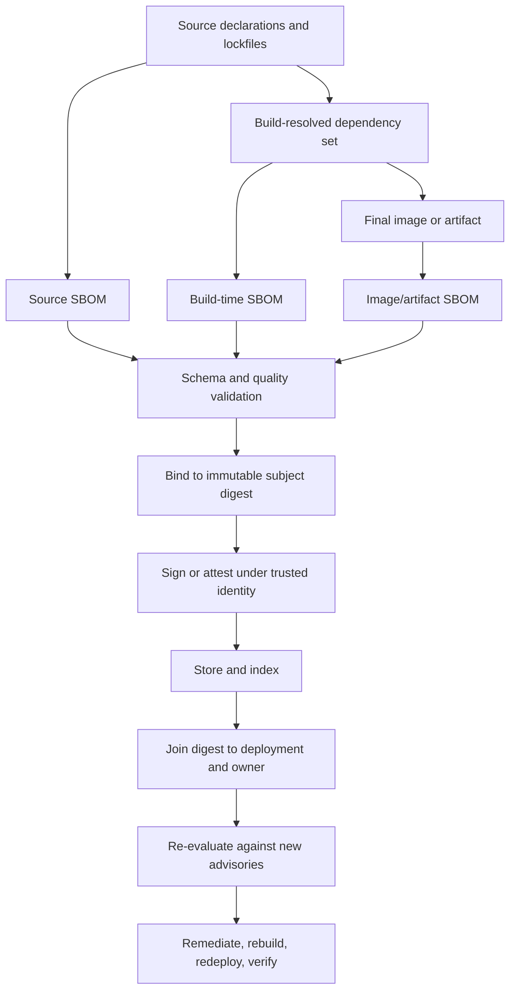

# Unit 3 — Software bills of materials and dependency provenance

**Target file:** `03-software-bills-of-materials-and-dependency-provenance.md` | **Module:** M12 | **Stage:** 2E  
**Estimated study time:** 30–42 hours including labs and review; planning estimate, not measured duration.  
**Prerequisites:** M01–M11 and M12 Units 1–2.  
**Core tools:** Syft, Trivy, Python standard library, JSON/CSV, optional SQLite.  
**Awareness/optional:** SPDX tooling, CycloneDX CLI, Grype, cosign, ORAS, local PyPI proxy, OpenSSF Scorecard, deps.dev, OSV.  
**Last reviewed:** 2026-10-30.  
**Tool/spec baseline:** no local tool versions were executed or supplied for this authoring task. Current references appear in §3.14; tool versions, schema versions and CLI behavior must be recorded in `versions.txt` and verified against installed releases.  
**Footprint:** fixture labs use Python standard library and small JSON files; image pulls and vulnerability databases may consume multiple GB. Measure with `du -sh "$LAB"` and `docker system df`. These are estimates, not benchmarks.  
**Internet:** required for tool installation, approved image pulls, official schemas and advisory database refreshes. Deterministic fixture labs work offline. No paid scanners, SaaS security platforms or cloud accounts are required.

> **Authenticity conventions:** `[SYNTHETIC]` = fabricated training data; `[ASSUMPTION]` = design assumption to confirm; `[ILLUSTRATIVE]` = example, not measured output; `[VERIFY]` = version-sensitive detail requiring verification. Labs are defensive and limited to learner-owned local artifacts. This module was not execution-verified in the learner's environment.

---

### 3.0 Why this matters in production

A software bill of materials (SBOM) is a structured inventory of components and relationships for a specific software artifact; it helps engineering, security, procurement and incident teams identify what may be affected by a vulnerability, license issue or supplier event. An SBOM is not a safety certificate: catalogers can miss vendored or statically linked code, documents can be stale or inaccurate, and an SBOM attached to a mutable tag can be associated with the wrong artifact. A reliable programme binds the inventory to an immutable artifact digest, records generation context, stores it with access and retention controls, and re-evaluates it as advisory data changes. M12 Unit 2 consumes SBOM data for scanning and contextual triage; Unit 3 builds the inventory and lifecycle; Unit 4 signs/attests the inventory; Unit 9 owns remediation and closure; Unit 10 deepens build provenance. The production outcome is not “a JSON file exists”; it is “for a deployed digest, we can identify components, known gaps, owner, evidence age and next action.”

### Running example and boundaries

We use three workload classes: (1) a Python inference API, (2) an ETL/data job, and (3) a notebook/Spark-like environment. Use existing learner-owned images from M01 where possible. If images are unavailable, use deterministic directory fixtures and clearly mark that a directory inventory is not equivalent to a final-image inventory.

| Related module | Reuse here | Boundary |
|---|---|---|
| M01 | Existing digest-pinned images, lockfiles, local registry, Syft/Trivy/cosign basics | Do not re-teach Dockerfile/image construction |
| M02 | CI concepts, dependency-confusion context, OIDC and permissions | Do not re-teach CI fundamentals |
| M08 | SBOM as release evidence; promotion must preserve digest | Do not re-teach GitOps |
| M09 | Secret hygiene and identity ownership | Never place credentials in SBOM/evidence |
| M10/M11 | Incident ownership, postmortem, telemetry and response timing | Do not re-teach SRE/observability stacks |
| M12 U1/U2 | Threat model; vulnerability scan/triage | SBOM is inventory, not scan/triage |
| M12 U4/U5/U9/U10 | Signing, trusted builder, remediation, provenance | Link and hand off; do not teach those units in full |
| M12 U6–U8/U11–U12 | Identity, runtime, admission, policy and detection | SBOM complements these controls |
| M13 | Backup/DR and immutability | Preserve and restore SBOM evidence/index; test evidence recovery and ransomware-resistant retention |
| M14 | Multi-cluster policy distribution (Awareness) | Keep digest/owner inventory consistent across clusters; policy distribution itself is deferred |
| M15 | Security-tooling cost (Awareness) | Track generation, storage, indexing and scanner resource costs; detailed cost governance is deferred |
| M16 | Golden paths and policy packs | Publish SBOM generation/validation as a secure default in reusable templates; platform golden-path implementation is deferred |
| M17 | Capstone | Reuse digest-bound SBOM, quality, inventory, advisory and ML artifact evidence in the integrated capstone |

---

### 3.1 Learning objectives

| ID | Level | Measurable outcome | Evidence |
|---|---|---|---|
| LO-01 | [L1] | Explain SBOM purpose/limits, SPDX/CycloneDX trade-offs, subject, component, PURL, relationship and VEX. | Glossary and self-check |
| LO-02 | [L1] | Generate SPDX and CycloneDX from a local image/directory using locally verified Syft/Trivy commands. | Command transcript and outputs |
| LO-03 | [L1] | Read subject, metadata, components, identifiers, hashes and relationships without claiming safety. | Annotated SBOM |
| LO-04 | [L2] | Compare source/lockfile, build-time and final-image inventory for API, ETL and notebook/Spark-like workloads. | Reconciliation report |
| LO-05 | [L2] | Validate schema where available and run custom quality checks against valid and planted-defect fixtures. | Validator/checker evidence |
| LO-06 | [L2] | Index digest → components → deployments → owners and query a package below a version. | Index/query output and measured time |
| LO-07 | [L2] | Diff two releases and flag added/removed/updated components with a documented review policy. | Diff report/tests |
| LO-08 | [L3] | Review dependency source, lockfile hashes, registry, publisher and build evidence for three candidates. | Three vetting records |
| LO-09 | [L3] | Create an ML-BOM-style local record, hash model/data references and reject missing/mismatched hashes before use. | Inventory and verifier |
| LO-10 | [L3] | Explain SBOM attachment/storage options and produce digest-bound local evidence or an honest fallback. | Attachment decision record |
| LO-11 | [L4] | Run a synthetic advisory drill and map component → digest → deployment → owner. | Impact report and elapsed time |
| LO-12 | [L4] | Define SBOM governance, SRE metrics, retention, exceptions and residual-risk reporting. | Lifecycle policy |

---

### 3.2 Concept map and vocabulary

### Glossary

| Term | Precise definition | Common misconception |
|---|---|---|
| SBOM | Machine-readable inventory of components in a defined software subject, with metadata and relationships supported by the format. | A vulnerability report or proof of safety. |
| Component | Software element represented in the inventory. | Every file or runtime behavior is necessarily a component. |
| Dependency | Relationship where one component requires or incorporates another. | Every dependency is direct. |
| Direct dependency | Dependency declared by project/environment. | The only dependency that matters. |
| Transitive dependency | Dependency introduced by another dependency. | Harmless because not declared directly. |
| Relationship | Typed connection between components/document elements. | A flat list is sufficient for impact analysis. |
| Supplier | Party identified as supplying a component. | Registry host is necessarily original supplier. |
| PURL | Package URL identifying package ecosystem/namespace/name/version and optional qualifiers/subpath. | A signature or proof of origin. |
| CPE | Common Platform Enumeration product identifier used in vulnerability/product matching contexts. | Replacement for PURL or available for every package. |
| Hash/digest | Cryptographic digest of bytes or a defined subject representation. | Proof bytes are benign or publisher is trusted. |
| Subject | Artifact to which a statement/inventory applies. | A mutable tag is an immutable identity. |
| Metadata | Context such as creator/tool, timestamp, subject and document identity. | Decorative information. |
| Cataloger | Tool component that detects/describes packages from a source. | Perfect parser that finds all code. |
| Lockfile | Resolved dependency record intended to make dependency selection repeatable. | Complete final-image inventory or proof of trust. |
| Provenance | Evidence describing where/how an artifact or dependency was resolved, built or published. | Same thing as SBOM. |
| Attestation | Structured statement about a subject, authenticated under a trust model. | Any JSON document containing claims. |
| Build-time dependency | Dependency used during build, possibly absent from final image. | Irrelevant to shipped artifact integrity. |
| Runtime dependency | Component needed/present for runtime behavior. | Always discoverable by package managers. |
| Vendoring | Copying dependency source/binaries into project/artifact. | Automatically tracked by original lockfile. |
| Static linking | Incorporating library code into a binary at build time. | Library must remain separately visible. |
| SBOM completeness | Degree of coverage within a stated scope. | Schema validation proves completeness. |
| SBOM accuracy | Correctness of assertions about components, versions, suppliers and relationships. | More rows means greater accuracy. |
| SBOM drift | Difference between inventory and artifact or between tools/times. | Always malicious tampering. |
| SBOM inventory | Searchable collection indexed by subject and linked to deployments/owners. | A folder of files with no stable subject key. |
| ML-BOM | Inventory of ML-specific artifacts/dependencies; exact normative capabilities depend on format/version. | Universal field set independent of specification. |
| VEX | Vulnerability Exploitability eXchange statement about vulnerability status for a specified product/subject and justification. | Replacement for SBOM or blanket ignore. |
| Reproducible build | Controlled build producing equivalent output from equivalent inputs under a defined claim. | Proof source/builder is trustworthy. |
| Dependency confusion | Resolution selects unintended package/source due to naming or source-priority ambiguity. | Merely a typo. |
| Typosquatting | Similar-looking package name intended to attract mistaken selection. | Evidence that an unfamiliar package is malicious. |
| Trusted publishing | Publishing via workload identity/federation rather than long-lived password; ecosystem-specific. | Proof source code is benign. |
| Supply-chain risk | Risk across dependency, source, build, publish, distribution and consumption relationships. | Solved by one scanner. |

### SBOM lifecycle and blind spots



Source/lockfile inventory can miss OS packages, build tools, generated code, vendored source and injected dependencies. Build-time inventory can be manipulated by an untrusted builder or omit hidden external parameters. Image inventory sees what catalogers can identify in the final artifact, but may miss static linking, opaque binaries and native libraries bundled inside wheels. Schema validation checks structure, not truth. Digest binding prevents subject mix-ups only when the digest is correctly resolved. Signing authenticates a statement under a trust policy; it does not prove the statement is complete or the artifact safe. Deployment joins can be stale. Advisory re-evaluation depends on database freshness and correct ecosystem/version matching.

### Source, build and image inventory

| Point | Captures well | Strength | Blind spots | Recommended role |
|---|---|---|---|---|
| Source/lockfile | Declared/locked language dependencies | Early feedback; review before build | OS/build packages, vendored code, injected packages | Preserve as input evidence |
| Build-time | Resolved/used build dependencies | Closest to build inputs when builder is trustworthy | Hidden external parameters, compromised builder | Preferred release evidence |
| Final image | Detectable components in shipped artifact | Practical view of final filesystem | Static linking, vendoring, opaque files | Cross-check build-time view |

Generate at build time and cross-check against final image; preserve source/lockfile view. Differences are investigation signals, not proof of compromise.

### SPDX and CycloneDX comparison

| Dimension | SPDX | CycloneDX |
|---|---|---|
| Standardization | International open standard; SPDX official site identifies ISO/IEC 5962:2021 | Ecma International standard ECMA-424 |
| Historical emphasis | License/copyright and software package exchange heritage | Security/supply-chain transparency and broader BOM use cases |
| Model | Versioned SPDX document/semantic model | Versioned BOM schema and domain-specific models |
| Serialization | Common tool outputs include JSON and tag-value; exact support depends on tool | Official project lists JSON/XML/Protocol Buffers; tools may support subsets |
| Ecosystem | License/compliance interoperability | Security workflows, VEX and ML-BOM use cases |
| Decision | Choose where SPDX consumer compatibility and license workflows fit | Choose where CycloneDX consumers and BOM capabilities fit |

Neither is universally superior. Confirm consumers, schema version, producer support and validator support. As of 2026-10-30, official pages surfaced during authoring list SPDX 3.0 and CycloneDX v1.7/ECMA-424 second edition. Tool support may lag the spec; pin the exact schema emitted by your installed tools.

### SBOM content and PURL

Inspect document identity, format/schema version, subject identity, generator metadata, timestamp, source scope, components, suppliers, package identifiers, hashes, licenses, relationships and known omissions. Field names differ by format/version; do not assume identical names.

PURL general shape:

```text
pkg:type/namespace/name@version?qualifiers#subpath
```

Illustrative examples:

```text
pkg:pypi/example-library@1.2.3
pkg:npm/%40example/widget@4.5.6
pkg:generic/vendor-native-lib@0.9.0
```

Encoding and qualifiers matter. Use a maintained implementation or official Package URL specification; validate syntax. PURL is an identifier, not proof of origin or safety. CPE is useful awareness for product matching but is not a replacement for ecosystem package identity.

### What an SBOM is not

- Not proof that an artifact has no vulnerabilities.
- Not itself a vulnerability report or risk decision.
- Not necessarily complete, accurate, current or trustworthy.
- Not signed unless signed or included in a signed attestation.
- Not proof of where/how a component was built.
- Not proof that source code or publisher is benign.
- Not full inventory of model behavior, training lineage, runtime access or service configuration.
- Not replacement for scanning, VEX, provenance, admission or runtime controls.

### SBOM and VEX

SBOM answers **what components are asserted to be in this subject?** VEX answers **what is the vulnerability status for this product/subject, and why?** VEX needs scoped product identity, vulnerability reference, status and defensible justification under a selected specification. A VEX “not affected” claim is not a universal ignore switch. Keep SBOM and VEX as separate linked evidence.

---

### 3.3 Level 1 — Beginner

#### 3.3.1 Definition and uses

SBOMs support vulnerability impact analysis, license review, incident response (“are we affected?”), procurement/customer requests, release change review and supplier intake. They allow teams to ask which artifacts may contain a component, but they do not decide whether a vulnerability is exploitable or whether a license use is legally acceptable.

#### 3.3.2 Common failure modes

| Failure | Symptom | Response |
|---|---|---|
| Missing component | known library absent | reconcile source/build/image; inspect vendored/static/native code |
| Wrong version | SBOM disagrees with artifact | verify source scope and package manager/image evidence |
| Wrong subject | SBOM associated with moved tag | bind and query by digest |
| Stale output | old generation timestamp | regenerate on artifact change; re-evaluate on advisory change |
| Missing relationships | flat list only | preserve dependency edges where supported |
| Cataloger blind spot | native/static code absent | known-component tests and manual supplement |
| Untrusted generation | compromised builder emits false inventory | trusted builder, independent checks and identity verification |
| Schema-only validation | valid document lacks digest/owner | custom quality checks and deployment join |

#### 3.3.3 SPDX/CycloneDX decision record

Before adopting a format, record:
- downstream consumers and versions;
- exact format/schema version;
- producer and validator support;
- required component and relationship semantics;
- subject digest representation;
- conversion losses if emitting multiple formats;
- local quality rules beyond schema requirements.

#### 3.3.4 Component review

| Concept | Illustrative value | Review question |
|---|---|---|
| Name/version | `example-lib`, `1.2.3` | Is identity unambiguous? |
| PURL | `pkg:pypi/example-lib@1.2.3` | Correct ecosystem and syntax? |
| Hash | SHA-256 | Which exact bytes were hashed? |
| Supplier | `Example Maintainers` | Asserted or independently verified? |
| License | `MIT` | Metadata or legal conclusion? |
| Relationship | application depends on library | Are direct/transitive edges represented? |
| Subject digest | `sha256:...` | Does it match deployed artifact? |
| Generator | tool/version | Which catalogers/configuration? |

Do not copy this illustrative row into a normative SBOM.

#### 3.3.5 Syft generation

Syft catalogs packages from supported sources and emits SBOM formats. Verify source syntax, output format names, output-file flag, cataloger behavior and layer scope against installed docs.

```bash
syft version
syft --help
```

Illustrative patterns; verify locally before use:

```bash
syft example-api:local -o spdx-json > evidence/api.syft.spdx.json
syft dir:./fixtures/api -o cyclonedx-json > evidence/api.source.syft.cdx.json
```

Record tool version, target digest/source path, output format, configuration and known cataloger gaps. A successful command does not prove completeness.

#### 3.3.6 Trivy generation and SBOM scanning

Keep inventory generation separate from vulnerability analysis. Trivy documentation describes SBOM generation for supported targets and scanning an existing SBOM using an `sbom` subcommand. Exact flags and formats are version-sensitive.

```bash
trivy version
trivy image --help
trivy fs --help
trivy sbom --help
```

Illustrative current-style patterns; verify installed help first:

```bash
trivy image --format cyclonedx --output evidence/api.trivy.cdx.json example-api:local
trivy image --format spdx-json --output evidence/api.trivy.spdx.json example-api:local
trivy sbom evidence/api.trivy.cdx.json
```

Scanning a saved SBOM decouples inventory generation from later advisory database updates, but does not fix stale/incomplete inventory. Record SBOM generation time and scan/database evaluation time separately. Unit 2 owns contextual triage.

#### 3.3.7 Read an SBOM

Review worksheet:

```text
SBOM file:
Format/schema version:
Subject name and immutable digest:
Generator and version:
Generation timestamp:
Source type (directory/image/build):
Component count:
Components with PURL:
Components with hashes:
Relationships present:
Known cataloger gaps:
Schema validation status:
Custom quality status:
Deployment/owner:
```

A component listed is not a component proven safe. A zero-finding scan is not proof of zero risk.

#### 3.3.8 Catalogers, layers and scope

Catalogers recognize supported package databases and ecosystems. They may miss vendored source, static linking, native libraries inside wheels, opaque binaries and model weights. Image historical layers and final filesystem are different scopes. Syft's exact layer selection semantics are `[VERIFY]`: check installed version docs, record configuration and test a known marker. Do not assume “removed in a later layer” means bytes are absent from earlier layers.

#### 3.3.9 Schema validity versus quality

Schema validation checks structure against a selected schema/version. Local quality checks may require digest, generator/version, timestamp, PURLs, hashes, relationships, owner join and duplicate detection. Neither proves completeness or truth.

### Guided lab — LAB-01: Generate and inspect an SBOM

**Goal:** produce SPDX and CycloneDX from a local image or directory; inspect subject and metadata; scan a saved SBOM where supported.  
**Footprint:** fixture <1 MB; tools/images dominate. Measure `du -sh "$LAB"` and `docker system df`.  
**Internet:** tool install/schema/image/database pulls; offline fixture alternative below.  
**Scope:** learner-owned image/files only.

```bash
mkdir -p "$HOME/m12-unit3"/{fixtures/api,output,evidence}
cd "$HOME/m12-unit3"
cat > fixtures/api/requirements.txt <<'EOF'
# [SYNTHETIC] Training manifest only; not an install instruction.
example-api-framework==1.0.0
example-data-lib==2.1.0
EOF
cat > fixtures/api/app.py <<'EOF'
APP_COMPONENT = "m12-unit3-api-fixture"
EOF
{
  date -u +"timestamp_utc=%Y-%m-%dT%H:%M:%SZ"
  uname -a
  python3 --version
  syft version 2>&1 || true
  trivy version 2>&1 || true
  docker version 2>&1 || true
} | tee evidence/versions.txt
```

If a learner-owned image exists, record its immutable digest:

```bash
docker image inspect example-api:local --format '{{json .RepoDigests}}' \
  | tee evidence/api-repodigests.json
```

Generate using verified syntax:

```bash
syft dir:fixtures/api -o spdx-json > output/api.source.spdx.json
syft dir:fixtures/api -o cyclonedx-json > output/api.source.cdx.json
```

Trivy patterns (verify format flags):

```bash
trivy fs --format cyclonedx --output output/api.trivy.cdx.json fixtures/api
trivy sbom output/api.trivy.cdx.json
```

**Expected evidence:** versions, command transcript, digest or explicit local-only identifier, outputs and interpretation note. No fixed component count is expected.  
**Mistakes:** directory SBOM called image SBOM; mutable tag treated as identity; unsupported format assumed; zero components interpreted as safe. Fix by verifying source, digest, tool help and cataloger coverage.  
**Offline fallback:** use synthetic fixtures and mark Syft/Trivy `NOT RUN — offline fixture path`.  
**Cleanup:** remove only `$HOME/m12-unit3` when finished; do not prune shared Docker images.  
**WSL2:** keep workspace in Linux filesystem for I/O; Docker Desktop storage may be outside WSL filesystem. Measure both.  
**Safe rerun:** outputs are regenerated in the dedicated workspace.

---

### 3.4 Level 2 — Intermediate

#### 3.4.1 Three inventory views

Source/lockfile captures declared dependencies. Build-time captures resolved/used build inputs. Final-image captures what catalogers detect in the shipped artifact. A multi-stage build may remove compilers from the final image while a compromised compiler can still affect output. A lockfile may omit OS packages. A wheel may bundle native code invisible to package-level inventory. Preserve all three views and reconcile; do not force counts to match.

#### 3.4.2 Three workload classes

| Workload | Inventory concerns | Blind spots |
|---|---|---|
| API | Python web stack, transitive packages, OS runtime | native wheel contents, generated code |
| ETL | numpy, pandas, pyarrow, codecs, OS libraries | native libraries, system packages, optional extras |
| Notebook/Spark-like | notebook, kernels, Java/Spark connectors, conda, extensions | JARs, native libs, user-installed plugins |

These are categories, not asserted scan results. Use learner-provided local images/digests or fixtures.

#### 3.4.3 Data/ML dependency tree

[ILLUSTRATIVE]

```text
ml-inference-service
├── scikit-learn
│   ├── scipy
│   │   └── platform-specific native math libraries
│   └── joblib
├── pandas
│   ├── numpy
│   └── python-dateutil
├── pyarrow
│   └── native Arrow/codec libraries (wheel/platform dependent)
└── OS packages: libc, CA certificates, compression utilities
```

Resolve exact versions from your own lockfile/image. Wheels may bundle native libraries; conda adds another package metadata ecosystem. Model files and datasets are non-package artifacts: inventory references, immutable IDs, hashes, licenses/lineage where known, and owners. Do not copy dataset contents into evidence.

#### 3.4.4 Attachment and storage

| Option | Benefit | Limitation |
|---|---|---|
| Git beside release source | review/history | tag/commit still needs subject binding; package names may be sensitive |
| Object store keyed by digest | durable retrieval and lifecycle | access, retention, backup required |
| OCI artifact/referrer | evidence near image | registry/client support varies `[VERIFY]` |
| ORAS attachment | OCI artifact workflow | command and registry behavior `[VERIFY]` |
| Signed attestation | authenticates statement under trust policy | Unit 4 owns signing and identity verification |
| Mutable sidecar tag | simple lookup | can move or be garbage-collected independently |

Store by immutable subject digest, retain raw SBOM, SBOM file hash, generator/version/configuration, timestamp, storage location, access policy and retention. Do not assume registry upload equals signed attestation. Verify current cosign/ORAS/OCI behavior; do not blindly copy deprecated `cosign attach sbom` examples.

#### 3.4.5 Offline inventory index

The following local normalized fixture format is **not SPDX or CycloneDX**. It is only a stable input for the teaching scripts.

```json
{
  "schema": "m12-unit3-index-fixture/v1",
  "subject": {"name": "api-v1", "digest": "sha256:aaaaaaaaaaaaaaaaaaaaaaaaaaaaaaaaaaaaaaaaaaaaaaaaaaaaaaaaaaaaaaaa"},
  "generator": {"name": "fixture-generator", "version": "1", "created": "2026-10-30T00:00:00Z"},
  "components": [
    {"type": "pypi", "name": "example-data-lib", "version": "2.1.0",
     "supplier": "[SYNTHETIC] example-maintainer",
     "purl": "pkg:pypi/example-data-lib@2.1.0",
     "hashes": ["sha256:bbbbbbbbbbbbbbbbbbbbbbbbbbbbbbbbbbbbbbbbbbbbbbbbbbbbbbbbbbbbbbbb"],
     "licenses": ["MIT"]}
  ],
  "relationships": []
}
```

Create `fixtures/sboms/api-v1.json`, `etl-v1.json`, `notebook-v1.json` with the same shape, distinct subject digests and components. Include:
- API: `example-data-lib` 2.1.0 and `example-http` 1.4.0;
- ETL: `example-data-lib` 1.9.0 and `example-columnar` 5.0.0;
- Notebook: `example-data-lib` 2.1.0 and `example-native-marker` 0.3.0.

`fixtures/deployments.json`:

```json
[
  {"digest":"sha256:aaaaaaaaaaaaaaaaaaaaaaaaaaaaaaaaaaaaaaaaaaaaaaaaaaaaaaaaaaaaaaaa","namespace":"ml-serving","workload":"inference-api","owner":"team-inference","observed_at":"2026-10-30T00:05:00Z"},
  {"digest":"sha256:cccccccccccccccccccccccccccccccccccccccccccccccccccccccccccccccc","namespace":"data-jobs","workload":"daily-etl","owner":"team-data","observed_at":"2026-10-30T00:06:00Z"},
  {"digest":"sha256:ffffffffffffffffffffffffffffffffffffffffffffffffffffffffffffffff","namespace":"ml-notebooks","workload":"research-notebook","owner":"team-ml-platform","observed_at":"2026-10-30T00:07:00Z"}
]
```

#### 3.4.6 Complete offline Python implementation

Save as `src/sbom_lab.py`. It uses only the standard library and consumes only the local fixture schema. It is not a normative SBOM parser or validator.

```python
#!/usr/bin/env python3
import argparse, hashlib, json, re
from pathlib import Path

SCHEMA = "m12-unit3-index-fixture/v1"
DIGEST = re.compile(r"^sha256:[0-9a-f]{64}$")
PURL = re.compile(r"^pkg:[a-z0-9.+-]+/.+")

def load(path):
    return json.loads(Path(path).read_text(encoding="utf-8"))

def dump(path, obj):
    p = Path(path); p.parent.mkdir(parents=True, exist_ok=True)
    p.write_text(json.dumps(obj, indent=2, sort_keys=True) + "\n", encoding="utf-8")

def file_hash(path):
    h = hashlib.sha256()
    with open(path, "rb") as f:
        for block in iter(lambda: f.read(1024 * 1024), b""): h.update(block)
    return h.hexdigest()

def quality(doc):
    errors = []
    if doc.get("schema") != SCHEMA: errors.append("schema unsupported")
    subject = doc.get("subject") or {}
    if not subject.get("name"): errors.append("subject.name missing")
    if not DIGEST.fullmatch(str(subject.get("digest", ""))): errors.append("subject.digest invalid")
    gen = doc.get("generator") or {}
    for key in ("name", "version", "created"):
        if not gen.get(key): errors.append("generator.%s missing" % key)
    comps = doc.get("components")
    if not isinstance(comps, list) or not comps:
        errors.append("components empty or not a list"); return errors
    relationships = doc.get("relationships")
    if not isinstance(relationships, list):
        errors.append("relationships missing or not a list")
    else:
        for i, rel in enumerate(relationships):
            if not all(rel.get(k) for k in ("type", "from", "to")):
                errors.append("relationships[%d] requires type/from/to" % i)
    seen = set()
    for i, c in enumerate(comps):
        for key in ("type", "name", "version", "supplier"):
            if not c.get(key): errors.append("components[%d].%s missing" % (i, key))
        ident = (c.get("type"), c.get("name"), c.get("version"))
        if ident in seen: errors.append("duplicate component identity: %r" % (ident,))
        seen.add(ident)
        if not isinstance(c.get("purl"), str) or not PURL.fullmatch(c["purl"]):
            errors.append("components[%d].purl invalid" % i)
        hashes = c.get("hashes")
        if not isinstance(hashes, list) or not hashes:
            errors.append("components[%d].hashes missing" % i)
        elif not all(re.fullmatch(r"sha256:[0-9a-f]{64}", str(x)) for x in hashes):
            errors.append("components[%d].hash invalid" % i)
        if not isinstance(c.get("licenses"), list):
            errors.append("components[%d].licenses must be a list" % i)
    return errors

def build_index(sbom_dir, deployments_path):
    deployments = load(deployments_path); by_digest = {}
    for d in deployments: by_digest.setdefault(d["digest"], []).append(d)
    artifacts = []
    for p in sorted(Path(sbom_dir).glob("*.json")):
        doc = load(p)
        if doc.get("schema") != SCHEMA: continue
        digest = doc["subject"]["digest"]
        artifacts.append({
            "name": doc["subject"]["name"], "digest": digest,
            "sbom_source": str(p), "components": doc["components"],
            "deployments": by_digest.get(digest, []),
            "mapping": "MATCHED" if digest in by_digest else "NO_DEPLOYMENT_MATCH"
        })
    known = {a["digest"] for a in artifacts}
    return {"schema":"m12-unit3-index/v1", "artifacts":artifacts,
            "unmatched_deployments":[d for d in deployments if d["digest"] not in known]}

def version_tuple(v):
    if not re.fullmatch(r"\d+(?:\.\d+)*", str(v)): return None
    return tuple(int(x) for x in str(v).split("."))

def query(index, package, op, version):
    target = version_tuple(version)
    if target is None: raise ValueError("fixture comparator accepts numeric dot versions only")
    result = []
    for a in index["artifacts"]:
        matches = []
        for c in a["components"]:
            if c["name"].lower() != package.lower(): continue
            current = version_tuple(c["version"])
            if current is None: continue
            ok = {"<":current<target, "<=":current<=target, "==":current==target,
                  ">=":current>=target, ">":current>target}[op]
            if ok: matches.append(c)
        if matches:
            result.append({"artifact":a["name"], "digest":a["digest"],
                           "components":matches, "deployments":a["deployments"],
                           "mapping":a["mapping"]})
    return result

def advisory(index, adv):
    matches = []
    for a in index["artifacts"]:
        for c in a["components"]:
            if c["name"].lower() == adv["package"].lower() and c["version"] in adv["affected_versions"]:
                matches.append({"artifact":a["name"], "digest":a["digest"],
                                "component":c, "deployments":a["deployments"]})
    return {"label":"[SYNTHETIC]", "id":adv["id"], "matches":matches,
            "unknowns":["Exact-string fixture matching only; no backports/reachability/exploitability.",
                        "Missing SBOM or deployment join is UNKNOWN, not NOT AFFECTED."]}

def diff(old, new):
    def cmap(d): return {(c["type"], c["name"].lower()):c for c in d["components"]}
    a, b = cmap(old), cmap(new)
    added = [b[k] for k in sorted(b.keys()-a.keys())]
    removed = [a[k] for k in sorted(a.keys()-b.keys())]
    updated = [{"before":a[k], "after":b[k]} for k in sorted(a.keys()&b.keys())
               if a[k].get("version") != b[k].get("version") or a[k].get("hashes") != b[k].get("hashes")]
    flags = []
    if added: flags.append("NEW_COMPONENTS_REVIEW")
    if updated: flags.append("VERSION_OR_HASH_CHANGED")
    if any(not x.get("hashes") for x in added): flags.append("ADDED_COMPONENT_WITHOUT_HASH")
    return {"added":added,"removed":removed,"updated":updated,"review_flags":flags,
            "note":"Review flags are not proof of maliciousness."}

def verify_mlbom(inventory, base):
    errors=[]
    for item in inventory.get("artifacts", []):
        name=item.get("name","unnamed"); rel=item.get("path"); expected=item.get("sha256")
        if not rel: errors.append(name+": path missing"); continue
        if not expected: errors.append(name+": hash missing; REFUSE"); continue
        p=Path(base)/rel
        if not p.is_file(): errors.append(name+": file missing"); continue
        if file_hash(p) != expected: errors.append(name+": hash mismatch; REFUSE")
    return errors

def main():
    p=argparse.ArgumentParser(); sub=p.add_subparsers(dest="cmd",required=True)
    q=sub.add_parser("quality"); q.add_argument("sbom")
    ix=sub.add_parser("index"); ix.add_argument("sbom_dir"); ix.add_argument("deployments"); ix.add_argument("--out",required=True)
    qu=sub.add_parser("query"); qu.add_argument("index"); qu.add_argument("package"); qu.add_argument("op",choices=["<","<=","==",">=",">"]); qu.add_argument("version")
    ad=sub.add_parser("advisory"); ad.add_argument("index"); ad.add_argument("advisory"); ad.add_argument("--out",required=True)
    df=sub.add_parser("diff"); df.add_argument("old"); df.add_argument("new"); df.add_argument("--out",required=True)
    ml=sub.add_parser("verify-mlbom"); ml.add_argument("inventory"); ml.add_argument("base_dir")
    a=p.parse_args()
    if a.cmd=="quality":
        e=quality(load(a.sbom)); print(json.dumps({"status":"PASS" if not e else "FAIL","errors":e},indent=2)); return 0 if not e else 2
    if a.cmd=="index":
        x=build_index(a.sbom_dir,a.deployments); dump(a.out,x); print("indexed",len(x["artifacts"])); return 0
    if a.cmd=="query": print(json.dumps(query(load(a.index),a.package,a.op,a.version),indent=2)); return 0
    if a.cmd=="advisory": x=advisory(load(a.index),load(a.advisory)); dump(a.out,x); print("synthetic matches",len(x["matches"])); return 0
    if a.cmd=="diff": x=diff(load(a.old),load(a.new)); dump(a.out,x); print("added/removed/updated",len(x["added"]),len(x["removed"]),len(x["updated"])); return 0
    if a.cmd=="verify-mlbom":
        e=verify_mlbom(load(a.inventory),a.base_dir); print(json.dumps({"status":"REFUSE" if e else "PASS","errors":e},indent=2)); return 3 if e else 0
    return 1

if __name__=="__main__": raise SystemExit(main())
```

#### 3.4.7 Tests

Save as `tests/test_sbom_lab.py`. These test the local fixture policy only, not official SPDX/CycloneDX conformance or inventory completeness.

```python
import json, tempfile, unittest
from pathlib import Path
from src.sbom_lab import SCHEMA, quality, build_index, query, advisory, diff, verify_mlbom, file_hash

GOOD = {
 "schema":SCHEMA,
 "subject":{"name":"api","digest":"sha256:"+"a"*64},
 "generator":{"name":"fixture","version":"1","created":"2026-10-30T00:00:00Z"},
 "components":[{"type":"pypi","name":"example-data-lib","version":"2.1.0",
  "supplier":"[SYNTHETIC] example-maintainer",
  "purl":"pkg:pypi/example-data-lib@2.1.0","hashes":["sha256:"+"b"*64],"licenses":["MIT"]}],
 "relationships":[]
}

class QualityTests(unittest.TestCase):
 def test_valid(self): self.assertEqual([],quality(GOOD))
 def test_digest_missing(self):
  x=json.loads(json.dumps(GOOD)); x["subject"]["digest"]="latest"
  self.assertTrue(any("subject.digest" in e for e in quality(x)))
 def test_hash_missing(self):
  x=json.loads(json.dumps(GOOD)); x["components"][0]["hashes"]=[]
  self.assertTrue(any("hashes" in e for e in quality(x)))
 def test_purl_missing(self):
  x=json.loads(json.dumps(GOOD)); x["components"][0]["purl"]=""
  self.assertTrue(any("purl" in e for e in quality(x)))
 def test_generator_missing(self):
  x=json.loads(json.dumps(GOOD)); x["generator"]["version"]=""
  self.assertTrue(any("generator.version" in e for e in quality(x)))
 def test_duplicate(self):
  x=json.loads(json.dumps(GOOD)); x["components"].append(x["components"][0].copy())
  self.assertTrue(any("duplicate" in e for e in quality(x)))
 def test_relationships_missing(self):
  x=json.loads(json.dumps(GOOD)); del x["relationships"]
  self.assertTrue(any("relationships" in e for e in quality(x)))
 def test_relationship_entry_invalid(self):
  x=json.loads(json.dumps(GOOD)); x["relationships"]=[{"type":"DEPENDS_ON"}]
  self.assertTrue(any("requires type/from/to" in e for e in quality(x)))
 def test_supplier_missing(self):
  x=json.loads(json.dumps(GOOD)); del x["components"][0]["supplier"]
  self.assertTrue(any("supplier missing" in e for e in quality(x)))

class InventoryTests(unittest.TestCase):
 def test_query_and_owner_join(self):
  with tempfile.TemporaryDirectory() as t:
   root=Path(t); d=root/"sboms"; d.mkdir()
   (d/"api.json").write_text(json.dumps(GOOD))
   dep=root/"deployments.json"
   dep.write_text(json.dumps([{"digest":GOOD["subject"]["digest"],"namespace":"test",
    "workload":"api","owner":"team-api","observed_at":"2026-10-30T00:00:00Z"}]))
   idx=build_index(d,dep); result=query(idx,"example-data-lib","<","3.0.0")
   self.assertEqual("team-api",result[0]["deployments"][0]["owner"])
 def test_missing_mapping_visible(self):
  with tempfile.TemporaryDirectory() as t:
   root=Path(t); d=root/"sboms"; d.mkdir()
   (d/"api.json").write_text(json.dumps(GOOD))
   dep=root/"deployments.json"; dep.write_text("[]")
   self.assertEqual("NO_DEPLOYMENT_MATCH",build_index(d,dep)["artifacts"][0]["mapping"])
 def test_diff_add_remove_update(self):
  old=json.loads(json.dumps(GOOD)); new=json.loads(json.dumps(GOOD))
  old["components"].append({"type":"pypi","name":"removed","version":"1","purl":"pkg:pypi/removed@1","hashes":["sha256:"+"c"*64],"licenses":[]})
  new["components"][0]["version"]="2.2.0"
  new["components"].append({"type":"pypi","name":"added","version":"1","purl":"pkg:pypi/added@1","hashes":["sha256:"+"d"*64],"licenses":[]})
  r=diff(old,new); self.assertEqual((1,1,1),(len(r["added"]),len(r["removed"]),len(r["updated"])))

class AdvisoryMLTests(unittest.TestCase):
 def test_synthetic_advisory(self):
  idx={"artifacts":[{"name":"api","digest":GOOD["subject"]["digest"],
   "components":GOOD["components"],"deployments":[]}]}
  a={"id":"SYNTH-001","package":"example-data-lib","affected_versions":["2.1.0"]}
  self.assertEqual(1,len(advisory(idx,a)["matches"]))
 def test_mlbom_hash_and_refusal(self):
  with tempfile.TemporaryDirectory() as t:
   p=Path(t)/"model.marker"; p.write_bytes(b"harmless-marker")
   inv={"artifacts":[{"name":"demo","path":"model.marker","sha256":file_hash(p)}]}
   self.assertEqual([],verify_mlbom(inv,t))
   inv["artifacts"][0]["sha256"]=""
   self.assertTrue(verify_mlbom(inv,t))

if __name__=="__main__": unittest.main()
```

Run deterministic tests:

```bash
python3 -m unittest discover -s tests -v
```

This command is not claimed to have been run in this authoring session. Preserve actual output. The custom checker is not a normative schema validator, does not prove packages exist, and cannot prove all components were discovered.

#### 3.4.8 Inventory query and measured time

```bash
python3 src/sbom_lab.py index fixtures/sboms fixtures/deployments.json --out output/index.json
/usr/bin/time -f 'elapsed_seconds=%e max_rss_kb=%M' \
  python3 src/sbom_lab.py query output/index.json example-data-lib '<' 2.0.0 \
  | tee evidence/package-query.json
```

The fixture comparator supports numeric dot versions only. It is not PEP 440, SemVer, Debian version ordering or vendor backport logic. Production must use ecosystem-aware comparison and advisory semantics. Record actual elapsed time; do not invent a benchmark.

#### 3.4.9 License awareness

SPDX license identifiers/expressions help normalize metadata. Permissive and copyleft categories are useful awareness but obligations depend on the license and facts. Metadata can be missing/conflicting; automated labels are not legal advice. Route decisions to qualified legal/compliance reviewers.

### Pattern catalogue

| Pattern | When useful | Limitation |
|---|---|---|
| Source + build + image inventories | Cross-check declared/resolved/shipped views | Reconciliation effort |
| Digest-keyed object store | Reliable retrieval | Retention/access/backup work |
| Raw SBOM + normalized index | Fast queries with original evidence | Parser/tool drift |
| Quality gate with exceptions | Prevent missing metadata | Can block release if unstaged |
| Scheduled historical re-evaluation | New advisory response | Depends on freshness and retention |
| Supplier intake validation | Third-party transparency | Supplier accuracy remains uncertain |
| Release diff | Unexpected dependency review | Change flag is not maliciousness proof |

### Anti-pattern catalogue

| Bad practice | Consequence | Correction |
|---|---|---|
| SBOM attached to `latest` | subject may change | immutable digest key |
| Only lockfile inventory | OS/native/vendored misses | build-time + image cross-check |
| Compare counts only | same count can hide different components | normalized identities/relationships |
| Schema pass = complete | false confidence | custom quality and known-component tests |
| Store but never re-evaluate | stale vulnerability context | scheduled advisory re-evaluation |
| Trust supplier SBOM blindly | bad data enters index | validate schema, subject, metadata and quality |
| Popularity = safety | weak signal overtrusted | provenance, source and build review |
| Flatten graph | relationship loss | preserve dependency edges |

---

### 3.5 Level 3 — Advanced

#### 3.5.1 Dependency provenance and trust

Provenance asks where a dependency came from, how it was resolved/built/published and what evidence supports the claim. Distinguish:
- **SBOM:** what components were identified in a subject;
- **hash:** whether bytes match an expected digest;
- **signature/attestation:** whether a statement was authenticated under a trust policy;
- **provenance:** source/build/publication claims;
- **vulnerability scan:** advisory correlation for identified components.

A valid hash in a malicious lockfile only proves downloaded bytes match the lockfile. A signed release may still come from a compromised publisher. A trusted builder can build malicious source.

```text
manifest → resolver/lockfile → registry/source → package bytes/hash
         → build backend/install → environment → artifact → SBOM
         → provenance/attestation → release → deployment
```

#### 3.5.2 Registry and package risks

- Typosquatting and dependency confusion.
- Malicious or compromised package releases.
- Maintainer-account takeover.
- Abandoned projects and slow security response.
- Install-time code execution through build backends/install mechanisms.
- Registry/proxy compromise or source-priority ambiguity.
- Transitive dependency expansion.

Defensive controls: canonical names, source allow-lists, lockfiles, hashes, controlled mirrors, quarantine/review, build isolation, prebuilt wheels where feasible, restricted egress and audit logs. Never install a malicious package for demonstration; use harmless policy fixtures.

#### 3.5.3 Lockfiles and hashes

Hash checking can make installation fail when bytes differ from expected lockfile hashes. It does not prove the lockfile was reviewed, publisher trusted, source benign, package vulnerability-free, build backend safe or license correct.

Example pip pattern; verify current behavior:

```bash
python -m pip install --require-hashes -r requirements-hashed.txt
```

`pip-compile --generate-hashes` is a known pip-tools workflow; verify exact current options. `uv`, Poetry and conda lock/hash semantics are version-dependent. Record installer version, index/source, lockfile hash and package hashes. Hash mismatch must fail for protected release paths.

#### 3.5.4 Wheels, source distributions and build isolation

Prefer prebuilt wheels where feasible to reduce source-build execution, but account for platform compatibility and bundled native libraries. Source distributions may execute build backend code and resolve additional build dependencies. Build isolation limits environment interference but is not a complete security boundary. Unit 5 owns trusted builder design; here record wheel/source origin, build dependencies and builder evidence.

#### 3.5.5 Private mirrors and allow-lists

A controlled mirror/proxy can centralize approved names/versions, source policy, hash verification, caching, quarantine, audit logs and retention. `[ASSUMPTION]` delayed ingestion/quarantine is a policy pattern, not a capability guaranteed by every proxy. Verify tool feasibility before adoption. Offline allow-list fixture is the required fallback. Avoid mixing public/private sources without understanding resolution priority.

#### 3.5.6 Package attestations and publisher identity

PyPI Trusted Publishing and PEP 740 are awareness topics; verify current support, identity claims and verification guidance. npm provenance is ecosystem-specific. An authentic attestation can still describe malicious source, compromised upstream dependencies, an insecure build or a vulnerable package. Verify issuer, identity, source/ref and subject digest. Unit 4/10 owns implementation.

#### 3.5.7 OpenSSF Scorecard, deps.dev and OSV

Optional signals only. Record source, query timestamp, package identity, coverage, metric definition and intended use. Popularity/download counts and health scores are weak signals, not proof of safety or probability of compromise.

#### 3.5.8 Three-candidate dependency vetting

Use these synthetic profiles, not unsupported claims about real packages:

| Candidate | Evidence | Unknowns | Decision |
|---|---|---|---|
| A | repository reference, release history, lock hash, license, security contact | publisher identity/build provenance not verified | conditional accept pending identity review |
| B | lookalike name, no owner/repository match, no hash, ambiguous source | source and package contents unknown | reject/quarantine pending investigation |
| C | internal fork, named owner, patch history, build notes, hash | upstream merge plan and license obligations | accept with owner/review date |

Checklist: ecosystem/name/version; repository/registry consistency; maintainers/ownership; release history; license; install/build scripts; transitive impact; lockfile/hash; publisher identity/attestation; security response; maintenance; update path; decision, owner and review date. Download count is weak evidence.

#### 3.5.9 Vendoring and internal forks

Track upstream source/version, patch set, internal owner, license notices, backport mapping, rebase cadence, artifact hashes and SBOM identity. A modified fork may need its own internal identifier and upstream relationship.

#### 3.5.10 Base-image provenance

M01 owns construction/digest pinning. Unit 3 records base image identity, digest, SBOM and publisher evidence where available. Digest identifies bytes, not publisher trust. Verify signatures against expected identities in Unit 4. Automated update PRs still need review and tests.

#### 3.5.11 Build-time versus runtime dependencies

A multi-stage build may remove compilers from the final image. A final-image SBOM will not show all build tools; nevertheless a compromised compiler can alter output. Build-time inventory and provenance explain inputs; runtime inventory describes detectable deployed components.

#### 3.5.12 ML-BOM

Track model name/version/immutable reference, model hash, dataset reference/version/hash (not dataset contents), framework versions, base-model lineage, training/fine-tuning code references, license evidence, evaluation references, provenance status, owner and retention/access class.

CycloneDX's official project lists ML-BOM as a supported use case; SPDX 3 broadens AI/data concepts. Exact normative fields and tool support depend on selected version. Do not invent fields: validate against the selected schema or label the record custom.

**Safe loading:** verify integrity before use. Expected hash must come from a trusted record. Never load arbitrary untrusted pickle files in this module; lab uses harmless text marker only.

#### 3.5.13 Lifecycle

```text
generate per build → schema validate → custom quality validate
→ bind to immutable digest → sign/attest (Unit 4)
→ store/index → join to deployment/owner
→ re-evaluate against new advisories → finding/owner (Unit 9)
→ patch/rebuild/redeploy → verify running digest → retire by policy
```

Track generation time, vulnerability evaluation time, deployment observation time and remediation time separately. A fresh scan against an old SBOM does not repair missing components; an old but accurate SBOM can still describe its old digest while its vulnerability evaluation is stale.

#### 3.5.14 SBOM and VEX

Keep separate linked records. VEX must be scoped to product/subject and vulnerability, with justification/evidence under chosen spec. Re-review on product, dependency, exploitability or policy change. Unit 2 handles applicability/triage; Unit 9 owns exceptions/remediation.

#### 3.5.15 Release diff

Report added, removed, updated version/hash, supplier/source, relationship and license-expression changes. Teaching script uses `(type,name)` identity only; production should use ecosystem-aware PURL identity and qualifiers. Flags prioritize review; they are not maliciousness verdicts.

#### 3.5.16 Reproducible builds

M01 Unit 3 covers reproducibility. Equivalent controlled inputs producing equivalent outputs enables independent comparison. It does not prove source benign, dependencies safe, builder uncompromised or build process free of intentional malicious code.

### Dependency provenance workflow

1. Identify ecosystem/name/version/PURL and direct/transitive role.
2. Trace manifest and lockfile/commit.
3. Trace registry, mirror, source and namespace.
4. Verify downloaded bytes against expected hash.
5. Review publisher identity/attestation where available.
6. Review wheel/source distribution, backend, build dependencies and isolation.
7. Review ownership, release history, license and security response.
8. Review transitive impact, runtime/build-time role and native/vendored code.
9. Decide accept/conditional/reject/investigate with evidence and uncertainty.
10. Monitor releases/advisories and assign owner/review date.

**Worked decision [SYNTHETIC]:** new transitive dependency has valid PURL and wheel hash matching lockfile, but source registry differs from approved mirror and no publisher identity evidence exists. Hold promotion; preserve lockfile, resolver output, hash, mirror config, SBOM diff and build record. Owner: application dependency owner plus package-mirror owner. Rebuild only after approved source and evidence are established. Residual risk: mirror/builder may still be compromised.

---

### 3.6 Level 4 — Expert

#### 3.6.1 Governance policy

Define artifact scope; generation points; approved format/schema; required metadata/quality; digest binding; signer/attestation policy; storage/retention/backup; access control; internal/external consumers; freshness; ownership; exception/expiry; retirement; audit history.

#### 3.6.2 Consumers

Internal: vulnerability management, incident response, platform engineering, application owners, licensing/compliance, procurement and release engineering. External: customers/regulators may request evidence, but requirements vary. This is technical training, not legal advice.

#### 3.6.3 SBOM-as-evidence in M08

Release bundle should include artifact digest, SBOM reference/hash, schema version, generator/version/configuration, timestamp/source scope, schema/custom quality results, known gaps, Unit 4 attestation reference, Unit 10 provenance reference, deployment observation/owner, advisory evaluation time and exception records. Promotion must preserve digest identity; rebuild means regenerate/rebind evidence.

#### 3.6.4 Metrics definitions

Do not invent target values. Derive them from baseline, release cadence, criticality, user need and capacity.

| Metric | Numerator | Denominator | Window | Owner | Limitation |
|---|---|---|---|---|---|
| Releases with SBOM | in-scope releases with SBOM | all in-scope releases | rolling | release engineering | not quality |
| Validated coverage | SBOMs passing selected schema validation | in-scope releases | rolling | supply-chain platform | not completeness |
| Digest-bound coverage | SBOM subject matches immutable artifact digest | in-scope releases | rolling | registry/platform | depends on reliable digest resolution |
| Signed/attested coverage | required valid attestations | releases where policy requires | rolling | security platform | signature does not prove truth |
| SBOM freshness | active artifacts within local age policy | all active artifacts | snapshot | inventory owner | freshness not accuracy |
| Quality failure rate | custom quality failures | SBOMs evaluated | rolling | SBOM service owner | policy changes affect trend |
| Component inventory coverage | required artifacts with usable inventory | all required artifacts | snapshot | platform/app owners | population may be incomplete |
| Time-to-answer | advisory intake to affected/unknown owner report | drills/incidents | per event | incident response | synthetic differs from real |
| Time-to-remediate | accepted finding to verified deployment closure | closed findings | rolling | service owner | do not close at merge |
| Owner mapping coverage | active digests with valid owner | active observed digests | snapshot | platform operations | stale telemetry distorts |

#### 3.6.5 Advisory drill

Use a clearly synthetic advisory against a lab component. Start timing at intake; finish when affected/unknown digests, deployments and owners are reported and remediation assigned. States:
- `AFFECTED`: evidence matches advisory product/version semantics.
- `UNKNOWN`: missing SBOM, ambiguous identity, stale deployment join or cataloger gap.
- `NOT AFFECTED`: only when evidence and advisory semantics support it.
Absence from incomplete inventory is not not-affected.

#### 3.6.6 Digest/deployment/owner join

```text
SBOM subject digest
   ↕ exact digest equality
running image digest (Kubernetes/GitOps)
   ↕ workload metadata
namespace / deployment / job
   ↕ ownership metadata
team / service owner / escalation route
```

Test missing SBOM, SBOM not deployed, multiple workloads sharing digest, missing/stale owner, tag without resolved digest, desired/running digest mismatch and registry garbage collection. Never join by tag alone.

#### 3.6.7 Accuracy and tool drift

Syft and Trivy may differ due to catalogers, package recognition, metadata normalization, layer handling, ecosystem support and versions. Compare same digest/source, tool/version, configuration, schema, normalized identity and known gaps. A comparison is heuristic, not universal ground truth. Use known synthetic components to test detection.

#### 3.6.8 Independent verification

An SBOM generated by compromised build can lie. Use isolated trusted builder (Unit 5), provenance, signed attestation (Unit 4), signer identity/subject verification, independent regeneration and reconciliation. Different tools may still share blind spots. Independent regeneration does not prove source benign.

#### 3.6.9 Supplier intake

Record supplier/product/version/receipt time; validate schema and declared version; match subject/digest to supplied artifact; inspect generator/time/components/hashes/relationships; verify attestation where available; compare independently; record gaps; map owner; accept/quarantine/reject with rationale and refresh expectations.

#### 3.6.10 Risk-score limitations

Disclose features, sources, weights, missing-data handling, validation, uncertainty and intended use. Do not call a score probability without validated statistical model. Keep raw evidence visible.

#### 3.6.11 Incident analysis

| Scenario | Symptom | Investigation | Root cause | Remediation | Prevention |
|---|---|---|---|---|---|
| Lockfile SBOM missed vendored wheel library | advisory query says absent | compare lockfile, wheel, image and cataloger | inventory scope incomplete | assess affected artifact; patch/rebuild if needed | known marker tests and manual native review |
| SBOM not digest-bound | deployment cannot map | resolve running digest | mutable tag indexing | regenerate/associate matching SBOM | digest-keyed ingestion gate |
| Advisory took days to find owners | owner list incomplete | query index and reconcile deployment | no component→digest→owner join | assign affected owners | scheduled joins and drills |
| Typosquatted package in CI | unexpected dependency | inspect source, lockfile, registry | no source allow-list/review | remove and rebuild | canonical names, hashes and vetting |
| Untrusted model loaded | integrity unknown | preserve hash/source/loader evidence | model treated as trusted package | quarantine and restore approved artifact | ML inventory and pre-load verification |
| SBOM never re-evaluated | new advisory unnoticed | compare inventory and evaluation timestamps | lifecycle ended at generation | re-evaluate active digests | scheduled refresh/freshness alert |
| License issue after release | downstream use blocked | trace package/license/path | review too late | legal/compliance review | pre-release review and diff gate |

#### 3.6.12 Forward handoffs M13–M17

| Module | Taught here | Deferred to that module |
|---|---|---|
| M13 — Backup/DR and immutability | SBOM raw documents, normalized index, schemas, owner mappings and evidence references are recovery-relevant metadata; include them in backup/restore scope and test retrieval. | Full backup architecture, immutable storage and disaster-recovery engineering. |
| M14 — Multi-cluster policy distribution (Awareness) | The digest→deployment→owner join must account for the same artifact deployed in multiple clusters; record cluster identity and observation time in the operational inventory. | Distribution and synchronization of policy across clusters. |
| M15 — Security-tooling cost (Awareness) | Measure SBOM generation latency, storage growth, index size, query cost and duplicate work; use these as inputs to cost review. | Full cost allocation, procurement and tooling FinOps. |
| M16 — Golden paths and policy packs | Convert approved SBOM generation, validation, digest binding and evidence conventions into reusable defaults. | Golden-path platform implementation and organization-wide policy-pack lifecycle. |
| M17 — Capstone | Supply digest-bound SBOMs, quality reports, inventory joins, synthetic advisory evidence, ML artifact hashes and known-gap register. | Integrated end-to-end capstone delivery and defense. |

These are handoffs, not additional Unit 3 lessons. Do not re-teach the deferred modules here.

#### 3.6.12 Limits

SBOM is a decision foundation, not a certificate. It may be incomplete, inaccurate, stale, untrusted or unbound. It does not prove source integrity, publisher identity, safe build, vulnerability absence, reachability, legal compliance or model quality. Combine with Units 2, 4–12.

---

### 3.7 SRE lens

Treat generation, validation, indexing and retrieval as a production service.

| Signal | Definition | Why it matters |
|---|---|---|
| Generation latency | artifact available → SBOM output | CI/release impact |
| Generation failure rate | failed generations / attempts | tool/config health |
| Validation failure rate | schema/custom failures / evaluations | drift and quality regression |
| Inventory freshness | age for active digest | stale inventory risk |
| Coverage | active in-scope digests with matching SBOM | inventory reach |
| Owner mapping coverage | active digests with valid owner | incident assignment |
| Query latency | time to package/advisory query | operational usefulness |
| Time-to-answer | advisory intake → affected/unknown owner report | incident readiness |
| Time-to-remediate | accepted finding → verified running digest closure | remediation flow |
| Storage availability | successful write/read | evidence retrieval |
| Restore success | restored index/hash/query verification | recovery readiness |

No SLO targets are invented. Derive them from baseline, release cadence, criticality, user need and capacity.

| Failure | Detection | Fail-open/closed decision | Recovery |
|---|---|---|---|
| Generator unavailable | build failure/timeout | protected release blocks or governed exception; dev may proceed with visible missing-evidence status | retry/fallback; preserve digest |
| Cataloger misses ecosystem | known fixture absent | mark incomplete/unknown | update tool/config and supplement |
| Validator unavailable | validator failure | environment-specific; protected release may fail closed | pin/cache approved schema; restore |
| Index unavailable | query error | never infer not-affected | restore/replay raw SBOMs |
| Registry/object store unavailable | upload/read failure | no evidence-dependent release without approved fallback | spool/retry/restore |
| Advisory source stale | freshness breach | mark evaluation stale | refresh from approved source |
| Deployment join stale | timestamp/owner check | classify unknown | reconcile cluster/GitOps/catalog |
| Duplicate records | duplicate identities | quarantine/retain originals | dedupe with stable identity |
| Schema/tool change | count/field drift | stage upgrade | compatibility tests and parallel comparison |

**Runbook snippets**

- **Missing SBOM:** trigger on digest without inventory → inspect build/registry → regenerate from trusted source or governed exception → add negative test.
- **Digest mismatch:** preserve both digests → resolve registry/cluster state → reject old SBOM association → regenerate/rebind → test mismatch gate.
- **Generation failure:** inspect tool/version/input/cataloger/disk/network → bounded retry → record fallback as fallback, not production inventory → regression test.
- **Stale inventory:** determine artifact change vs advisory-data change → regenerate if artifact changed; re-evaluate if only advisory changed → freshness alert.
- **New advisory:** validate ecosystem/version semantics and source freshness → query index → join owners → classify unknowns → route to Unit 2/9.

Retain raw SBOMs, index, digest, generator metadata, validation evidence, attestation references, deployment joins and audit logs. Test restore by recomputing SBOM file hash and querying known component/owner. A backup job alone does not prove recovery.

---

### 3.8 Security lens

| Threat/failure | Preventive control | Detective control | Corrective control | Negative test | Evidence | Residual risk/owner |
|---|---|---|---|---|---|---|
| Incomplete/inaccurate SBOM | multi-point generation, known fixtures | source/build/image compare | supplement/rebuild | omit known marker | reconciliation | opaque code; SBOM owner |
| Wrong digest/tag | immutable digest key | subject equality check | reject/rebind | wrong digest fixture | mismatch test | registry metadata; registry owner |
| Compromised builder | trusted isolated builder | independent compare | quarantine/rebuild | wrong builder identity | provenance review | malicious source; build owner |
| Typosquatting/confusion | canonical names, source allow-list | diff/source audit | remove/rebuild | unlisted marker denied | allow-list test | namespace compromise; dependency owner |
| Registry/maintainer compromise | least privilege, mirror, trusted publishing | identity/release monitoring | quarantine | publisher mismatch | vetting record | account compromise; package owner |
| Install-time execution | reviewed wheels, isolated build | build logs/egress audit | quarantine runner/artifact | unapproved backend marker | build evidence | trusted builder risk; build owner |
| Unverified hash/lockfile | hash mode and review | byte/hash comparison | fail install | mismatch fixture | installer evidence | malicious lockfile; repo owner |
| Vendored/static/native miss | manual inventory/known markers | missing marker | supplement/patch | omit marker | blind-spot report | cataloger limit; app owner |
| Untrusted supplier SBOM | intake policy | subject/schema review | quarantine/reject | digest mismatch | intake report | supplier assertion; procurement |
| Model/data without hash | ML inventory/pre-load verification | missing/mismatch alert | refuse use | missing/mismatch hash | verifier test | compromised reference; ML owner |
| Stale SBOM | scheduled re-evaluation | freshness alert | rescan/re-evaluate | stale timestamp | freshness report | advisory gap; vuln owner |
| Schema-valid low quality | custom quality policy | quality failure rate | reject/exception | remove PURL/hash | checker output | completeness; SBOM owner |
| Compromised cataloger | verified tool release | version drift/cross-tool compare | rollback/regenerate | tool mismatch fixture | tool record | shared blind spots; platform |
| No workload/owner join | digest join requirement | unmatched mapping | reconcile | missing owner | index report | stale cluster data; operations |
| Unjustified license/provenance | evidence requirements/legal review | audit claims | retract/remediate | empty justification | review record | legal interpretation; compliance |

SBOM cannot prevent package compromise, malicious source, unsafe build, credential theft, runtime exploit, model misuse or license violation. It makes questions answerable and must combine with Units 1–12 controls.

---

### 3.9 Production checklist

- [ ] Every release artifact has a declared SBOM policy.
- [ ] Source/lockfile, build-time and image-based roles documented.
- [ ] SBOM bound to immutable artifact digest.
- [ ] Generator, version, configuration, timestamp and source recorded.
- [ ] Schema validation and independent custom quality checks run.
- [ ] Hashes/PURLs/relationships/metadata checked where appropriate.
- [ ] Cataloger blind spots documented.
- [ ] SPDX/CycloneDX choice and schema versions pinned/recorded.
- [ ] Generation and validation tested in CI.
- [ ] Index maps digest → components → deployments → owners.
- [ ] Cross-artifact query tested.
- [ ] Release diff runs.
- [ ] Synthetic advisory drill identifies artifacts/owners.
- [ ] ML inventory records model/data references and hashes; refuses unhashed model.
- [ ] Supplier SBOM intake validated.
- [ ] Storage, retention, access and recovery documented.
- [ ] Unit 4 signing/attestation handoff documented.
- [ ] SBOMs re-evaluated against new advisories.
- [ ] Evidence scrubbed of secrets/sensitive metadata.
- [ ] Residual risks/exceptions have owners and review dates.

---

### 3.10 Hands-on lab set

The ten mandatory themes are preserved as individual acceptance items within five core lab groupings plus optional exercises.

| Lab ID | Goal | Steps | Expected evidence | Cleanup | Stretch |
|---|---|---|---|---|---|
| LAB-01 | Generate SPDX/CycloneDX with Syft/Trivy for API, ETL, notebook images; validate and reconcile. | Use local images/digests or fixtures; run verified commands; validate exact schemas; compare components/metadata. | Three workload inventories, `versions.txt`, schema results, reconciliation. | Remove only temporary tags/workspace. | Compare cataloger configs with known marker. |
| LAB-02 | SBOM quality checker with NTIA-style concepts, hashes/PURLs/relationships/digest and planted defects. | Run custom checker; valid and missing digest/hash/PURL/generator/duplicate/empty tests. | Source/tests/defect corpus/output. | Keep regression fixtures. | Add relationship graph checks. |
| LAB-03 | Digest→components→deployments→owners index and query. | Build index; query package below version; measure elapsed time; test stale/missing joins. | Index/schema/query/timing. | Keep raw fixtures. | Ecosystem-aware version comparison. |
| LAB-04 | Synthetic advisory drill. | Query index, join owners, classify affected/unknown, plan remediation. | Advisory, impact report, timestamps, plan. | Keep synthetic evidence. | Missing SBOM and stale owner drill. |
| LAB-05 | Release diff and dependency vetting. | Diff release A/B; flag review; evaluate three candidate profiles. | Diff tool/tests/report, three vetting records. | Keep fixtures. | Supplier and license changes. |
| LAB-06 | Optional PyPI proxy/allow-list. | Verify tool feasibility or use offline allow-list; reject unlisted synthetic name. | Proxy evidence or explicit fallback. | Stop local service/remove local cache. | Quarantine/approval workflow. |
| LAB-07 | ML-BOM exercise. | Hash harmless model marker and dataset reference; verify before use; reject missing/mismatch. | Custom inventory, hashes, verifier and rejection test. | Delete markers after preserving non-sensitive evidence. | Unit 4 signed manifest. |
| LAB-08 | Attach/attest SBOM handoff. | Bind digest; hash SBOM; use verified registry mechanism or fixture fallback; verify retrieval. | Commands/digest/hash/evidence or limitation report. | Remove only temporary artifacts. | Complete Unit 4 attestation. |
| LAB-09 | Lockfile/build/image comparison. | Preserve three views; normalize identity; classify differences and assign owners. | Reconciliation and open gaps. | Keep report. | M01 reproducible rebuild comparison. |
| LAB-10 | Governance/operational review. | Complete checklist, metrics, runbooks, retention/restore and threat mapping. | Lifecycle policy and final review. | Keep review artifacts. | M11 dashboard using verified metrics. |

**Shared constraints:** laptop ~4 CPU/8 GB RAM/30 GB disk, WSL2 Ubuntu primary, native Linux secondary. Fixture tests use Python standard library and no network. Real images/database refresh require internet and may use multiple GB. Measure actual footprint. For each lab record footprint, internet/offline mode, exact commands, output, interpretation, troubleshooting, cleanup, rerun behavior, WSL2 caveats and defensive-only scope.

#### LAB-01 detailed: three image SBOM generation

Create `~/m12-unit3/{fixtures,sboms,evidence,schemas}`. Use local API/ETL/notebook images or fixture directories. For each image record digest, Syft/Trivy versions and commands. Example patterns (verify exact syntax):

```bash
syft "$API_IMAGE" -o spdx-json > sboms/api.syft.spdx.json
syft "$API_IMAGE" -o cyclonedx-json > sboms/api.syft.cdx.json
trivy image --format spdx-json --output sboms/api.trivy.spdx.json "$API_IMAGE"
trivy image --format cyclonedx --output sboms/api.trivy.cdx.json "$API_IMAGE"
```

Repeat for all three image categories. Validate with matching official schemas; record schema version and schema file hash. Compare component identities, PURLs, hashes, relationships, subject digest and generator metadata. If tool or image unavailable, use fixture and mark execution `NOT RUN`. Acceptance: three categories represented, digest recorded, schema status captured, meaningful reconciliation written and at least one known blind spot documented.

#### LAB-02 detailed: quality checker

Use `quality()` in `src/sbom_lab.py`. Planted defects: missing subject digest, generator version, component hash, PURL, duplicate identity, empty component list and invalid fixture schema. Positive fixture must pass; each defect must fail with a specific message. This is local policy validation, not normative SPDX/CycloneDX validation or proof of completeness.

#### LAB-03 detailed: inventory query

```bash
python3 src/sbom_lab.py index fixtures/sboms fixtures/deployments.json --out output/index.json
/usr/bin/time -f 'elapsed_seconds=%e max_rss_kb=%M' \
  python3 src/sbom_lab.py query output/index.json example-data-lib '<' 2.0.0 \
  | tee evidence/package-query.json
```

Positive: matching artifact returned with owner. Negative: unknown package returns none; digest with no SBOM is listed unmatched; SBOM with no deployment is `NO_DEPLOYMENT_MATCH`; stale owner is reported unknown. Record actual elapsed time.

#### LAB-04 detailed: synthetic advisory

`fixtures/advisory.json`:

```json
{
  "id":"SYNTH-M12-2026-001",
  "label":"[SYNTHETIC]",
  "package":"example-data-lib",
  "affected_versions":["1.9.0"],
  "summary":"Training-only advisory",
  "published_at":"2026-10-30T00:00:00Z"
}
```

```bash
python3 src/sbom_lab.py advisory output/index.json fixtures/advisory.json \
  --out output/synthetic-advisory-impact.json
```

Report affected digest, deployment, owner, unknowns, mitigation and remediation plan. Measure intake-to-report duration using UTC timestamps. This fixture uses exact string matching only; it does not model backports, ranges, reachability or exploitability.

#### LAB-05 detailed: release diff and dependency vetting

```bash
python3 src/sbom_lab.py diff fixtures/release-a.json fixtures/release-b.json \
  --out output/release-diff.json
```

Test add/remove/update, hash changes and no-change. Policy flags new dependency, version/hash change, supplier change, license-class change and transitive expansion for review; flags are not maliciousness proof.

Use three synthetic candidate profiles from §3.5.8. Record evidence, unknowns, decision, owner and review date. Do not assert real package safety without verified public evidence.

#### LAB-06 detailed: optional local PyPI proxy

If tool feasibility is uncertain, use an offline allow-list fixture:

```json
{
  "allowed": {
    "example-data-lib": {
      "versions":["2.1.0"],
      "hashes":["sha256:bbbbbbbbbbbbbbbbbbbbbbbbbbbbbbbbbbbbbbbbbbbbbbbbbbbbbbbbbbbbbbbb"]
    }
  }
}
```

Positive test: exact allowed name/version/hash → `ALLOW`. Negative test: `unlisted-marker-package` → `DENY`. Do not install a malicious package. For a real proxy verify upstream handling, name/version/hash policy, quarantine, audit, access controls and source priority. The prompt's devpi/pypiserver examples are not a verified tool recommendation.

#### LAB-07 detailed: ML-BOM

```bash
mkdir -p fixtures/ml
printf 'harmless-model-marker-v1\n' > fixtures/ml/model.marker
printf 'dataset-reference: synthetic://dataset/demo-v1\n' > fixtures/ml/dataset.ref
sha256sum fixtures/ml/model.marker fixtures/ml/dataset.ref > evidence/ml-hashes.txt
```

Create custom `fixtures/mlbom.json`:

```json
{
  "artifacts":[
    {"name":"demo-model-marker","path":"model.marker","sha256":"<actual-64-hex-hash>"},
    {"name":"demo-dataset-reference","path":"dataset.ref","sha256":"<actual-64-hex-hash>"}
  ]
}
```

Run `python3 src/sbom_lab.py verify-mlbom fixtures/mlbom.json fixtures/ml`. Remove hash, alter byte and point to missing file in negative tests. All must refuse. Do not load arbitrary pickle/model files.

#### LAB-08 detailed: attachment/attestation

Resolve exact local registry digest; compute SBOM file hash; attach/store by digest using a verified current registry mechanism; retrieve and verify. Cosign/ORAS/OCI referrer commands and registry support are `[VERIFY]`. Fallback: store `evidence/attachments/<digest>/sbom.json` and its SHA-256. This proves local file association/hash only; it is not equivalent to registry attachment or signed attestation. Hand off digest, SBOM hash, signer identity requirement and open questions to Unit 4.

#### LAB-09 detailed: reconciliation

Compare lockfile, build-resolved inventory and final image. Classify each difference as `DECLARED_ONLY`, `BUILD_ONLY`, `IMAGE_ONLY`, `VERSION_MISMATCH`, `VENDORED_OR_OPAQUE`, `TOOL_DIFFERENCE` or `UNEXPLAINED`. Assign owner/action; do not force sets to match.

#### LAB-10 detailed: governance

Complete §3.9; define metric numerators/denominators/window/owner/limitations; rehearse missing SBOM, digest mismatch, index outage and new advisory runbooks; test restore from raw SBOM evidence.

---

### 3.11 Self-check questions

1. **Is an SBOM a vulnerability report?** No: it inventories components; scanner correlates with advisory data. Tempting error: treating embedded vulnerability data as the same thing as component inventory.
2. **Should everyone choose CycloneDX over SPDX?** No: choose by consumers, schema/tool support, license and security workflows. Tempting error: “security-oriented means universally better.”
3. **Which inventory point is sufficient: lockfile, build or image?** None alone; preserve and reconcile all three. Tempting error: lockfile omits OS/native/vendored/build dependencies.
4. **Why bind to digest?** Exact artifact identity; tags move. Tempting error: release tag is immutable.
5. **Does schema validation prove completeness?** No; structural validity only. Tempting error: validator proves all components found.
6. **What does a hash prove?** Byte equality to expected digest, assuming expected value trusted. Not publisher trust or safety. Tempting error: hash proves official origin.
7. **How do SBOM, provenance and attestation differ?** Inventory vs origin/build claims vs authenticated statement. Tempting error: signed SBOM proves build history.
8. **Why can Python SBOM miss native code?** Wheels may bundle libraries; static linking/vendoring hide separate package boundaries. Tempting error: pip package list describes every binary.
9. **Scenario: VEX says not affected but lacks justification/scope. Suppress?** No; reject/unsubstantiate until evidence, product scope and approver are present. Tempting error: VEX overrides scanner unconditionally.
10. **Scenario: synthetic advisory matches component but deployment owner join missing. Is service not affected?** No; artifact candidate match, deployment/owner unknown. Tempting error: missing owner means no deployment.

---

### 3.12 Evidence artifacts

Dedicated workspace only; do not invent repository changes.

```text
$HOME/m12-unit3/
├── versions.txt
├── fixtures/
│   ├── sboms/
│   ├── deployments.json
│   ├── advisory.json
│   ├── release-a.json
│   ├── release-b.json
│   ├── candidates.json
│   ├── mlbom.json
│   └── ml/
├── src/sbom_lab.py
├── tests/test_sbom_lab.py
├── output/
│   ├── index.json
│   ├── synthetic-advisory-impact.json
│   └── release-diff.json
├── evidence/
│   ├── image-digests.txt
│   ├── syft-spdx-cyclonedx/
│   ├── trivy-spdx-cyclonedx/
│   ├── schema-validation/
│   ├── quality-checker/
│   ├── inventory-query/
│   ├── advisory-drill/
│   ├── release-diff/
│   ├── dependency-vetting/
│   ├── proxy-allow-list/
│   ├── mlbom-integrity/
│   ├── attachment-attestation/
│   └── reconciliation/
├── policy/
│   ├── sbom-lifecycle-policy.md
│   ├── quality-policy.json
│   └── dependency-vetting-checklist.md
└── audit/
    ├── source-verification-register.md
    ├── production-checklist.md
    └── final-audit.md
```

`versions.txt` records Syft/Trivy/validator versions, image refs/digests, platform, commands, timestamps, schema versions and DB timestamps. Include SPDX/CycloneDX outputs for three images/directories where feasible; schema/custom quality outputs; checker/tests/defect fixtures; index schema and deployment/owner join; query/timing; synthetic advisory; diff tool/fixtures/policy/tests; three vetting records; proxy evidence or fallback; ML inventory/hash/verifier/rejection; attachment evidence or limitation; reconciliation; lifecycle/retention policy; checklist; source notes and final audit. Do not store secrets, private keys, tokens, personal data or dataset contents.

---

### 3.13 Common interview and design-review questions

**1. Why is an SBOM not proof that an artifact is safe?**  
It is inventory generated by tools with scope and cataloger limits. It may miss vendored/static/opaque code, be stale/inaccurate or be bound to wrong digest. It does not prove source, publisher, build, vulnerability absence, reachability or license compliance. Combine digest binding, quality checks, provenance, scanning, deployment joins and re-evaluation. Evidence: generator/version/scope, known-component tests and reconciliation.

**2. How do you reconcile lockfile, build-time and image-based SBOM differences?**  
Normalize ecosystem identity; retain raw docs and metadata; classify build-only/image-only/version mismatch/vendored/opaque/tool difference; inspect multi-stage boundaries and native libraries; assign owners. Do not compare only counts or force equality. Evidence: lockfile hash, build record, final digest, tool versions and report.

**3. How do you answer “are we affected?” across hundreds of deployed digests?**  
Validate advisory identity/semantics/freshness; query digest-keyed index; join to running image digests and owners; classify affected/unknown/not-affected; route to Unit 2/9; measure time-to-answer. Missing inventory is unknown, not not-affected. Evidence: timestamps, digest list, owner mapping, unknown list and remediation plan.

**4. How do you assess dependency provenance without confusing popularity, signatures, hashes and trust?**  
Popularity is weak health signal; hash proves bytes match expected value; signature authenticates statement under policy; provenance describes source/build claims. Review exact identity/source/lockfile/hash/publisher/build backend/transitive impact/license/security response. Signed packages can still be malicious/vulnerable. Evidence: lockfile, hash, registry config, attestation and decision record.

**5. Design an SBOM/ML-BOM programme for a data/ML platform.**  
Scope API/ETL/notebook/base/model/data artifacts; generate source/build/image inventories; bind digest; validate; index; diff; re-evaluate; map owners. Maintain separate model/data references and hashes, framework versions, license/lineage/evaluation references; do not copy sensitive data. Verify before loading and avoid unsafe deserialization. Combine Unit 4 signing, Unit 5 trusted builder, Unit 9 remediation and M11 telemetry. Residual risks: opaque native code, incomplete lineage, compromised source.

---

### 3.14 Sources and verification notes

Primary/official references consulted or identified. Pin exact revision/schema/tool release during lab; rolling docs can change.

| Topic | Primary source | Claim supported | Status |
|---|---|---|---|
| SPDX | https://spdx.dev/use/specifications/ | SPDX specification versions and standardization | Consulted 2026-10-30; pin schema/model |
| SPDX model | https://github.com/spdx/spdx-spec | Official spec/model resources | Consulted; validate exact version |
| CycloneDX | https://ecma-international.org/publications-and-standards/standards/ecma-424/ | ECMA-424 BOM specification | Consulted; pin version |
| CycloneDX schemas/ML-BOM | https://github.com/CycloneDX/specification | Official schemas and project-listed ML-BOM/VEX use cases | Consulted; exact field support version-specific |
| PURL | https://github.com/package-url/purl-spec | PURL syntax/identity model | `[VERIFY]` selected revision |
| Syft | https://github.com/anchore/syft and https://oss.anchore.com/docs/ | Sources, catalogers, output formats | `[VERIFY]` installed version/flags/layers |
| Trivy SBOM | https://trivy.dev/docs/latest/guide/supply-chain/sbom/ | Generation and supported targets/formats | Consulted; confirm installed version |
| Trivy SBOM scan | https://trivy.dev/docs/latest/target/sbom/ | Existing SBOM scanning | Consulted; verify parser/format caveats |
| NTIA minimum elements | https://www.ntia.gov/report/2021/minimum-elements-software-bill-materials-sbom | 2021 minimum-element baseline | Consulted; not completeness proof |
| in-toto / DSSE | https://github.com/in-toto/attestation and https://github.com/secure-systems-lab/dsse | Attestation/envelope concepts | `[VERIFY]` selected version/fields |
| Sigstore/cosign | https://docs.sigstore.dev/ | Signing, identity and verification | `[VERIFY]` current attach/attest/registry behavior |
| OCI/ORAS | https://github.com/opencontainers/distribution-spec and https://oras.land/docs/ | OCI artifacts/referrers and attachment | `[VERIFY]` registry/client support |
| pip | https://pip.pypa.io/en/stable/topics/secure-installs/ | Hash-checking concepts | `[VERIFY]` current syntax/requirements |
| pip-tools | https://pip-tools.readthedocs.io/ | Lock generation/hash options | `[VERIFY]` current CLI |
| PyPI/PEP 740 | https://packaging.python.org/en/latest/specifications/ and https://peps.python.org/pep-0740/ | Trusted publishing/attestation concepts | `[VERIFY]` current support/verifier |
| OpenSSF Scorecard | https://scorecard.dev/ | Project-health signals | Awareness only; not safety proof |
| OSV | https://osv.dev/ | Vulnerability data service | `[VERIFY]` ecosystem/freshness semantics |
| M12 roadmap | `PROMPT-Production-Security-and-Software-Supply-Chain.md`, Unit 3 | L1–L4 topics, labs and handoffs | Source-derived |
| Repository tree | `Roadmap_ptree(20261016-195120).md`, Stage 2E section | Target path and adjacent files | Source-derived; older tree numbering differs from current prompt |

**Current-version notes:** official SPDX page lists SPDX 3.0; official CycloneDX/ECMA pages list ECMA-424 and CycloneDX v1.7 information. Trivy docs describe SPDX/CycloneDX output and SBOM scanning. These do not prove installed Syft/Trivy/validator support. Verify exact commands with installed `--help` and official versioned docs. No CVEs, real advisory data, scan findings, benchmark results or package safety verdicts are asserted.

Separate:
- specification requirements;
- tool-specific implementation/support;
- local quality policy;
- governance decision about release blocking and exceptions.

License analysis is informational, not legal advice. Download counts and health scores are not proof of safety.

---

## Author’s Verification and Completeness Audit

### Audit method

This table maps the Unit 3 requirements and prompt Sections 5–16 to evidence. `PASS` means content is present and inspectable. `VERIFY` means live tool/spec/environment checks remain. `GAP` means the supplied sources do not support the requested detail or content is not sufficiently present. No execution result is claimed without observed output.

| Requirement | Status | Evidence pointer | Rationale |
|---|---|---|---|
| Exact target filename/scope | PASS | Title/metadata and pasted Unit 3 prompt | Correct Unit 3 scope; output is separately saveable because repository access is unavailable. |
| Roadmap folder naming consistency | VERIFY | `Roadmap_ptree(20261016-195120).md` Stage 2E entry vs current Unit 3 prompt | Older tree uses `06-Production-Security-and-Software-Supply-Chain/`; current prompt and later roadmap export use `12-Production-Security-and-Software-Supply-Chain/`. Confirm canonical repository folder before copying. |
| Mandatory order 3.0–3.14 | PASS | Numbered headings | All required headings present in order. |
| L1–L4 measurable objectives | PASS | §3.1 and §§3.3–3.6 | Twelve measurable outcomes. |
| SBOM purpose/limits | PASS | §§3.0, 3.2, 3.3, 3.6 | Uses and non-goals taught. |
| SPDX/CycloneDX/PURL | PASS | §3.2, §3.14 | Comparison, illustrative syntax and primary sources. |
| Syft generation/catalogers/layers | VERIFY | §3.3, LAB-01 | Commands are patterns; installed flags/formats/layer semantics need verification. |
| Trivy generation and SBOM scan | VERIFY | §3.3, LAB-01 | Official docs consulted; installed release still needs verification. |
| Source/build/image comparison | PASS | §§3.2, 3.4, LAB-09 | All three views and reconciliation included. |
| API/ETL/notebook coverage | PASS | §§3.0, 3.4, LAB-01 | Three categories represented; actual images are learner-run. |
| ML dependency/native blind spots | PASS | §3.4 | numpy/pandas/pyarrow/scikit-learn, OS, wheels, conda and native limits. |
| ML-BOM/hash/refusal | PASS | §§3.4, 3.5, LAB-07 | Custom inventory and refusal tests specified. |
| Attachment/digest/Unit 4 | VERIFY | §3.4, LAB-08 | Fallback documented; current OCI/cosign/ORAS behavior unverified. |
| Index digest→components→deployments→owners | PASS | §3.4 code | Offline index implementation supplied. |
| Query and measured time | PASS | LAB-03 | Command measures learner's actual elapsed time. |
| Schema validator/custom quality | VERIFY | §§3.3–3.4 and `src/sbom_lab.py` | Custom checker validates local supplier/relationship/hash/PURL/digest metadata; official schema validator command remains version-dependent. |
| Planted-defect tests | PASS | `test_sbom_lab.py` | Missing digest/hash/PURL/generator/duplicate cases included. |
| Dependency provenance and three candidates | PASS | §3.5 | Workflow and synthetic profiles included. |
| Registry/mirror/allow-list/hash/attestation | VERIFY | §3.5, LAB-06/08 | Controls explained; proxy and ecosystem support must be verified. |
| SBOM/VEX/lifecycle | PASS | §§3.2, 3.5 | Distinction and continuous lifecycle. |
| SBOM diff and tests | PASS | §3.4 code/tests, LAB-05 | Add/remove/update logic included. |
| Synthetic advisory/owner mapping | PASS | §3.4 code, LAB-04 | Synthetic impact query and joins included. |
| SRE lens | PASS | §3.7 | Metrics, failure modes, runbooks, retention/restore. |
| Security lens | PASS | §3.8 | All required threat families mapped. |
| Production checklist | PASS | §3.9 | Required controls represented. |
| Ten lab themes | PASS | §3.10 | Ten themes retained with acceptance/evidence rows. |
| Footprint/internet/offline/WSL2/troubleshooting | PASS | Metadata, §3.10 and lab subsections | Shared baseline and lab execution rules present. |
| Self-check 8–10 and scenarios | PASS | §3.11 | Ten questions, two scenarios. |
| Evidence paths | PASS | §3.12 | Dedicated workspace structure. |
| Exactly five interview questions | PASS | §3.13 | Five senior-level answers. |
| Official sources/verification notes | VERIFY | §3.14 | Primary sources listed; version-sensitive support remains. |
| Cross-module boundaries | PASS | §§3.0, 3.5–3.8 | M01/M02/M08/M09/M10/M11 and M12 units linked. |
| Forward M13–M17 handoff | PASS | §§3.0 and 3.6.12 | Explicit taught-here/deferred handoff for backup/DR, multi-cluster distribution, tooling cost, golden paths/policy packs and capstone. |
| Python paths/imports/tests | PASS (authoring environment) | `src/sbom_lab.py`, `tests/test_sbom_lab.py`; 14-test unittest run | The embedded deterministic suite executed successfully in the authoring environment; learner WSL2/native Linux and tool integrations remain unverified. |
| No unsafe model/credential handling | PASS | Labs and §3.5.12 | Harmless markers only; no secrets or untrusted pickle loading. |
| No fabricated execution claims | PASS | Metadata and lab notes | Execution status disclosed. |

### Audit repairs and limitations

1. **Forward M13–M17 handoff — GAP:** the Unit 3 source prompt requests a handoff, but does not define exact M13–M17 scope. The older `Roadmap_ptree.md` indicates later Stage 2E topics outside M12; detailed handoffs require confirmation against the canonical current roadmap. This module does not teach those modules.
2. **Repository write constraint:** the repository itself is not mounted or writable in this chat. Earlier conversation attachments with the same basename do not prove that the repository target exists. This deliverable is therefore provided separately with `.generated.md`; no repository file was changed.
3. **Tool/spec versions:** no Syft, Trivy, validator, registry, cosign or ORAS commands were executed. Flags, formats, cataloger/layer behavior and attachment semantics remain `VERIFY`.
4. **Python code:** the embedded deterministic unit suite was executed in the authoring environment: 14 tests passed. Re-run on the learner's WSL2/native Linux environment and preserve local output; Syft/Trivy/registry integration was not executed.
5. **Version comparator:** fixture code supports numeric dot versions only; it is not a production package-version comparator.
6. **ML-BOM:** exercise uses custom local inventory and harmless marker files, not a normative CycloneDX/SPDX ML-BOM.
7. **Quality checker:** validates local fixture schema/policy only; it does not parse normative SPDX/CycloneDX or prove completeness.

### Final audit status

**PASS WITH VERIFY ITEMS AND ONE DOCUMENTED GAP.**

- Teaching structure and core coverage: present.
- Ten lab themes: present with individual evidence/acceptance criteria.
- Offline Python implementation/tests: 14 deterministic unit tests executed and passed in the authoring environment; learner environment and external tool integrations remain unverified.
- Official references: included; exact installed tool support remains to verify.
- Forward M13–M17 handoff: `GAP` pending authoritative roadmap detail.
- Repository target: not inspected on disk; separate artifact delivered and no repository file changed.
- Production security certification: not claimed.

**Required next actions**
- [ ] Confirm forward M13–M17 handoff against canonical current roadmap.
- [ ] Record Syft/Trivy/validator versions and supported commands/formats.
- [ ] Validate output against exact SPDX/CycloneDX schemas.
- [ ] Run Python tests and retain actual output.
- [ ] Verify local registry attachment/attestation with Unit 4's chosen stack.
- [ ] Replace numeric comparator before production use.
- [ ] Confirm SBOM subject digest equals deployed digest and owner mapping.

**Execution statement:** the embedded Python unit suite was executed in the authoring environment: `14 tests`, `OK`, exit code `0`. This does not verify execution in the learner's WSL2/native Linux environment, nor does it verify Syft, Trivy, schema validators, registry attachment, cosign or ORAS. Those integration steps remain `not execution-verified`.
