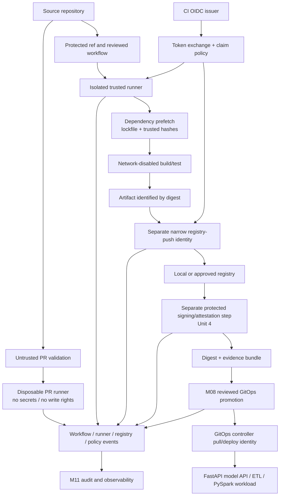

# Unit 5 — Build Isolation and Short-Lived CI Identities

**Target file:** `05-build-isolation-and-short-lived-ci-identities.md`  
**Module:** M12 — Production Security and Software Supply Chain  
**Estimated time:** 14–20 hours for all nine labs; 7–9 hours for the core audit/identity/isolation path  
**Prerequisites:** M01–M11, especially M01 local registry and BuildKit, M02 CI/CD and local runner simulation, M04 NetworkPolicy/egress, M08 GitOps, M09 Unit 7 federation mechanisms, M10 incident response, and M11 telemetry  
**Core tools:** Python 3 standard library, Git, Docker or compatible container runtime, BuildKit/Buildx where available, local registry and local CI simulation from M01/M02, shell utilities  
**Awareness tools:** actionlint, zizmor, OPA/Conftest, Buildah, Kaniko, Bazel, Nix, Loki/Prometheus/Alertmanager, cloud OIDC federation, organization-level required workflows  
**Last reviewed:** 2026-10-29  
**Tool/spec baseline assumed:** Provider-specific examples use GitHub Actions as an illustration. Do not assume claim names, token lifetimes, event semantics, runner features, or organization controls are universal. Check installed tool versions and current official documentation before execution.  
**Footprint:** Keep the core lab under a few hundred MB of local source/fixtures plus the already-installed container runtime and a small test image. Image pulls and local registry use can consume more. Check `df -h`, `docker system df`, `docker images`, and `docker ps -a` before and after. The 30 GB free-disk target is a planning constraint, not a measured guarantee.  
**Needs internet at lab time:** Internet is needed to obtain tools, base images, and authoritative documentation. The deterministic Python audit, JWT-claims fixture tests, cache tests, incident event parser, and synthetic evidence tests can run offline after the files are saved. For offline work, pre-download tools and dependencies from official sources, verify them using an independently obtained checksum/signature, and retain the source/version metadata. A checksum downloaded from the same compromised channel is not an independent trust anchor.

> **Safety boundary:** Use only your own toy repository and local lab. Every credential is fake and disposable. Do not use real secrets, production tokens, cloud credentials, third-party repositories, or external targets. Do not mount the host Docker socket into a build container. Any secret/cache/egress exercise uses benign marker files and must prove a control blocks or detects the attempt.

## 5.0 Why this matters in production

A build system is a high-value security boundary because it can read source, resolve dependencies, consume credentials, and produce artifacts that later become production workloads. If an attacker can influence a build or its environment, they may not need to compromise production directly: they can try to influence the artifact that the platform already trusts.

For a data/ML platform, the build may package a FastAPI model-serving API, an ETL image, a PySpark job, model-loading code, dependency wheels, or a notebook runtime. A poisoned build can affect data-store access, model artifacts, training outputs, or production inference. The relevant asset is not only the source repository; it includes the runner, cache, dependency mirror, registry, signing step, GitOps repository, identity issuer, and audit records.

The core design rule is **separate untrusted validation from trusted release execution**. A fork pull request may run tests, but should not receive secrets, write-capable credentials, production registry access, or a runner that retains state from trusted builds. A protected release build should run in an isolated environment, use narrow short-lived identity, verify dependencies and tools, produce a digest-addressed artifact, and hand the artifact to a separate signing/promotion path.

A short-lived credential reduces the time window in which a stolen token can be reused; it does not make the token harmless while valid. Isolation, least privilege, egress controls, cache separation, identity constraints, and audit remain necessary. Similarly, a green configuration audit is evidence about the supported subset of files, not proof that every pipeline is secure.

This unit applies M02’s CI/CD controls and M09 Unit 7’s identity mechanisms to the security architecture of the build platform. It does not re-teach CI fundamentals, the OIDC/JWKS/Vault implementation tutorial, image signing mechanics (Unit 4), or SLSA requirements (Unit 10).

## 5.1 Learning objectives

After completing the module, the learner can:

1. **[L1]** Draw a CI threat model identifying assets, trust boundaries, attacker-controlled inputs, identities, and blast radius.
2. **[L1]** Distinguish untrusted pull-request execution from trusted protected-ref/release execution and explain poisoned pipeline execution (PPE).
3. **[L2]** Harden a supported CI configuration for permissions, action pinning, trigger safety, approvals, timeouts, retention, and action allow-listing.
4. **[L2]** Demonstrate disposable build workspaces, no shared writable state across trust tiers, no Docker socket mount, and a documented egress boundary.
5. **[L2]** Use BuildKit secret mounts where supported and prove that a fake secret marker is not placed in image layers, logs, caches, or artifacts.
6. **[L2]** Validate a synthetic token-claims record against expected issuer, audience, subject/repository, protected ref, environment, and expiry, while explaining that the fixture is not a bearer token or real federation.
7. **[L2]** Separate build, registry-push, signing, and GitOps deployment/pull identities by capability.
8. **[L3]** Implement dependency prefetch and integrity verification followed by a network-disabled build/test step, and distinguish hermeticity from reproducibility.
9. **[L3]** Demonstrate cache trust-tier separation and reject a synthetic cache artifact written by an untrusted job.
10. **[L3]** Verify a tool or harmless fixture against an independently trusted digest/signature source and detect one-byte tampering.
11. **[L4]** Run a CI compromise tabletop, activate a documented kill-switch, preserve evidence, and measure local time-to-contain.
12. **[L4]** Explain which local tests support a production claim, which only simulate provider behavior, and what additional evidence a trusted-builder design requires.

## 5.2 Concept map and vocabulary

### 5.2.1 Terms

| Term | Meaning in this unit |
|---|---|
| Pipeline | The ordered automation that validates source, resolves dependencies, builds/tests artifacts, and may publish evidence or artifacts. |
| Runner/build agent | The execution environment in which a job’s commands run. Its isolation and residual state are part of the trust model. |
| Trust tier | A group of jobs with similar trust level and permissions, such as untrusted PR validation versus protected release builds. |
| Protected ref | A branch or tag whose updates are controlled by repository policy and review. Exact enforcement is provider-specific. |
| Poisoned pipeline execution (PPE) | Attacker-controlled changes or inputs influence a privileged pipeline execution, potentially exposing credentials or altering outputs. |
| Ephemeral runner | A runner created for a job or short lifecycle and destroyed afterward. Ephemeral lifecycle reduces residual state but does not itself prove strong isolation. |
| Hermetic build | A build whose inputs and permitted interactions are controlled so undeclared external state/network access cannot silently change the result. |
| Reproducible build | A build for which independent executions under specified conditions produce bit-for-bit identical outputs. This is stronger than merely disabling network access. |
| Cache poisoning | An untrusted writer changes cached data later consumed by a trusted build. |
| OIDC | OpenID Connect, an identity layer over OAuth 2.0; here it can provide job identity for short-lived credential exchange. |
| JWT | JSON Web Token, a claims container often signed by an issuer. A valid signature alone does not mean a token is authorized for a target service. |
| Issuer | The identity provider that asserts a token’s claims. |
| Audience | The intended recipient of a token. A verifier should reject tokens minted for another audience. |
| Subject/claims | Identity attributes asserted by the issuer. Exact names and meanings depend on the provider and token version. |
| Federation | A trust relationship allowing an external identity to obtain a target-specific credential without storing a long-lived secret in CI. |
| Short-lived credential | A credential with a limited validity interval. It still requires narrow permissions and protected use. |
| Build provenance | An authenticated claim about where/how an artifact was produced. Unit 10 teaches the SLSA requirements; this unit protects the process that would produce trustworthy provenance. |
| Blast radius | The set of artifacts, systems, data, or identities a compromised job could affect. |
| Kill-switch | A tested response action that stops promotion or revokes/disables a compromised trust path. |
| BuildKit secret mount | A BuildKit mechanism that exposes a secret to a specific build instruction without treating it as a build argument or ordinary environment variable. It still must not be copied into output or logs. |
| Dependency prefetch | Downloading required dependencies before a network-restricted build step, then checking them against a trusted lock/checksum source. |
| Static audit | Inspection of configuration text without executing the workflow. It can flag patterns but cannot prove runtime semantics or all YAML behavior. |
| Trusted builder | A build platform whose control plane and execution boundary are trusted to run the intended build and produce accurate evidence, not merely a script that claims success. |

### 5.2.2 OWASP CI/CD risk taxonomy

OWASP’s **Top 10 CI/CD Security Risks** lists these categories: insufficient flow control mechanisms; inadequate identity and access management; dependency chain abuse; poisoned pipeline execution (PPE); insufficient pipeline-based access controls (PBAC); insufficient credential hygiene; insecure system configuration; ungoverned usage of third-party services; improper artifact integrity validation; and insufficient logging and visibility. The names and project status are version-sensitive: verify the current primary OWASP page before quoting them as a current edition. This is a CI/CD-specific taxonomy, not the OWASP Web Application Top 10.

The taxonomy helps organize controls, but it does not rank the risk of a particular pipeline. Prioritize based on the asset, attacker access, likelihood, impact, existing controls, and evidence from tests.

### 5.2.3 Long-lived versus short-lived credentials

| Pattern | Example | Risk and trade-off |
|---|---|---|
| Long-lived static secret | Registry password stored as a repository secret | Can be reused until rotated; may leak into logs, process environments, artifacts, or runner residue. |
| Short-lived federated credential | Job identity exchanged for a narrow registry token | Limits lifetime and can bind to claims, but a compromised job can still misuse it while valid. |
| Signing identity | Protected signing job or service identity | Must not be available to untrusted build scripts. Signature mechanics are Unit 4; identity isolation is taught here. |
| Deployment/pull identity | GitOps controller’s identity pulling the approved artifact | Should be separate from the CI identity that builds or pushes. CI should not need cluster-admin merely to publish an image. |

### 5.2.4 Sequence diagram

```text
Protected CI job
  | requests identity token for a specific audience
  v
CI OIDC issuer
  | signs claims (issuer, subject, repository/ref/workflow/environment as supported)
  v
Token exchange / trust policy
  | validates issuer + audience + subject/claims + expiry + target scope
  v
Short-lived registry/Vault credential
  | narrow permissions, short expiry, audit event
  v
Only the required operation (for example, push to one repository path)
  |
  +--> expiry / revocation / policy denial
```

Do not log the bearer token or print its full payload in ordinary CI logs. Inspect only a sanitized claims fixture or provider-approved redacted diagnostics. Claim names, token lifetime, audience requirements, and exchange behavior are provider-specific `[VERIFY]`.

## 5.3 Level 1 — Beginner: Foundations

### 5.3.1 Threat model the build path

Start with the data/ML release path:

```text
Source repository
   |-- untrusted PR validation (no secrets, no write rights)
   |
   `-- protected release workflow
          |
          v
     isolated ephemeral runner
          |
          +--> dependency prefetch + integrity check
          +--> network-restricted build/test
          |
          v
     image digest --> separate registry-push identity
          |
          v
     separate signing/attestation step (Unit 4)
          |
          v
     M08 GitOps promotion/deployment pull identity
          |
          v
     running FastAPI / ETL / PySpark workload
```

Assets include source and workflow definitions, fake or real secrets, runner filesystem/processes, dependency caches, registry credentials, signing authority, model/data artifacts, and audit evidence. Trust boundaries exist between contributor-controlled source and protected workflow logic, between PR and release runners, between build and signing, and between CI and deployment.

A basic threat table:

| Asset / boundary | Attacker-controlled input | Threat scenario | Preventive control | Detection signal | Recovery | Residual risk |
|---|---|---|---|---|---|---|
| Protected workflow | PR edits workflow/script invoked by trusted workflow | PPE makes privileged job run attacker-controlled logic | Protected workflow definitions, required review, split untrusted/trusted workflows | Workflow diff, unexpected permission/trigger change | Freeze promotion, revert, inspect runs | Reviewer or protected branch compromise |
| Runner filesystem | Previous job/cache/workspace | Secret or poisoned artifact persists to next job | Ephemeral single-use runner; clean workspace | Lifecycle logs, marker test | Destroy runner, rotate affected credentials | Host-level compromise outside container boundary |
| Registry | Build output | Untrusted job publishes image used by release | Separate push identity and repository scope | Unexpected push event | Freeze promotion, identify digest, rebuild | Registry/admin compromise |
| Signing identity | Build script or PR job | Untrusted code can request signing | Separate protected signing job; no key access in build | Unexpected signer event | Disable trust, investigate digests | Compromised protected workflow |
| Dependency source | Package index/mirror/cache | Unexpected package or tool substituted | Lockfile, hash verification, approved mirror | Hash mismatch or egress denial | Quarantine build, update dependency through review | Trusted expected hash can itself be wrong |
| Audit system | Job/event logs | Events missing or secret values captured | Redaction, least privilege, durable audit sink | Telemetry gap/secret marker detected | Preserve raw safe evidence; rotate exposed secret | Audit platform compromise |

### 5.3.2 Untrusted versus trusted execution

Untrusted jobs include fork PRs and feature branches whose authors can change source, tests, scripts, build files, package metadata, and workflow inputs. Trusted jobs should only execute code after the repository’s protected-ref and review controls are satisfied. A protected branch does not magically make every dependency or build input trustworthy; it only changes the trust assumptions around the source ref.

GitHub Actions is an example, not a universal model. `pull_request` and `pull_request_target` have different security contexts. `pull_request_target` can be useful for metadata/labeling operations, but a workflow combining privileged context/secrets with checkout or execution of PR-controlled code is dangerous. Do not treat the trigger name alone as proof of safety; inspect the whole job and what it executes.

Safe pattern: an untrusted PR workflow runs tests with read-only/no secret permissions and isolated workspace. A separate protected-branch workflow performs release actions after review and only on a protected ref. Never “solve” a failed PR check by adding production secrets to the PR job.

### 5.3.3 Build isolation

Isolation has layers:

- **Process/workspace:** clean checkout and disposable workspace; no residual files or processes from previous jobs.
- **Container:** limits filesystem/process view but shares the host kernel; not equivalent to a VM or microVM.
- **VM/microVM:** stronger separation in many designs, at higher provisioning and operational cost; still requires hardening.
- **Network:** only required registries/mirrors and identity endpoints are reachable.
- **Identity:** job receives only the permissions needed for its specific action.
- **Cache:** untrusted writers cannot influence cache entries trusted builds consume.
- **Lifecycle:** runner and temporary credentials are destroyed/revoked after the job.

Never mount `/var/run/docker.sock` into an untrusted job as a convenience shortcut. Access to a host Docker socket can effectively grant host-level authority in many configurations. Prefer rootless builds where feasible, and use VM-level isolation for higher-risk public/untrusted workloads when supported.

### 5.3.4 Secrets in builds

Never pass credentials through Docker build arguments, Dockerfile `ENV`, source files, image layers, caches, logs, or artifacts. Build arguments and environment variables may persist in image metadata or layers and are not appropriate secret channels. BuildKit secret mounts are a better mechanism when supported, but they are not magic: a command can still copy the secret into an output file or print it.

Illustrative Dockerfile fragment (BuildKit syntax; verify the installed Docker/BuildKit version):

```dockerfile
# syntax=docker/dockerfile:1
FROM python:3.12-slim
WORKDIR /app
COPY requirements.lock .
RUN --mount=type=secret,id=package_token \
    test -s /run/secrets/package_token && \
    python -m pip download --require-hashes -r requirements.lock -d /wheels
COPY src/ ./src/
```

This is a pattern, not a complete application build. The lock file must contain supported hash-pinned requirements and the chosen pip/tool versions must support the syntax. The token is not automatically safe if the build command echoes it or copies `/run/secrets/package_token` into the image. Prefer dependency prefetch outside the final image build when possible.

### 5.3.5 Hermetic versus reproducible

A hermetic build controls inputs and disallows undeclared network/environment dependencies. A reproducible build aims for independent builds to produce identical bytes. A network-disabled build is a useful control, but it is not automatically reproducible: timestamps, filesystem ordering, compiler versions, generated metadata, locale, CPU features, and nondeterministic tool behavior can still differ.

## 5.4 Level 2 — Intermediate: Working Practice

### 5.4.1 Pipeline hardening baseline

Reuse M02 rather than relearning it. Review each workflow for:

- least-privilege permissions; read-only by default where supported;
- third-party actions pinned to full immutable commit SHA where the platform supports it;
- no secrets or write-capable tokens in untrusted PR jobs;
- protected branches/tags and required review for workflow changes;
- environment-scoped secrets and approval gates for release operations;
- explicit job/workflow timeout and concurrency controls;
- artifact retention appropriate to evidence and data sensitivity;
- runner class declared per trust tier;
- third-party action allow-list and reviewed update process;
- digest-addressed artifacts and separate push/sign/deploy roles;
- no persistent runner or cache shared across trust tiers without an explicit, tested isolation boundary.

Organization-level rulesets, required workflows, allowed-action lists, environment approvals, runner groups, and ephemeral runner features are provider- and plan-specific `[VERIFY]`. This module provides a local audit simulation, not a claim that a local Git repository enforces hosted branch protection.

### 5.4.2 Safe illustrative GitHub Actions workflow

The following is an **illustrative provider-specific example**. It is not the required local lab substrate and is not execution-verified. Confirm syntax, current runner behavior, action SHAs, environment protection, and permissions against official GitHub documentation before use. Replace `REPLACE_WITH_REVIEWED_40_HEX_COMMIT_SHA` with a verified immutable commit SHA; the placeholder deliberately prevents copy-paste use as if it were pinned.

```yaml
name: local-ci-security-example

on:
  pull_request:
  push:
    branches: ["main"]

permissions:
  contents: read

concurrency:
  group: ci-${{ github.workflow }}-${{ github.ref }}
  cancel-in-progress: true

jobs:
  validate:
    # Untrusted validation: no secrets, no registry push, no signing.
    if: github.event_name == 'pull_request' || github.ref == 'refs/heads/main'
    runs-on: ubuntu-latest
    timeout-minutes: 10
    permissions:
      contents: read
    steps:
      - name: Checkout
        uses: actions/checkout@REPLACE_WITH_REVIEWED_40_HEX_COMMIT_SHA
      - name: Run local tests
        run: python -m unittest discover -s tests -v

  release:
    # In production, enforce protected-ref/review policy outside this YAML too.
    if: github.event_name == 'push' && github.ref == 'refs/heads/main'
    needs: validate
    runs-on: ubuntu-latest
    environment: protected-release
    timeout-minutes: 15
    permissions:
      contents: read
      # id-token: write belongs only on a job that needs federated identity.
      # Add it only after the target trust policy and audience are verified.
    steps:
      - name: Checkout
        uses: actions/checkout@REPLACE_WITH_REVIEWED_40_HEX_COMMIT_SHA
      - name: Placeholder for digest-addressed build
        run: echo "Replace with reviewed build and registry workflow"
```

The `echo` placeholder is deliberately non-deploying. Do not add registry credentials, signing keys, or deployment tokens to the validation job. The example shows a separation boundary, not a complete production release workflow. The release job needs a concrete protected environment configured in the provider; a YAML name alone does not create approvals.

### 5.4.3 Local workspace bootstrap

Use a dedicated directory and synthetic marker:

```bash
mkdir -p "$HOME/m12-unit5-lab"/{repo,fixtures,cache-untrusted,cache-trusted,evidence,tools}
chmod 700 "$HOME/m12-unit5-lab"
cd "$HOME/m12-unit5-lab"

python3 --version
git --version
docker version  # if Docker is installed
docker system df
df -h .
```

Save a fake marker only:

```bash
printf '%s\n' 'SYNTHETIC_SECRET_MARKER_DO_NOT_USE' > fixtures/fake-secret.txt
chmod 600 fixtures/fake-secret.txt
```

Never substitute a real token. Use the fake marker to verify whether it appears in logs, images, caches, or artifacts. If it appears, stop the lab and treat the boundary as failed.

### 5.4.4 Audit supported workflow configuration

The audit script in Lab 1 is intentionally a limited line-oriented checker for a documented subset of YAML. It does not parse arbitrary YAML semantics, resolve reusable workflows, evaluate expressions, or prove runtime security. Use a full YAML parser and policy engine in production. The deterministic local checker is useful because it reports the same findings for the same files and fixtures.

## 5.5 Level 3 — Advanced: Production Engineering

### 5.5.1 Trust tiers and permissions matrix

| Capability | Untrusted PR validation | Trusted build | Registry push step | Signing/attestation step | GitOps controller / deployment pull | Audit collector |
|---|---|---|---|---|---|---|
| Read source | PR checkout only | Protected ref | Usually not required | Only required release metadata | GitOps repo/manifests | No source secrets |
| Execute PR-controlled code | Yes, isolated | No, unless protected/reviewed source | No | No | No | No |
| Read secrets | None | Only specific build-time secret via safe mount, if unavoidable | Short-lived push credential only | Separate protected signing authority | Pull/deploy identity only | No |
| Push image | No | Prefer no; pass digest/output to push step | Narrow repository/path only | No | No | No |
| Sign artifact | No | No | No | Yes, only approved digest | No | No |
| Deploy to cluster | No | No | No | No | Controller reconciles approved GitOps state | No |
| Write shared cache | Untrusted cache namespace only | Trusted namespace only | No | No | No | No |
| Access arbitrary internet | Deny/restrict | Allow-list only | Registry endpoints only | Required signing/identity endpoints only | Required GitOps/registry endpoints | Telemetry endpoints only |
| Retain state after job | No | No | No | Minimal audit only | Controller-managed | Audit retention policy |

Separate build, push, signing, and deployment identities. A build job should not need cluster-admin. In a pull-based GitOps flow, CI publishes a digest and a reviewed promotion change; the GitOps controller’s identity performs reconciliation/pull. Signing mechanics are Unit 4; Unit 5 ensures untrusted build code cannot access that signing authority.

### 5.5.2 Protected workflow definitions and PPE variants

PPE may be direct or indirect:

- **Direct:** a PR edits a workflow that will execute with privileged context.
- **Indirect:** a trusted workflow invokes a script, Makefile, test, package hook, or build file that a PR can alter.
- **Dependency-mediated:** a changed dependency or build plugin executes during a privileged step.
- **Cache-mediated:** untrusted job writes cache data later consumed by trusted release build.
- **Runner-persistence:** a previous untrusted job leaves files, processes, credentials, or altered tooling for the next job.

Mitigations: separate workflows and runner pools; keep release workflow definitions controlled; require review for CI config; do not execute untrusted source with trusted credentials; isolate caches; use minimal permissions; constrain network egress; use disposable workspaces; protect signing and publishing steps; and test the negative case. A reviewed workflow can still invoke untrusted scripts or dependencies, so review must include the transitive execution path.

### 5.5.3 Runner isolation trade-offs

- **Container-per-job:** cheap and convenient, but shares the host kernel; do not treat it as a strong boundary against hostile kernel-level behavior.
- **Rootless BuildKit/Buildah:** can reduce the need for privileged daemon access; feature parity, networking, and performance vary `[VERIFY]`.
- **VM per job:** stronger separation of kernel and filesystem state, with additional provisioning cost and slower startup.
- **MicroVM/sandbox:** can reduce cross-tenant blast radius in some platforms; operational complexity and compatibility vary.
- **Persistent self-hosted runner:** carries residue risk; avoid for public/untrusted PRs unless a separately reviewed isolation architecture exists.
- **WSL2:** useful for the local learning path but not proof of hosted runner isolation, kernel policy, or cloud OIDC behavior. If a kernel capability or egress rule is unavailable, use a fixture simulation and record the missing evidence.

Never run a privileged container or expose a real host socket to demonstrate a negative case. The unsafe pattern is explained, not executed on the learner’s host.

### 5.5.4 Egress and dependency chain controls

Allow only required registries, approved mirrors, identity endpoints, and required package sources. DNS and proxy restrictions can be bypassed if the environment has alternate network paths; test from the actual build namespace and document what is controlled. In the lab, a harmless request to a deliberately unconfigured endpoint should fail because the network is disabled or an allow-list denies it. Do not attempt external exfiltration.

Dependency controls include committed lockfiles, expected hashes from a trusted review path, approved mirrors, dependency update review, pinned tool versions, and an offline build phase. A hash proves that bytes match an expected hash; it does not prove the expected hash is trustworthy. A malicious dependency can be correctly hash-pinned after a compromised update process approves it.

### 5.5.5 Cache trust policy

Cache data is an input. A cache key alone is not an authorization boundary. Separate cache namespaces by trust tier and ensure untrusted jobs cannot write entries consumed by trusted jobs. For each cached artifact, decide whether it is merely a performance hint or a trusted build input. Verify integrity and reject unknown/untrusted metadata. The safest cache policy is to make cache misses slower, not to let cache state change build semantics.

### 5.5.6 Tool integrity and bootstrap of trust

For downloaded tools such as scanner, cosign, Syft, compilers, or build frontends:

1. pin a version and source;
2. obtain the expected checksum or signature verification key from an independently trusted official channel;
3. verify bytes before execution;
4. retain version/source/check result in `versions.txt`;
5. test that one-byte tampering fails;
6. update through reviewed changes and re-run the tests.

If the binary and checksum are downloaded from the same compromised endpoint, the checksum alone is not a sufficient trust anchor. The trust chain must begin somewhere: official release metadata, a previously trusted key, a pinned digest in reviewed source, or an independently controlled mirror. Do not fabricate a real tool version or checksum in a teaching example; use a local harmless fixture with a digest generated and recorded during the lab.

### 5.5.7 OIDC trust-policy claims

A verifier should validate issuer, audience, subject/identity claims, expiry/not-before semantics where applicable, and the target resource’s authorization policy. It should also bind to the repository, protected ref, environment, and workflow identity when those claims are supported and meaningful. Exact claim names differ by provider and token version `[VERIFY]`.

A broad wildcard such as “any repository from this organization” can accidentally accept feature branches, forks, or unrelated workflows. Prefer exact or narrowly constrained identities and protected release contexts. Do not print a live token to inspect it; use a sanitized claims fixture or provider-approved diagnostics with the bearer token redacted.

A valid JWT signature proves the issuer signed the claims under its key, not that the subject is allowed to push to a particular registry path. Token issuance and target authorization are separate checks.

### 5.5.8 Trusted provenance boundary

A build script should not be able to forge authoritative provenance or access the identity that signs it. Provenance must be generated by a trusted build platform/control plane or an isolated, protected attestation step that observes build execution and binds evidence to the artifact digest. If a script controls both the claim and the identity that authenticates the claim, the result may be self-asserted rather than independently trustworthy.

Unit 10 defines SLSA/provenance expectations. This unit prepares the conditions for credible evidence: protected workflow definitions, isolated builder, known inputs, dependency integrity, short-lived job identity, and separation of duties.

## 5.6 Level 4 — Expert: Operating at Scale and Under Failure

### 5.6.1 Pipeline security program

Establish a versioned baseline, policy owner, exception process, review cadence, and evidence retention policy. Use the local audit script as a teaching implementation, then migrate to a real parser/policy engine after validating coverage. Optional tools such as actionlint, zizmor, OPA, and Conftest are not required for core completion; verify their current installation instructions, flags, and policy capabilities before use.

Organization-level required workflows, action allow-lists, protected environments, rulesets, required reviewers, runner groups, and managed ephemeral runners are production controls, but availability varies by provider and plan `[VERIFY]`. A local branch-protection simulation is not equivalent to provider-side enforcement. Document the exact provider settings and retain evidence from the provider UI/API for a production review.

### 5.6.2 Compromise kill-switch and recovery

On suspected CI compromise:

1. Freeze promotion/release, not necessarily every non-production validation job.
2. Disable or revoke the affected federation trust/Vault role or token-exchange path.
3. Disable unsafe runner registration and isolate/destroy affected runners.
4. Rotate exposed registry credentials and signing identities as applicable; do not rotate unrelated credentials without scope analysis.
5. Preserve sanitized workflow logs, runner lifecycle records, registry events, policy changes, and affected digests.
6. Identify every artifact that could have been built, pushed, signed, or promoted by the affected trust path.
7. Rebuild from a clean, trusted builder and verify the new digest and evidence.
8. Reconcile running deployments and model/data artifacts; use M08 GitOps rollback/re-promotion controls.
9. Measure local time-to-contain, document assumptions, and hold a postmortem with M10 roles.

Do not delete evidence before preservation. Do not assume rotating a token removes already-published malicious artifacts. A kill-switch should be tested in a disposable environment and have an owner, authorization path, and recovery criteria.

### 5.6.3 Separation of duties and small teams

Ideal separation is author ≠ reviewer/approver ≠ release/signing authority. Small teams may not have enough people for fully independent roles; compensating controls can include protected branches, mandatory second-person review for workflow/identity changes, delayed promotion, independently stored audit logs, and time-limited exceptions. State the residual risk instead of claiming full independence.

### 5.6.4 Metrics

Define each metric’s numerator, denominator, window, owner, and collection method. Do not invent universal targets.

| Metric | Definition | Collection | Limitation |
|---|---|---|---|
| Workflow baseline pass rate | Workflows passing required checks / workflows in scope | Static audit JSON, versioned inventory | Depends on supported syntax and inventory completeness |
| Untrusted-job isolation coverage | Untrusted jobs with no secrets/write permissions and assigned isolated runner/cache / all untrusted jobs in scope | Workflow audit + runner policy evidence | Static config cannot prove runtime host isolation |
| Ephemeral runner coverage | Release jobs completed on verified disposable runners / release jobs in window | Runner lifecycle events | “Ephemeral” label alone does not prove cleanup |
| Dependency/tool integrity coverage | Critical dependencies/tools with verified expected hashes/signatures / critical dependencies/tools in scope | Build logs and `versions.txt` | Expected values can be compromised upstream |
| Short-lived identity adoption | Privileged jobs using approved short-lived credentials / privileged jobs in scope | Provider audit logs and policy inventory | Token lifetime does not prove least privilege |
| Egress denial signal | Denied unexpected egress attempts, grouped by job/tier | Firewall/proxy/NetworkPolicy events | No events may mean no attempt or missing telemetry |
| Cache isolation coverage | Trusted cache consumers isolated from untrusted writers / trusted cache consumers | Cache ACL and pipeline tests | Cache namespace alone may not enforce writer permissions |
| Time to revoke trust | Time from confirmed compromise decision to effective trust disablement | UTC incident timeline | Depends on detection and decision latency |
| Time to contain | Time from first confirmed signal to stopping affected promotion/trust path | UTC incident timeline | Laptop timing is not a production SLO |
| False-positive/negative rate | Findings reviewed as false positive/negative divided by reviewed findings | Periodic audit review | Requires consistent labels and sampling |

### 5.6.5 Failure modes and contingency

| Failure | Default decision | Controlled contingency |
|---|---|---|
| OIDC issuer/token exchange unavailable | Fail closed for privileged push/sign/deploy operations | Delay release; use an alternate pre-approved path only if its trust policy and audit are tested |
| Registry unavailable | Do not claim push/promotion succeeded | Retry with bounded backoff; preserve digest/evidence; avoid silently changing registry |
| Cache corruption | Ignore cache and rebuild from verified inputs | Recreate isolated cache after evidence capture |
| Runner provisioning fails | Delay trusted build | Use a pre-approved isolated runner pool; never fall back to a shared persistent runner without risk approval |
| Audit pipeline outage | Preserve local sanitized logs and pause high-risk promotion if required evidence cannot be retained | Bounded local spool with access control and replay; document retention gap |
| Signing identity revoked | Freeze promotion | Re-authorize only through Unit 4’s controlled signing path |
| Trust policy lockout | Fail closed, page policy owner | Versioned rollback to last known-good policy with approval and audit |
| Emergency release request | Do not silently bypass controls | Time-limited break-glass approval, compensating verification, exact digest, named owner, expiry, and post-release review |

## 5.7 End-to-end reference architecture

### 5.7.1 Architecture



The diagram is conceptual. A real provider may combine or split these steps, but the authority boundaries must remain explicit. The OIDC issuer and token exchange are separate from the build process; only jobs that need a specific federated credential should be able to request it.

### 5.7.2 Threat boundaries

1. **Contributor boundary:** PR code and PR-controlled scripts are untrusted.
2. **Workflow-control boundary:** protected workflow definitions and required review determine which commands may receive trust.
3. **Runner boundary:** job filesystem/process/network and host/kernel isolation.
4. **Dependency boundary:** packages, tools, base images, caches, mirrors, and build inputs.
5. **Credential boundary:** short-lived identity issuance and target resource authorization.
6. **Artifact boundary:** image digest, registry push, signing, attestations, and promotion.
7. **Deployment boundary:** GitOps controller pulls and deploys only reviewed digest references.
8. **Audit boundary:** logs and evidence must be retained without leaking credentials.

### 5.7.3 Permissions matrix

| Role | Allowed | Must not receive |
|---|---|---|
| Untrusted PR job | Read source needed for validation; write only to its disposable workspace/untrusted cache | Secrets, registry push, signing, production deploy, trusted cache write |
| Trusted build job | Read protected source; resolve approved inputs; build/test in isolated runner | Cluster-admin, signing private key, broad registry admin |
| Registry-push step | Push only to approved repository/path with short-lived credential | Signing authority, cluster credentials, broad registry delete/admin |
| Signing step | Sign/attest approved digest using protected identity | Untrusted PR code, broad arbitrary build execution |
| GitOps controller | Read GitOps state and pull approved images; reconcile permitted namespaces | CI build credentials or signing private key |
| Audit collector | Read sanitized audit events and append to protected storage | Job secrets, write access to workflow/release policy |

### 5.7.4 What controls prove

| Control | What a positive/negative test can show | What it cannot prove alone |
|---|---|---|
| Static workflow audit | Known risky patterns are flagged in the supported syntax subset | Complete YAML semantics, provider runtime behavior, or absence of every risk |
| Ephemeral workspace | A benign marker from job A is absent from job B’s workspace | VM-level isolation or protection against host compromise |
| Egress restriction | A test request to a blocked destination fails from the tested network context | Every possible egress route is blocked unless the full path is measured |
| OIDC claims fixture | Local policy rejects wrong issuer/audience/subject/ref/environment/expiry in the model | Real provider signature validation or actual cloud federation |
| Cache isolation | Trusted job rejects/ignores an untrusted marker artifact | Security of every external cache backend |
| Network-disabled build | Build succeeds with prefetched inputs and fails on unexpected network dependency | Bit-for-bit reproducibility |
| Tool checksum | Local bytes match an expected digest | Trustworthiness of the expected digest source |
| Kill-switch drill | The documented local response stops simulated promotion and records evidence | Production containment speed or complete provider control coverage |

## 5.8 Hands-on labs

All labs are zero-budget and local. The core scripts use Python’s standard library. Use the M01 local registry and M02 local CI simulation where available, but do not require a hosted CI account. Save evidence under the proposed workspace; do not create or modify repository files outside the target module just by following this document.

### Lab 1 — CI hardening checklist and configuration audit

**Level/time:** L2–L4, 2–3 hours.  
**Objectives:** Audit permissions, action pinning, risky trigger/checkout patterns, secrets in untrusted jobs, environment protection, runner type, timeouts, artifact retention, and third-party action allow-listing. Produce JSON and human-readable findings.  
**Prerequisites:** Python 3; a disposable directory. No hosted account required.  
**Setup and file tree:**

```text
lab-01/
├── audit_ci.py
├── test_audit_ci.py
├── allowlist.txt
├── workflows/
│   ├── clean.yml
│   └── defects.yml
└── evidence/
```

Create `allowlist.txt` as a list of approved action owner/repository names, one per line. The example allow-list is synthetic; adjust only after review.

```text
actions/checkout
actions/setup-python
```

Create `workflows/clean.yml`:

```yaml
name: clean-example
on:
  push:
    branches: ["main"]
permissions:
  contents: read
jobs:
  test:
    runs-on: ubuntu-latest
    timeout-minutes: 10
    steps:
      - uses: actions/checkout@0123456789abcdef0123456789abcdef01234567
        with:
          persist-credentials: false
      - run: python -m unittest discover -s tests -v
```

The SHA is a syntactically shaped placeholder, not a verified action revision. It is only a fixture for the checker. In a real workflow, verify the commit SHA and source repository.

Create `workflows/defects.yml` with at least ten planted misconfigurations:

```yaml
name: defects-example
on:
  pull_request_target:
  push:
    branches: ["main"]
permissions:
  contents: write
  actions: write
jobs:
  unsafe-pr:
    runs-on: self-hosted
    # missing timeout-minutes
    steps:
      - uses: actions/checkout@main
        with:
          ref: ${{ github.event.pull_request.head.sha }}
          persist-credentials: true
      - run: echo "${{ secrets.FAKE_MARKER }}"
      - run: python build.py
      - uses: unapproved/publish-action@v1
  release:
    runs-on: self-hosted
    steps:
      - run: echo "publishing"
```

This is intentionally unsafe fixture data; do not execute it as a workflow. The fake secret name is not a real secret. It contains more than ten issues: privileged trigger with PR checkout, write permissions, branch-name action ref, untrusted secret reference, persistent self-hosted runner, missing timeouts, no environment protection on release, unapproved third-party action, and credentials persistence.

Create `audit_ci.py`:

```python
#!/usr/bin/env python3
"""Deterministic heuristic audit for a narrow GitHub Actions YAML subset.

This is NOT a general YAML parser and does not prove workflow safety.
It reports evidence and remediation without printing secret values.
Exit: 0 no findings, 1 policy findings, 2 input/parser/tool error.
"""
import argparse
import json
import re
import sys
from pathlib import Path

ACTION_RE = re.compile(r"^\s*-\s*uses:\s*([^\s#]+)", re.M)
RUNNER_RE = re.compile(r"^\s*runs-on:\s*(.+?)\s*$", re.M)
TIMEOUT_RE = re.compile(r"^\s*timeout-minutes:\s*\d+\s*$", re.M)
PERMISSIONS_RE = re.compile(r"^\s*permissions:\s*$", re.M)
SECRETS_RE = re.compile(r"\$\{\{\s*secrets\.[A-Za-z0-9_]+\s*\}\}")
PR_HEAD_RE = re.compile(r"pull_request\.head\.(sha|ref)")
PR_TARGET_RE = re.compile(r"^\s*pull_request_target\s*:", re.M)
ENVIRONMENT_RE = re.compile(r"^\s*environment:\s*\S+", re.M)
RETENTION_RE = re.compile(r"retention-days\s*:", re.M)

def finding(file, rule, severity, evidence, limitation, remediation):
    return {"file": str(file), "rule_id": rule, "severity": severity,
            "evidence": evidence, "limitation": limitation,
            "remediation": remediation}

def audit(path: Path, allowlist: set[str]) -> list[dict]:
    text = path.read_text(encoding="utf-8")
    # Minimal sanity checks for the documented subset; this is not YAML parsing.
    if re.search(r"^\s*\t", text, re.M):
        raise ValueError("tabs in indentation are unsupported")
    if text.count("${{") != text.count("}}"):
        raise ValueError("unbalanced workflow expression delimiters")
    if not text.strip():
        raise ValueError("empty workflow file")
    findings = []
    if not PERMISSIONS_RE.search(text):
        findings.append(finding(path, "CI001", "high", "No explicit permissions block found.",
            "Text scan cannot evaluate inherited organization defaults.",
            "Declare minimal workflow/job permissions and inspect provider defaults."))
    if re.search(r"^\s*(contents|actions|packages|id-token):\s*write\s*$", text, re.M):
        findings.append(finding(path, "CI002", "high", "Write-capable permission found.",
            "A broad regex cannot prove the exact job scope or required operation.",
            "Narrow permissions to the smallest job and capability that needs them."))
    if PR_TARGET_RE.search(text) and (PR_HEAD_RE.search(text) or re.search(r"^\s*-\s*run:", text, re.M)):
        findings.append(finding(path, "CI003", "critical",
            "pull_request_target appears with PR-head reference or executable run step.",
            "Heuristic: manual review is required to determine whether untrusted code is executed.",
            "Do not execute PR-controlled code in privileged context; split metadata and validation workflows."))
    if SECRETS_RE.search(text) and re.search(r"^\s*pull_request\s*:", text, re.M):
        findings.append(finding(path, "CI004", "high", "Secret expression and pull_request trigger both appear.",
            "Text matching cannot determine job reachability or secret availability.",
            "Remove secrets from untrusted PR jobs; use fake markers in tests."))
    if not TIMEOUT_RE.search(text):
        findings.append(finding(path, "CI005", "medium", "No timeout-minutes declaration found.",
            "A workflow-level or platform default may exist outside this file.",
            "Set explicit job timeouts and test cancellation behavior."))
    runners = RUNNER_RE.findall(text)
    if any("self-hosted" in r for r in runners) and re.search(r"^\s*pull_request\s*:", text, re.M):
        findings.append(finding(path, "CI006", "high", "Self-hosted runner and pull_request trigger both appear.",
            "Static text does not prove the runner group or host isolation.",
            "Do not run untrusted PRs on persistent trusted runners; use disposable isolated runners."))
    if re.search(r"^\s*-\s*uses:\s*[^@\s]+@(main|master|v\d+|latest)\s*$", text, re.M):
        findings.append(finding(path, "CI007", "high", "Action reference appears mutable or tag-based.",
            "Some local/reusable references and provider-supported exceptions need separate handling.",
            "Pin third-party actions to a reviewed full immutable commit SHA where supported."))
    if not ENVIRONMENT_RE.search(text) and re.search(r"^\s*name:\s*.*release", text, re.I | re.M):
        findings.append(finding(path, "CI008", "medium", "Release-named workflow has no environment declaration.",
            "Environment protection is configured outside workflow YAML and cannot be proven here.",
            "Use a protected release environment and verify required approvals in provider settings."))
    if not RETENTION_RE.search(text) and re.search(r"upload-artifact|artifact", text, re.I):
        findings.append(finding(path, "CI009", "low", "Artifact usage appears without explicit retention-days.",
            "Not all artifact mechanisms expose this syntax.",
            "Set evidence retention explicitly where supported and avoid storing secrets."))
    for action in ACTION_RE.findall(text):
        owner_repo = action.split("@", 1)[0]
        if "/" in owner_repo and owner_repo not in allowlist and not owner_repo.startswith("./"):
            findings.append(finding(path, "CI010", "medium", f"Action not in allow-list: {owner_repo}",
                "Allow-list is a local policy fixture and does not validate the action's content.",
                "Review source, permissions, maintainer, update path, then allow-list deliberately."))
        if "@" in action:
            ref = action.rsplit("@", 1)[1]
            if not re.fullmatch(r"[0-9a-fA-F]{40}", ref):
                findings.append(finding(path, "CI011", "high", f"Action ref is not a 40-hex commit SHA: {ref}",
                    "Only applies to action references in the supported syntax subset.",
                    "Pin to a verified immutable commit SHA where the ecosystem supports it."))
    return findings

def main() -> int:
    parser = argparse.ArgumentParser()
    parser.add_argument("--workflows", required=True)
    parser.add_argument("--allowlist", required=True)
    parser.add_argument("--json-out", required=True)
    parser.add_argument("--report-out", required=True)
    args = parser.parse_args()
    root = Path(args.workflows)
    if not root.is_dir():
        print("ERROR: workflows path is not a directory", file=sys.stderr)
        return 2
    try:
        allowlist = {x.strip() for x in Path(args.allowlist).read_text(encoding="utf-8").splitlines()
                     if x.strip() and not x.lstrip().startswith("#")}
        files = sorted(root.glob("*.yml")) + sorted(root.glob("*.yaml"))
        results = []
        for file in files:
            results.extend(audit(file, allowlist))
        results.sort(key=lambda x: (x["file"], x["rule_id"], x["evidence"]))
        Path(args.json_out).write_text(json.dumps(results, indent=2) + "\n", encoding="utf-8")
        lines = ["CI CONFIGURATION AUDIT", f"Files scanned: {len(files)}", f"Findings: {len(results)}", ""]
        for item in results:
            lines.append(f"[{item['severity'].upper()}] {item['rule_id']} {item['file']}")
            lines.append(f"  Evidence: {item['evidence']}")
            lines.append(f"  Limitation: {item['limitation']}")
            lines.append(f"  Remediation: {item['remediation']}")
        Path(args.report_out).write_text("\n".join(lines) + "\n", encoding="utf-8")
        return 1 if results else 0
    except ValueError as exc:
        print(f"ERROR: malformed supported-subset input: {exc}", file=sys.stderr)
        return 2
    except (OSError, UnicodeError) as exc:
        print(f"ERROR: {type(exc).__name__}: could not read/write audit inputs or outputs", file=sys.stderr)
        return 2

if __name__ == "__main__":
    raise SystemExit(main())
```

Create `test_audit_ci.py`:

```python
import tempfile
import unittest
from pathlib import Path
from audit_ci import audit

ALLOW = {"actions/checkout", "actions/setup-python"}

class AuditTests(unittest.TestCase):
    def audit_text(self, text):
        with tempfile.TemporaryDirectory() as d:
            p = Path(d) / "workflow.yml"
            p.write_text(text, encoding="utf-8")
            return {f["rule_id"] for f in audit(p, ALLOW)}

    def test_clean_supported_subset(self):
        text = """name: clean
permissions:
  contents: read
jobs:
  test:
    runs-on: ubuntu-latest
    timeout-minutes: 5
    steps:
      - uses: actions/checkout@0123456789abcdef0123456789abcdef01234567
"""
        self.assertEqual(self.audit_text(text), set())

    def test_missing_permissions(self):
        self.assertIn("CI001", self.audit_text("name: x\njobs:\n  a:\n    runs-on: ubuntu-latest\n    timeout-minutes: 1\n"))

    def test_write_permission(self):
        self.assertIn("CI002", self.audit_text("permissions:\n  contents: write\n"))

    def test_pr_target_and_run(self):
        self.assertIn("CI003", self.audit_text("on:\n  pull_request_target:\njobs:\n  x:\n    steps:\n      - run: echo test\n"))

    def test_secret_on_pr(self):
        self.assertIn("CI004", self.audit_text("on:\n  pull_request:\njobs:\n  x:\n    steps:\n      - run: echo ${{ secrets.FAKE_MARKER }}\n"))

    def test_missing_timeout(self):
        self.assertIn("CI005", self.audit_text("permissions:\n  contents: read\njobs:\n  x:\n    runs-on: ubuntu-latest\n"))

    def test_self_hosted_pr(self):
        self.assertIn("CI006", self.audit_text("on:\n  pull_request:\njobs:\n  x:\n    runs-on: self-hosted\n"))

    def test_mutable_action(self):
        self.assertIn("CI007", self.audit_text("permissions:\n  contents: read\njobs:\n  x:\n    timeout-minutes: 2\n    steps:\n      - uses: actions/checkout@main\n"))

    def test_release_without_environment(self):
        self.assertIn("CI008", self.audit_text("name: release\npermissions:\n  contents: read\n"))

    def test_artifact_without_retention(self):
        self.assertIn("CI009", self.audit_text("permissions:\n  contents: read\njobs:\n  x:\n    steps:\n      - run: echo artifact\n"))

    def test_unapproved_action(self):
        self.assertIn("CI010", self.audit_text("permissions:\n  contents: read\njobs:\n  x:\n    steps:\n      - uses: unapproved/publish@0123456789abcdef0123456789abcdef01234567\n"))

    def test_non_sha_action_ref(self):
        self.assertIn("CI011", self.audit_text("permissions:\n  contents: read\njobs:\n  x:\n    steps:\n      - uses: actions/checkout@v4\n"))


    def test_unbalanced_expression_is_input_error(self):
        with tempfile.TemporaryDirectory() as d:
            p = Path(d) / "bad.yml"
            p.write_text("permissions:\n  contents: read\nrun: ${{ broken\n", encoding="utf-8")
            with self.assertRaises(ValueError):
                audit(p, ALLOW)

    def test_empty_workflow_is_input_error(self):
        with tempfile.TemporaryDirectory() as d:
            p = Path(d) / "empty.yml"
            p.write_text("", encoding="utf-8")
            with self.assertRaises(ValueError):
                audit(p, ALLOW)

    def test_tab_indentation_is_input_error(self):
        with tempfile.TemporaryDirectory() as d:
            p = Path(d) / "tab.yml"
            p.write_text("jobs:\n\tname: bad\n", encoding="utf-8")
            with self.assertRaises(ValueError):
                audit(p, ALLOW)

if __name__ == "__main__":
    unittest.main()
```

Run:

```bash
python3 -m unittest -v test_audit_ci.py
python3 audit_ci.py --workflows workflows --allowlist allowlist.txt \
  --json-out evidence/audit.json --report-out evidence/audit.txt
```

**Expected behavior derived from code:** `clean.yml` should not trigger these supported checks; `defects.yml` should produce findings. The audit command returns `1` when findings exist, `0` when none exist, and `2` for an input/tool error. The unit tests assert each rule ID. The checker never prints secret values; it reports only that a secret reference pattern exists.

**Interpretation and limitations:** this checker is a deterministic teaching subset, not a general YAML parser. Its regular expressions can produce false positives and false negatives; it cannot evaluate expression reachability, inherited permissions, reusable workflows, organization policy, runner configuration, or whether a command executes PR-controlled code indirectly. It does not replace provider-side checks or a production parser/policy engine.

**Positive test:** `clean.yml` yields no findings in the supported subset.  
**Negative tests:** the planted defect corpus triggers rules for broad permissions, privileged trigger/PR code, secrets in PR jobs, no timeout, self-hosted runner, mutable action ref, release without environment, missing retention when artifact usage is visible, and action allow-list/pinning.  
**Cleanup:** delete the disposable `lab-01` directory after retaining sanitized JSON/report if needed.  
**Troubleshooting:** if the clean fixture is flagged, compare the rule regex and fixture syntax; do not weaken a rule without adding a regression test. If a known defect is missed, document the blind spot and add a fixture.  
**Evidence:** `evidence/lab-01/audit.json`, `audit.txt`, test output, and a short limitations note.

### Lab 2 — Ephemeral runner and build isolation

**Level/time:** L2–L3, 1–2 hours.  
**Objectives:** Demonstrate disposable workspace, no Docker socket, no host mounts, a fake secret marker unavailable to another job, and a restricted network step.  
**Prerequisites:** Python 3 and shell; Docker is optional.  
**Lab tree:**

```text
lab-02/
├── job_a.sh
├── job_b.sh
├── isolated-build.sh
├── fixtures/fake-secret.txt
└── evidence/
```

Create a disposable workspace and marker:

```bash
mkdir -p lab-02/fixtures lab-02/evidence
printf '%s\n' 'FAKE_RUNNER_SECRET_MARKER' > lab-02/fixtures/fake-secret.txt
chmod 600 lab-02/fixtures/fake-secret.txt
```

`job_a.sh`:

```bash
#!/usr/bin/env bash
set -eu
WORK="${1:?provide a disposable workspace path}"
mkdir -p "$WORK"
printf '%s\n' 'job-a-only-marker' > "$WORK/job-a.txt"
test -f "$WORK/job-a.txt"
printf '%s\n' 'JOB_A_PASS: workspace created'
```

`job_b.sh`:

```bash
#!/usr/bin/env bash
set -eu
WORK="${1:?provide a fresh workspace path}"
if test -e "$WORK/job-a.txt"; then
  printf '%s\n' 'JOB_B_FAIL: previous-job state visible'
  exit 1
fi
if test -e "$WORK/fake-secret.txt"; then
  printf '%s\n' 'JOB_B_FAIL: fake secret marker visible'
  exit 1
fi
printf '%s\n' 'JOB_B_PASS: no prior marker visible'
```

Run with distinct temporary workspaces:

```bash
chmod +x lab-02/job_a.sh lab-02/job_b.sh
A="$(mktemp -d)"
B="$(mktemp -d)"
lab-02/job_a.sh "$A"
lab-02/job_b.sh "$B"
rm -rf "$A" "$B"
```

**Expected deterministic output:** `JOB_A_PASS: workspace created` followed by `JOB_B_PASS: no prior marker visible`. This proves only that two explicitly separate local directories do not share the tested files; it does not prove VM isolation or provider runner behavior.

For Docker/BuildKit where available, build without `--privileged`, without `-v /var/run/docker.sock:...`, and without host filesystem mounts. Inspect the command before execution. Use a rootless builder if supported by the local environment; check `buildctl --version`, `buildctl --help`, or the chosen builder’s official docs. Rootless BuildKit, Buildah, and Kaniko have different capabilities and maintenance status `[VERIFY]`; none is required for the fixture path.

Egress test: prefer a network-disabled build step (`--network=none` where supported by the selected builder, syntax `[VERIFY]`) or an isolated local network whose default denies egress. Attempt only a benign request to an intentionally unconfigured local endpoint. Do not run a public endpoint probe and do not claim WSL2 has enforced an egress boundary unless you inspect the actual route/firewall policy.

**Positive test:** second workspace cannot see first workspace marker.  
**Negative test:** deliberately point job B at job A’s workspace; the test should fail, proving the test detects shared state. Use only the synthetic marker.  
**Cleanup:** remove temp directories and any disposable containers/images.  
**Troubleshooting:** if the marker appears in job B, inspect workspace reuse, bind mounts, caches, and runner lifecycle. If the network-disabled option is unavailable, use the offline fixture and document that live egress restriction was not demonstrated.  
**Evidence:** workspace test output, builder version, container command with secrets redacted, egress decision, and limitations.

### Lab 3 — Poisoned pipeline execution (PPE) simulation

**Level/time:** L2–L3, 1–2 hours.  
**Objectives:** Use a toy repository to demonstrate why untrusted changes must not run in privileged release context; test fake secret, workflow-change, and synthetic image-push attempts.  
**Prerequisites:** Git and Python. No remote repository or hosted CI account.  
**Lab tree:**

```text
lab-03/
├── toy-repo/
│   ├── ci/
│   │   ├── untrusted-validation.sh
│   │   └── protected-release.sh
│   ├── workflow-policy.json
│   └── evidence/
└── fixtures/fake-secret.txt
```

`workflow-policy.json`:

```json
{
  "trusted_ref": "refs/heads/main",
  "untrusted_events_have_secrets": false,
  "untrusted_events_can_push": false,
  "release_requires_reviewed_ref": true
}
```

`untrusted-validation.sh`:

```bash
#!/usr/bin/env bash
set -eu
echo "VALIDATION_ONLY"
if test -n "${FAKE_SECRET:-}"; then
  echo "FAIL: untrusted job received fake secret"
  exit 1
fi
if test "${CAN_PUSH:-false}" = "true"; then
  echo "FAIL: untrusted job has push capability"
  exit 1
fi
echo "PASS: no fake secret and no push capability"
```

`protected-release.sh`:

```bash
#!/usr/bin/env bash
set -eu
REF="${CI_REF:-}"
REVIEWED="${REVIEWED:-false}"
if test "$REF" != "refs/heads/main" || test "$REVIEWED" != "true"; then
  echo "DENY: release requires reviewed protected ref"
  exit 1
fi
if test -z "${SYNTHETIC_IMAGE_DIGEST:-}"; then
  echo "DENY: no digest-addressed artifact"
  exit 1
fi
echo "ALLOW: protected release preconditions satisfied"
```

Run the untrusted validation with no secret or push capability:

```bash
chmod +x lab-03/toy-repo/ci/*.sh
env -u FAKE_SECRET CAN_PUSH=false lab-03/toy-repo/ci/untrusted-validation.sh
```

Then test the denied case using only a fake marker:

```bash
if FAKE_SECRET='FAKE_MARKER_ONLY' CAN_PUSH=false \
  lab-03/toy-repo/ci/untrusted-validation.sh; then
  echo "TEST FAIL: untrusted job accepted fake secret"
else
  echo "TEST PASS: untrusted job rejected fake secret"
fi
```

Test release preconditions:

```bash
CI_REF=refs/heads/feature REVIEWED=false \
  SYNTHETIC_IMAGE_DIGEST=sha256:fixture \
  lab-03/toy-repo/ci/protected-release.sh
```

This command should return nonzero and print the denial. A passing release fixture uses `CI_REF=refs/heads/main REVIEWED=true SYNTHETIC_IMAGE_DIGEST=sha256:fixture`.

The fake `CAN_PUSH` variable is a policy simulation, not a real registry authorization boundary. For a stronger local test, use a local registry with separate credentials/permissions if the selected registry supports them, and prove the untrusted identity cannot push. Do not use a production token.

**Positive tests:** untrusted job passes with no secrets/push rights; reviewed protected-ref release preconditions pass.  
**Negative tests:** fake secret present; feature ref; missing review; missing digest; attempted synthetic push under untrusted identity.  
**Cleanup:** remove toy repo and any local registry test content.  
**Troubleshooting:** a shell variable is not authorization; document whether the test is a policy simulation or an actual registry ACL check.  
**Evidence:** UTC timeline, fake-marker denial, workflow diff, simulated push denial, and scope limitations.

### Lab 4 — Short-lived identity and trust-policy claims

**Level/time:** L2–L3, 1–2 hours.  
**Objectives:** Validate synthetic claims against issuer, audience, repository, protected ref, environment, and expiry; prove rejection of a feature branch, fork-like event, wrong environment, wrong audience, wrong issuer/subject, expired token, and missing claim.  
**Prerequisites:** Python 3 standard library. No real JWT signing, cloud credentials, or identity provider required.  
**Lab tree:**

```text
lab-04/
├── claims_policy.py
├── test_claims_policy.py
├── fixtures/
│   ├── claims-valid.json
│   └── claims-invalid.json
└── evidence/
```

The JSON is a **sanitized claims fixture, not a bearer token**. It cannot authenticate to any service.

`fixtures/claims-valid.json`:

```json
{
  "issuer": "https://issuer.example.invalid",
  "audience": "registry-push",
  "subject": "repo:demo/ml-api:ref:refs/heads/main",
  "repository": "demo/ml-api",
  "ref": "refs/heads/main",
  "environment": "protected-release",
  "workflow": "release.yml",
  "expires_at": 2000000000,
  "issued_at": 1999999700
}
```

`claims_policy.py`:

```python
#!/usr/bin/env python3
"""Policy exercise over synthetic claims; NOT a JWT signature verifier."""
import json
import sys
from pathlib import Path

EXPECTED = {
    "issuer": "https://issuer.example.invalid",
    "audience": "registry-push",
    "repository": "demo/ml-api",
    "ref": "refs/heads/main",
    "environment": "protected-release",
    "workflow": "release.yml",
}

def validate(claims: dict, now: int) -> list[str]:
    errors = []
    for key, value in EXPECTED.items():
        if claims.get(key) != value:
            errors.append(f"{key}_mismatch_or_missing")
    if not isinstance(claims.get("expires_at"), int) or claims["expires_at"] <= now:
        errors.append("expired_or_missing_expiry")
    if not isinstance(claims.get("issued_at"), int) or claims["issued_at"] > now:
        errors.append("invalid_or_missing_issued_at")
    if claims.get("subject") != "repo:demo/ml-api:ref:refs/heads/main":
        errors.append("subject_mismatch")
    return errors

def main():
    if len(sys.argv) != 3:
        raise SystemExit("usage: claims_policy.py CLAIMS.json NOW_UNIX")
    claims = json.loads(Path(sys.argv[1]).read_text(encoding="utf-8"))
    errors = validate(claims, int(sys.argv[2]))
    print(json.dumps({"decision": "DENY" if errors else "ALLOW", "reasons": errors}, indent=2))
    raise SystemExit(1 if errors else 0)

if __name__ == "__main__":
    main()
```

`test_claims_policy.py`:

```python
import unittest
from claims_policy import validate

GOOD = {
    "issuer": "https://issuer.example.invalid", "audience": "registry-push",
    "subject": "repo:demo/ml-api:ref:refs/heads/main", "repository": "demo/ml-api",
    "ref": "refs/heads/main", "environment": "protected-release",
    "workflow": "release.yml", "expires_at": 2000000000, "issued_at": 1999999700
}

class ClaimsTests(unittest.TestCase):
    def test_valid_claims(self):
        self.assertEqual(validate(GOOD, 1999999800), [])
    def test_feature_branch(self):
        x = dict(GOOD, ref="refs/heads/feature", subject="repo:demo/ml-api:ref:refs/heads/feature")
        self.assertIn("ref_mismatch_or_missing", validate(x, 1999999800))
    def test_fork_like_repository(self):
        self.assertIn("repository_mismatch_or_missing", validate(dict(GOOD, repository="fork/ml-api"), 1999999800))
    def test_wrong_environment(self):
        self.assertIn("environment_mismatch_or_missing", validate(dict(GOOD, environment="dev"), 1999999800))
    def test_wrong_audience(self):
        self.assertIn("audience_mismatch_or_missing", validate(dict(GOOD, audience="other"), 1999999800))
    def test_wrong_issuer(self):
        self.assertIn("issuer_mismatch_or_missing", validate(dict(GOOD, issuer="https://wrong.example.invalid"), 1999999800))
    def test_wrong_subject(self):
        self.assertIn("subject_mismatch", validate(dict(GOOD, subject="repo:other/app"), 1999999800))
    def test_expired(self):
        self.assertIn("expired_or_missing_expiry", validate(dict(GOOD, expires_at=100), 1999999800))
    def test_missing_claim(self):
        x = dict(GOOD); del x["workflow"]
        self.assertIn("workflow_mismatch_or_missing", validate(x, 1999999800))

if __name__ == "__main__":
    unittest.main()
```

Run `python3 -m unittest -v test_claims_policy.py`. The tests use fixed timestamps and are deterministic. They do not cryptographically validate a JWT, JWKS, audience exchange, or cloud authorization. They validate only local policy logic over a synthetic record.

**Production mapping:** For GitHub Actions, consult the official OIDC documentation and inspect provider-specific claim semantics in a controlled test. `id-token: write` permits a workflow/job to request an OIDC token; it does not itself grant registry or cloud resource write permission. Do not log `ACTIONS_ID_TOKEN_REQUEST_TOKEN`, the returned JWT, or any live bearer token. Verify issuer, audience, repository/ref/workflow/environment claims, token expiry, and the target registry/Vault trust policy before enabling an exchange.

**Identity separation:** build identity reads source/build inputs; registry-push identity can push only to a specific repository path; signing identity is available only to the protected signing step; deployment/pull identity belongs to the GitOps controller.  
**Cleanup:** remove fixtures/evidence after retaining sanitized reports.  
**Evidence:** positive and negative test output, expected policy, limitation statement, and source/version notes.

### Lab 5 — Hermetic build with verified dependency prefetch

**Level/time:** L2–L3, 1–2 hours.  
**Objectives:** Prefetch a tiny dependency set, verify its hash against a locally reviewed lock record, and run a build/test step with network disabled.  
**Prerequisites:** Python 3. Use a dependency-free fixture if network or package installation is unavailable.  
**Lab tree:**

```text
lab-05/
├── prefetch.py
├── verify_and_build.sh
├── requirements.lock
├── vendor/
│   └── README.txt
└── evidence/
```

For the fully offline baseline, create `vendor/README.txt` with the content `synthetic dependency fixture v1`, calculate its digest, and put that expected digest into a reviewed `requirements.lock` file in the form `sha256 <hex> vendor/README.txt`. The expected hash must be generated once and checked into the lab fixture only after review. Do not use a checksum obtained from the same untrusted source as the file without an independent trust decision.

`prefetch.py`:

```python
#!/usr/bin/env python3
import hashlib
import sys
from pathlib import Path

def sha256(path):
    h = hashlib.sha256()
    with path.open("rb") as f:
        for chunk in iter(lambda: f.read(65536), b""):
            h.update(chunk)
    return h.hexdigest()

def main():
    lock = Path("requirements.lock")
    if not lock.is_file():
        raise SystemExit("DENY: missing requirements.lock")
    for line in lock.read_text(encoding="utf-8").splitlines():
        line = line.strip()
        if not line or line.startswith("#"):
            continue
        parts = line.split()
        if len(parts) != 3 or parts[0] != "sha256":
            raise SystemExit("DENY: malformed lock entry")
        expected, rel = parts[1], parts[2]
        path = Path(rel)
        if not path.is_file():
            raise SystemExit(f"DENY: missing prefetched input {rel}")
        actual = sha256(path)
        if actual != expected:
            raise SystemExit(f"DENY: hash mismatch for {rel}")
        print(f"VERIFIED {rel} sha256={actual}")
    print("PREFETCH_INTEGRITY_PASS")

if __name__ == "__main__":
    main()
```

`verify_and_build.sh`:

```bash
#!/usr/bin/env bash
set -eu
python3 prefetch.py
# Simulated network-disabled build: it consumes only the verified local fixture.
# A real BuildKit network-disabled build must use the selected builder's verified syntax.
python3 - <<'PY'
from pathlib import Path
assert Path("vendor/README.txt").read_text(encoding="utf-8") == "synthetic dependency fixture v1"
print("OFFLINE_BUILD_PASS: only verified local fixture consumed")
PY
```

Run `python3 prefetch.py` and `bash verify_and_build.sh`. For a real container build, use the selected builder’s documented network-disabled mode, e.g. BuildKit’s supported network configuration `[VERIFY]`, and prove an unexpected network request fails. Do not guess the syntax for your installed version.

**Negative test:** change one byte in `vendor/README.txt` and rerun. Expected result is nonzero with `DENY: hash mismatch`. Restore the fixture afterward.  
**Interpretation:** success proves the file matches the reviewed expected hash and the fixture build used local data. It does not prove the expected hash was obtained securely or that the build is reproducible.  
**Cleanup:** restore fixture and remove generated evidence.  
**WSL2/native Linux:** Python fixture works on both; real network namespace behavior depends on runtime/kernel and must be measured.  
**Evidence:** expected hash, actual hash, tamper-negative result, build log, tool versions, and whether network was truly disabled.

### Lab 6 — Cache-poisoning demonstration

**Level/time:** L2–L3, 1 hour.  
**Objectives:** Show that cache content is an input, isolate cache paths by trust tier, and reject an untrusted marker before trusted use.  
**Prerequisites:** Python 3.  
**Lab tree:**

```text
lab-06/
├── cache_policy.py
├── test_cache_policy.py
├── cache-untrusted/marker.json
├── cache-trusted/
└── evidence/
```

`cache_policy.py`:

```python
import json
from pathlib import Path

def accept_cache(path: Path, trusted_tier: str) -> tuple[bool, str]:
    try:
        record = json.loads(path.read_text(encoding="utf-8"))
    except (OSError, ValueError):
        return False, "invalid_cache_record"
    if record.get("writer_tier") != trusted_tier:
        return False, "untrusted_writer_tier"
    if record.get("integrity_verified") is not True:
        return False, "integrity_not_verified"
    return True, "accepted"

def main():
    import sys
    ok, reason = accept_cache(Path(sys.argv[1]), "trusted-release")
    print(("ALLOW" if ok else "DENY") + ": " + reason)
    raise SystemExit(0 if ok else 1)

if __name__ == "__main__":
    main()
```

`cache-untrusted/marker.json`:

```json
{
  "writer_tier": "untrusted-pr",
  "integrity_verified": false,
  "marker": "SYNTHETIC_CACHE_POISON_MARKER"
}
```

Create a trusted fixture only for the positive test:

```json
{
  "writer_tier": "trusted-release",
  "integrity_verified": true,
  "marker": "TRUSTED_FIXTURE"
}
```

`test_cache_policy.py`:

```python
import json
import tempfile
import unittest
from pathlib import Path
from cache_policy import accept_cache

class CacheTests(unittest.TestCase):
    def write(self, d, record):
        p = Path(d) / "cache.json"
        p.write_text(json.dumps(record), encoding="utf-8")
        return p
    def test_trusted_cache_accepted(self):
        with tempfile.TemporaryDirectory() as d:
            p = self.write(d, {"writer_tier":"trusted-release","integrity_verified":True})
            self.assertEqual(accept_cache(p, "trusted-release"), (True, "accepted"))
    def test_untrusted_cache_denied(self):
        with tempfile.TemporaryDirectory() as d:
            p = self.write(d, {"writer_tier":"untrusted-pr","integrity_verified":False})
            self.assertEqual(accept_cache(p, "trusted-release"), (False, "untrusted_writer_tier"))
    def test_missing_record_denied(self):
        with tempfile.TemporaryDirectory() as d:
            self.assertEqual(accept_cache(Path(d)/"missing.json", "trusted-release"), (False, "invalid_cache_record"))

if __name__ == "__main__":
    unittest.main()
```

Run `python3 -m unittest -v test_cache_policy.py`.  
**Unsafe boundary illustration:** if a trusted build blindly consumes a file writable by untrusted PRs, that file can influence the trusted build. This lab does not create a malicious package or execute payloads; it uses a benign marker and rejects it by policy.  
**Positive test:** trusted cache fixture is accepted.  
**Negative tests:** untrusted writer tier, missing/malformed cache record, and a marker with failed integrity metadata are rejected.  
**Production mapping:** isolate cache namespaces and ACLs in the real CI/cache backend; do not rely on a JSON field supplied by the writer as authenticated proof. Integrity must be verified from a trusted mechanism.  
**Cleanup:** remove both cache directories and fixtures.  
**Evidence:** test output, cache-tier policy, and limitation note.

### Lab 7 — Pipeline tool integrity verification

**Level/time:** L2, 45–60 minutes.  
**Objectives:** Pin a tool version/source record, verify a harmless fixture against an expected digest, and prove one-byte tampering fails.  
**Prerequisites:** Python 3.  
**Lab tree:** `lab-07/verify_file.py`, `fixture.bin`, `expected.sha256`, `evidence/`.

`verify_file.py`:

```python
#!/usr/bin/env python3
import hashlib
import sys
from pathlib import Path

def digest(path):
    h = hashlib.sha256()
    with Path(path).open("rb") as f:
        for chunk in iter(lambda: f.read(65536), b""):
            h.update(chunk)
    return h.hexdigest()

if len(sys.argv) != 3:
    raise SystemExit("usage: verify_file.py FILE EXPECTED_SHA256")
actual = digest(sys.argv[1])
expected = sys.argv[2].strip().lower()
if actual != expected:
    print("DENY: digest mismatch")
    raise SystemExit(1)
print("ALLOW: digest matches expected value")
```

Create a harmless fixture: `printf 'tool-fixture-v1\n' > fixture.bin`. Generate a digest, review it, and save it to `expected.sha256`. For the lab, the expected value is local fixture metadata; for a real tool, obtain the expected checksum/signature and verification key from an independently trusted official source. Run the verifier, modify one byte, and run it again.

**Expected behavior:** unchanged fixture is allowed; tampered fixture is denied. The exact digest is intentionally not preprinted because it should be generated from the file bytes in the learner’s environment.  
**Negative test:** `printf 'X' >> fixture.bin`; verifier must return nonzero. Restore the fixture.  
**What it proves:** byte identity against a given expected digest. It does not prove the expected digest is authentic, nor does it replace signature verification or provenance.  
**Cleanup:** remove fixture/tool copy and retain only sanitized result if needed.  
**Evidence:** tool inventory row, expected digest source, positive/tamper outputs, and version information.

### Lab 8 — CI compromise kill-switch and tabletop

**Level/time:** L4, 1–2 hours.  
**Objectives:** Simulate a fake-secret access or unexpected registry-push alert, freeze promotion, revoke synthetic trust, preserve evidence, identify potentially tainted digests, and measure local time-to-contain.  
**Prerequisites:** UTC-capable clock, Python or shell. No real CI token or remote registry required.  
**Lab tree:**

```text
lab-08/
├── incident.json
├── runbook.md
├── timeline.csv
├── decision-log.md
└── evidence/
```

`incident.json`:

```json
{
  "incident_id": "SYNTHETIC-CI-001",
  "detected_at_utc": "2026-10-29T10:00:00Z",
  "signal": "untrusted job referenced FAKE_REGISTRY_PUSH_MARKER",
  "affected_identity": "synthetic-ci-registry-push",
  "affected_digest": "sha256:SYNTHETIC_NOT_A_REAL_DIGEST",
  "promotion_frozen": false,
  "trust_disabled": false,
  "runner_isolated": false
}
```

This is synthetic incident data, not a claim about a real event. In a disposable simulation, update the booleans as actions are performed and record UTC timestamps. Do not put real credentials or actual registry tokens into the record.

`runbook.md` should contain the steps: freeze promotion; disable/revoke the affected federation trust or Vault role; disable unsafe runner registration; rotate affected registry/signing credentials if exposed; isolate runner; preserve workflow/runner/registry/policy logs; list potentially tainted digests; rebuild on a trusted clean builder; verify replacement artifact; reconcile M08 GitOps state; and complete M10 postmortem.

**Roles:** incident commander; CI/platform operator; security/identity owner; registry/release owner; observer/scribe. In a solo lab, one learner may play multiple roles but must record role decisions explicitly.  
**Timeline:** `detected_at_utc`, `promotion_frozen_at_utc`, `trust_disabled_at_utc`, `runner_isolated_at_utc`, `scope_known_at_utc`, `recovery_verified_at_utc`. Calculate time-to-contain from detection to the action that effectively stops the compromised trust path; define the chosen endpoint.  
**Positive test:** a simulated promotion request is denied after freeze.  
**Negative test:** before the freeze, a synthetic request fixture is marked as eligible; after freeze, the same request is denied. No real publish operation occurs.  
**Evidence checklist:** sanitized alert, UTC timeline, decision log, affected digest list, trust-disable record, runner disposition, recovery verification, postmortem, and remaining unknowns.  
**Cleanup:** reset the simulation fixture; do not disable any real provider identity.  
**Limitation:** laptop time-to-contain is a training measurement, not a production SLO or evidence of provider-side kill-switch performance.

### Lab 9 — CI audit-log detections and M11 integration

**Level/time:** L3–L4, 1–2 hours.  
**Objectives:** Parse synthetic audit events and detect protected workflow changes, unexpected token requests, unusual egress, runner registration, permission changes, and unexpected registry pushes.  
**Prerequisites:** Python 3. Loki/Prometheus/Alertmanager are optional if the M11 stack is already available.  
**Lab tree:**

```text
lab-09/
├── detect_events.py
├── test_detect_events.py
├── fixtures/events.jsonl
└── evidence/
```

Use synthetic JSON Lines events, one JSON object per line:

```json
{"ts":"2026-10-29T10:00:00Z","event":"workflow_changed","actor":"synthetic-user","path":".github/workflows/release.yml","protected":true}
{"ts":"2026-10-29T10:01:00Z","event":"oidc_token_requested","job_tier":"untrusted-pr","audience":"registry-push"}
{"ts":"2026-10-29T10:02:00Z","event":"egress_denied","destination":"not-allow-listed.invalid","job_tier":"trusted-build"}
{"ts":"2026-10-29T10:03:00Z","event":"runner_registered","runner_class":"persistent-self-hosted","job_tier":"untrusted-pr"}
{"ts":"2026-10-29T10:04:00Z","event":"permissions_changed","contents":"write","job_tier":"untrusted-pr"}
{"ts":"2026-10-29T10:05:00Z","event":"registry_push","identity":"synthetic-pr-identity","repository":"production/ml-api"}
```

`detect_events.py`:

```python
#!/usr/bin/env python3
import json
import sys
from pathlib import Path

def detect(event):
    kind = event.get("event")
    findings = []
    if kind == "workflow_changed" and event.get("protected") is True:
        findings.append("protected_workflow_changed")
    if kind == "oidc_token_requested" and event.get("job_tier") == "untrusted-pr":
        findings.append("unexpected_token_request_from_untrusted_job")
    if kind == "egress_denied":
        findings.append("unexpected_egress_attempt")
    if kind == "runner_registered" and event.get("job_tier") == "untrusted-pr":
        findings.append("runner_registration_from_untrusted_context")
    if kind == "permissions_changed" and event.get("contents") == "write" and event.get("job_tier") == "untrusted-pr":
        findings.append("write_permission_in_untrusted_job")
    if kind == "registry_push" and event.get("identity") == "synthetic-pr-identity":
        findings.append("unexpected_registry_push_identity")
    return findings

def main():
    if len(sys.argv) != 2:
        raise SystemExit("usage: detect_events.py EVENTS.jsonl")
    count = 0
    for line_no, line in enumerate(Path(sys.argv[1]).read_text(encoding="utf-8").splitlines(), 1):
        if not line.strip():
            continue
        try:
            event = json.loads(line)
        except ValueError:
            print(f"ERROR line={line_no}: malformed JSON", file=sys.stderr)
            raise SystemExit(2)
        count += 1
        for rule in detect(event):
            print(f"ALERT {rule} ts={event.get('ts', 'unknown')} event={event.get('event', 'unknown')}")
    print(f"EVENTS_PROCESSED={count}")

if __name__ == "__main__":
    main()
```

`test_detect_events.py`:

```python
import unittest
from detect_events import detect

class DetectionTests(unittest.TestCase):
    def test_untrusted_token_request_alerts(self):
        self.assertIn("unexpected_token_request_from_untrusted_job",
                      detect({"event":"oidc_token_requested","job_tier":"untrusted-pr"}))
    def test_unexpected_registry_push_alerts(self):
        self.assertIn("unexpected_registry_push_identity",
                      detect({"event":"registry_push","identity":"synthetic-pr-identity"}))
    def test_normal_trusted_event_has_no_alert(self):
        self.assertEqual(detect({"event":"job_completed","job_tier":"trusted-build"}), [])
    def test_egress_denial_is_visible(self):
        self.assertIn("unexpected_egress_attempt", detect({"event":"egress_denied"}))

if __name__ == "__main__":
    unittest.main()
```

Run `python3 -m unittest -v test_detect_events.py` and `python3 detect_events.py fixtures/events.jsonl`. The output is deterministic from the fixture; preserve it as `evidence/detection-report.txt`. Route the synthetic stream into the existing M11 Loki/Prometheus/Alertmanager stack only if it is already available and the integration is documented. Otherwise the offline parser is the required fallback.

**Alert rationale:** protected workflow changes and unexpected token/push/runner events are high-signal candidates because they cross trust boundaries. Egress denials may be expected during a test; tune severity based on job tier and approved dependency list.  
**False positives:** planned workflow updates, runner scale events, and legitimate denied network requests.  
**False negatives:** missing events, renamed event fields, incomplete coverage, or events not collected.  
**Retention/redaction:** use UTC timestamps; never include token bodies, secret values, private registry credentials, or personal identifiers.  
**Cleanup:** delete fixture logs if not needed for assessment.  
**Evidence:** test output, detection report, alert rationale, retention/redaction policy, and a detection runbook.

### Lab completion rubric

| Lab | Pass criteria | Required evidence | Limitations to state |
|---|---|---|---|
| 1 Audit | Clean fixture passes supported checks; defect corpus produces nonzero findings; malformed input/tool error is distinct from policy findings | JSON, human report, tests, ≥10 planted misconfigurations | Heuristic parser is not a full YAML semantic analyzer |
| 2 Isolation | Separate-workspace positive test passes; shared workspace negative test fails; no socket/host mount used | Test output, runner/builder details, egress note | Local directories do not prove VM or provider isolation |
| 3 PPE | Fake secret, untrusted ref, missing review, and synthetic push attempts are denied | Workflow diff, test results, UTC timeline | Shell simulation is not real CI-provider authorization |
| 4 Identity | Valid claims accepted; seven required invalid conditions rejected | Unit tests, policy fixture, sanitized report | No real JWT signature verification or federation exchange |
| 5 Hermeticity | Prefetch integrity passes; tampered file fails; build fixture runs offline | Hash record, output, version notes | Does not prove bit-for-bit reproducibility |
| 6 Cache | Trusted fixture accepted; untrusted/malformed cache rejected | Unit tests, trust-tier policy | JSON field is not an authenticated cache ACL |
| 7 Tool integrity | Expected fixture digest accepted; one-byte tamper rejected | Tool inventory, positive/negative output | Fixture digest does not authenticate a real tool release |
| 8 Kill-switch | Freeze and trust-disable actions recorded; post-freeze request denied; time-to-contain calculated | UTC timeline, decision log, postmortem | Laptop timing is not a production SLO |
| 9 Detection | Required event types detected; benign event does not alert; malformed JSON returns tool-error status | Fixture, tests, report, runbook | Synthetic events do not prove provider telemetry completeness |

## 5.9 Troubleshooting and failure analysis

| Symptom | Likely cause | Diagnostic | Safe fix and regression test |
|---|---|---|---|
| OIDC token request denied | Job lacks permission or provider policy blocks request | Check the job’s declared permission and provider audit event; do not print token | Grant only required token-request permission to the correct job; re-test untrusted job denial |
| Wrong audience/subject/issuer | Trust policy and token claims disagree | Compare sanitized claim fixture with expected policy | Correct the intended audience/identity policy; test wrong audience/issuer/subject remains denied |
| Feature-branch token accepted | Broad wildcard or missing ref constraint | Run feature-branch negative fixture | Narrow policy to protected ref/workflow/environment and retest |
| Token expires before push completes | Token lifetime/operation duration mismatch | Compare issue/expiry and registry operation timestamps | Request just-in-time credential where supported; reduce operation scope/duration; never extend trust broadly without review |
| Untrusted job writes trusted cache | Shared cache namespace or backend ACL is too broad | Inspect writer identity and cache ACL, run marker test | Separate namespaces and enforce write ACLs; negative test that untrusted identity cannot write trusted cache |
| Build fails offline | Dependency or tool was not prefetched, or build is non-hermetic | Compare network requests with lockfile/vendor inputs | Prefetch verified inputs; fail closed on missing input; add regression fixture for the dependency |
| BuildKit secret missing | Secret not supplied to the build instruction or builder lacks support | Check installed builder help/docs and secret ID/path without printing value | Use documented secret mount for that version; verify marker does not appear in layers/logs |
| Secret appears in output/log | Build command echoed or copied it; masking was mistaken for control | Search only for the synthetic marker in local artifacts/logs | Stop build, remove output, rotate if real secret was involved, and add a marker-negative test |
| Audit script misses a defect | Unsupported syntax or indirect execution | Compare workflow against parser’s supported subset and test corpus | Add a regression fixture or use a real YAML parser/policy engine |
| Audit script false positive | Regex matches a harmless pattern or context | Inspect evidence and relevant workflow scope | Add narrowly scoped logic and regression tests; do not silently suppress the rule |
| Tool checksum mismatch | Wrong file, changed download, corrupted cache, or incorrect expected hash | Re-download from approved source and independently verify release metadata | Quarantine artifact; do not execute it; update expected value only through reviewed source change |
| Runner workspace survives | Runner is persistent or cleanup failed | Inspect lifecycle logs and synthetic marker | Destroy runner, clear state safely, rotate exposed credentials, and test cleanup |
| Build job can push unexpectedly | Build identity has broader permissions than intended | Attempt a benign denied operation with a test identity and inspect registry ACL | Move push to separate step/identity; narrow repository scope and retest |
| PR author can change release workflow | Workflow is not protected by review/branch rules or trusted pipeline reads PR version | Inspect repository protection and workflow provenance | Protect workflow paths, require review, split untrusted/trusted pipelines, and test a workflow-change PR |
| Audit events missing or contain secrets | Telemetry not enabled, parser schema mismatch, or unsafe logging | Compare known synthetic events with sink; search only fake marker | Restore event collection, redact data, rotate if real secret exposed, and add event fixture tests |
| Organization/hosted runner feature unavailable on plan | Feature is provider/plan-specific | Check current provider docs and account capabilities | Use local simulation; document that production mapping is not demonstrated |
| WSL2 lacks required kernel/network feature | Kernel/runtime limitation | Record kernel/runtime versions and error; verify official support | Use native Linux or a disposable VM, or use offline fixture fallback and state the limitation |
| Rootless builder cannot access registry | User namespace/network/auth setup mismatch | Check builder docs, registry endpoint, and permissions | Fix local lab config; do not switch to privileged mode as default |
| Cache test passes poisoned data | Policy trusts writer-supplied metadata without authenticated integrity | Inspect trust decision and test mutation of metadata | Bind cache trust to backend ACL/signature/digest verified by a trusted source |
| Kill-switch does not stop promotion | Freeze control not connected to actual promotion path | Test each release route and alternate workflow | Add a central gate or revoke trust at the enforcing boundary; document bypasses and retest |

For every incident-like failure, preserve the relevant evidence first, contain the risky path, fix the narrowest root cause, run a regression test, and document residual risk. Disabling security controls is not the normal repair.

## 5.10 Security checklist and reusable baseline

- [ ] Untrusted PR jobs receive no secrets, no registry push rights, no signing authority, and no production deploy credentials.
- [ ] Trusted release workflows are protected by reviewed branch/ref and workflow-definition controls.
- [ ] Risky `pull_request_target` patterns do not execute PR-controlled code in privileged context.
- [ ] Workflow permissions are explicit and least-privilege-oriented.
- [ ] Third-party actions are pinned to verified full immutable commit SHA where supported; updates are reviewed.
- [ ] Job timeouts, concurrency behavior, artifact retention, and environment approvals are explicit where supported.
- [ ] Untrusted and trusted jobs use separate runner/cache trust tiers.
- [ ] Runners are disposable where feasible; persistent state, host mounts, privileged mode, and Docker socket exposure are prohibited or explicitly risk-accepted.
- [ ] Runner lifecycle and cleanup are tested with benign markers.
- [ ] Network egress is restricted to required endpoints; denials are observable.
- [ ] Build secrets use supported secret mounts or a protected short-lived mechanism, never build args/ENV/layers/logs/caches/artifacts.
- [ ] Short-lived identity policy constrains issuer, audience, subject/repository, protected ref, workflow/environment, expiry, and target resource scope where supported.
- [ ] Token issuance and target authorization are separately validated.
- [ ] Build, registry-push, signing, and deployment/pull identities are separate.
- [ ] Cache writers and readers are separated by trust tier; untrusted cache writes cannot affect trusted releases.
- [ ] Dependencies are lockfile/hash verified and prefetched from approved sources.
- [ ] Build/test step succeeds without network access when the design claims hermeticity.
- [ ] Tool versions are pinned and downloaded bytes verified using independently trusted metadata.
- [ ] Image/artifact is recorded by immutable digest.
- [ ] Signing/attestation authority is unavailable to untrusted build scripts.
- [ ] Audit script output is reviewed with its parser limitations understood.
- [ ] Workflow changes, token requests, egress denials, runner registrations, permission changes, registry pushes, and promotion decisions are logged.
- [ ] Kill-switch is rehearsed; time-to-contain and evidence preservation are measured.
- [ ] Exceptions have an owner, rationale, expiry, compensating controls, and review date.
- [ ] Production claims distinguish local simulation from actual provider/VM/kernel evidence.

### Reusable decision record: runner isolation and identity

```markdown
# Decision Record: CI Runner Isolation and Identity

- Date (UTC):
- Owner:
- Status: proposed / accepted / superseded
- System and workload:
- Context:
- Assets and trust boundaries:
- Threat scenarios:
- Options considered: container / rootless builder / VM / microVM / hosted ephemeral runner
- Chosen isolation level and why:
- Untrusted job policy:
- Trusted release policy:
- Identity design: build / registry push / signing / GitOps pull
- Issuer, audience, subject/ref/environment constraints (provider-specific):
- Cache and egress policy:
- Evidence/tests performed:
- What the tests prove:
- What the tests do not prove:
- Residual risks and owners:
- Exceptions and expiry:
- Rollback / kill-switch:
- Revisit trigger (provider change, incident, trust boundary change, tool update):
```

## 5.11 Observability, evidence, and audit

### 5.11.1 Events to capture

Capture, where available and supported:

- workflow file changes, actor, review/approval, and protected-ref context;
- job identity requests and token-exchange outcome metadata (never the token itself);
- runner creation, registration, job assignment, teardown, and cleanup result;
- egress allow/deny events by runner/job tier;
- dependency/tool integrity check result and expected-source metadata;
- cache write/read identity and trust tier;
- registry push identity, repository/path, digest, and timestamp;
- signing step invocation and artifact digest (mechanics in Unit 4);
- promotion decision, GitOps commit/change, and running digest reconciliation;
- policy failures, break-glass approvals, expiry, and recovery events.

Use UTC timestamps and redact bearer tokens, secrets, private registry credentials, personal identifiers, and sensitive payloads. Do not log raw JWTs or request-token environment variables. Where feasible, send sanitized events to M11’s Loki/Prometheus/Alertmanager pipeline. If the stack is unavailable, retain a bounded local fixture report and explicitly record the telemetry gap.

### 5.11.2 Evidence bundle structure

This is a **proposed directory structure inside the learner’s lab workspace**, not a set of files created by this module author:

```text
evidence/
├── versions.txt
├── lab-01/
│   ├── audit.json
│   ├── audit.txt
│   └── tests.txt
├── lab-02/
│   ├── workspace-tests.txt
│   └── egress-limitations.md
├── lab-03/
│   ├── workflow-diff.txt
│   └── ppe-negative-tests.txt
├── lab-04/
│   ├── claims-policy.json
│   └── tests.txt
├── lab-05/
│   ├── expected-hash.txt
│   └── tamper-test.txt
├── lab-06/
│   └── cache-tests.txt
├── lab-07/
│   └── integrity-tests.txt
├── lab-08/
│   ├── timeline.csv
│   ├── decision-log.md
│   └── postmortem.md
└── lab-09/
    ├── detection-report.txt
    └── tests.txt
```

### 5.11.3 Tool inventory

Use a `versions.txt` inventory. Do not invent versions or checksums:

```text
date_utc=<actual UTC timestamp>
os=<actual OS and release>
kernel=<actual kernel version>
runtime=<actual container runtime and version, or not-installed>
python=<actual python3 --version>
git=<actual git --version>
buildkit=<actual version or not-installed>
local_registry=<implementation/version or not-used>
ci_simulation=<actual M02 mechanism or fixture-only>
tool_name=<name>
tool_version=<actual version>
source_url=<official release/source page>
integrity_method=<signature or independently sourced checksum>
integrity_result=<pass/fail/not-run>
owner=<role>
update_cadence=<defined local policy>
```

### 5.11.4 Audit and response rules

- If the audit stream is incomplete, mark the gap; do not infer that no attack occurred.
- Separate expected policy denials from infrastructure failures.
- Retain evidence under least privilege and a documented retention window.
- Verify time synchronization where operationally important; local timestamps are not a substitute for a trusted audit timestamp.
- Test detection rules with both positive and negative fixtures.
- Measure false positives and false negatives and tune only with a regression test.
- Do not claim compliance with SOC 2, ISO 27001, PCI, HIPAA, FedRAMP, or other frameworks based on this lab.

## 5.12 Capstone integration and handoffs

### 5.12.1 Mandatory handoff statement

> M02 taught CI/CD design, runner security basics, `permissions`, SHA-pinned actions, and OIDC-to-cloud as a concept; M09 Unit 7 taught the federation mechanisms (issuer, JWKS, claims, Vault JWT auth). This unit applies them as a **security architecture for the build system itself**: isolating builds, minimizing and shortening CI credentials, preventing poisoned builds/caches, and making the build platform a trustworthy provenance source — without re-teaching those mechanics.

Unit 5 secures the **build platform and CI identity lifecycle**. Unit 4 owns signing/verification mechanics; Unit 6 owns the security-architecture view of workload identity/rotation; Unit 10 owns SLSA/provenance requirements; M08 owns GitOps promotion and deployment flow. This unit establishes trust boundaries and evidence; it does not duplicate those full lessons.

### 5.12.2 Cross-module handoff table

| Module | Reused | What Unit 5 adds | Deliberately deferred |
|---|---|---|---|
| M01 | Image building, digest pinning, local registry, BuildKit basics | Trust boundary around build inputs and registry-push identity | Container construction mechanics |
| M02 | CI/CD design, runner basics, least-privilege `permissions`, SHA pinning, local CI simulation | Trust tiers, ephemeral isolation, PPE defenses, short-lived identity architecture, cache/egress policy | Full CI/CD fundamentals |
| M04 | NetworkPolicy and egress-control concepts | Build runner egress requirements and tests | Network fundamentals |
| M08 | GitOps promotion, pull model, digest/evidence chain | Separation of CI build/push from GitOps deployment/pull | Full deployment workflow |
| M09 Unit 7 | OIDC issuer/JWKS/claims/Vault JWT auth | CI-specific trust boundary, token minimization, and claim policy testing | Federation implementation tutorial |
| M09 Unit 8 | Secret scanning and leak response/rotation | Secret exposure paths through build/cache/artifact | Full secret scanning lesson |
| Unit 4 | Signature and attestation mechanics | Protect signing identity from build/PR jobs | Signing/verification implementation |
| Unit 6 | Workload identity/rotation security architecture | CI-specific identities and runner boundaries | Broader workload identity design |
| Unit 10 | SLSA and provenance semantics | Conditions required for trustworthy build-platform evidence | SLSA level requirements and full provenance lesson |
| M10 | Incident roles, evidence, postmortems | CI compromise kill-switch and time-to-contain drill | General incident-response basics |
| M11 | Logs/metrics/alerts stack | CI event schema and detection handoff | General observability stack setup |
| M16 / integrated capstone | Secure golden paths and final release controls | Auditable build isolation, identity and evidence artifacts | Capstone files and implementation |

### 5.12.3 Release-readiness gate

Do not promote a release until the applicable checks are evidenced:

- [ ] No secrets or write-capable credentials in untrusted jobs.
- [ ] No shared writable cache across trust tiers without a tested, explicit trust design.
- [ ] Runner isolation and lifecycle are documented and tested.
- [ ] Short-lived identity policy is constrained and target authorization is least-privilege.
- [ ] Build, push, signing, and deployment/pull identities are separated.
- [ ] Toolchain and dependencies are integrity-verified.
- [ ] Build output is recorded by immutable digest.
- [ ] Audit events are captured and sanitized.
- [ ] Kill-switch and incident response have been rehearsed.
- [ ] The local lab’s limitations are stated; no unsupported production claim is made.
- [ ] Unit 4 verification and Unit 10 provenance evidence are available where required.
- [ ] M08 GitOps promotion references the approved digest and remains independently reviewable.

## 5.13 Review questions and assessment rubric

### 5.13.1 Review questions with answers

1. **Why is the build platform a high-value target?**  
   It can access source, dependencies, credentials, caches, registries, and produce artifacts that downstream systems trust. Compromise can taint releases without directly attacking production.

2. **What is the difference between a trusted ref and trusted execution?**  
   A protected ref constrains how source changes are accepted; trusted execution also requires protected workflow definitions, isolated runners, safe dependency resolution, narrow identity, and separation of duties.

3. **Why is `pull_request_target` not automatically unsafe but still high risk?**  
   It can be used for privileged metadata operations. The dangerous pattern is executing PR-controlled code with privileged context/secrets/write permissions. Review the complete job and all invoked scripts.

4. **Does a short-lived token remove credential risk?**  
   No. It reduces exposure duration, but the token can still be abused while valid. Least privilege, isolation, egress limits, and audit are still required.

5. **Why separate build and registry-push identities?**  
   Build code executes potentially untrusted dependencies/scripts; it should not automatically inherit publish authority. A narrowly scoped push step limits what a compromised build job can publish.

6. **Why should signing identity be unavailable to the build script?**  
   Otherwise attacker-controlled build logic may sign arbitrary outputs, making a signature appear to authenticate a compromised build. Unit 4 defines signing; this unit protects access to the signing step.

7. **What does an offline build prove?**  
   It shows that the tested build step completed using its available prefetched inputs without network access, if the network restriction was actually enforced. It does not by itself prove reproducibility or trustworthy inputs.

8. **Why is a checksum insufficient if downloaded beside the binary?**  
   If both are substituted through the same compromised channel, the checksum will still match. The expected digest/signing key must come from a trust source independent of the artifact channel.

9. **How can cache poisoning happen without executing a malicious package?**  
   Untrusted job writes a benign marker or altered cached output; a trusted job blindly consumes it. The lab uses marker fixtures to prove the trust boundary without a payload.

10. **What does the local claims validator prove?**  
    It proves the test code rejects configured mismatches in a synthetic claims record. It does not verify JWT signatures, JWKS, provider identity, or a real cloud token exchange.

11. **What is the first response to suspected CI compromise?**  
    Freeze promotion, disable the affected trust path, isolate runners, preserve evidence, scope affected digests, rotate exposed credentials, rebuild from a clean trusted builder, and reconcile deployed artifacts.

12. **What is the difference between a container-per-job runner and a VM-per-job runner?**  
    Containers share the host kernel and may not contain a hostile job that escapes the container boundary; VMs provide a separate guest kernel boundary at additional cost and operational complexity.

13. **What if the audit script reports no findings?**  
    It means no implemented rules matched the supported syntax subset. Review parser limitations and provider-side settings; it is not a proof of security.

14. **How should cache and dependency failures be handled?**  
    Fail closed for integrity mismatch, avoid consuming untrusted cache data, prefetch from approved sources, and add a regression test. Do not bypass verification to restore build speed.

15. **What does time-to-contain measure in Lab 8?**  
    Time from the defined detection timestamp to the action that effectively stops the affected promotion/trust path. It is a local exercise measurement, not a production SLO.

16. **Why should CI usually not hold cluster-admin?**  
    M08’s GitOps controller can perform pull-based deployment with its own scoped identity. CI needs to publish a digest and reviewed promotion change, not broad direct cluster authority.

### 5.13.2 Assessment rubric

Score each lab from 0–2 in each dimension: **0** missing/unsafe, **1** partial or simulation limitation not clearly recorded, **2** repeatable evidence with positive and negative tests and honest limitations. Total scores are learning aids, not certification.

| Lab | Observable pass criteria |
|---|---|
| 1 Audit | Supported checks work; clean fixture passes; at least ten planted defects are present; JSON/human report generated; exit statuses and parser limitations documented. |
| 2 Isolation | Separate workspace test passes; shared workspace negative test fails; no Docker socket or host mount used; egress capability/limitation recorded. |
| 3 PPE | Fake secret, feature-ref release, missing review, and synthetic push are denied; direct/indirect PPE are explained; evidence is local and benign. |
| 4 Identity | Valid fixture passes; wrong issuer/audience/subject/ref/environment, fork-like repository, expired token, and missing claim are rejected; no real token is printed. |
| 5 Hermeticity | Prefetched input hash verified; tamper fails; network-disabled behavior either tested or honestly marked as simulated. |
| 6 Cache | Trusted fixture accepted; untrusted/malformed cache rejected; cache trust boundary and backend ACL limitations explained. |
| 7 Tool integrity | Fixture digest matches; one-byte tamper fails; independent trust-source problem explained. |
| 8 Kill-switch | Promotion frozen, trust path disabled in simulation, evidence preserved, affected digest identified, UTC timeline and local time-to-contain recorded. |
| 9 Detection | Required event types trigger expected rules; benign fixture does not alert; malformed input returns tool-error status; retention/redaction and false positives documented. |

### 5.13.3 Evidence bundle checklist

- [ ] `versions.txt` with actual environment/tool information and verification sources.
- [ ] Lab 1 JSON/human audit report, test output, defect corpus, limitations.
- [ ] Lab 2 isolation output and egress/runner limitations.
- [ ] Lab 3 PPE positive/negative test evidence and workflow diff.
- [ ] Lab 4 synthetic claims policy and test output.
- [ ] Lab 5 hash verification, tamper-negative result, network restriction evidence.
- [ ] Lab 6 cache trust tests.
- [ ] Lab 7 tool integrity positive/negative result.
- [ ] Lab 8 UTC timeline, decision log, evidence checklist, time-to-contain, postmortem.
- [ ] Lab 9 detection report, tests, alert rationale, and redaction/retention policy.
- [ ] Runner/identity decision record and residual-risk owners.
- [ ] Release-readiness gate with explicit pass/fail/partial state.
- [ ] No credentials, private keys, live tokens, or sensitive payloads in the evidence bundle.

## 5.14 Further reading and source references

Primary sources checked for this module:

1. **OWASP Foundation — “Top 10 CI/CD Security Risks.”** Supports the CI/CD risk taxonomy and general CI/CD security context. https://owasp.org/www-project-top-10-ci-cd-security-risks/  
   The taxonomy is version-sensitive; verify exact names and project status before treating it as the current edition.

2. **OWASP Cheat Sheet Series — “CI/CD Security.”** Provides general defensive guidance on CI/CD security risks and mitigations. https://cheatsheetseries.owasp.org/cheatsheets/CI_CD_Security_Cheat_Sheet.html

3. **GitHub Docs — “Securely using `pull_request_target`.”** Supports the provider-specific warning about privileged context and untrusted PR code. https://docs.github.com/en/actions/reference/security/securely-using-pull_request_target

4. **GitHub Docs — “OpenID Connect.”** Supports provider-specific token-request permissions and the OIDC workflow model. https://docs.github.com/en/actions/reference/security/oidc  
   Claim names, audience configuration, and trust-policy syntax must be checked for the actual provider/integration.

5. **Docker Docs — “Build secrets.”** Explains why build args/environment variables are inappropriate secret channels and describes secret mounts. https://docs.docker.com/build/building/secrets/

6. **Docker BuildKit documentation.** Use the current official BuildKit documentation for rootless mode, network controls, and builder flags. Exact syntax and availability are `[VERIFY]` for the installed builder.

7. **Open Policy Agent / Conftest documentation.** Optional policy-as-code path for validating configuration. Check current installation and syntax before use; not required for the core lab.

8. **SLSA — Build Provenance specification.** Explains build provenance as verifiable information about where/how an artifact was produced. https://slsa.dev/spec/v1.0/provenance  
   Use Unit 10 for the complete SLSA requirements and level interpretation.

9. **GitHub Actions workflow syntax and security hardening documentation.** Verify current `permissions`, action pinning, environment protection, artifact retention, concurrency, runner, and workflow trigger behavior before production use.

10. **Buildah and Kaniko official documentation/status.** Optional builder comparisons only; verify current maintenance/status, capabilities, and supported security model before selecting either. Do not assume all tools have equivalent isolation.

11. **Local course handoffs:** M01 image build, local registry, BuildKit and digests; M02 CI simulation; M04 egress/NetworkPolicy; M08 GitOps promotion; M09 Unit 7 OIDC/JWKS/claims/Vault JWT auth and Unit 8 secret leak response; M10 incident response; M11 telemetry; Unit 4 signing; Unit 6 workload identity architecture; Unit 10 provenance.

### Version verification procedure

Before executing a provider- or tool-specific command:

```bash
command -v python3 git docker buildctl buildah
python3 --version
git --version
docker version
buildctl --version
buildctl --help
```

Commands for missing tools may fail; record “not installed” rather than inferring a version. For each tool, consult its official docs/release page, verify the checksum/signature through an independently trusted source, and record the actual result in `versions.txt`. Do not download and execute a script through `curl | sh`. Do not assume a command shown for one provider or version applies to another.

### Source-derived versus illustrative content

- The required target filename, section skeleton, nine lab themes, handoff statement, constraints, and audit criteria are derived from the supplied Unit 5 prompt and M12 syllabus.
- GitHub Actions examples are provider-specific illustrations and must be checked against current GitHub documentation.
- `issuer.example.invalid`, synthetic repository/ref names, fake marker values, fake digest strings, fixture events, and the incident scenario are synthetic training data, not production credentials or real incidents.
- The local claim validator does not verify a JWT signature or real federation. The local cache policy does not replace backend ACLs or authenticated integrity checks.
- The audit script is intentionally heuristic and does not claim complete YAML semantic analysis.
- The module does not claim production-grade trusted-builder status, compliance, or successful live provider integration.

## Author’s Verification and Completeness Audit

Status meanings: **PASS** means the requirement is explicitly represented in the module and the stated evidence is available in the artifact; **PARTIAL** means a local simulation or static pattern is provided but cannot prove the production/provider feature; **VERIFY** means an exact version/provider/runtime detail remains to be checked; **FAIL** means a requirement is missing. A content PASS does not imply a live production control was executed.

| Requirement | Evidence location | Validation performed | Status | Limitation / follow-up |
|---|---|---|---|---|
| 1. Correct title and exact target filename | Title and metadata | Compared to prompt | PASS | Artifact is separate because repository checkout is unavailable. |
| 2. Mandatory handoff statement verbatim | §5.12.1 | Exact text compared to source prompt | PASS | None. |
| 3. Reuse M02/M09 without re-teaching | §§5.0, 5.2, 5.12 | Handoff boundaries reviewed | PASS | Federation mechanism details remain in M09. |
| 4. All L1 topics | §§5.2–5.3 | Cross-checked against prompt | PASS | OWASP taxonomy version remains a verification item. |
| 5. All L2 topics | §§5.4, 5.8 Labs 1–7 | Cross-checked against prompt | PASS/PARTIAL | Provider-specific controls and live runner isolation need local/provider validation. |
| 6. All L3 topics | §5.5 and Labs 2–7 | Cross-checked against prompt | PASS/PARTIAL | Some network/cache features are fixture-based where runtime support is unavailable. |
| 7. All L4 topics | §5.6, Labs 8–9, §§5.10–5.13 | Cross-checked against prompt | PASS/PARTIAL | Production kill-switch and org-level controls are simulated. |
| 8. OWASP CI/CD categories and `[VERIFY]` | §5.2.2, §5.14 | Compared with official OWASP source | PASS | Verify exact current project edition before formal adoption. |
| 9. Trusted/untrusted trigger boundary and PPE | §§5.3.2, 5.5.2, Lab 3 | Content review | PASS | Provider trigger semantics remain provider-specific. |
| 10. Ephemeral runner, no socket, rootless, no host mounts, egress, limitations | §§5.3.3, 5.5.3, Lab 2 | Requirement checklist | PARTIAL | Local marker test is not VM/kernel isolation; builder support needs verification. |
| 11. Secrets, token exposure, short-lived identity and claim binding | §§5.3.4, 5.5.7, Lab 4 | Requirement checklist | PASS/PARTIAL | Real provider claim names/token exchange require verification. |
| 12. Separate build/push/sign/deploy identities | §§5.4, 5.5.1, 5.7.3, 5.12 | Permissions matrix reviewed | PASS | Real ACL enforcement depends on chosen registry/provider. |
| 13. Cache poisoning prevention and negative test | §5.5.5, Lab 6 | Test code included | PASS/PARTIAL | Local JSON metadata is not an authenticated backend ACL. |
| 14. Prefetch, hash verification, network-disabled build | §5.5.4, Lab 5 | Script and negative test included | PASS/PARTIAL | Actual BuildKit network isolation is `[VERIFY]` for installed version. |
| 15. Toolchain integrity and tamper test | §5.5.6, Lab 7 | Script and test procedure included | PASS | No real tool checksum fabricated; verify independently sourced metadata. |
| 16. Audit script/tests with ≥10 defects | Lab 1 | 15 audit unit tests executed successfully against extracted snippets; defect fixture includes ≥10 planted issues | PASS/PARTIAL | Static heuristic only; local/provider workflow execution is not proven. |
| 17. All nine labs fully specified | §5.8 Labs 1–9 | Lab list cross-checked with prompt | PASS/PARTIAL | Some hosted/provider/kernel behaviors are honest simulations. |
| 18. Audit-log detection and M11 integration/fallback | Lab 9, §5.11 | Event types and parser included | PASS/PARTIAL | M11 stack integration depends on availability. |
| 19. Kill-switch, response, time-to-contain, postmortem | §5.6.2, Lab 8 | Runbook and evidence checklist included | PASS/PARTIAL | Laptop timing is not a production SLO. |
| 20. Data/ML context | §§5.0, 5.7, 5.12 | FastAPI/ETL/PySpark examples checked | PASS | No real model/data assets used. |
| 21. Zero-budget, WSL2/native Linux/offline | Metadata, Labs 2/5/7, §5.9 | Environment caveats included | PASS/PARTIAL | Actual kernel/runtime capabilities must be measured. |
| 22. Cross-module handoffs and scope | §5.12 | Compared with prompt | PASS | None. |
| 23. Questions, answer keys, rubric, evidence, release gate | §§5.11–5.13 | Section contents reviewed | PASS | Evidence files are proposed, not created separately. |
| 24. Troubleshooting matrix | §5.9 | Required symptom list cross-checked | PASS | Add environment-specific symptoms after local execution. |
| 25. Official sources/version-sensitive claims | §5.14 | Official OWASP, GitHub, Docker, SLSA sources checked | PASS/VERIFY | Optional tool docs/status and exact versions require follow-up. |
| 26. No fabricated commands, outputs, incidents, claims, versions | Throughout; especially §5.14 | Static review | PASS | Commands are examples; no claim that all were executed. |
| 27. No real credentials; fake temporary lab values | Labs 1–9 | Static safety review | PASS | Learner must preserve the same boundary. |
| 28. Cleanup/resource limits | Metadata and each lab | Checklist review | PASS/PARTIAL | Actual disk/network consumption must be measured locally. |
| 29. Markdown structure/code fences/tables | Whole file | Structural inspection planned | VERIFY | Run a Markdown linter if available; not claimed here. |
| 30. Repository safety | Delivery statement | Filesystem checkout was not available for inspection | PARTIAL | Only the standalone artifact was created; no repository files were modified. |

### Completion verdict

The standalone module covers the required Unit 5 structure, teaching levels, cross-module handoff, CI configuration audit implementation, nine defensive labs, operational troubleshooting, assessment rubric, and final audit. Official OWASP, GitHub, Docker, and SLSA references were checked during authoring.

**Not execution-verified:** the Python snippets have not been run as a suite in this authoring pass; the live local registry, BuildKit/network isolation, real CI provider, VM/microVM isolation, OIDC token exchange, hosted environment approvals, and M11 integration have not been exercised. The audit script is a limited static checker, not a full YAML parser. The local claims validator is not a real JWT verifier. Before production use, execute the scripts, validate current provider/tool syntax and actual trust policies, test runner/cache/egress boundaries, and retain the evidence specified above.

**Repository status:** The target file is delivered as a standalone artifact because the repository checkout and existing target-file state were not available to inspect here. No repository file was modified.
