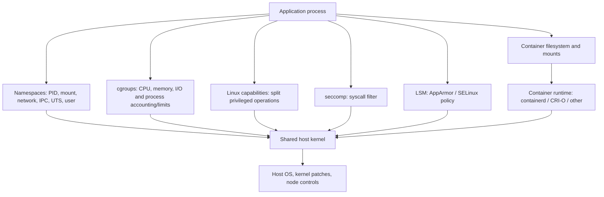
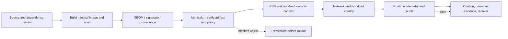
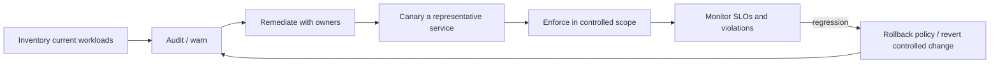
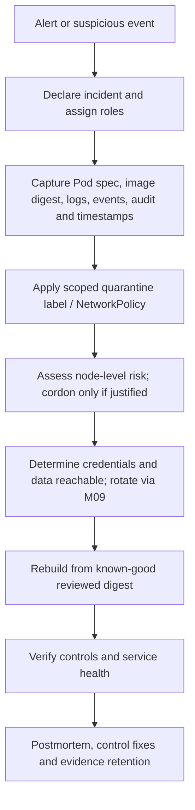

# Unit 7 — Runtime Security and Container Hardening

**Target file:** `07-runtime-security-and-container-hardening.md` | **Estimated time:** 18–26 hours | **Prerequisites:** Stage 0–2D and Stage 2E M01–M11; especially M01 Unit 8, M03 Units 7/8/9/11, M04 Units 5/6/9, M05 storage/volume permissions, M06 packaging and operator RBAC, M09 Unit 6, M10 incident response, and M11 observability.

**Core tools:** Kubernetes `kubectl`, Docker, `kind`, Linux inspection tools, `kube-bench` (target compatibility `[VERIFY]`), Python 3 for local audit scripts. | **Awareness:** gVisor, Kata Containers, `RuntimeClass`, Security Profiles Operator, `strace`, Falco (deep detection work belongs to Unit 12), Kubescape, Trivy Kubernetes scanning. | **Last reviewed:** 2026-10-29 for this authored module; re-check version-sensitive sources before use. | **Tool/spec baseline assumed:** Kubernetes API versions are taken from examples shown here (`v1` core resources, `apps/v1` workload controllers, `networking.k8s.io/v1` NetworkPolicy); installed Kubernetes, kind, Docker/Podman, kube-bench, kernel and CNI versions must be recorded locally. No unverified tool version is asserted. | **Footprint:** 4 CPU / 8 GB RAM / 30 GB free disk is a practical starting point; measure yours and run one heavy component at a time. | **Needs internet at lab time:** Usually yes for image pulls and official docs; offline fallback uses pre-pulled images and clearly marked synthetic fixtures.

> **Safety boundary:** All tests below are for a disposable local cluster and benign fixtures. Do not use production credentials, real sensitive data, exploit chains, or third-party endpoints. Do not create a privileged pod, mount the host filesystem or Docker socket, or test escape techniques as part of the labs. Admission rejection is not evidence of runtime denial; label the layer actually tested. Containers share the host kernel; they are not virtual machines. No individual control makes a container secure.

## Table of Contents

- [7.0 Why this matters in production](#70-why-this-matters-in-production)
- [7.1 Learning objectives](#71-learning-objectives)
- [7.2 Concept map and vocabulary](#72-concept-map-and-vocabulary)
- [7.3 Level 1 — Beginner](#73-level-1--beginner)
- [7.4 Level 2 — Intermediate](#74-level-2--intermediate)
- [7.5 Level 3 — Advanced](#75-level-3--advanced)
- [7.6 Level 4 — Expert](#76-level-4--expert)
- [7.7 SRE lens](#77-sre-lens)
- [7.8 Security lens](#78-security-lens)
- [7.9 Production checklist](#79-production-checklist)
- [7.10 Hands-on lab set](#710-hands-on-lab-set)
- [7.11 Self-check questions](#711-self-check-questions)
- [7.12 Evidence artifacts](#712-evidence-artifacts)
- [7.13 Common interview and design-review questions](#713-common-interview-and-design-review-questions)
- [7.14 Sources and verification notes](#714-sources-and-verification-notes)
- [Author’s Verification and Completeness Audit](#authors-verification-and-completeness-audit)

### 7.0 Why this matters in production

A model-serving API may be built from a trusted image yet still expose sensitive data if its process can read unnecessary credentials, write unexpected files, or reach destinations it does not need. A hardened manifest can also break a release if the application writes caches into a read-only root filesystem or relies on a syscall blocked by a custom seccomp profile. The operational problem is therefore not “add every security field”; it is to reduce credible attack paths while preserving the service’s required behavior and proving both outcomes. Runtime hardening reduces blast radius but cannot remove shared-kernel risk, eliminate vulnerable application code, or replace patching, admission controls, network controls, monitoring, and incident response.

### 7.1 Learning objectives

By completing this unit, the learner will be able to:

1. **[L1]** Explain namespaces, cgroups, Linux capabilities, seccomp, Linux Security Modules (LSMs), and user namespaces, including the shared-kernel boundary.
2. **[L1]** Inspect a running workload’s identity, effective capabilities, root filesystem behavior, and declared security context without modifying the production image.
3. **[L2]** Deploy API, ETL, and notebook-like workloads with justified writable paths, resource limits, probes, and minimal permissions.
4. **[L2]** Diagnose common hardening failures using logs, events, effective runtime state, and narrowly scoped fixes.
5. **[L2]** Test preventive controls with positive and negative probes while distinguishing admission-time rejection from runtime enforcement.
6. **[L3]** Design a layered posture across image, admission, pod, network, identity, runtime detection, and audit with explicit residual risk.
7. **[L3]** Triage at least ten kube-bench findings without inventing CIS mappings or treating `kind` as proof of production node compliance.
8. **[L3]** Build and test a read-only live-spec posture auditor and an exception-expiry checker with stable reports.
9. **[L4]** Operate staged rollouts, time-bounded exceptions, drift detection, node/kernel patching, and evidence-preserving incident response.
10. **[L4]** Decide when a sandbox runtime is justified using threat model, compatibility tests, operational burden, and measurable acceptance criteria.

### 7.2 Concept map and vocabulary

#### Runtime isolation layers



Namespaces change a process’s view of resources; they do not create a separate kernel. Cgroups account for and can constrain resource use; a CPU or memory limit is not itself a complete denial-of-service defense. Capabilities divide selected privileged operations. Seccomp filters system calls; an LSM constrains access to objects such as files and processes. Filesystem mounts and user-ID mappings add separate controls. These layers complement one another; their exact effect depends on kernel, runtime, node configuration, and workload.

#### Defense-in-depth control path



Preventive controls aim to block a disallowed action; detective controls generate evidence or alerts; response controls limit impact and restore service. A detection rule does not prevent an action unless a separate enforcement mechanism does so. Admission controls belong to Unit 8; deep Kyverno and Open Policy Agent (OPA) Gatekeeper authoring belongs to Unit 11; Falco runtime threat detection belongs to Unit 12.

#### Glossary

| Term | Meaning | Common misconception |
|---|---|---|
| Container | A packaged process using kernel isolation and resource controls | A small virtual machine with its own kernel |
| Namespace (Linux) | Kernel feature that changes a process’s view of resources | Same as a Kubernetes Namespace object |
| Kubernetes Namespace | API object used to group namespaced resources and scope policies/RBAC | A hard host or kernel security boundary |
| cgroup | Kernel mechanism for resource accounting and control | Merely a Kubernetes resource limit; limits are configured through higher layers |
| Linux capability | A narrow privilege such as binding certain low ports or changing network settings | Same as Kubernetes RBAC |
| Kubernetes RBAC | API authorization for Kubernetes requests | Restricts every syscall inside a container |
| seccomp | A syscall filter attached to a process | A filesystem access-control policy or a complete sandbox |
| LSM | Kernel security framework, including AppArmor and SELinux | Equivalent to seccomp; they govern different operations |
| PSS | Built-in Pod Security Standards: Privileged, Baseline, Restricted | A replacement for all custom admission policy |
| `securityContext` | Pod/container settings for UID/GID, capabilities, seccomp, privilege escalation and related controls | A guarantee that the node supports every requested feature |
| `hostPath` | Mount of a path from the node filesystem into a Pod | Safe because it is read-only; read-only still exposes host data |
| `RuntimeClass` | Kubernetes object selecting a configured runtime handler | Installing the object installs a sandbox runtime |
| Drift | Difference between approved posture and live configuration/state | Always malicious; some drift is an unreviewed change or controller mutation |
| Exception | Explicit, approved, scoped, time-bounded deviation from a baseline | A permanent bypass for a difficult workload |
| Container escape | Crossing the intended container isolation boundary, potentially affecting the host or other workloads | Only possible through a single exploit; dangerous configuration can widen the boundary |

#### Control comparison: baseline hardening checklist (reused from M01 Unit 8 and M03 Unit 9)

| Control | Threat reduced | Verification | Limitation |
|---|---|---|---|
| Non-root numeric UID/GID and `runAsNonRoot: true` | Reduces impact of process compromise | Inspect effective `id`; inspect Pod spec and runtime state | Does not remove kernel vulnerabilities or application-level permissions |
| Drop all capabilities; add back only justified ones | Reduces privileged kernel operations | Inspect `CapEff` in `/proc/self/status`; review manifest | Capability sets can differ by runtime; does not block all dangerous syscalls |
| `allowPrivilegeEscalation: false` | Restricts gaining privileges through setuid/file capabilities in supported contexts | Inspect spec and effective process attributes where available | Does not mean “cannot exploit application” or “no privilege exists” |
| `readOnlyRootFilesystem: true` | Prevents writes to image root filesystem | Safe write attempt to a known root path should fail; approved tmp volume should work | Writable mounts remain writable; app may crash if scratch paths are missed |
| `seccompProfile: RuntimeDefault` | Restricts syscalls according to runtime profile | Inspect Pod spec; benign syscall probe / runtime evidence where feasible | Profile differs by runtime/version; not a full sandbox |
| No privileged containers | Avoids broad host-kernel access and disabled/relaxed confinement | Review spec; admission test rejects privileged request | Some infrastructure agents require narrowly governed exceptions |
| No host namespaces (`hostPID`, `hostNetwork`, `hostIPC`) | Reduces shared host view and exposure | Inspect live workload spec and traffic/process isolation | Not all network exposure is controlled by these fields alone |
| No `hostPath`; narrowly justified read-only exception only | Avoids host filesystem exposure | Inspect all volumes; exception must name path, owner and expiry | Read-only host files can still disclose sensitive data |
| Requests and limits | Improves scheduling and contains some resource abuse | Inspect spec and observe bounded lab load | CPU limits can affect latency; memory limit can cause OOM termination |
| Disable ServiceAccount token automount unless needed | Reduces accidental API credential exposure | Inspect `automountServiceAccountToken`; verify token mount absent | Workload can still have credentials from other sources |
| Minimal maintained image; preferably no shell/package manager | Reduces attack surface and post-start modification options | Inspect image digest, package inventory and runtime filesystem | Minimal image does not imply low risk; native dependencies and app bugs remain |

PSS recap: `privileged` allows broad configurations; `baseline` blocks known privilege escalations while preserving common workloads; `restricted` applies a stronger least-privilege baseline. Namespace labels select `enforce`, `audit`, and `warn` modes and version labels. The exact supported label values and behavior are `[VERSION-SENSITIVE]`; inspect the installed Kubernetes documentation and `kubectl version` before rollout. PSS is a coarse built-in baseline, not a custom policy engine.

### 7.3 Level 1 — Beginner

#### 7.3.1 Why containers are not virtual machines

A virtual machine normally provides a guest kernel boundary. A conventional Linux container uses the host kernel while isolating process views and resource use. Namespaces isolate process IDs, mount views, networking, IPC, hostnames, and (where used) user IDs. Cgroups constrain or account for resource use. Capabilities split traditional root privileges into smaller units. Seccomp filters system calls; AppArmor and SELinux are LSMs that enforce policy over resources and operations. A container runtime assembles these controls, but a privileged container or dangerous host mount can undo important assumptions.

Defensive escape-path examples include: a vulnerable shared kernel; `privileged: true`; unnecessary `CAP_SYS_ADMIN`; a Docker socket mount that exposes host container-management authority; host PID/network/IPC namespaces; and a broad hostPath mount. This module does not teach exploit chains. The operational response is to prevent unnecessary access, patch the host, restrict workloads, test denials, and preserve evidence if compromise is suspected.

#### 7.3.2 Inspect an existing workload safely

**Execution context:** host shell with `kubectl` configured for the disposable cluster; `kind` and Docker required only if running a local cluster. Commands below are read-only except for creating the disposable namespace/Pod in labs. Do not install diagnostic tools into a production image just to run these checks.

```bash
kubectl version --client
kubectl cluster-info
kubectl get nodes -o wide
kubectl get pods -A
kubectl get pod -n <NAMESPACE> <POD> -o yaml
kubectl describe pod -n <NAMESPACE> <POD>
kubectl logs -n <NAMESPACE> <POD> --all-containers=true
```

Inside an already running diagnostic-capable lab container:

```sh
id
cat /proc/self/status | grep -E '^(Uid|Gid|CapInh|CapPrm|CapEff|CapBnd|NoNewPrivs|Seccomp):'
# Optional: only if installed in the lab image
capsh --print
# Safe negative test: expected to fail on a read-only rootfs; do not redirect to a real path
( touch /readonly-probe 2>&1 && echo 'UNEXPECTED_WRITE_SUCCEEDED' ) || echo 'EXPECTED_WRITE_DENIED'
```

Expected interpretation: `id` should show the configured non-root UID/GID. A `CapEff` value of `0000000000000000` is consistent with no effective capabilities, but this value is not a full security assessment. `Seccomp` values and capability bit interpretation are kernel-specific; consult the current Linux proc documentation. The `touch` test proves only that the selected path is not writable from that process at that time. It does not prove all mounts are read-only. If the image lacks `sh`, `id`, `capsh`, or `grep`, use `kubectl exec` only where the image supports it, inspect the Pod spec, or use a separate disposable diagnostic image. Do not mutate a production image.

#### 7.3.3 Basic cluster posture and kube-bench

`kube-bench` checks Kubernetes node/control-plane configuration against a selected CIS Kubernetes Benchmark mapping. Before running it, record the kube-bench release, Kubernetes version, selected benchmark target, configuration, and official support statement. The exact command/container image and target selector are `[VERIFY]` because supported target names and mappings change. Follow the official Aqua Security kube-bench project instructions for the installed release; do not copy an old command blindly. Run only in a disposable cluster and grant only the access required by the chosen mode.

- **PASS:** the check met its test condition; it does not prove the whole system secure.
- **FAIL:** the test condition was not met; determine applicability and risk before remediation.
- **WARN:** the tool could not conclusively test or requires manual interpretation; do not count it as pass.
- **Not applicable:** document why the control is not meaningful in this local cluster and what production evidence would be required instead.

`kind` is useful for Kubernetes API behavior and some node checks, but it does not prove managed control-plane configuration or production node compliance. Managed Kubernetes divides responsibility between provider and customer; request provider evidence for controls you cannot inspect directly.

#### 7.3.4 Beginner failure modes

| Symptom | Likely explanation | Safe next step |
|---|---|---|
| Pod rejected with a PSS warning/error | Manifest violates selected namespace policy | Inspect the exact field; test in audit/warn before enforcement; remediate rather than disabling PSS |
| Container exits after read-only root filesystem is enabled | App writes to `/tmp`, home, cache, or runtime path | Identify the exact path from logs; mount a narrowly scoped `emptyDir` or configure app cache path |
| `id` or `capsh` not found | Minimal/distroless image omits diagnostics | Inspect spec and use a separate disposable diagnostic workload; do not add tools to production image |
| Pod cannot start due to UID/GID or volume permissions | Mounted data is not writable by the effective identity | Inspect volume ownership and storage behavior; use a least-privilege group/ownership fix consistent with M05 |
| kube-bench has many warnings/failures on kind | Checks may target a different deployment model or node setup | Verify target/config/version, classify each result and avoid fabricated CIS IDs |

### 7.4 Level 2 — Intermediate

#### 7.4.1 Hardened workload template for data/ML services

The following manifest is a baseline for a small API-like service. It uses a placeholder image and is not directly deployable until `<IMAGE_DIGEST>` is replaced with an approved, pullable immutable digest and probes are adapted to the application. Numeric UID/GID must match the image and volume design. `fsGroup` is included only as a pattern for volumes that need shared group access; verify its storage-class/CSI behavior and performance with M05.

**Execution context:** create the YAML in the learner’s local lab and apply with `kubectl` to a disposable cluster. Prerequisite: `kubectl`, cluster, a verified image digest, and permission to create a namespace. Applying creates resources; inspect the namespace before cleanup.

```yaml
apiVersion: v1
kind: Namespace
metadata:
  name: runtime-lab
  labels:
    pod-security.kubernetes.io/enforce: restricted
    pod-security.kubernetes.io/audit: restricted
    pod-security.kubernetes.io/warn: restricted
    # Pin these values to the cluster's supported version before production use.
    pod-security.kubernetes.io/enforce-version: latest
    pod-security.kubernetes.io/audit-version: latest
    pod-security.kubernetes.io/warn-version: latest
---
apiVersion: apps/v1
kind: Deployment
metadata:
  name: api-demo
  namespace: runtime-lab
  labels:
    app.kubernetes.io/name: api-demo
    security.example.com/baseline: hardened-v1
spec:
  replicas: 1
  selector:
    matchLabels:
      app.kubernetes.io/name: api-demo
  template:
    metadata:
      labels:
        app.kubernetes.io/name: api-demo
        security.example.com/baseline: hardened-v1
    spec:
      automountServiceAccountToken: false
      terminationGracePeriodSeconds: 30
      securityContext:
        runAsNonRoot: true
        runAsUser: 10001
        runAsGroup: 10001
        fsGroup: 10001
        seccompProfile:
          type: RuntimeDefault
      containers:
        - name: api
          image: registry.example.invalid/ml-api@sha256:<IMAGE_DIGEST>
          ports:
            - name: http
              containerPort: 8080
          securityContext:
            allowPrivilegeEscalation: false
            readOnlyRootFilesystem: true
            capabilities:
              drop: ["ALL"]
          resources:
            requests:
              cpu: 100m
              memory: 128Mi
            limits:
              cpu: 500m
              memory: 512Mi
          startupProbe:
            httpGet: {path: /health/startup, port: http}
            periodSeconds: 5
            failureThreshold: 24
          readinessProbe:
            httpGet: {path: /health/ready, port: http}
            periodSeconds: 5
          livenessProbe:
            httpGet: {path: /health/live, port: http}
            periodSeconds: 10
          volumeMounts:
            - name: tmp
              mountPath: /tmp
            - name: cache
              mountPath: /var/cache/app
      volumes:
        - name: tmp
          emptyDir: {sizeLimit: 128Mi}
        - name: cache
          emptyDir: {sizeLimit: 256Mi}
```

`latest` is an allowed PSS version selector but floats with the cluster’s latest supported policy version. For a reproducible rollout, use a version label supported by the exact cluster version after checking the official documentation. Replace the example namespace labels with your chosen test mode and follow Lab 4’s staged process before enforcing in an established namespace. The example is intentionally not a real API image or digest.

**Execution context — local cluster:** after replacing the placeholder with a valid image reference and adjusting probe paths, run:

```bash
kubectl apply -f <YOUR_INLINE_MANIFEST_SAVED_DURING_LAB>.yaml
kubectl rollout status deployment/api-demo -n runtime-lab --timeout=120s
kubectl get pod -n runtime-lab -l app.kubernetes.io/name=api-demo -o wide
kubectl get pod -n runtime-lab -l app.kubernetes.io/name=api-demo -o jsonpath='{.items[0].spec.securityContext}'; echo
kubectl get pod -n runtime-lab -l app.kubernetes.io/name=api-demo -o jsonpath='{.items[0].spec.containers[0].securityContext}'; echo
```

The placeholder filename above refers to the local working copy of the inline manifest; no repository sibling file is required by this module. If you choose not to save files, paste the manifest through your editor and name the temporary lab file outside the repository.

#### 7.4.2 Three service profiles: API, ETL, notebook

| Concern | API | ETL job | Notebook-like workload |
|---|---|---|---|
| Process lifecycle | Long-running, graceful shutdown | Finite job with completion status | Interactive, user-controlled and less predictable |
| Writable paths | `/tmp`, bounded application cache if needed | `/tmp`, bounded scratch/work directory | Explicit ephemeral workspace and cache; persistence only when justified |
| Resource model | Requests/limits based on latency and throughput | Job-specific CPU/memory/ephemeral storage and deadline | Per-user quota and limits; prevent one notebook starving others |
| Network | Narrow inbound and egress peers | Usually no inbound; narrow data store/object store egress | Strict egress; approved package mirror and data endpoints only |
| Identity | No API token by default; minimum backend permissions | Job-specific identity/credentials scoped to dataset/job | No persistent broad credentials; short-lived access and separate user isolation |
| Debugging | Logs, metrics, ephemeral debug when authorized | Job status, exit code, structured logs | User-space debugging; no host access or Docker socket |
| Special risk | Exposed endpoint, request-driven abuse | Bulk data access and data movement | Arbitrary code, package installs, broad egress, multi-user exposure |

For ETL, use a `Job` with a deadline and retry policy appropriate to idempotency. For notebooks, isolate interactive code in a separate namespace and possibly dedicated node pool; do not grant broad privileges merely because the workload is interactive. GPU workloads are awareness-level here: device-plugin privileges, Multi-Instance GPU (MIG) isolation, and driver supply chain require vendor/platform-specific verification.

#### 7.4.3 Diagnose → evidence → minimal fix

| Breakage | Diagnosis evidence | Minimal fix that preserves intent | Avoid |
|---|---|---|---|
| App writes `/tmp` and crashes | Logs show `PermissionError`; rootfs is read-only | Add bounded `emptyDir` at `/tmp`; configure `TMPDIR` if supported | Making the entire rootfs writable |
| Python tries to write `.pyc` or cache | `PermissionError` in package/home cache paths | Set `PYTHONDONTWRITEBYTECODE=1` where appropriate; set `PYTHONPYCACHEPREFIX`/cache path to a writable bounded volume if needed; test exact runtime | Running as root without understanding path ownership |
| App needs low port | Bind error on port below 1024 | Prefer listen on an unprivileged port and expose it via Service/ingress; only consider `NET_BIND_SERVICE` if the platform and policy justify it | Running the whole process as root solely to bind a port |
| Library assumes root-owned home | Home directory permission errors | Set `HOME` to a controlled writable directory; fix image ownership at build time | Mounting host home directory |
| Spark/Jupyter needs scratch | Temporary spill or notebook write errors | Explicit bounded `emptyDir`, ephemeral storage requests/limits, cleanup policy | Unbounded writable rootfs or hostPath scratch |
| `fsGroup` does not fix volume | CSI/storage behavior or ownership semantics differ | Inspect CSI driver support, effective group and mount ownership; test on the actual storage class | Assuming every volume is recursively chowned or equally performant |
| Custom seccomp causes rare failure | `EPERM`/`SIGSYS` and syscall evidence; failure correlates with profile | Reproduce in a disposable test, identify required syscall, revise only a reviewed profile and add regression test | Setting production to `Unconfined` as first response |

#### 7.4.4 Seccomp, capabilities and filesystem mounts

`RuntimeDefault` delegates to the container runtime’s default seccomp profile. It is a good baseline because a custom profile can omit a rare but legitimate syscall and fail only under uncommon traffic or recovery paths. A custom `Localhost` profile is node-local: it must be present at the kubelet-configured profile location on every eligible node; path rules are `[VERSION-SENSITIVE]` and must be checked for the node image and Kubernetes release. `Unconfined` removes this syscall filter and should not be the routine fix for an unexplained error.

A profile is built from an explicit threat model and observed application behavior. `strace` can help identify syscall use in a disposable test environment, but trace output is not a complete workload specification: it reflects only the exercised paths, and syscall names/availability vary. Security Profiles Operator and OCI hooks are awareness-level integrations here; verify their current compatibility, APIs, and lifecycle before adopting them. Never generate a profile from one happy-path run and assume it covers startup, shutdown, error handling, model loading, batch spill, and rare requests.

| Capability | Typical effect | Safer design consideration |
|---|---|---|
| `NET_BIND_SERVICE` | Bind to privileged ports in supported contexts | Prefer an unprivileged internal port; add only if the requirement is real |
| `NET_RAW` | Use raw/packet sockets in applicable contexts | Drop unless network diagnostics/protocol genuinely need it |
| `NET_ADMIN` | Broad network administration operations | Rarely appropriate for application containers; separate networking agent if required |
| `SYS_PTRACE` | Trace/inspect processes subject to other controls | Keep out of application workload; use authorized debug workflow |
| `SYS_ADMIN` | Broad set of administrative operations, often described as “the new root” | Treat as exceptionally risky, but not literally identical to all root powers in every configuration |
| `privileged: true` | Grants broad capabilities and relaxes several confinement controls | Avoid; use a dedicated, reviewed infrastructure exception if indispensable |

`noexec` prevents execution of binaries from a mount under supported filesystem semantics; `nosuid` suppresses set-user-ID/set-group-ID effects on that mount. They are useful only where supported and compatible with application behavior; they do not make content safe or prevent interpretation by an already-running interpreter. Validate mount options in the target runtime and avoid assuming a `volumeMount` alone expresses host mount flags.

#### 7.4.5 AppArmor, SELinux, and node hardening

AppArmor confines programs with path-oriented profiles; SELinux applies label-based mandatory access control. Enforcement occurs in the host kernel, and availability depends on node OS/kernel/runtime configuration. Check rather than assume:

```bash
# Host Linux; read-only checks. Commands may be unavailable on WSL2 or non-systemd hosts.
cat /sys/module/apparmor/parameters/enabled 2>/dev/null || true
command -v aa-status >/dev/null && aa-status || true
command -v getenforce >/dev/null && getenforce || true
command -v sestatus >/dev/null && sestatus || true
uname -a
```

`[VERIFY]` WSL2 and `kind` may not expose the same AppArmor/SELinux behavior as a supported production Linux node. If a profile cannot be enforced locally, use an annotated walkthrough against official documentation and retain a clear “not demonstrated” note. Do not claim a policy is active merely because a field appears in YAML.

Node controls include a maintained minimal host OS, kernel/runtime patch cadence, authenticated kubelet access, authorization webhook where applicable, disabled anonymous access where not required, and disabled kubelet read-only port. Kubelet configuration and flags change; inspect the installed kubelet version and official kubelet authentication/authorization docs. A local kind check cannot validate managed control-plane settings or a provider’s node image lifecycle.

#### 7.4.6 Audit logging and network controls

Kubernetes audit policy levels include `None`, `Metadata`, `Request`, and `RequestResponse`. `Metadata` records request metadata without request/response bodies, and is the safer default for tracking secret access. Do not capture secret bodies in audit records. Enabling audit on kind requires a verified API-server configuration path and may require recreating a disposable cluster; this is `[VERIFY]` for the local environment. Use the synthetic-event fallback in Lab 6 when configuration cannot be safely enabled.

NetworkPolicy is enforced only if the cluster network plugin supports it. Default-deny egress plus explicit allow rules is a useful boundary, but standard NetworkPolicy does not universally express FQDN allow-lists or application identity. Cilium FQDN policy is an optional CNI-specific path `[VERIFY]`. Metadata endpoint blocking must be explicitly tested for the environment; a policy manifest by itself is not evidence. M04 owns the detailed network/mTLS material; this unit verifies how network controls support runtime containment.

#### 7.4.7 Sandboxed runtimes and debug workflow

gVisor uses a userspace application kernel (`runsc`) to add an isolation layer; Kata Containers uses lightweight virtual-machine-based isolation. Both can improve isolation for selected threat models but add compatibility, performance, operations, and observability trade-offs. `RuntimeClass` selects a runtime handler configured on nodes; creating a `RuntimeClass` object alone does not install or configure the handler. Test prerequisites, runtime support, node coverage, workload compatibility, GPU/storage behavior, observability and upgrade operations before rollout. WSL2/kind support is `[VERIFY]`; Lab 10 includes an honest no-live-runtime path.

For debugging, prefer logs, metrics, ephemeral debug containers, and a controlled diagnostic image under restricted RBAC. Debugging mechanisms and API support are version-sensitive; see M03 Unit 11 and official ephemeral-container documentation. Do not weaken the production workload or add broad capabilities merely to make debugging convenient.

### 7.5 Level 3 — Advanced

#### 7.5.1 Threat model and defense in depth

Start with a concrete asset and attack path: for example, an attacker controls a dependency in the ETL image, gains code execution as the ETL process, reads any mounted credentials, accesses data endpoints permitted by egress rules, and attempts to affect the host or neighboring workloads. Map each control to a specific step and test it. Non-root reduces some impact; read-only rootfs limits persistence through image-layer modification; dropped capabilities reduce privileged operations; seccomp limits syscall surface; disabled token automount reduces one credential path; network policy narrows reachable peers; audit/runtime detection provides evidence; response limits blast radius. None prevents all application abuse or eliminates kernel vulnerabilities.

| Layer | Preventive control | Detective control | Response control | Residual risk |
|---|---|---|---|---|
| Image | Minimal maintained image, digest pinning, signed artifact verification (Unit 8) | Image inventory/SBOM drift | Rebuild and redeploy known-good digest | Compromised build or malicious but approved code |
| Admission | PSS and policy enforcement (Units 8/11) | Audit/warn events and policy reports | Rollback policy or workload under change control | Bypass permissions, webhook failure behavior, policies with gaps |
| Pod/runtime | UID/GID, capabilities, seccomp, LSM, read-only rootfs | Effective-state checks, runtime alerts (Unit 12) | Quarantine, preserve evidence, replace workload | Shared kernel, vulnerable runtime, writable mounts |
| Network | Default-deny and narrow egress (M04) | Flow logs/Hubble/telemetry | Quarantine policy or route block | CNI gaps, allowed endpoint misuse, DNS/FQDN gaps |
| Identity | Minimal RBAC and no unnecessary token mount (M09) | API audit, credential-use anomalies | Revoke/rotate reachable credentials (M09) | Credentials reachable through other mounts/env/metadata |
| Node | Patch cadence, hardened node OS, restricted kubelet | Node inventory, kube-bench triage | Cordon/drain/replace node | Provider-controlled settings and zero-day exposure |
| Response | Runbook and evidence preservation | M11 logs, metrics and audit | Contain, rotate, rebuild, verify, postmortem (M10) | Detection delay, incomplete logs, evidence loss |

#### 7.5.2 PSS versus custom admission policy

| Mechanism | Strength | Limitation | Handoff |
|---|---|---|---|
| PSS namespace labels | Built-in coarse baseline with enforce/audit/warn modes | Does not express every organization-specific rule or artifact trust decision | M03 Unit 9 recap; this unit stages rollout |
| ValidatingAdmissionPolicy using CEL | Kubernetes-native declarative validation where supported | API/feature availability and policy semantics are version-sensitive | Unit 8 overview; verify cluster version |
| Kyverno | Rich policy authoring, mutation/validation and reporting ecosystem | Additional webhook availability, versioning and policy operations | Deep authoring in Unit 11 |
| OPA Gatekeeper | Rego-based policy constraints and audit model | Additional components and Rego expertise; version compatibility matters | Deep authoring in Unit 11 |
| Runtime detection (Falco) | Detects selected runtime behaviors after admission | Does not prevent the behavior unless paired with enforcement/response | Unit 12 |

#### 7.5.3 Soft multi-tenancy and data/ML workloads

Namespace + RBAC + quotas + NetworkPolicy + PSS is **soft multi-tenancy**: it reduces accidental and some adversarial cross-workload access but does not create a separate kernel boundary. Dedicated nodes/taints can isolate scheduling and capacity, but still share the cluster control plane and may share kernel/runtime risks. Virtual clusters and sandboxed runtimes are awareness-level. Stronger hostile-tenant requirements may justify separate clusters or VM-level isolation.

Notebook and Spark workloads often require scratch space, package installation, broader network access, or specialized runtime behavior. Do not give them host access as a shortcut. Use separate namespaces, ephemeral user pods, strict egress, no persistent credentials, image allow-lists, approved package mirrors, resource quotas, and node pools where justified. GPU workloads need an explicit threat and compatibility review for device-plugin privileges, MIG configuration, driver patching, and image/driver supply chain.

#### 7.5.4 Host and kernel protections

Track the host OS, kernel, `containerd`/`runc` versions and patch cadence. A container image rebuild does not patch the host kernel or runtime. User namespaces can map container IDs to unprivileged host IDs; Kubernetes Pod user namespace behavior is `[VERSION-SENSITIVE]` and should be verified against the exact cluster release and runtime. `procMount`, `/proc`, `/sys`, and host namespace access affect what process and kernel information is visible. Safe/unsafe sysctl classifications and `podPidsLimit` configuration are version- and node-specific `[VERIFY]`; inspect the current kubelet config, cluster docs, and kernel behavior rather than assuming a field is supported.

#### 7.5.5 Runtime secrets and egress as an exfiltration barrier

Prefer mounted secrets from a supported CSI Secret Store integration where appropriate (M09 Unit 6) and avoid persistent credentials in notebook images. A memory-backed or tmpfs mount can reduce disk persistence but does not stop a compromised process from reading a secret it is authorized to use. Environment variables may be visible to the same-privilege process or diagnostic tooling through `/proc/<pid>/environ`; crash dumps can also capture sensitive process memory. Disable core dumps where justified and supported by the platform; verify the actual container and node configuration. Never put secrets into logs, command output, manifests, or retained lab evidence.

Default-deny egress and explicit allow-lists reduce data exfiltration paths. A CNI-specific FQDN policy, an egress proxy, or application-layer authorization may be needed when destination names/IPs change. Measure unusual egress volume with M11 metrics and Hubble where available; Unit 12 owns runtime rules. A successful `curl` to an allowed endpoint is a positive test; a blocked request to an unlisted **local** endpoint is a negative test. Neither test proves every alternate protocol or path is blocked.

#### 7.5.6 Resource controls and immutable infrastructure

Resource requests/limits and quotas contain some denial-of-service risks and improve scheduling. Process-count controls such as `pids.max` or kubelet `podPidsLimit` are `[VERIFY]` for the installed runtime and node configuration. Never use a disruptive load or cryptomining payload; use harmless bounded test processes and a disposable namespace. CPU anomalies can be monitored through M11, but an alert is detective, not preventive.

Treat Pods and nodes as replaceable. Avoid SSHing into a container or manually patching its filesystem as the normal recovery method. Rebuild from reviewed source and a known-good image digest; detect drift between approved and live workload specs and, where appropriate, files changed after startup. Falco/FIM-style signals and `kubectl debug` comparisons are Unit 12/awareness-level techniques. Preserve evidence before replacement.

### 7.6 Level 4 — Expert

#### 7.6.1 Runtime security program

An operating program needs more than a template. Maintain: (1) versioned, tested golden workload templates or reusable Helm/Kustomize components (M06/M16); (2) policy packs and admission controls (Units 8/11); (3) an exception registry with owner, rationale, compensating controls, approval and expiry; (4) continuous posture scanning and trend reports; (5) node/kernel/runtime lifecycle ownership; (6) incident runbooks and forensic readiness; and (7) review metrics. Assign service owners and platform/security owners explicitly. Multi-cluster policy/template distribution is an M14 awareness-level handoff: define a common baseline and versioning contract here, but defer fleet-wide distribution, rollout coordination and cross-cluster consistency operations to M14. M16 owns the broader golden-path secure defaults and reusable platform components.

Continuous posture tools may include kube-bench, Kubescape, or Trivy Kubernetes scanning. Current flags, output formats, target support, and benchmark versions are `[VERIFY]`. Schedule checks against a representative environment; retain dated outputs, configuration and version inventory. Trend findings by stable identifiers and applicability, not just aggregate score. Do not chase a perfect local score by disabling checks or treating all kind-specific findings as production defects.

#### 7.6.2 Live-spec drift and bypass detection

Compare the live API objects with a documented baseline and known exception registry. At minimum, detect: privileged mode; host namespaces; hostPath; Docker socket paths; `SYS_ADMIN`; missing UID/GID; root filesystem writes allowed; missing seccomp; missing requests/limits; unexpected ServiceAccount token automount; stale image tags instead of digests; old workloads; and namespaces excluded from policy. Also inspect fail-open/misbehaving mutating webhooks and policy components. A script can flag obvious deviations, but it is not a full policy engine: it may not understand all controller templates, defaulting, mutation order, or semantic equivalence. Use policy engine tests for enforceable invariants and retain the script as a read-only audit signal.

The full reference implementation is included in Lab 7. It reads JSON input, reports stable JSON findings, validates exception owner/reason/expiry fields, and never changes the cluster. Run it with a read-only service account in production, if adopted, and test the script against known-good and known-bad fixtures before relying on its output.

#### 7.6.3 Exception governance and rollout

Examples of legitimate elevated workloads include CNI and CSI node plugins, certain observability agents, and build tools that require specific host integration. A privileged workload is not acceptable by default. For each exception, record the exact resource and field, threat/risk, business reason, owner, approver, expiry, review state, compensating controls, evidence, and a renewal path. Consider a dedicated namespace and node pool; minimize capabilities; restrict image source, network, RBAC, and host mounts; monitor runtime behavior; and test expiry enforcement. The exception must be narrower than the threat it creates.

Rollout sequence:



PSS enforcement or a custom profile change is a production change. Communicate the change window, owner, success criteria, and rollback. Do not enable cluster-wide enforcement late in the day without an inventory and tested rollout. The rollback should reverse the policy change, not broadly remove all hardening from every workload.

#### 7.6.4 Failure stories and operational response

| Scenario | Detection/evidence | Containment | Corrective action | Prevention/owner | Measurable follow-up |
|---|---|---|---|---|---|
| Privileged debug Pod with host mounts remains for weeks | Inventory finds privileged/hostPath; audit history and owner missing | Isolate namespace/workload; preserve YAML, image digest and logs; remove under change control | Delete after evidence capture; rotate credentials accessible from node/workload if exposure is plausible | Platform owner; short-lived debug workflow and exception expiry | 100% debug Pods have owner/expiry; stale count reviewed weekly `[ILLUSTRATIVE target]` |
| `hostPath: /` exception is forgotten | Exception expiry report; broad mount scan | Restrict scheduling/access; assess exposed host files | Replace with narrow path or supported volume | Workload owner + security approver | No expired hostPath exceptions without active incident record |
| Docker socket mounted in CI runner | Live spec scan; runner activity and audit logs | Stop runner, isolate host/cluster, preserve job logs and image digest | Rebuild runner; rotate accessible tokens; review artifact provenance | CI owner; rootless/remote builder or dedicated ephemeral runner | Zero unapproved socket mounts in weekly posture report |
| PSS enforce enabled cluster-wide late day; rollout blocked | Admission errors, deployment failures, change timeline | Pause rollout; use approved rollback of policy label change if service risk requires | Remediate violations, canary and re-enable with release plan | Platform team; audit/warn inventory and staged change | PSS violations trend downward; no unreviewed cluster-wide policy change |
| Custom seccomp blocks rare path | `EPERM`/`SIGSYS`, trace and application error; correlated with profile release | Roll back to reviewed previous profile or RuntimeDefault in a controlled scope | Add tested syscall only if justified; exercise rare path | Service owner + security reviewer; regression tests | Rare-path test included in CI and release readiness |
| Node kernel unpatched for months | Asset inventory and patch-age dashboard | Drain/cordon according to availability plan; restrict sensitive workloads if needed | Patch/rotate node pool; validate runtime version and workload health | Node/platform owner | Patch-age SLO and exception expiry reviewed regularly |
| Read-only rootfs causes CrashLoopBackOff | Pod events/logs show permission errors | Roll back affected release or add scoped writable mount | Identify exact path; bound `emptyDir`; retest rootfs write denial | Application owner | Positive app write test and negative rootfs write test in CI |
| Notebook broad egress allows benign data movement | Flow logs/policy tests show unlisted endpoint reachable | Apply quarantine policy and suspend affected notebook | Narrow egress to approved mirror/data endpoints; inspect accessed credentials/data | Notebook platform owner | All notebook namespaces default-deny egress; blocked probe verified per CNI |

#### 7.6.5 Container-compromise response



Preserve evidence before deleting or restarting the Pod unless ongoing harm requires immediate containment. Capture the image digest, workload spec, logs, events, relevant audit records, policy versions and synchronized timestamps. A snapshot or memory-forensics tool may be unavailable or disruptive; `kubectl debug`, forensic tooling and CRIU/checkpoint-restore are awareness-level `[VERIFY]` options, not assumed capabilities. Revoke/rotate credentials the workload could reach, following M09. Rebuild rather than patching the compromised container. Reopen traffic only after the owner verifies the rebuilt workload, its image provenance, policy and observed behavior.

#### 7.6.6 Runtime sandbox decision framework

Choose a sandbox runtime only when a threat model justifies a stronger boundary and the platform can support it. Record: hostile workload assumptions; kernel attack-surface reduction expected; runtime handler and node prerequisites; compatibility with networking, volumes, debuggers, observability and GPU; p50/p95 latency and throughput under representative tests; CPU/memory overhead; operational ownership and patch cadence; failure and rollback behavior; and acceptance thresholds agreed before measurement. Do not invent performance figures. Measure the same workload on the same node pool and resource settings; retain raw measurements and configuration. If the laptop cannot run the runtime, Lab 10 requires a comparative decision record based on official docs, not a claim of successful execution.

### 7.7 SRE lens

Runtime security is a reliability control as well as a security control. A policy can reduce attack surface and also cause a rollout failure; a seccomp regression may surface only under rare traffic; strict memory limits can turn resource pressure into OOM restarts. Track both security outcomes and service health.

**Suggested indicators** (targets are organization-specific, not standards):

- Percentage of supported workloads compliant with the approved baseline, split by criticality and exception state.
- Percentage of exceptions with a valid owner, approval, compensating control and unexpired expiry.
- Time from detection of drift to triage and remediation.
- Count of unauthorized privileged/hostPath/host-namespace workloads found per scan.
- PSS audit/warn violations by namespace and rollout wave.
- Restart rate, CrashLoopBackOff count, startup/readiness failure rate, and latency changes after hardening.
- Node/kernel/runtime patch age and number of nodes outside the patch policy.
- Egress-policy negative-test pass rate and security telemetry freshness.

**Fail-closed versus fail-open:** if admission policy enforcement is unavailable, behavior depends on the specific webhook/policy configuration; verify it. Fail-closed may block deployments during a policy-engine outage. Fail-open may admit workloads without the intended checks. Set timeouts, availability objectives, emergency procedures and monitoring explicitly. Do not treat the availability of a security webhook as a purely security-team concern: it is part of the deployment control plane.

**Runbook snippet:** trigger = unexpected privileged spec, hardening-related crash loop, node patch-age breach, or runtime alert. Triage = identify affected namespace/workload, compare live spec to approved baseline, inspect rollout events and image digest, correlate audit/runtime/network evidence. Mitigate = quarantine or pause rollout, roll back the last safe policy/workload change when required, preserve evidence. Follow up = fix the underlying image/configuration, add a regression probe, update the exception registry and postmortem. Cost notes: retain useful evidence but avoid high-cardinality labels, excessive syscall logging, or storing secret-bearing object bodies. Measure tool overhead on the target workload instead of quoting a generic benchmark.

### 7.8 Security lens

Use a threat-to-control-to-test mapping, not a list of controls without evidence.

| Threat / attack path | Control | Negative test | What remains possible |
|---|---|---|---|
| Process compromise attempts privileged operation | Non-root, drop capabilities, `allowPrivilegeEscalation: false`, seccomp/LSM | Safe operation expected to fail; inspect effective `CapEff` and logs | Exploitation through allowed syscalls, kernel vulnerability, app-authorized actions |
| Process modifies image filesystem | Read-only rootfs | Write to known root path fails while `/tmp` succeeds | Writes to mounted volumes; external data modification |
| Workload accesses Kubernetes API unnecessarily | `automountServiceAccountToken: false`, least-privilege RBAC | Confirm token mount absent; API request without credentials fails | Credentials from other sources; network reachability to API remains separate |
| Workload reaches unapproved destination | Default-deny egress plus allow-list | `curl` to unlisted local endpoint blocked and visible; allowed local endpoint works | CNI not enforcing policy, alternate route/protocol, allowed endpoint misuse |
| Dangerous spec enters cluster | PSS and Unit 8 admission policy | Submit prohibited manifest in a disposable namespace; API rejects it | Admission bypass/permissions, policy gaps, existing objects not retroactively fixed |
| Host/runtime vulnerability enables escape | Patch lifecycle, minimal node OS, least privilege, sandbox where justified | Inventory/patch evidence; sandbox compatibility tests | Zero-day and residual shared-kernel risk |
| Compromise is not noticed | Runtime telemetry, Kubernetes audit, M11 pipeline | Synthetic/benign event appears in evidence pipeline | Blind spots, dropped events, rule noise, delayed alerting |

Auditability requires retaining enough context to reconstruct the decision: cluster/workload identity, image digest, baseline and policy version, exception approval, relevant event timestamps, and remediation evidence. Redact secret bodies, bearer tokens, environment values, private keys and sensitive user data. Do not collect more runtime telemetry than the threat model requires.

### 7.9 Production checklist

#### Pre-deployment — workload owner

- [ ] Image is approved, digest-pinned, maintained and has scan/SBOM evidence (M01/M12 Units 2–4); record image digest.
- [ ] Numeric UID/GID and `runAsNonRoot` are explicit where applicable; effective runtime identity has been verified.
- [ ] All capabilities are dropped by default; each added capability has a documented justification and owner.
- [ ] `allowPrivilegeEscalation: false`, `readOnlyRootFilesystem: true`, and seccomp `RuntimeDefault` are configured where compatible and tested.
- [ ] No privileged container, host namespace, Docker socket, or `hostPath` exists without a current scoped exception.
- [ ] Every writable path is enumerated, bounded and mounted intentionally; cache/temp/scratch tests pass.
- [ ] Requests/limits, ephemeral storage and process-count controls are verified for the actual cluster/runtime.
- [ ] Probes and `terminationGracePeriodSeconds` reflect service lifecycle and shutdown behavior.
- [ ] ServiceAccount token automount is disabled unless required; RBAC/credentials follow M09.
- [ ] Positive tests prove required behavior still works; negative tests prove intended denials.

#### Runtime and network — platform owner

- [ ] CNI enforcement is confirmed with an allow test and a blocked local-endpoint test.
- [ ] Metadata endpoint access is explicitly tested for the actual environment where applicable.
- [ ] Notebook/ETL egress is allow-listed; package installation uses an approved mirror when feasible.
- [ ] No unexpected host mounts, namespace sharing, elevated capabilities, or image digest drift exists.
- [ ] Runtime telemetry and Kubernetes audit events reach M11 with timestamps and safe retention.
- [ ] Diagnostic access is RBAC-scoped; debug containers do not silently weaken production policy.

#### Node, audit and governance — platform/security owner

- [ ] Kernel, host OS, container runtime and kubelet versions are inventoried with patch owner/cadence.
- [ ] Kubelet anonymous/authentication/authorization settings and read-only port are verified against current docs.
- [ ] AppArmor/SELinux/seccomp/user-namespace support is checked rather than assumed.
- [ ] kube-bench target and CIS benchmark mapping match the cluster type/version; findings are triaged with reasons.
- [ ] PSS rollout has inventory, audit/warn period, remediation owners, canary, enforcement plan and rollback.
- [ ] Exceptions include exact scope, reason, risk, owner, approver, compensating controls, creation date, expiry and review state.
- [ ] Expired or broad exceptions fail CI and are escalated; no “temporary” exception is indefinite.
- [ ] Incident response preserves evidence, assesses reachable credentials, rotates them when justified, rebuilds from known-good image, verifies and postmortems.

### 7.10 Hands-on lab set

All labs are local and defensive. Keep manifests, scripts and fixtures inline in your notes or temporary lab workspace; this module creates no sibling repository files. Do not include secrets in evidence. If the environment cannot support a live check, label the evidence `[SYNTHETIC]` or `[NOT RUN — environment limitation]`; never claim the control ran.

#### Lab 1 — Hardened pod templates for three services

**Objective.** Deploy or review hardened API, ETL and notebook-like templates; explain their different write paths, process lifecycle, network needs and identity requirements. **Footprint:** one small kind cluster plus one service image at a time. **Internet:** image pulls may require it; offline fallback uses pre-pulled images and manifest review. **Safety:** no production data or credentials.

**Architecture.** One disposable `runtime-lab` namespace; API is a long-running Deployment, ETL is a bounded Job, notebook is a separate interactive profile. Use an approved test image that can run as UID 10001 and whose digest is known. Do not use the placeholder image as if it were real.

**Steps.**

1. Record `kubectl version`, `kind version`, node OS/kernel and CNI. Confirm the cluster is disposable and has sufficient capacity.
2. Start from the Deployment in 7.4.1. Replace the placeholder image/digest and health paths; use PSS audit/warn first if this is not an empty test namespace.
3. For ETL, use this template fragment and merge it into the same baseline:

```yaml
apiVersion: batch/v1
kind: Job
metadata:
  name: etl-demo
  namespace: runtime-lab
spec:
  backoffLimit: 1
  activeDeadlineSeconds: 600
  template:
    metadata:
      labels:
        app.kubernetes.io/name: etl-demo
        security.example.com/baseline: hardened-v1
    spec:
      restartPolicy: Never
      automountServiceAccountToken: false
      terminationGracePeriodSeconds: 20
      securityContext:
        runAsNonRoot: true
        runAsUser: 10001
        runAsGroup: 10001
        seccompProfile: {type: RuntimeDefault}
      containers:
        - name: etl
          image: registry.example.invalid/etl@sha256:<IMAGE_DIGEST>
          command: ["/app/run-etl"]
          securityContext:
            allowPrivilegeEscalation: false
            readOnlyRootFilesystem: true
            capabilities: {drop: ["ALL"]}
          resources:
            requests: {cpu: 250m, memory: 256Mi}
            limits: {cpu: "1", memory: 1Gi}
          volumeMounts:
            - {name: scratch, mountPath: /tmp}
            - {name: work, mountPath: /work}
      volumes:
        - name: scratch
          emptyDir: {sizeLimit: 256Mi}
        - name: work
          emptyDir: {sizeLimit: 1Gi}
```

4. For notebook-like workloads, use a separate namespace/profile and the same security baseline. This complete template illustrates bounded ephemeral workspace/cache paths; replace the image digest and probe paths, and verify the image supports UID 10001 and the configured HTTP health endpoint before applying it.

```yaml
apiVersion: apps/v1
kind: Deployment
metadata:
  name: notebook-demo
  namespace: runtime-lab
  labels: {app.kubernetes.io/name: notebook-demo}
spec:
  replicas: 1
  selector:
    matchLabels: {app.kubernetes.io/name: notebook-demo}
  template:
    metadata:
      labels:
        app.kubernetes.io/name: notebook-demo
        security.example.com/baseline: hardened-v1
    spec:
      automountServiceAccountToken: false
      terminationGracePeriodSeconds: 30
      securityContext:
        runAsNonRoot: true
        runAsUser: 10001
        runAsGroup: 10001
        seccompProfile: {type: RuntimeDefault}
      containers:
        - name: notebook
          image: registry.example.invalid/notebook@sha256:<IMAGE_DIGEST>
          ports: [{name: http, containerPort: 8888}]
          securityContext:
            allowPrivilegeEscalation: false
            readOnlyRootFilesystem: true
            capabilities: {drop: ["ALL"]}
          resources:
            requests: {cpu: 250m, memory: 512Mi}
            limits: {cpu: "1", memory: 2Gi}
          startupProbe:
            tcpSocket: {port: http}
            periodSeconds: 5
            failureThreshold: 24
          readinessProbe:
            tcpSocket: {port: http}
            periodSeconds: 10
          volumeMounts:
            - {name: tmp, mountPath: /tmp}
            - {name: workspace, mountPath: /workspace}
            - {name: cache, mountPath: /home/app/.cache}
      volumes:
        - name: tmp
          emptyDir: {sizeLimit: 256Mi}
        - name: workspace
          emptyDir: {sizeLimit: 2Gi}
        - name: cache
          emptyDir: {sizeLimit: 512Mi}
```

Keep token automount disabled, no hostPath, no privileged mode, and no broad egress. Do not run arbitrary notebook code in a shared namespace with production data access. The TCP probes only show that a port accepts connections; they do not prove notebook authentication or application readiness. Add a real readiness check where the image supports one.
5. Apply each workload only after replacing placeholders and validating it. Check rollout/job completion, events, effective UID if diagnostics are available, and write behavior. Confirm app paths work; confirm a root filesystem path remains unwritable.
6. Compare the three profiles in the table in 7.4.2 and record each deviation and reason.

**Positive tests:** service starts and writes only to designated writable paths; ETL completes its benign fixture; notebook workspace is writable only where intended. **Negative tests:** rootfs write fails; a forbidden hostPath/privileged/hostNetwork test object is rejected by PSS/admission if enforcement is enabled. Record that rejection as an admission test, not runtime behavior.

**Evidence:** sanitized manifests, rollout/job status, `kubectl describe`, logs, effective UID/capability evidence where available, and a table of paths/permissions. **Cleanup:** inspect namespace, then delete only the disposable `runtime-lab` namespace when no longer needed; deletion destroys lab resources. **Troubleshooting:** use diagnosis → evidence → minimal fix from 7.4.3. **Fallback:** if no cluster is available, run YAML/schema validation with a verified local tool and label runtime checks not run.

#### Lab 2 — Hardening conformance test suite (15+ probes)

**Objective.** Create a CI-style suite that checks the admission and runtime layers independently. **Footprint:** same cluster; no heavyweight scanner required. **Safety:** tests use harmless objects and do not attempt a real escape or resource exhaustion.

The following Python script accepts a JSON document containing collected objects and test observations. It is intentionally a portable result evaluator, not a Kubernetes policy engine. Save it temporarily as `conformance.py`; provide JSON on stdin. The default suite has 17 named probes. Mark each as `PASS`, `FAIL`, or `NOT_TESTED` based on actual evidence; do not auto-pass unexecuted probes.

```python
#!/usr/bin/env python3
"""Evaluate recorded hardening probes. Input JSON is lab evidence, not live probing."""
import json, sys

REQUIRED = {
    "run_as_non_root": "deny_root_execution",
    "no_privilege_escalation": "deny_privilege_escalation",
    "no_privileged": "deny_privileged_container",
    "no_hostpath": "deny_hostpath",
    "no_host_network": "deny_host_network",
    "no_host_pid": "deny_host_pid",
    "no_host_ipc": "deny_host_ipc",
    "readonly_rootfs": "deny_rootfs_write",
    "drop_all_capabilities": "deny_unapproved_capability",
    "seccomp_runtime_default": "seccomp_declared_and_runtime_checked",
    "no_sa_token": "deny_unneeded_serviceaccount_token",
    "resource_limits": "resource_limit_present_and_bounded_test",
    "process_limit": "process_limit_checked_or_not_supported",
    "egress_default_deny": "deny_unlisted_local_egress",
    "egress_allowlist": "allow_listed_local_egress",
    "api_reachability": "deny_api_without_required_identity",
    "metadata_reachability": "deny_metadata_when_applicable",
}

VALID = {"PASS", "FAIL", "NOT_TESTED"}

def main():
    data = json.load(sys.stdin)
    results = data.get("results", {})
    missing = sorted(set(REQUIRED.values()) - set(results))
    rows = []
    for control, probe in REQUIRED.items():
        status = results.get(probe, "NOT_TESTED")
        if status not in VALID:
            raise SystemExit(f"invalid status for {probe}: {status!r}")
        rows.append({"control": control, "probe": probe, "status": status,
                     "evidence": data.get("evidence", {}).get(probe, "")})
    exemption = data.get("exemption", {})
    exempt_ok = all(exemption.get(k) for k in ("namespace", "owner", "reason", "expires"))
    rows.append({"control": "scoped_exemption_metadata", "probe": "exemption_metadata",
                 "status": "PASS" if exempt_ok else "FAIL",
                 "evidence": "owner/reason/expiry/namespace present" if exempt_ok else "missing required metadata"})
    print(json.dumps({"schema": "runtime-conformance-report/v1", "rows": rows,
                      "missing_probes": missing,
                      "overall": "PASS" if not missing and all(r["status"] == "PASS" for r in rows) else "INCOMPLETE_OR_FAIL"},
                     indent=2, sort_keys=True))
    return 0 if not missing and all(r["status"] == "PASS" for r in rows) else 1

if __name__ == "__main__":
    raise SystemExit(main())
```

The script evaluates 17 probes plus exemption metadata. It does not execute cluster probes; the operator must collect each observation from the correct layer. Use a JSON fixture with `NOT_TESTED` defaults first, then update only from real evidence. A positive test for the exemption must confirm the exception is scoped to the designated namespace, has an owner and expiry, and permits only the documented behavior; test that the same behavior remains denied outside the exception namespace.

**Test matrix:**

| # | Probe | Expected result / evidence |
|---:|---|---|
| 1 | Attempt root execution in a Restricted test namespace | Admission denies a Pod requesting root; separately verify a running workload UID is non-root |
| 2 | Request privilege escalation | Admission denies `allowPrivilegeEscalation: true` under the relevant policy |
| 3 | Request `privileged: true` | Admission denies; never run the privileged container |
| 4 | Request hostPath | Admission denies; do not mount host paths |
| 5 | Request hostNetwork | Admission denies |
| 6 | Request hostPID | Admission denies |
| 7 | Request hostIPC | Admission denies |
| 8 | Try a rootfs write in hardened running Pod | Runtime write attempt fails; designated tmp path works |
| 9 | Add unapproved capability | Admission rejects or live-spec audit flags it |
| 10 | Remove RuntimeDefault seccomp | Admission/audit flags deviation; do not claim runtime syscall denial from spec alone |
| 11 | Enable unnecessary ServiceAccount token automount | Spec audit/admission flags; token mount absent in compliant Pod |
| 12 | Omit resource limits | Admission/audit flags; no disruptive load test |
| 13 | Process-count limit | Verify node/runtime support; otherwise `NOT_TESTED` with reason |
| 14 | Unlisted local egress | Request to local endpoint is blocked and visible if CNI enforces policy |
| 15 | Listed local egress | Request to approved local endpoint succeeds |
| 16 | Kubernetes API access without identity | No token mount and unauthenticated request denied; avoid exposing tokens in logs |
| 17 | Metadata endpoint | Explicit environment-specific denial test; if no metadata service exists, mark not applicable/not tested with evidence |
| 18 | Exemption positive test | Only documented behavior succeeds in the designated, owned, time-bounded namespace |
| 19 | Exemption negative test | Same behavior is denied in an ordinary namespace |

**Expected result:** a complete report includes actual evidence for every supported probe, and every unsupported probe is explicitly `NOT_TESTED` or not applicable with reason. The evaluator exits non-zero for missing or non-PASS probes, so a CI gate fails closed on incomplete evidence. Do not mark a probe PASS because the manifest “looks right.” **Cleanup:** remove only lab resources created for the test. **Fallback:** use synthetic fixtures to test the evaluator itself, clearly labeled synthetic; this tests the script, not Kubernetes controls.

#### Lab 3 — Seccomp and capabilities exploration

**Objective.** Inspect effective capabilities and demonstrate a benign operation denied by the platform’s RuntimeDefault or a reviewed lab-only custom profile. **Prerequisites:** disposable Linux node/runtime and an image with required diagnostics; `strace` is optional and `[VERIFY]`. **Footprint:** small. **Safety:** no syscall abuse or escape attempts.

1. Run `id` and inspect `CapEff`, `CapPrm`, `NoNewPrivs`, and `Seccomp` in `/proc/self/status` from a lab workload. Use `capsh --print` only if already installed.
2. Run a harmless file write to a known read-only path and record the denial. This tests filesystem permission, not seccomp.
3. If you have a supported test image and runtime, use a benign operation that the installed RuntimeDefault demonstrably denies. Because runtime profiles differ, the exact operation must be discovered from official docs or a verified lab trace; do not assume a syscall will be blocked everywhere. If no such operation can be identified safely, use an annotated walkthrough and mark live syscall-denial test `[NOT RUN]`.
4. Optional `[VERIFY]`: run `strace` against a benign application in a disposable environment to inventory syscalls across startup, normal request, error path and shutdown. Do not generate a production profile from a single trace.
5. Compare `RuntimeDefault` with a custom `Localhost` profile only after confirming the node’s profile directory and version-specific configuration. Start with a narrow change, run positive and negative tests, and revert the lab profile if it breaks a required path.

**Evidence:** sanitized process status, manifest, exact runtime version, application path tested, trace or event showing denial, positive behavior after approved profile adjustment, and limitations. **Troubleshooting:** `EPERM` may arise from filesystem permissions, capabilities, LSM policy, seccomp, or application checks; correlate evidence instead of guessing. **Cleanup:** remove only the lab Pod/profile created for this exercise. **Fallback:** table-driven analysis of `RuntimeDefault` vs custom profile using official Kubernetes seccomp docs; state that no live syscall denial was demonstrated.

#### Lab 4 — PSS audit → warn → enforce rollout

**Objective.** Roll out namespace-level PSS without an uncontrolled blast radius. **Prerequisites:** disposable cluster and `kubectl`; version-specific label behavior checked. **Footprint:** small. **Safety:** do not label a production namespace or change cluster-wide enforcement as a learning exercise.

1. Record `kubectl version` and inspect the current Pod Security Admission documentation for the installed release. Verify `pod-security.kubernetes.io/{enforce,audit,warn}` and version-label behavior.
2. Create a disposable namespace and inventory existing workloads with `kubectl get pods,deployments,statefulsets,daemonsets -n <namespace> -o yaml`.
3. Add `audit` and `warn` labels first; inspect warnings/audit evidence. Use `enforce` only in the empty lab namespace or after remediation and canary testing.
4. Submit one compliant Pod and one intentionally noncompliant *manifest request* (for example, `privileged: true`) to confirm admission rejection; do not run the privileged Pod.
5. Record the exact denied field, owner, remediation, and rollback procedure. A rollback changes only the lab namespace labels to the prior recorded state.

**Evidence:** version inventory, before/after labels, workload inventory, warnings, denial event/API response, remediation list, rollback proof. **Fallback:** analyze sample audit/warn results labelled `[SYNTHETIC]`. **Cleanup:** delete the lab namespace only after checking it contains no valuable resources.

#### Lab 5 — kube-bench on kind and finding triage

**Objective.** Run or plan kube-bench responsibly and triage at least ten findings. **Prerequisites:** kind; kube-bench release and benchmark compatibility verified from the official project. **Footprint:** benchmark image and a disposable cluster; exact size varies. **Internet:** required for an image pull unless cached. **Safety:** do not run a benchmark container with broad host access on a valuable machine.

1. Record Kubernetes version, kind/node image, host kernel, kube-bench version/digest, selected CIS benchmark version, command and config.
2. Follow the installed kube-bench version’s official instructions and target list. The exact command is `[VERIFY]`; do not use a guessed target name or assume a kind node matches a production target.
3. Save the unmodified output and classify at least ten findings using the table below. The table is a triage template, not a claim about actual findings. Do not invent control IDs or result counts.
4. For every “fix,” state the actual config change and verification. For “accept,” state the reason, risk owner, compensating control and expiry/review. For “not applicable,” state why kind’s architecture does not provide the target component and what evidence is needed in production.
5. Store a dated summary with version inventory so future runs can be compared.

| Finding reference | Result | Classification | Reason/evidence | Action/owner | Review date |
|---|---|---|---|---|---|
| `<actual ID from output>` | `<PASS/FAIL/WARN>` | Fix / accept / N/A | `<evidence>` | `<change or compensation>` | `<date>` |

**[SYNTHETIC] Classification rehearsal (not actual kube-bench output and not CIS IDs):** the rows below illustrate the reasoning pattern only. Replace every row with findings from the actual tool run; do not copy these as measured results.

| Category-level example | Illustrative classification | Reasoning pattern | Compensating control / next action |
|---|---|---|---|
| Control-plane file check when kind node layout differs from benchmark assumptions | Not applicable pending evidence | The benchmark target may not match the local node layout | Verify the target and document what production evidence is required |
| A supported node setting is demonstrably weaker than the approved baseline | Fix | Applicable, evidence confirms deviation and fix is supported | Change node config through a disposable lab/reviewed rollout and rerun the check |
| Managed control-plane setting cannot be inspected from the learner’s local cluster | Not applicable to local proof, not “secure” | The learner lacks provider-side access; applicability is a scope question | Request provider evidence and record shared-responsibility owner |
| Audit logging absent in a self-managed test control plane | Fix if applicable to the selected baseline | Audit policy is a required control only after confirming benchmark/version applicability | Enable via verified configuration and ensure secret bodies are not logged |
| A benchmark check is marked WARN because the test cannot determine state | Accept only temporarily if risk owner approves; otherwise investigate | WARN is not PASS and may be an evidence gap | Manual verification, owner, expiry and compensating control |
| A kubelet setting is controlled by the managed provider | Accept/managed responsibility only with evidence | Customer cannot directly patch the provider control plane | Provider attestation, support ticket/evidence and review date |
| A required kubelet authentication/authorization setting is absent on a self-managed node | Fix | Applicable host configuration has been observed | Update config using supported procedure, test node replacement and verify |
| Node filesystem ownership differs from a supported benchmark expectation | Fix or N/A only after applicability review | Need actual file path and target-specific requirement | Correct permissions if applicable; preserve change and rerun evidence |
| A control is inapplicable because the component does not exist in the kind topology | Not applicable | No corresponding component is present in this local topology | Record why and what production architecture would need checking |
| Result depends on unverified benchmark target/version | Not yet classified; block conclusion | Evidence cannot support a fix/accept/N/A decision yet | Verify benchmark and tool version before final classification |

**Ten categories to review** (not CIS IDs): API server arguments/config; API authorization; API authentication; etcd encryption/configuration where applicable; control-plane component availability in kind; kubelet anonymous/authentication; kubelet authorization; kubelet read-only port; file permissions/ownership on node; audit logging. Classify only from the actual output and current benchmark mapping. These are categories to investigate, not invented finding IDs or expected failures.

**Evidence:** raw output, versions, target mapping source, ten-row triage, changes verified, unresolved items. **Fallback:** synthetic triage dataset explicitly labelled `[SYNTHETIC]`; this teaches classification, not compliance. **Cleanup:** remove only temporary benchmark resources according to verified instructions. **Troubleshooting:** if the benchmark target is unsupported, stop rather than forcing a mismatched target.

#### Lab 6 — Kubernetes audit policy and Loki

**Objective.** Capture safe metadata-level evidence for secret access without logging secret bodies and route the event to M11/Loki. **Prerequisites:** a disposable cluster; verified API-server audit configuration path; Loki endpoint if available. **Footprint:** small for synthetic path; larger if bringing up observability stack. **Safety:** use synthetic secret names and no secret values.

A policy fragment for an API server that supports the Kubernetes audit policy schema:

```yaml
apiVersion: audit.k8s.io/v1
kind: Policy
rules:
  - level: Metadata
    resources:
      - group: ""
        resources: ["secrets"]
  - level: Metadata
    resources:
      - group: ""
        resources: ["pods", "pods/exec"]
  - level: None
```

This is a teaching fragment, not a complete production audit policy. Rule order matters; complete policies need deliberate coverage of other resources, and the catch-all rule must be considered carefully. Do not add `Request` or `RequestResponse` for Secrets. Enabling audit on kind is `[VERIFY]`: confirm the API server’s supported flags/configuration and kind node setup for the exact version before editing/recreating a disposable cluster.

Synthetic fallback event (not actual cluster output):

```json
{"kind":"Event","apiVersion":"audit.k8s.io/v1","level":"Metadata","verb":"get","user":{"username":"system:serviceaccount:unexpected-ns:debugger"},"objectRef":{"resource":"secrets","namespace":"runtime-lab","name":"synthetic-demo"},"requestURI":"/api/v1/namespaces/runtime-lab/secrets/synthetic-demo","stage":"ResponseComplete"}
```

Example Loki/LogQL filter for structured JSON logs; adapt to your pipeline’s labels and JSON parsing:

```logql
{app="kube-audit"} | json | verb="get" and objectRef_resource="secrets" and user_username!="system:serviceaccount:runtime-lab:approved-reader"
```

Field extraction names depend on the collector and label pipeline, so validate the query against one known synthetic event. Do not put high-cardinality user IDs into labels. If the collector preserves nested JSON fields differently, parse or filter the exact field path supported by your Loki version. **Positive test:** an approved test ServiceAccount secret metadata event is retained with no body. **Negative test:** a synthetic/unexpected ServiceAccount `get secrets` event matches the filter and creates review evidence. Do not create a real secret with a real credential for this test.

**Evidence:** audit policy, API server version/configuration, one redacted real metadata event or clearly synthetic fixture, Loki query, matched result, retention/redaction notes. **Fallback:** synthetic event only; state audit configuration and actual shipping were not tested. **Cleanup:** remove only lab-specific config and synthetic data.

#### Lab 7 — Live-spec posture audit script

**Objective.** Audit live Pod, Deployment, StatefulSet and DaemonSet specifications read-only; report obvious deviations and validate scoped exceptions. **Prerequisites:** Python 3.9+ (uses standard library); `kubectl` for collecting objects. **Footprint:** small. **Safety:** script does not mutate cluster state; review the JSON input before sharing.

**Collection (host shell, read-only):**

```bash
kubectl get pods,deployments,statefulsets,daemonsets -A -o json > live-workloads.json
```

Review this output for sensitive annotations/env values before retaining it; prefer `kubectl` JSONPath or a redacting collector in environments where object output may contain sensitive data. For this lab use synthetic manifests or redact the input before saving.

**Complete script (`posture_audit.py`):**

```python
#!/usr/bin/env python3
"""Heuristic, read-only posture audit for Kubernetes workload JSON."""
import argparse, datetime as dt, json, sys
from pathlib import Path

DANGEROUS_CAPS = {"SYS_ADMIN", "NET_ADMIN", "SYS_PTRACE", "NET_RAW"}

def finding(out, obj, code, detail, severity="high"):
    md = obj.get("metadata", {})
    out.append({"namespace": md.get("namespace", "default"),
                "kind": obj.get("kind", "Unknown"), "name": md.get("name", "unknown"),
                "code": code, "severity": severity, "detail": detail})

def podspec(obj):
    kind = obj.get("kind")
    spec = obj.get("spec", {})
    if kind == "Pod": return spec
    if kind in {"Deployment", "StatefulSet", "DaemonSet", "ReplicaSet", "Job"}:
        return spec.get("template", {}).get("spec", {})
    return {}

def check_object(obj, out):
    spec = podspec(obj)
    if not spec: return
    md = obj.get("metadata", {})
    pod_sc = spec.get("securityContext") or {}
    if spec.get("hostNetwork"): finding(out, obj, "HOST_NETWORK", "hostNetwork enabled")
    if spec.get("hostPID"): finding(out, obj, "HOST_PID", "hostPID enabled")
    if spec.get("hostIPC"): finding(out, obj, "HOST_IPC", "hostIPC enabled")
    if spec.get("automountServiceAccountToken", True):
        finding(out, obj, "SA_TOKEN_AUTOMOUNT", "token automount is not explicitly false", "medium")
    if pod_sc.get("runAsNonRoot") is not True:
        finding(out, obj, "RUN_AS_NON_ROOT_MISSING", "pod runAsNonRoot is not true", "medium")
    if not pod_sc.get("seccompProfile"):
        finding(out, obj, "SECCOMP_MISSING", "pod seccomp profile not declared", "medium")
    for v in spec.get("volumes", []) or []:
        if "hostPath" in v:
            finding(out, obj, "HOSTPATH", f"hostPath volume {v.get('name', '?')}")
    for c in (spec.get("containers", []) or []) + (spec.get("initContainers", []) or []):
        name = c.get("name", "?"); sc = c.get("securityContext") or {}
        if sc.get("privileged"):
            finding(out, obj, "PRIVILEGED", f"container {name} privileged")
        if sc.get("allowPrivilegeEscalation") is not False:
            finding(out, obj, "PRIV_ESCALATION_NOT_FALSE", f"container {name} does not set false", "medium")
        if sc.get("readOnlyRootFilesystem") is not True:
            finding(out, obj, "ROOTFS_NOT_READONLY", f"container {name} rootfs not explicitly read-only", "medium")
        caps = sc.get("capabilities") or {}
        if "ALL" not in (caps.get("drop") or []):
            finding(out, obj, "CAPS_NOT_DROP_ALL", f"container {name} does not drop ALL", "medium")
        added = set(caps.get("add") or [])
        if added & DANGEROUS_CAPS:
            finding(out, obj, "DANGEROUS_CAPABILITY", f"container {name} adds {sorted(added & DANGEROUS_CAPS)}")
        resources = c.get("resources") or {}
        if not resources.get("requests") or not resources.get("limits"):
            finding(out, obj, "RESOURCES_INCOMPLETE", f"container {name} lacks requests or limits", "medium")
        image = c.get("image", "")
        if image and "@sha256:" not in image:
            finding(out, obj, "IMAGE_NOT_DIGEST_PINNED", f"container {name} image is not digest-pinned", "medium")
    mdlabels = md.get("labels") or {}
    if mdlabels.get("security.example.com/baseline") != "hardened-v1":
        finding(out, obj, "BASELINE_LABEL_MISSING", "approved baseline label absent", "low")

def parse_expiry(value):
    try:
        parsed = dt.date.fromisoformat(value)
        return parsed
    except (TypeError, ValueError):
        return None

def validate_exceptions(exceptions, today):
    problems = []
    for i, e in enumerate(exceptions):
        required = ("namespace", "resource", "exception", "reason", "owner", "expires")
        missing = [k for k in required if not e.get(k)]
        expiry = parse_expiry(e.get("expires"))
        if missing: problems.append({"index": i, "problem": "missing_fields", "fields": missing})
        if e.get("expires") and expiry is None:
            problems.append({"index": i, "problem": "invalid_expiry"})
        elif expiry and expiry < today:
            problems.append({"index": i, "problem": "expired", "expires": str(expiry)})
        if e.get("exception") in {"all", "*", "all-hostpath", "privileged-everywhere"}:
            problems.append({"index": i, "problem": "broad_exception"})
    return problems

def main():
    ap = argparse.ArgumentParser()
    ap.add_argument("input", help="Kubernetes List JSON or file from kubectl get -o json")
    ap.add_argument("--exceptions", help="JSON array of exception objects")
    ap.add_argument("--today", help="test date YYYY-MM-DD; default current UTC date")
    args = ap.parse_args()
    data = json.loads(Path(args.input).read_text(encoding="utf-8"))
    objects = data.get("items", []) if data.get("kind") == "List" or "items" in data else [data]
    out = []
    for obj in objects: check_object(obj, out)
    today = dt.date.fromisoformat(args.today) if args.today else dt.datetime.now(dt.timezone.utc).date()
    exc_problems = []
    if args.exceptions:
        exceptions = json.loads(Path(args.exceptions).read_text(encoding="utf-8"))
        exc_problems = validate_exceptions(exceptions, today)
    report = {"schema": "runtime-posture-report/v1", "read_only": True,
              "generated_date_utc": str(today), "objects_seen": len(objects),
              "findings": sorted(out, key=lambda x: (x["namespace"], x["kind"], x["name"], x["code"])),
              "exception_problems": exc_problems,
              "limitations": ["heuristic only", "not an admission engine", "does not model all defaults or mutations"]}
    print(json.dumps(report, indent=2, sort_keys=True))
    return 1 if exc_problems else 0

if __name__ == "__main__": raise SystemExit(main())
```

**Fixture example (synthetic):**

```json
{"apiVersion":"v1","kind":"List","items":[{"apiVersion":"v1","kind":"Pod","metadata":{"name":"bad-demo","namespace":"runtime-lab","labels":{}},"spec":{"hostNetwork":true,"automountServiceAccountToken":true,"containers":[{"name":"app","image":"example.invalid/app:latest","securityContext":{"privileged":true,"allowPrivilegeEscalation":true,"readOnlyRootFilesystem":false,"capabilities":{"add":["SYS_ADMIN"]}}}]}}]}
```

Save the fixture as `fixture.json` in a temporary directory and run `python3 posture_audit.py fixture.json`. Expect findings for host network, token automount, missing pod-level non-root/seccomp, privileged mode, privilege escalation, writable rootfs, missing capability drop, dangerous capability, missing resources, non-digest image, and missing baseline label. Output ordering is stable. Add a clean fixture and assert the expected finding count rather than assuming “zero findings means secure.”

**Exception schema example:**

```json
[
  {"namespace":"runtime-lab-exempt","resource":"DaemonSet/node-agent","exception":"NET_ADMIN for node networking","reason":"Required by the selected CNI; no narrower supported design confirmed","risk":"Host networking control surface remains elevated","owner":"platform-networking","compensating_controls":"Dedicated nodes, pinned image, restricted egress, RBAC, monitoring","approval":"ADR-EX-001","created":"2026-10-29","expires":"2026-11-12","review_state":"approved"}
]
```

**Positive/negative tests:** run the script on a clean and bad synthetic fixture; confirm the bad fixture yields expected finding codes; supply an exception fixture with a past date using `--today 2026-11-20` and confirm it flags expiry. Note the auditor only validates expiry for entries provided to `--exceptions`; it does not enforce live policy or fully interpret all workload controllers. **Evidence:** script, fixtures, JSON output, exact Python version, limitations. **Cleanup:** remove temporary local files. **Fallback:** script and synthetic fixtures are the primary lab and do not require a cluster.

#### Lab 8 — Egress control and benign exfiltration simulation

**Objective.** Demonstrate a blocked request to an unlisted local endpoint and a successful request to an allowed local endpoint. **Prerequisites:** disposable cluster with a CNI that enforces NetworkPolicy; `kubectl`, and `curl` in the test image or equivalent. **Footprint:** small. **Safety:** local endpoints only, no real data; no public/third-party URL.

Use a local server workload with a harmless response and a client Pod. First confirm the CNI supports NetworkPolicy. Apply a default-deny egress policy in a dedicated namespace, then allow only the label-selected local server and DNS if the environment needs it. Standard NetworkPolicy cannot guarantee universal FQDN controls; test the actual destination and metadata path separately.

```yaml
apiVersion: networking.k8s.io/v1
kind: NetworkPolicy
metadata:
  name: default-deny-egress
  namespace: runtime-lab
spec:
  podSelector: {}
  policyTypes: [Egress]
---
apiVersion: networking.k8s.io/v1
kind: NetworkPolicy
metadata:
  name: allow-local-lab-endpoint
  namespace: runtime-lab
spec:
  podSelector:
    matchLabels: {app: lab-client}
  policyTypes: [Egress]
  egress:
    - to:
        - podSelector:
            matchLabels: {app: lab-server}
      ports:
        - {protocol: TCP, port: 8080}
```

This example assumes both client and server are in the same namespace and that the selected CNI enforces NetworkPolicy. It intentionally omits DNS egress; add a DNS rule only if required by the cluster and verify its selectors/ports against the actual DNS service. The server must be a local lab Pod, not a host-network process or internet service.

**Steps:**

1. Deploy a benign server returning a fixed string such as `lab-ok` and a client Pod labeled `app: lab-client`; label the server `app: lab-server`.
2. Confirm the allowed local request succeeds before applying deny policy. Record endpoint labels and destination.
3. Apply default-deny and the narrow allow policy. Repeat the allowed request; it should still succeed.
4. Start a second unlisted local endpoint with a different label and attempt `curl` from the client. Expected: connection times out/fails and the event/flow evidence indicates the denial where the CNI exposes such evidence.
5. If metadata endpoint is meaningful in the environment, test a safe connection attempt without sending credentials or sensitive data; otherwise document not applicable. Do not use cloud credentials.

**Evidence:** policies, CNI name/version, pre/post requests, server logs, flow/event evidence if available, metadata test outcome. **Cleanup:** remove only lab server/client resources and policies. **Troubleshooting:** if unlisted traffic succeeds, verify policy selectors and CNI enforcement; a YAML object is not proof of enforcement. **Fallback:** synthetic flow records labeled `[SYNTHETIC]`; clearly state that live traffic enforcement was not demonstrated.

#### Lab 9 — Container-compromise response drill

**Objective.** Run a timed incident exercise with a harmless suspicious event in a disposable Pod. **Footprint:** small. **Prerequisites:** M10 incident process, M09 credential-rotation runbook, M11 logs/metrics concepts. **Safety:** no real credentials, malware or destructive payload.

**Scenario:** a lab application emits a marker log `SUSPICIOUS_MARKER_RUNTIME_LAB` and attempts a benign request to an unlisted local endpoint. The expected exercise is to detect, preserve evidence, quarantine and replace the workload—not to run an exploit.

| Time | Role | Action / decision | Evidence |
|---|---|---|---|
| T+00 | Incident commander | Declare lab incident, scope and roles | Incident ID, start time, severity rationale |
| T+03 | Investigator | Capture Pod/owner specs, image digest, logs, events, node, labels, timestamps | Redacted YAML, image digest, logs and event export |
| T+06 | Network/platform operator | Apply scoped quarantine label/NetworkPolicy; verify allowed response paths needed for forensics | Policy before/after, blocked local probe evidence |
| T+10 | Security owner | Decide which credentials/data the workload could reach; request rotation if exposure plausible | M09 rotation decision and approvals; never store values |
| T+15 | Workload owner | Rebuild/redeploy from known-good approved image digest | Release evidence, rollout and health checks |
| T+20 | Incident commander | Verify no old replica remains, controls pass, service health restored | Post-containment test results and timeline |
| T+25 | Team | Write blameless postmortem and assign prevention actions | Root cause/hypotheses, actions, owners and due dates |

**Decision points:** if immediate harm continues, containment may precede complete evidence capture; record the reason. Cordon/drain a node only if evidence suggests node-level compromise or the incident commander approves the availability impact. Do not delete the Pod before capturing required evidence unless containment requires it. Rotate credentials only when the workload could have accessed them; follow M09 rather than re-teaching the mechanism.

**Completion criteria:** time-stamped timeline; spec, image digest, logs, audit events and relevant network evidence preserved; quarantine verified; credential decision documented; known-good rebuild deployed; positive service test and negative egress test passed; M10 postmortem has owners and measurable follow-up. **Cleanup:** remove lab-only quarantine labels/policies and the lab workload after evidence review. **Fallback:** use synthetic logs/events and label all artifacts synthetic; do not claim live detection.

#### Lab 10 — Sandboxed runtime / RuntimeClass exploration

**Objective.** Test a sandbox runtime only if prerequisites are confirmed; otherwise create a defensible decision record from official sources. **Prerequisites:** host/runtime with supported gVisor or Kata setup and a configured node handler; `RuntimeClass` API. **Footprint:** variable and may exceed laptop budget. **Internet:** likely needed for runtime installation/docs. **Safety:** use benign test workload only.

1. Record OS/kernel, container runtime, Kubernetes/kind version, node architecture and available resources.
2. Read official gVisor or Kata Kubernetes documentation and verify compatibility for the exact host and cluster. Do not assume WSL2/kind support.
3. If configured, inspect existing `RuntimeClass` objects (`kubectl get runtimeclass -o yaml`) and confirm the referenced handler exists on eligible nodes. Creating a RuntimeClass object is not installation.
4. Run the same benign workload under the default runtime and sandbox runtime. Verify startup, filesystem, networking, probes, logs, volume behavior and shutdown. Measure resource use and latency using the same workload and limits; report actual measured values only.
5. If not feasible, complete this decision record without live claims:

| Field | Decision record entry |
|---|---|
| Threat model | Which tenant/workload is less trusted, and what boundary is sought? |
| Candidate | gVisor / Kata / none at present |
| Compatibility | Kernel, runtime, CNI, volumes, GPUs, observability and debugger requirements; source references |
| Operations | Patch owner, node rollout, support path, incident and rollback plan |
| Measurements | Workload, concurrency, warm-up, sample count, p50/p95 latency, throughput, CPU/memory; actual measurements or “not measured” |
| Go/no-go criteria | Pre-agreed security benefit, compatibility, operational readiness and performance budget |
| Decision | Go / no-go / further test; approver and date |

**Evidence:** official documentation consulted, versions and prerequisites, runtimeclass YAML if actually configured, test results or explicit `[NOT RUN]`, and signed-off decision record. **Cleanup:** remove only lab resources and runtime configuration that you installed specifically for the exercise, following official uninstall instructions. **Fallback:** read-only comparison and decision record; live sandbox isolation is not demonstrated.

#### Lab 11 — Exception registry and expiry enforcement

**Objective.** Maintain a version-controlled exception registry and fail a CI check for expired, broad, missing-owner, missing-expiry or invalid entries. **Footprint:** Python standard library only. **Safety:** fixture data only; do not list real host paths, credentials or production cluster details in a public repo.

The exception schema is shown in Lab 7. For a registry policy, require: resource/workload, exact field or exception, reason, risk, owner, compensating controls, approval evidence, creation date, expiry date and review state. The following script is a complete CI-oriented checker; it reports problems and returns exit code 1 if any entry is invalid, broad, unowned or expired.

```python
#!/usr/bin/env python3
"""Validate a JSON exception registry; no cluster changes are performed."""
import datetime as dt, json, sys
from pathlib import Path

REQUIRED = ["namespace", "resource", "exception", "reason", "risk", "owner",
            "compensating_controls", "approval", "created", "expires", "review_state"]
BROAD = {"*", "all", "all-hostpath", "privileged-everywhere", "all-namespaces"}

def date_value(value):
    try: return dt.date.fromisoformat(value)
    except (TypeError, ValueError): return None

def validate(entries, today):
    issues = []
    for index, entry in enumerate(entries):
        for key in REQUIRED:
            if not entry.get(key): issues.append({"index": index, "code": "MISSING_FIELD", "field": key})
        created, expires = date_value(entry.get("created")), date_value(entry.get("expires"))
        if entry.get("created") and not created: issues.append({"index": index, "code": "INVALID_CREATED_DATE"})
        if entry.get("expires") and not expires: issues.append({"index": index, "code": "INVALID_EXPIRY_DATE"})
        if expires and expires < today: issues.append({"index": index, "code": "EXPIRED", "expires": str(expires)})
        if created and expires and expires < created: issues.append({"index": index, "code": "EXPIRY_BEFORE_CREATION"})
        for key in ("namespace", "resource", "exception"):
            if str(entry.get(key, "")).strip().lower() in BROAD:
                issues.append({"index": index, "code": "BROAD_SCOPE", "field": key})
        if entry.get("review_state") not in {"approved", "pending", "rejected", "renewal-requested"}:
            issues.append({"index": index, "code": "INVALID_REVIEW_STATE"})
        if entry.get("review_state") != "approved":
            issues.append({"index": index, "code": "NOT_APPROVED", "state": entry.get("review_state")})
    return issues

def main():
    if len(sys.argv) not in (2, 3):
        print("usage: exception_check.py registry.json [YYYY-MM-DD]", file=sys.stderr); return 2
    today = dt.date.fromisoformat(sys.argv[2]) if len(sys.argv) == 3 else dt.datetime.now(dt.timezone.utc).date()
    entries = json.loads(Path(sys.argv[1]).read_text(encoding="utf-8"))
    issues = validate(entries, today)
    report = {"schema": "exception-registry-report/v1", "today": str(today),
              "entries_checked": len(entries), "issue_count": len(issues), "issues": issues,
              "ci_result": "PASS" if not issues else "FAIL"}
    print(json.dumps(report, indent=2, sort_keys=True))
    return 0 if not issues else 1

if __name__ == "__main__": raise SystemExit(main())
```

**Fixtures/tests:** create three JSON fixtures in a temporary directory: one valid entry expiring in the future; one expired entry; one entry missing owner/expiry and with broad scope `*`. Run `python3 exception_check.py registry.json 2026-11-01` (the date is a test input, not a policy recommendation). Assert valid returns 0; expired/missing/broad returns 1 and reports the expected codes. Also test an invalid date and an expiry earlier than creation. The CI job should fail on any issue, publish only the sanitized report, and open a renewal task before expiry. Escalate to the exception owner and security approver; do not automatically renew. A renewal requires new evidence and approval.

**Expected sample report:** any report shown from fixture data must be labelled `[SYNTHETIC]`; it should include `entries_checked`, `issue_count`, each issue code and `ci_result`. **Evidence:** registry schema, fixtures, test commands/results, sample report, escalation/renewal process and owners. **Cleanup:** remove temporary fixtures if not needed; do not delete a persistent approved registry. **Fallback:** this lab is local-only and does not require a cluster.

### 7.11 Self-check questions

Answer before reading the key. Wrong answers are tempting when they treat one control as a complete boundary or confuse API policy with runtime behavior.

1. Why are containers not virtual machines, and what risk remains after non-root hardening?
2. What is the difference between a Linux namespace and a Kubernetes Namespace object?
3. How do cgroups differ from a Kubernetes CPU/memory limit?
4. How do Linux capabilities differ from Kubernetes RBAC?
5. What does seccomp restrict, and how does that differ from AppArmor/SELinux?
6. Why is `CAP_SYS_ADMIN` treated as exceptionally risky? Why is “the new root” still an oversimplification?
7. A Pod has `readOnlyRootFilesystem: true` but crashes at startup. What evidence do you collect before changing the control?
8. The application needs port 80. Why should you consider an unprivileged internal port before adding a capability or running as root?
9. A custom seccomp profile works in staging but breaks a rare recovery path. What is the safe response?
10. When does `fsGroup` help, and why can it fail to solve a volume-permission problem?
11. What does PSS enforce, and what should be deferred to Units 8 and 11?
12. Why is a `hostPath` mount risky even if marked read-only?
13. What does `automountServiceAccountToken: false` reduce, and what does it not guarantee?
14. Why is a clean kube-bench report on kind not proof of managed-cluster compliance?
15. What is the difference between audit, warn and enforce in a PSS rollout?
16. Why should Kubernetes audit events for Secret access use Metadata rather than RequestResponse in this lab?
17. Why is a NetworkPolicy YAML object insufficient evidence that egress is blocked?
18. How do you test an egress allow-list without contacting a third party?
19. When should a workload use a sandboxed runtime, and what evidence is needed to justify it?
20. What makes namespace + RBAC + quotas + NetworkPolicy + PSS soft multi-tenancy?
21. A node kernel is months behind, but all container images are current. Is the runtime risk resolved? Explain.
22. Why should evidence be preserved before deleting a suspicious Pod?
23. What must be in a time-bounded exception registry entry?
24. Why is a heuristic live-spec auditor not a full policy engine?
25. A PSS rollout blocks deployment at a critical time. What do you do first?
26. What is the distinction between prevention, detection and response in this module?
27. How should notebook egress and package installation differ from a production API?
28. Why can a process with no Kubernetes API token still access sensitive data?
29. What is the purpose of the positive and negative tests in a hardening conformance suite?
30. Which claims cannot be validated in a local kind cluster and require provider or production-node evidence?

**Answer key with reasoning**

1. Containers share the host kernel. Non-root reduces some privileges but leaves application flaws, allowed syscalls, mounted secrets and kernel vulnerabilities.
2. A Linux namespace is a kernel isolation feature; a Kubernetes Namespace is an API grouping/policy scope, not a separate kernel.
3. Cgroups are the kernel resource mechanism; Kubernetes requests/limits are API configuration translated by kubelet/runtime and can have scheduling and enforcement semantics of their own.
4. Capabilities constrain process-level privileged operations; RBAC authorizes API requests. Neither replaces the other.
5. Seccomp filters syscalls; AppArmor/SELinux enforce LSM policies over process/resource access. Their controls overlap only partially.
6. `SYS_ADMIN` covers many administrative operations and broadens attack surface; its exact power depends on namespace and kernel context, so it is not literally every root privilege.
7. Collect logs/events, exact failed path, UID/GID, mount list and cache/tmp behavior; add only the necessary bounded writable mount or configure the path.
8. An unprivileged port avoids broad privilege changes; Service/ingress can expose external port 80 while the process listens internally on a higher port.
9. Reproduce, identify evidence, roll back to a reviewed safe profile/RuntimeDefault in controlled scope, then revise with tests; do not blindly unconfine production.
10. `fsGroup` may give group access on supported volumes; CSI/storage behavior, existing ownership, mount options or driver capabilities may differ. Verify effective permissions.
11. PSS is a built-in coarse pod baseline. Organization-specific admission logic and deep Kyverno/Gatekeeper authoring belong to Units 8 and 11.
12. Read-only host mounts can disclose host files, runtime sockets or configuration; read-only prevents writes but not reads or all forms of impact.
13. It removes one automatic token mount. Other credentials may be injected, mounted or reachable through network/metadata/application permissions.
14. kind does not replicate every managed control-plane/node responsibility; target mappings may not apply. Use provider evidence and a representative environment.
15. Audit records violations; warn surfaces warnings; enforce rejects noncompliant requests. Exact behavior depends on supported labels/version and must be tested.
16. Metadata captures identity/action/resource without secret bodies; body logging creates unnecessary sensitive-data exposure.
17. The CNI must enforce NetworkPolicy; selectors, routes and policy semantics must be tested with actual traffic.
18. Use a benign local server and unlisted local endpoint; show allowed traffic succeeds and unlisted traffic fails with event/flow evidence.
19. When the threat model warrants a stronger boundary; verify runtime/host compatibility, workload behavior, performance, operations, support and rollback.
20. They reduce cross-namespace access but share cluster control plane and often kernel/runtime, so they are not a hard hostile-tenant boundary.
21. No. Host kernel/runtime patching is independent of container image updates.
22. Deletion can destroy logs, runtime state, image/digest linkage and incident context. Containment may take precedence if harm is ongoing; document that decision.
23. Exact resource/field, reason, risk, owner, compensating controls, approval evidence, creation date, expiry and review state.
24. It uses heuristics and may miss defaults, mutations, controller semantics and policy relationships; treat it as an audit signal and test against known fixtures.
25. Pause and triage the rollout, inspect admission errors and recent changes, then use the approved scoped rollback if service risk warrants; do not broadly remove all hardening.
26. Prevention blocks; detection creates evidence/alerts; response contains and recovers. One does not imply the others.
27. Notebooks execute arbitrary interactive code and may install packages; isolate them, constrain egress, use approved mirrors, ephemeral workspaces and no persistent broad credentials.
28. It may read mounted secrets, environment variables, files or data endpoints authorized to the process, even without API access.
29. Positive tests prove legitimate work still functions; negative tests prove the intended control blocks a disallowed action. Both are necessary.
30. Managed control-plane configuration, provider-managed node settings, production kernel/driver coverage, real multi-tenant behavior, and sandbox performance require actual target evidence. Mark unavailable checks not run.

### 7.12 Evidence artifacts

Retain a secret-free evidence bundle for review. The bundle can live in the learner’s own working area; this module does not create a repository directory for it.

1. Version inventory in an inline `versions.txt`-style record:

```text
[ILLUSTRATIVE FORMAT — replace with observed values]
collected_utc=<timestamp>
os_release=<observed>
kernel=<uname -r output>
docker_or_podman=<observed version>
kubectl_client=<observed version>
kubernetes_server=<observed version>
kind=<observed version or not-installed>
cni=<observed name/version or unknown>
kube_bench=<observed version or not-run>
cis_benchmark=<verified mapping or [VERIFY]>
seccomp_support=<verified or not-tested>
apparmor_state=<observed or unavailable>
selinux_state=<observed or unavailable>
runtimeclass=<observed or not-configured>
```

2. Hardened API/ETL/notebook manifests and rendered live specs, with placeholder digests replaced only in the private lab evidence.
3. Rollout/job status, Pod events, safe logs, rootfs write denial and approved temp-write success.
4. Conformance report with all probes and status (`PASS`, `FAIL`, `NOT_TESTED`) plus evidence paths.
5. PSS audit/warn/enforce rollout record: namespace labels, inventory, violation list, canary, rollback test and owner approvals.
6. kube-bench raw output, version/target mapping, and at least ten triaged findings with reason/action/owner/review date; synthetic examples clearly labelled.
7. Audit policy, a redacted metadata event or `[SYNTHETIC]` fixture, Loki query, matched result and redaction/retention notes.
8. Posture-auditor script, clean/bad fixtures, stable JSON output, exception checker fixtures and CI exit-code tests.
9. NetworkPolicy YAML, CNI evidence, allowed and blocked local endpoint results, metadata test outcome.
10. Incident timeline, sanitized Pod spec/image digest, logs/events/audit evidence, credential rotation decision, known-good rebuild verification and postmortem.
11. Sandbox runtime decision record with official sources, compatibility matrix and actual measurements or explicit “not run/not measured”.
12. Exception registry schema, owner/expiry checks, synthetic sample report, approval/renewal/escalation workflow.
13. SHA-256 checksums for retained artifacts if your evidence process requires integrity verification; use the host’s verified `sha256sum` or platform equivalent.

**Redaction:** remove bearer tokens, Secret data, environment values that may contain secrets, private keys, personal data, customer identifiers and sensitive URLs. Do not retain raw secret bodies or unredacted API responses. Preserve image digests, policy versions, resource names only when non-sensitive, timestamps, exit codes and finding codes where safe. Keep synthetic fixtures visibly labelled. A hash does not make a secret safe to publish.

### 7.13 Common interview and design-review questions

1. **Why are containers not a strong isolation boundary by default?** They share the host kernel; namespaces and other controls narrow access but do not provide a separate kernel. The design must consider kernel/runtime patching and stronger isolation for hostile tenants.
2. **When would you use `RuntimeDefault` instead of custom seccomp?** As the default because it is maintained with the runtime and reduces profile-maintenance burden. Use custom profiles only for a demonstrated requirement, with versioned tests covering rare paths and a rollback plan.
3. **Is `runAsNonRoot` sufficient?** No. It reduces privilege but does not prevent application-level abuse, reading authorized secrets, allowed syscall exploitation, unsafe mounts or kernel vulnerabilities.
4. **How do you handle an app that needs a writable directory?** Determine exact path and data lifetime from logs, mount a bounded `emptyDir` or supported volume, set ownership/configuration, then verify intended writes succeed and rootfs writes fail.
5. **Why not grant `SYS_ADMIN` to fix a permission problem?** It is broad and may expose administrative operations. Diagnose the specific denied operation and grant the narrowest supported capability or change the application design.
6. **What is the difference between PSS and a policy engine?** PSS is a built-in coarse namespace-level baseline; policy engines add organization-specific checks, mutation/reporting and artifact requirements, with additional operational dependencies.
7. **How would you introduce PSS in a live cluster?** Inventory, audit/warn, remediate with owners, canary enforcement, communicate impact, monitor and retain an approved rollback.
8. **What does kube-bench prove?** Only that selected checks were run against a particular benchmark/configuration and returned particular results. Applicability and production control ownership still need triage.
9. **How do you prove NetworkPolicy works?** Confirm CNI support, run allowed and unlisted local traffic tests, capture results/flows, and test relevant metadata routes explicitly.
10. **When would you use gVisor or Kata?** When the threat model needs a stronger workload boundary and compatibility/operations/performance tests meet agreed criteria. Do not select a sandbox merely as a checkbox.
11. **How do you handle an exception that is needed for a CNI/CSI agent?** Scope exact fields/resources, isolate nodes/namespace where justified, minimize privileges, add compensating controls, record owner/approval/expiry and test renewal enforcement.
12. **What is the first priority during a suspected container compromise?** Follow incident command, scope and contain; preserve key evidence before destructive actions where safe; determine credentials/data reachable, rotate as warranted, rebuild from known-good artifact and verify.
13. **Why disable ServiceAccount token automount?** It avoids exposing Kubernetes API credentials to workloads that do not need them; it does not prevent other credential paths or application-authorized data access.
14. **How do you prevent hardening from damaging reliability?** Stage changes, test startup/error/shutdown and rare paths, track restarts/latency/availability, canary, define rollback and assign owners.
15. **How would you measure a runtime security program?** Baseline compliance, drift age, exception expiry compliance, patch age, negative-test success, security telemetry freshness and service health impact; avoid a single aggregate score.

### 7.14 Sources and verification notes

Official/primary sources consulted or identified for verification:

1. **Kubernetes — “Configure a Security Context for a Pod or Container.”** Security context, UID/GID, capabilities, `allowPrivilegeEscalation`, seccomp, AppArmor and SELinux fields: <https://kubernetes.io/docs/tasks/configure-pod-container/security-context/>.
2. **Kubernetes — “Pod Security Standards.”** Privileged/Baseline/Restricted policy definitions and allowed fields: <https://kubernetes.io/docs/concepts/security/pod-security-standards/>.
3. **Kubernetes — “Linux kernel security constraints for Pods and containers.”** Capabilities, seccomp, LSMs, privileged container limitations and user namespace context: <https://kubernetes.io/docs/concepts/security/linux-kernel-security-constraints/>.
4. **Kubernetes — “Seccomp and Kubernetes.”** Supported Pod/container seccomp fields and `RuntimeDefault`/`Localhost` concepts: <https://kubernetes.io/docs/reference/node/seccomp/>.
5. **Kubernetes — “Network Policies.”** NetworkPolicy semantics and CNI enforcement expectations: <https://kubernetes.io/docs/concepts/services-networking/network-policies/> `[VERIFY]` exact current content and CNI implementation.
6. **Kubernetes — “Auditing.”** Audit policy levels and API-server audit configuration: <https://kubernetes.io/docs/tasks/debug/debug-cluster/audit/> `[VERIFY]` local kind setup for the installed version.
7. **Kubernetes — “Ephemeral Containers.”** Debug workflow and API limitations: <https://kubernetes.io/docs/concepts/workloads/pods/ephemeral-containers/> `[VERIFY]` installed cluster behavior.
8. **Kubernetes — “Kubelet authentication/authorization” and kubelet reference.** Verify anonymous auth, webhook authorization and read-only port configuration for installed version: <https://kubernetes.io/docs/reference/access-authn-authz/kubelet-authn-authz/> and <https://kubernetes.io/docs/reference/command-line-tools-reference/kubelet/>.
9. **Aqua Security — kube-bench project documentation.** Verify release, target name, CIS benchmark mapping and invocation for the installed version: <https://github.com/aquasecurity/kube-bench>.
10. **NIST SP 800-190, _Application Container Security Guide_.** Container security risks and mitigation guidance: <https://doi.org/10.6028/NIST.SP.800-190>.
11. **gVisor documentation.** Runtime and Kubernetes integration: <https://gvisor.dev/docs/>.
12. **Kata Containers documentation.** Runtime architecture and Kubernetes deployment: <https://katacontainers.io/> `[VERIFY]` canonical current docs and supported release.
13. **Cilium documentation.** FQDN policy and Hubble flow observability, only if using Cilium: <https://docs.cilium.io/> `[VERIFY]` installed release and policy semantics.
14. **Falco documentation.** Runtime detection boundary and response signals belong to Unit 12: <https://falco.org/docs/> `[VERIFY]` exact current rules/features; this unit does not claim live Falco operation.
15. **Google SRE Book / Workbook.** Change management, monitoring, incident response and postmortems: <https://sre.google/books/>.

#### Version-sensitive items and safe verification method

| Item | What must be checked | Safe verification method |
|---|---|---|
| PSS label keys/values and version pinning | Installed Kubernetes version and supported policy version | `kubectl version`; compare with official PSS docs; test in disposable namespace |
| SecurityContext fields, AppArmor fields and user namespaces | Kubernetes API support, node kernel/runtime and feature state | Inspect current official docs and `kubectl explain pod.spec.securityContext`; use a disposable test |
| Seccomp `Localhost` profile placement | Kubelet root/profile directory and node filesystem | Read installed kubelet config and official seccomp docs; confirm profile on every eligible node |
| `strace`/profile generation/Security Profiles Operator/OCI hooks | Kernel permissions, tool release and compatibility | Official project compatibility matrix; use only a disposable workload |
| AppArmor/SELinux enforcement | Host OS/kernel modules and loaded profiles/policies | Host checks in 7.4.5; verify node-level enforcement, not YAML alone |
| kube-bench/CIS mapping | kube-bench release, target support and benchmark revision | Official project docs, raw output and version inventory; never invent IDs |
| kubelet anonymous auth, webhook authorization, read-only port | Current kubelet config and managed-provider responsibility | Inspect config/flags and official kubelet docs; ask provider for inaccessible settings |
| Audit policy levels and kind API-server flags | API server version, config mount and kind node setup | Official audit docs; test on disposable cluster; otherwise synthetic fallback |
| NetworkPolicy and FQDN filtering | CNI type/version and feature support | Inspect CNI and run allowed/blocked local traffic tests; Cilium FQDN is CNI-specific |
| `RuntimeClass`, gVisor and Kata | Node handler installation, kernel, runtime, CNI, volumes and GPU support | Official runtime docs; inspect existing RuntimeClass and test workload; do not infer installation from object existence |
| `podPidsLimit`, `pids.max`, safe sysctls and `procMount` | kubelet/runtime/kernel configuration and API version | Inspect installed kubelet config, `kubectl explain`, official docs; use harmless bounded tests |
| Trivy Kubernetes/Kubescape scanning | Tool version, current flags and target support | Run `--help` for installed version and official docs; no unsupported flags assumed |
| Loki query fields | Pipeline parsing and label schema | Query a known synthetic JSON event and verify extracted field names |
| CRIU/checkpoint/forensics | Kernel/runtime support and operational safety | Official project docs and isolated test; awareness only in this module |

**Claim register**

| Claim/topic | Source or verification method | Status | Note |
|---|---|---|---|
| Containers share the host kernel; namespaces/cgroups/capabilities/seccomp/LSMs are distinct controls | Kubernetes security context and Linux-kernel security constraints docs | `verified` at concept level | Actual behavior depends on host/runtime configuration |
| PSS has Privileged/Baseline/Restricted profiles and namespace-level admission modes | Kubernetes PSS docs | `verified` at concept level; exact labels `[VERIFY]` | Pin label version for reproducibility |
| RuntimeDefault and Localhost seccomp profile types | Kubernetes seccomp docs | `verified` at API concept level | Local profile placement is node/version dependent |
| Standard NetworkPolicy requires an enforcing CNI and is not universal FQDN policy | Kubernetes NetworkPolicy docs | `verified` at concept level | Validate actual CNI behavior |
| kube-bench result labels/target mappings | Installed official kube-bench documentation | `[VERIFY]` | No benchmark IDs/results are fabricated here |
| gVisor uses userspace application kernel; Kata uses VM-based isolation architecture | Official project docs | `verified` at architecture level; exact compatibility `[VERIFY]` | No local sandbox execution is claimed |
| Lab script finding IDs and sample fixtures | Authored teaching examples | `illustrative` / `[SYNTHETIC]` | They are not official controls or live cluster results |
| Resource footprints and rollout targets | Learner’s local measurements and organization policy | `[ASSUMPTION]` | Measure and set local thresholds; examples are not standards |

### Author’s Verification and Completeness Audit

This audit distinguishes static coverage checks, official-source review and environment-dependent work. A `PASS` means the stated check was actually completed at authoring time; a local runtime behavior that was not executed is not marked PASS.

#### Audit checklist

| Check | Result | Evidence/section | Correction made or remaining action |
|---|---|---|---|
| Exact mandatory headings and order 7.0–7.14 plus audit | PASS | Table of Contents and headings | Verified in final file after generation |
| L1 coverage | PASS | 7.2–7.4 | Isolation model, shared kernel, escape-risk configuration, checklist, PSS, effective posture, kube-bench interpretation included |
| L2 coverage | PASS | 7.4 and Labs 1–4, 6, 8 | Hardened API/ETL/notebook patterns, write-path fixes, seccomp/capabilities, LSMs, network, node/audit, dangerous feature restriction, sandbox/debugging covered |
| L3 coverage | PASS | 7.5 and Labs 2, 5, 7–10 | Defense in depth, trade-offs, exceptions, residual escape paths, PSS vs policy, data/ML and multi-tenancy, kernel/runtime, secrets/egress/resources/immutable infra and conformance covered |
| L4 coverage | PASS | 7.6, Labs 5, 7, 9–11 | Program governance, scans/drift, node lifecycle, sandbox decision, staged rollout, incident response, forensic readiness and organizational scenarios covered |
| All 11 labs in order | PASS | 7.10 Labs 1–11 | Each lab includes objective, prerequisites/footprint, steps or complete implementation, tests, evidence, cleanup, safety and fallback; environment-specific steps marked `[VERIFY]` |
| At least 15 conformance probes | PASS | Lab 2 | 17 core probe identifiers plus scoped-exemption positive/negative tests; unsupported checks remain NOT_TESTED |
| Ten kube-bench findings triage without fabricated IDs/results | PASS | Lab 5 | Ten categories provided as investigation areas; table requires actual output IDs/results |
| Audit policy avoids secret bodies | PASS | Lab 6 | Metadata-level secret rule; no Request/RequestResponse for Secret resources; synthetic fallback labeled |
| Live posture audit read-only by default | PASS | Lab 7 | Reads supplied JSON, emits stable JSON; heuristic limitations stated |
| Exception expiry checker catches required defects | PASS | Lab 11 | Missing fields, invalid dates, expired entries, broad scope and non-approved state fail CI |
| Four required diagrams | PASS | 7.2, 7.6.3, 7.6.5 | Isolation, defense-in-depth, staged rollout, incident response |
| Required comparison tables | PASS | 7.2, 7.4, 7.5, Labs 1 and 5 | Hardening controls, PSS/policy engines, seccomp, capabilities, multi-tenancy, triage and API/ETL/notebook differences included |
| Source/claim integrity | PARTIAL | 7.14 Claim register and verification table | Official documentation reviewed via source search; exact installed versions, cluster behavior and some current project pages remain `[VERIFY]` |
| Manifest/script static consistency | PARTIAL | 7.4.1, Labs 2, 7, 11 | Examples were reviewed for internal structure, but no YAML linter, Kubernetes schema validation or full script test suite was executed in a live cluster in this authoring session; learner must run tests locally |
| Environment/fallback | PASS | Metadata, 7.3.3–7.4.7, all labs | WSL2/kind/LSM/sandbox limitations and synthetic fallbacks are explicit; live environment remains untested |
| Safety/no-secrets | PASS | Safety boundary, labs and evidence section | No exploit chain, real credentials, third-party endpoint or production secrets included; host-impacting privileged setup is not instructed |
| Cross-module handoffs | PASS | Metadata, 7.2, 7.4–7.8 | M01/M03 hardening/PSS reused; M04 network; M05 volumes; M06 packaging; M09 secrets/rotation; M10 incident process; M11 telemetry; Units 8/11/12 boundaries stated |
| Roadmap placement | PARTIAL | Note below | Available archived roadmap is not the requested `Roadmap_ptree.md` current filename and shows a prior folder name; prompt target path followed without silently reconciling |
| No other repository file modified | PASS | Output creation procedure | Only the standalone target module was written as a deliverable; source files were read/materialized for review, not edited |

#### Coverage matrix — syllabus requirements to module sections

| Requirement group | Coverage | Sections/labs |
|---|---|---|
| L1.1 namespaces, cgroups, capabilities, seccomp, LSMs, user namespaces | Covered; user namespace behavior `[VERIFY]` | 7.2–7.5, 7.14 |
| L1.2 shared kernel, not VMs | Covered | 7.0, 7.2, 7.3, 7.8 |
| L1.3 defensive escape paths and dangerous config | Covered defensively | 7.3, 7.5, 7.8, Lab 2 |
| L1.4 full hardening checklist | Covered | 7.2 control table |
| L1.5 PSS profiles/labels recap | Covered; exact version labels `[VERIFY]` | 7.3, Lab 4 |
| L1.6 effective posture checks | Covered | 7.3, Lab 1 |
| L1.7 kube-bench/CIS interpretation and managed vs self-managed | Covered; exact target `[VERIFY]` | 7.3.3, Lab 5 |
| L2.1 hardened API/ETL/notebook workload template | Covered | 7.4.1–7.4.2, Lab 1 |
| L2.2 writable paths, ports, Python cache, root assumptions, Spark/Jupyter scratch | Covered | 7.4.3 |
| L2.3 RuntimeDefault/custom seccomp/profile generation | Covered; custom placement/tooling `[VERIFY]` | 7.4.4, Lab 3 |
| L2.4 AppArmor/SELinux and WSL2/kind feasibility | Covered with checks/fallback | 7.4.5, Lab 3 |
| L2.5 capability effects and NET_BIND_SERVICE/SYS_ADMIN | Covered | 7.4.4 |
| L2.6 rootfs and mount flags | Covered | 7.2, 7.4.4 |
| L2.7 NetworkPolicy, metadata, mTLS context, CNI limitations | Covered/reused from M04 | 7.4.6, 7.5.5, Lab 8 |
| L2.8 node hardening and kubelet checks | Covered; flags/config `[VERIFY]` | 7.4.5, 7.5.4, 7.14 |
| L2.9 audit levels, secret-body safety, Loki/M11 | Covered; kind setup `[VERIFY]` | 7.4.6, Lab 6 |
| L2.10 dangerous feature restrictions | Covered | 7.2, 7.5.1, Lab 2 |
| L2.11 gVisor/Kata/RuntimeClass trade-offs | Covered, awareness-level and compatibility `[VERIFY]` | 7.4.7, 7.6.6, Lab 10 |
| L2.12 ephemeral debug containers/restricted debug | Covered/reused from M03 | 7.4.7, 7.6.5 |
| L3.1 preventive/detective/response layers | Covered | 7.2, 7.5.1, 7.8 |
| L3.2 security/compatibility/performance/debuggability/velocity/cost | Covered | 7.5, 7.7, 7.6.6 |
| L3.3 privileged exceptions with owner/expiry/compensation | Covered | 7.6.3, Lab 11 |
| L3.4 escape-path controls and residual risk | Covered | 7.5.1, 7.8 |
| L3.5 PSS vs custom admission | Covered; deeper authoring deferred | 7.5.2 |
| L3.6 data/ML hardening and GPU awareness | Covered | 7.4.2, 7.5.3 |
| L3.7 soft tenancy vs node/VM/cluster boundaries | Covered | 7.5.3 |
| L3.8 kernel/runtime lifecycle, sysctls, user namespaces, proc | Covered; exact features `[VERIFY]` | 7.5.4, 7.14 |
| L3.9 runtime secrets, tmpfs, CSI, environ/core dumps | Covered | 7.5.5 |
| L3.10 egress and anomaly detection | Covered | 7.4.6, 7.5.5, Lab 8 |
| L3.11 resource limits, pids and CPU anomaly | Covered; exact pids config `[VERIFY]` | 7.5.6, 7.7 |
| L3.12 immutable infrastructure/drift | Covered | 7.5.6, 7.6.2 |
| L3.13 runtime supply-chain controls | Covered/reused from Units 2–4/8 | 7.5.1, 7.5.6, checklist |
| L3.14 conformance suite | Covered | Lab 2 |
| L3.15 kube-bench ten-item triage | Covered as real-output workflow | Lab 5 |
| L4.1 golden templates/policy packs/registry/metrics | Covered | 7.6.1, 7.7, Lab 11 |
| L4.2 continuous posture scanning | Covered; current CLI `[VERIFY]` | 7.6.1, 7.14 |
| L4.3 drift/bypass detection | Covered | 7.6.2, Lab 7 |
| L4.4 node/kernel/runtime patching | Covered | 7.5.4, 7.6.1, 7.6.4 |
| L4.5 sandbox decision framework | Covered | 7.6.6, Lab 10 |
| L4.6 multi-cluster consistency forward link | Covered at awareness level | 7.6.1 and note below |
| L4.7 staged rollout and four failure stories | Covered | 7.6.3–7.6.4 |
| L4.8 compromise response and credential rotation | Covered/reuses M09/M10 | 7.6.5, Lab 9 |
| L4.9 forensic readiness | Covered | 7.6.5, 7.12 |
| L4.10 limitations/residual risk | Covered | 7.0, 7.5.1, 7.8 |
| L4.11 all eight organizational scenarios | Covered | 7.6.4 |
| Lab 1 | Covered | 7.10 Lab 1 |
| Lab 2 | Covered (17 core probes plus exemption tests) | 7.10 Lab 2 |
| Lab 3 | Covered; live syscall denial conditional | 7.10 Lab 3 |
| Lab 4 | Covered; version behavior `[VERIFY]` | 7.10 Lab 4 |
| Lab 5 | Covered; actual benchmark execution not claimed | 7.10 Lab 5 |
| Lab 6 | Covered; kind configuration conditional | 7.10 Lab 6 |
| Lab 7 | Covered with full script and limitations | 7.10 Lab 7 |
| Lab 8 | Covered; live CNI enforcement conditional | 7.10 Lab 8 |
| Lab 9 | Covered with timed exercise | 7.10 Lab 9 |
| Lab 10 | Covered with no-live-runtime path | 7.10 Lab 10 |
| Lab 11 | Covered with full expiry checker and fixtures plan | 7.10 Lab 11 |

#### Roadmap discrepancy

The supplied generation prompt specifies the current target path under `Stage 2E — Production DevOps & Platform Engineering/12-Production-Security-and-Software-Supply-Chain/`. The available archived `Roadmap_ptree(20261016-195120).md` lists the security module as `06-Production-Security-and-Software-Supply-Chain/` and includes the Unit 7 filename, but its tree is an older snapshot and does not establish the current folder spelling requested by the prompt. The exact `Roadmap_ptree.md` file was not available under that filename during this authoring pass. Therefore, the standalone output follows the prompt’s exact intended path and records the mismatch as unresolved rather than silently changing the roadmap.

#### Unresolved `[VERIFY]` register

1. **Current repository path:** confirm the exact current `Roadmap_ptree.md` path and folder spelling before copying this file into the repository. The available tree is an archived snapshot.
2. **Kubernetes/kind version:** pin the exact server/node version and check PSS label values, `securityContext` fields, ephemeral containers, user namespaces and `RuntimeClass` support against that release.
3. **kube-bench/CIS target:** verify installed kube-bench version, target selector and CIS benchmark mapping. No actual kube-bench results or CIS IDs are asserted by this module.
4. **Audit on kind:** verify the API-server audit flags/configuration mount and whether cluster recreation is required. If unavailable, retain synthetic evidence and label it accordingly.
5. **CNI enforcement/FQDN/metadata:** verify NetworkPolicy enforcement and any Cilium FQDN capabilities on the actual CNI; run local allow/deny tests and metadata reachability test where relevant.
6. **AppArmor/SELinux on WSL2/kind:** inspect host and node support and verify actual enforcement. If unsupported, use annotated walkthrough and mark not demonstrated.
7. **Custom seccomp profile path and syscall behavior:** verify the kubelet profile directory, runtime default profile and custom profile behavior on every eligible node. Do not use a guessed denied syscall.
8. **kubelet configuration:** verify anonymous authentication, webhook authorization, read-only port, safe sysctls and `podPidsLimit` using installed kubelet config and official docs/provider evidence.
9. **Sandbox runtime support:** verify gVisor/Kata compatibility with host kernel, container runtime, CNI, storage and any GPU device plugin. No live sandbox execution is claimed.
10. **Tool-specific CLIs:** verify installed versions and current help/docs for Trivy Kubernetes scanning, Kubescape, Loki query fields, `strace` and Security Profiles Operator before optional use.
11. **Forensics/CRIU:** verify tool/kernel support and safety; awareness only, not a required lab execution.
12. **Application-specific values:** image digests, probe paths, writable paths, resource budgets, cache locations and local endpoints must be replaced with measured/verified lab values; placeholders are not executable configuration.

#### Final execution statement

This file contains the teaching module only. The authored scripts and YAML examples were reviewed statically for intended structure, but no live Kubernetes cluster, kube-bench scan, CNI enforcement test, AppArmor/SELinux enforcement test, custom seccomp test, audit pipeline, gVisor/Kata runtime, or production node was executed as part of this authoring pass. No PASS claim is made for those runtime behaviors. The only target artifact created for delivery is `07-runtime-security-and-container-hardening.md`; no repository source, roadmap, prompt, project, or configuration file was modified.
