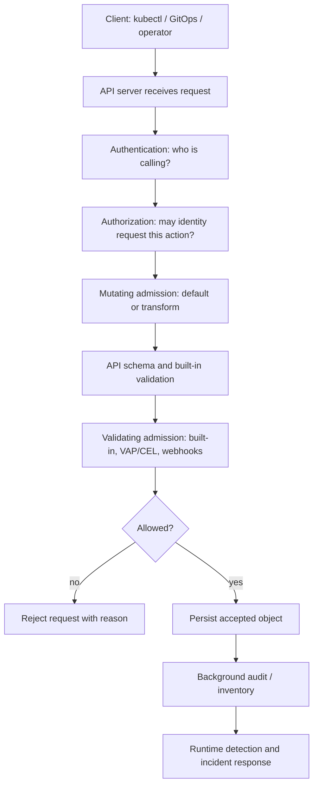
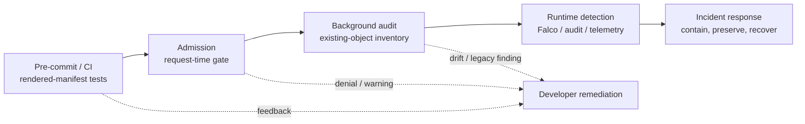
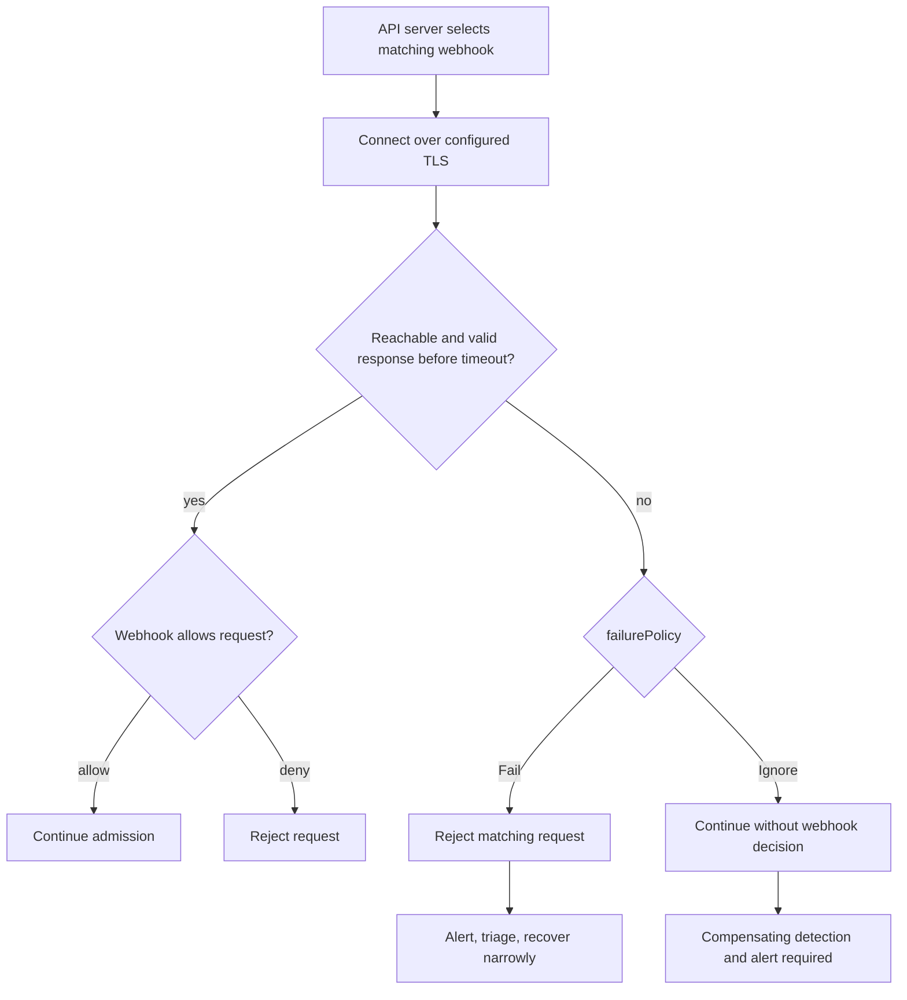
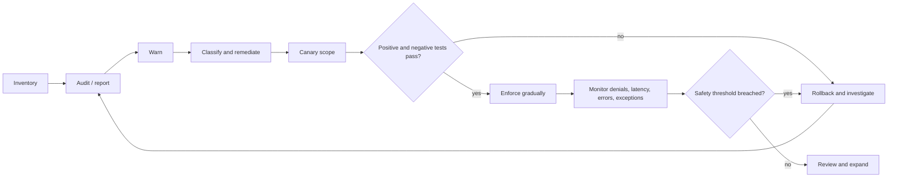
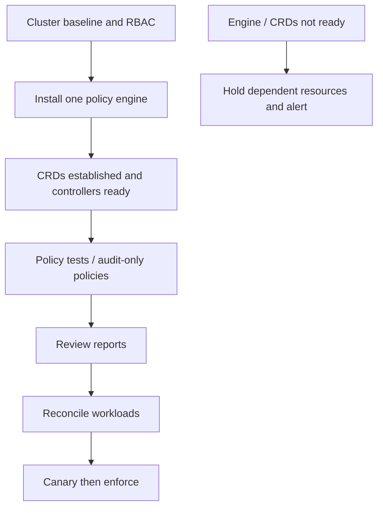
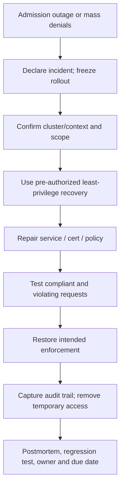

# Unit 8 — Admission Controls and Deployment Policy Enforcement

**Target file:** `08-admission-controls-and-deployment-policy-enforcement.md` | **Estimated time:** 24–36 hours | **Prerequisites:** Stage 0–2D and Stage 2E M01–M11; especially M03 Units 1/9, M04 networking/TLS, M06 Unit 4 rendered-manifest checks, M08 Unit 6 GitOps policy delivery, M09 identity/secrets, M10 change and incident management, M11 observability, and M12 Units 4, 7, 9, 10, 11, and 12.

**Core tools:** `kubectl`, `kind`, Docker, Kubernetes ValidatingAdmissionPolicy (VAP) where supported, Python 3, local fixtures, and one policy engine at a time. | **Awareness:** Kyverno, OPA Gatekeeper, `gator`, Conftest, Argo CD, Flux, cert-manager, Sigstore policy-controller, Ratify, Kubewarden, jsPolicy. | **Last reviewed:** 2026-10-29 for this authored module; re-check version-sensitive sources before use. | **Tool/spec baseline assumed:** Kubernetes version and VAP API support must be discovered from the disposable cluster; engine, CLI, CRD, metric, and GitOps syntax claims marked `[VERIFY]` require confirmation against the exact installed release. No unverified tool version is asserted. | **Footprint:** One small `kind` cluster is the baseline; webhook and policy-engine components add image/cache/storage use. Plan for 4 CPU / 8 GB RAM / 30 GB free disk, measure actual usage, and sequence heavyweight labs. | **Needs internet at lab time:** Yes for initial image/tool pulls and current docs; offline fallback is pre-pulled images plus local synthetic fixtures and static review. Offline fixtures do not prove live admission behavior.

> **Safety boundary:** Run cluster-changing commands only against the disposable `kind` cluster created for the lab. Confirm the Kubernetes context before every destructive step. Never test failure policies on production, use real credentials, or respond to a broken engine by blindly disabling all admission or granting `cluster-admin`. A successful admission test proves only the tested API path and resource scope; it does not prove that a running container is safe.

## Table of Contents

- [8.0 Why this matters in production](#80-why-this-matters-in-production)
- [8.1 Learning objectives](#81-learning-objectives)
- [8.2 Concept map and vocabulary](#82-concept-map-and-vocabulary)
- [8.3 Level 1 — Beginner](#83-level-1--beginner)
- [8.4 Level 2 — Intermediate](#84-level-2--intermediate)
- [8.5 Level 3 — Advanced](#85-level-3--advanced)
- [8.6 Level 4 — Expert](#86-level-4--expert)
- [8.7 SRE lens](#87-sre-lens)
- [8.8 Security lens](#88-security-lens)
- [8.9 Production checklist](#89-production-checklist)
- [8.10 Hands-on lab set](#810-hands-on-lab-set)
- [8.11 Self-check questions](#811-self-check-questions)
- [8.12 Evidence artifacts](#812-evidence-artifacts)
- [8.13 Common interview and design-review questions](#813-common-interview-and-design-review-questions)
- [8.14 Sources and verification notes](#814-sources-and-verification-notes)
- [Author’s Verification and Completeness Audit](#authors-verification-and-completeness-audit)

### 8.0 Why this matters in production

A trusted Git commit and signed container do not prevent a user or controller from submitting a privileged Pod, selecting an unapproved registry, omitting resource limits, or attaching an unnecessary host path. Admission controls are the last preventive checkpoint before an API object is persisted, regardless of whether it arrives through `kubectl`, GitOps, Helm, or an operator. A mis-scoped or unavailable fail-closed webhook can block routine recovery, while an exclusion or fail-open setting can silently weaken the boundary. Production policy engineering therefore requires threat modelling, safe rollout, positive and negative tests, measurable reliability, and rehearsed recovery—not merely a policy file.

### 8.1 Learning objectives

1. **[L1]** Describe the Kubernetes API request path and distinguish authentication, authorization, schema validation, mutation, validation, persistence, background audit, and runtime detection.
2. **[L1]** Compare built-in admission controls, VAP/CEL, dynamic webhooks, Kyverno, and Gatekeeper by enforcement point, availability dependency, and operational cost.
3. **[L2]** Verify VAP support on a disposable cluster and test policy acceptance/rejection with server-side dry-run and controlled fixtures.
4. **[L2]** Explain and test webhook TLS, `failurePolicy`, timeout, selectors, dry-run declarations, readiness, and recovery boundaries.
5. **[L2]** Build a CI-style regression harness and exception validator with stable results and no production-context assumptions.
6. **[L3]** Design a staged rollout: inventory, audit/warn, remediation, canary, enforce, rollback, and time-bounded exceptions.
7. **[L3]** Design supply-chain admission checks that separately evaluate registry, digest, signature identity, and attestations without overstating engine capabilities.
8. **[L3]** Analyze bypasses involving exclusions, tenant-controlled labels, init containers, pre-existing objects, and policy-engine outages.
9. **[L4]** Define admission SLI/SLO candidates, alerts, ownership, policy lifecycle governance, and rehearsed break-glass procedure.
10. **[L4]** Produce a coverage matrix and evidence bundle showing verified controls, detective-only gaps, and unresolved `[VERIFY]` items.

### 8.2 Concept map and vocabulary

#### Admission request path



**Ordering caveat:** This is a teaching model, not a universal request-path specification. Admission stages and schema-validation interactions can vary by request path and Kubernetes version. Confirm official documentation for the exact release; authorization is not admission, and persistence occurs only after required checks succeed.

#### Lifecycle control points



#### Dynamic webhook decision flow



#### Safe rollout



#### Engine bootstrap / GitOps order



#### Break-glass recovery



#### Glossary

| Term | Precise definition | Common misconception |
|---|---|---|
| Authentication | Establishes the identity associated with an API request. | It does not grant permission. |
| Authorization | Evaluates whether an identity may perform an action on a resource. | RBAC permission does not make the object safe. |
| Admission | Request-time processing before persistence, including mutation and validation. | It is not a runtime firewall. |
| Mutating admission | May modify a matching object, often to apply defaults. | Mutation can conflict with GitOps or other webhooks. |
| Validating admission | Accepts or rejects an object based on policy. | A policy can miss container arrays or nested Pod templates. |
| Admission plugin | Kubernetes-integrated behavior such as PodSecurity or ResourceQuota. | It is not the same as a third-party policy engine. |
| Dynamic admission webhook | API-server callback to an external service. | It depends on service, network, TLS and timely response. |
| VAP / CEL | Kubernetes-native ValidatingAdmissionPolicy using Common Expression Language where supported. | API support and maturity are not identical across releases. |
| `failurePolicy` | API-server behavior when a webhook call fails, typically `Fail` or `Ignore`. | `Ignore` creates an enforcement gap during failures. |
| Server-side dry-run | Processes an API request without persisting it, subject to admission dry-run compatibility. | It does not test all runtime/controller behavior. |
| Audit | Records or evaluates state/events; background audits find existing objects. | A report does not itself block a future request. |
| Enforcement | A control actually rejects or prevents a prohibited operation. | “Policy installed” does not prove it matched or rejected anything. |
| Exemption | Deliberate scope exclusion or exception. | An unowned, indefinite, tenant-controlled exclusion is a bypass. |
| TOCTOU | Time-of-check/time-of-use gap between evaluating an object and its later use. | Admission cannot guarantee runtime behavior. |
| PDB | PodDisruptionBudget constrains certain voluntary disruptions under its semantics. | It does not guarantee availability against all failures. |
| Policy report | Engine-specific report of evaluated resources/violations, where supported. | CRD names, fields and completeness vary by engine/version. |

#### VAP, webhook, Kyverno, Gatekeeper comparison

| Mechanism | Strengths | Constraints / dependency | Typical use |
|---|---|---|---|
| Built-in controls | Native integration, fewer components. | Limited to documented built-in semantics; defaults need verification. | PSS, quota and resource guardrails. |
| VAP + CEL | In-process declarative validation, no external policy-service call. | `[VERSION-SENSITIVE]` API and CEL behavior; no arbitrary external lookup assumption. | Common invariants expressible in CEL. |
| Dynamic webhook | Custom request-time validation or mutation. | TLS, service, network, latency, scaling and failure-policy dependencies. | Narrow custom rule unsupported by simpler mechanisms. |
| Kyverno | Kubernetes-oriented workflows; image verification/reporting depends on release. | Controllers, CRDs, RBAC, upgrade and availability work; exact features `[VERIFY]`. | Verified Kubernetes-native policy workflow or image verification. |
| OPA Gatekeeper | Rego constraints and audit ecosystem. | Controller/webhook/CRDs and Rego complexity; do not assume native signature verification. | Central constraints when Rego fits the team. |

**Boundary:** Unit 11 teaches Kyverno and Gatekeeper authoring in depth. Unit 8 uses them for architecture comparison, sequenced image-verification and operational integration only. Never install Kyverno and Gatekeeper simultaneously in the same lab cluster.

#### Built-in admission controls versus custom policy

| Control | Purpose | Operational note |
|---|---|---|
| PodSecurity admission / PSS | Apply baseline/restricted Pod security profiles at namespace scope. | Verify namespace labels, exemptions and version behavior. |
| ResourceQuota | Bound aggregate namespace resource consumption and selected object counts. | Does not guarantee every container has suitable limits unless configured. |
| LimitRanger | Apply defaults and enforce selected per-object resource constraints. | Defaults can mask missing explicit workload intent. |
| NodeRestriction | Restrict kubelet identities from modifying resources outside permitted scope. | Requires documented authentication/authorization setup; verify enabled config. |
| ServiceAccount admission | Applies ServiceAccount-related behavior to Pod creation. | Token automount and identity design connect to M09. |
| VAP / webhook / policy engine | Add organization-specific invariants. | Adds testing, exception and reliability obligations. |

Built-in plugin enablement/defaults vary by distribution and release. Inspect actual cluster configuration and official docs; do not infer production behavior from `kind` defaults.

### 8.3 Level 1 — Beginner

#### 8.3.1 Why admission is separate

A pipeline may validate manifests and scan an image, but a user or controller with API permissions can submit a different object. Admission lets the cluster inspect the requested object before persistence. It is useful for invariants independent of caller: approved registry, non-root execution, no privileged mode, resource declarations, owner labels and restrictions on host access.

Admission does not replace authentication/authorization, CI feedback, background audits, runtime controls, or incident response. A valid object can still run vulnerable code; a broken gate can become an availability incident.

#### 8.3.2 Request path and validation layers

The conceptual path is API request → authentication → authorization → mutating admission → schema validation → validating admission → persistence. Verify exact order/interactions against the installed Kubernetes version. Authentication failure is not fixed by admission policy; authorization failure is not fixed by an exception; schema errors should not be disguised as policy issues.

Mutations must be idempotent. A validator should cover relevant `containers`, `initContainers`, and where applicable `ephemeralContainers`, plus controllers whose Pod template is nested beneath a higher-level resource.

#### 8.3.3 Audit, warn, enforce

- **Audit:** discover violations without necessarily blocking requests. Engine background scans, Kubernetes audit events, and VAP `Audit` actions are different mechanisms.
- **Warn:** return feedback where supported; clients can ignore warnings.
- **Enforce/deny:** reject a violating request.

Start non-blocking, inventory actual workloads, remediate, canary, then enforce gradually. “Start in audit” means gather evidence and plan a controlled transition—not leave critical controls non-enforcing forever.

#### 8.3.4 Preflight and disposable cluster

**Execution context: host shell.** Prerequisites: Docker or compatible runtime, `kind`, `kubectl`; record versions. These commands create a new lab cluster only.

```bash
kind version
kubectl version --client
kubectl config get-contexts
kind create cluster --name admission-lab
kubectl --context kind-admission-lab cluster-info
kubectl --context kind-admission-lab get nodes
kubectl --context kind-admission-lab api-resources | grep -i validatingadmissionpolicy || true
kubectl --context kind-admission-lab version -o yaml
```

If creation fails, stop and inspect runtime/disk. If `kind-admission-lab` does not exist, do not substitute the current default context. Explicitly pass `--context kind-admission-lab` for lab changes. Missing VAP API is a stop condition, not a reason to guess an API version; use the labelled fixture fallback in Lab 1.

#### 8.3.5 Baseline Pod and negative fixture

**Execution context:** save locally and apply only to the disposable context. The image digest is a placeholder; replace with a local approved digest before live use.

```yaml
apiVersion: v1
kind: Namespace
metadata:
  name: admission-demo
  labels:
    pod-security.kubernetes.io/enforce: restricted
    app.kubernetes.io/part-of: admission-training
---
apiVersion: v1
kind: Pod
metadata:
  name: api-compliant
  namespace: admission-demo
  labels:
    app.kubernetes.io/name: model-api
    app.kubernetes.io/part-of: admission-training
    owner: platform-ml
spec:
  automountServiceAccountToken: false
  securityContext:
    runAsNonRoot: true
    seccompProfile:
      type: RuntimeDefault
  containers:
    - name: api
      image: registry.lab.local/ml/model-api@sha256:<REPLACE_WITH_64_HEX_DIGEST>
      securityContext:
        allowPrivilegeEscalation: false
        readOnlyRootFilesystem: true
        capabilities:
          drop: ["ALL"]
      resources:
        requests: {cpu: "100m", memory: "128Mi"}
        limits: {cpu: "500m", memory: "512Mi"}
      ports:
        - name: http
          containerPort: 8080
```

This is a template, not directly applicable until its digest/image are replaced. Test `RuntimeDefault`, read-only root filesystem and resource values against the application. If it needs a writable cache, add a bounded writable volume instead of removing hardening by default.

Negative fixtures should vary `runAsNonRoot`, privileged mode, `hostPath`, owner label, `:latest`, resource declarations and registry. A negative test must show that the intended rule rejected the object, with version/context recorded.

#### 8.3.6 Common beginner mistakes

| Mistake | Symptom | Fix |
|---|---|---|
| Confuse RBAC with admission | Allowed user creates insecure Pod. | Keep least-privilege RBAC and add request validation. |
| Treat warning as denial | Noncompliant Pod persists. | Run a negative test and verify rejection. |
| Check only `containers` | Bad init container passes. | Cover all relevant arrays and templates. |
| Enforce immediately | Rollouts fail unexpectedly. | Inventory, warn, remediate, canary, enforce. |
| Exclude broad namespaces | Large policy bypass surface. | Narrow, centrally controlled exclusions and audit. |
| Assume old objects are rechecked | Legacy resource remains. | Background audit and remediation. |
| Ignore webhook outages | Enforcement silently disappears. | Alert on availability and fail-open intervals. |

### 8.4 Level 2 — Intermediate

#### 8.4.1 VAP and CEL design

VAP uses CEL validation where supported. A policy defines match constraints and validations; a binding selects effective scope and validation actions. `paramKind` belongs to the policy parameterization structure, while binding fields select parameters/actions according to the installed API schema. Exact API versions and field placements are `[VERSION-SENSITIVE]`; inspect OpenAPI and official docs before applying examples.

CEL rules must handle absent/null fields and type mismatches. Test empty maps, absent labels/security contexts, multiple containers and malformed values. Never assume an evaluation error is equivalent to a denial or pass without checking documented semantics.

**Illustrative schema pattern only; not guaranteed directly applicable.** Replace placeholders only after verifying target API/schema.

```yaml
# [ILLUSTRATIVE][VERSION-SENSITIVE]
apiVersion: admissionregistration.k8s.io/<VERIFY_SUPPORTED_VERSION>
kind: ValidatingAdmissionPolicy
metadata:
  name: require-owner-label
spec:
  failurePolicy: Fail
  matchConstraints:
    resourceRules:
      - apiGroups: [""]
        apiVersions: ["v1"]
        operations: ["CREATE", "UPDATE"]
        resources: ["pods"]
        scope: Namespaced
  validations:
    - expression: "has(object.metadata.labels) && 'owner' in object.metadata.labels && size(object.metadata.labels['owner']) > 0"
      message: "Set metadata.labels.owner to the accountable team."
---
apiVersion: admissionregistration.k8s.io/<VERIFY_SUPPORTED_VERSION>
kind: ValidatingAdmissionPolicyBinding
metadata:
  name: require-owner-label
spec:
  policyName: require-owner-label
  validationActions: [Warn, Audit]
```

The placeholder avoids falsely asserting universal API support. Discover resources, inspect schema with `kubectl explain`/OpenAPI, then test compliant and violating fixtures using server-side dry-run. If unverifiable, keep the example illustrative and use local fixtures.

#### 8.4.2 Required policy catalogue

Lab 1 must include at least eight distinct policies with positive and negative tests.

| ID | Invariant | Positive | Negative | Caveat |
|---|---|---|---|---|
| VAP-01 | Non-root | `runAsNonRoot: true` | False/missing where required | Pod/container security contexts interact. |
| VAP-02 | Registry allow-list | `registry.lab.local/` boundary | `registry.lab.local.evil/...` | Avoid substring matching. |
| VAP-03 | No `latest`, digest required | `repo/app@sha256:<digest>` | `repo/app:latest` or tag only | Test tag+digest semantics. |
| VAP-04 | Requests and limits | CPU/memory on all relevant containers | Missing request/limit | Include init containers/templates. |
| VAP-05 | Owner/team labels | Non-empty labels | Missing/empty labels | Prevent tenant-controlled opt-outs. |
| VAP-06 | No privileged/host access | No privileged mode/hostPath | `privileged: true` or hostPath | Cover all container types and volumes. |
| VAP-07 | Capabilities/seccomp | Drop unnecessary capabilities; approved baseline | Prohibited capability/profile omission | Runtime support must be tested. |
| VAP-08 | Token automount | Disabled where unnecessary | True/omitted where policy requires false | Document workloads needing identity. |
| VAP-09 | Probes | Appropriate probes present | Required probe missing | Jobs need different rules. |
| VAP-10 | Service exposure | Approved internal Service | Unapproved NodePort/LoadBalancer | Provider/environment scope differs. |
| VAP-11 | NetworkPolicy inventory | Expected policy object present | Missing object in audit | Presence is detective, not proof of CNI enforcement. |
| VAP-12 | Ingress hostname | Approved host | Unapproved host | API/gateway CRDs vary. |

VAP must not be assumed to query arbitrary cluster-wide resources or external registries. Signature/attestation checks, cross-object existence checks and dynamic external data may need an engine, webhook, CI gate or background auditor. Map the actual enforcement component for each requirement.

#### 8.4.3 AdmissionReview decision logic

A validating webhook receives an `AdmissionReview`, evaluates the object, and returns a response containing the matching request UID and an `allowed` decision. Denials should provide an actionable message. The API server must trust the service TLS certificate; exact schema and behavior are `[VERIFY]` for the target release.

```python
# Pure decision core for tests; this is not a complete HTTPS server.
from typing import Any


def validate_pod(pod: dict[str, Any]) -> tuple[bool, str]:
    metadata = pod.get("metadata") or {}
    labels = metadata.get("labels") or {}
    owner = labels.get("owner")
    if not isinstance(owner, str) or not owner.strip():
        return False, "Set metadata.labels.owner to the accountable team."
    return True, "owner label present"


def admission_response(review: dict[str, Any]) -> dict[str, Any]:
    request = review.get("request") or {}
    uid = request.get("uid")
    if not isinstance(uid, str) or not uid:
        raise ValueError("AdmissionReview request.uid is required")
    allowed, message = validate_pod(request.get("object") or {})
    response: dict[str, Any] = {"uid": uid, "allowed": allowed}
    if not allowed:
        response["status"] = {"message": message, "reason": "Invalid"}
    return {"apiVersion": review.get("apiVersion"), "kind": "AdmissionReview", "response": response}
```

A complete service must validate AdmissionReview kind/version, handle intended operations, serve HTTPS, return correct content type/status, implement readiness/liveness and graceful shutdown, use a trusted certificate, and avoid logging sensitive object contents. Lab 2 specifies the deployment wiring and failure drill; no live execution is claimed here.

#### 8.4.4 Webhook fields and reliability

| Field | Meaning | Failure concern |
|---|---|---|
| `failurePolicy: Fail` | Call failure blocks matching requests. | Endpoint/certificate outage can block deploys and recovery. |
| `failurePolicy: Ignore` | Call failure does not block request. | Enforcement gap during outage; alert and compensate. |
| `timeoutSeconds` | Bounds API-server wait per documented limits. | Verify allowed range; set from measured latency. |
| `namespaceSelector` | Selects namespaces by labels. | Tenant-controlled labels can create bypasses. |
| `objectSelector` | Selects objects by labels. | Object labels may be attacker-controlled. |
| `matchPolicy` | Controls matching across served API versions. | Verify behavior and served versions. |
| `sideEffects` | Declares webhook side effects and affects dry-run compatibility. | Incorrect declaration breaks dry-run expectations. |
| `admissionReviewVersions` | Declares supported AdmissionReview versions. | Service must share a supported version with API server. |
| Service/TLS CA bundle | Locates service and establishes trust. | DNS, SAN, CA trust and rotation need end-to-end tests. |
| `reinvocationPolicy` | Governs mutating webhook reinvocation under documented conditions. | `[VERIFY]`; mutations should be idempotent regardless. |

| Pattern | Use when | Avoid when |
|---|---|---|
| Narrow match rules/selectors | Only selected resources need the rule. | Selectors are tenant-manipulable or untested. |
| Multiple replicas across failure domains | Requests are business-critical. | Replica count is mistaken for complete HA. |
| Readiness/liveness | Service must be ready before receiving reviews. | Probe tests only process existence, not decision path. |
| PDB | Constrain selected voluntary disruptions. | Treated as protection from all crashes/node failures. |
| Fail-closed with recovery | Invariant is critical and HA/recovery is rehearsed. | No monitoring or authorized recovery exists. |
| Fail-open with compensation | Lower-risk check has independent detection. | High-impact control has no compensating control. |
| Narrow system exclusions | Specific platform components require an exception. | Entire namespaces excluded for convenience. |

#### 8.4.5 Image verification at admission

Keep five checks distinct: (1) approved registry, (2) digest pinning, (3) signature by expected key/identity, (4) provenance/SBOM/scan attestation conditions, and (5) freshness or known-bad digest denial. Unit 4 owns signing; Unit 10 owns provenance; Unit 11 owns deep engine authoring. Kyverno `verifyImages` is an example only after checking the installed release and CRD schema. Do not claim Gatekeeper verifies signatures natively without naming and verifying an external component.

| Anti-pattern | Failure | Correction |
|---|---|---|
| Check only `containers` | Init container escapes scope. | Check `containers`, `initContainers`, relevant ephemeral containers and templates. |
| Registry substring match | `registry.lab.local.evil` may pass. | Use boundary-aware reference checks and negative test. |
| Global enforce on day one | Existing workloads/system components blocked. | Audit/warn, remediate, canary, expand. |
| Trust any key | Retired/unrelated signer accepted. | Pin expected identity/key and test wrong key. |
| Tenant-controlled opt-out label | Tenant bypasses policy. | Centrally control labels/RBAC and audit exclusions. |
| Mutate all security fields | Hidden intent and GitOps drift. | Validate invariants; mutate only safe, documented defaults. |
| Ignore webhook outage | Enforcement silently disappears. | Alert on health, errors, fail-open intervals and coverage. |
| Policy before CRDs ready | Reconciliation fails or policy not evaluated. | Engine → CRDs/readiness → policies → workloads. |
| Treat report as enforcement | Violating resource persists. | Negative test and capture denial or detective finding. |
| Indefinite exception | Temporary bypass becomes permanent. | Owner, reason, controls, approval, expiry and renewal/revocation. |

### 8.5 Level 3 — Advanced

#### 8.5.1 Architecture decision: smallest effective policy stack

Prefer built-in controls first. Use PSS for supported Pod security profiles, ResourceQuota/LimitRanger for consumption controls, and VAP/CEL for common invariants where the cluster release supports the needed fields and semantics. Add Kyverno or Gatekeeper only where verified capabilities justify an extra availability dependency—for example, mutation/generation, image verification, richer reporting or complex workflows. A custom webhook should solve a specific gap that cannot be handled safely by simpler controls.

| Option | Benefit | Cost | Risk | Choose when |
|---|---|---|---|---|
| Built-in controls | Native integration, low extra burden. | Limited to documented semantics. | May not cover organization-specific rules. | Baseline security and resource guardrails. |
| VAP/CEL | In-process validation without external webhook call. | Version support and CEL complexity. | Evaluation errors or missing-field gaps. | Common invariants with tested schemas. |
| Kyverno | Kubernetes-oriented policy workflows; image verification/reporting may be available. | Controller, CRDs, RBAC, upgrades and on-call. | Match-scope, mutation or trust-policy defects. | Verified feature gap and team expertise. |
| Gatekeeper | Rego constraints and audit ecosystem. | Rego/controller/CRD/report complexity. | Constraint defects can over- or under-enforce. | Rego fit and central governance need. |
| Custom webhook | Arbitrary domain-specific logic. | Highest bespoke service/TLS/on-call burden. | Code bugs, latency, certificate expiry, failure-policy blast radius. | Narrow requirement with no simpler suitable option. |

Record an Architecture Decision Record (ADR): threat addressed, alternatives, verified versions/features, failure policy, exception design, performance test, owner, rollback plan and revisit date. Do not select an engine merely because it is familiar or feature-rich.

#### 8.5.2 Failure-policy design

`Fail` and `Ignore` describe behavior when a dynamic webhook call fails; they do not change what happens when the webhook successfully returns an explicit denial. Fail-closed may be appropriate for a critical invariant only if service, certificates, network, capacity, monitoring and recovery are engineered and rehearsed. Fail-open for a lower-risk check requires compensating controls and strong alerts.

| Choice | Benefit | Failure mode | Required guardrail |
|---|---|---|---|
| Fail closed | Matching requests do not proceed when the service cannot decide. | Outage can block deploys, operators and recovery objects. | HA, bounded timeout, endpoint/cert alerts, rehearsed break-glass, narrow match rules. |
| Fail open | API availability during webhook failure. | Noncompliant requests can pass during outage. | Alert on every failure interval, background audit, CI gate, compensating controls and accepted risk. |

Never use broad exclusions as a shortcut to repair a broken webhook. Freeze rollout, diagnose, repair endpoint/certificate/policy, and use only the approved narrow recovery path if needed.

#### 8.5.3 Policy rollout and exit criteria

| Stage | Evidence required to advance | Stop / rollback trigger |
|---|---|---|
| Inventory | Matching resources, namespaces, owners and current violations. | Unknown scope or missing ownership. |
| Audit | Violation report, false-positive classification and tested coverage. | Policy does not match expected resources or errors are unexplained. |
| Warn | Developer-visible messages and warning volume understood. | Warnings are noisy or unactionable. |
| Remediate | Owners/dates assigned; exceptions have expiry and controls. | Critical workload lacks a compliant path. |
| Canary | Compliant accepted; violating rejected; latency/error behavior observed. | Unexpected denial of critical operations or SLO breach. |
| Enforce | Scope and rollback approved; on-call knows runbook. | Lab threshold breached, e.g. unexplained denial in canary `[ASSUMPTION]`. |
| Expand/review | Findings, exceptions, metrics and bypass tests reviewed each wave. | Upgrade changes semantics or audit coverage drops. |

A safe change record includes policy diff, threat-model link, owners, compatibility tests, positive/negative fixture results, current violations, affected namespaces, communication plan, rollback, break-glass approver and expiry for any temporary relaxation.

#### 8.5.4 GitOps bootstrap and drift

Policy engine CRDs/controllers must exist and be ready before dependent policies reconcile. Workloads should not depend on a policy that has not been installed and validated. Argo CD sync waves and Flux dependency mechanisms can implement ordering, but exact syntax is version-sensitive; use official docs for the installed release. A local simulation proves only ordering logic, not live reconciliation.

Mutation can create drift when the API server stores an object different from Git-rendered desired state. Before adding ignore-differences rules, determine which field is mutated, whether mutation is safe/deterministic, and whether ignored fields could conceal attacker-controlled changes. Prefer validation for security invariants; mutate only safe, explainable defaults.

#### 8.5.5 Multi-tenancy and exception governance

Separate policy ownership from workload ownership. Teams may own namespace metadata and request exceptions, but should not weaken cluster-wide policy, alter webhook configuration, change global bindings or grant themselves exclusions. Protect policy objects and selector labels with RBAC. Audit changes to `ValidatingWebhookConfiguration`, `MutatingWebhookConfiguration`, VAP policies/bindings, engine CRDs and exception resources.

| Exception field | Requirement |
|---|---|
| `id`, `policy` | Stable ID and exact policy/control. |
| `scope` | Explicit namespace/resource selector; wildcard requires separate high-risk approval. |
| `reason`, `risk` | Specific operational need and residual risk. |
| `owner` | Named accountable team/service owner. |
| `compensating_controls` | Concrete controls, evidence and limitations. |
| `approved_by` | Authorized reviewer; independent from requester for high-risk cases. |
| `created_at`, `expires_at` | Valid dates, expiry after creation, bounded duration per organization policy. |
| `review_state` | Proposed, approved, expired, revoked or renewed. |
| `evidence_ref` | Local record/reference without credentials or private data. |

Exceptions should be stored as code, checked in CI, reported before expiry, escalated after expiry and revoked when unnecessary. Missing owner/expiry must never mean permanent approval.

#### 8.5.6 CI policy tests and mutation tests

Run checks against the same rendered manifests GitOps will deploy. M06 Unit 4 already teaches rendered-manifest validation; reuse it. Unit 11 owns deep Kyverno/Gatekeeper authoring, but this unit’s harness requires compliant fixtures, one violation per invariant and regression cases for known bypasses. Kyverno CLI, Gatekeeper `gator`, and Conftest syntax are `[VERIFY]` for the installed versions. Do not require both policy engines in one cluster.

A mutation test changes/removes a field or adds a known violation and verifies that the test suite catches it. Examples: remove owner label, add `hostPath`, add a bad init container, change digest to tag, use wrong signature key, or expire an exception. A green suite with no known-bad fixtures is weak evidence. Server-side dry-run is not a replacement for local tests and is only available where the API and admission components support it.

#### 8.5.7 Supply-chain bundle mapping

| Requirement | Enforcement point | Positive / negative test | Residual limitation |
|---|---|---|---|
| Approved registry | CI and admission | Approved path passes; unlisted path denied. | Registry name does not prove integrity. |
| Digest pinning | CI and admission | Digest passes; tag-only fails. | Digest does not imply benign content. |
| Trusted signature | Verified engine/component | Trusted signer passes; unsigned/wrong key fails. | Trust policy/signer can be compromised. |
| Provenance | CI/engine only if supported | Expected builder/source passes; unexpected source fails. | Not every engine supports every predicate. |
| SBOM/scan attestation | CI or engine if supported | Required evidence present/compliant; missing/stale evidence rejected. | Quality/freshness require policy. |
| Known-bad digest | Admission deny-list plus inventory | Listed digest denied. | Existing Pods need separate remediation. |
| Hardened Pod | PSS/VAP/engine | Restricted passes; privileged/host access fails. | Cannot prevent vulnerable application logic. |
| Default-deny network | NetworkPolicy audit plus CNI test | Object exists and connectivity behaves as expected. | Object presence does not prove CNI enforcement. |
| ServiceAccount hygiene | Admission plus M09 identity controls | Unnecessary token automount rejected. | Some workloads legitimately need identity. |
| Exception expiry | CI checker/controller/report | Valid passes; expired/missing-owner fails. | Live enforcement depends on integration. |

#### 8.5.8 Incident scenarios

| Scenario | Evidence | Safe containment/recovery | Durable prevention / owner / metric |
|---|---|---|---|
| Fail-closed engine crash blocks deployments | API errors, endpoints, readiness, changes/timestamps | Freeze rollout; repair service/cert; use narrow approved break-glass only if necessary; test both outcomes. | Platform owner; availability/denial alerts; rehearse recovery. |
| Enforce policy blocks rollouts | Policy diff, canary results, denied objects, timeline | Stop expansion; rollback only affected revision/scope. | Policy owner; canary evidence and unexpected-denial rate. |
| Certificate expires | API errors, certificate dates/SAN/issuer, service name | Renew through approved process; verify trust/endpoints and tests. | Certificate owner; expiry alert and rehearsal. |
| Exempt namespace becomes bypass | Labels, selectors, RBAC, audit events | Restore centrally controlled scope; inspect affected workloads. | Cluster policy owner; exclusion inventory/age. |
| Tenant label opts out | RBAC/labels and negative fixture | Remove tenant control of selector label; add regression test. | Platform RBAC owner; bypass coverage. |
| Mutation fights GitOps | Desired/stored object, webhook mutation, reconciliation diff | Pause rollout; remove conflict or define field ownership; verify stable reconcile. | GitOps owner; OutOfSync duration/repeated patch rate. |
| Init container missed | Stored Pod spec and policy coverage | Fix expression/scope, remediate and test all arrays. | Policy owner; container-category test coverage. |
| Retired signing key still trusted | Trust config/key IDs, digest, audit history | Reviewed trust update; block affected digests if needed; rebuild/re-sign. | Supply-chain owner; signer inventory/retirement SLA. |
| Policy bug reports zero findings | Fixtures, evaluation errors, logs, known-bad object | Treat zero as suspicious until probes pass; restore known-good policy. | QA owner; mutation-test coverage/audit freshness. |
| Upgrade changes behavior | Release notes, CRD schema, logs, before/after fixtures | Halt upgrade; rollback supported version/config; preserve evidence. | Engine owner; conformance gate/version inventory. |
| Generate rule creates excess RoleBindings | Policy diff, generated objects, RBAC audit | Stop generation; revoke inappropriate bindings via reviewed change. | Security owner; generated-RBAC review. |
| Engine absent during bootstrap | Dependency state, CRD availability, reconcile errors | Hold policies/workloads until engine and CRDs ready. | GitOps owner; bootstrap test/time-to-ready. |

### 8.6 Level 4 — Expert

#### 8.6.1 Policy as a production service

A mature admission program has a policy owner, platform owner, workload owner and incident responder. Every policy has a threat rationale, severity, scope, positive/negative fixtures, compatibility notes, exception process, metrics, rollback and review date. Policy code follows application lifecycle: review, test, version, canary, monitor, deprecate and retire.

Minimum governance controls:

1. Protect policy/webhook configuration through RBAC and GitOps review; alert on out-of-band changes.
2. Pin and verify engine images/charts according to Unit 4’s trust model; exact verification syntax is `[VERIFY]`.
3. Review controller RBAC and remove permissions not required by enabled features. Treat Kyverno generation rules as privileged automation because they can create resources such as RoleBindings.
4. Restrict webhook network access to intended callers using M04 controls; test actual CNI enforcement.
5. Maintain compatibility matrix for Kubernetes, CRDs, engine versions and resource kinds.
6. Test synthetic valid/invalid fixtures before release; run mutation tests and periodically re-test bypasses.
7. Inventory exclusions, exceptions, signing identities and owners; do not accept unowned/indefinite exceptions silently.
8. Define deprecation/retirement so unowned policies do not become accidentally permissive after upgrades.

#### 8.6.2 Metrics and alerting

Use verified exporter metrics when available. Do not invent built-in names. If needed, implement a custom exporter or use labelled synthetic fixture data. Define numerator, denominator, window, labels and missing-data behavior.

| SLI / metric | Definition | Caveat |
|---|---|---|
| Admission latency | Duration of matching admission evaluations. | Distinguish API-server total latency from webhook latency; use p50/p95/p99 only if source supports it. |
| Webhook availability | Successful health/readiness probes divided by scheduled probes. | Health endpoint alone does not prove admission decision works. |
| Webhook error rate | Failed calls divided by matching calls. | Separate timeout, TLS, network, invalid response and explicit denial. |
| Denial rate | Denied requests divided by evaluated matching requests. | Denials can be correct or accidental; segment by policy/scope. |
| Warning rate | Warned requests divided by matching requests. | Sudden zero may mean policy stopped matching; pair with coverage probes. |
| Evaluation failure | Failed evaluations divided by all evaluations. | Metric name/labels depend on engine/version. |
| Audit coverage | In-scope inventory evaluated in window divided by total in-scope inventory. | Missing/stale reports are not clean results. |
| Exception hygiene | Active exceptions with owner/future expiry divided by active exceptions. | Track expired and overbroad entries separately. |
| Remediation lead time | Time from confirmed violation to verified fix. | Define severity and start/stop events. |
| Negative-test coverage | Required cases with passing rejection tests divided by required cases. | Program metric, not proof of runtime safety. |

Example Prometheus-style rules below use **custom lab metrics**, not claimed built-in series:

```yaml
# [ILLUSTRATIVE] Custom metrics emitted by the lab fixture exporter.
groups:
  - name: admission-policy-lab
    rules:
      - alert: AdmissionWebhookUnavailable
        expr: admission_webhook_up == 0
        for: 2m
        labels: {severity: page}
        annotations:
          summary: "Admission webhook health probe is failing"
          runbook: "Freeze rollout; inspect endpoints, TLS, readiness and API errors."
      - alert: AdmissionPolicyEvaluationErrors
        expr: rate(admission_policy_evaluation_errors_total[5m]) > 0
        for: 5m
        labels: {severity: ticket}
        annotations:
          summary: "Policy evaluation errors observed"
          runbook: "Check schema, controller logs and known-bad fixtures."
      - alert: AdmissionExceptionExpired
        expr: admission_exceptions_expired > 0
        for: 1m
        labels: {severity: ticket}
        annotations:
          summary: "Expired exceptions require action"
          runbook: "Notify owner, apply expiry workflow and preserve review evidence."
```

These series are custom fixture metrics. Verify `for` and rule syntax against the installed Prometheus version. Test alert routing in a disposable M11 stack or with synthetic events.

#### 8.6.3 Performance, scale and availability

Admission latency affects matching API requests. Impact depends on request volume, policy complexity, webhook latency, API-server behavior, timeout and scope. Measure locally and label results as laptop measurements; do not extrapolate `kind` data to production. Reduce cost by narrowing match scope without creating bypasses, avoiding external lookups in synchronous admission, keeping rules bounded, sizing from measurements, testing probes against the decision path, and monitoring coverage. Review replicas, placement, resources, PDB, TLS rotation and endpoints as one availability design.

#### 8.6.4 Break-glass procedure

Break-glass is an authorized, narrow and auditable recovery path—not a general bypass.

1. Declare incident under M10 and freeze policy rollout.
2. Confirm current context; explicitly verify `kind-admission-lab`. Abort if it is not the disposable lab.
3. Collect API errors, endpoints, readiness, recent changes, certificate state and audit events.
4. Prefer repairing service, endpoint, certificate or policy. If temporary configuration change is unavoidable, use the narrowest pre-approved object/scope and record before/after state.
5. Set explicit expiry/review time. Do not remove all admission or grant `cluster-admin` generically.
6. Verify a compliant request is accepted and a known violation is rejected after recovery.
7. Restore intended failure policy/scope and verify no temporary exception remains.
8. Remove temporary access, preserve evidence and create regression/postmortem actions.

#### 8.6.5 Ecosystem and deferred topics

Kubewarden, jsPolicy and other frameworks should be compared only with current verified feature claims. Record a decision and revisit date rather than adding engines without a threat-model need. Multi-cluster distribution is deferred to M14; golden paths/shared policy packs to M16; integrated capstone to M17 per the syllabus forward references. This unit establishes lifecycle/evidence but does not teach multi-cluster rollout.

### 8.7 SRE lens

#### 8.7.1 Admission SLO design

Define the population of matching requests, source and measurement window before selecting targets. Do not copy universal latency/error thresholds from examples. Production targets must follow measured workload requirements and risk tolerance.

| Candidate SLI | Denominator | Failure condition | Response |
|---|---|---|---|
| Webhook success | All matching webhook calls | Timeout, TLS failure, unreachable endpoint, invalid response | Check endpoints, trust chain, readiness, network and saturation. |
| Admission latency | Matching requests observed by selected source | p95/p99 above approved budget | Reduce scope/complexity and inspect saturation/dependencies. |
| Denial quality | Denials sampled by policy/reason | Unexpected denial or unhelpful message | Freeze rollout, classify denial, improve message/tests. |
| Evaluation coverage | Expected in-scope resources/probes | Missing reports or probe no longer matches | Treat missing data as unknown, restore controller/policy. |
| Exception freshness | All active exceptions | Missing owner/expiry or expired exception remains active | Notify owner, apply expiry workflow and escalate. |

#### 8.7.2 Fail-closed and fail-open blast radius

- **Fail-closed:** prevents matching requests when the webhook cannot decide, but can cause control-plane availability incidents. Blast radius depends on match scope, kinds, selectors, timeout and whether recovery resources match.
- **Fail-open:** preserves API operations but permits matching requests without that decision. Make the gap visible, bounded where possible, and covered by background audit/CI or another control.
- **VAP:** avoids an external webhook network dependency for supported validations, but schema/API support and evaluation errors still need tests.
- **Engine outage:** distinguish request-path webhook failure from background controller/audit failure; one may work while the other is stale.

#### 8.7.3 Runbook: admission outage or mass denial

**Trigger:** webhook unavailable, elevated call errors/latency, unexpected denial surge, or a synthetic compliant request failing.

1. **Triage:** identify scope/start time, confirm context, inspect recent policy/engine/certificate changes, separate explicit denials from transport errors.
2. **Mitigate:** freeze expansion; repair service/certificate or restore known-good policy. Use break-glass only with documented authorization and narrow scope.
3. **Verify:** run compliant and violating fixtures; check endpoints and coverage; prove enforcement is restored, not merely that requests succeed.
4. **Follow up:** remove temporary relaxations, preserve audit records, hold M10 postmortem, add regression test/alert/owner/due date.

#### 8.7.4 Cost and capacity

VAP avoids a separately scaled webhook for its own validation path, but API-server evaluation and policy complexity still matter. Webhooks/engines add CPU/memory, upgrades, certificates, CRDs, RBAC, policy tests and on-call toil. Choose the smallest set that meets the threat model. Sequence heavyweight components; never run Kyverno and Gatekeeper together in the lab cluster.

### 8.8 Security lens

#### 8.8.1 Threat mapping and residual risk

| Threat | Admission control | Independent verification | Residual risk |
|---|---|---|---|
| Privileged Pod/host access | PSS/VAP/engine rejects forbidden fields. | Positive/negative API tests and stored-spec audit. | Exemptions, unsupported kinds, missed templates, authorized policy changes. |
| Unapproved/mutable image | Registry allow-list and digest requirement. | Wrong registry/tag-only tests. | Digest can contain malicious code; mirror/trust policy can be compromised. |
| Unsigned/wrongly signed image | Verified signature component at admission. | Trusted signer, unsigned and wrong-key tests. | Trust root, verifier policy, signer identity and freshness. |
| Missing provenance/SBOM/scan evidence | Engine if supported; otherwise CI gate plus audit. | Missing/incorrect attestation fixture. | Predicate support and evidence quality vary. |
| Excess resource consumption | Quota, LimitRanger and policy checks. | Missing/over-budget fixtures. | Runtime can use its allowed budget; quota may block valid work. |
| Namespace/label bypass | Central selectors and RBAC. | Tenant opt-out test. | Cluster admins/misconfigured automation can change scope. |
| Runtime behavior | Admission sets configuration baseline. | Unit 7 hardening and Unit 12 detection. | Admission cannot prevent all application compromise. |
| Policy-engine compromise | RBAC, pinned artifacts, network restriction, audit/tests. | Controller permission and policy-change review. | Compromised controller/author can undermine policy. |

#### 8.8.2 Trust boundaries and bypasses

Admission trust depends on API-server configuration, identity allowed to alter policy, webhook TLS, engine image/RBAC, selectors and verifier trust roots. Protect policy configuration as carefully as workload configuration. Alert on webhook config, VAP policy/binding, engine CRD, exception, namespace-selector label and relevant RBAC changes.

Required bypass checks: exempt namespace; `Ignore` outage; tenant-controlled opt-out label; init/ephemeral containers; pre-existing object; unsupported kinds/CRDs wrapping Pod specs; stale background scan; engine/CRDs absent during bootstrap; cluster-admin policy changes; retired key or overbroad keyless identity; tag/digest TOCTOU and a signed digest later added to a deny-list.

#### 8.8.3 Defensive purple-team method

Use benign manifests in the disposable cluster. For each threat, record invariant, compliant fixture, violating fixture, expected enforcement point, observed result, evidence and residual limitation. If a requirement cannot be enforced, label it detective-only and add a compensating control. Do not attempt host escape, credential theft, persistence or third-party exploitation.

#### 8.8.4 What admission does not prove

Acceptance does not prove the image is vulnerability-free, signer uncompromised, provenance truthful, application bug-free, NetworkPolicy effective in the CNI, workload compliant after later changes, or runtime safe. Combine admission with M01 scanning/SBOM, M04 network controls, M09 identity/secrets, M11 telemetry, Unit 7 runtime hardening, Unit 9 audit/remediation, Unit 10 provenance, Unit 11 engine authoring and Unit 12 runtime detection.

### 8.9 Production checklist

| Check | Evidence / test | Owner |
|---|---|---|
| Cluster/version known | `kubectl --context kind-admission-lab version -o yaml`; version inventory | Platform |
| Context verified before mutation | `kubectl config current-context` plus explicit context | Operator |
| Built-in controls reviewed | Distribution config and official docs | Platform security |
| VAP support/schema verified | `api-resources`, `kubectl explain`, OpenAPI | Policy owner |
| Every policy has positive/negative test | Regression report and expected denial | Policy author |
| All container arrays covered | Regular/init/ephemeral fixtures | Policy author |
| Nested templates considered | Deployment/Job/CronJob/operator coverage matrix | Platform |
| Registry matching is boundary-safe | Approved and deceptive suffix fixtures | Supply-chain owner |
| Digest/signature separate | Tag-only, unsigned, wrong-key tests | Supply-chain owner |
| Attestation support not overstated | Component map and verified docs | Supply-chain owner |
| Webhook TLS valid | SAN/issuer/trust and successful request | Webhook owner |
| Failure policy documented | ADR and recovery test | Platform SRE |
| Webhook monitored end-to-end | Health plus synthetic decision probe | On-call |
| PDB/replica limits understood | Disruption test and note | Platform SRE |
| Exclusions centrally controlled | Selector inventory and RBAC review | Security |
| Engine RBAC least-privileged | Role review and generated-resource review | Security |
| Rollout staged | Audit/warn/remediation/canary/enforce record | Change owner |
| Rollback tested | Restore known-good revision and rerun probes | Change owner |
| Exceptions owned/expire | Validator report and expiry alert | Service owner |
| GitOps order tested | Engine → CRDs/readiness → policies → workloads | GitOps owner |
| Mutation/drift reviewed | Desired/stored diff and reconcile evidence | GitOps owner |
| Existing objects audited | Inventory includes pre-existing resources | Security ops |
| Metrics are verified/custom-labelled | Metric inventory and query tests | Observability owner |
| Alerts have runbooks | Rule validation and notification simulation | On-call |
| Break-glass narrow/audited | Rehearsal, approver, temporary access removal | Incident commander |
| Evidence redacted | Logs/manifests/keys review | Evidence owner |

### 8.10 Hands-on lab set

All labs use the learner’s disposable lab. Footprint depends on cached images; measure actual disk and memory and keep one policy engine at a time. Replace placeholders before live apply. For every `[VERIFY]`, check official docs for the installed version. Do not create or modify the learner’s real repository; artifacts described below are local lab artifacts only.

#### Lab 1 — VAP baseline policy set (at least 8 CEL policies)

**Objective:** Create at least eight independent VAP policies with bindings, begin in `Warn` + `Audit`, inspect observations, remediate fixtures, and test `Deny` only after review.

**Architecture:** `kubectl` → disposable API server → VAP policy/binding → accept/reject. Offline fallback: local fixture tests and schema review, explicitly stating that live VAP enforcement was not demonstrated.

**Prerequisites/footprint:** `kind`, `kubectl`, verified VAP support. Small extra footprint; internet needed for image pulls/docs. If the API is absent, stop live tests rather than guessing an API version.

**Policy set:** (1) non-root, (2) boundary-safe registry allow-list, (3) no `latest` and digest required, (4) requests/limits, (5) owner/team labels, (6) no privileged/host access, (7) capabilities/seccomp baseline where supported, and (8) token automount hygiene. Stretch: probes, Service exposure, ingress host allow-list and NetworkPolicy inventory. Policy presence checks may require a separate auditor; do not assume VAP can query arbitrary other objects.

**Steps:**

1. Record Kubernetes version and served API resources; inspect VAP/binding schemas with `kubectl explain`/OpenAPI and official docs.
2. Create local `vap-01.yaml` through `vap-08.yaml`. Give each rule an actionable message and scope its binding to the lab namespace.
3. Configure `Warn` and `Audit` using the verified schema. Apply only to `kind-admission-lab`.
4. For each policy, submit one compliant and one violating fixture with `kubectl apply --dry-run=server --context kind-admission-lab -f <fixture>`. If a webhook blocks dry-run due to its side-effect declaration, record it; do not bypass by applying to production.
5. Save warnings, audit annotations/logs where available, and the matrix below. If the chosen path does not expose audit annotations, document that limitation.
6. Remediate invalid fixtures and rerun. Change actions to `Deny` only in the lab after inventory and review.
7. Verify the compliant fixture is accepted and the known-bad fixture rejected. Roll back to non-blocking mode if critical lab operations are unexpectedly denied.

| Policy | Compliant fixture | Violation fixture | Non-blocking observation | Deny result | Evidence |
|---|---|---|---|---|---|
| VAP-01 non-root | Required non-root context | False/missing context | Record actual | Record actual | Filename/hash |
| VAP-02 registry | Approved path | Deceptive suffix/unlisted registry | Record actual | Record actual | Filename/hash |
| VAP-03 digest | Digest reference | Tag-only/`latest` | Record actual | Record actual | Filename/hash |
| VAP-04 resources | Requests and limits present | Missing field | Record actual | Record actual | Filename/hash |
| VAP-05 labels | Owner/team labels present | Missing/empty label | Record actual | Record actual | Filename/hash |
| VAP-06 host/privilege | Restricted Pod | Privileged/hostPath | Record actual | Record actual | Filename/hash |
| VAP-07 caps/seccomp | Approved baseline | Prohibited capability/profile gap | Record actual | Record actual | Filename/hash |
| VAP-08 token hygiene | Token disabled where applicable | Required-off policy violated | Record actual | Record actual | Filename/hash |

**Expected result:** Every row has observed acceptance/rejection or documented unsupported/`[VERIFY]` status. A policy file existing is not a pass; local fixture-only evidence is not live API-server evidence.

**Troubleshooting:** Missing API means stop and use fixture fallback. CEL errors require schema/optional-field review. If a violation passes, inspect policy/binding scope/action and test exact resource/namespace. If compliant input is denied, distinguish malformed object from policy defect.

**Evidence:** version inventory, policies/bindings, positive/negative fixtures, dry-run output, result matrix, audit/warn observation, remediation and rollback note.

**Cleanup:** Remove only lab policies/bindings and fixtures; delete `kind-admission-lab` only after verifying name/context. **Defensive-only:** benign manifests, no production cluster or real secret.

#### Lab 2 — Teaching admission webhook with TLS and failure-policy drill

**Objective:** Implement a TLS-backed webhook that rejects a Pod missing `metadata.labels.owner`; compare `Fail` and `Ignore` only in the disposable cluster and recover through an authorized process.

**Architecture:** API server → `ValidatingWebhookConfiguration` → TLS Service → Python handler → AdmissionReview. cert-manager may be reused if already present; otherwise a lab-only CA/service certificate is acceptable if SAN and trust wiring are verified.

**Prerequisites/footprint:** Python 3, `kind`, `kubectl`; cert-manager adds footprint. Use a dedicated lab namespace. Internet needed for missing images/packages; offline if cached.

**Decision logic (pure function, not a complete web server):**

```python
from typing import Any


def decide(review: dict[str, Any]) -> dict[str, Any]:
    request = review.get("request") or {}
    uid = request.get("uid")
    if not isinstance(uid, str) or not uid:
        raise ValueError("request.uid is required")
    obj = request.get("object") or {}
    meta = obj.get("metadata") or {}
    labels = meta.get("labels") or {}
    owner = labels.get("owner")
    allowed = isinstance(owner, str) and bool(owner.strip())
    response: dict[str, Any] = {"uid": uid, "allowed": allowed}
    if not allowed:
        response["status"] = {
            "message": "Set metadata.labels.owner to the accountable team.",
            "reason": "Invalid",
        }
    return {"apiVersion": review.get("apiVersion"), "kind": "AdmissionReview", "response": response}
```

A complete service must add HTTPS transport, JSON/size validation, AdmissionReview version negotiation, correct HTTP response, readiness/liveness, graceful shutdown and certificate mounting. The API server must trust the certificate for the Service DNS name. Never log sensitive object data.

**Inline deployment requirements:** Deployment (two replicas if laptop permits), resource requests/limits, non-root context, no privileged mode, readiness/liveness probes; Service matching certificate SAN; CA trust configured for the webhook; narrowly scoped `ValidatingWebhookConfiguration` for Pods in the dedicated namespace; verified `admissionReviewVersions`, `timeoutSeconds`, `sideEffects`, selectors and `failurePolicy`. Use a PDB only if replicas/topology can satisfy it; it does not protect against all failures.

**Steps:**

1. Confirm context; create dedicated namespace in `kind-admission-lab`.
2. Generate lab-only CA and service certificate with SAN matching Service DNS. Never commit or save private key into evidence.
3. Build a local image for the handler/HTTPS server; pin digest where local registry permits.
4. Deploy service and verify endpoints/readiness before creating webhook configuration.
5. Submit a Pod with `owner` and one without it. First should pass, second should be denied with remediation message.
6. Stop the webhook Deployment only in this cluster. With `failurePolicy: Fail`, submit a matching request and capture actual API-server error. Restore service.
7. Change only the lab webhook to `Ignore`, stop it again, submit the same violation, and record whether it proceeds. This is a fail-open gap, not a successful validation.
8. Recover: verify context, restore service/certificate and intended failure policy, test compliant and violating Pods, remove temporary changes.

**Expected result:** Healthy webhook accepts compliant Pod and rejects missing-label Pod. Unavailability behaves according to verified failure-policy semantics; exact error text must come from actual output.

**Troubleshooting:** TLS errors suggest CA/SAN/service-name mismatch, missing CA bundle or expiry. No endpoints suggests selector/readiness. No webhook call suggests rule/selector mismatch. Timeout differs from explicit policy denial.

**Evidence:** sanitized certificate metadata, webhook config, Deployment/Service manifests, test outputs, Fail/Ignore timeline, errors, recovery approval and verification.

**Cleanup:** Restore intended config first, remove webhook/resources and destroy lab keys, then delete cluster. **Defensive-only:** outage test is restricted to learner-owned disposable cluster.

##### Lab 2 implementation supplement: standard-library HTTPS handler and inline manifests

The earlier `decide()` function defines the policy decision but is not a network service. The following compact service is a complete Python HTTPS handler for the lab protocol; it still requires a local image build and verified API schema. The code intentionally uses Python’s standard library to avoid an unpinned web framework dependency.

```python
# server.py — lab-only validating admission webhook, Python standard library.
import json
import os
import ssl
from http.server import BaseHTTPRequestHandler, ThreadingHTTPServer


def evaluate(review):
    if review.get("kind") != "AdmissionReview" or not isinstance(review.get("request"), dict):
        raise ValueError("expected AdmissionReview request")
    req = review["request"]
    uid = req.get("uid")
    if not isinstance(uid, str) or not uid:
        raise ValueError("request.uid is required")
    obj = req.get("object") or {}
    metadata = obj.get("metadata") or {}
    labels = metadata.get("labels") or {}
    owner = labels.get("owner")
    allowed = isinstance(owner, str) and bool(owner.strip())
    response = {"uid": uid, "allowed": allowed}
    if not allowed:
        response["status"] = {"message": "Set metadata.labels.owner to the accountable team.", "reason": "Invalid"}
    return {"apiVersion": review.get("apiVersion", "admission.k8s.io/v1"), "kind": "AdmissionReview", "response": response}


class Handler(BaseHTTPRequestHandler):
    def send_json(self, status, value):
        body = json.dumps(value).encode("utf-8")
        self.send_response(status)
        self.send_header("Content-Type", "application/json")
        self.send_header("Content-Length", str(len(body)))
        self.end_headers()
        self.wfile.write(body)

    def do_GET(self):
        if self.path in ("/healthz", "/readyz"):
            return self.send_json(200, {"status": "ok"})
        return self.send_json(404, {"error": "not found"})

    def do_POST(self):
        if self.path != "/validate":
            return self.send_json(404, {"error": "not found"})
        try:
            length = int(self.headers.get("Content-Length", "0"))
            if length <= 0 or length > 1_000_000:
                return self.send_json(413, {"error": "invalid request size"})
            review = json.loads(self.rfile.read(length))
            return self.send_json(200, evaluate(review))
        except (ValueError, json.JSONDecodeError) as exc:
            return self.send_json(400, {"error": str(exc)})

    def log_message(self, fmt, *args):
        # Keep lab logs concise; do not log request bodies or object content.
        print("webhook", self.address_string(), fmt % args)


if __name__ == "__main__":
    cert = os.environ.get("TLS_CERT", "/tls/tls.crt")
    key = os.environ.get("TLS_KEY", "/tls/tls.key")
    server = ThreadingHTTPServer(("0.0.0.0", 8443), Handler)
    context = ssl.SSLContext(ssl.PROTOCOL_TLS_SERVER)
    context.load_cert_chain(certfile=cert, keyfile=key)
    server.socket = context.wrap_socket(server.socket, server_side=True)
    server.serve_forever()
```

**Execution context: host shell, in a temporary lab directory.** Create a `Dockerfile` inline in the lab workspace:

```dockerfile
FROM python:3.12-slim
ENV PYTHONDONTWRITEBYTECODE=1 PYTHONUNBUFFERED=1
WORKDIR /app
COPY server.py /app/server.py
USER 65532:65532
EXPOSE 8443
CMD ["python", "/app/server.py"]
```

The base image tag is a lab convenience, not a production pin. For a production-like exercise, resolve and pin a verified digest and record it. Build locally and load into the `kind-admission-lab` nodes using the locally installed `kind` syntax; verify the exact command with `kind --help`.

Generate a lab-only certificate whose subject alternative name includes `admission-webhook-lab.admission-webhook-lab.svc` (adjust if the Service name/namespace differs). Use a CA and leaf certificate; never commit the private key. Store the leaf certificate/key in a lab Secret and CA certificate in the webhook configuration. Confirm the SAN and trust chain before creating the webhook. The following manifests show wiring and use placeholders for the CA bundle and image digest; they are not apply-ready until replaced and schema-checked:

```yaml
apiVersion: v1
kind: Namespace
metadata:
  name: admission-webhook-lab
  labels:
    admission-training: "true"
---
apiVersion: v1
kind: Service
metadata:
  name: admission-webhook-lab
  namespace: admission-webhook-lab
spec:
  selector:
    app: admission-webhook-lab
  ports:
    - name: https
      port: 443
      targetPort: 8443
---
apiVersion: apps/v1
kind: Deployment
metadata:
  name: admission-webhook-lab
  namespace: admission-webhook-lab
spec:
  replicas: 2
  selector:
    matchLabels:
      app: admission-webhook-lab
  template:
    metadata:
      labels:
        app: admission-webhook-lab
    spec:
      automountServiceAccountToken: false
      securityContext:
        runAsNonRoot: true
        seccompProfile:
          type: RuntimeDefault
      containers:
        - name: webhook
          image: registry.lab.local/admission-webhook@sha256:<REPLACE_WITH_64_HEX_DIGEST>
          ports:
            - name: https
              containerPort: 8443
          env:
            - name: TLS_CERT
              value: /tls/tls.crt
            - name: TLS_KEY
              value: /tls/tls.key
          readinessProbe:
            httpGet:
              path: /readyz
              port: https
              scheme: HTTPS
          livenessProbe:
            httpGet:
              path: /healthz
              port: https
              scheme: HTTPS
          resources:
            requests: {cpu: "50m", memory: "64Mi"}
            limits: {cpu: "250m", memory: "128Mi"}
          securityContext:
            allowPrivilegeEscalation: false
            readOnlyRootFilesystem: true
            capabilities:
              drop: ["ALL"]
          volumeMounts:
            - name: tls
              mountPath: /tls
              readOnly: true
      volumes:
        - name: tls
          secret:
            secretName: admission-webhook-tls
```

`Secret` creation and `ValidatingWebhookConfiguration` are intentionally not hard-coded with fake certificate data. Create the Secret from generated local files using the verified `kubectl` syntax; create the webhook configuration only after the CA bundle, service DNS, AdmissionReview version, rules, selectors, `sideEffects`, timeout and failure policy are verified against the installed API schema. Scope it to Pod CREATE/UPDATE requests in the dedicated namespace. Confirm dry-run behavior against the declared side effects. A PDB is optional and meaningful only if replicas are schedulable.

**Protocol test before API-server wiring:** Send a synthetic AdmissionReview JSON body to the service over TLS from inside the lab network and verify the returned `response.uid` matches the request UID. Test one owner-labelled Pod object and one without the label. Then test through the API server. The local direct request tests the handler; only the API-server test demonstrates admission integration.

**Failure-policy drill and recovery:** Stop the Deployment only in `kind-admission-lab`; compare `Fail` and `Ignore`; capture actual response/error. Restore Deployment/certificate and intended policy, test good and bad Pods, delete temporary test Pods, and remove the webhook configuration before deleting the namespace. If any schema, certificate or routing detail cannot be verified, stop before enabling the webhook and use the offline fixture fallback.

#### Lab 3 — Registry allow-list, digest, and signature verification

**Objective:** Enforce approved registry, digest references and signature verification as distinct controls using Unit 11’s engine in a separate/sequenced cluster. Never install Kyverno and Gatekeeper simultaneously.

**Architecture:** Local registry/test image → Unit 4 throwaway signing key/trust model → admission verifier → allowed/denied request. Engine support/registry compatibility are `[VERIFY]` for the installed release.

**Prerequisites/footprint:** Local registry, disposable `kind`, test key generated at runtime, verified engine/CRD version. If integration is too heavy, run registry/digest tests live and signature cases as local fixtures, clearly labelling the latter non-live.

**Steps:**

1. Record a known local image digest and registry path.
2. Configure approved registry and digest-only policy. Test approved path, unlisted registry, deceptive suffix and tag-only reference.
3. Sign the exact digest using Unit 4’s throwaway key. Configure trust only for that key/identity with syntax verified for installed version.
4. Test trusted signed digest, unsigned digest, same digest signed by a different test key, and tag-only reference. Separate registry failure from signature failure.
5. Test attestation/provenance only if the engine supports the exact predicate/source fields. Do not claim every engine supports every attestation natively.

| Case | Registry | Digest | Signature | Expected final decision |
|---|---|---|---|---|
| Approved + trusted signed digest | Pass | Pass | Pass | Accept |
| Approved + unsigned digest | Pass | Pass | Fail | Deny |
| Approved + wrong-key signature | Pass | Pass | Fail | Deny |
| Approved + tag only | Pass | Fail | Not relied upon | Deny |
| Unlisted registry + valid test signature | Fail | Pass | May pass independently | Deny |

**Expected result:** Each denial maps to the correct control. Unsupported signature/attestation checks must be recorded as unsupported and shifted to a verified component/CI gate, not marked enforced.

**Troubleshooting:** Check signature-digest association, controller trust material, registry artifact/referrer support and policy scope. A tag that resolves to a digest is not the same as requiring a digest in the submitted reference.

**Evidence:** image digest, public key fingerprint, signer policy, engine version/schema, matrix, denial output and component responsibility map.

**Cleanup:** Remove trust/policy, destroy private test key and tear down engine/cluster before another engine. **Defensive-only:** test images and throwaway keys only.

#### Lab 4 — Policy rollout and blast-radius simulation

**Objective:** Inventory lab workloads, run audit/warn, export violations, remediate, canary enforcement, test compliant/bad workloads, and document rollback.

**Steps:**

1. Export lab resources and list namespaces/workloads, owner and image digest where available.
2. Run non-blocking policies or local audit equivalent. Save findings with resource, rule, severity, owner, remediation and status.
3. Classify true violation, false positive, workload exception, unsupported check or missing evidence; assign owner/date.
4. Remediate easy cases. Exceptions require scope, owner, reason, compensating control and expiry.
5. Canary a low-risk lab namespace. Choose a stop threshold as `[ASSUMPTION]`, e.g. rollback on any unexplained denial or critical platform component denial.
6. Expand only after canary, warning volume, latency/errors and owner communication are reviewed.
7. Simulate a bad policy revision in the lab, stop rollout, restore prior revision and re-test both outcomes.

**Communication template:** “Policy <ID> changes from warn to enforce for <scope> at <time>. Known violations: <actual count>. Action: <remediation>. Exceptions need owner, rationale, controls and expiry. Rollback owner: <role>.” Never invent counts.

**Expected result:** Violation list, classification, compliant workload accepted, violating workload rejected, and rollback evidence.

**Troubleshooting:** Zero findings requires a known-bad probe. Missing owner gets a triage owner, not silent removal. If rollback still blocks, inspect bindings, remaining policies and GitOps reconciliation.

**Evidence:** before/after inventory, report, remediation/exception records, canary timeline, test output, rollback diff and communication.

**Cleanup:** Restore baseline and remove temporary exceptions. **Defensive-only:** all rollout actions stay inside disposable cluster.

#### Lab 5 — Policy test harness and regression suite

**Objective:** Test positive/negative fixtures with stable exit status, optional VAP server-side dry-run, and optional Kyverno CLI/Gatekeeper `gator`/Conftest adapters where commands are verified. Do not require both engines in one cluster.

**Local harness:**

```python
#!/usr/bin/env python3
"""Fixture test of policy intent; not a Kubernetes CEL evaluator."""
import json, sys
from dataclasses import dataclass, asdict
from typing import Any

@dataclass
class Case:
    name: str
    pod: dict[str, Any]
    expected_allowed: bool


def check(pod: dict[str, Any]) -> tuple[bool, str]:
    meta = pod.get("metadata") or {}
    labels = meta.get("labels") or {}
    spec = pod.get("spec") or {}
    if not isinstance(labels.get("owner"), str) or not labels["owner"].strip():
        return False, "owner label missing"
    containers = (spec.get("containers") or []) + (spec.get("initContainers") or [])
    for c in containers:
        image = c.get("image", "")
        if not image.startswith("registry.lab.local/"):
            return False, "unapproved registry"
        if ":latest" in image or "@sha256:" not in image:
            return False, "image must be digest-pinned and not latest"
        if (c.get("securityContext") or {}).get("privileged") is True:
            return False, "privileged container prohibited"
    if any(spec.get(k) is True for k in ("hostNetwork", "hostPID", "hostIPC")):
        return False, "host namespace access prohibited"
    if any(v.get("hostPath") for v in (spec.get("volumes") or [])):
        return False, "hostPath prohibited"
    return True, "fixture checks passed"


def main() -> int:
    d = "a" * 64
    cases = [
        Case("valid", {"metadata":{"labels":{"owner":"team-a"}},"spec":{"containers":[{"image":"registry.lab.local/app@sha256:"+d}]}}, True),
        Case("missing-owner", {"metadata":{"labels":{}},"spec":{"containers":[{"image":"registry.lab.local/app@sha256:"+d}]}}, False),
        Case("deceptive-registry", {"metadata":{"labels":{"owner":"team-a"}},"spec":{"containers":[{"image":"registry.lab.local.evil/app@sha256:"+d}]}}, False),
        Case("bad-init-container", {"metadata":{"labels":{"owner":"team-a"}},"spec":{"containers":[{"image":"registry.lab.local/app@sha256:"+d}],"initContainers":[{"image":"docker.io/other@sha256:"+d}]}}, False),
        Case("hostpath", {"metadata":{"labels":{"owner":"team-a"}},"spec":{"containers":[{"image":"registry.lab.local/app@sha256:"+d}],"volumes":[{"name":"host","hostPath":{"path":"/tmp"}}]}}, False),
    ]
    results=[]
    for c in cases:
        actual, msg = check(c.pod)
        results.append({**asdict(c), "actual_allowed":actual, "message":msg, "test_passed":actual is c.expected_allowed})
    failures=sum(not x["test_passed"] for x in results)
    print(json.dumps({"cases":results,"failures":failures}, indent=2))
    return 1 if failures else 0

if __name__ == "__main__":
    sys.exit(main())
```

This tests a subset of intent only; it does not execute CEL, verify signatures or validate full Kubernetes schemas.

**Steps:** Save the script in a temporary workspace, run `python3 policy_harness.py`, inspect JSON and exit status; add an init-container mutation test; if VAP is supported, run positive/negative server-side dry-runs; optionally run one engine CLI after verifying current syntax; make CI fail if a positive fixture is rejected or a negative fixture accepted.

**Expected result:** Case name, expected/actual decision, message and failure count. Do not claim success without running the script and retaining output.

**Evidence:** script, fixtures, stdout JSON, exit code, versions and note distinguishing fixture tests from live tests.

**Cleanup:** Remove temporary workspace after saving sanitized evidence. **Defensive-only:** synthetic fixtures, no real targets or secrets.

#### Lab 6 — Benign bypass-analysis clinic

**Objective:** Demonstrate and repair exactly five lab-only weaknesses: exempt namespace, fail-open `Ignore`, tenant-controlled label opt-out, missed init container, and pre-existing object not re-evaluated by admission.

| Weakness | Benign fixture/evidence | Correction or compensation | Regression test |
|---|---|---|---|
| Exempt namespace | Create a namespace excluded by the weak selector; submit a bad Pod and record it was not evaluated. | Narrow/justify exclusions, centrally control labels, audit exclusions. | Test every excluded namespace; fail if exclusion is unapproved. |
| `Ignore` / fail-open | Stop only lab webhook and submit violating fixture; record accepted request if ignored. | Fail-closed for critical invariant with HA/recovery, or compensating audit/alert for lower-risk checks. | Simulate outage and assert alert; do not claim enforcement during outage. |
| Tenant-controlled opt-out | Give lab tenant control of selector label; change it and submit violation. | Protect label with RBAC/admission; avoid object-controlled opt-out. | Tenant cannot change protected label; bad fixture remains in scope. |
| Missed `initContainers` | Weak policy checks only `containers`; add violating init container. | Cover init/ephemeral containers and workload templates. | Mutation test adding bad init container must fail. |
| Pre-existing object | Create noncompliant fixture before policy activation; show it is not automatically rechecked. | Background audit/inventory and remediation; test update behavior only when documented. | Audit finds fixture; report cannot claim compliance until fixed. |

**Steps:** Capture weak behavior first, apply correction and rerun the same fixture. Retain before/after evidence. Do not use real clusters or weaken production controls.

**Expected result:** Five gap demonstrations, five corrections and five regression tests. If only simulated locally, label `[SYNTHETIC]`; do not claim live API-server behavior.

**Evidence:** weak/corrected policy snippets, fixtures/output, scope inventory, RBAC review, regression suite and remaining limitations.

**Cleanup:** Restore lab baseline and remove temporary exclusions/tenants. **Defensive-only:** no exploitation, persistence or third-party target.

#### Lab 7 — Webhook reliability and certificate-expiry drill

**Objective:** Generate bounded Pod-create requests, vary webhook availability, measure observed latency/errors, test replica/PDB assumptions, simulate certificate failure safely, and verify recovery.

**Prerequisites/footprint:** Lab 2 webhook and `kind`; use a small controlled request set, not an unbounded flood. Use invalid-certificate fixture instead of changing system time if safer. Internet only for missing images/docs.

**Steps:**

1. Record baseline latency/error outcomes around a bounded set of unique lab Pod requests.
2. Repeat with one webhook replica stopped, then restore it and verify readiness/endpoints.
3. If resources permit, test multiple replicas and PDB; document that a PDB does not protect against crashes, node loss, bad certs or overload.
4. Simulate certificate trouble with lab-only invalid CA/certificate fixture or controlled expiry. Capture actual API errors, restore valid trust and rerun compliant/violating probes.
5. Export actual M11 metrics if available; otherwise use a custom synthetic exporter and label all values synthetic.

**Expected result:** Baseline/degradation/recovery timeline, local measurements clearly labelled, observed `Fail`/`Ignore` behavior and proof enforcement returned after recovery.

**Troubleshooting:** No errors may mean webhook selector did not match. Certificate changes may need service reload/restart; verify actual implementation. State limitations if sample size is small.

**Evidence:** request counts, measurement method, error timeline, endpoint/replica state, PDB assumptions, certificate metadata (no key), alert output and recovery test.

**Cleanup:** Restore valid trust and intended failure policy before deleting lab. **Defensive-only:** bounded requests to disposable cluster only.

#### Lab 8 — Policy metrics and alert rules

**Objective:** Define metrics/alerts for violation rate, deny rate, webhook latency/errors, availability and policy evaluation failure; test alerts where feasible.

**Architecture:** Verified exporter or custom fixture exporter → Prometheus queries/rules → Alertmanager/runbook. Reuse M11 patterns. Without M11, use fixture metrics and validate rules; verify `promtool` syntax/version.

| Custom lab metric | Type / labels | Definition |
|---|---|---|
| `admission_webhook_up` | Gauge, `webhook` | 1 if synthetic health probe succeeds, else 0. |
| `admission_webhook_requests_total` | Counter, `decision` | Lab requests by accepted/denied/error category. |
| `admission_webhook_request_duration_seconds` | Histogram, `webhook` | Duration measured by custom lab service/exporter. |
| `admission_policy_evaluation_errors_total` | Counter, `policy` | Fixture exporter evaluation errors, not a built-in metric. |
| `admission_exceptions_expired` | Gauge | Expired entries found by local checker. |

**Steps:** Inspect actual `/metrics`/exporter docs before writing queries; define numerator/denominator/window; separate explicit denials from webhook failures; implement alerts using custom series or verified exporter metrics; test healthy, unavailable, evaluation-error and expired-exception cases; verify notification routing with synthetic events. Choose any deny-rate threshold as `[ASSUMPTION]` and document why.

**Expected result:** Metric dictionary, queries, alert rules, test output and runbooks. Do not claim custom fixture values reflect real API-server telemetry.

**Evidence:** metric contract, scrape config, query results, rule validation, synthetic/actual label, alert timeline and runbook.

**Cleanup:** Remove lab metric sources/rules and temporary routes. **Defensive-only:** lab/synthetic events only.

#### Lab 9 — Exceptions as code with expiry enforcement

**Objective:** Implement a complete exception validator rejecting missing owner/expiry, invalid dates, overbroad scope and expired entries; produce report, alert/escalation path, renewal and revocation process.

**Architecture:** Local exception JSON → validator → report/exit code → CI gate and owner escalation. The script does not remove a live engine exception unless integrated with verified enforcement.

```python
#!/usr/bin/env python3
import json, sys
from datetime import date
from typing import Any

ALLOWED_STATES = {"proposed", "approved", "expired", "revoked", "renewed"}
MAX_DAYS = 30  # [ASSUMPTION] lab maximum; organization chooses its own.


def validate(record: dict[str, Any], today: date) -> list[str]:
    required = ("id", "policy", "scope", "reason", "risk", "owner", "compensating_controls", "approved_by", "created_at", "expires_at", "review_state")
    errors = [f"missing required field: {k}" for k in required if k not in record or record[k] in (None, "", [], {})]
    if errors:
        return errors
    scope = record["scope"]
    if not isinstance(scope, dict) or not scope.get("namespace") or scope.get("namespace") == "*":
        errors.append("scope must name one explicit namespace; wildcard rejected by lab checker")
    try:
        created = date.fromisoformat(record["created_at"])
        expires = date.fromisoformat(record["expires_at"])
        if expires <= created:
            errors.append("expires_at must be after created_at")
        if expires < today:
            errors.append("exception is expired")
        if (expires - created).days > MAX_DAYS:
            errors.append(f"duration exceeds lab maximum of {MAX_DAYS} days")
    except (TypeError, ValueError):
        errors.append("created_at and expires_at must be ISO dates YYYY-MM-DD")
    if record.get("review_state") not in ALLOWED_STATES:
        errors.append("review_state is not recognized")
    controls = record.get("compensating_controls")
    if not isinstance(controls, list) or not all(isinstance(x, str) and x.strip() for x in controls):
        errors.append("compensating_controls must be a non-empty list of concrete controls")
    return errors


def main() -> int:
    today = date.today()
    records = json.load(sys.stdin)
    report = [{"id": r.get("id", "<missing>"), "valid": not (e := validate(r, today)), "errors": e} for r in records]
    print(json.dumps({"evaluated_on": today.isoformat(), "records": report}, indent=2))
    return 1 if any(not r["valid"] for r in report) else 0

if __name__ == "__main__":
    raise SystemExit(main())
```

**Synthetic fixture:**

```json
[
  {
    "id": "EX-LAB-001",
    "policy": "require-owner-label",
    "scope": {"namespace": "admission-demo"},
    "reason": "Synthetic training workload awaits metadata change.",
    "risk": "Accountability metadata may be incomplete.",
    "owner": "team-ml-platform",
    "compensating_controls": ["Daily audit report", "Manual owner review"],
    "approved_by": "platform-security-reviewer",
    "created_at": "2026-10-29",
    "expires_at": "2026-11-05",
    "review_state": "approved"
  }
]
```

Fixture result depends on run date. Thirty days is a lab assumption, not a standard.

**Steps:** Run validator with fixture on stdin; add negative records for missing owner, absent expiry, invalid date, past expiry, wildcard namespace, excessive duration and empty controls; confirm each invalid record yields actionable error/nonzero exit; report exceptions expiring in seven days; notify owner, require renewal approval or revoke; verify engine exception API separately if used.

**Expected result:** Valid fixture passes; invalid fixtures fail; report and escalation path exist. Checker alone does not prove live exceptions are removed.

**Evidence:** validator, valid/invalid fixtures, JSON report, exit codes, escalation and renewal/revocation record.

**Cleanup:** Remove synthetic records. **Defensive-only:** no real organization or production exception.

#### Lab 10 — GitOps policy delivery and ordering

**Objective:** Demonstrate engine → CRDs/readiness → policies → workloads, reproduce policy-before-CRD/readiness failure, fix it and discuss drift. Use Argo CD/Flux only if present and syntax verified; otherwise run a local simulation.

```python
from collections import deque

DEPENDENCIES = {
    "engine": [],
    "crds-ready": ["engine"],
    "policies": ["crds-ready"],
    "workloads": ["policies"],
}


def order(graph):
    incoming = {node: set(deps) for node, deps in graph.items()}
    ready = deque(sorted(n for n, deps in incoming.items() if not deps))
    result = []
    while ready:
        node = ready.popleft()
        result.append(node)
        for other in sorted(incoming):
            if node in incoming[other]:
                incoming[other].remove(node)
                if not incoming[other] and other not in result and other not in ready:
                    ready.append(other)
    if len(result) != len(graph):
        raise ValueError("dependency cycle or missing dependency")
    return result

if __name__ == "__main__":
    expected = ["engine", "crds-ready", "policies", "workloads"]
    actual = order(DEPENDENCIES)
    print(actual)
    assert actual == expected, (actual, expected)
```

**Steps:** Record tool/version; verify official sync-wave/dependency syntax; create inline lab manifests for engine, CRDs/readiness, policies and workloads; simulate/reproduce policies arriving before CRDs; record error; add explicit dependencies/readiness gates; verify order from sync status/events or simulation; compare desired/stored manifests after a safe mutation; test compliant and violating requests and rollback. Do not install both engines in one cluster.

**Expected result:** Ordered delivery, before/after failure evidence, proof the policy is active, drift note and rollback record. Local simulation is not live GitOps evidence.

**Troubleshooting:** A local order pass proves only graph logic. For live reconciliation, inspect CRD establishment, controller readiness, sync errors and actual policy behavior.

**Evidence:** dependency graph, versions, manifests, sync status/events or labelled simulation, acceptance/rejection tests, drift diff and rollback.

**Cleanup:** Remove lab resources and tear down only after confirming context. **Defensive-only:** disposable cluster/local fixtures only.

### 8.11 Self-check questions

Answer first, then compare with the key. Wrong answers are tempting because they confuse a configured control with an effective control.

1. **[L1] Authentication vs admission?** **Answer:** Authentication establishes identity; admission evaluates/mutates object before persistence. **Temptation:** RBAC permission is mistaken for field safety.
2. **[L1] Why is request order a teaching model?** **Answer:** Exact interactions vary by request path/version. **Temptation:** treating a simplified diagram as the complete API specification.
3. **[L1] Does a warning reject a Pod?** **Answer:** No; warning is feedback. **Temptation:** any policy message is mistaken for enforcement.
4. **[L1] Name two built-in controls.** **Answer:** PodSecurity applies PSS; ResourceQuota limits aggregate namespace consumption; LimitRanger can apply/enforce selected resource constraints. **Temptation:** assuming built-ins cover every custom rule.
5. **[L1] What dependency does a webhook add?** **Answer:** Reachable TLS service, valid response and latency budget. **Temptation:** deployed Service is mistaken for a healthy decision path.
6. **[L1] Risk of `failurePolicy: Ignore`?** **Answer:** Request can proceed without webhook decision on call failure. **Temptation:** fail-open is viewed as free availability.
7. **[L1] Are existing objects automatically rechecked?** **Answer:** Not generally; audit/inventory and remediation are needed. **Temptation:** new policy is assumed retroactive.
8. **[L2] Why test `registry.lab.local.evil`?** **Answer:** It catches unsafe substring/prefix matching. **Temptation:** trusted text anywhere in name is assumed sufficient.
9. **[L2] Why test init containers?** **Answer:** A policy checking only `containers` may miss `initContainers`. **Temptation:** assuming one container array covers all. 
10. **[L2] What does server-side dry-run prove?** **Answer:** API-server processing without persistence, subject to admission dry-run compatibility. **Temptation:** it is mistaken for full deployment/runtime testing.
11. **[L2] What must AdmissionReview response correlate?** **Answer:** Request UID and valid response structure/version. **Temptation:** any JSON with `allowed` is assumed sufficient.
12. **[L2] Why does TLS SAN matter?** **Answer:** API server must trust certificate and validate service identity. **Temptation:** encryption without identity validation is treated as enough.
13. **[L2] Registry allow-list vs signature?** **Answer:** Registry checks source naming; signature checks trusted signer claim for digest. **Temptation:** approved registry is mistaken for trusted content.
14. **[L2] Why pin digest?** **Answer:** Tags can move; digest identifies content. **Temptation:** familiar tag is treated as immutable.
15. **[L2] Does NetworkPolicy object presence prove isolation?** **Answer:** No; CNI enforcement and rule correctness require connectivity tests. **Temptation:** declarative intent is confused with dataplane behavior.
16. **[L2] VAP API absent—what next?** **Answer:** Stop live VAP test, verify release, use labelled fixture fallback. **Temptation:** guessing an API version.
17. **[L3] When prefer VAP to webhook?** **Answer:** Common supported CEL validations without external service need. **Temptation:** assuming CEL can query any external data.
18. **[L3] When is fail-closed defensible?** **Answer:** Critical invariant with HA, TLS, monitoring, narrow scope and tested recovery. **Temptation:** fail-closed is assumed always best regardless of availability.
19. **[L3] Why are broad exclusions dangerous?** **Answer:** They create bypass surface and hide workloads. **Temptation:** exclude whole namespaces for convenience.
20. **[L3] What precedes enforce?** **Answer:** Inventory, false-positive review, remediation, positive/negative tests, metrics and rollback. **Temptation:** one clean sample is treated as fleet readiness.
21. **[L3] Why can mutation cause GitOps drift?** **Answer:** Stored fields differ from rendered desired state. **Temptation:** API server is assumed to store exactly Git content.
22. **[L3] Why separate registry/digest/signature/provenance tests?** **Answer:** They prove different properties and fail independently. **Temptation:** “verified image” is treated as one property.
23. **[L3] What is mutation testing for policies?** **Answer:** Alter/remove a field or add violation and verify tests catch it. **Temptation:** happy-path tests are assumed enough.
24. **[L3] Why require exception expiry?** **Answer:** Prevent temporary bypass becoming permanent. **Temptation:** urgency is mistaken for indefinite approval.
25. **[L3] What does zero audit finding mean?** **Answer:** Verify matching with known-bad fixture and check coverage/freshness. **Temptation:** zero findings is treated as zero risk.
26. **[L4] Break-glass requirements?** **Answer:** Authorized approver, narrow scope, evidence, time bound, recovery tests, access removal and postmortem. **Temptation:** emergency is treated as exempt from audit.
27. **[L4] Why doesn't PDB guarantee availability?** **Answer:** It constrains selected voluntary disruptions, not all crashes/node loss/config errors/overload. **Temptation:** replica count is treated as full HA.
28. **[L4] What makes an SLI meaningful?** **Answer:** Defined population, denominator, window and source. **Temptation:** metric name is chosen without data semantics.
29. **[L4] Upgrade causes zero violations—what do you do?** **Answer:** Check matching, schema, controller errors and known-bad fixtures; halt/rollback if behavior changed. **Temptation:** zero findings is assumed improvement.
30. **[L4] What risk remains after signature verification?** **Answer:** Signer/trust policy, provenance, vulnerability freshness, application behavior, runtime posture and policy changes. **Temptation:** signature is treated as a safety guarantee.

### 8.12 Evidence artifacts

Keep a sanitized bundle in the lab workspace. Do not commit private keys, CA private material, credentials, sensitive manifests or unredacted audit logs.

| Artifact | Contents | Redaction/integrity note |
|---|---|---|
| `versions.txt` (inline lab artifact) | Kubernetes/kind/runtime, OS/kernel, engine/CLI/CRD versions, VAP support and check date. | Record actual output, no credentials. |
| Policy manifests | VAP policies/bindings, webhook config, engine policy, selectors/failure policy. | Remove secret/key material. |
| Fixture corpus | Positive/negative Pod/controller/exception cases. | Synthetic names/digests. |
| Dry-run output | Acceptance, warnings, denials/errors per fixture. | Redact tokens/private endpoints. |
| Webhook drill timeline | Availability, certificate state, Fail/Ignore behavior, recovery. | Certificate metadata only, no private keys. |
| Signature matrix | Digest, registry result, signer fingerprint/identity, observed decision. | Never retain private signing key. |
| Rollout/rollback record | Inventory, remediation, canary, threshold, rollback and communication. | Lab resources only. |
| Test report | Case, expected/actual, exit status, tool version and fixture hash. | Label fixture vs live API test. |
| Bypass clinic | Five gaps, before/after, correction and regression test. | No real targets. |
| Metrics/alerts | Metric dictionary, queries, rules, validation, runbooks. | Label synthetic vs actual telemetry. |
| Exception report | Valid/invalid entries, owners, expiry, escalation/renewal/revocation. | Synthetic identities. |
| GitOps evidence | Dependency graph, sync status/events or local simulation, drift diff. | Simulation clearly labelled. |
| ADR | Mechanism, alternatives, threat, failure policy, versions, cost, rollback, revisit date. | No secret/production identifiers. |
| Checksums | SHA-256 for saved scripts/manifests/reports where useful. | Hash proves identity, not correctness/provenance. |

### 8.13 Common interview and design-review questions

1. **Why admission if CI validates manifests?** **Model answer:** CI provides fast feedback; admission enforces cluster-side invariants across `kubectl`, GitOps and operators. Share fixtures, keep both enforcement points, and audit existing resources. CI may be bypassed by another authorized caller; admission can be unavailable/mis-scoped.
2. **When choose VAP over Kyverno/Gatekeeper?** **Model answer:** Prefer built-ins/VAP for common supported validations without external service dependency. Add an engine when verified features justify operational cost. Record compatibility and rollback; no one mechanism fits every rule.
3. **Always use `failurePolicy: Fail`?** **Model answer:** No. Fail-closed can suit critical controls with HA, bounded latency, TLS rotation, monitoring and recovery. Lower-risk checks may fail open only with compensation and alerts.
4. **Roll out a policy with many existing violations?** **Model answer:** Inventory, audit/warn, classify, assign owners, remediate, time-bound exceptions, canary, test both outcomes, monitor and expand. Define rollback before enforcement.
5. **Prevent label-based bypass?** **Model answer:** Do not trust tenant-controlled opt-out labels. Protect namespace labels and policy objects with RBAC; centrally control selectors and alert on changes.
6. **Admission vs background audit?** **Model answer:** Admission can reject a matching request before persistence; audit finds existing/out-of-scope resources. Audit requires freshness/coverage and does not retroactively block creation.
7. **How validate image at admission?** **Model answer:** Separate registry, digest, signer identity/key and attestation/provenance checks. Test trusted, unsigned, wrong-key, tag-only and unlisted registry cases with a verified component.
8. **Certificate expires during release?** **Model answer:** Freeze policy changes, inspect errors/endpoints/SAN/CA/expiry, renew through approved process, and test good/bad requests. Any temporary relaxation must be narrow, approved and time-bound.
9. **Why isn't PDB enough for availability?** **Model answer:** It constrains some voluntary disruptions, not crashes, node loss, bad certs, overload or no endpoints. HA needs placement, resources, readiness, TLS, network, alerts and recovery tests.
10. **Detect policy no longer matching after upgrade?** **Model answer:** Run known-good/bad fixtures before and after, inspect CRDs/logs and coverage freshness; halt/rollback if behavior differs. Zero findings alone is not success.
11. **How handle CRDs wrapping Pod templates?** **Model answer:** Inventory kinds, verify engine understands schema/paths, test representative custom resources; otherwise use CI/controller-specific checks and document gap.
12. **Danger of automatic mutation of security fields?** **Model answer:** It can hide intent, change runtime behavior and create drift. Prefer validation for invariants; mutate only safe, deterministic defaults with idempotence and field ownership.
13. **What proves a negative test?** **Model answer:** Known-bad fixture matched policy and actual denial/detection was recorded with version/scope; a compliant fixture passed. Static YAML or zero findings is insufficient.
14. **How govern exceptions?** **Model answer:** Exact scope/policy, reason/risk, owner, controls, approval, created/expiry dates and state; CI checks, pre-expiry alerts, renew/revoke workflow. Validator alone does not remove live exceptions.
15. **Fail-closed policy blocks recovery resources?** **Model answer:** Use rehearsed authorized path to repair engine or narrowly change required config with audit/time bound; never default to disabling all admission or generic cluster-admin.
16. **Measure effectiveness without gaming?** **Model answer:** Pair denial/remediation outcomes with coverage, known-bad test success, stale audit and exception hygiene. Define denominators/windows and investigate sudden zeros.
17. **Residual risk after signature verification?** **Model answer:** Signer/build environment, trust policy, provenance, post-signing vulnerabilities and runtime behavior remain. Combine with provenance, rescanning, deny-list/freshness, hardening and detection.
18. **Protect policy engine itself?** **Model answer:** Verify/pin artifacts, restrict controller RBAC, isolate webhook network, protect GitOps config, alert on changes, audit generated RBAC and test upgrade/rollback. Engine is part of trusted computing base.

### 8.14 Sources and verification notes

Use primary sources and verify the exact release/schema before applying examples. Canonical entry points:

1. Kubernetes **Admission Control**: <https://kubernetes.io/docs/reference/access-authn-authz/admission-controllers/> — built-in controllers; verify plugin enablement/defaults for the distribution.
2. Kubernetes **Dynamic Admission Control**: <https://kubernetes.io/docs/reference/access-authn-authz/extensible-admission-controllers/> — webhook config/request/response/failure behavior; verify schema and semantics.
3. Kubernetes **Validating Admission Policy**: <https://kubernetes.io/docs/reference/access-authn-authz/validating-admission-policy/> — VAP/CEL and version support; verify API, actions, `paramKind`, typing and field placement.
4. Kubernetes **Admission Webhook Good Practices**: <https://kubernetes.io/docs/concepts/cluster-administration/admission-webhooks-good-practices/> — availability and mutation; check current guidance.
5. Kubernetes **Pod Security Admission**: <https://kubernetes.io/docs/concepts/security/pod-security-admission/> — labels, enforcement and exemptions; verify version.
6. Kubernetes **Resource Quotas**: <https://kubernetes.io/docs/concepts/policy/resource-quotas/> — quota scope/behavior.
7. Kubernetes **Limit Ranges**: <https://kubernetes.io/docs/concepts/policy/limit-range/> — defaults/constraints.
8. Kubernetes **API Concepts**: <https://kubernetes.io/docs/reference/using-api/api-concepts/> — dry-run/API request behavior; verify webhook side-effect compatibility.
9. Kubernetes **Audit**: <https://kubernetes.io/docs/tasks/debug/debug-cluster/audit/> — audit policy/event capture; verify cluster configuration/log access.
10. Kubernetes API reference for VAP, bindings and webhook configuration objects: use the reference matching exact Kubernetes release; do not infer API version from placeholders.
11. Kyverno official docs: <https://kyverno.io/docs/> — `verifyImages`, reporting, CLI tests, exceptions; exact CRDs/features `[VERIFY]`.
12. OPA Gatekeeper official docs: <https://open-policy-agent.github.io/gatekeeper/website/docs/> — constraints, templates, audit, `gator`; verify CLI/features. Do not assume native signature verification.
13. Sigstore docs: <https://docs.sigstore.dev/> — signatures/identity; Unit 4 owns signing workflow.
14. Argo CD docs: <https://argo-cd.readthedocs.io/en/stable/> — sync ordering/reconciliation; verify release syntax.
15. Flux docs: <https://fluxcd.io/flux/> — dependencies/reconciliation; verify release syntax.
16. Prometheus docs: <https://prometheus.io/docs/> — metrics, PromQL, alert rules. `admission_*` names here are custom lab metrics.
17. Prometheus `promtool`: verify installed version’s rule-check/unit-test syntax.
18. M10/M11 roadmap modules: incident/change-management and observability practices; use actual local paths.

#### Version verification procedure

1. Capture `kubectl version -o yaml`, `kind version`, runtime and Kubernetes distribution/release.
2. Discover served APIs; inspect `kubectl explain`/OpenAPI. Never guess API version/feature gate.
3. Read official docs for that release and record exact fields, values and dry-run semantics.
4. Check engine controller, CRD and CLI versions together; verify commands in current official docs and local help.
5. Run compliant and known-bad fixtures, save actual output/exit code. Label static/fixture-only results as not live enforcement.
6. Repeat after Kubernetes/engine upgrades; schema acceptance alone does not prove enforcement.

#### Claim Register

| Claim/topic | Source or verification | Status | Note |
|---|---|---|---|
| Admission is pre-persistence control point | Kubernetes admission docs | Verified conceptually; exact order `[VERIFY]` | Diagram is simplified. |
| Built-in plugin defaults | Distribution config/docs | `[VERIFY]` | Check actual cluster. |
| VAP API/schema | API discovery/OpenAPI/docs | `[VERIFY]` | Example uses placeholder API version. |
| CEL missing/null behavior | Target schema and tests | `[VERIFY]` | Test absent/null/wrong type. |
| Webhook failure policy/timeout/selectors/TLS | Official docs and live lab | `[VERIFY]` | Version-specific. |
| AdmissionReview schema/UID | Official webhook docs/API reference | `[VERIFY]` for exact version | Code is decision core, not transport. |
| Kyverno image/report/exception APIs | Official docs for installed release | `[VERIFY]` | Deep authoring belongs Unit 11. |
| Gatekeeper CLI/external signature integration | Official docs for installed release | `[VERIFY]` | No native signature claim made. |
| Argo CD/Flux dependency syntax | Official docs | `[VERIFY]` | Local simulation is not live GitOps evidence. |
| `admission_*` metrics | Custom lab exporter/fixture | Custom/illustrative | Not built-in metric claims. |
| Exception maximum duration | Lab assumption | `[ASSUMPTION]` | 30 days is not universal policy. |
| Laptop latency/load | Must be measured | Not supplied | No benchmark invented. |
| Folder naming/placement | Roadmap vs syllabus prompt | Discrepancy confirmed | Tree uses `06-...`; task/prompt uses `12-...`. |

#### Unresolved `[VERIFY]` items

| Item | Why unresolved | Safe verification method |
|---|---|---|
| Exact Kubernetes/VAP API version/maturity | Depends on installed release/distribution. | API discovery, OpenAPI/`kubectl explain`, release docs and live dry-run. |
| CEL syntax/field behavior | Fields/schema and null handling vary. | Test valid, absent, null, wrong-type and multi-container fixtures. |
| Built-in plugin defaults | Managed/self-managed distributions differ. | Inspect config and matching release docs. |
| Webhook schema, `sideEffects`, timeout, reinvocation/dry-run | Version-sensitive behavior. | Inspect API schema and test controlled lab requests. |
| TLS/cert-manager wiring | Depends on DNS, CA and chosen certificate setup. | Verify SAN/issuer/trust/endpoints and actual request. |
| Kyverno `verifyImages`, exception/report APIs | CRDs/features/CLI vary. | Verify release docs/schema/CLI and signature negative tests. |
| Gatekeeper `gator`/report capabilities | CLI and feature support vary. | Official docs/local help; keep engine in separate cluster. |
| Argo CD/Flux syntax | Tool/release specific. | Official docs and sync events/status. |
| Prometheus metrics/`promtool` flags | Exporters/versions differ. | Inspect `/metrics`, official docs and local help. |
| CNI NetworkPolicy enforcement | Depends on CNI. | Controlled permitted/denied connectivity tests. |
| Signature/attestation support | Not all engines support every predicate natively. | Verify exact integration and test unsigned/wrong-key/wrong-source/missing-attestation. |

### Author’s Verification and Completeness Audit

This audit distinguishes static/content checks from live lab execution. `PASS` means the stated content/check was actually reviewed; it does not imply that a live Kubernetes lab ran.

#### Pass 1 — Source fidelity and scope

| Check | Result | Evidence/section | Correction / remaining action |
|---|---|---|---|
| Request prompt inspected | PASS | Attached Unit 8 prompt | Exact filename, section order and ten-lab sequence preserved. |
| M12 syllabus prompt inspected | PASS | `PROMPT-Production-Security-and-Software-Supply-Chain.md` Unit 8/handoffs | Unit 11 authoring depth excluded; links to Units 4/10/11 and M03–M11 retained. |
| Roadmap tree inspected | PASS | Archived `Roadmap_ptree(20261016-195120).md` | Current `Roadmap_ptree.md` was not available among inspected sources. |
| Folder discrepancy reported | PASS | Header/claim register | Tree says `06-Production-Security-and-Software-Supply-Chain/`; prompt says `12-Production-Security-and-Software-Supply-Chain/`. Intended path follows task prompt, discrepancy disclosed. |
| All Unit 8 topics represented | PARTIAL | Sections 8.3–8.8 and matrix | Static coverage included; exact live API/engine semantics remain `[VERIFY]`. |
| Ten labs present in order | PASS | Section 8.10 | Each has objective, architecture, prerequisites, steps, expected result, evidence, troubleshooting, cleanup and safety boundary. |
| Only target file created/delivered | PASS for this output operation | `/mnt/data/08-admission-controls-and-deployment-policy-enforcement.md` | No repository source/sibling file was modified by this authoring operation. |

#### Coverage matrix

| Requirement | Section(s) | Status/note |
|---|---|---|
| Request flow/authentication/authorization/admission/persistence | 8.2, 8.3 | Covered; exact ordering caveat. |
| Built-in plugins/defaults | 8.2, 8.3, 8.14 | Concept covered; actual enablement `[VERIFY]`. |
| Webhook fields/failure policy | 8.2, 8.4, Labs 2/7 | Covered; schema `[VERIFY]`. |
| VAP/CEL/binding/actions/params/null behavior | 8.4, Lab 1 | Covered; API/schema `[VERIFY]`. |
| CI/admission/audit/runtime points | 8.2, 8.3, 8.8 | Covered. |
| Audit/warn/enforce rollout | 8.3, 8.5, Labs 1/4 | Covered. |
| Eight VAP policies + positive/negative tests | 8.4, Lab 1 | Catalogue/matrix included; live tests need supported cluster. |
| Webhook decision logic, AdmissionReview, TLS | 8.4, Lab 2 | Decision core included; full transport/deployment not executed. |
| Fail vs Ignore drill | 8.4, Lab 2 | Disposable cluster only. |
| Replicas/PDB/probes/TLS rotation | 8.4, Labs 2/7 | Covered; live test environment-dependent. |
| Registry/digest/signature negative cases | 8.4, Lab 3 | Covered; engine support `[VERIFY]`. |
| Rollout/remediation/canary/rollback | 8.5, Lab 4 | Covered. |
| CI harness/regression suite | Lab 5 | Harness included; engine CLI adapters `[VERIFY]`. |
| Five bypass weaknesses | Lab 6 | All five with correction/regression intent. |
| Reliability/certificate drill | Lab 7 | Invalid-cert fallback included; live not claimed. |
| Metrics/alerts/M11 integration | 8.6, 8.7, Lab 8 | Custom metrics labelled. |
| Exception validator | Lab 9 | Complete algorithm/fixture; current date affects expiry. |
| GitOps ordering/drift | Lab 10 | Simulation and live verification path. |
| 25+ answered self-checks | 8.11 | 30 included. |
| 12+ interview questions | 8.13 | 18 included. |
| Required diagrams/tables | 8.2, 8.4–8.10 | Included. |
| Claim register/unresolved items | 8.14 | Included. |
| Safe break-glass | 8.5–8.8, Lab 2 | No blanket disable or generic cluster-admin recommendation. |

#### Pass 2 — Technical correctness

| Check | Result | Evidence/section | Correction / remaining action |
|---|---|---|---|
| Ordering caveat stated | PASS | 8.2, 8.3 | Diagram explicitly simplified. |
| VAP schema verified on live cluster | PARTIAL | 8.4, Lab 1 | No live cluster run; placeholders/`[VERIFY]` remain. |
| CEL checked on target release | PARTIAL | 8.4, Lab 1 | Validate schema and missing/null cases before use. |
| Webhook TLS/service wiring executed | PARTIAL | Lab 2/7 | Decision core/design included; live transport/cert run remains. |
| Engine features/CLI verified | PARTIAL | Labs 3/5, 8.14 | Version-specific syntax requires official docs and lab validation. |
| Metrics built-in/custom distinction | PASS | 8.6, Lab 8 | Custom series explicitly labelled. |

#### Pass 3 — Executability and test integrity

| Check | Result | Evidence/section | Correction / remaining action |
|---|---|---|---|
| Python snippets structurally complete | PASS (AST syntax parse; harness and dependency-order snippets executed) | 8.4, Labs 5/9/10 | Exception validator also requires fixture-level checks in the learner workspace. |
| Positive/negative fixtures included | PASS (content review) | Labs 1/3/5/6 | Live enforcement depends on cluster/version. |
| Full webhook/TLS deployment ran | PARTIAL | Lab 2 | No fully pinned/executed service image; live transport remains learner lab work. |
| Signature digest/trust integration executed | PARTIAL | Lab 3 | Matrix is defined; actual engine/registry association requires testing. |
| Five bypass cases have fixes/tests | PASS (content audit) | Lab 6 | Live evidence remains to be collected. |
| Metrics do not invent built-in names | PASS | 8.6, Lab 8 | Custom fixture series. |
| Cleanup scoped to lab | PASS (content review) | Labs 1–10 | Operator must verify context/names before commands. |

#### Pass 4 — Currency and source integrity

| Check | Result | Evidence/section | Correction / remaining action |
|---|---|---|---|
| Official primary docs listed | PASS | 8.14 | Canonical entry points included. |
| Version-sensitive claims identified | PASS | Header, 8.4, 8.14 | VAP/CEL/webhook/engine/GitOps/metrics flagged. |
| No fabricated output/benchmarks | PASS | Entire module | No measured latency numbers claimed. |
| Live execution claims accurate | PASS | Audit and labs | No live Kubernetes execution is claimed. |

#### Pass 5 — Security, availability and safety

| Check | Result | Evidence/section | Correction / remaining action |
|---|---|---|---|
| No real credentials/private keys | PASS | All labs | Lab keys generated locally and excluded from evidence. |
| Fail-open/closed trade-offs | PASS | 8.4–8.8, Labs 2/7 | Recovery is lab-only. |
| Non-blocking rollout before enforce | PASS | 8.3, 8.5, Labs 1/4 | Staging and stop conditions included. |
| Break-glass narrow/audited | PASS | 8.5, 8.7, Lab 2 | No blanket disable or generic cluster-admin. |
| Policy changes protected/monitored | PASS | 8.5–8.8 | RBAC/GitOps/audit controls included. |
| Residual risk explained | PASS | 8.8 | Runtime, existing-object, exclusion and trust-root gaps included. |

#### Pass 6 — Teaching quality and completeness

| Check | Result | Evidence/section | Correction / remaining action |
|---|---|---|---|
| Exact headings 8.0–8.14 and audit in order | PASS | Full module | Heading sequence checked. |
| 25+ self-checks with answer/reason | PASS | 8.11 | 30 included. |
| 12+ interview questions with answers | PASS | 8.13 | 18 included. |
| Required diagrams/tables | PASS | 8.2, 8.4–8.10 | Six diagrams and required comparison/rollout/evidence tables. |
| Unit 8/Unit 11 boundary | PASS | Header, 8.2, 8.4, 8.14 | Unit 11 remains deep authoring unit. |

#### Pass 7 — Final claim and file audit

| Check | Result | Evidence/section | Correction / remaining action |
|---|---|---|---|
| Ten lab titles/order checked | PASS | 8.10 | Labs 1–10 follow prompt sequence. |
| Folder discrepancy disclosed | PASS | Header, Claim Register | Archived tree `06-...`; prompt target `12-...`. |
| Only target output path created | PASS for this operation | `/mnt/data/08-admission-controls-and-deployment-policy-enforcement.md` | No repository files modified. |
| Live cluster/engine/webhook/GitOps labs executed | PARTIAL | Labs 1–10 | Not executed during authoring; no live pass claimed. |

**Final audit conclusion:** The module covers the required Unit 8 scope and all ten labs in requested order, with the roadmap-path discrepancy and unresolved version checks disclosed. Static completeness is not a live integration pass. Before production adoption, verify Kubernetes/engine versions, complete and test the TLS-backed webhook, run positive/negative tests in a disposable cluster, and review scope, failure policy, exceptions and recovery with the platform owner.
