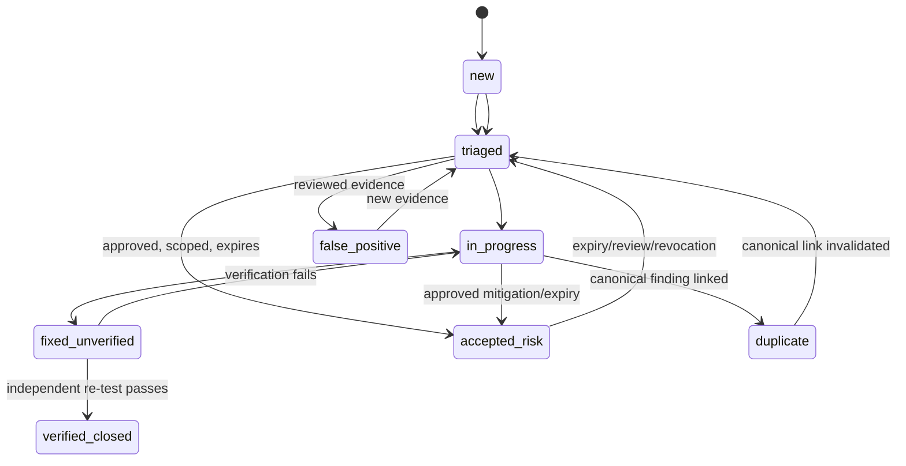
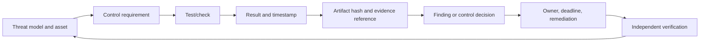
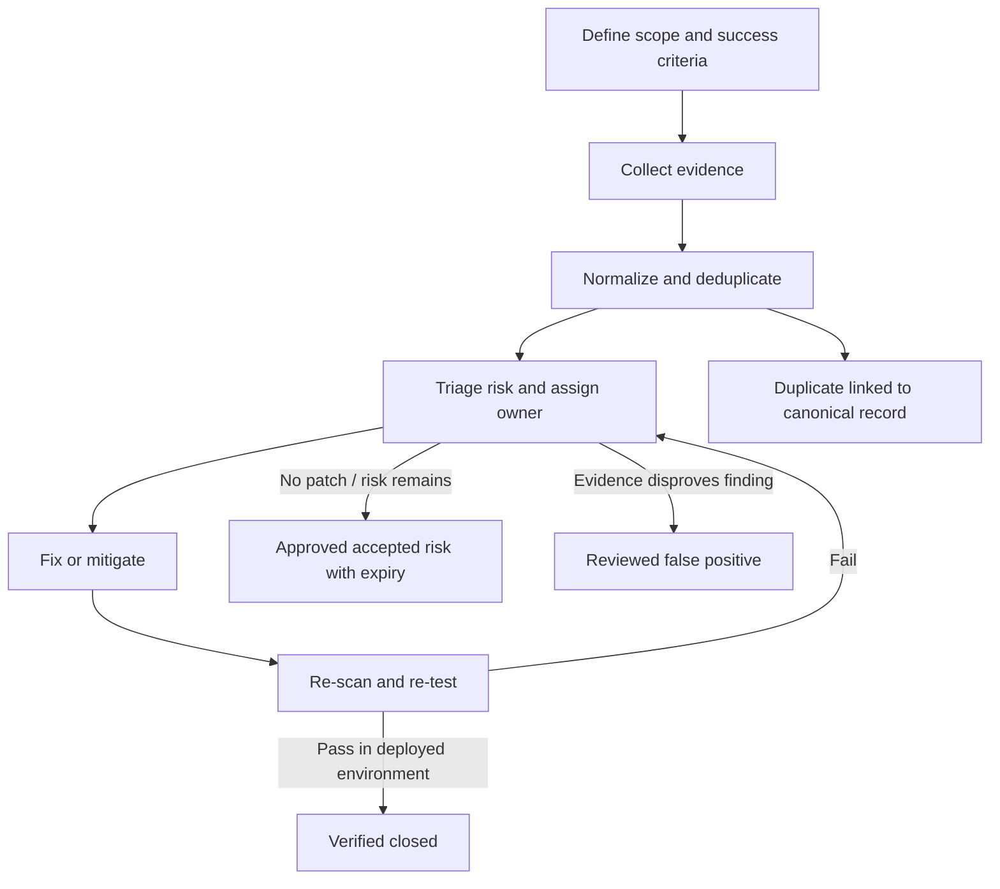
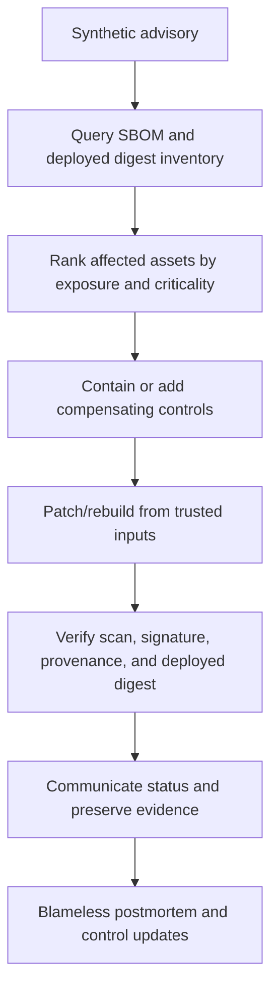
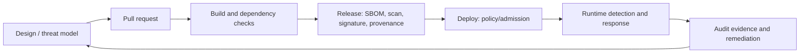
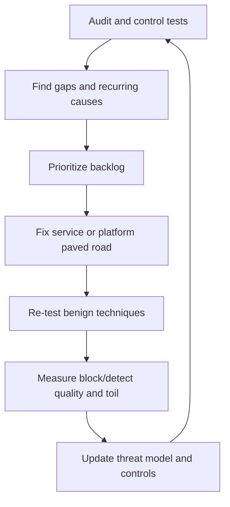

# Unit 9 — Security Auditing and Vulnerability Remediation Workflows

**Target file:** `09-security-auditing-and-vulnerability-remediation-workflows.md` | **Estimated time:** 18–28 hours | **Prerequisites:** M12 Units 1–8; M01–M11 platform foundations  
**Core tools:** `kind`, `kubectl`, Trivy, Syft, kube-bench, Python 3, SQLite/CSV/JSON, Git, optional Checkov, local registry, M11 Prometheus/Grafana/Loki/Alertmanager | **Awareness:** CIS Kubernetes Benchmark, NIST, OWASP, CVSS, EPSS, CISA KEV, VEX, responsible disclosure, FAIR, ATT&CK-style taxonomies  
**Last reviewed:** 2026-10-29 (authoring date; recheck version-sensitive details before use) | **Tool/spec baseline:** installed versions are deliberately not asserted; inventory and verify locally | **Footprint:** approximately 2–6 GB incremental disk for lightweight fixtures; 4–6 GB RAM if a local cluster and observability stack are active [ASSUMPTION; measure your machine] | **Needs internet at lab time:** sometimes; scanner database refresh and image/tool pulls need internet, while fixture-based workflow labs can run offline.

> **Safety and evidence rule:** Use only a disposable local lab and synthetic records. Never paste credentials, tokens, secret values, personal data, or secret-bearing request/response bodies into evidence. Do not describe synthetic records as scanner output. This module does not certify compliance or replace a qualified security assessment.

## Table of Contents

- [9.0 Why this matters in production](#90-why-this-matters-in-production)
- [9.1 Learning objectives](#91-learning-objectives)
- [9.2 Concept map and vocabulary](#92-concept-map-and-vocabulary)
- [9.3 Level 1 — Beginner](#93-level-1--beginner)
- [9.4 Level 2 — Intermediate](#94-level-2--intermediate)
- [9.5 Level 3 — Advanced](#95-level-3--advanced)
- [9.6 Level 4 — Expert](#96-level-4--expert)
- [9.7 SRE lens](#97-sre-lens)
- [9.8 Security lens](#98-security-lens)
- [9.9 Production checklist](#99-production-checklist)
- [9.10 Hands-on lab set](#910-hands-on-lab-set)
- [9.11 Self-check questions](#911-self-check-questions)
- [9.12 Evidence artifacts](#912-evidence-artifacts)
- [9.13 Common interview and design-review questions](#913-common-interview-and-design-review-questions)
- [9.14 Sources and verification notes](#914-sources-and-verification-notes)
- [Author’s Verification and Completeness Audit](#authors-verification-and-completeness-audit)

### 9.0 Why this matters in production

A platform team may publish a report showing that hundreds of findings were “closed,” while the affected image digest is still running in a production workload. Another team may run a scanner every day but never scan a newly created namespace, so the dashboard appears green despite an asset-coverage gap. A useful audit connects a threat-modelled control to a reproducible test, timestamped evidence, a named owner, a risk-based deadline, and a verified result in the deployed environment. This unit teaches that full lifecycle and the governance needed to keep it trustworthy.

### 9.1 Learning objectives

By completion, the learner will be able to:

1. **[L1]** Distinguish audit, assessment, vulnerability scan, and penetration test, and define an explicit scope and limitations.
2. **[L1]** Collect secret-safe evidence and explain what each source proves and cannot prove.
3. **[L2]** Normalize and deduplicate findings without losing source IDs or collapsing different affected assets.
4. **[L2]** Operate the lifecycle `new → triaged → in progress → fixed (unverified) → verified closed`, plus accepted-risk, reviewed false-positive, and duplicate states.
5. **[L2]** Generate a finding register and local issue stubs with owners, risk rationale, due dates, evidence references, and stable IDs.
6. **[L3]** Prioritize by asset value, exposure, exploitability, controls, and exposure window—not CVSS alone.
7. **[L3]** Define measurable remediation SLIs, SLA policies, exception expiry, and safeguards against metric gaming.
8. **[L3]** Run a synthetic-advisory response drill from inventory query through mitigation, rebuild, verification, communications, and postmortem.
9. **[L4]** Integrate benign control-effectiveness tests, incident response, evidence integrity, and quarterly program reviews.
10. **[L4]** Present leadership with a concise risk narrative and investment asks supported by evidence rather than raw scanner counts.

### 9.2 Concept map and vocabulary

#### Lifecycle diagrams













#### Glossary

- **Audit:** systematic examination of controls, configurations, processes, and evidence against an agreed scope and criteria.
- **Assessment:** broader evaluation of risk or maturity; it may include audits but does not necessarily test every control.
- **Vulnerability:** a weakness that may be exploitable in a given context.
- **Finding:** a recorded observation requiring action, review, or explicit disposition. A finding can concern a vulnerability, misconfiguration, process gap, or evidence gap.
- **Risk:** a reasoned view of likelihood and impact under stated assumptions and controls; it is not identical to scanner severity.
- **Exposure:** how reachable or accessible an asset or weakness is, including network path, identity, tenancy, and data sensitivity.
- **Severity:** a rating of the technical condition or impact under a defined scheme. It is an input to, not a substitute for, risk prioritization.
- **False positive:** a finding judged not applicable or unsupported after documented review.
- **Duplicate:** a separate source record for the same underlying issue on the same asset/scope, linked to a canonical finding; never merge distinct assets merely because the CVE or rule is the same.
- **Accepted risk:** a time-bounded, accountable decision to tolerate residual risk with rationale, controls, approval, and expiry.
- **Exception:** a scoped deviation from a control or policy; it is not proof that the risk disappeared.
- **Remediation:** a change that removes the weakness or reduces the risk.
- **Verification:** independent re-test and, where relevant, confirmation of the running deployment.
- **SLA:** service-level agreement or internal deadline policy for response/remediation; example times below are illustrative, not universal.
- **MTTR:** mean time to remediate in this unit; define whether the clock ends at fix deployment or verified closure before comparing teams.
- **Evidence:** a traceable artifact that supports a claim, with provenance, timestamp, integrity information, and access controls.
- **Control coverage:** the fraction of in-scope assets or controls with current, usable evidence; it is not the fraction of findings closed.
- **Audit scope:** assets, environments, time window, criteria, exclusions, and owners included in a specific audit.

### 9.3 Level 1 — Beginner

#### 9.3.1 What kind of audit are you running?

| Audit type | Objective | Example evidence | Limitation | Typical owner |
|---|---|---|---|---|
| Configuration/posture | Compare configuration to defined controls | Kubernetes manifests, runtime settings, kube-bench results | A snapshot may not represent current running state | Platform/SRE |
| Access review | Verify least privilege and trust boundaries | RBAC bindings, identity policies, access review records | Does not prove all credentials are known or uncompromised | IAM/platform |
| Vulnerability | Identify known vulnerable components | Trivy output, package inventory, SBOM | DB freshness and reachability matter; absence of findings is not proof of safety | Product/security |
| Code/dependency | Find risky code or dependencies | SAST/dependency reports, lockfiles | Tool rules and language coverage are incomplete | Engineering |
| Compliance mapping | Map controls to a framework | Control matrix, evidence references | Mapping is not certification or legal advice | GRC/security |
| Process | Check ownership, escalation, exception review | Tickets, postmortems, expiry report | Documentation can be stale or performative | Service owner/security |

An **internal audit** is performed within the organization, but independence still matters: the person verifying a fix should not rely solely on the implementer’s assertion. An **external audit** may offer additional independence, but the result is limited by contract, scope, sampling, and evidence access. Record exclusions explicitly; “not tested” must never be interpreted as “passed.”

A penetration test is an authorized, scoped attempt to validate exploitable paths. It is not a synonym for scanning or auditing. In this unit, pen testing is awareness only; all hands-on exercises are benign and local.

#### 9.3.2 Evidence quality

For each claim, capture:
1. **Control and test:** what requirement was checked and by what procedure.
2. **Scope:** asset identifiers, environment, namespace, image digest, time window, and exclusions.
3. **Result:** pass, fail, inconclusive, or not tested, with interpretation.
4. **Provenance:** source tool/version/configuration and original record ID.
5. **Integrity:** stable artifact reference and cryptographic hash where useful.
6. **Time:** collection time and, if different, event time.
7. **Owner and disposition:** accountable team, due date, status, exception or remediation record.

Evidence must be minimally sufficient. Save sanitized command output, structured JSON/CSV, audit-log event references, and relevant screenshots only when a visual state is important. Never store raw secret values. For secret checks, retain the rule result, resource reference, and redacted finding—not the secret payload. Restrict evidence access because inventory and logs can reveal architecture and personal data.

**Source interpretation matrix**

| Source | Can support | Cannot establish alone |
|---|---|---|
| Trivy image/filesystem/config scan | Known findings under a particular DB, config, and scan scope | Exploitability in context, absence of unknown flaws, or deployed digest identity |
| Syft SBOM | Component inventory as observed by a specific generator | That all components were discovered or that the artifact is trustworthy |
| Image signature verification | Artifact signed by a trusted identity/key under configured verification | That the artifact is vulnerability-free or safe at runtime |
| kube-bench | Results for checks applicable to its selected target/profile | Production compliance when run against a `kind` node or wrong target |
| Kubernetes audit logs | Recorded API actions covered by configured audit policy | Events not logged, in-container behavior, or intent without context |
| RBAC review | Permissions implied by the reviewed bindings/rules | That all identities and external authorization paths were inventoried |
| Policy report | Violations observed by that engine and its scan/configuration | Effective network behavior or complete coverage of unsupported kinds |
| Falco/runtime alerts | Events visible to the deployed rules and sensor | Absence of unobserved behavior or proof that a benign alert is malicious |
| Checkov/Trivy config | Findings in scanned IaC/manifests | Effective cloud state or resources omitted from the scan |
| Ticket marked “fixed” | Someone updated a workflow record | That the fix is deployed or independently verified |

#### 9.3.3 Remediation lifecycle

A finding is not closed because a pull request merged or a ticket changed state. The state machine is:

`new → triaged → in progress → fixed (unverified) → verified closed`

Managed alternate states are `accepted-risk (expires)`, `false positive (reviewed)`, and `duplicate`. Every transition has a guard:

| From → To | Required evidence/fields |
|---|---|
| new → triaged | Scope, source ID, affected asset, initial severity, triage owner |
| triaged → in progress | Risk rationale, accountable owner, due date, planned fix |
| in progress → fixed (unverified) | Change/PR reference, before/after artifact or configuration reference |
| fixed (unverified) → verified closed | Re-scan or equivalent control test; deployed digest/state evidence when applicable; verifier and timestamp |
| any managed state → accepted-risk | Approver, rationale, scope, compensating controls, created/expiry/review dates |
| new/triaged → false positive | Reviewer, evidence and reason; retain original source record |
| new/triaged → duplicate | Canonical finding ID and explanation that asset/scope truly match |
| accepted-risk → triaged | Expiry, new advisory, changed exposure, or review triggers reassessment |

No transition should erase source provenance. A false positive is a reviewed conclusion, not a way to suppress inconvenient findings. A duplicate remains traceable to its original source record and canonical record.

#### 9.3.4 Scope and SLA basics

An audit plan states: purpose, in-scope assets, owner, environment, period, criteria, tools, exclusions, sampling, evidence retention, success criteria, and approver. Derive the checklist from the M12 Unit 1 threat model and control traceability matrix.

Example internal response targets are **[ILLUSTRATIVE]** and must be adapted to asset criticality, exposure, and patch availability:

| Tier | Example target | Clock starts | Escalation |
|---|---|---|---|
| Critical/exposed | Contain immediately; owner engaged same day | Discovery or credible advisory confirmation, whichever policy defines | Incident commander + service/platform/security lead |
| High | Mitigation plan within 2 business days; remediation target within 7 days | Triage confirmation | Service owner manager |
| Medium | Plan within 5 business days; target within 30 days | Triage confirmation | Team lead at risk of breach |
| Low | Scheduled in normal maintenance cycle, e.g. 90 days | Triage confirmation | Backlog review |

These are example policy choices, not standards. Specify whether weekends count, how “no patch available” pauses (or does not pause) the clock, whether mitigation is required, and who may approve an extension. A clock must not be reset by reclassifying a finding. If a finding is not affected, document evidence and reviewer approval. If no fix exists, use mitigation or time-bounded accepted risk rather than pretending it is remediated.

### 9.4 Level 2 — Intermediate

#### 9.4.1 Audit design and normalized finding schema

A useful audit question has five parts: **asset + threat/control + observable test + evidence + decision rule**. Example: “For every production workload image, does the deployed image digest have a current scan result and an approved signature, and can we link both to the workload revision?” This is testable. “Are our images secure?” is not.

Use a normalized schema even when source tools have different schemas. Keep original JSON or report artifacts immutable; normalized records are a working index, not a replacement for source evidence.

```json
{
  "finding_id": "FND-2026-00017",
  "source_tool": "synthetic-fixture",
  "source_record_id": "fixture-image-04",
  "canonical_key": "image-digest|sha256:EXAMPLE|unsigned",
  "asset": "registry.lab.local/team/api@sha256:EXAMPLE",
  "environment": "kind-lab",
  "namespace": "payments-demo",
  "category": "supply-chain",
  "severity": "high",
  "risk_rationale": "Unsigned artifact in an exposed service; synthetic training record",
  "exposure": "ingress-reachable in lab model",
  "first_seen": "2026-10-01T09:00:00Z",
  "last_seen": "2026-10-29T09:00:00Z",
  "evidence_refs": ["evidence://lab/scan-004", "evidence://lab/deployment-002"],
  "recommended_action": "Verify trusted build, sign and deploy approved digest",
  "owner": "team-platform",
  "due_date": "2026-11-05",
  "status": "triaged",
  "verification_evidence": null,
  "exception": null,
  "source_refs": ["fixture-image-04"]
}
```

This record is **[SYNTHETIC]** and is not scanner output. Use UTC timestamps in machine records. Do not put secrets in the record. A stable canonical key should include the affected asset identity and issue class; a vulnerability identifier alone is not enough.

#### 9.4.2 Safe local preflight and evidence collection

**Execution context: host shell (WSL2 Ubuntu or Linux); prerequisites:** Docker/Podman, `kubectl`, `kind`, Python 3 and Git as applicable. Run only against a named disposable cluster. Estimates vary by image and local cache.

```bash
# HOST — read-only preflight; no cluster changes
set -eu
date -u +%Y-%m-%dT%H:%M:%SZ
uname -a
python3 --version
git --version
kubectl version --client
kind version
docker version --format '{{.Client.Version}} / {{.Server.Version}}' 2>/dev/null || true
kubectl config current-context 2>/dev/null || true
df -h .
free -h 2>/dev/null || true
```

Before any destructive command, confirm the cluster name and context. Do not use `kubectl delete` against a context you cannot positively identify as the lab. An offline run can use committed synthetic fixtures and previously saved scanner reports; it cannot establish current vulnerability-database freshness or current cluster posture.

**Execution context: host shell, local evidence directory;** create a restricted folder and record inventory without collecting secrets:

```bash
# HOST — creates only a local evidence folder
umask 077
export AUDIT_DIR="$PWD/evidence-unit9-$(date -u +%Y%m%dT%H%M%SZ)"
mkdir -p "$AUDIT_DIR"/{raw,normalized,logs}
printf 'collected_at_utc=%s\n' "$(date -u +%Y-%m-%dT%H:%M:%SZ)" > "$AUDIT_DIR/manifest.txt"
kubectl config current-context >> "$AUDIT_DIR/manifest.txt" 2>&1 || true
kubectl get namespaces -o wide > "$AUDIT_DIR/raw/namespaces.txt" 2>&1 || true
kubectl get deploy,ds,sts,job,cronjob -A -o wide > "$AUDIT_DIR/raw/workloads.txt" 2>&1 || true
kubectl get networkpolicy -A -o wide > "$AUDIT_DIR/raw/networkpolicies.txt" 2>&1 || true
kubectl get role,rolebinding -A -o yaml > "$AUDIT_DIR/raw/namespaced-rbac.yaml" 2>&1 || true
kubectl get clusterrole,clusterrolebinding -o yaml > "$AUDIT_DIR/raw/cluster-rbac.yaml" 2>&1 || true
find "$AUDIT_DIR" -type f -print0 | sort -z | xargs -0 sha256sum > "$AUDIT_DIR/SHA256SUMS"
```

Review and sanitize before sharing. The RBAC output contains security-sensitive architecture information; do not collect Secret objects or dump their data. Audit log configuration and retention vary by cluster; a local `kind` cluster does not automatically provide a production-grade centralized audit trail.

Tool command examples are version-sensitive. Verify with the installed CLI’s `--help` and official docs before running:

```bash
# HOST — optional scanner examples; [VERIFY] exact CLI flags for installed versions
trivy version
trivy kubernetes --help
trivy config --help
trivy image --help
syft version
kube-bench --help
checkov --help
```

`kube-bench` may require host/node access or target-specific settings. Its checks against `kind` containers do not establish that a managed Kubernetes control plane is compliant. Record the selected target/profile and mark inapplicable checks as such; never silently convert “not applicable” into “pass.”

#### 9.4.3 Platform audit sources and interpretation

| Source/check | Question | Evidence | Known gap |
|---|---|---|---|
| kube-bench [VERIFY] | Which CIS-derived checks apply to the selected node/control-plane target? | Tool version, target, report, excluded/not-applicable checks | `kind` is not a representative managed production control plane |
| Trivy image/config/Kubernetes [VERIFY] | What known image/config issues are found in this scope? | Command/version, DB metadata if available, JSON report | Does not prove runtime reachability or completeness |
| RBAC audit | Which principals can perform sensitive actions? | Bindings, role rules, `kubectl auth can-i` tests where applicable | Does not cover every external identity path unless inventoried |
| Policy reports (Unit 8) | Which resources violate engine rules? | Report object and engine configuration | Report CRDs/fields differ by engine/version; `[VERIFY]` |
| Local registry (M01 Unit 7) | Which tags/digests are present and stale/unsigned? | Registry API response or catalog plus signature evidence | Registry APIs and pagination are implementation-specific; `[VERIFY]` |
| IaC scan (M07 Unit 6) | Which repository definitions violate rules? | Commit, scanner version, report | Does not prove deployed state |
| CI audit (Unit 5) | Are pipeline trust and permissions configured as intended? | Workflow/config snapshots and test results | Static check cannot prove runtime identity claims alone |
| Secrets audit (M09 Unit 8) | Are secret-handling controls violated? | Redacted rule result and resource reference | Never export secret values |
| Network audit (M04 Unit 5) | Which namespaces lack NetworkPolicy or have broad egress? | Policy inventory, flow tests if available | Presence of a policy does not prove effective isolation |
| Kubernetes audit logs (M11) | Were sensitive API actions recorded? | Audit policy, event IDs, sanitized query results | Events absent from policy are invisible; local cluster may not retain logs |
| Falco (Unit 12) | Are configured runtime signals detected? | Rule, event metadata, alert and triage | Detection depends on sensor/rules and may miss behavior |

For Kubernetes audit analysis, use the actual configured log source and schema. Do not assume `kind` emits audit events to a file by default. In a fixture-only lab, use synthetic JSON events with explicit labels; that tests the parser/query, not live audit coverage.

#### 9.4.4 Dedupe and normalization

Deduplication should preserve provenance. A safe algorithm:
1. Normalize case and whitespace only for fields whose semantics allow it.
2. Build a candidate key from issue type/rule or vulnerability, immutable asset identity (for images, digest; for workload, cluster/namespace/kind/name and revision), and environment.
3. Compare evidence and time window.
4. Link source records to a canonical finding; retain each `source_tool` and `source_record_id`.
5. Never deduplicate different assets merely because they share a CVE or policy rule.
6. Re-open or create a new observation if the issue recurs after verified closure.

#### 9.4.5 Local workflow implementation

The following complete Python program implements a small fixture-based finding registry. It validates lifecycle transitions, rejects closure without verification, preserves source references, and produces local issue stubs. It intentionally does not call hosted ticketing APIs or scan systems.

**Execution context:** host Python 3; prerequisites: Python standard library only. Save as `finding_workflow.py` inside the lab directory, then run `python3 finding_workflow.py`. The file is included inline for learning; this module does not create it separately.

```python
#!/usr/bin/env python3
"""Fixture-based Unit 9 finding lifecycle demonstration; standard library only."""
from dataclasses import dataclass, asdict
from datetime import date, datetime, timezone
from pathlib import Path
import json
import re

ALLOWED = {
    "new": {"triaged", "duplicate"},
    "triaged": {"in progress", "accepted-risk", "false positive", "duplicate"},
    "in progress": {"fixed (unverified)", "accepted-risk"},
    "fixed (unverified)": {"verified closed", "in progress"},
    "accepted-risk": {"triaged"},
    "false positive": {"triaged"},
    "duplicate": {"triaged"},
    "verified closed": {"triaged"},  # reopen only when new evidence justifies it
}
REQUIRED = {"finding_id", "source_tool", "source_record_id", "asset", "severity",
            "owner", "due_date", "status", "evidence_refs"}

def validate(record):
    errors = []
    for key in REQUIRED:
        if not record.get(key):
            errors.append(f"missing required field: {key}")
    try:
        date.fromisoformat(record["due_date"])
    except (KeyError, ValueError, TypeError):
        errors.append("due_date must be ISO YYYY-MM-DD")
    if record.get("status") == "verified closed" and not record.get("verification_evidence"):
        errors.append("verified closed requires verification_evidence")
    if record.get("status") == "accepted-risk":
        for key in ("approver", "risk_rationale", "compensating_controls", "expiry"):
            if not record.get(key):
                errors.append(f"accepted-risk requires {key}")
        try:
            expiry = date.fromisoformat(record.get("expiry", ""))
            if expiry < date.today():
                errors.append("accepted-risk expiry is already past")
        except ValueError:
            errors.append("accepted-risk expiry must be ISO YYYY-MM-DD")
    if record.get("status") == "duplicate" and not record.get("duplicate_of"):
        errors.append("duplicate requires duplicate_of canonical ID")
    if record.get("status") == "false positive" and not record.get("review_evidence"):
        errors.append("false positive requires review_evidence")
    return errors

def transition(record, new_status, evidence=None):
    old = record.get("status")
    if new_status not in ALLOWED.get(old, set()):
        raise ValueError(f"forbidden transition: {old!r} -> {new_status!r}")
    candidate = dict(record, status=new_status)
    if evidence:
        if new_status == "verified closed":
            candidate["verification_evidence"] = evidence
        elif new_status == "false positive":
            candidate["review_evidence"] = evidence
    errors = validate(candidate)
    if errors:
        raise ValueError("; ".join(errors))
    return candidate

def issue_stub(record, out_dir):
    safe_id = re.sub(r"[^A-Za-z0-9._-]", "-", record["finding_id"])
    path = Path(out_dir) / f"{safe_id}.md"
    path.parent.mkdir(parents=True, exist_ok=True)
    body = (
        f"# {record['finding_id']}: {record.get('category', 'security finding')}\n\n"
        f"- Asset: `{record['asset']}`\n- Severity: {record['severity']}\n"
        f"- Owner: {record['owner']}\n- Due: {record['due_date']}\n"
        f"- Status: {record['status']}\n"
        f"- Source: `{record['source_tool']} / {record['source_record_id']}`\n"
        f"- Evidence: {', '.join(record['evidence_refs'])}\n\n"
        f"## Required closure evidence\nRe-scan or re-test, deployment identity where applicable, "
        "verifier, timestamp, and artifact reference.\n"
    )
    if not path.exists():
        path.write_text(body, encoding="utf-8")
    return path

def main():
    base = {
        "finding_id": "FND-TEST-001", "source_tool": "synthetic-fixture",
        "source_record_id": "fixture-001", "asset": "kind-lab/demo-api@sha256:EXAMPLE",
        "category": "image-policy", "severity": "high", "owner": "team-demo",
        "due_date": date.today().isoformat(), "status": "new",
        "evidence_refs": ["evidence://synthetic/scan-001"],
        "source_refs": ["fixture-001"]
    }
    assert not validate(base), validate(base)
    triaged = transition(base, "triaged")
    progress = transition(triaged, "in progress")
    fixed = transition(progress, "fixed (unverified)")
    try:
        transition(fixed, "verified closed")
        raise AssertionError("closure without evidence should fail")
    except ValueError as exc:
        assert "verification_evidence" in str(exc)
    closed = transition(fixed, "verified closed", "evidence://synthetic/retest-001")
    assert closed["status"] == "verified closed"
    try:
        transition(base, "verified closed")
        raise AssertionError("forbidden transition should fail")
    except ValueError as exc:
        assert "forbidden transition" in str(exc)
    out = issue_stub(base, "issue-stubs")
    print(json.dumps({"tests": "PASS", "closed_status": closed["status"],
                      "issue_stub": str(out), "synthetic": True}, indent=2))

if __name__ == "__main__":
    main()
```

**Expected outcome:** the script prints a JSON object with `tests: PASS` and `synthetic: true`; exact path depends on the working directory. This is a fixture demonstration, not proof that the production platform is secure. Production hardening would add schema validation, immutable event history, locking/transactions, authorization, structured logging, test coverage, and a durable store.

#### 9.4.6 At least 25 sample findings for Lab 1

The records below are **[SYNTHETIC]** audit fixtures, not real scanner results. The `source_record_id` is a fixture identifier. Severity and due dates are example policy decisions.

| ID | Category / synthetic observation | Asset / environment | Severity and rationale | Owner | Disposition / evidence |
|---|---|---|---|---|---|
| F-001 | Unsigned image fixture | `demo-api@sha256:A1`, lab | High: release trust gap | team-api | In progress; `ev-001` |
| F-002 | Mutable tag fixture | `worker:latest`, lab | High: identity can change | team-ml | Triaged; `ev-002` |
| F-003 | Missing SBOM reference | `batch-job@sha256:B2`, lab | Medium: inventory gap | team-data | New; `ev-003` |
| F-004 | Stale scan timestamp | `model-api@sha256:C3`, lab | High: current risk unknown | team-ml | Triaged; `ev-004` |
| F-005 | Excessive ClusterRole verb | `clusterrole/demo-reader`, lab | High: broad access | platform | In progress; `ev-005` |
| F-006 | Wildcard resource permission | `role/report-reader`, lab | Medium: scope broad | team-data | New; `ev-006` |
| F-007 | Secret mounted to unrelated pod | `demo-api`, lab | High: unnecessary secret exposure | team-api | Triaged; `ev-007` |
| F-008 | Namespace lacks NetworkPolicy | `sandbox`, lab | Medium: no declared isolation | platform | New; `ev-008` |
| F-009 | Broad egress rule fixture | `etl`, lab | High: egress not constrained | team-data | In progress; `ev-009` |
| F-010 | Privileged container fixture | `debug-job`, lab | High: host boundary risk | team-platform | Triaged; `ev-010` |
| F-011 | Root user configured | `legacy-worker`, lab | Medium: weaker containment | team-ml | New; `ev-011` |
| F-012 | Missing resource limits | `trainer`, lab | Medium: resource exhaustion risk | team-ml | New; `ev-012` |
| F-013 | Missing readiness probe | `model-api`, lab | Medium: rollout signal gap | team-ml | New; `ev-013` |
| F-014 | IaC public ingress fixture | `infra/dev`, repo | High: unintended exposure | platform | Triaged; `ev-014` |
| F-015 | CI token permissions broad | `build-workflow`, repo | High: supply-chain impact | team-devex | In progress; `ev-015` |
| F-016 | Pinned action missing in fixture | `build-workflow`, repo | Medium: mutable dependency | team-devex | New; `ev-016` |
| F-017 | Image digest differs from approved release | `demo-api`, lab | Critical in this scenario: identity mismatch | team-api | Triaged; `ev-017` |
| F-018 | Provenance record absent | `worker@sha256:D4`, lab | High: build origin unproven | team-ml | New; `ev-018` |
| F-019 | Exception expired | `legacy-worker`, lab | High: control bypass unmanaged | platform/security | Triaged; `ev-019` |
| F-020 | Audit policy omits secret reads | `kind-lab`, lab | High: evidence coverage gap | platform | New; `ev-020` |
| F-021 | Runtime alert untriaged | `demo-api`, lab | Medium: detection workflow gap | on-call | In progress; `ev-021` |
| F-022 | Registry contains stale tag | `local-registry`, lab | Low: hygiene/inventory issue | team-devex | New; `ev-022` |
| F-023 | Duplicate scanner records | `demo-api@sha256:A1`, lab | Low: workflow noise; preserve sources | security | Duplicate; `ev-023` |
| F-024 | Namespace omitted from scan inventory | `research`, lab | High: false coverage confidence | platform | Triaged; `ev-024` |
| F-025 | Closure lacks verification evidence | `demo-api@sha256:A1`, lab | High: fix not proven | team-api | In progress; `ev-025` |
| F-026 | Policy report schema version unknown | `policy-engine`, lab | Medium: report parsing uncertainty | platform | New; `ev-026` |
| F-027 | Unreviewed risk exception | `trainer`, lab | High: accountability gap | team-ml | Triaged; `ev-027` |

A complete operational register would add `first_seen`, `last_seen`, `evidence_refs`, `risk_rationale`, `recommended_action`, `verification_evidence`, `exception_expiry`, and all source IDs. The table is a required sample seed set, not a substitute for a real audit.

#### 9.4.7 Cross-module audit handoffs

- **M12 Unit 1:** import assets, trust boundaries, threat scenarios, and control traceability.
- **Unit 2:** preserve Trivy DB freshness, exploitability/context, and VEX reasoning; do not reimplement scanner triage here.
- **Unit 3:** use SBOMs to map components to artifacts and deployed workloads.
- **Unit 4:** verify signatures against the intended trust identity; signature presence is not equivalent to trust.
- **Unit 5:** inspect CI permissions and build isolation.
- **Unit 6 / M09:** review RBAC, workload identity, secrets exposure and rotation without printing secret values.
- **Unit 7:** validate runtime hardening in the actual deployed workload.
- **Unit 8 / Unit 11:** ingest admission and policy-engine reports; check report coverage and versioned schema.
- **Unit 10:** connect artifact digest to trusted provenance.
- **Unit 12:** connect runtime alerts to investigation and remediation.
- **M01 Unit 7 / M04 Unit 5 / M07 Unit 6:** local registry, network, and IaC evidence.
- **M08 Unit 13:** evidence references, hashes, storage and query discipline.
- **M10 / M11:** incident command, postmortems, metrics and alerting.
- **M16:** feed recurring template defects into future paved roads; this is a future handoff, not an assumed existing file.

### 9.5 Level 3 — Advanced

#### 9.5.1 Risk prioritization beyond CVSS

The Common Vulnerability Scoring System (CVSS) expresses technical severity under a defined version and scoring model. It does not automatically encode your asset’s business criticality, real network exposure, compensating controls, active exploitation evidence, or duration of exposure. Use CVSS as one signal, not the queue order.

A qualitative decision model:

| Factor | Lower concern | Higher concern |
|---|---|---|
| Asset criticality | disposable dev fixture | production identity, customer data, model release path |
| Exposure | unreachable from relevant trust boundary | public or broadly reachable service |
| Exploitability | no credible path in this environment | known reachable path or credible exploitation evidence |
| Existing controls | verified compensating controls | controls absent, bypassable, or untested |
| Impact | low-value isolated workload | sensitive data, control plane, release integrity |
| Exposure window | newly introduced, contained | long-lived and widely deployed |
| Remediation | tested patch available | no patch; mitigation required |

**[ASSUMPTION]** A practical qualitative score can assign 1–3 points per factor, but do not present the sum as a scientifically calibrated probability. Use the score to structure discussion and keep the rationale visible. Use current CISA Known Exploited Vulnerabilities (KEV), FIRST EPSS, and CVSS guidance only after verifying current source and version; do not invent a KEV status or EPSS probability.

Example: a high-severity library finding in a non-networked, disposable build fixture may be lower priority than a moderate-severity weakness reachable in a production service holding sensitive data. Record why, the assumptions, and the review trigger. Reassess when exposure, exploitability, or asset role changes.

#### 9.5.2 Root-cause and batch remediation

If 40 workloads share the same vulnerable base image, fixing each workload independently creates drift and repeat work. Identify the common ancestor: base image, dependency lock, chart, template, CI action, default policy, or platform module. Patch the root, rebuild dependent artifacts, regenerate SBOM/provenance/signature, scan the new digest, and deploy through the approved path. Preserve the before/after digest mapping.

A batch is safe only when compatibility and rollout risk are tested. Do not blindly auto-merge security PRs. **[ASSUMPTION]** Consider auto-merge only for low-risk dependency classes with deterministic tests, protected branches, verified provenance, rollback, and an explicit policy owner.

#### 9.5.3 Ownership and escalation (RACI)

| Activity | Service owner | Platform | Security | Incident commander |
|---|---|---|---|---|
| Fix application dependency | Responsible | Consulted | Advises/independently verifies | Informed unless incident |
| Fix golden base image | Consulted | Responsible | Defines controls/reviews | Informed |
| Define risk criteria | Consulted | Consulted | Accountable for policy | Consulted |
| Accept high residual risk | Accountable business owner + named approver | Consulted | Challenges and records | Required during incident if applicable |
| Verify closure | Supplies change evidence | Supplies platform evidence | Independent verifier or delegated reviewer | Tracks incident actions |
| SLA breach | Responsible for recovery plan | Supports | Escalates governance | Owns incident coordination when declared |

Do not make the security team the default owner for every engineering fix. Ownership should follow control and service boundaries. Security should challenge risk acceptance and verify evidence without becoming a bottleneck for routine engineering.

#### 9.5.4 Metrics, denominators, and Goodhart safeguards

| Metric | Definition | Denominator/window | Missing data | Gaming risk and safeguard |
|---|---|---|---|---|
| Time to remediate | Verified-closure timestamp minus policy-defined start | Closed findings in cohort; report median and tail percentiles separately | Exclude/flag missing timestamps, never silently zero | Teams close early; require verification evidence |
| SLA compliance | Findings verified/mitigated by deadline ÷ findings whose deadlines fell in window | Cohort with due dates in reporting period | Missing due date is a data-quality failure | Severity downgrade; immutable triage history |
| Breach count | Count of open findings past due date | Snapshot at report time plus trend | Report unknown deadlines separately | Resetting due dates; preserve change history |
| Aging backlog | Open findings grouped by age and risk | All in-scope open findings at snapshot | Unknown first-seen shown separately | Old findings disappear from scan; reconcile inventory |
| Fix vs new rate | Verified fixes and new unique findings per period | Stable scope and observation window | Incomplete scan coverage flagged | Duplicate inflation; stable canonicalization |
| Recurrence rate | Reopened/new findings with same root cause ÷ verified closures in cohort | Root-cause labels over defined follow-up period | Unknown root cause separate | Overly broad root-cause labels; sampled review |
| Exposure window | Time from first credible exposure to verified containment/remediation | Findings with known start/end | Unknown start/end reported as unknown | Backdating; preserve source timestamps |
| Scan freshness | In-scope assets with current scan evidence ÷ in-scope assets | Define freshness window and inventory snapshot | Unknown assets count against coverage or are separately flagged | Stale inventory; reconcile multiple inventories |
| Evidence coverage | Controls with current, retrievable evidence ÷ controls in scope | Defined audit scope and cadence | Missing evidence is not pass | Cherry-picking controls; independent sampling |
| Exception expiry | Active exceptions expired or nearing expiry | All active exceptions at snapshot | Missing expiry is invalid | Renew without review; require approver and rationale |
| Policy trend | Violations by rule and asset over time | Same policy/version and inventory scope | Version changes annotated | Rule changes appear as improvement; version the series |

Goodhart safeguards: never optimize closed count alone; keep a stable denominator; preserve severity-change history; sample closed findings; require a second-person verification for material risks; record scanner and DB freshness; include unknown/unscanned assets; and keep original evidence immutable. “Zero findings” can mean excellent controls, no scan, broken ingestion, or missing scope. It is not a security conclusion without coverage evidence.

#### 9.5.5 Exceptions and no-patch situations

A valid exception record includes: identifier, policy/control, asset and exact scope, rationale, risk, owner, accountable approver, compensating controls, created date, expiry, review date, status, evidence, and revocation trigger. The owner cannot self-approve a high-impact exception without an independent approver. Use a Git-reviewed registry, automated expiry report, and alert/escalation route. Expired exceptions return to triage; they do not silently persist.

Distinguish:
- **Not affected:** evidence shows the vulnerable code/path is absent or unreachable under a defined and reviewed condition.
- **No patch available:** exposure remains; mitigate and monitor, and track a patch/replacement trigger.
- **Accepted risk:** an authorized decision to tolerate residual risk until expiry.
- **Fixed:** the weakness is removed and verification passes.

Potential mitigations include network isolation, disabling an affected feature, tightening access, temporary WAF/rule controls where applicable, increased runtime detection, replacing the component, or pinning to a known safe version. These are not interchangeable and must be tested for functional and availability impact. A VEX statement from Unit 2 can document product applicability; it is not a generic waiver.

#### 9.5.6 Synthetic zero-day response

Use a fictional advisory ID such as `SYN-ADV-2026-004` labelled **[SYNTHETIC]**, never a fabricated CVE. The incident process:
1. Declare under M10 when severity/exposure criteria are met; name incident commander and technical leads.
2. Query SBOM and artifact/deployment inventories by package name, version range, image digest, model-serving service and build provenance.
3. Establish evidence confidence: inventory freshness, missing artifacts, runtime deployment state.
4. Prioritize by reachable exposure, asset criticality, exploitability evidence and existing controls.
5. Contain: isolate or restrict the affected path, pause promotion, or apply a tested compensating control.
6. Rebuild from trusted inputs after patch availability; regenerate SBOM, scan, signature and provenance.
7. Deploy by digest through normal gates or documented emergency change; verify actual running digest and negative tests.
8. Communicate facts, uncertainty, scope and next update time; preserve evidence and avoid unsupported claims.
9. Run a blameless postmortem and update threat model, templates, inventory coverage and response playbooks.

Record local elapsed time as a lab measurement only; do not claim it predicts production response.

#### 9.5.7 Continuous controls and reporting

A continuous control record should link `control_id → test_id → result → timestamp → artifact_hash → finding/decision`. Scheduled checks should reconcile inventory and scans, not only rerun scanners on a fixed list. Include newly created namespaces, ephemeral workloads, build artifacts, deployed digests, and decommissioned assets. A scan of source manifests cannot establish runtime state; a runtime event stream cannot establish SBOM completeness.

Compliance mapping to SOC 2, ISO 27001, CIS, or NIST is awareness-level: say “evidence may support an assessment,” never “this proves certification.” Framework versions and applicability must be checked. Maintain a disclosure route for the learner’s own service, including a security contact and `security.txt` concept. For third-party issues, use the maintainer’s coordinated disclosure process; do not test beyond authorization.

Security debt is a risk-ranked backlog with owners, cost of delay, compensating controls, and an explicit budget alongside feature work. Comparing it to an SRE error budget is **[ASSUMPTION]**: the analogy can help governance but is not a formal security standard.

### 9.6 Level 4 — Expert

#### 9.6.1 Detection-to-prevention integration

Operational maturity is a closed loop: detection produces a triaged finding; incident response contains immediate risk; remediation changes the artifact or platform; verification proves the change; prevention updates templates, controls and tests; the postmortem updates the threat model. Every handoff has a record and owner. Avoid independent dashboards that cannot connect an alert to a deployed asset or a remediation PR.

#### 9.6.2 Incident response, evidence custody, and postmortems

Follow M10’s incident command model. Contain first when active risk requires it, but preserve evidence before changing state where feasible. Record who collected evidence, when, from which system, how it was transferred, and its hash. Limit access to sensitive logs. Consult legal/compliance specialists where required; this module is not legal advice. If credential compromise is plausible, follow M09 rotation and assume-compromise procedures. Rebuild from trusted inputs rather than trusting a possibly compromised artifact.

A postmortem is blameless but not vague: state impact, detection path, timeline, contributing conditions, what worked, what failed, action owner/date, and verification criteria. Restrict distribution when details expose sensitive systems or personal data. An action is complete only when evidence shows the control changed and its test passes.

#### 9.6.3 Benign control-effectiveness tests

Run tests only against your own disposable cluster and local registry. Each test should specify expected prevention/detection, actual outcome, evidence ID, time-to-detect, alert quality, false-positive notes, remediation, and cleanup. Use a local taxonomy unless an ATT&CK mapping is verified against the current official matrix. Atomic Red Team is awareness only; no external target or weaponized exploit is required.

| Benign attempt | Control under test | Expected result | Evidence |
|---|---|---|---|
| Submit unsigned test image | Signature/release gate | Block or create explicit finding | Admission/CI record |
| Use tag-only image reference | Digest policy | Block or warn as configured | Policy test |
| Use unlisted local registry path | Registry allow-list | Reject | Policy report |
| Use privileged Pod manifest | PSS/admission | Reject or detect | API response/policy event |
| Add hostPath volume in lab Pod | Workload policy | Reject or detect | Policy event |
| Use weak synthetic provenance record | Provenance check | Fail trust decision | Verification result |
| Attempt unauthorized read of a harmless test ConfigMap | RBAC least privilege | Denied | `kubectl auth can-i`/API audit event |
| Overwrite a local test tag | Digest identity control | Existing digest remains distinct; promotion by digest | Registry digest evidence |
| Send benign request to unlisted local endpoint | Egress policy | Denied or alert if policy supports it | Controlled connectivity test |
| Deploy image with stale scan fixture | Freshness gate | Warn/block per policy | CI output and timestamp |
| Expire a synthetic exception | Exception control | Alert and return to triage | Expiry report |
| Remove a namespace from inventory fixture | Coverage control | Coverage gap alert | Reconciliation report |

Do not infer “blocked” from a missing alert. Prove the attempt occurred, prove the control had coverage, and capture the resulting decision. If a control is detective rather than preventive, say so.

#### 9.6.4 Audit readiness and mock auditor queries

The mock auditor should be able to ask, “Show every production image deployed in Q3 with its SBOM, scan result, signature, provenance, and approver.” In this local exercise, `production` and `Q3` are **[SYNTHETIC]** labels. A good answer includes the query, inventory denominator, artifacts, missing items, and time-to-answer. A polished screenshot without machine-readable references is weak evidence.

Suggested evidence-store schema:

```sql
-- SQLite teaching schema; synthetic local evidence index, not a full GRC system.
CREATE TABLE evidence (
  evidence_id TEXT PRIMARY KEY,
  control_id TEXT NOT NULL,
  asset_id TEXT NOT NULL,
  artifact_path TEXT NOT NULL,
  sha256 TEXT NOT NULL,
  collected_at_utc TEXT NOT NULL,
  source_tool TEXT NOT NULL,
  source_version TEXT,
  result TEXT NOT NULL CHECK (result IN ('pass','fail','inconclusive','not-tested')),
  redacted INTEGER NOT NULL CHECK (redacted IN (0,1))
);
CREATE TABLE finding (
  finding_id TEXT PRIMARY KEY,
  asset_id TEXT NOT NULL,
  category TEXT NOT NULL,
  severity TEXT NOT NULL,
  status TEXT NOT NULL,
  owner TEXT NOT NULL,
  due_date TEXT,
  evidence_id TEXT REFERENCES evidence(evidence_id)
);
```

Example auditor query (requires the evidence schema to be populated; no live data is implied):

```sql
-- SQLite — identify production-labelled image assets missing one of the required evidence types.
SELECT asset_id,
       SUM(CASE WHEN control_id = 'sbom' THEN 1 ELSE 0 END) AS sbom_records,
       SUM(CASE WHEN control_id = 'scan' THEN 1 ELSE 0 END) AS scan_records,
       SUM(CASE WHEN control_id = 'signature' THEN 1 ELSE 0 END) AS signature_records,
       SUM(CASE WHEN control_id = 'provenance' THEN 1 ELSE 0 END) AS provenance_records,
       SUM(CASE WHEN control_id = 'approver' THEN 1 ELSE 0 END) AS approver_records
FROM evidence
WHERE asset_id LIKE 'production/%'
GROUP BY asset_id
HAVING sbom_records = 0 OR scan_records = 0 OR signature_records = 0
    OR provenance_records = 0 OR approver_records = 0;
```

This query identifies missing evidence records only. It does not validate signature cryptography, SBOM correctness, provenance trust, or approval authority. Those checks must be performed by their relevant controls and linked evidence.

#### 9.6.5 Third-party risk, resilience, and organization

Review third-party vendors, SaaS, open-source dependencies, and supplier SBOM/provenance as awareness-level activities. Record critical dependencies, support lifecycle, maintainer trust, update channels, incident contacts, and exit/continuity options. Local mirrors/caches for container registries and package indexes can improve resilience during upstream outages, but they introduce cache freshness and compromise risks; define quarantine windows and approval criteria for new upstream releases. During an active supply-chain incident, a dependency freeze may reduce uncontrolled change but can also block urgent fixes; define an exception path.

Scale with security champions, platform-provided golden paths, and embedded service ownership. Measure pipeline time added, false-positive rate, override rate, fix latency, and developer effort alongside risk reduction. Central policy provides consistency; federated ownership provides context and speed. Avoid policy sprawl by assigning one canonical control owner, documenting precedence, and retiring duplicate rules.

Quantitative risk models such as FAIR are awareness-level only; use them to structure assumptions, not to create false precision. Ethical boundaries include authorization, privacy in logs, proportional employee monitoring, responsible disclosure, and legal review where needed.

### 9.7 SRE lens

Security remediation is a production change and can cause outages. Prioritize containment when exploitation is plausible, but use canaries, health checks, rollback, and compatibility tests for routine upgrades. A critical vulnerability does not justify deploying an untested replacement blindly; choose the least risky action that reduces exposure within the required window.

- **Reliability:** track whether remediation changes increase error rate, latency, restart count, or failed rollouts.
- **Response time:** distinguish time to acknowledge, time to mitigate, time to deploy a fix, and time to verified closure.
- **Alert quality:** group duplicate signals without hiding distinct assets; track actionable-alert rate and false positives.
- **Backlog health:** age by severity, owner, and risk; highlight unowned and overdue records.
- **Change safety:** use staged rollout, compatibility tests, rollout guardrails, and a documented rollback trigger.
- **Automation:** automate evidence gathering, dedupe candidates, ticket stubs, expiry alerts, and report generation; keep risk acceptance and ambiguous applicability review human-accountable.
- **On-call:** runbooks must identify incident commander, service owner, platform/security contacts, escalation criteria, evidence location, and recovery decision authority.
- **Operational toil:** recurring findings should trigger root-cause fixes in base images, templates, policies, or pipelines.

An error-budget analogy for security debt is **[ASSUMPTION]** only. Security risk is not always fungible across services, and “spending” a budget cannot justify unapproved risk acceptance.

### 9.8 Security lens

Threat-model every audit around assets, trust boundaries, adversary capability, and impact. Preserve integrity of evidence; a report is only as trustworthy as its collection method, timestamp, scope and provenance. Use least privilege for scanners and evidence stores, separate implementation from material-risk approval, and avoid logging secret-bearing bodies.

Key bypasses and residual risks include:
- unscanned namespaces or workloads;
- stale scanner databases and incomplete SBOMs;
- image tags that change after scan;
- policy reports with incomplete kind coverage;
- unlogged API actions or missing runtime visibility;
- exceptions with broad scope or no expiry;
- false-positive and duplicate processes that suppress distinct assets;
- cluster administrators able to alter controls;
- a “fixed” source artifact while an older digest remains deployed;
- compromised scanner, CI runner, registry, or evidence store.

Use source IDs and immutable raw evidence to make suppression auditable. Hashing detects accidental or later modification only if the expected hash is protected; a hash stored beside a mutable artifact is not a complete chain-of-custody system. Retention should match audit, incident and privacy needs, with access controls and deletion policy. Responsible disclosure means reporting through authorized maintainer channels, not probing beyond permission.

### 9.9 Production checklist

| Check | Evidence to retain | Owner |
|---|---|---|
| Audit scope, criteria, period and exclusions approved | Scope record and sign-off | Audit lead |
| Asset inventory reconciled to namespaces, registry, CI and deployment state | Timestamped inventory diff | Platform |
| Scanner versions and DB freshness recorded | Version inventory and scan metadata | Security/platform |
| Threat-model controls mapped to tests | Control traceability matrix | Security |
| Raw reports retained and sanitized | Read-only evidence references and hashes | Evidence custodian |
| Findings normalized without losing source IDs | Register and dedupe decision log | Audit automation owner |
| Each finding has owner, risk rationale and due date | Register validation report | Service owner |
| SLA clock and pause/escalation rules defined | Approved policy | Security + service leadership |
| Fixes re-scanned/re-tested | Before/after evidence | Implementer |
| Running digest/configuration verified | Deployment query and artifact identity | Platform/service owner |
| Exceptions have approver, controls, expiry and review | Exception registry and expiry report | Risk owner |
| False positives have review evidence | Review record | Independent reviewer |
| Audit logs and runtime signals have known coverage | Config, sample events and gap list | Platform/SRE |
| Metrics include denominators and missing-data behavior | Metric dictionary and test results | M11 owner |
| Dashboard labels synthetic vs measured data | Dashboard metadata | Reporting owner |
| Postmortem actions have owners/dates and retests | Action tracker | Incident commander |
| Quarterly review updates threat model and backlog | Review notes and decisions | Security/platform leadership |

### 9.10 Hands-on lab set

All labs are local and defensive. Use the same synthetic IDs consistently. The exact CLI flags for tools can change; run the installed CLI help and consult official docs before copying version-sensitive scanner commands. If a tool or cluster is unavailable, use the stated fixture fallback and mark the evidence as fixture-only.

#### Lab 1 — Full platform audit

**Objective:** produce an evidence-backed audit checklist and a normalized findings log with at least 25 records across categories. The 27-row synthetic set in §9.4.6 satisfies the seed-record requirement; do not call it real scan output.

**Prerequisites / preflight:** host shell; Python 3, Git and optionally `kind`, `kubectl`, Trivy, Syft, kube-bench, Checkov. Run the §9.4.2 preflight. Confirm `kubectl config current-context` names the disposable cluster before cluster queries. Estimate 1–3 GB for a small `kind` cluster plus images; scanner DBs can add disk use. Internet is needed for fresh image/DB pulls; fixture-only mode is offline.

**Architecture:** threat model → scoped evidence collection → immutable raw reports → normalized register → triage.

**Steps:**
1. Copy the Unit 1 control traceability matrix into the audit checklist. For each control, write the test, evidence, owner, and decision rule.
2. Inventory namespaces/workloads, RBAC, NetworkPolicies, and deployed image references with the commands in §9.4.2.
3. Run installed scanners only after verifying CLI syntax: Trivy image/config/Kubernetes, Syft SBOM, kube-bench for a supported target, and Checkov for IaC. Record exact version, arguments, timestamp, DB freshness where reported, and scope.
4. Inspect M12 Unit 8 policy reports and M12 Unit 5 CI audit outputs; use local registry audit from M01 Unit 7. Audit secrets through redacted rule results only.
5. Review M11 audit-log queries where a real log source exists. If not, replay clearly labelled synthetic JSON events and record “parser tested; live audit coverage not established.”
6. Normalize observations into the schema in §9.4.1. Add all source record IDs. Use the 27 synthetic records as seeded tests, not claimed findings.
7. Produce a coverage report: assets in inventory, assets scanned, scan freshness, unsupported checks, excluded namespaces, and missing evidence.
8. Hash sanitized artifacts and record the hash list.

**Positive tests:** a compliant fixture has current scan evidence, owner, due date, and verification reference. **Negative tests:** missing namespace inventory, expired scan, missing owner, and a synthetic unsigned image create findings.

**Expected outcome:** at least 25 records, categories spanning supply chain, access, workload posture, network, CI, audit logging, exception governance and evidence gaps; each record has an ID, asset, severity/risk rationale, owner, due date, source/evidence reference and disposition.

**Evidence:** scope, control matrix, version inventory, raw sanitized reports, normalized CSV/JSON/SQLite, hash manifest, coverage-gap list.

**Troubleshooting:** if `kube-bench` target applicability is unclear, do not force a production interpretation; mark not applicable and use its official docs. If scanner DB refresh fails, keep the DB timestamp and switch to fixtures without claiming current vulnerability coverage.

**Cleanup:** retain only sanitized local evidence required for the exercise; delete the disposable cluster only after confirming context and evidence preservation. Do not delete shared clusters.

**Limitations:** a laptop `kind` audit is a training exercise, not a production certification or full control-plane assessment.

#### Lab 2 — Finding dedupe, normalization, and lifecycle tool

**Objective:** implement a stable local lifecycle tool and test duplicate handling, allowed transitions, SLA clocks, and expiry.

**Prerequisites:** host Python 3, standard library; no internet or cluster required. Use a new lab directory. Do not overwrite an existing repository script.

**Architecture:** JSON records → schema checks → candidate dedupe key → transition validation → local issue stub.

Use the program in §9.4.5 as the baseline. Extend the fixture list with:
- same asset + same canonical key + two source IDs: link as duplicate and retain both sources;
- same vulnerability/rule on two different assets: keep separate findings;
- malformed due date: reject;
- forbidden `new → verified closed`: reject;
- `verified closed` without verification evidence: reject;
- accepted-risk without approver, controls, or expiry: reject;
- expired accepted-risk: return to triage and alert;
- duplicate without canonical ID: reject.

**Exact steps:** save the inline code to a local file; run `python3 finding_workflow.py`; add the fixtures above; run again; compare exit status and output. To make a stable issue generator idempotent, the example uses a stable filename and refuses to overwrite an existing stub. In a production implementation, update by explicit versioned action rather than silently replacing human edits.

**Expected outcome:** positive records pass; malformed or unauthorized transitions fail non-zero; separate assets remain separate; source IDs are preserved.

**Evidence:** test output, fixture inputs, generated issue stubs, transition matrix and hash manifest.

**Troubleshooting:** if a duplicate collapses two assets, revise the canonical key to include immutable asset identity and add a regression test. If a ticket is generated every run, use the stable finding ID as the idempotency key.

**Cleanup:** remove only the lab’s temporary issue-stub directory and fixtures when evidence is retained.

**Limitations:** a standard-library fixture tool is not a production ticketing service; it does not provide multi-user authorization, durable transactions, or hosted integrations.

#### Lab 3 — Remediation workflow simulation

**Objective:** show an end-to-end synthetic fix, from a finding to a verified deployed digest.

**Prerequisites:** Git, local container engine and `kind` optional. Offline fixture path works without registry pulls. All identifiers and outputs below are synthetic.

**Before state [SYNTHETIC]:**
- deployed digest: `sha256:OLD_EXAMPLE`
- scan finding: `SYNTHETIC-DEP-01`
- source image: `registry.lab.local/team/api@sha256:OLD_EXAMPLE`
- status: `in progress`
- evidence: `ev-before-scan`, `ev-before-deploy`

**Steps:**
1. Create a local issue stub with owner, due date, risk rationale, and evidence references.
2. Simulate a base-image update in a Git branch. Review the diff, lockfile changes, build inputs, and CI gates. Treat Renovate/Dependabot as optional awareness tools; verify current behavior and configuration before use.
3. Run unit/integration tests and the available image/config scan against the rebuilt image. If no image is built, use a synthetic before/after report and label it fixture-only.
4. Generate a new SBOM, sign/verify according to Unit 4, and attach provenance according to Unit 10. Record new digest and tool versions.
5. Deploy the new digest to the disposable cluster or use a deployment fixture. Query the actual Pod spec/status and confirm the deployed digest where the runtime exposes it.
6. Re-run the negative test that originally failed and a positive test for the compliant artifact.
7. Change to `fixed (unverified)` only after the change is deployed; change to `verified closed` only after independent verification passes.

**Closure rule [illustrative pseudocode]:**

```python
def may_close(record):
    required = (
        record.get("status") == "fixed (unverified)"
        and bool(record.get("verification_evidence"))
        and bool(record.get("verified_deployed_digest"))
        and bool(record.get("rescan_result") == "pass")
        and bool(record.get("verifier"))
        and bool(record.get("verified_at_utc"))
    )
    return required
```

**Expected result table [SYNTHETIC]:**

| Gate | Before | After | Closure evidence |
|---|---|---|---|
| Scan | Finding present | Relevant check passes | `ev-after-scan` |
| SBOM | Missing/stale reference | New SBOM linked to digest | `ev-after-sbom` |
| Signature | Trust not established | Trusted identity verified | `ev-after-signature` |
| Deployment | Old digest running | Approved new digest running | `ev-after-deploy` |
| Negative test | Bad artifact accepted or flagged late | Bad artifact rejected by configured gate | `ev-negative-test` |
| Lifecycle | In progress | Verified closed | `ev-review` |

**Negative tests:** scan still fails; deployed digest differs; signature verification fails; verifier missing. Each must prevent closure.

**Evidence:** PR/commit reference, CI results, before/after digests, scan/SBOM/signature/provenance references, deployment query, negative-test result and verifier.

**Troubleshooting:** if the source manifest uses a tag, resolve and record the digest. If a new image passes scanning but the old digest remains running, keep the finding open.

**Cleanup:** delete only the lab deployment and local test images after evidence capture.

**Limitations:** synthetic results do not prove a real artifact was scanned or deployed.

#### Lab 4 — SLA and metrics report generator

**Objective:** calculate MTTR, SLA compliance, aging, fix-vs-new rate, recurrence, exposure window, and coverage using an explicit denominator.

**Prerequisites:** Python 3 and synthetic CSV/JSON; optional M11 stack. No external service required.

**Metric definitions:**
- MTTR = mean of `verified_closed_at - clock_start_at` for verified closures in the cohort; report median and tail separately in real operations.
- SLA compliance = findings closed or mitigated by due date ÷ findings whose deadlines fall in the selected cohort/window.
- Aging backlog = open findings grouped by age at snapshot.
- Fix-vs-new = count of unique verified fixes vs newly observed unique findings in the same scope/window.
- Recurrence = findings with a previously resolved root cause reappearing ÷ verified closures in the cohort.
- Exposure window = verified containment/remediation time minus first credible exposure time.
- Coverage = in-scope assets with current usable evidence ÷ all in-scope assets.

**Fixture [SYNTHETIC]:**

```csv
finding_id,severity,clock_start_at,due_at,verified_closed_at,status,owner,first_seen,asset_scanned,asset_in_scope,root_cause
F-101,high,2026-10-01T09:00:00Z,2026-10-08T00:00:00Z,2026-10-06T12:00:00Z,verified closed,team-a,2026-10-01T09:00:00Z,yes,yes,base-image-x
F-102,critical,2026-10-02T09:00:00Z,2026-10-02T12:00:00Z,,in progress,team-b,2026-10-02T09:00:00Z,no,yes,release-trust
F-103,medium,2026-10-03T09:00:00Z,2026-11-02T00:00:00Z,2026-10-20T12:00:00Z,verified closed,team-a,2026-10-03T09:00:00Z,yes,yes,base-image-x
F-104,high,2026-10-04T09:00:00Z,2026-10-11T00:00:00Z,,in progress,unowned,2026-10-04T09:00:00Z,unknown,yes,unknown
```

**Steps:** load the fixture, parse timestamps as UTC, calculate elapsed durations, flag overdue open records, and report missing/unknown scan status separately. Do not count `unknown` as scanned. Export CSV/JSON for Grafana ingestion or create a custom local exporter only if you define its metric names and labels; do not claim they are built-in Prometheus metrics.

**Alert examples:** alert on overdue critical findings, missing owner, scan freshness breach, coverage drop, expired exceptions, and recurrence spike. Thresholds are **[ILLUSTRATIVE]** and must be agreed with owners. Use `promtool` only after verifying installed syntax and rule configuration.

**Expected outcome:** report includes numerator, denominator, time window, missing-data behavior and synthetic label. Dashboard outline: severity/age, SLA breaches, owner backlog, scan coverage/freshness, exception expiry and root-cause recurrence.

**Evidence:** fixture hash, report, metric dictionary, alert test output and dashboard/query export.

**Troubleshooting:** a denominator that changes with scan scope makes trends misleading; reconcile inventory and annotate policy/tool changes.

**Cleanup:** remove temporary metrics files or stop only the lab exporter.

**Limitations:** synthetic data tests formulas, not production scrape reliability or operational targets.

#### Lab 5 — Exception registry and Goodhart-resistance exercise

**Objective:** enforce exception fields and expiry, and flag likely metric manipulation or evidence gaps.

**Prerequisites:** Python 3, local JSON/CSV, no internet required.

**Exception schema [SYNTHETIC]:**

```json
{
  "exception_id": "EX-2026-003",
  "control_id": "image-scan-freshness",
  "scope": {"environment": "kind-lab", "namespace": "demo", "asset": "demo-api@sha256:EXAMPLE"},
  "reason": "Synthetic fixture: patch compatibility test pending",
  "risk": "Medium residual risk due to bounded lab exposure",
  "owner": "team-demo",
  "approver": "platform-security-reviewer",
  "compensating_controls": ["deny public ingress", "runtime alert enabled"],
  "created_at": "2026-10-01",
  "expiry": "2026-11-01",
  "review_state": "approved",
  "evidence_refs": ["ev-exception-review"]
}
```

Reject missing owner/approver/expiry, invalid dates, broad scope (for example all namespaces or all clusters without a narrowly documented approval), expired entries, missing compensating controls, and unreviewed renewals. A reviewer must confirm that the exception is still necessary and controls remain effective. Expiry alerting should notify owner and approver, then escalate to the security/platform owner; expiry returns the finding to triage unless formally renewed through review.

Seed five anti-Goodhart cases:
1. severity lowered shortly before SLA breach with no new evidence;
2. ticket closed without rescan;
3. exception renewed without review;
4. duplicate count inflates “findings fixed”;
5. a new namespace is absent from scan inventory.

**Rule checks:** flag any severity change without reviewer/reason, verified closure without verification reference, exception renewal without new review timestamp/approver, duplicate counted as a fix, and inventory mismatch. These are signals for human review, not automatic proof of fraud.

**Positive test:** narrow, approved, unexpired exception with compensating controls. **Negative tests:** missing owner, broad scope, expired date, no review, and closure without evidence.

**Expected outcome:** report includes each detected gap, evidence reference, severity, owner, and escalation path.

**Evidence:** registry fixture, validator output, expiry report, review/revocation record, and false-positive notes.

**Troubleshooting:** do not auto-revoke a control exemption in a way that causes an unplanned outage; route to an owner, assess blast radius, and use the documented safe rollout path.

**Cleanup:** delete only synthetic fixtures after evidence is retained.

**Limitations:** static validation cannot determine whether a compensating control is effective without a separate test.

#### Lab 6 — Synthetic zero-day workflow drill

**Objective:** rehearse response to a fictional advisory without fabricating a CVE or running an exploit.

**Advisory [SYNTHETIC]:**

```yaml
advisory_id: SYN-ADV-2026-004
title: Synthetic parsing-library flaw in a sample service
affected_component: example-parser
affected_versions: "2.1.x (fictional training range)"
fix_available: false
reported_at_utc: "2026-10-29T09:00:00Z"
confidence: "unconfirmed training scenario"
impact_statement: "Potential availability and data-integrity impact if a reachable parser path is affected"
required_actions:
  - inventory artifacts using the component
  - identify deployed digest and exposure
  - apply temporary mitigation where justified
  - track fix/replacement trigger
```

This is not a real advisory and does not correspond to a real CVE. No exploit or malicious input is needed.

**Steps and timeline:** start a local incident record; assign incident commander, technical lead, communications owner, evidence custodian; query synthetic SBOM rows for `example-parser`; join artifact digests to deployment inventory; list unknown/unscanned assets; rank by exposure and asset criticality; record a mitigation decision; simulate patch availability as a second phase; rebuild and regenerate scan/SBOM/signature/provenance evidence; verify deployed digest; communicate status; conduct postmortem.

**Inventory query example (SQLite; synthetic tables):**

```sql
SELECT s.component, s.version, s.artifact_digest, d.environment,
       d.namespace, d.workload, d.deployed_digest, d.last_seen_utc
FROM sbom_component AS s
JOIN deployment_inventory AS d ON d.artifact_digest = s.artifact_digest
WHERE lower(s.component) = lower('example-parser');
```

If the deployed digest differs from the SBOM’s artifact digest, treat the join as an inventory inconsistency, not as proof of unaffected status. Record missing inventory coverage.

**Timeline template [SYNTHETIC]:**

| Time from drill start | Action | Evidence |
|---|---|---|
| T+00 | Advisory accepted; incident lead named | `zd-001` |
| T+05 | Inventory query run | `zd-002` |
| T+12 | Affected and unknown assets classified | `zd-003` |
| T+20 | Mitigation decision approved | `zd-004` |
| T+35 | Patch/rebuild phase simulated | `zd-005` |
| T+45 | Scan, SBOM and trust evidence checked | `zd-006` |
| T+55 | Deployed digest verified in fixture | `zd-007` |
| T+65 | Communication and postmortem actions drafted | `zd-008` |

Times above are **[ILLUSTRATIVE]**, not measured. During an actual lab run, replace them with measured timestamps and label those as local measurements.

**Expected outcome:** affected asset list, uncertainty list, risk decisions, evidence index, communication draft, and postmortem actions. **Positive test:** all affected digests are mapped and the replacement is verified. **Negative test:** missing SBOM or mismatched digest remains “unknown,” not “not affected.”

**Evidence:** synthetic advisory, inventory query, incident timeline, decision log, evidence hashes, communication, postmortem and owners.

**Troubleshooting:** if the SBOM is missing, use package lockfiles or rebuild records as weaker interim evidence and record uncertainty; do not claim full inventory.

**Cleanup:** close the simulation, retain redacted drill evidence, remove temporary fixtures.

**Limitations:** the drill measures local workflow latency only; it does not model real exploitability or production incident times.

#### Lab 7 — Benign adversary-emulation suite

**Objective:** test whether known guardrails prevent or detect benign policy violations in a disposable lab.

**Scope:** own `kind` cluster and local registry only. Do not run these attempts against shared or production clusters. No credential theft, persistence, exploit payloads, or third-party target is involved.

| ID | Benign attempt | Expected control | Evidence to capture | Pass criterion |
|---|---|---|---|---|
| A-01 | Submit unsigned image fixture | Signature verification gate | CI/admission result | Reject or explicit alert per policy |
| A-02 | Submit `:latest` fixture | Tag/digest policy | Policy result | Reject/warn as designed |
| A-03 | Use unlisted registry fixture | Registry allow-list | Denial record | Reject |
| A-04 | Apply privileged Pod manifest | PSS/admission | API response | Reject |
| A-05 | Apply hostPath Pod manifest | Workload policy | API response/report | Reject or detected gap documented |
| A-06 | Provide weak synthetic provenance | Provenance verifier | Verification result | Trust decision fails |
| A-07 | Check access to harmless ConfigMap with a test identity | RBAC | Authorization result/audit ID | Unauthorized read denied |
| A-08 | Overwrite local test tag with another benign image | Digest identity control | Before/after digest | Promotion still references expected digest |
| A-09 | Request benign endpoint in an unlisted local service | Egress control | Connectivity and policy evidence | Denied or gap documented |
| A-10 | Present stale scan fixture | Freshness rule | CI report | Warn/block per policy |
| A-11 | Expire exception fixture | Expiry validator | Report/alert record | Flagged and returned to triage |
| A-12 | Omit a namespace from inventory fixture | Coverage reconciliation | Inventory diff | Coverage gap raised |

**Steps:** run each attempt one at a time; record test ID, start/end timestamps, target asset, expected outcome, observed outcome, evidence reference, detection time, alert quality and cleanup. Use the fixture path when the cluster integration is unavailable. Verify each control is actually enabled before counting a test as meaningful.

**Scoring:** `prevented`, `detected`, `missed`, `not tested`, or `inconclusive`. Do not count `not tested` as pass. A missing alert is a miss only if the telemetry and rule coverage were proven active.

**Expected result:** a scorecard with at least 10 attempts, false-positive notes, time-to-detect where measured, remediation owner and regression test. ATT&CK-style mapping remains `[VERIFY]` until checked against the current official matrix.

**Evidence:** sanitized request/response metadata, policy/CI records, runtime alert IDs, test matrix and hash manifest.

**Troubleshooting:** if a Pod is rejected for a different reason than the intended control, mark the test inconclusive and isolate the control under test.

**Cleanup:** remove test Pods, namespaces, test identities and local registry fixtures; verify only resources created by the lab are deleted.

**Limitations:** this is a control-validation suite, not a penetration test or proof of complete adversary coverage.

#### Lab 8 — Mock audit and evidence-gap analysis

**Objective:** answer six auditor questions using local evidence and measure time-to-answer.

**Questions:**
1. Show every production-labelled image in synthetic Q3 with SBOM, scan, signature, provenance and approver.
2. Which critical/high findings are overdue, and who owns them?
3. Which active exceptions expire in the next 14 days?
4. Which in-scope namespaces have no current scan evidence?
5. Which findings were marked verified closed without independent verification evidence?
6. Which root causes recurred after a verified fix?

**Steps:** seed the evidence schema in §9.6.4 with synthetic rows; start a timer; run the query or documented manual lookup; list result count and missing evidence; stop timer; record unanswered questions with owner, corrective action and due date. A sample evidence-gap register:

| Question | Result | Gap | Owner | Corrective action |
|---|---|---|---|---|
| Q1 | Partial [SYNTHETIC] | One image lacks provenance reference | platform | Connect provenance index to digest inventory |
| Q2 | Answerable [SYNTHETIC] | Owner missing on one high finding | service lead | Assign accountable owner |
| Q3 | Answerable [SYNTHETIC] | One expiry date invalid | security ops | Correct registry and add validation |
| Q4 | Partial [SYNTHETIC] | Namespace inventory older than scan | platform | Reconcile inventory before report |
| Q5 | Answerable [SYNTHETIC] | One closure has no verifier | audit owner | Reopen finding and verify |
| Q6 | Partial [SYNTHETIC] | Root-cause field missing for one record | service owner | Add root-cause review |

**Expected outcome:** six answers, evidence IDs, time-to-answer, missing-data statements, and remediation owners. Never fabricate elapsed time; measure it during the exercise or label the value illustrative.

**Positive test:** all required evidence records are present and queryable. **Negative test:** remove one provenance row and one namespace from inventory; the query must report gaps rather than silently omit them.

**Evidence:** queries, result exports, timer record, gap register, and redaction log.

**Troubleshooting:** a query can only answer what the schema records. Add missing evidence relationships instead of writing a narrative that overstates confidence.

**Cleanup:** delete only the mock database and fixture rows if no longer needed.

**Limitations:** this tests evidence discoverability, not the validity of each underlying security control.

#### Lab 9 — Security-posture dashboard and leadership risk report

**Objective:** present a risk narrative using synthetic data and explicit denominators.

**Dashboard specification:** panels for findings by severity/age/owner; overdue SLAs; scan and SBOM coverage; signature/provenance coverage; policy-violation trend; exceptions expiring soon; kube-bench applicable/pass/fail/not-applicable trend; scan freshness; and root-cause recurrence. Each panel must show scope, timestamp, source, definition and missing-data handling.

**Example dataset [SYNTHETIC]:**

```json
{
  "report_period": "2026-Q3-SYNTHETIC",
  "in_scope_assets": 40,
  "assets_with_current_scan": 34,
  "assets_with_sbom": 30,
  "assets_with_signature_evidence": 28,
  "assets_with_provenance": 24,
  "open_high_or_critical": 7,
  "overdue_findings": 3,
  "active_exceptions": 5,
  "exceptions_expiring_14d": 2,
  "unknown_scan_status": 4,
  "note": "Fixture data only; not a measured environment"
}
```

Do not infer that 34/40 scanned means the six unscanned assets are safe. The gap is itself a risk. Do not label these counts production results.

**Leadership report template:**
- **Decision needed:** fund a root-cause fix to the shared base image and inventory reconciliation.
- **Top risk:** a synthetic release-trust gap affects the model-serving path; deployed digest evidence is incomplete.
- **Exposure:** distinguish public reachability, internal-only exposure and unknown coverage.
- **Mitigations:** promotion by digest, signature/provenance gate, temporary exposure restriction, independent re-scan.
- **Residual risk:** unscanned assets and missing provenance remain unknown until evidence is obtained.
- **Trend:** compare only periods with consistent scope and rules; annotate tool/policy changes.
- **Owner/date:** name service/platform owners and decision deadlines.
- **Investment ask:** allocate engineering time to shared templates and inventory automation; explain expected reduction in recurrence and manual audit toil.

**Steps:** import the fixture into a CSV/JSON-based dashboard or M11 stack; label every custom metric; define alerts and test them with fixture values; write a one-page leadership report. If Grafana/Prometheus is unavailable, the fixture and dashboard specification are the complete fallback.

**Positive/negative tests:** current coverage with all assets reconciled should show no missing-scan alert; unknown scan status and an expiring exception must trigger the relevant fixture alert.

**Evidence:** data dictionary, dashboard export/screenshot, alert rules and tests, report, and data hash.

**Cleanup:** remove fixture metrics from the lab stack; do not alter shared dashboards without authorization.

**Limitations:** synthetic dashboards validate presentation and formulas, not live collection reliability or security posture.

#### Lab 10 — Secure-SDLC gates map

**Objective:** map controls from design to runtime and decide where they block, warn, or inform.

| Stage | Signal/input | Decision | Owner | Evidence | Failure mode / bypass risk | Remediation |
|---|---|---|---|---|---|---|
| Design | Threat model, data flow, asset criticality | Inform/review | Product + security | Threat model/control matrix | Missing asset or trust boundary | Update threat model |
| Pull request | Code review, dependency checks, IaC scan | Block on high-confidence required controls; warn on noisy checks | Developer/platform | Commit and test results | Unscanned paths or suppressed rules | Add coverage and regression |
| Build | Isolated runner, dependency locks, CI identity | Block trust-policy violations | CI/platform | Build log, identity evidence | Compromised runner or broad token | Harden isolation and permissions |
| Release | Trivy scan, SBOM, signature, provenance | Block according to risk policy | Release/security | Digest-bound artifacts | Stale DB or unsigned promotion | Refresh, sign and verify |
| Deploy | Admission/policy report | Block critical invariants after staged rollout | Platform | Admission event and policy version | Exemption or fail-open | Alert, scope exclusions, review |
| Runtime | Falco/telemetry, posture and network signals | Detect/respond | SRE/security | Alert ID and event timeline | Sensor/rule gap | Validate coverage and tune |
| Remediation | Finding, PR, re-scan, deployed digest | Close only after verification | Service owner + verifier | Before/after evidence | Ticket closure without deployment | Reopen and test |
| Continuous audit | Inventory reconciliation and evidence freshness | Inform/escalate | Audit/platform | Coverage report/hash | New namespace omitted | Reconcile inventories |

**Steps:** measure local pipeline time with timestamps before and after each gate; do not invent a number. Run a compliant fixture and a non-compliant fixture through the same control path. Start new controls in warn/inform mode where risk allows, review false positives and bypasses, then canary enforcement. High-criticality release integrity controls may need blocking earlier, but only with tested recovery and ownership.

**Evidence:** gate map, local timing data, CI results, policy versions, failure-mode record, rollout decision and rollback trigger.

**Cleanup:** remove only local test branches, resources and fixtures.

**Limitations:** local timing is not a production benchmark; the gate map is not a substitute for implementing the controls in the actual delivery system.

### 9.11 Self-check questions

1. **[L1]** Why is an audit not the same as a vulnerability scan?  
   **Answer:** An audit evaluates controls and evidence against a defined scope; a scanner is one evidence source with bounded coverage.
2. **[L1]** What must an audit scope include?  
   **Answer:** Purpose, assets, environment, time window, criteria, exclusions, owners, retention and success criteria.
3. **[L1]** Why must raw scanner output be retained?  
   **Answer:** It preserves source provenance and permits re-evaluation of normalized records.
4. **[L1]** Why is “ticket closed” insufficient?  
   **Answer:** It does not prove the fix was deployed or independently tested.
5. **[L1]** What is the difference between false positive and accepted risk?  
   **Answer:** A false positive is reviewed as inapplicable/unsupported; accepted risk acknowledges a real residual risk with approval and expiry.
6. **[L1]** Why should secret values never be copied into evidence?  
   **Answer:** Evidence storage and sharing would expand the secret’s exposure surface.
7. **[L1]** Is pen testing part of the hands-on labs?  
   **Answer:** No; it is awareness only. Labs use benign, authorized local checks.
8. **[L2]** Why is a CVE-only dedupe key unsafe?  
   **Answer:** It can merge distinct affected assets and erase separate remediation ownership.
9. **[L2]** What must remain on a duplicate record?  
   **Answer:** Original source IDs, canonical finding reference and the rationale for duplication.
10. **[L2]** What evidence is required to close a finding?  
    **Answer:** Re-scan or equivalent control re-test, verifier and timestamp, and actual deployed-state evidence where applicable.
11. **[L2]** What should happen if a required scan is stale?  
    **Answer:** Mark current status unknown or stale, refresh if possible, and avoid interpreting old results as current coverage.
12. **[L2]** Why is kube-bench on `kind` limited?  
    **Answer:** `kind` nodes are containers and do not represent all controls of a managed production control plane.
13. **[L2]** What is the purpose of a stable finding ID?  
    **Answer:** It enables idempotent issue generation and consistent history across runs.
14. **[L2]** What should a finding record include beyond severity?  
    **Answer:** Asset, environment, exposure, rationale, owner, deadline, evidence, status, source IDs and verification/exception data.
15. **[L2]** Why is missing namespace coverage not a pass?  
    **Answer:** An unobserved asset is unknown; no scan result is not a clean result.
16. **[L3]** Why is CVSS alone insufficient for remediation order?  
    **Answer:** It does not encode all environment-specific exposure, asset value, existing controls and exposure duration.
17. **[L3]** What is the difference between mitigation and remediation?  
    **Answer:** Mitigation reduces likelihood/impact while the weakness may remain; remediation removes or fixes the weakness.
18. **[L3]** How can a shared base-image fix reduce security debt?  
    **Answer:** It fixes a common root cause and prevents repeated per-service patch work, if dependents are rebuilt and verified.
19. **[L3]** Define SLA compliance precisely.  
    **Answer:** In-scope findings completed by their defined deadline divided by the cohort whose deadlines fall in the reporting window, with explicit missing-data rules.
20. **[L3]** Name two Goodhart failure modes.  
    **Answer:** Closing without rescanning and downgrading severity to avoid a breach; safeguards include immutable history and independent sampling.
21. **[L3]** What is required for risk acceptance?  
    **Answer:** Accountable approval, scope, rationale, residual risk, compensating controls, owner, expiry, review and revocation trigger.
22. **[L3]** Why is “no patch available” not “not affected”?  
    **Answer:** The weakness may remain; no patch means mitigation and tracking are needed, while not affected requires applicability evidence.
23. **[L3]** Why must the zero-day drill use a synthetic advisory?  
    **Answer:** The exercise is a workflow simulation and must not fabricate a real CVE or imply a real incident.
24. **[L3]** How do you measure control coverage?  
    **Answer:** Define the in-scope asset/control denominator, count current usable evidence, and report unknowns/exclusions separately.
25. **[L4]** What is chain of custody for evidence?  
    **Answer:** A record of collection, time, collector, transfer, integrity and access sufficient to explain how evidence was handled.
26. **[L4]** What should happen when a security fix risks an outage?  
    **Answer:** Assess exposure, contain if necessary, test compatibility, canary, define rollback and preserve an incident escalation path.
27. **[L4]** Why are security and delivery metrics paired?  
    **Answer:** A gate can reduce risk but add latency or drive shadow pipelines; both effects need measurement.
28. **[L4]** Why is a hash alone insufficient for evidence integrity?  
    **Answer:** If the expected hash is mutable alongside the artifact, an attacker can replace both; protect the reference independently.
29. **[L4]** What belongs in a quarterly program review?  
    **Answer:** Top risks, control effectiveness, recurring root causes, benign test results, metrics, exceptions and next-quarter investments.
30. **[L4]** What does zero findings mean?  
    **Answer:** Only that the defined scan reported none; without coverage and freshness it does not establish security.

### 9.12 Evidence artifacts

Retain the following in a restricted, versioned evidence store:

1. Audit scope, criteria, owners, exclusions and approved checklist.
2. Sanitized raw evidence bundle, collection timestamps, tool/version inventory and hash manifest.
3. Normalized finding register with original source IDs, canonical links and dedupe decisions.
4. Lifecycle transition test output, including rejected invalid transitions and closure-without-verification test.
5. Local issue stubs and owner-resolution/CODEOWNERS or service-catalog fixture.
6. Remediation PR/change reference, before/after image digests, scan re-run, SBOM, signature/provenance and actual deployment verification.
7. SLA/metrics report with definitions, numerator/denominator, window, missing-data behavior and alert test output.
8. Exception registry, expiry report, renewal/revocation review and escalation record.
9. Synthetic zero-day advisory, inventory query, timeline, risk decisions, communication, evidence bundle index and postmortem actions.
10. Benign adversary-emulation scorecard with expected/observed outcomes, evidence IDs, detection time, false-positive notes and cleanup.
11. Six mock-audit answers, queries, time-to-answer and evidence-gap register.
12. Dashboard specification/export, synthetic data labels and leadership risk report.
13. Secure-SDLC gate map, measured local pipeline time where available, rollout/rollback decision.
14. Quarterly review actions and threat-model/control updates.

**Redaction and retention:** remove secrets, tokens, personal data and sensitive request/response bodies before evidence leaves the lab. Preserve original source artifacts only in appropriately restricted storage; sanitized copies should reference the source hash without copying sensitive payloads. Set retention based on organizational policy and incident/audit needs; delete temporary fixtures safely when no longer needed. Do not claim a hash proves authenticity unless the expected hash is independently protected.

### 9.13 Common interview and design-review questions

1. **How do you prioritize 500 scanner findings?**  
   Start with asset inventory and dedupe candidates, then rank by exposure, exploitability, asset criticality, controls, data sensitivity and exposure window. Preserve CVSS and scanner severity as signals, not the only queue. Validate the top risks with owners and sample the long tail for coverage gaps.
2. **When is a false positive safe to close?**  
   Only after a reviewer records applicability evidence, rationale, source ID, timestamp and review identity. Reopen if component, version, configuration or exposure changes.
3. **What is your closure criterion?**  
   The relevant control test passes, a fresh scan or equivalent check supports the result, and the running artifact/configuration is verified where applicable. A merged PR is not enough.
4. **Who can accept risk?**  
   A named accountable risk owner with authority for the asset/business impact, following the policy’s independent approval rules. The finding owner should not unilaterally accept material risk.
5. **How do you detect scan coverage gaps?**  
   Reconcile a trusted inventory of assets against scan results and freshness timestamps; report unknowns, unsupported types and exclusions explicitly.
6. **How do you prevent SLA gaming?**  
   Keep immutable severity and due-date history, define the clock, require evidence-backed closure, separate duplicates from fixes, and use independent samples and recurrence metrics.
7. **How do you respond to a zero-day without a patch?**  
   Use inventory/SBOMs to scope affected artifacts, contain exposed paths, add tested compensating controls, monitor, communicate uncertainty, and track a replacement/patch trigger; do not call it fixed.
8. **How do you preserve evidence integrity?**  
   Record source, collector, time, scope, hash and custody; restrict write access and protect the hash/reference separately from the artifact.
9. **How do you balance security and delivery speed?**  
   Block high-confidence, high-impact violations with a tested recovery path; warn on noisy or low-confidence checks while improving them; measure pipeline time and false-positive/override rates.
10. **Why is CVSS insufficient?**  
    It does not fully encode local reachability, business impact, compensating controls or asset criticality. Contextual triage and explicit assumptions are required.
11. **How do you handle a finding that appears in three scanners?**  
    Link source records to a canonical finding only when asset and issue semantics match; preserve source IDs and distinct affected assets.
12. **What does a good exception process look like?**  
    Narrow scope, rationale, risk, owner, accountable approval, compensating controls, expiry, review, alerting and revocation; expiry never silently converts to permanent approval.
13. **How do you measure remediation program health?**  
    Time-to-remediate by risk, SLA compliance, overdue backlog, recurrence, exposure window, evidence coverage and scan freshness, all with explicit denominators and missing-data behavior.
14. **How do you remediate many services sharing one vulnerable base image?**  
    Fix the root base image, rebuild all dependent artifacts, regenerate SBOM/signature/provenance, canary deployment, verify deployed digests and track stragglers.
15. **What is the difference between mitigation and accepted risk?**  
    Mitigation is an action reducing risk; acceptance is an accountable decision to tolerate remaining risk for a defined scope and period. Mitigation may be a condition of acceptance.
16. **How should security gates be rolled out?**  
    Inventory and baseline first; audit/warn; remediate; canary by namespace/environment; enforce with rollback thresholds and communications. Critical release-integrity controls may warrant earlier blocking only when recovery is tested.
17. **What is the danger of a green dashboard?**  
    It may reflect missing assets, stale data, suppressed rules or broken ingestion. Every metric needs a denominator, freshness and data-quality status.
18. **How do you use external frameworks responsibly?**  
    Map evidence to applicable controls only after checking current versions and scope. Do not claim certification or legal compliance from a local learning exercise.

### 9.14 Sources and verification notes

Use official primary documentation for current details. Because the installed tools and versions are not specified, the exact CLI/API behaviors below remain version-sensitive and must be checked before use.

- **Trivy documentation** — image, filesystem, Kubernetes and configuration scanning; JSON output, database freshness and offline behavior. Canonical documentation: `https://trivy.dev/` [VERIFY exact page/CLI for installed release].
- **Anchore Syft documentation** — SBOM generation and supported output formats: `https://github.com/anchore/syft` [VERIFY current documentation and format behavior].
- **kube-bench** — target selection and CIS Kubernetes Benchmark checks: `https://github.com/aquasecurity/kube-bench` [VERIFY version, target and profile applicability].
- **CIS Kubernetes Benchmark** — benchmark version and control applicability: `https://www.cisecurity.org/benchmark/kubernetes` [VERIFY current edition and licensing/access details].
- **Kubernetes documentation** — auditing, RBAC, workload configuration and API audit policy: `https://kubernetes.io/docs/` [VERIFY exact version and audit backend/configuration].
- **Kyverno documentation** — policy reports and supported fields: `https://kyverno.io/docs/` [VERIFY installed release and CRD schema].
- **OPA Gatekeeper documentation** — audit and policy report behavior: `https://open-policy-agent.github.io/gatekeeper/website/docs/` [VERIFY current URL/feature details for installed release].
- **Checkov documentation** — IaC scan behavior and output: `https://www.checkov.io/` [VERIFY flags and supported frameworks].
- **FIRST CVSS** — severity model and version: `https://www.first.org/cvss/` [VERIFY version].
- **FIRST EPSS** — exploit prediction score semantics: `https://www.first.org/epss/` [VERIFY current model and API semantics before interpreting].
- **CISA Known Exploited Vulnerabilities Catalog** — known exploited entries: `https://www.cisa.gov/known-exploited-vulnerabilities-catalog` [VERIFY current catalog; do not infer absent entries are safe].
- **NIST Cybersecurity Framework / publications** — control and risk context: `https://www.nist.gov/cyberframework` and `https://csrc.nist.gov/publications` [VERIFY current revision and applicability].
- **OWASP** — application/security verification resources: `https://owasp.org/` [VERIFY relevant project version].
- **MITRE ATT&CK** — tactic/technique taxonomy: `https://attack.mitre.org/` [VERIFY current matrix and mapping; local taxonomy is acceptable otherwise].
- **VEX / SBOM ecosystem** — use the relevant CISA and standards-body documentation for current format and semantics [VERIFY].
- **M12/M10/M11 internal roadmap materials** — use the supplied repository versions for incident process, evidence store, metrics and control handoffs; paths should be cross-linked only if confirmed to exist.

Do not treat URLs as proof that a specific command works. Check the installed CLI’s help, the official docs for that release, the selected target/profile, output schema, and a disposable test. If a canonical page or API detail cannot be confirmed, retain `[VERIFY]` and record the safe check in the claim register.

### Author’s Verification and Completeness Audit

#### Source fidelity and path

The supplied task prompt specifies `12-Production-Security-and-Software-Supply-Chain/`. The available archived `Roadmap_ptree(20261019-040421).md` lists `06-Production-Security-and-Software-Supply-Chain/` and includes the Unit 9 filename under that folder. The current exact `Roadmap_ptree.md` filename was not found in the available Library search results. Therefore, this module follows the user-specified intended M12 path but explicitly flags the unresolved source-tree discrepancy; do not silently treat the archived tree as current.

The M12 syllabus prompt was located and inspected via Library search; the uploaded Unit 9 generation prompt was read directly. Cross-module links are described by unit/module name and should be converted to relative links only after the repository confirms those files exist.

#### Coverage matrix

| Requirement | Coverage section(s) | Audit status |
|---|---|---|
| L1 audit types, independence, evidence, lifecycle, SLA, exceptions, baselines, audit vs assessment vs pen test | 9.2, 9.3, 9.8 | PARTIAL — covered conceptually; current baseline versions remain `[VERIFY]` |
| L2 scope, control mapping, normalized schema, platform audit sources, dedupe, lifecycle, issue stubs, PR remediation, verification, SLA | 9.4, Labs 1–3 | PARTIAL — fixture workflow included; actual scanner/cluster integration not run |
| L3 contextual risk, root cause, RACI, metrics, Goodhart, exceptions, no-patch, synthetic advisory, continuous controls, compliance awareness, disclosure, debt, SDLC, incident scenarios | 9.5, 9.7–9.8, Labs 4–6 | PARTIAL — required incident scenarios are discussed as patterns; tool-specific live evidence is not available |
| L4 response integration, custody, postmortems, quarterly review, benign emulation, audit readiness, third-party risk, resilience, scaling, FAIR, ethics, program trade-offs | 9.6–9.8, Labs 7–10 | PARTIAL — no live production system exercised |
| Lab 1 full platform audit, at least 25 records | Lab 1, §9.4.6 | PASS for synthetic seed count (27); PARTIAL for live audit |
| Lab 2 dedupe/lifecycle/SLA/expiry and negative tests | Lab 2, §9.4.5 | PARTIAL — inline tool and test design included; standalone execution not claimed |
| Lab 3 remediation, PR, rescan, deployed digest, closure rule | Lab 3 | PARTIAL — complete workflow and fixtures; no live image build/deploy claimed |
| Lab 4 metrics formulas and export fallback | Lab 4, §9.5.4 | PARTIAL — definitions and fixture included; live M11 integration not tested |
| Lab 5 exceptions and five anti-Goodhart seeds | Lab 5 | PASS for required scenarios in content; execution not claimed |
| Lab 6 synthetic zero-day workflow | Lab 6, §9.5.6 | PASS for synthetic-only design; measured times must be recorded during run |
| Lab 7 at least 10 benign attempts | Lab 7, §9.6.3 | PASS for 12 local-only attempts; no ATT&CK mapping claimed |
| Lab 8 six mock-audit questions | Lab 8 | PASS for six questions; answer times must be measured during run |
| Lab 9 dashboard and leadership risk report | Lab 9 | PASS for spec and synthetic data; no live dashboard claimed |
| Lab 10 SDLC gate map | Lab 10 | PASS for stage mapping; pipeline timing must be measured locally |
| Exact headings 9.0–9.14 plus audit | This module | PASS — authored in requested order |
| 25+ self-check questions with answers | 9.11 | PASS — 30 |
| 12+ interview questions with model answers | 9.13 | PASS — 18 |
| Required diagrams and tables | 9.2–9.10 | PARTIAL — diagrams and most tables are included; see remaining actions |
| File safety | Delivery | PASS only for standalone output; no repository path was modified by this authoring workflow |

#### Claim register

| Claim/topic | Source or verification method | Status | Note |
|---|---|---|---|
| Finding lifecycle and required fields | Unit 9 task specification | verified against prompt | Workflow is an instructional model, not a universal standard |
| 27 sample finding records | This module’s seeded fixture table | synthetic | Not scanner output |
| Example SLA tiers | Example policy design | illustrative | Must be approved for the organization |
| Qualitative risk score | Design recommendation | assumption | Not a calibrated probability |
| Tool commands and output flags | Installed CLI help + official docs | `[VERIFY]` | Versions not provided |
| kube-bench target applicability | kube-bench and CIS docs | `[VERIFY]` | `kind` is not a managed production control plane |
| Trivy DB freshness/offline behavior | Trivy docs and CLI output | `[VERIFY]` | Record exact DB metadata |
| Policy-report schemas | Kyverno/Gatekeeper docs and installed CRDs | `[VERIFY]` | Engine/version-specific |
| Kubernetes audit event fields and availability | Cluster audit configuration and docs | `[VERIFY]` | `kind` may not provide production-like centralized logs |
| CISA KEV, EPSS and CVSS semantics | Official current sources | `[VERIFY]` | Never fabricate a current status or score |
| Synthetic zero-day advisory | Lab 6 fixture | synthetic | Not a real CVE/advisory |
| Dashboard values | Lab 9 fixture | synthetic | Not measured posture |
| Laptop footprint | Planning estimate | assumption | Measure actual RAM/disk |
| Roadmap folder path | Uploaded task prompt vs archived tree | `[VERIFY]` | Prompt says `12-...`; archived tree says `06-...`; exact current tree unavailable |

#### Unresolved `[VERIFY]` items

1. **Current repository placement:** the exact current `Roadmap_ptree.md` was not found in Library search; compare the current file to the archived tree before moving this standalone output into the repository.
2. **Trivy commands, output fields and database metadata:** verify against the installed Trivy release with `trivy version`, CLI help and official docs.
3. **Syft output format and component coverage:** verify installed version and review its SBOM output schema.
4. **kube-bench target/profile and CIS edition:** select a supported target, record the chosen profile and applicability, and do not infer production compliance from `kind`.
5. **Registry API and pagination:** verify the local registry implementation’s API; if unavailable, use an exported registry inventory fixture and label it synthetic.
6. **Kyverno/Gatekeeper policy-report schema:** inspect installed CRDs and engine docs; keep report ingestion versioned.
7. **Kubernetes audit logging:** inspect cluster configuration and sample events; if absent, use fixture replay and explicitly state live coverage is untested.
8. **Checkov and optional SAST CLI flags:** verify installed versions and supported IaC languages before execution.
9. **Prometheus/Alertmanager metrics and `promtool` syntax:** use only metrics exposed by installed exporters; custom metrics must be labelled and tested.
10. **CVSS/EPSS/KEV and compliance references:** verify current source revisions and definitions before making operational decisions.
11. **ATT&CK mapping:** verify current official taxonomy before adding mappings; the module uses a local technique taxonomy by default.

#### Final checklist

| Check | Result | Evidence/section | Correction or remaining action |
|---|---|---|---|
| Requested target filename | PASS | File metadata | None |
| Source-tree discrepancy explicitly recorded | PASS | Audit: Source fidelity and path | Confirm current tree before repository placement |
| All 10 labs in requested order | PASS | §9.10 | Live integrations still need learner execution |
| 27 synthetic findings included | PASS | §9.4.6 | Do not represent as scanner output |
| 12 benign attempts included | PASS | Lab 7 | Run only in disposable local lab |
| 30 self-check answers | PASS | §9.11 | None |
| 18 interview answers | PASS | §9.13 | None |
| Diagrams and required tables | PARTIAL | §9.2–9.10 | Add further operational detail if the repository’s full syllabus prompt requires more specific artifacts |
| Tool/API claims verified against installed versions | PARTIAL | §9.14 and Claim register | Exact local versions unavailable; follow `[VERIFY]` plan |
| Scripts executed end-to-end | PARTIAL | Labs 2–5 | Inline examples are authored but not claimed as executed in the learner’s environment |
| Live `kind` / M11 / scanner integrations tested | PARTIAL | Lab limitations | Not run; use fixture fallbacks and record local evidence |
| No invented live results or real CVEs | PASS | Labs 1, 6, 9 and Claim register | Synthetic data is labelled |
| Secret-safe and local-only scope | PASS | §9.3, §9.8, Labs | Sanitize evidence before sharing |
| Only target module created | PASS for this standalone authoring output | Output path | No repository file was overwritten or modified |

**File-safety statement:** this module is authored as a standalone output. It does not overwrite repository files or create separate deliverable scripts, dashboards, policies, manifests, or evidence bundles. All examples are inline. Confirm the exact repository path against the current tree before copying it into the repository.
