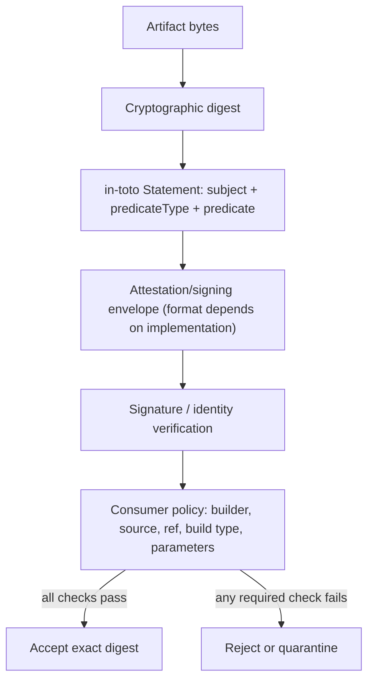
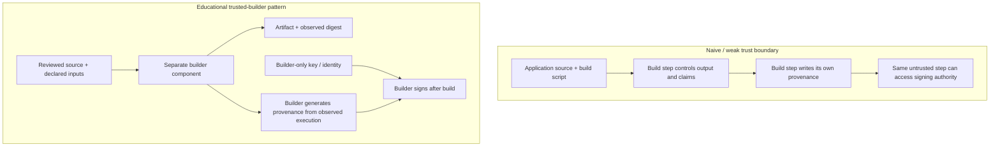

# Unit 10 — SLSA Framework and Build Provenance Levels

**Target file:** `10-slsa-framework-and-build-provenance-levels.md` | **Estimated time:** 18–26 hours | **Prerequisites:** M12 Units 1–9; M01 Unit 3; basic Docker/BuildKit, Git, JSON, cosign, SBOMs, CI/CD, Kubernetes and GitOps  
**Core tools:** Docker/BuildKit/buildx, Git, cosign, Python 3, JSON tooling, optional `kind` and Unit 11 policy engine | **Awareness:** hosted attestations, `slsa-verifier`, transparency logs, Source track, VSA, TUF, ML provenance initiatives | **Last reviewed:** 2026-10-29 (authoring date; current tool/spec status not live-certified) | **Spec/tool baseline:** `[VERIFY]` pin and record the exact SLSA, in-toto, DSSE, cosign, Docker/buildx, BuildKit and Kubernetes versions before execution | **Footprint:** [ILLUSTRATIVE] 1–3 GB for local JSON/Git exercises; 4–10 GB additional image/cache space for container labs; memory varies by daemon and image | **Needs internet at lab time:** image pulls and current-tool installation need internet; JSON fixture and verifier labs can run offline.

> **Safety and authenticity contract:** all keys are throwaway lab keys. Use only your own disposable repository, local images and `kind` cluster. Never commit private keys, embed them in image layers, print them, or include them in provenance. Examples and expected output are explicitly labelled when synthetic or illustrative. A local educational builder simulation is not a certified or conformant SLSA builder.

## Table of Contents

- [10.0 Why this matters in production](#100-why-this-matters-in-production)
- [10.1 Learning objectives](#101-learning-objectives)
- [10.2 Concept map and vocabulary](#102-concept-map-and-vocabulary)
- [10.3 Level 1 — Beginner](#103-level-1--beginner)
- [10.4 Level 2 — Intermediate](#104-level-2--intermediate)
- [10.5 Level 3 — Advanced](#105-level-3--advanced)
- [10.6 Level 4 — Expert](#106-level-4--expert)
- [10.7 SRE lens](#107-sre-lens)
- [10.8 Security lens](#108-security-lens)
- [10.9 Production checklist](#109-production-checklist)
- [10.10 Hands-on lab set](#1010-hands-on-lab-set)
- [10.11 Self-check questions](#1011-self-check-questions)
- [10.12 Evidence artifacts](#1012-evidence-artifacts)
- [10.13 Common interview and design-review questions](#1013-common-interview-and-design-review-questions)
- [10.14 Sources and verification notes](#1014-sources-and-verification-notes)
- [Author’s Verification and Completeness Audit](#authors-verification-and-completeness-audit)

### 10.0 Why this matters in production

[ILLUSTRATIVE] A team deploys an image with a valid signature and an attached provenance statement. A release gate accepts it because it checks only that an attestation exists. Later, the team discovers that the statement names a feature-branch commit and an unapproved builder identity. The signature verified correctly; the trust policy was incomplete. The operational lesson is that provenance must be generated across a defensible trust boundary and then verified against the exact artifact digest, trusted builder, source/ref, build type and allowed parameters. A provenance record is evidence about a build, not proof that source code is safe, dependencies are benign, or the runtime is secure.

### 10.1 Learning objectives

By the end of this unit, the learner will be able to:

1. **[L1]** Explain the producer/consumer model and map threats across source, build, package, distribution and consumption.
2. **[L1]** Describe provenance, an in-toto Statement, a predicate, an attestation envelope and a subject digest without conflating them.
3. **[L1]** Find and record the current SLSA specification version, tracks and level requirements instead of relying on memorized definitions.
4. **[L2]** Create and inspect a clearly labelled SLSA Provenance v1-shaped fixture, validate its JSON, and identify schema claims that need current-spec verification.
5. **[L2]** Explain why a separate trusted builder is stronger than letting an application build script author and sign its own claims.
6. **[L2]** Run a local verification policy against positive and negative provenance fixtures with stable exit codes.
7. **[L3]** Produce a gap analysis against current official Build-track requirements, with evidence and unresolved requirements rather than an unsupported level claim.
8. **[L3]** Design a policy that checks digest, builder, source/ref, build type, parameters and dependency consistency.
9. **[L4]** Define provenance coverage metrics, exception governance and a response workflow for a compromised dependency or builder.
10. **[L4]** Distinguish what local experiments demonstrate from claims requiring a hardened hosted builder, verified product integration or independent audit.

### 10.2 Concept map and vocabulary

#### Supply-chain lifecycle

```mermaid
flowchart LR
  S["Source<br/>repo, commit, review"] -->|trust boundary 1| B["Build<br/>builder, workflow, inputs"]
  B -->|artifact digest + provenance| P["Package<br/>image, wheel, chart, model"]
  P -->|registry/mirror| D["Distribution<br/>access, retention, promotion"]
  D -->|consumer verification| C["Consumption<br/>CI, admission, runtime"]
  S -. "threat: compromised source" .-> B
  B -. "threat: forged provenance / contaminated builder" .-> P
  P -. "threat: tag overwrite / wrong digest" .-> D
  D -. "threat: unverified artifact" .-> C
```



#### Provenance structure and trust boundary



**Glossary**

- **SLSA**: Supply-chain Levels for Software Artifacts, commonly pronounced “salsa”; a framework/specification for improving software artifact integrity, particularly the build process.
- **Provenance**: verifiable information about how an artifact was produced. A builder asserts a relationship among output digest, source, build instructions, parameters, dependencies/materials and execution metadata.
- **Predicate**: the typed payload that describes a claim, such as build provenance.
- **Attestation**: a structured statement about an artifact, commonly signed or wrapped so consumers can verify integrity and signer identity.
- **Subject digest**: cryptographic identifier for the artifact the statement is about. Policy should compare it to the exact artifact being consumed.
- **in-toto Statement**: a statement structure that associates one or more subjects with a `predicateType` and predicate payload. Confirm the current specification schema before relying on field requirements.
- **DSSE**: Dead Simple Signing Envelope, a signing/envelope approach used in the attestation ecosystem. Verify the envelope and payload conventions against the current DSSE/in-toto documentation.
- **Builder identity**: identity asserted by the build system, such as a configured builder ID. It must be matched to a trust policy, not accepted merely because it is present.
- **Build type**: identifier describing the build process/instructions or build definition. Consumer policy should allow only expected build types.
- **Resolved dependency/material**: a concrete input used by a build, ideally with stable identity and digest. A name without a digest may not uniquely identify bytes.
- **`externalParameters`**: parameters supplied from outside the trusted build platform. Treat them as an input boundary and allow-list expected values.
- **`internalParameters`**: platform-controlled or otherwise internal build parameters in the selected predicate model. Exact semantics are version-dependent: `[VERIFY]`.
- **Reproducible build**: an independent rebuild that yields the same artifact bytes/digest under defined conditions. Nondeterminism can make this difficult; a mismatch is evidence to investigate, not proof by itself of compromise.
- **Verification policy**: explicit consumer rules for signer/builder identity, artifact digest, source/ref, build type, parameters and any required attestations.
- **Authenticity**: evidence that a statement came from an identity trusted by the verifier and was not altered under the signing model.
- **Completeness**: whether the evidence contains the required claims and materials for the intended decision.
- **Generation**: producing the provenance record. Generation alone does not make it trustworthy.
- **Verification**: evaluating cryptographic integrity and semantic policy against a particular artifact and trust configuration.

#### SLSA tracks and levels: verify, do not memorize

The curriculum expects a Build track with levels described as L0–L3 and asks learners to inspect the current Source track where applicable. Because the official specification evolves, this table is a navigation aid, not a normative definition.

| Topic | Teaching interpretation | Required source check |
|---|---|---|
| Build track | Requirements focused on how software artifacts are built and how trustworthy provenance is produced | `[VERIFY]` Current SLSA specification: track names, level labels and requirements |
| Source track | Requirements addressing source integrity may be published separately from Build requirements | `[VERIFY]` Confirm current status, level names and maturity |
| L0 | Baseline/no meaningful SLSA Build assurance in the selected model | `[VERIFY]` Use current official definition |
| L1 | Provenance is produced, with limited guarantees depending on the current requirements | `[VERIFY]` Confirm provenance and completeness requirements |
| L2 | Stronger provenance authenticity/build-platform requirements than L1 | `[VERIFY]` Confirm hosted-platform and signing requirements; do not generalize |
| L3 | Stronger platform hardening, isolation and resistance to build-step forgery in the applicable spec | `[VERIFY]` Confirm exact requirements and evidence |

Do not label a pipeline “SLSA L2” or “SLSA L3” because it has JSON provenance, a signature, BuildKit flags, or a checklist that is mostly complete. A level is a claim against a specific current specification and all applicable requirements, supported by evidence.

### 10.3 Level 1 — Beginner

#### 10.3.1 Producer and consumer

The producer is responsible for generating accurate evidence from a controlled build. The consumer decides whether to trust the artifact. The same organization may play both roles, but the roles should remain logically distinct: the component whose output is being built should not be able to invent every claim used to approve that output.

| Lifecycle step | Example threat | Control/evidence | Residual limitation |
|---|---|---|---|
| Source | Unreviewed or compromised commit | protected branch, review record, commit/ref in provenance | review can miss malicious code |
| Build | Build script forges its own provenance | trusted builder generates evidence outside untrusted steps | builder itself can be compromised |
| Package | Wrong bytes promoted under a tag | digest-based identity and signature/attestation | digest does not say whether bytes are safe |
| Distribution | Registry/tag mutation or stale mirror | verify exact digest, access controls, mirror audit | consumer must still verify |
| Consumption | Policy checks only “attestation exists” | semantic policy checks signer, builder, source/ref and digest | policy can be incomplete or misconfigured |

#### 10.3.2 What provenance can and cannot establish

**Can support:** “Trusted builder identity X asserts that artifact digest D was produced from source commit C using build type T and recorded materials M.” Whether that assertion is trustworthy depends on the builder’s controls, isolation, signing boundary and consumer verification.

**Cannot establish by itself:**
- source code is benign or reviewed well;
- dependencies have no vulnerabilities;
- the SBOM is complete or correct;
- a signature means the signer is authorized for this repository;
- an image will behave safely at runtime;
- all fields are truthful merely because the JSON parses;
- the build is reproducible;
- the pipeline meets a SLSA level.

#### 10.3.3 Signature, provenance and SBOM are different

| Evidence | Primary question | Does not replace |
|---|---|---|
| Image signature | Was this digest signed by an identity/key the verifier trusts? | provenance or vulnerability scanning |
| Provenance attestation | What does a trusted builder assert about how this digest was produced? | source review, SBOM, scan |
| SBOM | Which components/dependencies are declared or discovered in this artifact? | provenance or proof of safety |
| Vulnerability scan | Which known issues were detected under a specific DB/tool/configuration? | provenance, runtime controls, or proof of absence |
| Build log | What did a particular process log? | tamper-resistant provenance unless trust and integrity are established |

Handoff: M12 Unit 4 covers image signing and deployment verification; Unit 3 covers SBOMs; Unit 2 covers scanning/triage; Unit 5 covers build isolation and CI identity. Unit 10 joins these artifacts into a verification decision.

### 10.4 Level 2 — Intermediate

#### 10.4.1 Trusted-builder contrast



A separate component is only a meaningful boundary if the build step cannot read its key, alter the builder’s code/configuration, impersonate its identity, overwrite its evidence, or change the inputs after they are measured. Merely putting a shell script in another directory is not isolation.

**Naive example — deliberately weak, local-only:**

```bash
# Context: disposable local shell; no secrets. Illustrative anti-pattern.
# A build-controlled script can simply write whatever claim it wants.
mkdir -p out
cat > out/provenance.json <<'JSON'
{"builder":"trusted-builder","source":"refs/heads/main","artifact":"sha256:pretend"}
JSON
```

The marker says nothing about whether the named builder actually performed the build. It is intentionally not a valid SLSA predicate.

**Safer design principle:** a separate trusted component obtains source identity from the checked-out repository, controls the build command, computes the resulting digest itself, records resolved inputs, and signs using authority inaccessible to application-controlled steps. In this laptop lab, the separation is an educational approximation; a same-user process or same Docker daemon may still share a trust domain. Do not claim SLSA conformance.

#### 10.4.2 Predicate and statement example

The following is a **schema-shaped teaching fixture**, not a claim that every field is valid or required under the current SLSA schema. Validate it against the official current predicate schema before signing or consuming it. The field names requested by this curriculum are shown with verification notes.

```json
{
  "_comment": "[SYNTHETIC] Schema-shaped example; validate against current official schema.",
  "_type": "https://in-toto.io/Statement/v1",
  "subject": [
    {
      "name": "registry.lab.local/demo/service",
      "digest": {"sha256": "0123456789abcdef0123456789abcdef0123456789abcdef0123456789abcdef"}
    }
  ],
  "predicateType": "https://slsa.dev/provenance/v1",
  "predicate": {
    "buildDefinition": {
      "buildType": "https://example.invalid/buildtypes/local-container-v1",
      "externalParameters": {
        "sourceRepository": "https://example.invalid/team/service",
        "sourceRef": "refs/heads/main",
        "entryPoint": "container build"
      },
      "internalParameters": {
        "builderProfile": "local-training-profile"
      },
      "resolvedDependencies": [
        {
          "uri": "git+https://example.invalid/team/service@0123456789abcdef0123456789abcdef01234567",
          "digest": {"gitCommit": "0123456789abcdef0123456789abcdef01234567"}
        }
      ]
    },
    "runDetails": {
      "builder": {"id": "https://example.invalid/builders/local-training-v1"},
      "metadata": {
        "invocationId": "local-run-001",
        "startedOn": "2026-10-29T10:00:00Z",
        "finishedOn": "2026-10-29T10:01:00Z"
      },
      "byproducts": []
    }
  }
}
```

Important cautions:
- `https://example.invalid` is intentionally non-routable example data.
- The digest and commit are synthetic, not real artifact evidence.
- Exact schema versions, required fields, accepted digest formats, timestamp requirements, and the relationship of statement fields to the SLSA predicate must be checked in the current official schemas: `[VERIFY]`.
- A JSON parser can validate syntax, not conformance, truth, or trust.

#### 10.4.3 Validate the fixture locally

```bash
# Context: host shell; Python 3 required; no network needed.
python3 - <<'PY'
import json
from pathlib import Path
# Paste the JSON fixture above into fixture.json in your disposable lab first.
p = Path("fixture.json")
data = json.loads(p.read_text(encoding="utf-8"))
assert data.get("predicateType") == "https://slsa.dev/provenance/v1"
assert data.get("subject"), "missing subject"
print("JSON syntax and minimal teaching assertions passed")
print("This is not official schema validation or signature verification.")
PY
```

Expected result shape: a success line only if the file parses and the minimal assertions pass. This test does not prove the fields conform to the latest SLSA predicate.

#### 10.4.4 Throwaway key and cosign attestation workflow

Use a throwaway key only for the lab. Current cosign flags and predicate-type names vary by release; verify `cosign version`, `cosign attest --help`, `cosign verify-attestation --help`, and the official cosign documentation before executing. The curriculum mentions `--type slsaprovenance1` or a custom predicate type, but the exact current syntax is `[VERIFY]`.

```bash
# Context: host shell in a disposable lab directory.
# Preconditions: cosign installed from a trusted source; local test artifact exists;
# never run this in a production checkout or with production keys.
cosign version
cosign attest --help
cosign verify-attestation --help
```

Then follow the installed version’s documented key-based attestation workflow using a throwaway key generated outside source control. Do not copy an unverified command from a stale tutorial. Keep the private key file permission-restricted; use a test image/digest and verify against the matching public key. Remove the private key and test artifacts at cleanup. The workflow must establish both cryptographic validity and semantic policy acceptance; a valid signature from an untrusted key is a policy failure.

#### 10.4.5 BuildKit provenance and SBOM

The curriculum calls out `docker buildx build --provenance=mode=max --sbom=true` as a starting point. These flags, mode semantics, builder behavior and attestation storage/inspection are version-sensitive: `[VERIFY]`.

```bash
# Context: host shell; disposable local service directory; Docker daemon/buildx available.
docker version
docker buildx version
docker buildx inspect
docker buildx build --help
```

Before a real run:
1. Record the Docker Engine, buildx and BuildKit versions.
2. Confirm the installed help documents the exact provenance and SBOM options.
3. Build a tiny benign service with a local tag or push to a disposable local registry.
4. Inspect the image digest and available attestation metadata using the installed documented workflow.
5. Retain the command, version inventory, digest and inspection evidence.

**Limit:** provenance emitted by a build client/daemon that an untrusted build controls is not automatically resistant to a malicious builder. BuildKit output is useful evidence, but do not infer SLSA L3 from a flag or assume every registry preserves/represents attestations identically. If the environment cannot expose attestations, use the JSON fixture and document that the fallback does not demonstrate BuildKit attachment, registry distribution or signature verification.

#### 10.4.6 Consumer verification logic

A verifier should fail closed for production promotion when required provenance is absent or required trust claims fail. The following Python policy works on a **normalized local fixture**; it is not a complete in-toto, DSSE, cosign or SLSA verifier. Cryptographic verification must happen before this semantic policy is called.

```python
#!/usr/bin/env python3
"""Semantic policy over an already-verified, normalized provenance fixture."""
import json
import sys
from pathlib import Path

POLICY = {
    "subject_sha256": "0123456789abcdef0123456789abcdef0123456789abcdef0123456789abcdef",
    "builder_id": "https://example.invalid/builders/local-training-v1",
    "source_repository": "https://example.invalid/team/service",
    "allowed_refs": {"refs/heads/main", "refs/tags/v1.0.0"},
    "build_type": "https://example.invalid/buildtypes/local-container-v1",
    "allowed_external_parameters": {"sourceRepository", "sourceRef", "entryPoint"}
}

def evaluate(statement):
    errors = []
    if statement.get("predicateType") != "https://slsa.dev/provenance/v1":
        errors.append("unexpected or missing predicateType")
    subjects = statement.get("subject") or []
    digest_values = [s.get("digest", {}).get("sha256") for s in subjects]
    if POLICY["subject_sha256"] not in digest_values:
        errors.append("subject digest mismatch")
    predicate = statement.get("predicate") or {}
    definition = predicate.get("buildDefinition") or {}
    run = predicate.get("runDetails") or {}
    builder = run.get("builder") or {}
    if builder.get("id") != POLICY["builder_id"]:
        errors.append("untrusted builder identity")
    if definition.get("buildType") != POLICY["build_type"]:
        errors.append("unexpected build type")
    params = definition.get("externalParameters") or {}
    if params.get("sourceRepository") != POLICY["source_repository"]:
        errors.append("unexpected source repository")
    if params.get("sourceRef") not in POLICY["allowed_refs"]:
        errors.append("source ref not allowed")
    unexpected = set(params) - POLICY["allowed_external_parameters"]
    if unexpected:
        errors.append("unexpected external parameter keys: " + ", ".join(sorted(unexpected)))
    if not params.get("entryPoint"):
        errors.append("missing entryPoint")
    return errors

if __name__ == "__main__":
    if len(sys.argv) != 2:
        print(f"usage: {sys.argv[0]} STATEMENT.json", file=sys.stderr)
        sys.exit(2)
    try:
        statement = json.loads(Path(sys.argv[1]).read_text(encoding="utf-8"))
    except (OSError, json.JSONDecodeError) as exc:
        print(f"cannot read valid JSON: {exc}", file=sys.stderr)
        sys.exit(2)
    errors = evaluate(statement)
    if errors:
        for error in errors:
            print("REJECT:", error)
        sys.exit(1)
    print("POLICY PASS (semantic fixture only; crypto verification is a separate prerequisite)")
    sys.exit(0)
```

The sample policy uses exact allow-list semantics for the training fixture. Production policies must be adapted to the actual schema and threat model. Validate required/optional fields, canonical repository URIs, tag/ref semantics, workflow pinning, parameter boundaries, multi-subject behavior and cryptographic identity using current tool/spec documentation.

#### 10.4.7 Verification decision sequence

1. Resolve the artifact to an immutable digest.
2. Retrieve the attestation for that digest.
3. Verify envelope/signature or keyless identity using a current supported verifier.
4. Verify that the attestation subject digest equals the artifact digest.
5. Verify trusted builder identity.
6. Verify source repository and allowed commit/ref.
7. Verify build type, entry point/workflow and pinned workflow references where applicable.
8. Validate external parameters and materials against the threat model.
9. Compare provenance materials with SBOM and scan evidence for the same subject digest.
10. Accept, reject, or route to an explicitly governed exception.

A signature check is necessary in many designs but never substitutes for steps 4–9.

### 10.5 Level 3 — Advanced

#### 10.5.1 Build-track gap analysis

Evaluate each applicable requirement in the current official spec. The table below is a template for the learner’s local educational simulation; it is not a conformance claim.

| Requirement area | Evidence to collect | Local simulation likely demonstrates | Limitation / next action |
|---|---|---|---|
| Provenance generated | predicate, builder logs, output digest | record can be generated | generation does not prove truth |
| Provenance completeness | schema validation and required-claim checks | selected fields can be tested | validate current official schema |
| Provenance authenticity | signature/identity verification | throwaway key workflow may demonstrate cryptographic verification | test key is not production trust |
| Builder isolation | access-control and architecture evidence | conceptual separation | same laptop/daemon may share trust |
| Build-to-build isolation | separate workers and access boundaries | perhaps not demonstrated | use a platform with documented isolation |
| Non-falsifiability against user build steps | negative test: build step cannot sign/alter evidence | limited fixture test | cannot claim hardened-builder guarantees |
| Source integrity | branch protection/reviews/ref validation | local Git ref checks | source-track requirements need separate review |
| Build platform control | builder image/version and configuration inventory | inventory can be recorded | a local lab is not independently assessed |

**Rule:** only use `met` when the exact requirement is verified against the selected specification version and evidence supports it. Use `not met`, `not applicable with rationale`, or `unknown`; unknown is not met.

#### 10.5.2 Threat-to-requirement mapping

| Threat | Relevant control direction | Evidence | Residual risk |
|---|---|---|---|
| Forged provenance | builder-controlled generation; signing key inaccessible to tenant build steps | boundary diagram, access test, signature verification | trusted builder compromise |
| Cross-build contamination | isolated/ephemeral workers and clean workspace | worker configuration, isolation tests | shared daemon/kernel vulnerabilities |
| Stolen signing key | secret/key isolation, least privilege, rotation/revocation | key access audit, rotation record | trust bootstrapping and stale verifiers |
| Compromised source | review, protected refs, source identity in provenance | review/ref evidence | authorized malicious change |
| Compromised dependency | digest identity, SBOM, scanning, lockfiles, incident inventory | resolved materials and SBOM comparison | undeclared/dynamic dependencies |
| Compromised builder | hardening, monitored upgrades, independent rebuilds, revoke identity | builder inventory and rebuild record | independent builders may share inputs/tooling |
| Parameter injection | allow-list external parameters and pin workflows | policy tests | schema evolution can introduce new inputs |
| Wrong artifact promoted | bind all evidence to digest | digest consistency matrix | registry or consumer configuration errors |

#### 10.5.3 `externalParameters` and policy design

Treat externally supplied parameters as a meaningful trust boundary. A parameter such as source ref, build target, build command, dependency mirror, or workflow reference can change what is built. The exact distinction between externally supplied and internally controlled fields depends on the selected predicate version and build type: `[VERIFY]`.

Do not blindly reject every unknown field in all predicates: a strict allow-list is appropriate only when the policy intentionally defines a closed input contract and has a migration process. A safe governance model is:
- version the accepted build type and policy;
- inventory the parameter schema;
- reject unexpected values for high-risk production builds;
- log/audit new fields during migration;
- review the producer and consumer compatibility window;
- test old and new predicate versions before enforcement;
- record the policy version used for each decision.

#### 10.5.4 Provenance + SBOM + scan bundle

| Artifact | Required consistency check |
|---|---|
| Image digest | same immutable subject across all records |
| Provenance | subject matches image; builder/source/ref/build type meet policy |
| SBOM | subject or image digest association is explicit and matches |
| Scan result/attestation | scan target digest, scanner/database version and timestamp are recorded |
| Signature | trusted signer/identity signs the exact image digest or defined attestation |
| Deployment record | deployed digest matches the verified bundle |
| Exception | scoped to exact digest/repository and expires; does not silently widen |

Do not compare only human-readable tags. A tag can be reassigned. If the provenance describes one digest while the cluster runs another, the bundle is inconsistent regardless of how complete the documents look.

#### 10.5.5 Multi-artifact and non-container builds

A monorepo pipeline may produce multiple subjects. Preserve the mapping from each output digest to source path, commit, build target and materials. Verify the selected statement schema’s multi-subject behavior instead of assuming one subject per build.

For Python wheels, Helm charts, model files and datasets, the same core principle applies: compute an immutable digest, record source/material identity and execution environment, and make the consumer compare the digest it actually uses. Do not assume image-specific policy tooling automatically verifies a wheel, chart, model or dataset.

**ML training-run example — `[SYNTHETIC]`:**

```json
{
  "recordType": "educational-ml-training-provenance",
  "code": {
    "repository": "https://example.invalid/ml/recommender",
    "commit": "0123456789abcdef0123456789abcdef01234567"
  },
  "data": [
    {"name": "training-snapshot", "sha256": "aaaaaaaaaaaaaaaaaaaaaaaaaaaaaaaaaaaaaaaaaaaaaaaaaaaaaaaaaaaaaaaa"},
    {"name": "feature-snapshot", "sha256": "bbbbbbbbbbbbbbbbbbbbbbbbbbbbbbbbbbbbbbbbbbbbbbbbbbbbbbbbbbbbbbbb"}
  ],
  "parameters": {"epochs": 3, "seed": 17},
  "environment": {"python": "record exact version", "framework": "record exact version", "containerDigest": "sha256:record-real-digest"},
  "output": {"name": "model.bin", "sha256": "cccccccccccccccccccccccccccccccccccccccccccccccccccccccccccccccc"}
}
```

This is an educational record, not a claimed SLSA predicate or a universal ML provenance standard. Verify emerging ML-specific provenance efforts before naming or adopting them. Provenance does not prove model fairness, accuracy, privacy, robustness or safety.

#### 10.5.6 Reproducible builds

A second independent environment rebuilds from recorded source and inputs, then compares output digests. Matching digests increase confidence that the artifact is reproducible under the tested conditions; they do not prove the source is safe. Different digests may result from timestamps, file ordering, package repository drift, platform architecture, compiler/toolchain versions, nondeterministic packaging, or an actual compromise.

Procedure:
1. Pin source commit and dependencies.
2. Record builder/toolchain and target platform.
3. Build in isolated environment A and compute digest.
4. Rebuild in environment B with the same declared inputs.
5. Compare digests and metadata.
6. If different, compare build logs and materials, classify known nondeterminism, and rerun only after preserving evidence.
7. Do not “fix” the test by ignoring digest differences without explaining the assurance lost.

Handoff: M01 Unit 3 owns foundational reproducible-build concepts; this unit uses them as one signal in a provenance program.

#### 10.5.7 Admission and GitOps

At CI promotion, verify the signature and provenance policy before the artifact is promoted. At admission, verify the exact image digest and relevant attestations again when the selected policy engine supports the required claims. Unit 8 owns admission architecture; Unit 11 owns detailed Kyverno/Gatekeeper policy authoring. Current `verifyImages` attestation syntax and supported predicate conditions are `[VERIFY]`; inspect the installed engine version and official documentation, then test positive and negative fixtures in a disposable `kind` cluster.

GitOps should promote immutable digests and retain a link between source commit, provenance decision, release approval and deployed digest. Mutation and tag-based drift can break that evidence chain. Use M08 Unit 13’s evidence-store and promotion practices.

### 10.6 Level 4 — Expert

#### 10.6.1 Governance and target requirements

Define artifact tiers using the Unit 1 threat model. A high-criticality control-plane component, model-serving gateway or data-ingestion image may justify stronger build isolation than a short-lived internal tool. A tier decision should document:
- business/data criticality and exposure;
- acceptable build trust assumptions;
- target requirements mapped to a specific spec version;
- evidence required for each requirement;
- accountable producer and consumer owners;
- migration milestones, exception policy and review date;
- cost and operational burden;
- exit criteria for enforcement.

A roadmap should say “targeting the verified requirements listed in policy version X” rather than marketing a level unsupported by evidence.

#### 10.6.2 Coverage metrics

All metrics below are custom program metrics, not assumed built-in Prometheus metrics. Define the population before calculating percentages.

| Metric | Numerator / denominator | Window and missing-data behavior | Caveat |
|---|---|---|---|
| Production digests with provenance | distinct in-scope deployed digests with usable provenance / all distinct in-scope deployed digests | rolling 30 days `[ILLUSTRATIVE]`; missing inventory means coverage unknown, not zero | denominator depends on complete runtime inventory |
| CI promotion verification | promotion events with passing verification / all in-scope promotion events | weekly/monthly; missing decisions count as unknown and alert | distinguish retry from separate promotion |
| Admission verification | eligible admission decisions that verified required provenance / eligible decisions | weekly; explicitly exclude only documented non-applicable kinds | policy bypasses/exemptions must be reported |
| Independent reproducibility | artifacts successfully rebuilt with matching digest / artifacts selected for independent rebuild | quarterly; failed/unavailable attempts remain in denominator as not verified | selection bias if only easy artifacts are rebuilt |
| Consistent evidence bundle | deployed digests with matching provenance + SBOM + scan evidence / all in-scope deployed digests | rolling window; missing evidence is a gap | evidence age and tool DB freshness matter |
| Exception count/age | active exceptions and age distribution | daily snapshot; expired entries remain visible until revoked | count alone says little about risk |
| Failed verification | rejected or indeterminate decisions / total verification attempts | daily/weekly; separate invalid from unavailable | alerting on retries can inflate rates |

Do not publish universal SLO targets. Set `[ASSUMPTION]` thresholds from risk appetite, baseline data, and operational capacity.

#### 10.6.3 Exception governance

A third-party artifact without acceptable provenance may need a temporary exception while a replacement is prepared. The exception must be narrow and explicit.

| Field | Required content |
|---|---|
| Artifact | repository plus immutable digest; avoid tag-only scope |
| Missing requirement | exact provenance/signature/source/builder gap |
| Owner and approver | named accountable service owner and authorized risk approver |
| Rationale | business need and why alternatives are not immediately available |
| Compensating controls | scan, mirror/quarantine, digest pin, runtime restrictions, limited exposure |
| Evidence | review, scan, source/vendor statement and deployment references |
| Created / expiry | timestamp, short expiry, review date |
| Status | pending, approved, revoked, expired |
| Renewal | new evidence and explicit re-approval; never automatic forever |

Expired exceptions should alert and block promotion according to policy. If an emergency exception is needed, record the decision and later review it under M10. Exceptions are not a substitute for provenance generation.

#### 10.6.4 Compromised dependency or builder response

1. Declare and coordinate under M10 incident roles.
2. Preserve the advisory, affected dependency identity/digest, timestamps, relevant build records, provenance, SBOMs, registry and deployment records.
3. Query `resolvedDependencies` and SBOM inventories for artifacts whose build window and material set intersect the affected input.
4. Identify deployed digests; distinguish known affected, potentially affected and unknown due to missing evidence.
5. Apply a scoped admission deny/quarantine or rollout hold for affected digests. Avoid a blanket policy change without blast-radius review.
6. Rebuild using a clean, trusted builder and verified inputs.
7. Re-scan, regenerate SBOM, sign and attest; verify digest and policy.
8. Deploy the replacement and verify the actual running digest.
9. Rotate/revoke builder keys or identity if the builder is suspected; review trust roots and all evidence created during the compromise window.
10. Measure time-to-answer and time-to-mitigate; preserve chain of custody and hold a blameless postmortem.

If the builder is compromised, provenance it generated during the exposure window may be unreliable even if the signature validates. Revoke trust, inventory artifacts, rebuild from a clean trust domain, and independently verify selected outputs.

#### 10.6.5 Incident scenarios

| Scenario | Evidence and diagnosis | Containment and correction | Owner and effectiveness check |
|---|---|---|---|
| Build script writes its own provenance | build script can modify claim and signer access | stop promotion; move generation/signing to isolated builder | platform security; negative test proves build step cannot access key |
| Verifier checks only presence | policy accepts feature branch/wrong builder | reject until semantic policy checks source/ref/builder/digest | release engineering; regression matrix passes |
| Feature-branch build reaches production | source ref claim or promotion policy incomplete | hold rollout, identify affected digest, rebuild from approved ref | service owner; production promotion test rejects feature ref |
| Arbitrary external parameters accepted | parameter schema and allow-list absent | pin expected inputs, reject unknown high-risk values, version policy | builder owner; injected parameter test rejected |
| Builder key exposed to build step | access audit or benign read test succeeds | revoke/rotate key, assess all signed artifacts, rebuild | security owner; access-control test fails safely |
| Unsupported SLSA L3 claim | no evidence for required isolation/platform requirements | remove claim; publish gap analysis and target plan | program owner; claim register cites each requirement |
| Dependency cannot be mapped to artifacts | provenance/SBOM inventory incomplete | conservatively identify potentially affected builds; improve material capture | supply-chain owner; synthetic advisory query coverage improves |

#### 10.6.6 Ecosystem and future awareness

- **in-toto layouts:** a framework for describing and verifying supply-chain steps; verify current documentation and applicability.
- **OpenSSF Scorecard:** a project security-health signal, not a substitute for artifact-specific provenance.
- **S2C2F:** Secure Supply Chain Consumption Framework; verify current publication and scope.
- **NIST SSDF SP 800-218:** secure software development practices; map at a high level, not as an automatic equivalence to SLSA.
- **CNCF supply-chain guidance and CISA guidance:** use current primary documents.
- **Transparency logs, VSA, TUF, confidential-computing builders and reproducible-build ecosystems:** awareness only; current semantics and maturity `[VERIFY]`.
- **Hosted artifact attestations and `slsa-github-generator`:** product names, availability, trust identity and guarantees are `[VERIFY]`; no hosted account is required for this unit.

### 10.7 SRE lens

Provenance is an operational dependency. If the verifier or builder is unavailable, release throughput may stop; if the gate silently fails open, assurance may disappear. Design for both availability and integrity.

- **Availability:** document builder/verifier dependencies, key rotation, backup/recovery, version upgrades and failure behavior.
- **Latency:** measure build time added by provenance generation and verification locally. Do not extrapolate laptop numbers to production.
- **Reliability:** alert on missing provenance, verification errors, stale policy versions, expired exceptions and unexplained drops in coverage.
- **Change safety:** canary policy changes, test old/new predicate compatibility, preserve rollback, and keep a record of policy version used for each decision.
- **On-call:** define who owns builder failures, trust-root changes, false rejection and compromised-builder incidents.
- **Recovery:** do not bypass verification globally as the first response. Use a documented, authorized, narrow, time-limited exception only if the incident commander approves it and compensating controls are recorded.
- **False confidence:** a green signature check is not a green provenance policy. Dashboard the separate steps.
- **SLO candidates:** percentage of in-scope promotions with a completed decision; verification-service availability; p95 verification latency; age of unverified production digests; expired exception count. Define denominators and windows before choosing targets.
- **Error-budget analogy:** `[ASSUMPTION]` a release assurance budget may help discuss the balance between fail-closed policy and release availability, but it is not a universal standard and must never silently waive critical security controls.

### 10.8 Security lens

Threat-model the producer, builder, signer, registry, verifier, and consumer separately. Ask what an attacker controlling each component can falsify.

1. **Least privilege:** application build steps should not read builder signing material or edit builder policy.
2. **Trust bootstrapping:** a signature only means something if the verifier’s public key or identity roots were obtained and configured securely.
3. **Source/ref binding:** source repository, commit and permitted ref must match release policy.
4. **Parameter control:** externally supplied parameters can alter build behavior; document allowed values and review schema changes.
5. **Dependency integrity:** digest identity, SBOM and provenance materials should align; a clean provenance record does not make a dependency safe.
6. **Builder isolation:** evaluate worker isolation, ephemeral state, cache sharing, daemon privileges and access to other builds.
7. **Evidence privacy:** provenance should not leak tokens, internal secrets, private URLs or sensitive build arguments. Keep secrets out of external parameters and logs.
8. **Policy tampering:** protect verifier policy and trust roots with review, version control, RBAC and monitoring.
9. **Time-of-check/time-of-use:** ensure the artifact consumed is the digest verified; never verify a mutable tag and later deploy a potentially different digest.
10. **Residual risk:** a trusted builder may faithfully build malicious reviewed source; a compromised dependency can be accurately recorded; runtime compromise remains in Unit 12.

### 10.9 Production checklist

| Check | Evidence | Owner |
|---|---|---|
| Current spec and predicate version recorded | source URL, version/date, reviewed requirements | supply-chain security |
| Builder identity is explicit and trusted | builder registry and trust policy | platform team |
| Build step cannot access signing authority | access-control review and negative test | build platform owner |
| Artifact is immutable by digest | build/release/deployment records | release engineering |
| Predicate conforms to selected schema | schema validation result and tool version | producer owner |
| Signature/envelope verified | verifier result bound to digest | release pipeline |
| Source repo and ref are allowed | semantic policy test | source owner |
| Build type and entry point match policy | builder config and verification evidence | platform team |
| External parameters are reviewed | allow-list and negative tests | builder owner |
| Dependencies have stable identities | `resolvedDependencies` + SBOM comparison | application team |
| Scan evidence is current and digest-bound | scanner version/DB timestamp and target digest | security team |
| Admission verifies where supported | policy test and live admission evidence | cluster platform |
| GitOps deploys verified digest | desired vs running digest record | service owner |
| Exceptions have owner and expiry | registry report and expiry alert | risk approver |
| Builder upgrades are reviewed | version pin, release notes, compatibility tests | platform team |
| Incident inventory can identify affected outputs | synthetic query and measured response | incident lead |
| Metrics have denominator and missing-data policy | dashboard/query definitions | SRE |
| Private keys and sensitive inputs are excluded | secret scan/review and cleanup evidence | security owner |

### 10.10 Hands-on lab set

#### Lab preflight and common safety boundary

**Scope:** disposable local Git directory, throwaway keys, local image/registry and optional disposable `kind` cluster only. Never point these commands at a production context.

```bash
# Context: host shell, WSL2 Ubuntu or native Linux.
# Preconditions: Git, Python 3; Docker only for image labs.
git --version
python3 --version
docker version
docker buildx version
cosign version
kubectl config current-context 2>/dev/null || true
```

Before any cluster lab, confirm the current context is a disposable `kind` context. [ILLUSTRATIVE] Allow 2–4 CPU cores and 4–6 GB RAM for container/cluster labs, plus several GB of disk cache. Record actual measurements on your laptop. Internet is needed for initial downloads; fixture-based labs are offline.

```bash
# Context: host shell; create a new disposable directory.
mkdir -p "$HOME/slsa-unit10-lab"
cd "$HOME/slsa-unit10-lab"
umask 077
```

##### Lab 1 — Trusted-builder simulation and provenance-forgery contrast

**Objective:** demonstrate why a build-controlled script must not author the trust claims used to approve its own output.

**Architecture:** weak producer writes a claim; stronger educational design has a separate builder observe the digest and create evidence outside application-controlled steps. A single laptop cannot prove strong isolation if both components share the same user/daemon.

**Fixture — benign marker:**

```bash
# Context: disposable lab directory. No secret is used.
mkdir -p naive trusted
printf 'release-marker=expected\n' > naive/artifact.txt
sha256sum naive/artifact.txt
cat > naive/claim.json <<'JSON'
{"builder":"https://example.invalid/trusted-builder","sourceRef":"refs/heads/main","note":"[SYNTHETIC] build-controlled claim"}
JSON
cat naive/claim.json
```

**Negative test:** modify the claim without rebuilding the artifact. The claim can be changed because it is an ordinary file controlled by the same step. A verifier that checks only the claim’s existence will not notice.

```bash
# Context: disposable lab directory; intentionally alter only the synthetic claim.
python3 - <<'PY'
import json
p = "naive/claim.json"
x = json.load(open(p, encoding="utf-8"))
x["sourceRef"] = "refs/heads/feature/unapproved"
json.dump(x, open(p, "w", encoding="utf-8"))
print("Changed synthetic claim:", x["sourceRef"])
PY
```

**Trusted-builder design exercise:** create a separate process/job that receives a fixed source revision, executes a fixed build command, computes output digest, writes the record and signs with a key unavailable to the application step. Test that the application step cannot read the key or overwrite the builder’s record. If both steps run under the same host user with the same filesystem and Docker daemon permissions, mark the isolation test **not demonstrated**.

**Positive/negative criteria:** positive = builder records actual output digest and approved ref; negative = changed ref or key access attempt is rejected. **Evidence:** architecture diagram, file hashes, access test result, and a note describing shared trust domains. **Troubleshooting:** if both jobs can access the same key path, move the key to the builder-only boundary; do not treat a renamed file as isolation. **Cleanup:** remove `naive/`, `trusted/` and any throwaway keys. **Limitation:** this is not SLSA certification or proof of L3.

##### Lab 2 — SLSA v1 provenance generation, cosign attestation and inspection

**Objective:** create a fixture, validate JSON syntax, and rehearse the signed-attestation workflow without inventing current CLI syntax.

1. Save the schema-shaped JSON in Section 10.4.2 as `fixture.json`.
2. Run the Python syntax/minimal-assertion check from Section 10.4.3.
3. Verify the exact current SLSA predicate schema and in-toto Statement schema from official sources.
4. Check installed cosign version and local help for `attest` and `verify-attestation`.
5. In a disposable directory, generate a throwaway key using the documented installed cosign command; keep private key permissions restrictive and outside source control.
6. Use the installed documented command to attest a known local artifact digest; use the public key to verify the attestation.
7. Run a negative test with a different public key and with a statement whose subject digest does not match the artifact.
8. Retain command transcript, tool versions, artifact digest, public-key fingerprint, verification decision and redacted output.

**Expected outcome:** syntactic fixture checks pass; official schema validation and crypto verification are separate evidence items. Wrong key and wrong digest must fail the policy. **Fallback:** if cosign or registry support is unavailable, retain the JSON fixture and policy tests only and state that signing/attestation transport was not demonstrated. **Cleanup:** remove private key and disposable artifacts after retaining non-secret evidence. Never retain the private key as evidence.

##### Lab 3 — BuildKit provenance and SBOM

**Objective:** produce a small local container and inspect the actual provenance/SBOM behavior of the installed buildx/BuildKit version.

**Inline minimal Dockerfile:**

```dockerfile
FROM python:3.12-slim
WORKDIR /app
COPY app.py /app/app.py
USER 65532:65532
CMD ["python", "/app/app.py"]
```

```python
# app.py — benign local service marker, not a network listener.
print("slsa-unit10-demo")
```

**Steps — host shell in the disposable service directory:**
1. Record `docker version`, `docker buildx version` and `docker buildx inspect`.
2. Inspect `docker buildx build --help`; verify provenance/SBOM options and semantics for this version.
3. Build using the documented supported options. The curriculum’s starting point is `--provenance=mode=max --sbom=true`, but verify syntax first.
4. Capture the image digest and inspect metadata with the current documented `docker buildx imagetools inspect` or another supported method.
5. If the builder requires push to expose attestations, use a disposable local registry; do not assume a local image store or every registry preserves metadata identically.
6. Compare the provenance subject, SBOM association and image digest.

**Positive test:** emitted evidence refers to the built digest and includes expected build inputs. **Negative test:** inspect a different digest or an image without evidence; policy must not treat it as equivalent. **Expected outcome:** observed metadata is recorded without assuming a universal layout. **Troubleshooting:** inspect builder driver, output type and registry support; if not supported, use the fixture fallback. **Cleanup:** remove the test image, registry and build cache only after checking that no other project depends on them. **Limitation:** BuildKit output alone does not prove a malicious builder cannot forge its own evidence or satisfy SLSA L3.

##### Lab 4 — Provenance verification script/policy

**Objective:** test semantic checks against normalized fixtures. Use the script in Section 10.4.6 as `verify_policy.py`; save a valid statement fixture as `statement.json`.

**Required tests:**

| Case | Mutation | Expected decision |
|---|---|---|
| Positive | expected digest, builder, repository, allowed ref and build type | exit 0 |
| Wrong builder | change `runDetails.builder.id` | exit 1 |
| Feature branch | set `sourceRef` to an unapproved feature ref | exit 1 |
| Unexpected external parameter | add `shellCommand` to `externalParameters` | exit 1 |
| Digest mismatch | change subject SHA-256 | exit 1 |
| Missing provenance | no file / malformed file | exit 2 or explicit rejection, never silent pass |

**Context:** host shell; Python 3 only; no network required.

```bash
python3 verify_policy.py statement.json
echo "exit=$?"
```

Expected success/failure messages are generated by the script and depend on fixture content; do not copy synthetic output as if it were a live result. **Evidence:** fixture hashes, test matrix, exit codes and policy version. **Troubleshooting:** ensure the policy runs only after cryptographic verification, and do not treat normalized fixture success as SLSA schema conformance. **Cleanup:** remove generated fixtures or keep sanitized copies without secrets.

##### Lab 5 — Admission-time provenance verification

**Objective:** map the Lab 4 consumer policy to admission enforcement on a disposable `kind` cluster.

**Preflight:** verify the cluster is disposable, record `kubectl config current-context`, and ensure sufficient RAM. Use only one policy engine in the lab cluster. Unit 11 owns detailed policy authoring; this lab is integration and verification.

1. Inspect the installed Kyverno version and its official documentation for `verifyImages` and attestation conditions.
2. Confirm the selected engine version supports the exact predicate/attestation shape and identity/key model.
3. Create a disposable `kind` cluster and install only the selected engine following its official current instructions.
4. Begin with audit/warn behavior if available, using a compliant digest and negative fixtures.
5. Test an allowed builder/source/digest, wrong builder, unapproved source ref and missing attestation.
6. Review policy reports/events/logs; only progress to blocking after the negative tests and recovery procedure are understood.
7. Delete the cluster after evidence collection.

**Fallback:** a policy review worksheet plus the Lab 4 fixtures can demonstrate rule logic, but does not demonstrate API-server admission, webhook availability, registry retrieval or live signature verification. **Safety:** do not install Kyverno and Gatekeeper simultaneously; never change the current production cluster context. **Cleanup:** delete only the named disposable `kind` cluster after confirming its name.

##### Lab 6 — SLSA Build-track gap analysis

**Objective:** map local evidence to current official requirements without assigning an unsupported level.

1. Download or inspect the official SLSA specification for the version being evaluated.
2. Record the exact version/date and relevant requirement text or source references.
3. For each applicable requirement, record target track/level, status (`met`, `not met`, `unknown`, `not applicable` with rationale), evidence, gap, remediation owner and confidence.
4. Include provenance generation, completeness, authenticity, non-falsifiability, build isolation, platform control and signing boundary where applicable.
5. Ask an independent reviewer to challenge each `met` row.
6. Revisit the matrix after any spec, builder or workflow upgrade.

**Acceptance:** no level is claimed from a partial checklist. **Evidence:** requirements snapshot/reference, completed matrix and reviewer comments. **Fallback:** use the current official document manually if internet is unavailable; record the version used. **Cleanup:** no runtime resources required.

##### Lab 7 — Independent reproducible rebuild

**Objective:** rebuild a small artifact in two isolated directories/build environments and interpret the digest result.

```bash
# Context: host shell; same pinned source and inputs in two disposable worktrees.
git worktree add ../slsa-rebuild-a <PINNED_COMMIT>
git worktree add ../slsa-rebuild-b <PINNED_COMMIT>
# Run the same documented build command in each worktree and record digests.
sha256sum ../slsa-rebuild-a/path/to/artifact ../slsa-rebuild-b/path/to/artifact
```

Replace `<PINNED_COMMIT>` and artifact paths with the learner’s actual commit/output. Do not run the placeholder literally. If container builds are used, pin platform, base-image digest, dependency sources and build toolchain.

**Positive test:** digests match; investigate whether the two environments were genuinely independent. **Negative/non-match case:** preserve both outputs and compare timestamps, archive ordering, architecture, dependency resolution and toolchain. A mismatch is not automatic proof of compromise. **Evidence:** source commit, input manifest, builder/toolchain versions, output digests, logs and conclusion. **Troubleshooting:** do not erase nondeterministic inputs just to force a match. **Cleanup:** remove the two worktrees after preserving required evidence. **Handoff:** M01 Unit 3.

##### Lab 8 — Compromised-input response drill

**Objective:** use a synthetic advisory to inventory potentially affected artifacts, mitigate, rebuild and verify.

**Synthetic advisory schema:**

```json
{
  "id": "SYNTHETIC-ADVISORY-2026-TRAINING-01",
  "summary": "A training-only dependency release is considered untrusted",
  "affectedMaterial": {
    "uri": "pkg:pypi/example-library@9.9.9",
    "digest": {"sha256": "dddddddddddddddddddddddddddddddddddddddddddddddddddddddddddddddd"}
  },
  "knownSince": "2026-10-29T10:00:00Z",
  "scope": "local training inventory only"
}
```

This is not a real advisory or CVE. Do not treat the package name/version as a real vulnerability claim.

1. Create synthetic artifact records linking image digest, build timestamp, resolved dependencies, SBOM and deployment.
2. Query for artifacts that include the affected material and were built in the defined window.
3. Mark results as confirmed, potentially affected or unknown; missing provenance is an uncertainty, not proof of unaffected status.
4. Simulate denying the exact affected digests in the disposable admission policy or mark them quarantined in the local register.
5. Rebuild using clean trusted inputs, regenerate SBOM/provenance, verify signatures and policy, and record the replacement digest.
6. Measure local time-to-answer and time-to-mitigate with a clock; label values as local lab observations, not production guarantees.
7. Preserve the advisory, query, affected-digest list, decision log, verification evidence and postmortem actions.

**Expected outcome:** a traceable affected-artifact set and documented unknowns. **Cleanup:** remove test images and synthetic records only after preserving redacted evidence. **Limitation:** the fixture does not simulate a real exploit or prove production response times.

##### Lab 9 — ML artifact provenance

**Objective:** bind a synthetic training run to code, data snapshots, parameters, environment and output digest.

1. Use the synthetic record in Section 10.5.5 and replace placeholders only with benign local values/hashes.
2. Hash each input snapshot and the output model file.
3. Record code commit, toolchain/container digest, parameters, and timestamp.
4. Write a verifier that compares the expected model digest to the digest of the served/consumed file.
5. Mutate one metadata field and then the model file; ensure the verification decision identifies the mismatch.
6. Document access controls and privacy boundaries for dataset metadata.

**Positive test:** digest and metadata match the approved run record. **Negative test:** model digest or data snapshot differs. **Evidence:** synthetic training record, hashes, test results and limitation statement. **Cleanup:** remove model/data fixtures if not needed. **Limitation:** this educational pattern is not a universal ML provenance standard and does not prove model quality, fairness, safety or privacy.

##### Lab 10 — Provenance coverage metrics exporter

**Objective:** export locally calculated program metrics and define their semantics.

The following is a custom Prometheus text exposition fixture. Metric names are **custom**, not built-in Prometheus metrics.

```text
# HELP slsa_lab_provenance_coverage_ratio Fraction of in-scope deployed digests with usable provenance.
# TYPE slsa_lab_provenance_coverage_ratio gauge
slsa_lab_provenance_coverage_ratio 0.75
# HELP slsa_lab_verified_promotion_ratio Fraction of in-scope promotion events with passing verification.
# TYPE slsa_lab_verified_promotion_ratio gauge
slsa_lab_verified_promotion_ratio 0.9
# HELP slsa_lab_admission_verified_ratio Fraction of eligible admission decisions with provenance verification.
# TYPE slsa_lab_admission_verified_ratio gauge
slsa_lab_admission_verified_ratio 0.8
# HELP slsa_lab_reproducible_build_ratio Fraction of selected independent rebuilds with matching digest.
# TYPE slsa_lab_reproducible_build_ratio gauge
slsa_lab_reproducible_build_ratio 0.5
# HELP slsa_lab_active_exceptions Number of active provenance exceptions.
# TYPE slsa_lab_active_exceptions gauge
slsa_lab_active_exceptions 2
# HELP slsa_lab_expired_exceptions Number of expired exceptions not yet revoked.
# TYPE slsa_lab_expired_exceptions gauge
slsa_lab_expired_exceptions 1
# HELP slsa_lab_verification_failures_total Total failed provenance verification decisions in the fixture window.
# TYPE slsa_lab_verification_failures_total counter
slsa_lab_verification_failures_total 3
```

Values are `[SYNTHETIC]` and must not be represented as measured production results.

| Metric | Definition |
|---|---|
| `slsa_lab_provenance_coverage_ratio` | in-scope deployed digests with usable provenance / all in-scope deployed digests |
| `slsa_lab_verified_promotion_ratio` | promotion events with passing verification / all in-scope promotion events |
| `slsa_lab_admission_verified_ratio` | eligible admission decisions verified / all eligible admission decisions |
| `slsa_lab_reproducible_build_ratio` | selected independent rebuilds with matching digest / all selected rebuilds attempted |
| `slsa_lab_active_exceptions` | count of approved, unexpired exceptions at snapshot time |
| `slsa_lab_expired_exceptions` | count of expired exceptions not yet revoked |
| `slsa_lab_verification_failures_total` | failed verification decisions in the defined collection window; use counter semantics carefully |

**Steps:** calculate numerator/denominator from a synthetic inventory; export values to a file or custom exporter; validate exposition with the chosen monitoring tool if installed; create a dashboard panel and alert for expired exceptions or falling coverage. Define missing inventory as “unknown” and expose coverage gaps rather than silently treating missing data as zero.

**Evidence:** metric definitions, sample input, generated exposition, dashboard/query and alert test. **Fallback:** use the fixture above and a dashboard specification. **Cleanup:** stop any temporary exporter and remove the test series. **Limitation:** synthetic values demonstrate metric design, not a production SLO.

### 10.11 Self-check questions

1. **[L1] What is SLSA intended to improve?**  
   **Answer:** Software artifact supply-chain integrity, particularly the build process. It does not certify that software is benign.
2. **[L1] What is provenance?**  
   **Answer:** Structured, verifiable claims about how an artifact was produced, including source, builder, inputs and execution context.
3. **[L1] What is a subject digest?**  
   **Answer:** An immutable cryptographic identifier for the artifact the statement describes; consumers compare it with the artifact they actually use.
4. **[L1] How does an in-toto Statement relate to a predicate?**  
   **Answer:** The statement binds subject(s) to a predicate type and predicate payload; the predicate carries the claim-specific data.
5. **[L1] Does valid JSON mean valid provenance?**  
   **Answer:** No. Syntax, schema conformance, authenticity and semantic trust are separate checks.
6. **[L1] Does a signature prove the source is safe?**  
   **Answer:** No. It proves a signature under a trust model; source safety and policy compliance need separate evidence.
7. **[L1] Why distinguish producer and consumer?**  
   **Answer:** Producers generate evidence; consumers independently decide whether the evidence meets their trust policy.
8. **[L1] What does an SBOM add?**  
   **Answer:** Component/dependency inventory that can support vulnerability and incident analysis; it is not proof of provenance or safety.
9. **[L2] Why is a build script writing its own provenance weak?**  
   **Answer:** The same untrusted code can invent source, builder and artifact claims.
10. **[L2] Why must the builder-only key be inaccessible to build steps?**  
    **Answer:** Otherwise compromised build code may sign forged claims using the trusted identity.
11. **[L2] What must be verified before using a cosign command from a tutorial?**  
    **Answer:** Installed version, current help, official documentation, predicate type and verification semantics.
12. **[L2] What does `resolvedDependencies` contribute?**  
    **Answer:** Records materials used by the build; stable identities/digests support impact analysis, but completeness must be assessed.
13. **[L2] Why inspect BuildKit output rather than assume a flag guarantees a result?**  
    **Answer:** Output and storage behavior depend on builder/version/export/registry configuration.
14. **[L2] What is the difference between signature verification and provenance policy?**  
    **Answer:** Signature verification checks cryptographic trust; provenance policy checks whether claims match expected source, builder, digest and parameters.
15. **[L2] Why is a fixture policy not a complete verifier?**  
    **Answer:** It does not parse/verify the real envelope, establish signer identity, or validate the official schema.
16. **[L3] Why is SLSA L3 not established by a local simulation?**  
    **Answer:** A local laptop rarely proves all required platform isolation, control and non-falsifiability properties; every current requirement needs evidence.
17. **[L3] How should unexpected external parameters be handled?**  
    **Answer:** Define an explicit contract, review new fields, test compatibility and reject unexpected high-risk inputs where policy requires it.
18. **[L3] What if two independent rebuilds differ?**  
    **Answer:** Preserve evidence and investigate nondeterminism, toolchain, timestamps, platform and inputs; mismatch alone is not proof of compromise.
19. **[L3] Why bind provenance, SBOM and scan to the same digest?**  
    **Answer:** Otherwise evidence can describe different bytes than the artifact deployed.
20. **[L3] What changes in a monorepo with multiple outputs?**  
    **Answer:** Preserve each subject digest and its source path/build target/material mapping; verify the selected statement’s multi-subject semantics.
21. **[L3] Why does admission-time verification matter if CI already verified?**  
    **Answer:** It checks the artifact at the deployment boundary and helps detect drift or bypass, but only if it checks the exact digest and is correctly configured.
22. **[L3] What is the risk of overstrict parameter rejection?**  
    **Answer:** Valid producer upgrades may fail unexpectedly; use versioned schemas, migration windows, test fixtures and controlled rollout.
23. **[L4] What should happen when a builder is suspected compromised?**  
    **Answer:** Revoke trust, preserve evidence, inventory outputs during the exposure window, rotate identity/key, rebuild in a clean trust domain and re-verify.
24. **[L4] How do you measure provenance coverage?**  
    **Answer:** Define in-scope distinct deployed digests with usable provenance divided by all in-scope deployed digests, with window and missing-data behavior documented.
25. **[L4] Why are expired exceptions operationally important?**  
    **Answer:** They become hidden long-lived bypasses unless reported, reviewed and revoked or explicitly renewed.
26. **[L4] How should a level claim be reported?**  
    **Answer:** Name the exact spec version and requirements, provide evidence for each applicable requirement, disclose gaps and avoid certification language unless independently justified.
27. **[L4] What does a matching reproducible rebuild prove?**  
    **Answer:** The tested inputs produced matching bytes under those conditions; it does not prove source correctness or eliminate shared-compromise risk.
28. **[L4] How can provenance leak sensitive information?**  
    **Answer:** Parameters, URLs, paths or logs may expose tokens, private repository details or build arguments; minimize and redact evidence.
29. **[L4] What is a safe emergency exception?**  
    **Answer:** Narrow artifact scope, accountable approver, rationale, compensating controls, expiry, monitoring and post-incident review.
30. **[L4] Which metric can be gamed most easily?**  
    **Answer:** Any single percentage can be gamed by shrinking scope or excluding unknowns; publish denominator, exclusions, missing-data rate and independent checks.

### 10.12 Evidence artifacts

Retain the following in the lab’s evidence store. Keep private keys and credentials out of evidence.

| Artifact | Required contents | Redaction/integrity note |
|---|---|---|
| Spec snapshot/reference | official URL, spec version, date checked, relevant requirements | preserve reference/version, not an unreviewed copied blob |
| Builder config | builder image/tool versions, workflow and isolation model | remove secrets and private environment values |
| Source/ref record | repository identity, commit, approved ref and review reference | redact tokens and sensitive internal URLs |
| Artifact identity | image/package/model digest and build timestamp | immutable digest required |
| Provenance JSON | exact predicate/statement and schema version | inspect for secrets and internal sensitive metadata |
| Signature verification | verifier version, trust root/key fingerprint, result and target digest | never retain private key |
| SBOM and scan consistency | SBOM identifier, scanner/DB version, subject digest, timestamps | no sensitive package-feed credentials |
| Negative-test results | wrong builder/ref/digest/parameters/missing provenance outcomes | distinguish fixture from live result |
| Gap analysis | requirement, status, evidence, gap, owner, remediation | unknown is not met |
| Independent rebuild | source/input/toolchain record, both digests, analysis | retain mismatches; do not cherry-pick |
| Incident timeline | synthetic advisory, inventory query, affected digests, decisions and timing | label synthetic data clearly |
| ML artifact record | code/data snapshot hashes, parameters, environment, model digest | do not include private training data |
| Coverage metrics | definitions, numerator/denominator/window, exclusions and missing data | identify custom/synthetic metrics |
| Policy decision | policy version, decision, reason and exception reference | include enough context for reproducibility |
| Cleanup record | throwaway keys/artifacts removed, disposable cluster deleted | never attach the private key itself |

Use append-only or access-controlled storage where available. Hash retained files and keep a manifest of evidence hashes if the workflow supports it. A hash detects changes only when the expected hash is itself protected. Follow M08 Unit 13 evidence-store practices.

### 10.13 Common interview and design-review questions

1. **How does provenance differ from a signature?**  
   A signature authenticates a signed object under a trust model; provenance describes how an artifact was produced. A signed but semantically untrusted claim is still rejected. Trade-off: stronger semantic policy increases maintenance cost.

2. **How do you prove a SLSA level?**  
   Select a specific current specification version, enumerate every applicable requirement, collect evidence and independently review each status. Do not infer a level from a tool or badge. Trade-off: evidence collection costs time but avoids false assurance.

3. **Does BuildKit provenance automatically mean SLSA L3?**  
   No. Builder/platform requirements and resistance to tenant-controlled forgery must be evidenced under the current specification. Trade-off: native provenance is convenient but may not provide the full trust boundary required.

4. **What makes a builder trustworthy?**  
   Controlled configuration, isolation, identity, access boundaries, protected signing authority, monitored upgrades and evidence that untrusted steps cannot forge claims. No builder is trustworthy merely because its ID is a string.

5. **How do you handle `externalParameters`?**  
   Understand the selected predicate/build type, define allowed values and version the contract. Reject unexpected high-risk values, but provide migration tests to avoid breaking legitimate upgrades.

6. **How does provenance help with dependency compromise?**  
   Query resolved materials and combine them with SBOMs and deployment digests to build an affected-artifact set. Missing evidence increases uncertainty and may require conservative containment.

7. **What does reproducibility add?**  
   An independent rebuild can detect unexplained differences and reduce reliance on a single builder. It costs compute and may be difficult for nondeterministic artifacts; matching outputs still share possible source/input risks.

8. **Why verify at admission if CI verified already?**  
   CI and deployment are different trust boundaries. Admission can verify the exact digest about to run, provided the engine supports the policy and fail-open/exemption paths are controlled.

9. **How do you govern provenance exceptions?**  
   Scope to digest, record owner/approver/rationale/compensating controls/evidence/expiry, alert on expiry and require explicit renewal. Trade-off: exceptions preserve delivery but increase residual risk.

10. **What is the first action after builder compromise?**  
    Preserve evidence and declare the incident; revoke trust/credentials, inventory affected outputs and stop unsafe promotion while avoiding indiscriminate destructive changes. Rebuild from a clean trust domain.

11. **Can provenance be used for model artifacts?**  
    Yes as an educational pattern: bind code, dataset snapshot hashes, parameters, environment and model digest. But verify applicable standards and do not equate provenance with model quality or safety.

12. **How do you prevent provenance metrics from becoming vanity metrics?**  
    Publish denominators, scope, missing-data rate, exclusions, exception age and independent samples. Review whether “covered” means generated, cryptographically verified, semantically accepted and checked at deployment.

13. **How should builder identity be rotated?**  
    Introduce the new identity with an explicit trust window, verify new attestations, monitor old identity use, revoke the old identity at the planned point and preserve incident recovery procedures. Avoid ambiguous overlapping trust forever.

14. **How do you handle third-party artifacts without provenance?**  
    Prefer a replacement or upstream evidence; otherwise use a time-limited scoped exception, scan, mirror/quarantine, digest pin, runtime constraints and owner approval. This is risk acceptance, not equivalent assurance.

15. **What if the schema changes?**  
    Version schemas/policies, test producer and consumer compatibility, audit new fields, run shadow verification, canary, and only then enforce. A strict policy that silently breaks upgrades is operationally unsafe; a permissive policy that ignores new inputs may be insecure.

16. **How do you bootstrap trust in the builder?**  
    Use independently reviewed builder distribution/configuration, protected identity roots, pinned versions and monitored updates. Trust bootstrapping is a residual risk, not solved solely by the builder attesting to itself.

### 10.14 Sources and verification notes

Use primary sources and record the exact version/date actually consulted. The following canonical sources are supplied as starting points; current page content and exact requirements must be verified before making normative claims.

| Source | Official URL | What to verify |
|---|---|---|
| SLSA specification | https://slsa.dev/spec/ | Current version, tracks, level names and each applicable requirement |
| SLSA Provenance predicate | https://slsa.dev/provenance/v1 | Predicate schema, fields, required/optional status and semantics |
| in-toto Attestation / Statement | https://github.com/in-toto/attestation | Statement schema, subject/digest and predicate relationship |
| DSSE | https://github.com/secure-systems-lab/dsse | Envelope and signing semantics |
| Sigstore cosign documentation | https://docs.sigstore.dev/cosign/ | Current attest/verify command syntax, predicate types and key handling |
| Docker Buildx documentation | https://docs.docker.com/build/ | Current buildx flags, builder drivers, provenance/SBOM generation and inspection |
| BuildKit documentation | https://docs.docker.com/build/buildkit/ | Builder behavior, output modes and attestation limitations |
| Kubernetes documentation | https://kubernetes.io/docs/ | Admission integration, cluster version and policy behavior |
| Kyverno documentation | https://kyverno.io/docs/ | `verifyImages` attestation support for the installed release |
| OpenSSF Scorecard | https://scorecard.dev/ | Current project and check semantics |
| NIST SSDF SP 800-218 | https://csrc.nist.gov/Projects/ssdf | Current publication and high-level mapping |
| CISA Secure by Design / supply-chain guidance | https://www.cisa.gov/ | Current guidance applicable to the chosen threat model |
| Reproducible Builds | https://reproducible-builds.org/ | Reproducibility principles and practical limits |

**Verification method for each release of this module:**
1. Record installed tool versions (`cosign version`, `docker version`, `docker buildx version`, `kubectl version`) and do not copy flags from another release without checking local help.
2. Read the current official SLSA spec and predicate schema; record version/date and map exact requirements to evidence.
3. Validate the JSON fixture against the official schema, not just a JSON parser.
4. Confirm DSSE/in-toto envelope semantics and cosign command behavior in official docs.
5. Verify BuildKit attestation export/inspection with the actual builder driver and registry.
6. Verify the installed Kyverno version’s attestation conditions in a disposable cluster.
7. Mark any claim not actually checked `[VERIFY]`. Do not invent a checked date, tool version, live output, or conformance result.

### Author’s Verification and Completeness Audit

#### Pass 1 — Source fidelity and completeness

The authoring basis is the user-provided Unit 10 prompt and the available M12 syllabus-generation prompt. The available archived roadmap shows the M12 directory as `06-Production-Security-and-Software-Supply-Chain/`, while the task and current syllabus prompt specify `12-Production-Security-and-Software-Supply-Chain/`. The exact current `Roadmap_ptree.md` was not available for direct inspection in this turn; therefore the placement discrepancy is **unresolved**. This artifact follows the task’s intended filename and location without modifying the repository tree.

| Requirement group | Coverage location |
|---|---|
| L1 SLSA/provenance/trust boundaries | 10.2–10.3 |
| L2 local generation, trusted builder, cosign, BuildKit, verification policy | 10.4; Labs 1–5 |
| L3 gap analysis, threat mapping, policy, bundle consistency, multi-artifact, reproducibility | 10.5; Labs 6–7 |
| L4 governance, metrics, exceptions, incident response, ecosystem | 10.6–10.8; Labs 8–10 |
| All required diagrams | 10.2, 10.4, 10.6 |
| All required tables | 10.2, 10.3, 10.5, 10.6, 10.9, 10.12 |
| Lab 1 | 10.10, Lab 1 |
| Lab 2 | 10.10, Lab 2 |
| Lab 3 | 10.10, Lab 3 |
| Lab 4 | 10.10, Lab 4 |
| Lab 5 | 10.10, Lab 5 |
| Lab 6 | 10.10, Lab 6 |
| Lab 7 | 10.10, Lab 7 |
| Lab 8 | 10.10, Lab 8 |
| Lab 9 | 10.10, Lab 9 |
| Lab 10 | 10.10, Lab 10 |
| Self-checks, evidence, interview questions | 10.11–10.13 |
| Sources and unresolved verification | 10.14 and this audit |

#### Pass 2 — SLSA/spec accuracy

| Claim/topic | Source or verification method | Status | Note |
|---|---|---|---|
| Current SLSA version/tracks/levels | Official SLSA specification | `[VERIFY]` | Not represented as freshly verified |
| Provenance predicate URI/schema | Official SLSA predicate | `[VERIFY]` | Fixture is schema-shaped and synthetic |
| in-toto Statement and DSSE semantics | Official in-toto/DSSE docs | `[VERIFY]` | Check schema versions before production use |
| cosign flags and predicate type | Installed `cosign --help` + official docs | `[VERIFY]` | No unverified command claimed as executed |
| Buildx provenance/SBOM flags and storage | Installed buildx help + Docker docs | `[VERIFY]` | Builder/registry dependent |
| Kyverno attestation policy syntax | Installed Kyverno docs/version | `[VERIFY]` | Unit 11 owns detailed authoring |
| Metrics in Lab 10 | Inline definitions | `synthetic` | Custom metric names and synthetic values |
| ML training record | Inline educational record | `synthetic` | Not claimed as a standard predicate |
| Risk and policy choices | Threat-model design | `assumption` / `illustrative` | Adapt to asset tier and organization |

#### Pass 3 — Executability and consistency

| Check | Result | Evidence/section | Correction or remaining action |
|---|---|---|---|
| Required heading order 10.0–10.14 plus audit | PASS | File headings | Verified structurally before delivery |
| Ten labs present and in order | PASS | 10.10 | Checked against prompt list |
| JSON example visually consistent | PARTIAL | 10.4.2, 10.6.5, Lab 8 | Syntax/schema must be validated against current official schemas; examples intentionally synthetic |
| Python verifier logic | PARTIAL | 10.4.6 | Fixture must be saved and run locally; semantic policy only, not cryptographic verifier |
| Live cosign/buildx integration | PARTIAL | Labs 2–3 | Not run in a live environment; follow version verification steps |
| Admission integration | PARTIAL | Lab 5 | Fallback supplied; live `kind` integration not run |
| SLSA level claim | PASS | 10.5.1 | No level claimed; local simulation explicitly disclaims conformance |

#### Pass 4 — Security, privacy and safety

- All keys are designated throwaway; no private key or real credential is included.
- All named advisory and metric values are synthetic.
- Exercises are confined to the learner’s own local lab.
- No third-party exploitation or real secrets are required.
- Remaining risk: users must verify tool versions and clean up keys/artifacts themselves.

#### Pass 5 — Teaching and operational quality

- Acronyms are expanded at first substantive use.
- Provenance generation, authenticity, completeness and semantic verification are separated.
- Positive and negative cases are specified for the principal verification labs.
- Staged policy rollout, exception expiry, incident handling, evidence retention and residual risks are covered.
- Local lab measurements are not presented as production benchmarks.

#### Pass 6 — Final coverage and claims audit

| Check | Result | Evidence/section | Correction or remaining action |
|---|---|---|---|
| All L1–L4 curriculum areas addressed | PASS | 10.3–10.8 | Verify exact spec claims before production adoption |
| Ten mandatory labs included | PASS | 10.10 | Live tool integration remains learner-run |
| At least 25 answered self-checks | PASS | 10.11 | 30 questions |
| At least 12 interview/design questions | PASS | 10.13 | 16 questions |
| Claim register included | PASS | Audit Pass 2 | `[VERIFY]` items listed explicitly |
| Exact current roadmap inspected | PARTIAL | Audit Pass 1 | Current `Roadmap_ptree.md` was not available; archived tree shows alternate folder name |
| Live tests/cluster labs run | PARTIAL | Audit Pass 3 | No claim of live SLSA builder conformance or cluster enforcement |
| Only target module delivered | PASS | Delivery record | No other repository source file was intentionally modified |

#### Unresolved `[VERIFY]` list

1. **Current SLSA specification version, tracks, level names and requirements:** the current specification was not live-verified in this authoring pass. Consult `https://slsa.dev/spec/`, record the version/date, and map every applicable requirement to evidence.
2. **Provenance predicate and in-toto schema:** validate the fixture against the exact current schema and correct any field requiredness or type mismatch before signing.
3. **DSSE and cosign CLI/predicate syntax:** check the installed cosign release’s help and official documentation; test a throwaway key on a disposable artifact.
4. **Buildx/BuildKit provenance and SBOM behavior:** inspect installed versions and builder driver; verify flags, export mode and registry behavior experimentally.
5. **Kyverno admission attestation syntax:** check the installed version’s official `verifyImages` documentation and test in a disposable `kind` cluster.
6. **Current `Roadmap_ptree.md` path:** archived evidence uses `06-Production-Security-and-Software-Supply-Chain/`; the task expects `12-Production-Security-and-Software-Supply-Chain/`. Reconcile against the actual current tree before repository integration.

**File-safety statement:** this output is a new standalone Markdown artifact. No repository source file or neighboring module was intentionally modified. The file is teaching material and a reproducible lab plan; it does not claim a live production audit, current SLSA level, or successful integration with a particular installed toolchain.
