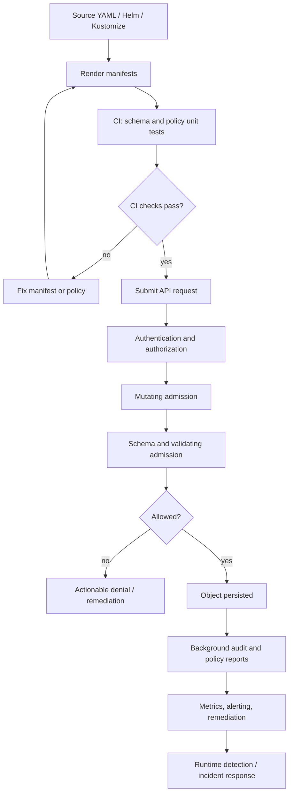
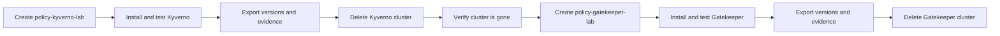

# Unit 11 — Kyverno and OPA Gatekeeper Policy Authoring

**Target file:** `11-kyverno-and-opa-gatekeeper-policy-authoring.md`  
**Stage:** Stage 2E — Production DevOps & Platform Engineering  
**Module:** M12 — Production Security and Software Supply Chain; **Unit:** 11  
**Estimated time:** 45–70 hours, including all labs, regression tests, and review  
**Prerequisites:** Stage 0–2D and Stage 2E M01–M11; particularly Kubernetes/RBAC/networking, Helm/Kustomize, GitOps, identity/secrets, image signing, supply-chain provenance, security auditing, and incident response.  
**Resource budget:** Approximately 4 CPU, 8 GB RAM, and 30 GB free disk. Run the two engine labs sequentially.  
**Review date:** 2026-10-29 (authored review; not a claim that all version-sensitive APIs were live-verified).  
**Version posture:** No exact tool release is asserted here. Select currently supported releases from official release/install documentation, record the versions, and resolve each `[VERIFY]` item before running version-sensitive commands or using a policy in production.

> Unit 8 taught the admission architecture, failure modes, rollout strategy, and governance with built-in controls and a teaching webhook. This unit is the **authoring craft** for two production policy engines — Kyverno and OPA Gatekeeper — including testing, mutation, generation, image verification, exceptions, reporting, performance, and migration between engines. Both are taught at authoring depth; they are installed in **separate sequenced lab clusters**, never together.

> **Safety boundary:** All commands that change cluster state are for the explicitly named disposable `kind` cluster only. Never use production contexts, real credentials, or production signing keys. Keep policy-engine webhooks out of the production recovery path until their availability and rollback procedures have been tested. A passing local lab is evidence about the tested fixtures and cluster—not proof of production security or compliance.

## Table of Contents

- [11.0 — Module Orientation, Outcomes, Prerequisites, and Safety](#110--module-orientation-outcomes-prerequisites-and-safety)
- [11.1 — Policy-as-Code Foundations and Engine Selection](#111--policy-as-code-foundations-and-engine-selection)
- [11.2 — Local Lab Bootstrap, Version Pinning, and Safe Engine Lifecycle](#112--local-lab-bootstrap-version-pinning-and-safe-engine-lifecycle)
- [11.3 — Kyverno from First Principles: Policies, Matching, Validation, and Feedback](#113--kyverno-from-first-principles-policies-matching-validation-and-feedback)
- [11.4 — Kyverno Mutation and Generation: Safe Defaults and Namespace Vending](#114--kyverno-mutation-and-generation-safe-defaults-and-namespace-vending)
- [11.5 — Kyverno Image Verification and Supply-Chain Attestation Policies](#115--kyverno-image-verification-and-supply-chain-attestation-policies)
- [11.6 — OPA Gatekeeper and Rego from First Principles](#116--opa-gatekeeper-and-rego-from-first-principles)
- [11.7 — Gatekeeper Mutation, External Data, and Policy Distribution](#117--gatekeeper-mutation-external-data-and-policy-distribution)
- [11.8 — Policy Testing, Fixtures, CI Gates, and Correctness Traps](#118--policy-testing-fixtures-ci-gates-and-correctness-traps)
- [11.9 — Exceptions, Exclusions, Rollout, and Multi-Tenant Governance](#119--exceptions-exclusions-rollout-and-multi-tenant-governance)
- [11.10 — Performance, Availability, Observability, and Troubleshooting](#1110--performance-availability-observability-and-troubleshooting)
- [11.11 — Engine Comparison, Migration, and Upgrade Engineering](#1111--engine-comparison-migration-and-upgrade-engineering)
- [11.12 — Mandatory Hands-On Labs](#1112--mandatory-hands-on-labs-complete-runnable-and-auditable)
- [11.13 — Production Operations, Incident Scenarios, and Capstone Policy Bundle](#1113--production-operations-incident-scenarios-and-capstone-policy-bundle)
- [11.14 — Review, Practice, References, and Author's Verification Audit](#1114--review-practice-references-and-authors-verification-audit)

---

## 11.0 — Module Orientation, Outcomes, Prerequisites, and Safety

### Why this unit exists

Policy-as-code makes some security and platform requirements executable at the point where Kubernetes objects are created or changed. It can reject an unsafe Pod, add a harmless default, create namespace baseline resources, or check image trust—depending on the engine, installed version, configuration, and the policy actually written. A policy is also production code: a false allow is a security defect; a false deny can become an availability incident.

A policy engine is not a substitute for authentication, RBAC, secure build systems, runtime detection, or a well-designed platform. It sees only the objects, context, and external evidence available to it. If a rule matches only `containers`, it may miss `initContainers`; if a selector can be controlled by a tenant, that tenant may be able to opt out; if a Rego rule always returns an empty result, audit can show zero violations while unsafe resources continue to be admitted.

### Learning outcomes

**Beginner**
- Explain policy, configuration, validation, mutation, generation, image verification, admission, audit, and runtime detection in your own words.
- Read a simple Kyverno rule and a Gatekeeper ConstraintTemplate/Constraint pair.
- Identify positive and negative test cases for a policy.

**Intermediate**
- Write and test equivalent label, image-tag, registry, and Pod-security rules in Kyverno and Gatekeeper.
- Scope policies across Pods and common Pod controllers without overlooking init containers.
- Run a policy in audit/warn/dry-run before a narrowly scoped enforce rollout.

**Advanced**
- Design mutation and generation with idempotence, lifecycle, RBAC, and GitOps drift in mind.
- Design signature and attestation checks without treating an attestation's mere existence as proof of trust.
- Detect policy bypasses using fixture corpora, mutation tests, and equivalent decisions across engines.

**Operational**
- Measure admission latency, denial/error rates, audit freshness, exception age, and policy coverage.
- Operate engine upgrades, webhook outages, emergency rollback, and time-boxed exceptions through reviewed runbooks.
- Produce an evidence bundle that separates observed results, synthetic examples, and unresolved version questions.

### Prerequisites and readiness check

Before proceeding, confirm that you can:
1. Create and delete a disposable `kind` cluster and verify its context.
2. Render a Helm/Kustomize workload and inspect the resulting Pod template.
3. Explain `securityContext`, service accounts, resource requests/limits, NetworkPolicy, RBAC, and image digests.
4. Explain a cosign signature and the purpose of an SLSA/in-toto provenance statement.
5. Use Git diffs, a shell, `kubectl`, and Python 3.
6. Read JSON/YAML and reason about absent fields versus explicit `null`.

If any item is missing, review the relevant M03–M10 unit before enabling enforcement. Revisit [Unit 8](08-admission-controls-and-deployment-policy-enforcement.md) for the architecture and rollout model, [Unit 4](04-image-signing-and-deployment-verification.md) for signatures, [Unit 10](10-slsa-framework-and-build-provenance-levels.md) for provenance, and [Unit 9](09-security-auditing-and-vulnerability-remediation-workflows.md) for audit/remediation.

### What policy-as-code does—and does not do

| Mechanism | Primary question | Typical timing | Does not prove |
|---|---|---|---|
| Validation | “Does this object satisfy a rule?” | CI and admission; sometimes background audit | That the running process remains safe |
| Mutation | “Can this object be safely defaulted or transformed?” | Mutating admission or a controlled pipeline | That the default is appropriate for every application |
| Generation | “Should a related resource be created from this parent event?” | Engine-specific controller workflow | That generated permissions are safe by default |
| Image verification | “Does this digest meet configured signature/attestation trust rules?” | Admission or pre-admission | That every claim in every attestation was semantically checked |
| Background audit | “Do existing resources violate the policy?” | Periodic or event-driven scan | That a new request would be rejected now |
| Runtime detection | “What is the workload doing after it starts?” | Runtime | That deployment-time policy was correct |

### Policy request lifecycle



This is a conceptual lifecycle. Exact API-server stage ordering, webhook reinvocation, and background-audit behavior must be checked against the selected Kubernetes and engine releases.

### Lab safety and two-engine sequence

- Use cluster names `policy-kyverno-lab` and `policy-gatekeeper-lab`.
- Never install Kyverno and Gatekeeper in the same lab cluster.
- Save evidence outside cluster storage before teardown.
- Use synthetic workloads and throwaway signing keys. Do not paste production tokens or registry credentials into YAML, shell history, or Git.
- Internet is needed for first-time image/chart/CLI downloads. A fully offline first install is not realistic unless every required artifact is already cached. Offline work can still use stored manifests and synthetic fixtures for static tests.
- Keep `kube-system`, CNI, DNS, storage, and engine namespaces out of broad experimental policies unless you have a specific tested reason to include them.



### Dependency map

| Dependency | Reuse in this unit |
|---|---|
| Unit 8: admission architecture | Failure policy, rollout, scope, rollback, governance |
| Unit 4: image signing | Cosign signatures, signer identity, key handling |
| Unit 10: SLSA/provenance | Builder/source claims, subject digest, attestation trust |
| M03–M04: Kubernetes/networking | Pod templates, RBAC, NetworkPolicy, TLS |
| M05: storage | PVC/StorageClass controls and quota boundaries |
| M06: packaging | Helm/Kustomize rendering and drift |
| M08: GitOps | Policy delivery, ordering, rollback, exception-as-code |
| M09: identity/secrets | Workload identity and secret minimisation |
| M10: incident response | Mass denial, outage, evidence preservation |
| M11: observability/performance | Admission latency, alert tests, benchmark harness |
| M16: platform golden paths | Namespace vending, tenant boundaries, safe defaults |

---

## 11.1 — Policy-as-Code Foundations and Engine Selection

### Policy, configuration, and enforcement

Configuration describes a desired object. A policy defines a condition that must or should hold. Enforcement is the mechanism that makes a policy consequential. For example, `runAsNonRoot: true` is configuration; “every application container must run as non-root” is a policy; an admission validator that rejects a Pod missing that setting is enforcement.

A useful policy has five explicit parts:
1. **Intent:** what risk is being reduced?
2. **Scope:** which resources, namespaces, operations, and actors are covered?
3. **Predicate:** what exact property must hold?
4. **Failure behavior:** deny, warn, report, or remediate?
5. **Evidence:** what tests and runtime signals demonstrate that the policy works?

Admission-time checks are strongest for blocking new or updated objects. CI checks are faster and give developers earlier feedback, but they can be bypassed by other API clients if admission is not also configured. Background audits help find legacy objects and policy drift. Runtime detection remains necessary for behavior that cannot be inferred from a manifest.

### Kubernetes admission in brief

A client sends a request to the API server. Authentication identifies the caller; authorization decides whether the caller may perform the action. Admission plugins and webhooks may mutate or validate eligible requests before persistence. Schema validation and admission behavior vary by request and Kubernetes version. A denial prevents persistence of that request; it does not automatically remove an already-running object. A background audit can identify existing violations, but the response and remediation workflow must be designed separately.

### Built-in-first strategy

Start with native controls where they meet the requirement:
- Pod Security Standards for baseline/restricted Pod security profiles.
- ValidatingAdmissionPolicy (VAP) and CEL for supported, relatively simple object predicates.
- RBAC for who may perform an action.
- ResourceQuota/LimitRange for resource governance.
- NetworkPolicy for network reachability, where the CNI enforces it.

An external policy engine adds useful authoring models and features but also adds controllers, webhooks, CRDs, upgrade paths, availability dependencies, permissions, and operational load. Do not install a policy engine because “every cluster needs one.” Choose the smallest combination that meets the threat model.

### Engine decision matrix

| Dimension | Kyverno | OPA Gatekeeper | VAP/CEL | Hybrid |
|---|---|---|---|---|
| Authoring model | Kubernetes-native YAML rules; JMESPath and Kyverno-specific syntax | ConstraintTemplate + Constraint; Rego | Kubernetes API policy + CEL expressions | Split by policy need |
| Validation | Strong core use case; exact features `[VERIFY]` | Strong core use case; Rego expressiveness | Good for supported object-local predicates | Avoid duplicate enforcement without a reason |
| Mutation | Available in supported Kyverno APIs; exact API/schema `[VERIFY]` | Mutation APIs exist in some releases; maturity/API `[VERIFY]` | Not a general mutation system | Use sparingly |
| Generation | Kyverno-specific generate workflow; lifecycle `[VERIFY]` | Not a direct equivalent to Kyverno generation | Not a general generation engine | Separate controller or GitOps may be clearer |
| Image verification | Kyverno `verifyImages` capabilities depend on release and trust setup `[VERIFY]` | Requires external verification architecture for cryptographic checks unless an explicitly verified integration is present | Not a signature verifier | Image verification may be separate |
| External/reference data | Context and API lookups depend on rule/release | Inventory sync and external data depend on Gatekeeper configuration/version | CEL has defined object/request context; not arbitrary remote lookups | Remote dependencies add failure modes |
| Audit/reporting | Policy reports/status vary by release `[VERIFY]` | Audit and constraint status; exact details `[VERIFY]` | API policy status/metrics vary by version | Ensure one coherent reporting view |
| Tests | Kyverno CLI and cluster tests `[VERIFY]` | `gator`, Rego tests, cluster tests `[VERIFY]` | API-server dry-run/integration tests | Shared fixture corpus helps |
| Availability | Webhook/controller dependency | Webhook/controller dependency | API-server built-in control; still version-dependent | More components, more failure modes |
| Best fit | Kubernetes-shaped validation plus supported mutation/generation/image features | Rego-based policy logic and constraint parameterisation | Simple native checks with low extra operational cost | Only when boundaries and ownership are explicit |

**Why teach both?** Teams inherit different engines, need to evaluate migration, or have distinct authoring requirements. The lab teaches comparable policy intent and tests—not a recommendation to deploy both together. Avoid dual-engine duplication because divergent decisions and doubled latency/operations can be worse than either tool alone.

### Threat model and policy objective

| Objective | Example | Evidence |
|---|---|---|
| Prevent | Reject privileged workload | Negative admission test |
| Detect | Report existing legacy Pod without owner label | Audit report plus known-violation fixture |
| Correct | Add an approved non-security-critical metadata label | Idempotence and diff test |
| Govern | Require owner, expiry, and approver for exception | Exception validation job |
| Recover | Roll back policy after mass denial | Rehearsed runbook and audit log |

Plain-English requirement: “Application workloads must have a valid `owner` label.”

Executable predicate: `metadata.labels` exists, `owner` exists, and its value is a non-empty string matching the organisation’s approved identity format.

Tests:
- Positive: `owner: team-payments`.
- Negative: missing `owner`.
- Negative: `owner: ""`.
- Negative: owner label placed on a nested template only when the policy expects top-level workload metadata.
- Bypass test: create a Deployment, not just a Pod.

The format of a valid owner should come from the organisation’s identity system, not from an arbitrary regex copied into a tutorial.

---

## 11.2 — Local Lab Bootstrap, Version Pinning, and Safe Engine Lifecycle

### Version-selection protocol

This module intentionally does not hardcode “latest” versions. Before commands:
1. Read the official installation and release documentation for Kubernetes/kind, Kyverno, Gatekeeper, OPA/Rego, and the matching CLIs.
2. Select supported versions that fit the laptop and one another.
3. Record version, source URL, date checked, and any compatibility notes in `versions.txt`.
4. Verify API resources and CLI help before applying examples.
5. Treat every `[VERIFY]` item as a stop sign, not a cosmetic annotation.

Example `versions.txt` (replace all placeholders with actual observed values):

```text
date_checked=YYYY-MM-DD
os=WSL2 Ubuntu or native Linux
docker=<exact version from docker version>
kubectl=<exact version from kubectl version --client>
kind=<exact version from kind version>
kubernetes=<exact server version from kubectl version>
kyverno=<exact release; Kyverno cluster only>
kyverno_cli=<exact release>
gatekeeper=<exact release; Gatekeeper cluster only>
opa_or_gator=<exact release if installed>
cosign=<exact release>
notes=<official release/compatibility links and unresolved checks>
```

### Preflight

Assumptions: Bash on WSL2 Ubuntu or native Linux; Docker daemon is available; `kubectl`, `kind`, and Python 3 are installed. Internet is needed for uncached downloads.

```bash
set -eu
printf '%s\n' '--- host ---'
uname -a
printf '%s\n' '--- memory ---'
free -h
printf '%s\n' '--- disk ---'
df -h "$HOME"
printf '%s\n' '--- CPU ---'
nproc
printf '%s\n' '--- Docker ---'
docker version
printf '%s\n' '--- kubectl client ---'
kubectl version --client
printf '%s\n' '--- kind ---'
kind version
printf '%s\n' '--- Python ---'
python3 --version
printf '%s\n' '--- connectivity/cache note ---'
printf '%s\n' 'First-time image/chart/CLI pulls require internet or pre-cached artifacts.'
```

Expected success signals are version output and sufficient free resources. Do not continue if Docker is unavailable or the laptop is already under resource pressure. WSL2 users should verify the Docker integration/daemon and disk location; large container storage under a constrained Windows drive can fill unexpectedly.

### Create the Kyverno cluster

`kind` cluster configuration may differ by version; this minimal file is a representative configuration. Verify current `kind` syntax before use.

Create `lab/kyverno/kind.yaml`:

```yaml
kind: Cluster
apiVersion: kind.x-k8s.io/v1alpha4
name: policy-kyverno-lab
nodes:
  - role: control-plane
  - role: worker
```

Run:

```bash
kind create cluster --name policy-kyverno-lab --config lab/kyverno/kind.yaml
kubectl config current-context
kubectl cluster-info
kubectl get nodes -o wide
```

**Guard:** the current context should identify `kind-policy-kyverno-lab`. If it does not, stop. Never substitute a production context.

Install Kyverno using the official installation path for the selected release. Prefer the official Helm chart or release manifests and a pinned chart/image version; do not copy an old URL from a blog. The exact chart command and values are **[VERIFY]** against the selected release. A typical Helm-shaped command, only after confirming repository/chart/version syntax, is:

```bash
# [VERIFY] Replace <CHART_REPO_NAME>, <CHART_REFERENCE>, and <VERSION>
# using the current official Kyverno installation documentation.
helm repo add <CHART_REPO_NAME> <OFFICIAL_CHART_REPOSITORY_URL>
helm repo update
helm install kyverno <CHART_REFERENCE> \
  --namespace kyverno --create-namespace \
  --version <VERSION>
kubectl -n kyverno rollout status deployment --timeout=180s
kubectl get crd | grep -i kyverno
kubectl get validatingwebhookconfigurations,mutatingwebhookconfigurations
```

If chart naming differs in the chosen release, use the official documented equivalent. Do not assume a particular Deployment name; discover it with `kubectl -n kyverno get deploy`.

Record evidence:

```bash
mkdir -p evidence/kyverno
kubectl config current-context > evidence/kyverno/context.txt
kubectl version -o yaml > evidence/kyverno/kubernetes-version.yaml
kubectl -n kyverno get deploy,pods,svc -o wide > evidence/kyverno/engine-resources.txt
kubectl get crd > evidence/kyverno/crds.txt
helm list -A > evidence/kyverno/helm-releases.txt
```

### Kyverno smoke test

Use the matching API version confirmed by the selected release. The example below is **representative** and assumes `kyverno.io/v1` supports `ClusterPolicy` in the selected release `[VERIFY]`.

```yaml
apiVersion: kyverno.io/v1
kind: ClusterPolicy
metadata:
  name: lab-require-owner
spec:
  validationFailureAction: Audit
  background: true
  rules:
    - name: require-owner-label
      match:
        any:
          - resources:
              kinds:
                - Pod
              namespaces:
                - policy-lab
      validate:
        message: "Add metadata.labels.owner with your responsible team."
        pattern:
          metadata:
            labels:
              owner: "?*"
```

Create the disposable namespace and policy only after checking context:

```bash
test "$(kubectl config current-context)" = "kind-policy-kyverno-lab"
kubectl create namespace policy-lab
kubectl apply --dry-run=server -f lab/kyverno/require-owner.yaml
kubectl apply -f lab/kyverno/require-owner.yaml
kubectl get clusterpolicy lab-require-owner -o yaml
```

The smoke test must include a known-good Pod and a known-bad Pod. In Audit mode, a bad object may be admitted while a violation is reported; do not expect a deny until you explicitly configure and test enforce mode. Exact report CRDs and behavior are **[VERIFY]**.

### Preserve evidence and tear down Kyverno before Gatekeeper

```bash
test "$(kubectl config current-context)" = "kind-policy-kyverno-lab"
kubectl get clusterpolicy -A -o yaml > evidence/kyverno/policies.yaml
kubectl get events -A --sort-by=.lastTimestamp > evidence/kyverno/events.txt
kind delete cluster --name policy-kyverno-lab
kind get clusters
```

Confirm the cluster is absent. **Do not create the Gatekeeper cluster until teardown is confirmed.** If a local registry was connected to kind, record how it was configured; do not delete a shared registry container unless you created it specifically for this lab and verified its name and ownership.

### Create the Gatekeeper cluster

```bash
kind create cluster --name policy-gatekeeper-lab
kubectl config current-context
kubectl cluster-info
kubectl get nodes -o wide
```

Expected context: `kind-policy-gatekeeper-lab`. Stop on mismatch.

Install Gatekeeper from the official documentation for the selected release. Use a pinned official release manifest or chart and record the exact artifact digest/version. The URL and resource names are **[VERIFY]**; do not substitute a guessed release URL.

```bash
# [VERIFY] Download/apply the official pinned release artifact.
kubectl apply -f <OFFICIAL_PINNED_GATEKEEPER_RELEASE_MANIFEST>
kubectl get pods -n gatekeeper-system -o wide
kubectl get crd | grep -E 'constrainttemplates|constraints.gatekeeper'
kubectl get validatingwebhookconfigurations
```

Discover the actual controller deployment names with `kubectl -n gatekeeper-system get deploy`; then wait for the relevant deployments. Verify the template API version and the Rego syntax supported by this release before applying examples.

Record evidence:

```bash
mkdir -p evidence/gatekeeper
kubectl config current-context > evidence/gatekeeper/context.txt
kubectl version -o yaml > evidence/gatekeeper/kubernetes-version.yaml
kubectl -n gatekeeper-system get deploy,pods,svc -o wide > evidence/gatekeeper/engine-resources.txt
kubectl get crd > evidence/gatekeeper/crds.txt
```

### Gatekeeper teardown

```bash
test "$(kubectl config current-context)" = "kind-policy-gatekeeper-lab"
kubectl get constrainttemplates -o yaml > evidence/gatekeeper/templates.yaml
kubectl get constraints -A -o yaml > evidence/gatekeeper/constraints.yaml
kind delete cluster --name policy-gatekeeper-lab
kind get clusters
```

### Offline and resource fallback

If installation cannot fetch images:
- Use only previously downloaded, integrity-checked release artifacts and cached images.
- Keep version metadata with every cached artifact.
- Use local fixture tests and static review while offline.
- Do not claim the offline simulation proves webhook behavior or admission integration.
- Do not use broad `docker system prune -a` cleanup. Inspect `docker ps -a`, `docker images`, and the exact kind cluster first; remove only resources you created and can identify.

---

## 11.3 — Kyverno from First Principles: Policies, Matching, Validation, and Feedback

### Policy structure

A Kyverno policy contains rules. A rule usually identifies which resources it applies to (`match` and optional `exclude`) and then validates, mutates, generates, or verifies them. A namespaced `Policy` is scoped differently from a cluster-wide `ClusterPolicy`; exact API availability and supported policy kinds vary by release. The examples use `ClusterPolicy` with `kyverno.io/v1` as a teaching baseline **[VERIFY]**. Newer CEL-based or `ValidatingPolicy` APIs may exist in the selected release; confirm support and lifecycle status before choosing them.

### Example 1: owner label

```yaml
apiVersion: kyverno.io/v1
kind: ClusterPolicy
metadata:
  name: require-owner
spec:
  validationFailureAction: Audit
  background: true
  rules:
    - name: owner-label-required
      match:
        any:
          - resources:
              kinds:
                - Pod
                - Deployment
                - StatefulSet
                - DaemonSet
                - Job
                - CronJob
              namespaces:
                - app-team-a
                - app-team-b
      validate:
        message: "Set metadata.labels.owner to the team accountable for this workload."
        pattern:
          metadata:
            labels:
              owner: "?*"
```

**Important limitation:** Controller resources have top-level metadata and a nested Pod template. A rule that checks only `metadata.labels` on a Deployment does not necessarily require the Pod template label. Conversely, Kyverno auto-generation can create controller rules from Pod rules for supported built-in controllers, but exact behavior and exclusions are version-sensitive **[VERIFY]**. Inspect the generated policy behavior and test each controller kind explicitly.

### Example 2: disallow `latest`

Image tags and digests are different. `nginx:latest` is mutable; `nginx@sha256:...` identifies content by digest. A registry port contains a colon, so naive string splitting at the first colon is wrong. A robust policy should use the engine's documented image parsing or an explicitly tested expression, not an improvised regex.

Representative policy for the tag case:

```yaml
apiVersion: kyverno.io/v1
kind: ClusterPolicy
metadata:
  name: disallow-latest-tag
spec:
  validationFailureAction: Audit
  background: true
  rules:
    - name: no-latest
      match:
        any:
          - resources:
              kinds:
                - Pod
      validate:
        message: "Use an explicit immutable digest or an approved non-latest tag."
        foreach:
          - list: "request.object.spec.containers"
            deny:
              conditions:
                any:
                  - key: "{{ element.image }}"
                    operator: EndsWith
                    value: ":latest"
          - list: "request.object.spec.initContainers || `[]`"
            deny:
              conditions:
                any:
                  - key: "{{ element.image }}"
                    operator: EndsWith
                    value: ":latest"
```

This is a teaching sketch, not a claim of universal syntax compatibility. Confirm JMESPath fallback, `foreach`, `EndsWith`, and controller auto-generation behavior in the selected Kyverno CLI/API. Add an explicit ephemeral-container rule if the selected engine and API path can evaluate it. Test image references such as `registry.lab.local:5000/team/app:latest`, `team/app:latest`, `team/app@sha256:<digest>`, and malformed references.

### Example 3: non-root and hardened Pod security

```yaml
apiVersion: kyverno.io/v1
kind: ClusterPolicy
metadata:
  name: require-hardened-pod
spec:
  validationFailureAction: Audit
  background: true
  rules:
    - name: require-nonroot-and-seccomp
      match:
        any:
          - resources:
              kinds:
                - Pod
      validate:
        message: "Set pod-level runAsNonRoot and seccomp RuntimeDefault; harden every container."
        pattern:
          spec:
            securityContext:
              runAsNonRoot: true
              seccompProfile:
                type: RuntimeDefault
            containers:
              - securityContext:
                  privileged: false
                  allowPrivilegeEscalation: false
                  capabilities:
                    drop:
                      - ALL
```

This exact pattern shape is not a universal proof that every container is covered; pattern list matching, anchors, and container iteration need version-specific testing. Use `foreach` or a validated equivalent for each `containers`, `initContainers`, and supported `ephemeralContainers` entry. A missing `securityContext` must fail, not pass because the policy accidentally skips the absent object. Pod Security Standards can provide a native baseline for many controls; do not duplicate a complex policy without a reason.

### Match, exclude, operations, and preconditions

- **Match** determines which requests enter the rule.
- **Exclude** removes requests from scope and is therefore a security-sensitive exception.
- **Kinds** and namespace/resource selectors define coverage.
- **Preconditions** narrow when a rule runs; a mistaken precondition can become an allow bypass.
- **Operations** may be configurable depending on API/version. If only CREATE is checked, UPDATE may allow an unsafe transition.
- **Variables/context/API calls** can make a policy more expressive but add dependency, latency, and failure complexity.
- Missing, null, empty, and malformed values are distinct test inputs. Define the intended behavior for each.

Do not use tenant-controlled labels as the sole basis for excluding a tenant from a cluster baseline. Keep the baseline in cluster-owned policy, and restrict who can edit policy and exception resources.

### Validation feedback and reports

A useful message tells the developer both the failure and the corrective action. “Policy violation” is weak; “Set `spec.template.spec.containers[*].resources.requests.cpu` and `.memory`, and limits required by platform policy” is actionable. Do not include secret values or full object bodies in denial messages or logs.

Policy reports can represent background results and are distinct from synchronous admission decisions. Report CRD names and behavior such as `PolicyReport` and `ClusterPolicyReport` are **[VERIFY]** against the selected release and installed CRDs. Inspect:

```bash
kubectl get clusterpolicy
kubectl describe clusterpolicy require-owner
kubectl get crd | grep -i policyreport
kubectl get events -A --sort-by=.lastTimestamp
```

### Deliberately flawed policy: Pod-only coverage

Flaw: the policy matches only `Pod`, but most applications are submitted as Deployments. A Deployment request can be admitted, then its controller creates Pods outside the expected policy path or the template rule may not exist. The test must submit a Deployment with an unsafe Pod template and demonstrate the gap before correcting the rule. Do not treat a single direct-Pod test as adequate coverage.

---

## 11.4 — Kyverno Mutation and Generation: Safe Defaults and Namespace Vending

### Mutation is not validation

Validation states a mandatory invariant. Mutation changes the object. Use validation for requirements that the workload owner must consciously satisfy—such as privilege, identity, or resource limits. Mutation is appropriate for predictable, non-security-critical defaults, such as adding an approved metadata label, provided it is idempotent and visible to the workload owner.

### Representative metadata mutation

The following example is a schema-shaped teaching example; verify `mutate` and strategic-merge behavior for the chosen Kyverno release **[VERIFY]**.

```yaml
apiVersion: kyverno.io/v1
kind: ClusterPolicy
metadata:
  name: add-platform-managed-label
spec:
  rules:
    - name: add-managed-label
      match:
        any:
          - resources:
              kinds:
                - Pod
              namespaces:
                - app-team-a
      mutate:
        patchStrategicMerge:
          metadata:
            labels:
              platform.example.com/managed: "true"
```

The desired property is idempotence: applying the policy repeatedly should not keep changing the object. Verify by comparing the submitted object, admitted object, and GitOps diff. Do not hide an unsafe workload by mutating away the evidence that a developer omitted a required security setting.

### JSON patch, strategic merge, foreach, and conflicts

- Strategic-merge-style patches express a desired partial object; merge semantics for arrays require particular care.
- JSON Patch is operation-based and can fail if paths do not exist or assumptions changed.
- `foreach` can operate on list elements, but syntax and patch context are version-sensitive.
- Preconditions should be narrow and tested.
- Multiple mutators can conflict or create ordering dependence. Keep a single owner for each mutated field where possible.
- Repeated admission should converge to one stable result.

For each mutator, test: absent field, existing compliant value, conflicting value, repeated application, UPDATE, and interaction with other mutators.

### Generation and namespace vending

A namespace-vending workflow may create:
- A default-deny NetworkPolicy.
- A ResourceQuota.
- A LimitRange.
- A tightly scoped RoleBinding only when its role and subjects are reviewed and fixed by platform-owned code.

A RoleBinding can grant privilege. A tenant who can edit the generation policy may be able to create privilege-bearing resources. Restrict policy writes with RBAC and GitOps branch protections; test the resulting permissions with `kubectl auth can-i`.

The exact Kyverno `generate`, `generateExisting`, `synchronize`, and orphan/deletion semantics are **[VERIFY]**. Before use, confirm current official docs and test these lifecycle cases:
1. A new namespace triggers expected resources.
2. An existing namespace is handled only if the selected feature is enabled.
3. Updating the parent causes only intended updates.
4. Deleting the parent has the documented child behavior.
5. Manually editing a generated child is either reverted or retained according to documented semantics.
6. Removing/upgrading the policy does not leave unexplained orphan resources.

### Representative NetworkPolicy for namespace baseline

This resource is ordinary Kubernetes NetworkPolicy YAML; enforcement still depends on the CNI and cluster networking implementation.

```yaml
apiVersion: networking.k8s.io/v1
kind: NetworkPolicy
metadata:
  name: default-deny-ingress-egress
  namespace: app-team-a
spec:
  podSelector: {}
  policyTypes:
    - Ingress
    - Egress
```

This policy can disrupt DNS and required egress. A production baseline usually needs explicit DNS and application egress allowances. “Default deny exists” is not equivalent to “the namespace is correctly networked.” Verify CNI enforcement and test required flows.

### GitOps and drift

Argo CD/Flux may compare desired resources against mutated or generated objects. Define ownership: source-controlled fields, engine-owned fields, generated children, and fields intentionally ignored. Ignore-differences rules reduce noisy drift but can also conceal meaningful changes; review every ignore rule. Order bootstrap so CRDs and engine controllers are healthy before applying dependent policies. Use M16’s namespace-vending design for platform ownership boundaries.

---

## 11.5 — Kyverno Image Verification and Supply-Chain Attestation Policies

### Trust chain: digest, signature, attestation

A tag is a mutable name. A digest identifies exact image content. A signature binds a signer to a digest or signed payload under a specific signature scheme. An attestation makes claims about a subject, such as build provenance or an SBOM. These are different checks.

A secure decision should bind together:
- Approved registry and repository path.
- Digest-pinned subject.
- Trusted signer key or tightly constrained keyless identity.
- Expected subject digest in each attestation.
- Expected predicate type and required claims.
- Expected source repository and protected ref.
- Trusted builder identity/build type.
- Freshness policy where the evidence actually carries trustworthy timestamps and the verifier implements the rule.
- A defined response to unavailable registry, signature, or transparency services.

An attestation's existence alone proves none of the semantic claims above.

### Kyverno `verifyImages`

Kyverno supports image verification features in certain releases, but exact schema and fields—including `imageReferences`, `attestors`, `mutateDigest`, `verifyDigest`, `required`, keyless identity fields, transparency-log settings, and attestation conditions—must be verified against the selected release **[VERIFY]**. Do not paste an old example and assume its schema is current.

A representative outline (not apply-ready until checked against official schema):

```yaml
apiVersion: kyverno.io/v1
kind: ClusterPolicy
metadata:
  name: verify-approved-images
spec:
  validationFailureAction: Audit
  rules:
    - name: verify-application-images
      match:
        any:
          - resources:
              kinds:
                - Pod
      verifyImages:
        - imageReferences:
            - "registry.lab.local/team-a/*"
          # [VERIFY] Add the selected release's documented digest/signature
          # and attestor fields here. Do not invent field names or trust rules.
```

This outline intentionally stops short of fabricating an attestor schema. To complete the lab:
1. Select a Kyverno release and open its official `verifyImages` documentation and CRD schema.
2. Confirm whether key-based signatures and keyless identities are supported and which identity/issuer constraints are required.
3. Confirm how the selected release retrieves signatures and attestations from the registry/OCI referrers or configured storage.
4. Confirm exact attestation predicate condition syntax and whether it can evaluate the scan freshness and finding fields required by the policy.
5. Test wrong key/identity, wrong subject digest, missing evidence, malformed predicate, and fetch errors before enforcing.

For public Sigstore/keyless verification, identity constraints and trust roots are critical; a broad regular expression or generic issuer condition can admit an unintended workflow. A local throwaway key demonstrates only a key-based lab path. It does not prove public Sigstore/keyless trust.

### Local registry considerations

A local registry can be plain HTTP or self-signed in a lab, but any insecure-registry setting must be confined to the disposable lab and clearly labelled. Production should use authenticated TLS, controlled trust roots, and least-privilege credentials. The policy engine needs network reachability and permission to retrieve image manifests and associated signature/attestation artifacts. Registry auth and signature storage behavior vary by implementation. Never put registry credentials into a policy file or public Git repository.

### Required image-verification negative-test matrix

| Scenario | Expected result | Native Kyverno check vs external/simulated dependency | What it proves |
|---|---|---|---|
| Correct digest, trusted signature, approved registry, required attestations | Allow | Signature/digest behavior only after selected schema is verified; claims require supported attestation condition | Positive trust path |
| No signature | Deny | Native only if the configured version verifies signatures and fails closed as tested | Signature presence is required |
| Wrong signing key or identity | Deny | Native only for configured and tested key/identity constraints | Trust is bound to intended signer |
| Tag-only image when digest required | Deny, or mutate only if explicitly configured and tested | Digest enforcement/mutation `[VERIFY]` | Digest policy is enforced |
| Registry outside allow-list | Deny | Registry policy; verify exact host/path boundary | Registry boundary is enforced |
| Lookalike `registry.lab.local.evil` | Deny | Must be proven with exact-host/path tests | Prefix confusion is prevented |
| Wrong provenance builder | Deny | Native only if the selected attestation predicate/claims are evaluated; otherwise external verifier | Builder identity is checked |
| Wrong source repository/ref | Deny | Attestation condition or external pre-admission control | Source policy is checked |
| Provenance/SBOM subject digest mismatch | Deny | Must verify subject binding; do not infer from presence | Evidence binds to exact image |
| Missing SBOM | Deny if required | Native only if configured to require it; otherwise separate verifier | SBOM is actually required |
| Missing provenance | Deny if required | Native only if configured to require it; otherwise separate verifier | Provenance is actually required |
| Stale scan attestation | Deny only if freshness is implemented and tested | Usually requires a verified timestamp policy or external verifier | Freshness is real, not assumed |
| Critical-fixable finding in synthetic scan | Deny only if predicate parsing is implemented and tested | Often external verifier unless selected release documents the exact predicate condition | Finding policy is evaluated |
| Malformed/unsupported predicate | Deny or documented safe failure | Verify parser and failure semantics; pre-admission simulation otherwise | Unknown evidence cannot silently pass |
| Registry TLS/authentication failure | Defined safe failure, alert, no silent success | Test actual fetch behavior and failure policy | Retrieval failure is visible |

**Honest boundary:** the signature and digest checks may be native to the selected Kyverno release; semantic inspection of arbitrary SBOM, scan, and provenance claims may require a separately verified verifier. If native policy syntax cannot reliably express freshness or critical-fixable findings, make that a CI/pre-admission gate and document its trust boundary. Do not label an unimplemented condition as enforced.

---

## 11.6 — OPA Gatekeeper and Rego from First Principles

### Gatekeeper architecture

OPA is a general-purpose policy engine. Gatekeeper integrates OPA/Rego with Kubernetes admission and constraint management. A `ConstraintTemplate` defines reusable policy logic and a parameter schema; a `Constraint` supplies the scope, parameters, and enforcement action. Gatekeeper also provides audit functionality and, in some releases, mutation and external-data features. Exact APIs, feature maturity, and Rego compatibility are version-sensitive **[VERIFY]**.

### Rego concepts

- `input` is the object passed to a policy.
- `input.review.object` commonly represents the admission object in Gatekeeper templates.
- `input.parameters` contains the Constraint's parameters.
- `some x` declares an existential variable over a collection in supported syntax.
- `not` expresses absence of a matching condition; missing-field semantics must be tested.
- A `violation` result is a collection of structured messages. If it is always empty, the policy permits everything.
- Rego v1 syntax changes include explicit `if`/`contains` conventions compared with older examples. Do not mix syntax dialects without confirming the OPA/Rego version embedded in the selected Gatekeeper release.

### ConstraintTemplate: require owner label

The following is a teaching template using a Rego v1-style structure. Verify `templates.gatekeeper.sh` API version, template schema, `targets[].rego` placement, and Rego dialect against the selected Gatekeeper release **[VERIFY]**.

```yaml
apiVersion: templates.gatekeeper.sh/v1
kind: ConstraintTemplate
metadata:
  name: k8srequiredowner
spec:
  crd:
    spec:
      names:
        kind: K8sRequiredOwner
      validation:
        openAPIV3Schema:
          type: object
          properties:
            label:
              type: string
  targets:
    - target: admission.k8s.gatekeeper.sh
      rego: |
        package k8srequiredowner

        violation contains {"msg": msg} if {
          not input.review.object.metadata.labels[input.parameters.label]
          msg := sprintf("required label %q is missing or empty", [input.parameters.label])
        }
```

The exact template schema and syntax must be validated before applying. A false/empty label value should be treated according to the documented expression semantics; include missing, null, and empty string fixtures.

### Constraint instance

```yaml
apiVersion: constraints.gatekeeper.sh/v1beta1
kind: K8sRequiredOwner
metadata:
  name: require-owner-on-pods
spec:
  enforcementAction: dryrun
  match:
    kinds:
      - apiGroups: [""]
        kinds: ["Pod"]
    namespaces:
      - app-team-a
      - app-team-b
  parameters:
    label: owner
```

`constraints.gatekeeper.sh/v1beta1`, the `enforcementAction` field, and the `dryrun`/`warn`/`deny` values are **[VERIFY]** for the selected release. Confirm installed CRDs and official documentation before applying.

### Equivalent policies: no latest and non-root

The example below illustrates a Rego v1-style logic pattern for image tags. In a real template, adapt the path handling for each resource kind and test registry ports and digest references.

```rego
package k8simages

violation contains {"msg": msg} if {
  some c in input.review.object.spec.containers
  endswith(c.image, ":latest")
  msg := sprintf("container %q uses the prohibited latest tag", [c.name])
}
```

This Pod-only fragment is intentionally incomplete for production because it does not cover init/ephemeral containers or controller templates. It demonstrates Rego logic, not full policy coverage.

A robust Gatekeeper template must account for:
- Pod `spec` and workload controller `spec.template.spec`.
- `containers`, `initContainers`, and supported `ephemeralContainers`.
- Missing fields and non-list values.
- Every relevant resource kind.
- Clear violation messages.
- Tests proving that a deliberately broken policy fails.

For non-root, test both pod-level and container-level security contexts, and define whether a container-level `runAsNonRoot: false` overrides a pod-level `true` in the selected Kubernetes semantics. Do not assume one simple field check covers every effective security configuration.

### Parameterized registry allow-list

Use a host/path parser or a precisely tested boundary rule. Avoid `startswith("registry.lab.local")`, which also matches `registry.lab.local.evil`. Image references can include a registry port and digest. For production policy, prefer a maintained parser or a tested helper rather than an ad hoc expression.

### Audit and violations

Gatekeeper audit evaluates existing resources within its configured scope; admission evaluates requests that reach the webhook. Exact audit interval, status shape, metrics, and whether a violation appears under a constraint’s status depend on version/configuration **[VERIFY]**. Verify with one intentionally non-compliant fixture and one compliant fixture before relying on a zero-violation report.

### Deliberately broken Rego: always-empty violation set

```rego
package k8srequiredowner

# Intentionally broken: the violation rule has no body and never emits a result.
violation contains {"msg": "required owner label is missing"} if {
  false
}
```

A test must submit an object missing `owner` and expect one violation. The test should fail against this version. Fix it with an explicit predicate that checks the object, then run the same fixture suite again. A zero-violation result is not proof of compliance until you have proven the test harness can detect a known violation.

### `Config`, inventory, and referential data

Gatekeeper can be configured to sync selected Kubernetes kinds into inventory for referential policies, but the `Config` schema, supported data scope, `data.inventory` shape, freshness, and permissions are **[VERIFY]**. Inventory introduces memory use, delayed consistency, and access to copied object data. Do not sync Secrets unless a specific reviewed requirement justifies it. A referential rule should define behavior when the referenced object is missing or stale.

---

## 11.7 — Gatekeeper Mutation, External Data, and Policy Distribution

Gatekeeper's primary focus in this module is validation. Mutation is an additional mechanism and must not be treated as a free defaulting layer. `Assign`, `AssignMetadata`, and `ModifySet` APIs, versions, and maturity are **[VERIFY]**. Confirm the selected release documentation before creating any mutation resources.

### Mutation review questions

1. Is the mutated field non-security-critical and safe for all matching workloads?
2. Is the mutation idempotent?
3. Does it conflict with another mutator or with GitOps desired state?
4. Is the patch path valid when the field is absent?
5. Is a tenant able to influence the target or escape the scope?
6. What happens when the mutator is unavailable?
7. Does the test suite compare pre- and post-mutation objects?

For security-critical requirements, validation with a helpful denial is usually easier to reason about than silent mutation.

### External data and referential policies

An external provider or synchronized inventory can answer questions not contained in the request object, but it changes the threat and availability model. Document:
- Provider identity and authentication.
- Network path and TLS trust.
- Cache lifetime and stale-data behavior.
- Timeout and error behavior.
- Whether provider failure denies, warns, or skips.
- Data minimisation and RBAC.
- Resource consumption and rate limits.

Do not make admission depend on a fragile external lookup unless the risk reduction justifies the new availability dependency. Where possible, precompute trusted data into a versioned local bundle.

### Policy distribution as privileged code

Policy templates, constraints, exceptions, webhook configurations, engine images, and policy repositories can alter what the cluster accepts. Treat them like privileged production code:
- Version and review policy bundles.
- Protect branches and require independent approval for baseline/exclusion changes.
- Pin engine/chart/image versions and verify their source.
- Use GitOps ordering so CRDs/controllers are ready before constraints.
- Sign policy bundles where the platform supports a verifiable workflow.
- Keep tenant-owned policy namespaces separate from platform-owned cluster policy.
- Audit changes to exceptions and webhook configuration.

Do not allow tenants to weaken cluster-owned baseline controls by editing a Constraint, changing a policy selector, or adding a broad exclusion. Namespace-scoped stricter policies are useful; tenant-controlled opt-outs are not.

---

## 11.8 — Policy Testing, Fixtures, CI Gates, and Correctness Traps

### Testing layers

| Layer | Question answered | Example |
|---|---|---|
| Static/schema | Is the manifest structurally valid? | YAML parse, API schema check |
| Policy unit test | Does a fixture trigger the expected rule? | Kyverno CLI / `gator` / Rego test |
| Mutation test | Does weakening the policy make a test fail? | Remove init-container predicate |
| API integration | Does the actual API server and webhook make the expected decision? | Disposable kind + server-side dry-run |
| Background audit | Does an existing violation appear in reports/status? | Apply bad object in audit mode |
| Runtime test | Does the workload behavior remain safe after admission? | Runtime telemetry and controlled test |

Kyverno CLI commands and fixture schemas (`kyverno test`, `kyverno apply`) are **[VERIFY]** against the selected CLI. Gatekeeper `gator test`/`gator verify`, suite schemas, and `opa test` applicability are likewise **[VERIFY]**. Unit tests of Rego logic do not prove Gatekeeper's admission integration, matching, webhook, or audit behavior.

### Fixture corpus

Store fixtures independently of either engine so equivalent policies can be tested against the same intent.

```text
policy-lab/
├── versions.txt
├── fixtures/
│   ├── pod-good.yaml
│   ├── pod-missing-owner.yaml
│   ├── pod-latest-image.yaml
│   ├── pod-init-privileged.yaml
│   ├── pod-ephemeral-unsafe.yaml
│   ├── deployment-bad-template.yaml
│   ├── registry-lookalike.yaml
│   ├── pod-null-security-context.yaml
│   └── clusterrolebinding-cluster-admin.yaml
├── kyverno/
│   ├── policies/
│   ├── tests/
│   └── README.md
├── gatekeeper/
│   ├── templates/
│   ├── constraints/
│   ├── tests/
│   └── README.md
├── scripts/
│   ├── check-fixture-coverage.py
│   └── benchmark-admission.sh
└── evidence/
```

### Positive fixture

```yaml
apiVersion: v1
kind: Pod
metadata:
  name: good-web
  namespace: app-team-a
  labels:
    owner: team-web
    team: platform-apps
    cost-center: cc-042
spec:
  automountServiceAccountToken: false
  securityContext:
    runAsNonRoot: true
    seccompProfile:
      type: RuntimeDefault
  containers:
    - name: web
      image: registry.lab.local/team/web@sha256:aaaaaaaaaaaaaaaaaaaaaaaaaaaaaaaaaaaaaaaaaaaaaaaaaaaaaaaaaaaaaaaa
      securityContext:
        allowPrivilegeEscalation: false
        privileged: false
        capabilities:
          drop: ["ALL"]
      resources:
        requests:
          cpu: "100m"
          memory: "64Mi"
        limits:
          cpu: "500m"
          memory: "256Mi"
      readinessProbe:
        httpGet:
          path: /
          port: 8080
      livenessProbe:
        httpGet:
          path: /healthz
          port: 8080
```

This is a fixture for policy tests, not a guarantee that the image exists or that the application exposes those endpoints. The digest is synthetic and must not be used as a real deployable image.

### Negative fixture: init container bypass

```yaml
apiVersion: v1
kind: Pod
metadata:
  name: bad-init
  namespace: app-team-a
  labels:
    owner: team-web
spec:
  containers:
    - name: app
      image: registry.lab.local/team/web@sha256:bbbbbbbbbbbbbbbbbbbbbbbbbbbbbbbbbbbbbbbbbbbbbbbbbbbbbbbbbbbbbbbb
      securityContext:
        privileged: false
  initContainers:
    - name: setup
      image: registry.lab.local/team/setup@sha256:cccccccccccccccccccccccccccccccccccccccccccccccccccccccccccccccc
      securityContext:
        privileged: true
```

The policy must reject this fixture when the requirement applies to every container class. If it does not, the policy or its matching logic is incomplete.

### Correctness-trap clinic

| Trap | Failure mode | Required negative test |
|---|---|---|
| Containers-only | `initContainers` or `ephemeralContainers` bypass | Unsafe init/ephemeral fixture |
| Pod-only | Deployment/StatefulSet/Job/CronJob template is not checked | Bad controller template |
| CREATE-only | Unsafe UPDATE or legacy object path slips through | Safe CREATE then unsafe UPDATE |
| Missing/null | Absent field is skipped instead of denied | Missing, null, empty string fixtures |
| Registry prefix | `registry.lab.local.evil` passes | Lookalike host and port fixtures |
| Tag/digest parse | Split on wrong colon; digest mistaken for tag | Port + tag, digest, malformed reference |
| Tenant opt-out label | Tenant changes label to bypass policy | Tenant-controlled selector/label test |
| Empty Rego violations | Rule always returns no violations | Known-bad object must produce one violation |
| Broad exclusion | Critical namespace is accidentally excluded | Test a critical namespace and an app namespace |
| UPDATE/subresource | Expected API path isn't covered | Verify operation and subresource behavior `[VERIFY]` |
| Mutator conflict | Two mutators alternate values | Repeated apply and convergence test |
| Background gap | Unsupported kind or pre-engine resource is missed | Known existing bad resource plus audit check |

### Mutation testing

A policy suite is not complete merely because the correct policy passes. Deliberately weaken it:
- Remove the `initContainers` check.
- Replace exact registry matching with a prefix match.
- Change a required label to optional.
- Change the Rego predicate to `false`.
- Add an overbroad exclusion.
- Remove a digest requirement.
- Broaden a signer identity.
- Remove a generation RBAC review test.

The corresponding test must fail. Record mutation name, expected failing test, observed result, and restored policy digest.

### Mechanical fixture-coverage check

Use a simple manifest inventory file as the source of truth. Each rule needs at least one positive and one negative fixture.

`rule-coverage.json`:

```json
{
  "rules": [
    {"id": "owner-label", "positive": ["pod-good.yaml"], "negative": ["pod-missing-owner.yaml"]},
    {"id": "no-latest", "positive": ["pod-good.yaml"], "negative": ["pod-latest-image.yaml"]},
    {"id": "all-container-classes", "positive": ["pod-good.yaml"], "negative": ["pod-init-privileged.yaml", "pod-ephemeral-unsafe.yaml"]},
    {"id": "registry-boundary", "positive": ["pod-good.yaml"], "negative": ["registry-lookalike.yaml"]}
  ]
}
```

`check-fixture-coverage.py`:

```python
#!/usr/bin/env python3
import json
import sys
from pathlib import Path

coverage = json.loads(Path(sys.argv[1]).read_text(encoding="utf-8"))
fixture_root = Path(sys.argv[2])
errors = []

for rule in coverage.get("rules", []):
    rule_id = rule.get("id", "<missing-id>")
    for side in ("positive", "negative"):
        fixtures = rule.get(side, [])
        if not fixtures:
            errors.append(f"{rule_id}: no {side} fixture")
        for name in fixtures:
            if not (fixture_root / name).is_file():
                errors.append(f"{rule_id}: missing {side} fixture {name}")

if errors:
    print("FAIL: fixture coverage incomplete")
    print("\n".join(f"- {e}" for e in errors))
    raise SystemExit(1)

print(f"PASS: {len(coverage.get('rules', []))} rules have positive and negative fixture references")
```

This checks inventory completeness, not policy behavior. CI must separately run each fixture against the engine-specific test harness and verify expected decisions.

---

## 11.9 — Exceptions, Exclusions, Rollout, and Multi-Tenant Governance

### Rollout lifecycle

| State | Entry criteria | Required evidence | Exit/rollback condition |
|---|---|---|---|
| Draft | Threat and owner identified | Policy design and scope | Reject if intent is ambiguous |
| Unit-tested | Positive/negative fixtures pass | Test logs and coverage | Any false allow blocks progress |
| Audit/warn/dry-run | Existing workload inventory available | Violations by namespace/team | Unknown blast radius blocks enforce |
| Remediation | Owners assigned | Legacy-workload plan | Exception without expiry is rejected |
| Canary | Small, representative scope | Admission outcomes and latency | Unexpected denial or latency regression |
| Enforce | Tests, rollback, ownership approved | Change record and alert links | Roll back on material regression |
| Maintain | Version and policy monitored | Periodic review and upgrade tests | Retire or revise when intent changes |

### Exceptions as code

Every exception should record:
- unique ID;
- owner and approver;
- business reason;
- exact resource and namespace scope;
- affected rule;
- compensating control;
- creation timestamp and expiry timestamp;
- ticket/change record;
- test evidence;
- automated expiry check;
- review outcome.

A Kyverno `PolicyException` API, its version, enablement, matching semantics, and scope are **[VERIFY]**. Gatekeeper exclusions and configuration-based process exclusions also vary by release. Do not treat a namespace name or label controlled by a tenant as a sufficient exemption boundary.

### Exception register template

| ID | Rule | Namespace/resource scope | Owner | Reason | Compensating control | Created | Expires | Approver | State |
|---|---|---|---|---|---|---|---|---|---|
| EX-0001 | require-probes | `app-team-a/Deployment/legacy-api` | `team-a` | Legacy app migration | Synthetic probe monitor + change ticket | `YYYY-MM-DD` | `YYYY-MM-DD` | `platform-security` | Proposed |

Reject an exception if the scope is `*`, the owner is unknown, the expiry is missing, or the compensating control cannot be tested. Automate a daily check for expired entries; alert on any exception whose expiry has passed.

### Multi-tenant governance

- Platform team owns cluster baseline policies, engine configuration, CRDs, and cluster-wide exclusions.
- Tenants may add stricter namespaced rules but cannot weaken the baseline.
- RBAC prevents tenant edits to `ClusterPolicy`, `ConstraintTemplate`, cluster-wide `Constraint`, webhook configuration, or exceptions that affect other tenants.
- GitOps branch protections require review for policy scope and enforcement changes.
- Emergency break-glass is restricted, logged, time-limited, and reviewed after use.
- Legacy objects are remediated by owner; exceptions are temporary and monitored.

### Engine-specific workflow comparison

| Task | Kyverno | Gatekeeper |
|---|---|---|
| Author reusable rule | Policy/ClusterPolicy and rule | ConstraintTemplate + Constraint |
| Audit rollout | Policy action/background behavior `[VERIFY]` | `enforcementAction` and audit behavior `[VERIFY]` |
| Exclusion | `exclude`, selectors, PolicyException where configured `[VERIFY]` | Constraint `match` and supported process exclusions `[VERIFY]` |
| Exception expiry | Enforce via exception metadata validation and scheduled checker | Enforce via exception-as-code process and scheduled checker |
| Rollback | Git revert plus tested policy/resource lifecycle | Git revert plus tested template/constraint lifecycle |

---

## 11.10 — Performance, Availability, Observability, and Troubleshooting

### Availability decisions need a threat model

A fail-closed webhook can preserve a security invariant during engine outage but can block deploys and recovery. Fail-open can preserve availability but admits requests without the intended policy decision. Neither is universally correct. Classify each control:
- **Critical security invariant:** evaluate fail-closed if the recovery path and engine availability are strong enough.
- **Advisory hygiene rule:** warn/audit may be appropriate.
- **External evidence lookup:** define whether a timeout is deny, warn, or a separate pre-admission failure; do not silently treat lookup failure as evidence of trust.

Exclude critical system workloads only when necessary and narrowly. Test CNI/DNS/storage recovery in a disposable environment; do not use a broad `kube-system` exclusion as a substitute for proper scoping.

### Operational signals

Metric names are engine-release-specific and **[VERIFY]**. Monitor concepts, then map them to verified metrics:
- admission requests and decisions;
- webhook latency, timeout, and error rate;
- policy execution latency where exposed;
- background audit duration and backlog;
- violation count by rule/namespace;
- deny and warn rates;
- exception count and age;
- policy engine restarts/readiness;
- zero-violation anomalies;
- version drift and policy update failures.

An all-zero violation count is suspicious if the cluster contains a known-bad fixture. Alert on the loss of expected observations, not just on high counts.

### Benchmark plan

Benchmark Kyverno and Gatekeeper separately. Choose sizes that fit the laptop (for example 5, 20, and 50 lightweight rules; adjust and record actual counts). Use a repeatable manifest set and concurrent submissions. Measure p50/p95 request latency, accepted/denied counts, errors/timeouts, controller CPU/memory, audit duration, and restart behavior. Do not compare results unless the workload, hardware, Kubernetes version, and policy semantics are equivalent.

`benchmark-admission.sh` outline:

```bash
#!/usr/bin/env bash
set -euo pipefail
: "${EXPECTED_CONTEXT:?Set EXPECTED_CONTEXT to the disposable cluster context}"
test "$(kubectl config current-context)" = "$EXPECTED_CONTEXT"
printf 'context=%s\n' "$EXPECTED_CONTEXT"
printf 'start_utc=%s\n' "$(date -u +%FT%TZ)"
printf 'kubectl_client=%s\n' "$(kubectl version --client --output=yaml | head -n 1)"
printf '%s\n' 'Run the same positive/negative fixture corpus at each policy-set size.'
printf '%s\n' 'Capture client-side duration, API response, controller resources, and errors.'
printf '%s\n' 'Do not record synthetic sample values as measured results.'
```

| Engine | Policy count | Requests | p50 ms | p95 ms | Errors/timeouts | CPU/memory | Audit duration | Status |
|---|---:|---:|---:|---:|---:|---|---|---|
| Kyverno | 5 | blank | blank | blank | blank | blank | blank | Not run |
| Kyverno | 20 | blank | blank | blank | blank | blank | blank | Not run |
| Kyverno | 50 | blank | blank | blank | blank | blank | blank | Not run |
| Gatekeeper | 5 | blank | blank | blank | blank | blank | blank | Not run |
| Gatekeeper | 20 | blank | blank | blank | blank | blank | blank | Not run |
| Gatekeeper | 50 | blank | blank | blank | blank | blank | blank | Not run |

These are planning rows, not measurements. Do not fill them with invented results. If the M11 Unit 13 harness is unavailable, build a small Python client loop that submits unique fixture names with server-side dry-run and records monotonic elapsed time; ensure it doesn't persist resources.

### Troubleshooting runbook

| Symptom | First checks | Likely causes | Safe response |
|---|---|---|---|
| Policy does not match | Kind, namespace, operation, selectors, generated rules | Wrong scope or controller template not covered | Add a minimal known-bad fixture; inspect rule status |
| Unexpected allow | Negative fixture, null handling, init/ephemeral coverage | Missing predicate or empty Rego violation set | Pause rollout; reproduce in unit test; fix and mutation-test |
| Unexpected denial | Exact message, audit results, rendered object | Legacy workload or overbroad match | Narrow scope only after threat review; remediate owner |
| Webhook unavailable | Pod readiness, service/endpoints, events, TLS | Crash, DNS/network, certificate, resource pressure | Follow approved fail-open/closed recovery plan |
| Certificate failure | Webhook cert and CA bundle, expiry, trust chain | Rotation or mismatched CA | Restore documented cert workflow; avoid disabling all admission |
| CRD not established | `kubectl get crd`, API discovery | Engine not ready or wrong release artifact | Wait for CRD establishment; apply templates afterward |
| Reports absent | CRDs, permissions, background config, known-bad object | Reporting feature/config mismatch | Verify release docs; do not interpret absence as zero findings |
| Rego compilation error | Template status, Rego dialect, Gatekeeper version | v0/v1 syntax mismatch | Match syntax to embedded OPA; run `gator`/OPA tests |
| Generated resource missing | Parent match, controller logs, policy status | Generate rule mismatch or feature not enabled | Inspect exact lifecycle semantics and events |
| Signature not found | Digest, registry auth/TLS, referrers support | Artifact not pushed or inaccessible | Verify with cosign separately; inspect engine fetch behavior |
| Stale report | Report timestamp, controller health, audit interval | Background scan lag or stale CRD | Alert on freshness; test a known violation |
| Upgrade regression | Before/after versions, CRD schema, fixtures | API or field changes | Roll back via change plan; test in fresh disposable cluster |

Never log complete objects that may contain Secret data. Prefer resource name, namespace, rule ID, request UID, decision, and a redacted reason.

---

## 11.11 — Engine Comparison, Migration, and Upgrade Engineering

### Equivalent policy comparison

| Intent | Kyverno approach | Gatekeeper approach | VAP/CEL suitability | Tests and caveats |
|---|---|---|---|---|
| Require owner/team/cost-center labels | `validate.pattern` or tested equivalent | ConstraintTemplate checking metadata labels | Often suitable for simple object-local fields | Missing/null/empty and controller template fixtures |
| Disallow `latest` | Tested image iteration and tag predicate | Rego image iteration and tested parser | Possible only within CEL capability and policy size limits `[VERIFY]` | Registry port, digest, malformed reference |
| Approved registry | Exact host/path parsing | Parameterised ConstraintTemplate | Possible for simple allow-list with carefully defined parsing | `registry.lab.local.evil` must fail |
| Require digest | Image reference parsing/verify feature | Rego or external validation | Possible if parsing is robust | Tag-only and digest fixtures |
| Non-root/hardened context | Pattern/foreach validation | Rego over all container classes | Some controls fit native policies | Effective context and all controller templates |
| Resources/probes | Pattern and list checks | Rego checks over containers | Often suitable for simple local checks | Init containers, exemptions for jobs/sidecars |
| Privileged/host access | Validate securityContext/volumes/hostNetwork | Rego on Pod and templates | Simple checks may fit VAP | Missing fields must fail as intended |
| NetworkPolicy present | Background/reference data or generate | Inventory/reference constraint | Usually not an object-local check | Inventory freshness and generation lifecycle |
| Image signatures/attestations | `verifyImages` when supported | External verifier/provider or pre-admission control | Not a cryptographic verifier by itself | Wrong identity, subject digest, missing evidence |
| Mutation/generation | Engine-native APIs | Mutation APIs/other controller; feature maturity `[VERIFY]` | Not a general replacement | Idempotence, drift, lifecycle |
| Audit/reporting | Kyverno reports/status `[VERIFY]` | Gatekeeper audit/status `[VERIFY]` | VAP status/metrics `[VERIFY]` | Known-bad control must appear |

### Migration as semantic translation

Never translate syntax line by line and assume equivalent enforcement. For each policy:
1. Write the intent in plain language.
2. Define exact resource scope, operations, fields, null semantics, and exception behavior.
3. Run the same fixture corpus through both engines.
4. Compare decisions and actionable messages.
5. Identify features without a direct counterpart: mutation, generation, image verification, external data, and reports.
6. Run disposable-cluster integration tests.
7. Roll out in audit/warn, remediate, canary, then enforce.
8. Record owner, rollback commit, revisit date, and remaining gaps.

Conversion tooling between Kyverno and VAP/CEL, or between engines, is Awareness-only unless currently confirmed in official documentation **[VERIFY]**. Do not claim automated conversion preserves semantics without evidence.

### Upgrade engineering

Before an upgrade:
- Pin the old and new versions and official release notes.
- Compare CRD schemas and deprecated API warnings.
- Reinstall the target version in a fresh disposable cluster.
- Run all unit, negative, mutation, admission, audit, and performance tests.
- Verify webhook readiness, certificates, reports, exception behavior, and image verification.
- Compare decisions against the previous version using the same fixture corpus.
- Test rollback and record the decision.

A zero-violation report immediately after an upgrade is not success until a known-bad control fixture still produces a violation.

---

## 11.12 — Mandatory Hands-On Labs (Complete, Runnable, and Auditable)

### Shared lab conventions

All labs are local and use synthetic data. Commands marked `[VERIFY]` must be checked against the exact selected version. The policy examples are representative until their schemas and behavior have been confirmed in the selected release. Keep Kyverno and Gatekeeper in separate sequential clusters.

Shared evidence layout:

```text
evidence/
├── versions.txt
├── policy-inventory.csv
├── fixture-coverage.json
├── mutation-test-report.md
├── engine-comparison.md
├── migration-record.md
├── exception-register.csv
├── incident-runbook.md
├── kyverno/
└── gatekeeper/
```

### Lab 1 — Kyverno baseline policy pack (minimum 12 policies)

**Purpose:** Build a baseline that prevents common unsafe workloads and demonstrates validation, mutation, generation, and image verification.  
**Threat model:** A user or GitOps controller can submit a workload with weak security context, unapproved images, missing metadata, or missing resource controls.  
**Prerequisites:** `policy-kyverno-lab` exists; Kyverno is installed and ready; API/CLI schema has been verified; no production credentials are present.

#### File tree

```text
lab/kyverno/
├── kind.yaml
├── versions.txt
├── policies/
│   ├── 01-owner-label.yaml
│   ├── 02-team-cost-labels.yaml
│   ├── 03-no-latest.yaml
│   ├── 04-approved-registry.yaml
│   ├── 05-require-digest.yaml
│   ├── 06-nonroot.yaml
│   ├── 07-capabilities-seccomp.yaml
│   ├── 08-no-privileged.yaml
│   ├── 09-no-host-access.yaml
│   ├── 10-resources-probes.yaml
│   ├── 11-serviceaccount-token.yaml
│   ├── 12-networkpolicy-presence-or-generate.yaml
│   ├── 13-ingress-hosts.yaml
│   ├── 14-safe-metadata-mutation.yaml
│   ├── 15-namespace-generate.yaml
│   └── 16-verify-images.yaml
├── tests/
│   ├── positive/
│   ├── negative/
│   └── kyverno-test.yaml
└── README.md
```

The full baseline has 16 policy intents. Because Kyverno schema and field placement are version-sensitive, use the validated patterns from sections 11.3–11.5 and create one policy file per intent; do not blindly duplicate a single generic Pod pattern. A safe baseline policy pack must be generated and reviewed against the selected release's official schema before application. The minimum 12 distinct intents are listed below.

| ID | Policy intent | Threat | Scope | Rollout | Positive fixture | Negative fixture | Evidence |
|---|---|---|---|---|---|---|---|
| K01 | Require `owner` | Unowned workload | Pod + controller templates | Audit first | `pod-good.yaml` | `pod-missing-owner.yaml` | Test log/report |
| K02 | Require team/cost labels | Missing accountability/cost attribution | App workloads | Audit first | All labels present | Missing team or cost-center | Test log |
| K03 | No `latest` | Mutable image reference | All container classes | Audit first | Digest reference | `pod-latest-image.yaml` | Test log |
| K04 | Approved registry | Untrusted registry | All container classes | Audit first | Exact allowed host | Lookalike host | Test log |
| K05 | Digest required | Tag drift | All container classes | Audit first | `@sha256:` | Tag-only | Test log |
| K06 | Non-root | Root process risk | Pod/controller templates | Audit first | `runAsNonRoot: true` | Missing/false | Test log |
| K07 | Drop capabilities/seccomp | Excess kernel privilege | All container classes | Audit first | `drop: [ALL]`, RuntimeDefault | Missing capability drop | Test log |
| K08 | No privileged | Host escape blast radius | All container classes | Audit first | `privileged: false` | Privileged init container | Test log |
| K09 | No `hostPath`/`hostNetwork` | Host access | Pod/controller templates | Audit first | No host access | HostPath/hostNetwork | Test log |
| K10 | Requests/limits | Resource exhaustion | Containers | Audit first | Requests/limits set | Missing limit | Test log |
| K11 | Probes where appropriate | Unhealthy app remains routed | Selected long-running workloads | Audit first | Probe set | Probe absent | Test log |
| K12 | Token automount hygiene | Unneeded API credentials | Workloads not needing API access | Audit first | `false` | Omitted/true | Test log |
| K13 | NetworkPolicy detection/generation | Unrestricted namespace traffic | Namespace baseline | Audit/report | Policy exists | No baseline policy | Generated resource/audit |
| K14 | Ingress host/annotation allow-list | Host takeover/risky controller features | Ingress | Audit first | Approved host | Unapproved host/annotation | Test log |
| K15 | Safe metadata mutation | Inconsistent platform metadata | Scoped app workloads | Mutation | Already labelled | Missing label, repeated apply | Before/after diff |
| K16 | Image signature/attestation verification | Untrusted image provenance | Approved image refs | Audit first | Trusted signed digest | Unsigned/wrong signer | Verification matrix |

The complete apply-ready implementation depends on version-specific APIs and trust configuration. For each policy, create a positive and negative fixture, run the CLI test harness, and then test a server-side dry-run against the disposable cluster. **Do not call this lab complete if any policy intent is only a row in the table.** Record each fully implemented policy file and its fixture pair in the evidence inventory.

#### Safe rollout commands

```bash
test "$(kubectl config current-context)" = "kind-policy-kyverno-lab"
kubectl create namespace app-team-a --dry-run=client -o yaml | kubectl apply -f -
kubectl label namespace app-team-a platform.example.com/managed=true --overwrite
kubectl apply --dry-run=server -f fixtures/pod-good.yaml
kubectl apply --dry-run=server -f fixtures/pod-init-privileged.yaml
```

Representative outcomes: compliant fixture accepted; non-compliant fixture generates the expected audit finding or denial according to configured action. If the negative fixture is accepted and no violation is reported, stop and investigate policy matching/test setup.

Only after all positive, negative, integration, and mutation tests pass should a narrow canary move to enforce mode. Keep a Git rollback commit and a documented owner available.

### Lab 2 — Gatekeeper equivalent policy set (minimum 8 rules)

**Purpose:** Implement the same policy intents in Rego/ConstraintTemplate/Constraint and compare outcomes.  
**Prerequisite:** Kyverno cluster has been deleted and its context is gone. Create only `policy-gatekeeper-lab`.

#### File tree

```text
lab/gatekeeper/
├── kind.yaml
├── versions.txt
├── templates/
│   ├── required-label.yaml
│   ├── approved-registry.yaml
│   ├── no-latest.yaml
│   ├── hardened-pod.yaml
│   ├── no-host-access.yaml
│   ├── resources-and-probes.yaml
│   ├── serviceaccount-hygiene.yaml
│   └── ingress-hosts.yaml
├── constraints/
│   ├── required-owner.yaml
│   ├── approved-registry.yaml
│   ├── no-latest.yaml
│   ├── hardened-pod.yaml
│   ├── no-host-access.yaml
│   ├── resources-and-probes.yaml
│   ├── serviceaccount-hygiene.yaml
│   └── ingress-hosts.yaml
├── tests/
│   ├── fixtures/
│   └── suites/
└── README.md
```

Eight required intents:
1. Registry allow-list.
2. Disallow `latest`.
3. Non-root and hardened security context.
4. Forbid privileged and host access.
5. Require resources and appropriate probes.
6. Require owner/team/cost labels.
7. Restrict ServiceAccount token automount.
8. Validate a non-Pod resource, such as Ingress host/annotation.

Use the template and constraint examples in 11.6 as the starting pattern, then implement one reusable template per distinct logic domain and parameterise where that improves maintainability. Every template must have a positive and negative fixture. Verify Rego dialect, template API, Constraint API, and enforcement actions first.

**Sequencing guard:**

```bash
kind get clusters
# Expected before creation: policy-kyverno-lab is absent.
test "$(kind get clusters | grep -cx 'policy-kyverno-lab' || true)" -eq 0
kind create cluster --name policy-gatekeeper-lab
test "$(kubectl config current-context)" = "kind-policy-gatekeeper-lab"
```

Start in `dryrun`, then demonstrate `warn`, then `deny` only after verifying selected-release semantics. Capture Constraint status and a known-bad audit result. Do not add Kyverno to this cluster.

Comparison record should state:
- What was more direct in Kyverno's YAML model.
- What was more expressive or reusable in Rego.
- Which mutation/generation/image-verification requirements needed separate components.
- Which differences came from version/configuration rather than engine fundamentals.

### Lab 3 — Image signature and attestation verification with negative tests

**Purpose:** Verify trust decisions with a local registry and throwaway key, without overclaiming public keyless trust.  
**Prerequisite:** Gatekeeper cluster is fully torn down before recreating the Kyverno cluster.

#### File tree

```text
lab/image-verification/
├── versions.txt
├── registry/
│   └── README.md
├── keys/
│   └── README.md
├── policy/
│   └── verify-images.yaml
├── attestations/
│   ├── provenance.synthetic.json
│   ├── sbom.synthetic.json
│   └── scan.synthetic.json
├── tests/
│   └── image-verification-matrix.csv
└── evidence/
```

Keep private key material outside the repository, use a disposable key, and delete it after the lab. Exact cosign/registry/Kyverno commands and trust fields are **[VERIFY]**. Use official docs for the selected release; first verify that a signature can be pushed and retrieved in the local registry before testing admission.

The required matrix is in section 11.5. For each row, record:
- expected result;
- actual result (blank until run);
- engine-native vs external verifier vs pre-admission simulation;
- exact predicate/claim tested;
- evidence file and version;
- safe failure behavior.

Positive case requires digest, trusted signature, approved registry, and required attestations. Negative cases include unsigned image, wrong key/identity, stale scan, synthetic critical-fixable finding, wrong source/ref, wrong builder, tag-only image, unlisted registry, subject mismatch, missing SBOM/provenance, malformed predicate, and TLS/auth failure. If the selected Kyverno release cannot natively evaluate a claim, use a separately verified pre-admission verifier or mark it not implemented. Never make a fake condition in the policy and claim it works.

### Lab 4 — Correctness-trap clinic and mutation testing

Create a test for each trap in 11.8. Each test follows this exact sequence:
1. Run against the intentionally flawed policy and observe the expected test failure.
2. Apply the corrected policy.
3. Run the same fixture corpus and expect a pass.
4. Weaken the corrected policy again and confirm the test fails.
5. Save the policy diff, test output, and fixture name.

Required cases: containers-only, Pod-only, unanchored registry, missing/null fields, UPDATE/legacy behavior, broad exclusions/tenant labels, empty Rego violations, non-idempotent mutation, broad `verifyImages` identity, generated RoleBinding privilege risk, and API-upgrade regression. Use benign synthetic workloads only.

### Lab 5 — Performance and availability test

Benchmark each engine separately. Select and record actual policy counts that fit the laptop; a proposed sequence is 5, 20, and 50 lightweight rules. Run the same mix of compliant and non-compliant fixtures at each size. Capture:
- p50/p95 request latency;
- accepted/denied counts;
- admission errors/timeouts;
- controller CPU/memory;
- audit duration/backlog;
- behavior during a controlled engine restart;
- behavior with webhook unavailable under the selected failure policy.

Use the blank results table in 11.10. Do not invent benchmark values. A representative synthetic table may be added for learning, but it must be explicitly labelled synthetic and must not be described as measured. Cleanup each disposable cluster before changing engines.

### Required cross-lab deliverables

- `versions.txt` with exact observed versions and official verification sources.
- Policy inventory and rule-to-threat mapping.
- Shared fixture corpus for overlapping semantics.
- Coverage report proving every rule has positive and negative fixtures.
- Mutation-test report showing weakened policies fail.
- Engine comparison matrix.
- Migration/equivalence test record.
- Rollout/rollback plan and exception register with owners and expiry.
- Runbook for policy outage and mass denial.
- Evidence inventory identifying observed versus representative results.

---

## 11.13 — Production Operations, Incident Scenarios, and Capstone Policy Bundle

### Policy lifecycle

A production policy follows: threat backlog → design → review → unit tests → audit/warn → remediation → canary → enforce → observe → maintain → retire. Each transition needs an owner and evidence. A policy should have an explicit reason for existence, scope, failure behavior, tests, and review date.

### Incident response matrix

| Scenario | Diagnosis | Immediate mitigation | Root cause investigation | Permanent fix | Regression test |
|---|---|---|---|---|---|
| Kyverno blocks CNI after node reboot | Check matched kinds/namespaces, denial messages, webhook logs | Use approved rollback/recovery path; do not blindly disable all admission | Broad match included `kube-system` | Narrow match; add critical-system fixtures | Reboot/recovery simulation in disposable cluster |
| Gatekeeper Rego always returns no violations | Apply known-bad fixture; inspect template status and test harness | Stop enforcement promotion; preserve current policy | `violation` predicate empty or false | Correct rule; add known-bad control fixture | Mutation test changes predicate back to false |
| Privileged init container slips through | Inspect container-class iteration | Stop rollout; fix rule | Only `containers` checked | Cover init and ephemeral containers where supported | Unsafe init/ephemeral fixtures |
| Registry lookalike admitted | Inspect parsing/matching | Roll back allow-list change | Unanchored prefix/regex | Exact host/path boundary and tested parser | `registry.lab.local.evil` fixture |
| Exception copied across namespaces | Audit exception scope and owners | Disable excess exceptions through reviewed change | Reusable broad scope/no expiry | Narrow scope, expiry checker, approval workflow | Expired and cross-namespace exception tests |
| Upgrade causes zero violations | Run known-bad control fixture and inspect APIs | Pause rollout/rollback | Field/API changed or policy stopped matching | Versioned compatibility suite | Before/after fixture equivalence test |
| Generate policy creates RoleBindings; tenant edits policy | Inspect RBAC, policy owner, bindings | Revoke tenant policy write access and review created bindings | Excessive RBAC on privileged policy | Platform-owned generation policy and least privilege | `kubectl auth can-i` and malicious policy-change test |
| `verifyImages` identity too broad | Review identity/issuer constraints and negative keyless tests | Stop enforcement promotion or revert policy | Broad identity pattern matches unintended workflow | Exact issuer/repository/workflow/ref identity | Wrong-identity signature fixture |

### Runbook: mass denial after policy change

1. Declare an incident and identify the policy version/change.
2. Determine affected namespaces, kinds, operations, and whether only new requests or updates are blocked.
3. Use a known-good and known-bad test object to validate the scope.
4. Roll back the policy commit or narrow the affected rule through the approved emergency path.
5. Do not delete policy-engine CRDs or disable all admission without an explicit incident decision.
6. Preserve policy diff, events, engine logs (redacted), denial counts, and timestamps.
7. Verify core system workloads and normal application deployments recover.
8. Add the failed fixture to the permanent regression suite and review why canary tests missed it.

### Runbook: webhook outage

- Verify API-server-to-webhook reachability, service endpoints, controller readiness, TLS CA/certificate validity, and recent upgrades.
- Identify each webhook's `failurePolicy` and the controls that depend on it.
- Apply the pre-approved recovery path for that criticality; do not assume fail-open or fail-closed is universally correct.
- Restore readiness and prove it with a positive and negative admission test.
- Confirm background audit resumes and check for requests accepted during any fail-open window.
- Record a post-incident review, owner, corrective action, and regression test.

### Engine hardening checklist

- Pin and verify engine controller/chart images.
- Minimise controller RBAC and review each added permission.
- Protect policy CRDs, templates, constraints, exceptions, and webhook configurations.
- Use NetworkPolicy to restrict webhook reachability to intended callers where feasible.
- Avoid logging sensitive object bodies.
- Monitor controller restarts, latency, errors, policy status, and exception age.
- Review community policy library templates before adopting them; inspect match scope, missing/null behavior, Rego logic, exceptions, and tests.
- Keep a tested rollback version and upgrade compatibility suite.

### Capstone: secure supply-chain policy bundle

The capstone combines policy intents rather than assuming a single engine can verify every claim. The bundle must enforce, where the selected version genuinely supports it:
- approved registry and exact host/path boundaries;
- digest-pinned images;
- trusted signature identity/key;
- SBOM presence;
- fresh vulnerability scan attestation with no critical-fixable findings only if the predicate is actually parsed and evaluated;
- trusted builder, source repository, protected ref, and subject digest;
- non-root, dropped capabilities, seccomp, no privileged/host access;
- resource requests/limits and probes where appropriate;
- owner/team/cost labels;
- default-deny NetworkPolicy generated or separately verified;
- service-account token hygiene;
- known-bad digest deny-list;
- controlled namespaced exceptions with expiry;
- positive, negative, and combined-interaction tests.

### Capability/limitation table

| Requirement | Kyverno | Gatekeeper | External control may be needed |
|---|---|---|---|
| Labels, image tags, registry, Pod hardening | Native validation rules when correctly authored | Rego ConstraintTemplate/Constraint | No, unless parsing/coverage requirements exceed policy engine |
| Digest/signature verification | `verifyImages` capabilities `[VERIFY]` | Not a cryptographic verifier by itself | Often for Gatekeeper architecture; verify chosen integration |
| SBOM/provenance presence | Depends on verified attestation support/schema | External verifier/provider generally required | Yes unless exact predicate checks are verified |
| Scan freshness/critical-fixable findings | Do not assume native semantic support | Do not assume native semantic support | Verified pre-admission verifier/CI gate |
| NetworkPolicy generation | Kyverno generate support/lifecycle `[VERIFY]` | Not a direct equivalent; use GitOps or another controller | Often |
| ServiceAccount/RBAC/Ingress/PVC controls | Rules over supported objects | Constraints over supported objects | External controller semantics cannot be inferred from arbitrary CRDs |
| Runtime behavior | Not runtime detection | Not runtime detection | Runtime security/telemetry (Unit 12/Falco) |

### Capstone rollout and evidence

1. Run unit and mutation tests in CI.
2. Install only the chosen engine in a disposable integration cluster.
3. Run server-side dry-run and background audit against a representative inventory.
4. Remediate legacy workloads; record exceptions with owner and expiry.
5. Canary in a low-risk namespace.
6. Observe deny/warn rates, p95 latency, errors, audit freshness, and exception growth.
7. Enforce only after approval; maintain a tested rollback commit.
8. Run a known-bad control fixture after every engine/policy upgrade.

Evidence inventory:

```text
capstone-evidence/
├── versions.txt
├── policy-inventory.csv
├── rule-threat-mapping.csv
├── fixtures/
├── unit-test-results.txt
├── mutation-test-report.md
├── integration-test-results.txt
├── audit-results.yaml
├── admission-benchmark.csv
├── exception-register.csv
├── rollout-record.md
├── rollback-runbook.md
└── limitations.md
```

---

## 11.14 — Review, Practice, References, and Author's Verification Audit

### Review checklist: beginner to advanced

**Beginner**
- [ ] Distinguish validation, mutation, generation, image verification, audit, and runtime detection.
- [ ] Explain why a policy must have positive and negative fixtures.
- [ ] Explain why a Pod-only rule may miss controller templates.

**Intermediate**
- [ ] Write equivalent owner-label and no-latest rules in both engines.
- [ ] Test missing/null values and all applicable container classes.
- [ ] Use audit/warn/dry-run before enforcing.
- [ ] Prove exact registry boundary behavior with lookalike hosts.

**Advanced**
- [ ] Review mutation idempotence and generated-resource lifecycle.
- [ ] Verify signature identity and attestation subject digest.
- [ ] Test policy weakening with mutation tests.
- [ ] Compare engine decisions over the same fixture corpus.

**Operational**
- [ ] Measure p50/p95 latency without inventing results.
- [ ] Rehearse mass denial, webhook outage, and rollback.
- [ ] Expire exceptions automatically.
- [ ] Run a known-bad control fixture after upgrades.

### Practice questions with answers and explanations

1. **What is policy-as-code?**  
   A versioned, testable rule that evaluates an object or context. It is not a complete security boundary unless the rule is correctly scoped and enforced at the intended path.

2. **Why test in CI if admission exists?**  
   CI gives fast developer feedback; admission protects API paths that bypass the CI pipeline.

3. **Why is a zero-violation report suspicious?**  
   The rule may not match, audit may be stale, or the test harness may be broken. Apply a known-bad control fixture.

4. **What is the difference between validation and mutation?**  
   Validation accepts/rejects or reports; mutation transforms the object. Mutation can hide intent or create GitOps drift.

5. **Why not install both engines in this lab cluster?**  
   The curriculum isolates resource usage and prevents overlapping webhook/policy effects. This is a lab design constraint, not a claim that organisations cannot run both.

6. **Why is `latest` undesirable?**  
   It is mutable and makes the exact deployed content less obvious. A digest provides content identity.

7. **Why is a digest not proof of trust?**  
   It identifies bytes but does not establish who built or approved them.

8. **What does a signature establish?**  
   It links a signed payload or artifact digest to a key/identity under a trust configuration; it does not prove every build claim is true.

9. **Why verify attestation subject digest?**  
   Otherwise valid evidence for a different artifact could be mistakenly applied to the deployed image.

10. **What is a false allow?**  
    A request that should violate the intended rule but is accepted because the policy or its scope is wrong.

11. **Why include init containers?**  
    They execute before application containers and can have significant privileges; a `containers`-only check can miss them.

12. **Why are controller templates separate test cases?**  
    Deployments and Jobs are submitted as workload objects containing nested Pod templates, not necessarily as direct Pods.

13. **Why test null and absent fields?**  
    Policy languages may treat missing, null, empty, and false values differently; accidental skips can allow unsafe objects.

14. **Why is an unanchored registry prefix unsafe?**  
    It can match a lookalike host such as `registry.lab.local.evil`, not only the intended registry.

15. **What is a ConstraintTemplate?**  
    A reusable Gatekeeper definition containing schema and policy logic; a Constraint instantiates it for a scope and parameters.

16. **What does `violation` represent in Gatekeeper Rego?**  
    The results that describe policy violations. If the rule never emits results, the policy may silently allow bad objects.

17. **What is the difference between Rego unit testing and admission integration testing?**  
    Unit tests test policy logic in isolation; integration tests exercise Kubernetes request shape, webhook, matching, and configured engine behavior.

18. **Why does inventory sync add risk?**  
    It copies selected cluster data into the engine, can become stale, consumes memory, and expands the data-access boundary.

19. **When is mutation appropriate?**  
    For predictable, safe, idempotent defaults with clear ownership. Mandatory security requirements should generally be validated explicitly.

20. **Why is generation of RoleBindings sensitive?**  
    A generated binding can grant privilege. Policy writers and generation scope must be tightly controlled and tested.

21. **What should an exception contain?**  
    Owner, reason, precise scope, affected rule, compensating control, approval, creation and expiry times, and a testable remediation plan.

22. **Why must exceptions expire?**  
    Temporary risk acceptance otherwise tends to become an undocumented permanent bypass.

23. **What does fail-closed mean for a webhook?**  
    If the webhook cannot be called, the matching request is rejected. This protects enforcement but can harm availability.

24. **When might fail-open be chosen?**  
    When availability requirements outweigh the risk of missing that specific policy decision and compensating detection/recovery is defined.

25. **Why benchmark both engines separately?**  
    Their latency and resource use depend on different implementations and configurations; simultaneous installation would confound this constrained lab.

26. **What is a mutation test?**  
    A deliberate policy weakening or defect that should cause a test to fail, proving the suite can detect regression.

27. **Why can a policy library template still be unsafe?**  
    It may have wrong scope, assumptions, outdated APIs, incomplete container coverage, or untested missing-field behavior.

28. **What is a safe migration between engines?**  
    Define intent and fixtures, implement independently, compare decisions, test integration, roll out gradually, and preserve rollback.

29. **Can Gatekeeper by itself be assumed to verify cosign signatures?**  
    No. A cryptographic verification component or explicitly verified integration must establish the signature trust decision.

30. **Does passing a kind lab prove production security?**  
    No. It proves only tested behavior under the lab’s versions, configuration, and fixtures.

31. **Why is a policy engine not runtime detection?**  
    Admission evaluates API requests; runtime detection observes behavior after deployment.

32. **Why avoid logging full admission objects?**  
    Objects may contain sensitive values or references; log minimal identifiers and redacted reasons.

33. **How should a policy change roll out?**  
    Unit tests, audit/warn, inventory/remediation, canary, enforcement, monitoring, and a rehearsed rollback.

34. **What is the most important test after an upgrade?**  
    Re-run positive, negative, and known-bad control fixtures against the exact new version and confirm policy matching and audit reporting.

35. **How should scan freshness be enforced?**  
    Only through a verified timestamp/predicate interpretation with a defined clock and age policy; if the engine cannot express it reliably, use a separate verifier and document the boundary.

### Glossary

- **Admission:** API-server request processing that may mutate or validate eligible objects.
- **Audit:** Evaluation of existing objects, distinct from synchronous request admission.
- **Constraint:** Gatekeeper instance configuring a template, scope, parameters, and enforcement action.
- **ConstraintTemplate:** Reusable Gatekeeper policy logic and parameter schema.
- **DSSE:** Envelope format used to carry a signed statement; signature validity and statement meaning are separate checks.
- **Exception:** Approved, scoped, time-limited deviation from a policy.
- **False allow:** Unsafe object is accepted due to a policy defect or gap.
- **False deny:** Safe/legitimate object is rejected by a policy.
- **Gatekeeper:** Kubernetes policy controller built around OPA/Rego.
- **Idempotence:** Repeatedly applying an operation converges to the same result.
- **Kyverno:** Kubernetes policy engine using Kubernetes-shaped policy resources and rule syntax.
- **Mutation:** Transforming a request object before persistence.
- **OPA/Rego:** General policy engine and its declarative policy language.
- **Policy report:** A resource representing policy evaluation findings; exact APIs depend on engine/version.
- **Provenance:** Evidence describing how an artifact was produced and from what inputs.
- **Subject digest:** Artifact digest to which a signature or attestation claim applies.
- **VAP/CEL:** Kubernetes ValidatingAdmissionPolicy and Common Expression Language for supported native validation.
- **Webhook failure policy:** Behavior when an admission webhook call fails or times out.

### Engine decision record template

```markdown
# Policy engine decision: <team/platform>

- Decision date:
- Owner:
- Review date:
- Threats addressed:
- Required policy capabilities:
- Built-in controls considered (PSS, VAP/CEL, RBAC, quotas):
- Kyverno evaluation:
- Gatekeeper evaluation:
- External verifier needs:
- Expected request volume and latency budget:
- Availability and failure-policy decision:
- Reporting/metrics requirements:
- Authoring skills and maintenance ownership:
- Exception governance:
- Test corpus and mutation-test evidence:
- Upgrade/rollback plan:
- Accepted limitations:
- Decision and rationale:
```

### Policy review checklist

- [ ] Intent and threat are explicit.
- [ ] Scope covers intended kinds, namespaces, operations, and controllers.
- [ ] `containers`, `initContainers`, and relevant ephemeral containers are handled.
- [ ] Missing, null, empty, malformed, and legacy fields are tested.
- [ ] Registry matching uses exact host/path boundaries and handles ports/digests.
- [ ] Positive, negative, integration, and bypass fixtures exist.
- [ ] A deliberately weakened policy causes a test failure.
- [ ] Messages are actionable and contain no sensitive object data.
- [ ] Audit/warn results are understood before enforce.
- [ ] Exceptions are scoped, approved, owned, and time-limited.
- [ ] Performance and webhook availability have been evaluated.
- [ ] Rollback and incident runbooks are current.
- [ ] Engine/version/API syntax has been checked against official docs.

### Exception review checklist

- [ ] Named owner and independent approver.
- [ ] Precise resource/namespace/rule scope.
- [ ] Business reason and risk description.
- [ ] Compensating control with evidence.
- [ ] Created and expiry timestamps.
- [ ] Automated expiry detection.
- [ ] No tenant-controlled broad opt-out.
- [ ] Review ticket and remediation target.
- [ ] Expired exceptions are denied/removed through a tested process.

### Official documentation and related modules

Use the official documentation for the exact selected release; these are canonical starting points where known. Verify page location and release-specific schema before applying examples.

**Kubernetes**
- Kubernetes documentation — Admission Control: https://kubernetes.io/docs/reference/access-authn-authz/admission-controllers/
- Kubernetes documentation — Pod Security Standards: https://kubernetes.io/docs/concepts/security/pod-security-standards/
- Kubernetes documentation — Validating Admission Policy: https://kubernetes.io/docs/reference/access-authn-authz/validating-admission-policy/
- Kubernetes documentation — Network Policies: https://kubernetes.io/docs/concepts/services-networking/network-policies/
- Kubernetes documentation — Server-Side Apply: https://kubernetes.io/docs/reference/using-api/server-side-apply/

**Kyverno**
- Kyverno documentation: https://kyverno.io/docs/
- Kyverno installation documentation: https://kyverno.io/docs/installation/
- Kyverno policy testing documentation: https://kyverno.io/docs/kyverno-cli/
- Kyverno image verification documentation: https://kyverno.io/docs/policy-types/cluster-policy/verify-images/
- Kyverno policy exceptions: https://kyverno.io/docs/policy-types/cluster-policy/policy-exceptions/
- Kyverno reports: https://kyverno.io/docs/policy-reports/

All exact paths, features, API fields, and status claims above are **[VERIFY]** against the chosen release.

**OPA, Rego, and Gatekeeper**
- OPA documentation: https://www.openpolicyagent.org/docs/
- Rego language documentation: https://www.openpolicyagent.org/docs/latest/policy-language/
- Gatekeeper documentation: https://open-policy-agent.github.io/gatekeeper/website/docs/
- Gatekeeper policy library: https://github.com/open-policy-agent/gatekeeper-library

Verify ConstraintTemplate API, Rego dialect, enforcement actions, audit status, `gator`, mutation, external data, and inventory behavior against the exact Gatekeeper release.

**Cosign and Sigstore**
- Sigstore documentation: https://docs.sigstore.dev/
- Cosign documentation: https://docs.sigstore.dev/cosign/overview/
- Related module: [04-image-signing-and-deployment-verification.md](04-image-signing-and-deployment-verification.md)
- Related module: [10-slsa-framework-and-build-provenance-levels.md](10-slsa-framework-and-build-provenance-levels.md)

**Related roadmap modules**
- [08-admission-controls-and-deployment-policy-enforcement.md](08-admission-controls-and-deployment-policy-enforcement.md)
- [09-security-auditing-and-vulnerability-remediation-workflows.md](09-security-auditing-and-vulnerability-remediation-workflows.md)
- [12-runtime-threat-detection-with-falco.md](12-runtime-threat-detection-with-falco.md)
- [practice-questions.md](practice-questions.md)
- [Projects/README.md](Projects/README.md)

The current source tree may not contain every linked sibling under the same canonical directory. Verify actual paths before relying on them; do not infer that a missing link exists.

### Author's Verification and Completeness Audit

This is a document-level self-audit, not proof of live compatibility. Human execution against the chosen versions remains mandatory before production use.

| Requirement | Location | Verification performed | Status | Notes |
|---|---|---|---|---|
| Mandatory handoff statement | 11.0 | Exact text compared with prompt | PASS | Included verbatim |
| Learning levels, readiness, safety, resource budget | 11.0 | Section review | PASS | Explicit two-cluster sequence |
| Engine selection and decision matrix | 11.1 | Required dimensions reviewed | PASS | Current capabilities remain `[VERIFY]` |
| Version pinning and safe lifecycle | 11.2 | Command/context guards reviewed | OPEN | Official install artifact and exact versions must be selected |
| Kyverno validation, matching, controllers, containers | 11.3 | Examples and coverage discussion reviewed | OPEN | Exact schema/CLI semantics require selected-release validation |
| Kyverno mutation/generation and namespace vending | 11.4 | Lifecycle, RBAC, NetworkPolicy risks reviewed | OPEN | Generate API semantics require verification |
| Image verification and negative matrix | 11.5 | All required matrix rows present | OPEN | Attestation predicate support varies; no unverified claim is asserted |
| Gatekeeper/Rego authoring | 11.6 | Template/Constraint examples and broken rule included | OPEN | Rego dialect/API must match installed version |
| Gatekeeper mutation/external data/distribution | 11.7 | Required features and risks covered | OPEN | Mutation APIs/maturity require verification |
| Fixture strategy and correctness traps | 11.8 | Required traps and coverage checker included | PASS | CLI-specific harness commands still `[VERIFY]` |
| Exceptions and governance | 11.9 | Register and rollout states included | PASS | Exception API details remain `[VERIFY]` |
| Performance, observability, troubleshooting | 11.10 | Blank benchmark template and runbooks included | PASS | No performance figures fabricated |
| Migration and upgrades | 11.11 | Equivalence method and matrix included | PASS | Conversion tooling remains Awareness/`[VERIFY]` |
| All mandatory labs | 11.12 | Five labs and evidence layout present | OPEN | Lab 1 policy pack and Lab 2 rule set require learner completion and version-specific fixture harnesses; this document does not claim they were run |
| Incident scenarios and capstone | 11.13 | All eight scenarios mapped to response | PASS | Capstone separates native/external controls |
| 30+ practice questions | 11.14 | 35 questions counted | PASS | Answers included |
| Official sources and cross-links | 11.14 | Canonical starting URLs and links included | OPEN | Check current docs and actual sibling paths |
| Version/API/CLI facts | Throughout | Unverified facts marked | OPEN | No exact release baseline or live verification claimed |
| Actual lab execution | All labs | No cluster commands run by author | OPEN | User must run labs and preserve observed evidence |
| Roadmap target path | Metadata and cross-links | Compared with supplied prompt context | OPEN | Uploaded prompt path may differ from archived roadmap tree; confirm canonical directory |

#### Unresolved `[VERIFY]` register

1. Choose and record supported Kubernetes/kind, Kyverno, Gatekeeper, cosign, and relevant CLI versions.
2. Verify Kyverno `Policy`/`ClusterPolicy` API, any `ValidatingPolicy`/CEL-based alternatives, action field placement, CLI syntax, JMESPath/`foreach`, anchors, context, missing/null behavior, auto-generation, `PolicyException`, report CRDs, generation lifecycle, and `verifyImages` schema.
3. Verify Gatekeeper `ConstraintTemplate` and Constraint API versions, embedded Rego dialect, enforcement actions, audit status, `Config` inventory, external data, mutation APIs, and `gator` suite syntax.
4. Verify current official install URLs/chart names and registry TLS/auth configuration for both engines.
5. Complete each baseline policy as an engine-specific file and run its positive, negative, integration, and mutation tests. The inventory table alone is not implementation evidence.
6. Verify whether the selected Kyverno release can semantically evaluate SBOM presence, provenance claims, scan freshness, and critical-fixable findings. If not, use a separately verified control.
7. Run the performance benchmark; no actual measurements are asserted.
8. Confirm the canonical roadmap path and existence of sibling modules before relying on relative links.

**Final operational rule:** A policy is not ready for production because the YAML parses or the happy path passes. It needs a threat model, exact scope, positive and negative fixtures, a bypass test, integration evidence, staged rollout, measurable behavior, exception governance, and a rehearsed rollback. A human must run and review these labs against the selected versions before production use.
