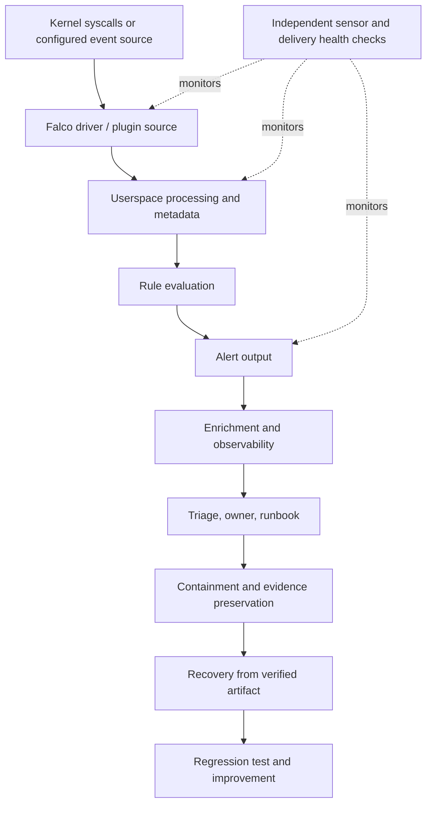
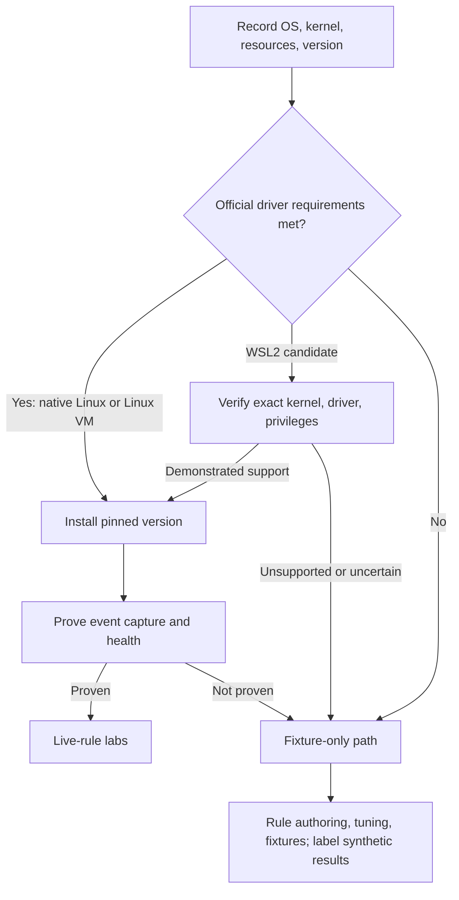
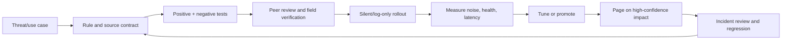

# Unit 12 — Runtime Threat Detection with Falco

> **Stage:** 2E — Production DevOps & Platform Engineering  
> **Module:** M12 — Production Security and Software Supply Chain  
> **Unit:** 12  
> **Filename:** `12-runtime-threat-detection-with-falco.md`  
> **Estimated effort:** 24–36 hours  
> **Primary authored path:** fixture-first; use live Falco only after the selected kernel, driver, privileges, and version are proven compatible.  
> **Version status:** `[VERIFY]` — no current Falco release or universal driver compatibility is assumed. Verify version-sensitive commands, fields, and integrations against official documentation before live use.  
> **Prerequisites:** M01 image/SBOM basics; M02 CI/OIDC; M03–M04 Kubernetes security and NetworkPolicy; M06 packaging; M07 IaC; M08 GitOps; M09 identity/secrets; M10 incident response; M11 observability; Units 7–11 as applicable.

> **Evidence honesty:** This module has not been executed against a selected Falco binary, kernel, cluster, or alert stack. Expected alerts and fixtures are representative/synthetic unless the learner records otherwise. A rule that parses is not necessarily a correct or operational detection.

## Table of contents

- [12.0 — Module Orientation, Learning Outcomes, and Safety](#120--module-orientation-learning-outcomes-and-safety)
- [12.1 — Runtime Detection Foundations and Threat Model](#121--runtime-detection-foundations-and-threat-model)
- [12.2 — Falco Architecture, Event Sources, Drivers, and Feasibility](#122--falco-architecture-event-sources-drivers-and-feasibility)
- [12.3 — Falco Rules: Syntax, Fields, Macros, Lists, and Priorities](#123--falco-rules-syntax-fields-macros-lists-and-priorities)
- [12.4 — Default Rules and Safe First Detections](#124--default-rules-and-safe-first-detections)
- [12.5 — Custom Runtime Rules for Data and ML Platforms](#125--custom-runtime-rules-for-data-and-ml-platforms)
- [12.6 — Rule Validation, Test Harness, and Detection-as-Code CI](#126--rule-validation-test-harness-and-detection-as-code-ci)
- [12.7 — Noise Reduction, Exceptions, Precision, Recall, and Tuning](#127--noise-reduction-exceptions-precision-recall-and-tuning)
- [12.8 — Kubernetes Audit Events, Correlation, and Supply-Chain Context](#128--kubernetes-audit-events-correlation-and-supply-chain-context)
- [12.9 — Alert Pipeline, Observability, and On-Call Integration](#129--alert-pipeline-observability-and-on-call-integration)
- [12.10 — Advanced Detection Engineering, Evasion Awareness, Performance, and Reliability](#1210--advanced-detection-engineering-evasion-awareness-performance-and-reliability)
- [12.11 — Incident Triage, Containment, Evidence, and Runbooks](#1211--incident-triage-containment-evidence-and-runbooks)
- [12.12 — Mandatory Hands-On Labs](#1212--mandatory-hands-on-labs-all-required)
- [12.13 — Production Runtime Detection Programme and Capstone Integration](#1213--production-runtime-detection-programme-and-capstone-integration)
- [12.14 — Review, Glossary, References, and Author's Verification Audit](#1214--review-glossary-references-and-authors-verification-audit)

---

## 12.0 — Module Orientation, Learning Outcomes, and Safety

### Why this unit exists

A runtime detection programme must continuously answer: **Can the sensor observe the event? Can the rule distinguish risky behaviour from normal behaviour? Does the alert reach someone who can act? Can the team prove the sensor, rules, and delivery path remain healthy?**

Falco evaluates rules against supported runtime event sources and emits alerts. In a common Linux deployment, a supported kernel driver/probe provides events to the userspace engine. Other event sources may be available through plugins, depending on release and configuration. Falco does **not** block or kill processes by default. Prevention, admission control, network enforcement, and response automation are separate controls.

### Learning outcomes

| Level | Outcome |
|---|---|
| Beginner | Explain runtime detection, sources, rule conditions, alert fields, and syscall vs API audit events. |
| Intermediate | Author and test rules, inspect fields, run positive/negative fixtures, and tune false positives. |
| Advanced | Build detection-as-code checks, threat coverage, audit/runtime correlation, and health controls. |
| Production operations | Operate staged rollout, runbooks, evidence preservation, compatibility checks, rollback, and performance measurement. |

### Readiness check

- [ ] Explain process, parent process, executable path, syscall, file descriptor, container, Pod, namespace, ServiceAccount, and Kubernetes audit event.
- [ ] Identify the current `kubectl` context and safely target a disposable cluster.
- [ ] Read structured JSON logs and query the M11 log pipeline.
- [ ] Explain why an image scan or SBOM cannot show what a process did at runtime.
- [ ] Follow an incident timeline and preserve evidence before deleting a workload.
- [ ] Use a version-controlled directory and run a local test script.

### Defence-in-depth placement

| Layer | Question | Examples | Limitation |
|---|---|---|---|
| Threat modelling (Unit 1) | What can go wrong? | Assets, trust boundaries, abuse cases | Does not prove detection |
| Build/supply chain (Units 9–10) | What was built and approved? | SBOM, signature, provenance | Does not prove runtime behaviour |
| Hardening (Unit 7, M03–M04) | How are attack opportunities reduced? | Non-root, read-only rootfs, NetworkPolicy | Does not prove every event is observed |
| Admission policy (Units 8/11) | Should an object be admitted? | Pod Security, policy-as-code | Does not govern all activity after admission |
| Runtime detection (this unit) | What observable behaviour occurred? | Falco syscall rules, audit-event detections | Does not prove malicious intent |
| Response (M10) | What should happen next? | Triage, quarantine, credential rotation | Untested automation can cause outages |

Assume breach: prevention can fail. No single rule, scan, SBOM, signature, sensor, or alert proves a workload is safe.

### Runtime event-to-response flow



### Feasibility decision



### Three honest lab paths

1. **Native Linux/Linux VM:** preferred for live capture when the exact release and driver support the kernel and required privileges.
2. **WSL2:** conditional only. Running Linux containers does not prove a Falco driver is supported. Check kernel, BTF/headers if required, capabilities, and official support.
3. **Fixture-only fallback:** supports rule intent, test contracts, tuning, correlation, and response. It does **not** demonstrate live syscall capture, kernel-level detection, real sensor overhead, or production sensor reliability.

Internet may be needed for packages, images, rules, and documentation. First-time fully offline installation is not realistic unless artifacts are already cached. If offline, use fixtures and record which installation steps were not performed.

### Safety and resource limits

The target laptop is approximately 4 CPU, 8 GB RAM, 30 GB free disk. Start with fixtures and one disposable workload. Run Loki/Grafana/Prometheus only when needed. Stop unused clusters and containers.

- Benign behaviours only; own lab only; no production changes or third-party systems.
- No real secrets, malware, exploit code, process injection, privilege-escalation payloads, or container-escape steps.
- Never print or transmit a service-account token. For a token-path test, open a lab token file without displaying or copying contents.
- Mark state-changing actions `⚠ STATE-CHANGING`; mark benign simulations `⚠ ATTACK-SIM (BENIGN, OWN LAB)`.
- Verify Kubernetes context before every state-changing command.
- “No alerts” means **unknown** until sensor health, event flow, rule loading, and output delivery are checked.

### Roadmap cross-links

Confirm exact relative paths in the current repository tree before adding links: Unit 1 threat modelling; Unit 7 runtime hardening; Units 8/11 admission policy; Unit 9 audit/remediation; Unit 10 `10-slsa-framework-and-build-provenance-levels.md`; M10 incident response; M11 telemetry; M04 NetworkPolicy. The supplied prompt does not contain the complete current tree, so exact sibling paths remain `[VERIFY]`.

---

## 12.1 — Runtime Detection Foundations and Threat Model

### What runtime detection can and cannot see

A syscall-oriented sensor can observe selected kernel-level activity, subject to driver support, kernel behaviour, permissions, event selection, and rule coverage. Examples include process execution, file operations, and network connection metadata when exposed by the selected source.

It may not see encrypted payload contents, events before startup or during capture failure, every event under overload, API actions without an audit feed, or malicious intent from a process name. It cannot prove exfiltration from a connect event alone.

### Distinguish evidence types

| Evidence | Example | Useful for | Common mistake |
|---|---|---|---|
| Falco runtime alert | Process opened a sensitive path | Runtime investigation | Treating it as proof of compromise |
| Kubernetes API audit | Principal created a privileged Pod | API actor/verb/object/outcome | Calling it a syscall alert |
| Application log | Model-load error | Application semantics | Assuming logs are complete |
| Metric | p95 latency rises | Symptoms and trends | Treating aggregate data as process evidence |
| Vulnerability finding | Image contains a vulnerable package | Exposure prioritisation | Assuming vulnerable code executed |
| Admission denial | Policy rejected a Pod | Preventing noncompliant admission | Assuming running Pods are remediated |

### Data/ML platform threat model

Protect inference APIs, ETL jobs, notebooks, model/data volumes, service-account identities, CI runners, registries, Kubernetes API, and network dependencies. Runtime attack surfaces include unexpected shells, package/download tools, sensitive file reads, unexpected writes, outbound connections, token access, privilege/host access indicators, binary drift, suspicious notebook processes, and unexpected reads of model/data files.

### Threat-to-signal matrix

| Threat | Observable event | Candidate signal | Additional telemetry | False positives | Response |
|---|---|---|---|---|---|
| Shell in inference Pod | Process execution | Shell in controlled workload | Kubernetes audit `exec`, deployment record | Approved debug | Verify actor/ticket/process tree |
| Runtime package install | Tool execution | Package/download tool in workload | Image digest, CI history | Approved init job | Compare runtime to image policy |
| Token-path access | File open/read | Process + token path | Identity/audit logs | Legitimate client | Never log token; identify reader |
| Unexpected egress | Connect/flow | Destination outside baseline | NetworkPolicy, DNS/flow logs | Approved API | Correlate process and destination |
| Unexpected executable | Process exec/path | Exec from writable temp path | Image filesystem/SBOM | Test helper | Compare artifact and provenance |
| Data read then connect | File + network events | Correlated event sequence | App/store/flow logs | Model fetch | Investigate; not proof of exfiltration |
| Privileged Pod | API audit event | Risky object create | Admission/audit policy | Approved agent | Verify actor and manifest |
| RBAC escalation | Role/Binding update | API audit event | Policy history | Operator change | Inspect actor and diff |
| Sensor tampering | Pod/config change or silence | Health/GitOps drift | Kubernetes audit, external heartbeat | Planned upgrade | Treat as telemetry gap |
| Notebook miner-like process | Process name/resource use | Heuristic | CPU metrics, process ancestry | Scientific job | Validate context; name is not proof |

A stronger signal combines a verified runtime event with independent audit/deployment context. A weak heuristic is a process named `miner` or an unfamiliar IP alone. Process names can be renamed, command lines can contain secrets, and fields may be unavailable for a source/version.

---

## 12.2 — Falco Architecture, Event Sources, Drivers, and Feasibility

### Architecture and sources

A common path is driver/probe → userspace event processing → rule evaluation → output → downstream enrichment/storage/routing. The sensor is privileged and expands the node's trusted computing base; restrict rule/config writes, deployment permissions, host mounts, and RBAC.

| Source | Can support | Cannot replace | Status |
|---|---|---|---|
| Syscall events | Selected process/file/network activity | Kubernetes API history or payload inspection | Kernel/driver dependent |
| Kubernetes audit/plugin source | Selected API events if supported/configured | Kernel process/file events | `[VERIFY]` schema/config |
| Other Falco plugins | Source-specific events | Universal coverage | `[VERIFY]` compatibility |
| Kubernetes audit logs in Loki | Queries over stored audit records | Falco event unless Falco ingests it | Separate route |
| App/flow telemetry | Application semantics or network-flow context | Kernel coverage | Separate system |

Kernel-module, legacy eBPF, and modern eBPF paths are release-specific. Verify the exact Falco version, OS/kernel, required headers/BTF/compiler, privileges, host access, prebuilt artifact support, and post-upgrade behaviour. Do not infer WSL2 or Docker Desktop support from successful container startup. `kind` shares the host kernel and does not automatically expose host telemetry to a sensor container.

### Non-destructive preflight

Create `lab/preflight.sh`:

```bash
#!/usr/bin/env bash
# lab/preflight.sh — read-only inventory; does not install a driver.
set -euo pipefail
printf '%s\n' '== OS and kernel =='
uname -a
[[ -r /etc/os-release ]] && sed -n '1,8p' /etc/os-release || true
printf '%s\n' '== Resources =='
command -v nproc >/dev/null 2>&1 && nproc || true
command -v free >/dev/null 2>&1 && free -h || true
command -v df >/dev/null 2>&1 && df -h . || true
printf '%s\n' '== Tools =='
for tool in docker kubectl kind helm falco falcoctl; do
  if command -v "$tool" >/dev/null 2>&1; then
    printf '%s: ' "$tool"
    case "$tool" in
      docker) docker version --format '{{.Client.Version}}' 2>/dev/null || true ;;
      kubectl) kubectl version --client -o yaml 2>/dev/null | sed -n '1,8p' || true ;;
      kind) kind version 2>/dev/null || true ;;
      helm) helm version --short 2>/dev/null || true ;;
      falco) falco --version 2>/dev/null || falco -V 2>/dev/null || true ;;
      falcoctl) falcoctl version 2>/dev/null || true ;;
    esac
  else printf '%s: not installed\n' "$tool"; fi
done
printf '%s\n' '== Kernel capability hints =='
[[ -r /sys/kernel/btf/vmlinux ]] && echo 'BTF file present; not proof of support' || echo 'BTF file not visible at standard path'
[[ -d "/lib/modules/$(uname -r)" ]] && echo 'Kernel modules directory present' || echo 'Kernel modules directory absent'
printf 'Kernel release: '; cat /proc/sys/kernel/osrelease
command -v kubectl >/dev/null 2>&1 && kubectl config current-context 2>/dev/null || true
cat <<'EOF'
NEXT: compare this inventory to official documentation for the exact Falco release.
Do not install a privileged sensor until kernel/driver support and required privileges are clear.
If uncertain, use fixture-only labs.
EOF
```

Prerequisite: Bash. Target: local host only. Run `bash lab/preflight.sh`; output is inventory, not a compatibility verdict. No changes are made. Retain the output in `versions.txt`, redacting sensitive host identifiers if necessary.

### Installation, health, and teardown

Use the official install path for the chosen release and pin `<VERSION>`. Inspect rendered manifests before applying them. Verify chart values, DaemonSet privileges, host mounts, capabilities, tolerations, driver settings, rule distribution, and resource limits. Do not apply a privileged DaemonSet to production for this lab.

Prove separately that the process runs, driver/source initialises, a benign event is captured, a rule loads/fires, output reaches destination, and an independent health check detects event-flow loss. If any proof fails, use fixtures and document why. Clean up only lab-created resources.

| Symptom | Possible cause | Safe diagnostic |
|---|---|---|
| Driver fails | Kernel mismatch, headers/BTF, privilege | Inspect logs and exact driver docs |
| No events | Wrong source, driver failure, rule/config | Trigger known benign event and inspect source startup |
| Metadata missing | Enrichment/source issue | Inspect event fields and config |
| Rule rejected | Schema/field/macro mismatch | Version-specific validator/docs |
| Alert not delivered | Output/downstream failure | Test local output, then each hop |
| Drops under load | Buffer/output bottleneck | Inspect documented counters |
| Upgrade blind spot | Driver incompatibility | Canary test and rollback |


---

## 12.3 — Falco Rules: Syntax, Fields, Macros, Lists, and Priorities

### Rule anatomy

A rule commonly declares a name, description, condition, output, priority, and tags. Optional fields such as `enabled`, `exceptions`, and source declarations are version/schema dependent.

```yaml
# detection/rules/custom-runtime.yaml
# Illustrative only; verify schema, fields, and syntax against selected Falco release.
- rule: Lab Shell In Inference Workload
  desc: Detect shell execution in a controlled inference workload.
  condition: >
    evt.type = execve and
    proc.name in (sh, bash, dash) and
    k8s.ns.name = "ml-lab"
  output: >
    LAB shell rule=%rule priority=%priority
    ns=%k8s.ns.name pod=%k8s.pod.name
    proc=%proc.name exe=%proc.exepath parent=%proc.pname
    user=%user.name
  priority: WARNING
  tags: [runtime, execution, ml-platform]
```

This is a teaching example, not production-ready. Confirm `execve`, event direction, process fields, Kubernetes metadata enrichment, output formatting, priority labels, and YAML schema against the chosen release.

### Fields, macros, lists, and output

Common field names to verify include `evt.type`, `evt.dir`, `proc.name`, `proc.cmdline`, `proc.pname`, `proc.aname`, `proc.exepath`, `fd.name`, `fd.sip`, `fd.sport`, `container.id`, `container.image.repository`, `k8s.ns.name`, `k8s.pod.name`, and `user.name`. Availability and semantics vary by source and event. Use the current official field reference and the installed binary's supported-field listing if available; record exact command and output in `versions.txt`. `falco --list`, `falco --validate`, and `falco -V` are `[VERIFY]`, not universal flags.

- **List:** reusable values, such as approved process names.
- **Macro:** reusable condition fragment.
- **Exception:** structured narrow exclusion supported by a particular schema/version.
- **Priority:** routing/triage signal, not probability of compromise.
- **Tags:** classification for search and coverage; verify naming expectations and ATT&CK taxonomy mapping.

Do not assume `evt.dir` values or syscall semantics without checking the selected release. Do not assume a field exists merely because it appears in an example. Keep custom rules in a separate version-controlled file; do not edit vendor defaults directly.

Output only triage-relevant data: time, rule, priority, namespace, Pod, image/digest if available, process/ancestry, user, file/network target, owner, runbook. Never log tokens, environment variables, request bodies, or sensitive payloads. Command lines and paths can themselves contain credentials.

### Deliberately broken rule

```yaml
# detection/broken-rule.yaml — intentionally incomplete.
- rule: Broken Example
  desc: Demonstrates a missing required condition.
  output: "broken=%rule"
  priority: WARNING
```

A version-appropriate validator should reject a missing required condition or identify a schema problem. If it does not, add a separate metadata/schema check. Use only validator flags supported by the installed version. Parsing alone does not prove semantic correctness.

---

## 12.4 — Default Rules and Safe First Detections

### Inspect the installed ruleset

Do not assume default rule names, maturity labels, schema, or install location. Inspect the package/chart and official rules repository for the exact release. Record Falco version, rules artifact/version, source type, enabled status, documented maturity labels, required fields, local overrides, and validation output.

### Six benign behaviours

Run only in a disposable lab. Exact alerts depend on source, enabled rules, fields, and workload; these are trigger ideas, not guarantees.

1. Spawn a shell through `kubectl exec` in a lab container.
2. Read a lab-only decoy path.
3. Attempt a harmless write below `/etc`; a read-only root filesystem may block it.
4. Execute a package manager with a help/version argument; do not install anything.
5. Connect to a local lab endpoint.
6. Open a disposable Pod's service-account token path without printing, copying, or transmitting the token. If no token is mounted, record “not applicable.”

For each attempt record command, timestamp, Kubernetes context, image digest, sensor health, ruleset version, output event, destination, and result. Fixture results must be labelled `SYNTHETIC`.

| Attempt | Expected signal | Confidence alone | False positives | Evidence to inspect |
|---|---|---|---|---|
| Shell in Pod | Process execution rule, if loaded/source supports it | Medium | Approved debugging | Actor, ticket, process tree |
| Decoy file read | File event rule | Low–medium | App config reads | Path, process, owner |
| `/etc` write attempt | Write/create event, if observed | Medium | Bootstrap/config jobs | Result semantics, rootfs |
| Package-manager help | Process rule | Low–medium | Approved diagnostics | Parent, image, intent |
| Local connection | Connect rule matching destination | Low | Health check/exporter | Process, destination, DNS |
| Lab token-path open | File event, if mounted/captured | Concerning but not proof of theft | Legitimate client SDK | Process, identity, audit; never token bytes |

---

## 12.5 — Custom Runtime Rules for Data and ML Platforms

### Contract and version warning

The following catalogue provides 12 detection intents. YAML examples are **illustrative templates** because no Falco binary/kernel is selected here. Before live use, adapt syntax, fields, macros, event direction, output, and metadata to the exact release. Fixture tests evaluate detection intent; they do not prove Falco emitted a field or the kernel observed an event.

Use stable workload identity governed by platform policy. Do not trust only `container.name`; labels and namespaces also require governance because a principal allowed to set them may spoof them.

### R01 — Interactive shell in inference/ETL workload

- **Threat:** unplanned interactive access.
- **Source/fields:** syscall process execution; verify event type, process, namespace, Pod, executable path.
- **Priority/owner/runbook:** WARNING; `platform-security`; `RB-RT-01`.
- **Rule:**

```yaml
- rule: LAB R01 Shell In ML Workload
  desc: Detect shell execution in controlled ml-lab workload.
  condition: >
    evt.type = execve and
    proc.name in (sh, bash, dash) and
    k8s.ns.name = "ml-lab"
  output: "R01 shell ns=%k8s.ns.name pod=%k8s.pod.name proc=%proc.name exe=%proc.exepath"
  priority: WARNING
  tags: [runtime, execution, ml-platform]
```

- **Positive:** shell in disposable Pod. **Negative:** normal inference health check.
- **False positives:** approved debug/init shell. Tune by controlled workload identity and change ticket.
- **Limit:** renamed process/field gaps; absence of alert is not proof of no interactive access.
- **Evidence:** process event, audit exec record, Pod UID, digest, owner.

### R02 — Runtime package/install/download tooling

- **Threat:** runtime filesystem drift.
- **Source/fields:** process execution; verify process/path semantics.
- **Priority/owner/runbook:** NOTICE/WARNING after baseline; `service-owner`; `RB-RT-02`.

```yaml
- rule: LAB R02 Runtime Mutation Tool In ML Workload
  desc: Detect selected download/package tools in lab workload.
  condition: >
    evt.type = execve and
    proc.name in (pip, pip3, curl, wget, apt, apt-get, apk, yum, dnf) and
    k8s.ns.name = "ml-lab"
  output: "R02 mutation-tool ns=%k8s.ns.name pod=%k8s.pod.name proc=%proc.name exe=%proc.exepath"
  priority: NOTICE
  tags: [runtime, software-supply-chain]
```

- **Positive:** tool help/version only; do not install/download. **Negative:** normal API request.
- **False positives:** approved setup jobs. Avoid blanket exclusions.
- **Limit:** renamed/static tools; execution does not prove a download succeeded.
- **Evidence:** event, image digest, deployment source, egress context.

### R03 — Unexpected outbound connection

- **Threat:** connection to an unapproved destination.
- **Source/fields:** connect event and destination fields; verify `fd.sip`, `fd.sport`, and metadata.
- **Priority/owner/runbook:** WARNING; `network-platform`; `RB-RT-03`.

```yaml
- rule: LAB R03 Local Only Egress Baseline
  desc: Candidate lab signal for non-loopback connections; not a production allowlist.
  condition: >
    evt.type = connect and
    k8s.ns.name = "ml-lab" and
    not fd.sip in (127.0.0.1, "::1")
  output: "R03 egress ns=%k8s.ns.name pod=%k8s.pod.name proc=%proc.name destination=%fd.sip port=%fd.sport"
  priority: WARNING
  tags: [runtime, network]
```

This deliberately broad example is a lab teaching baseline, **not suitable for production**. Replace it with a verified workload-specific approved-destination model; test IPv4/IPv6, DNS, NAT, proxies, and field direction. NetworkPolicy remains the enforcement control.

- **Positive:** connect to a lab-local endpoint intentionally outside the test allowlist. **Negative:** expected service connection.
- **False positives:** DNS, telemetry, mesh, approved APIs.
- **Limit:** encrypted payload intent is not visible from connection metadata alone.
- **Evidence:** process, destination, flow/DNS logs, NetworkPolicy.

### R04 — Service-account token-path access

- **Threat:** possible credential discovery.
- **Source/fields:** file open/read and path; verify event type and `fd.name`.
- **Priority/owner/runbook:** WARNING; `identity-platform`; `RB-RT-04`.

```yaml
- rule: LAB R04 Service Account Token Path Access
  desc: Candidate token-path signal for disposable lab workloads.
  condition: >
    evt.type in (open, openat) and
    fd.name contains "/var/run/secrets/kubernetes.io/serviceaccount/"
  output: "R04 token-path access ns=%k8s.ns.name pod=%k8s.pod.name proc=%proc.name path=%fd.name"
  priority: WARNING
  tags: [runtime, credential-access]
```

- **Positive:** open the path in a disposable Pod and discard bytes. **Negative:** use a Pod with automount disabled or record not applicable.
- **False positives:** Kubernetes clients and SDKs.
- **Limit:** path access does not prove successful read or token use.
- **Evidence:** process, ServiceAccount, audit events, mount config. Never retain token bytes.

### R05 — Sensitive-path write attempt

- **Threat:** unexpected filesystem mutation.
- **Source/fields:** file operation/path/result; verify event semantics.
- **Priority/owner/runbook:** WARNING; `runtime-detection`; `RB-RT-05`.

```yaml
- rule: LAB R05 Sensitive System Path Operation
  desc: Candidate signal for file operations under /etc.
  condition: >
    evt.type in (open, openat, creat) and
    fd.name startswith "/etc/"
  output: "R05 sensitive-path ns=%k8s.ns.name pod=%k8s.pod.name proc=%proc.name path=%fd.name"
  priority: WARNING
  tags: [runtime, filesystem]
```

- **Positive:** attempt to create a harmless marker under `/etc` in a disposable container; it may fail. **Negative:** write to designated `/tmp` lab path.
- **False positives:** config generation and bootstrap.
- **Limit:** path string alone may not establish successful write.
- **Evidence:** result semantics, rootfs settings, process tree.

### R06 — Executable from unexpected temporary path

- **Threat:** runtime binary drift.
- **Source/fields:** process exec and `proc.exepath`; verify path semantics.
- **Priority/owner/runbook:** WARNING; `image-security`; `RB-RT-06`.

```yaml
- rule: LAB R06 Executable From Temporary Path
  desc: Candidate signal for execution from /tmp in ml-lab.
  condition: >
    evt.type = execve and
    k8s.ns.name = "ml-lab" and
    proc.exepath startswith "/tmp/"
  output: "R06 temp executable ns=%k8s.ns.name pod=%k8s.pod.name proc=%proc.name exe=%proc.exepath"
  priority: WARNING
  tags: [runtime, image-drift]
```

- **Positive:** if permitted, execute a harmless copied utility in a disposable writable path; otherwise use fixtures. **Negative:** expected image binary.
- **False positives:** tests/helpers.
- **Limit:** scripts/interpreters and missing path metadata complicate interpretation.
- **Evidence:** digest, path metadata, manifest, safe file hash if appropriate.

### R07 — Sensitive Kubernetes API activity

- **Threat:** unapproved `exec`, privileged Pod create, RBAC change, or Secret access.
- **Source:** Kubernetes audit/plugin source or audit logs; **not a syscall-only rule**.
- **Priority/owner/runbook:** HIGH/CRITICAL by action and context; `cluster-security`; `RB-RT-07`.
- **Rule intent:** query audit records for sensitive principal/verb/resource/namespace/object and response status. Exact schema depends on audit level and Kubernetes version `[VERIFY]`.
- **Positive:** benign `exec` into a lab Pod or use a synthetic audit fixture. **Negative:** approved read-only operation.
- **False positives:** operators, GitOps, CI accounts.
- **Limit:** audit policy may omit fields or events.
- **Evidence:** audit record, principal, groups, object, response status, timestamps.

### R08 — Notebook unexpected-process heuristic

- **Threat:** unusual process in interactive notebook.
- **Source:** process event, optionally resource metrics.
- **Priority/owner/runbook:** NOTICE; `notebook-platform`; `RB-RT-08`.
- **Rule intent:** compare process names with documented expected notebook tools. Treat miner-like names as a heuristic, never proof of cryptomining.
- **Positive:** synthetic fixture with unusual benign process name. **Negative:** normal notebook kernel/worker.
- **False positives:** scientific workloads and benchmarks.
- **Limit:** renamed binaries and common names can evade or trigger.
- **Evidence:** parent, owner, resource metrics, schedule.

### R09 — Privileged Pod/host access configuration

- **Threat:** privileged mode, hostPath, hostNetwork, or host namespace exposure.
- **Source:** Kubernetes audit or admission/inventory; not syscall telemetry alone.
- **Priority/owner/runbook:** HIGH; `cluster-security`; `RB-RT-09`.
- **Rule intent:** query Pod create/update records for risky fields; verify audit request-body visibility.
- **Positive:** use a synthetic fixture or harmless manifest in disposable cluster if allowed. **Negative:** compliant non-privileged Pod.
- **False positives:** approved node agents.
- **Limit:** audit may omit request object; admission denial differs from successful creation.
- **Evidence:** audit event, admission response, manifest, actor.

### R10 — Cloud metadata endpoint access

- **Threat:** possible identity discovery in cloud environments.
- **Source:** connect event/flow log with destination; verify field support.
- **Priority/owner/runbook:** WARNING; `cloud-platform`; `RB-RT-10`.
- **Rule intent:** match only the actual environment's verified metadata endpoint. For no-cloud lab, use a synthetic fixture or lab-local destination; do not contact a real metadata endpoint.
- **Positive:** synthetic destination match. **Negative:** ordinary local endpoint.
- **False positives:** cloud agents/SDKs.
- **Limit:** NAT, proxy, IPv6, and environment differences.
- **Evidence:** process, destination, cloud identity audit, workload role.

### R11 — Unexpected process reads model/data mount

- **Threat:** possible collection precursor.
- **Source/fields:** file event, path, process metadata; verify fields.
- **Priority/owner/runbook:** NOTICE/WARNING; `data-platform`; `RB-RT-11`.
- **Rule intent:** scope to a controlled lab mount and an approved reader-process list.
- **Positive:** fixture where an unapproved process reads a decoy file. **Negative:** expected inference process reads it.
- **False positives:** model reload, checksum, backup, ETL.
- **Limit:** read does not prove exfiltration or malicious intent.
- **Evidence:** process, mount, owner, outbound events, object-store logs.

### R12 — Suspicious process lineage/tracing indicator

- **Threat:** unexpected process ancestry or tracing-related activity.
- **Source/fields:** verified ancestry and event types; `ptrace`/namespace visibility `[VERIFY]`.
- **Priority/owner/runbook:** NOTICE; `runtime-detection`; `RB-RT-12`.
- **Rule intent:** test known benign process trees and add a condition only after verifying fields/event semantics.
- **Positive:** synthetic unexpected parent/child fixture. **Negative:** normal application worker tree.
- **False positives:** debuggers, profilers, init systems.
- **Limit:** incomplete ancestry, re-parenting, missing fields, architecture differences.
- **Evidence:** process tree, change ticket, deployment context.

### Rule quality contract and inventory

Every rule must specify threat, event source, verified fields, positive and negative test, likely false positives, next evidence, safe action, limitations, owner, runbook, and last-tested date. Do not promote a rule solely because it parses.

| ID | Threat | Source/fields | Priority | Owner | Positive/negative fixture | Test status | Blind spot | Runbook | Last tested |
|---|---|---|---|---|---|---|---|---|---|
| R01 | Shell | Syscall/process + namespace `[VERIFY]` | WARNING | platform-security | R01+/R01− | NOT RUN | Renamed binary | RB-RT-01 | blank |
| R02 | Runtime mutation | Process execution `[VERIFY]` | NOTICE | service-owner | R02+/R02− | NOT RUN | Renamed/static tool | RB-RT-02 | blank |
| R03 | Egress | Connect/destination `[VERIFY]` | WARNING | network-platform | R03+/R03− | NOT RUN | Payload encrypted | RB-RT-03 | blank |
| R04 | Token path | File event/path `[VERIFY]` | WARNING | identity-platform | R04+/R04− | NOT RUN | Read ≠ use | RB-RT-04 | blank |
| R05 | Sensitive write | File event/path/result | WARNING | runtime-detection | R05+/R05− | NOT RUN | Write success unknown | RB-RT-05 | blank |
| R06 | Temp executable | Exec/path `[VERIFY]` | WARNING | image-security | R06+/R06− | NOT RUN | Script/path semantics | RB-RT-06 | blank |
| R07 | Sensitive API action | Kubernetes audit | HIGH | cluster-security | R07+/R07− | NOT RUN | Audit omissions | RB-RT-07 | blank |
| R08 | Notebook heuristic | Process/metrics | NOTICE | notebook-platform | R08+/R08− | NOT RUN | Name heuristic | RB-RT-08 | blank |
| R09 | Privileged Pod | Kubernetes audit/object | HIGH | cluster-security | R09+/R09− | NOT RUN | Request body omitted | RB-RT-09 | blank |
| R10 | Metadata endpoint | Connect/flow | WARNING | cloud-platform | R10+/R10− | NOT RUN | Environment-specific | RB-RT-10 | blank |
| R11 | Model/data read | File/path/process | NOTICE | data-platform | R11+/R11− | NOT RUN | Read ≠ exfiltration | RB-RT-11 | blank |
| R12 | Process lineage | Process ancestry/event | NOTICE | runtime-detection | R12+/R12− | NOT RUN | Missing ancestry | RB-RT-12 | blank |


---

## 12.6 — Rule Validation, Test Harness, and Detection-as-Code CI

### Test layers

| Test type | Proves | Does not prove |
|---|---|---|
| Syntax/schema validation | File parses against selected validator/schema | Fields exist at runtime or event is observable |
| Fixture/contract test | Intended logic against normalized fixtures | Kernel capture or Falco event generation |
| Live integration test | Selected environment observed a trigger and emitted an event | Coverage of every workload/kernel/attack |

A project-defined JSON fixture is not a Falco native event stream. Do not claim arbitrary JSON alert logs can be replayed as syscall events. Use official replay/capture formats only when documented for the selected release.

### Minimal directory tree

```text
runtime-detection-lab/
├── README.md
├── versions.txt
├── detection/
│   ├── rules/custom-runtime.yaml
│   ├── rule-catalog.json
│   ├── lint_rules.py
│   ├── test_fixtures.py
│   └── fixtures/
│       ├── R01-positive.json
│       ├── R01-negative.json
│       ├── R06-renamed-binary.json
│       └── missing-field.json
├── reports/
│   └── .gitkeep
└── .github/workflows/detection-ci.yml
```

### Normalized synthetic fixture

```json
{
  "fixture_id": "R01-positive-shell",
  "synthetic": true,
  "expected_rule": "R01",
  "expected_match": true,
  "event": {
    "event_type": "process_exec",
    "process_name": "sh",
    "executable_path": "/bin/sh",
    "namespace": "ml-lab",
    "pod": "inference-lab",
    "source": "synthetic-fixture"
  }
}
```

### Fixture harness

Create `detection/test_fixtures.py`:

```python
#!/usr/bin/env python3
"""Test normalized synthetic fixtures; not a Falco engine or replay tool."""
import json
import sys
from pathlib import Path

ROOT = Path(__file__).resolve().parent
FIXTURE_DIR = ROOT / "fixtures"

def intended_match(rule_id: str, event: dict) -> bool:
    # Examples only. Implement and review a matcher for every production rule.
    if rule_id == "R01":
        return (event.get("event_type") == "process_exec"
                and event.get("process_name") in {"sh", "bash", "dash"}
                and event.get("namespace") == "ml-lab")
    if rule_id == "R06":
        return (event.get("event_type") == "process_exec"
                and event.get("namespace") == "ml-lab"
                and str(event.get("executable_path", "")).startswith("/tmp/"))
    raise ValueError(f"No reviewed fixture matcher implemented for {rule_id}")

def main() -> int:
    files = sorted(FIXTURE_DIR.glob("*.json"))
    if not files:
        print("ERROR: no fixtures found", file=sys.stderr)
        return 2
    failures, rows = 0, []
    for path in files:
        try:
            fixture = json.loads(path.read_text(encoding="utf-8"))
            expected = fixture["expected_match"]
            actual = intended_match(fixture["expected_rule"], fixture["event"])
            ok = actual == expected
            rows.append({"fixture": path.name, "rule": fixture["expected_rule"],
                         "expected": expected, "actual": actual, "pass": ok,
                         "synthetic": fixture.get("synthetic", False)})
            failures += not ok
        except Exception as exc:
            rows.append({"fixture": path.name, "pass": False, "error": str(exc)})
            failures += 1
    report = {"schema_version": 1, "synthetic_fixture_tests": rows, "failures": failures}
    out = ROOT.parent / "reports" / "fixture-test-report.json"
    out.parent.mkdir(parents=True, exist_ok=True)
    out.write_text(json.dumps(report, indent=2) + "\n", encoding="utf-8")
    print(json.dumps(report, indent=2))
    return 1 if failures else 0

if __name__ == "__main__":
    raise SystemExit(main())
```

Only R01 and R06 are implemented in this sample. The harness intentionally fails closed for unimplemented rule IDs. Implement every catalogue rule and positive/negative fixtures before claiming complete coverage.

### Rule metadata catalogue

Create `detection/rule-catalog.json`:

```json
{
  "schema_version": 1,
  "rules": [
    {
      "id": "R01",
      "name": "Shell in ML workload",
      "rationale": "Detect unplanned shell execution in a controlled workload.",
      "threat_mapping": ["execution"],
      "source": "syscall",
      "required_fields": ["evt.type", "proc.name", "k8s.ns.name"],
      "priority": "WARNING",
      "owner": "platform-security",
      "runbook": "RB-RT-01",
      "positive_fixture": "fixtures/R01-positive.json",
      "negative_fixture": "fixtures/R01-negative.json",
      "last_tested": null,
      "status": "draft"
    }
  ]
}
```

Expand this to R01–R12. A draft rule with null `last_tested` must not be promoted.

### Metadata linter

Create `detection/lint_rules.py`:

```python
#!/usr/bin/env python3
"""Validate catalogue metadata and fixture paths; not a Falco YAML parser."""
import json
import sys
from pathlib import Path

ROOT = Path(__file__).resolve().parent
REQUIRED = ("id", "name", "rationale", "threat_mapping", "source",
            "required_fields", "priority", "owner", "runbook",
            "positive_fixture", "negative_fixture", "status")
ALLOWED = {"EMERGENCY", "ALERT", "CRITICAL", "ERROR", "WARNING",
           "NOTICE", "INFORMATIONAL", "DEBUG"}

def main() -> int:
    catalog = json.loads((ROOT / "rule-catalog.json").read_text(encoding="utf-8"))
    errors, seen = [], set()
    for item in catalog.get("rules", []):
        rid = item.get("id", "<missing-id>")
        if rid in seen:
            errors.append(f"{rid}: duplicate id")
        seen.add(rid)
        for key in REQUIRED:
            if key not in item or item[key] in (None, "", [], {}):
                errors.append(f"{rid}: missing/empty {key}")
        if item.get("priority") not in ALLOWED:
            errors.append(f"{rid}: invalid project-catalog priority")
        for key in ("positive_fixture", "negative_fixture"):
            rel = item.get(key)
            if rel and not (ROOT / rel).is_file():
                errors.append(f"{rid}: missing {key}: {rel}")
        if item.get("status") == "production" and not item.get("last_tested"):
            errors.append(f"{rid}: production requires last_tested")
    report = {"schema_version": 1, "rules_seen": len(catalog.get("rules", [])),
              "errors": errors, "passed": not errors}
    out = ROOT.parent / "reports" / "metadata-lint-report.json"
    out.parent.mkdir(parents=True, exist_ok=True)
    out.write_text(json.dumps(report, indent=2) + "\n", encoding="utf-8")
    print(json.dumps(report, indent=2))
    return 1 if errors else 0

if __name__ == "__main__":
    raise SystemExit(main())
```

This checks metadata and paths only. It does not validate Falco syntax, field support, exception schema, or event semantics.

### CI workflow

Create `.github/workflows/detection-ci.yml`:

```yaml
name: detection-as-code
on:
  pull_request:
  push:
    branches: [main]
jobs:
  fixture-and-metadata:
    runs-on: ubuntu-latest
    steps:
      - uses: actions/checkout@v4
      - uses: actions/setup-python@v5
        with:
          python-version: "3.x"
      - name: Metadata lint
        run: python detection/lint_rules.py
      - name: Synthetic fixture tests
        run: python detection/test_fixtures.py
      # Add the pinned official Falco validator after verifying its flags.
```

For stronger supply-chain policy, pin CI actions to reviewed commit SHAs. The tags shown are readable examples, not a claim that they meet every organisation's pinning requirements.

### Planted defects and missing fields

Plant these defects one at a time in a temporary branch: remove `owner`; point a fixture path to a nonexistent file; set `status: production` with null `last_tested`; alter a fixture's expected result. The metadata or fixture test should exit nonzero. Restore the files and record commit/report evidence.

Add fixtures for a benign-looking process name with an unexpected executable path, missing executable path, missing namespace, and a field available in syscall events but absent from a plugin event. Specify the desired behaviour for missing fields. Do not assume Falco's missing/null semantics; verify the selected release.

---

## 12.7 — Noise Reduction, Exceptions, Precision, Recall, and Tuning

High alert volume destroys trust; suppressing everything creates blind spots. Establish baselines by workload and phase: startup, steady state, scheduled jobs, maintenance, rollout, sidecars, init containers, health checks, CI runners, and approved debug sessions.

- **TP:** labelled risky test correctly alerts.
- **FP:** normal behaviour alerts.
- **FN:** risky test does not alert.
- **TN:** normal behaviour does not alert.
- **Precision:** `TP / (TP + FP)`, when defined.
- **Recall:** `TP / (TP + FN)`, when defined.
- **Detection latency:** event timestamp to alert availability, with defined clock and endpoint.

Synthetic fixtures measure consistency with the test contract, not real-world recall.

### Tuning table — fill only after running

| Measure | Before exceptions | After exceptions | Actual measurement |
|---|---:|---:|---|
| Normal-workload alerts per window | blank | blank | blank |
| Positive simulations detected | blank | blank | blank |
| Positive simulations missed | blank | blank | blank |
| Normal scenarios with alerts | blank | blank | blank |
| Precision | blank | blank | blank |
| Recall | blank | blank | blank |
| Median/p95 alert latency | blank | blank | blank |

### Exception register

| Field | Required value |
|---|---|
| Exception ID / rule ID | Unique identifiers |
| Owner / approver | Named team or role |
| Rationale | Specific observed benign behaviour |
| Scope | Workload identity, source, event, path/destination as applicable |
| Created / expiry | Explicit dates; no indefinite default |
| Compensating control | What still limits risk |
| Tests | Positive and negative regression fixture references |
| Last reviewed | Date and reviewer |
| Expiry automation | CI or scheduled check that reports overdue entries |

Use structured exceptions only after confirming the selected schema. If unsupported, use a documented narrow condition and test it. Never suppress by container name alone.

### Expiry checker

Create `lab4/expiry-check.py`:

```python
#!/usr/bin/env python3
"""Report expired exceptions; does not modify or delete rules."""
import csv
import datetime as dt
import sys
from pathlib import Path

path = Path(sys.argv[1] if len(sys.argv) > 1 else "exception-register.csv")
today, errors = dt.date.today(), 0
with path.open(newline="", encoding="utf-8") as handle:
    for row in csv.DictReader(handle):
        raw = (row.get("expiry") or "").strip()
        try:
            expiry = dt.date.fromisoformat(raw)
        except ValueError:
            print(f"OPEN: {row.get('exception_id')}: invalid expiry {raw!r}")
            errors += 1
            continue
        if expiry < today:
            print(f"EXPIRED: {row.get('exception_id')} rule={row.get('rule_id')} owner={row.get('owner')}")
            errors += 1
print(f"exceptions requiring review: {errors}")
raise SystemExit(1 if errors else 0)
```

### Decision scorecard

| Condition | Decision |
|---|---|
| Source/fields unverified or sensor health unknown | Do not promote |
| High-impact signal, positive/negative tests pass, owner/runbook present | Staged alerting; consider paging after measurement |
| Normal baseline triggers too often | Tune scope and preserve regression tests |
| No realistic positive test or no longer threat-relevant | Review retirement and coverage gap |
| Exception has no owner/expiry or suppresses positive test | Reject/remove |
| No destination or runbook | Not production-ready |

Do not disable an entire rule family because one rule is noisy.

---

## 12.8 — Kubernetes Audit Events, Correlation, and Supply-Chain Context

Kernel telemetry and Kubernetes audit events are different sources. Audit logs record API requests/outcomes according to the cluster audit policy. Investigate sensitive `kubectl exec`, privileged Pod creation, Role/Binding changes, RBAC escalation, and unexpected ServiceAccount Secret access using audit telemetry.

Use a Falco audit/plugin source only if its support and schema are verified. Otherwise query Kubernetes audit logs through the M11 Loki pipeline and label the result **audit-log detection**, not Falco syscall detection.

Correlate runtime alerts with workload owner, deployment history, running image digest, approved release inventory, signature/provenance, SBOM, vulnerability findings, NetworkPolicy, DNS/flow logs, and application/data-store audit. A signature binds a signer to a payload under a trust policy; it does not prove an artifact is safe.

### Example: model/data read followed by a connection

An inference process reads a model/data mount and soon initiates an unexpected connection. This raises investigation priority but does not prove exfiltration. The read may be legitimate model loading, the destination may be approved, and a connection event does not expose encrypted payload contents.

| Signal | Corroborating evidence | Confidence | Safe immediate action | Follow-up |
|---|---|---|---|---|
| Unexpected process | Digest, ancestry, deployment diff | Medium | Verify owner/change | Compare path to image |
| Token path opened | ServiceAccount, audit, process | Medium–high | Preserve evidence; review identity | Rotate if exposure plausible/confirmed |
| Unexpected egress | DNS/flow, destination owner, process | Medium | Scoped control if justified | Determine flow/app evidence |
| Privileged Pod created | Audit actor, admission, manifest | High for risky action, not necessarily compromise | Review/restrict if unauthorized | Fix RBAC/policy |
| Running digest differs from approved inventory | Verified runtime inventory + release inventory | High for drift if both sources trustworthy | Pause rollout; preserve metadata | Verify signature/provenance |
| Sensor event flow stops | Process/driver/output checks | High for telemetry gap | Declare blind interval | Restore and assess uncovered time |

Use a digest, not a mutable tag, for inventory comparison. Confirm that the approved digest is tied to the signed release and provenance. Do not log secret contents or unnecessary command-line data.

---

## 12.9 — Alert Pipeline, Observability, and On-Call Integration

### Pipeline options

- **Smallest path:** Falco JSON to stdout/file, repeatable parser/query, and local evidence.
- **Expanded path:** Falco JSON → verified forwarder/collector → Loki → Grafana → Alertmanager → M10 on-call simulation.
- **Optional integrations:** Falcosidekick and OpenTelemetry Collector only after verifying current input/output schema and configuration keys.

No complete stack is claimed to be running. A full stack can exceed a modest laptop's resources; run one component at a time and stop it after testing.

### Failure domains

| Hop | Failure | Detection | Risk | Recovery |
|---|---|---|---|---|
| Driver → Falco | Driver fails/events stop | Independent heartbeat and process/driver health | Blind interval | Restore compatible driver; assess gap |
| Falco → output | Rule/output misconfiguration | Local output check and canary | Alerts absent | Restore config and test |
| Forwarder | Down, queue full, malformed records | Health/logs, queue/drop signal | Loss or delay | Restore; inspect backlog/loss |
| Loki | Ingestion/search failure | Health endpoint and canary query | Query/alert gap | Restore and document missing window |
| Grafana/Alertmanager | Routing error | Synthetic alert test | No page despite stored log | Repair route and re-test |
| Human/on-call | Unowned/unread alert | Ownership and paging drill | Slow/no response | Assign owner/runbook |

### Integration verification checklist

Before configuring a hop, verify exact Falco output schema; collector input and output support; timestamp handling; retry/queue/backpressure/loss semantics; authentication/TLS; Loki labels/query model; Alertmanager routes; and privacy/redaction. `[VERIFY]` all Falcosidekick keys, OpenTelemetry `filelog`/OTLP processors, Loki ingestion settings, Grafana provisioning, and Alertmanager schema for selected versions. A generic JSON file is not automatically OTLP.

Use bounded labels such as `cluster`, `namespace`, `rule`, `priority`, and `service`. Avoid high-cardinality labels like raw command line, arbitrary path, Pod UID, request ID, or destination. Store dynamic details as controlled structured fields only if needed and permitted.

### Heartbeat and meta-monitoring

“No alerts” is ambiguous. Monitor independently:

- Falco process/Pod health.
- Driver/source initialisation.
- A periodic benign canary expected to match a known rule.
- Canary delivery to the final query/alert destination.
- Forwarder and Loki health.
- Documented dropped-event/overload counters if exposed by the selected release.

Do not invent metric names. Discover the endpoint and metric set from official docs or actual scrape output; record exact names in `versions.txt`. A heartbeat produced only inside a failed sensor cannot prove that the driver is collecting events. Use an external monitor or end-to-end canary where feasible.

### Alert-storm controls and test plan

Group by rule/namespace/service, deduplicate repeats, route low-confidence events to tickets/dashboards, and page only for high-impact, high-confidence signals with a tested runbook. Test a synthetic record end-to-end and verify fields, timestamp, query, route, and absence of secrets. Stop a lab forwarder to test health alerting and document loss/backlog semantics; do not claim durable delivery without proof.

Use `promtool` only for workflows supported by the installed Prometheus version. Verify syntax and compatibility; no query or alert is “tested” until the learner records actual output.


---

## 12.10 — Advanced Detection Engineering, Evasion Awareness, Performance, and Reliability

### Threat coverage matrix

| Behaviour/tactic | Candidate signal | Source | Test | Gap | Owner |
|---|---|---|---|---|---|
| Execution | Shell/package tool in sensitive workload | Syscall process event | R01/R02 | Renamed binary/field gaps | platform-security |
| Persistence | Unexpected filesystem mutation or workload creation | Syscall + audit | R05/R09 | Not all persistence visible | cluster-security |
| Privilege escalation | Privileged Pod/RBAC changes | Audit/admission | R07/R09 | Audit policy omissions | cluster-security |
| Defense evasion | Sensor/config change, renamed binary | Audit + process/file | Labs 8/9 | Kernel-level tampering | runtime-detection |
| Credential access | Token path/Secret API access | Syscall + audit | R04/R07 | Path read not token use | identity-platform |
| Discovery | Unexpected process/network activity | Process/network | Purple-team suite | Unknown tooling | runtime-detection |
| Lateral movement | Unexpected destination/API activity | Network/audit | R03/R07 | Encrypted payload/missing flows | network-platform |
| Collection | Unexpected model/data reads | File events | R11 | Read not proof of intent | data-platform |
| Exfiltration | Data read followed by suspicious connection | Runtime + flow + app | Correlation fixture | No payload visibility | incident-response |
| Impact | Unexpected writes/resource saturation | File/process/metrics | R05/R08 | Needs application context | service-owner |

ATT&CK-style mappings are a vocabulary, not proof of coverage. Verify the taxonomy/version and map only defensible behaviours.

### Evasion awareness — defensive only

- **Renamed binaries:** `proc.name` may differ from executable path. Compare verified fields using a harmless renamed utility in a disposable container.
- **In-memory/fileless indicators:** `memfd_create` and execution via `/proc/self/fd` are kernel/source/version dependent. Discuss conceptually and verify support; do not build an exploit demonstration.
- **Living-off-the-land:** interpreters and utilities can be abused, but are also legitimate. Context, ancestry, workload role, and change history matter.
- **Mount/namespace activity:** potentially relevant to boundary risk; visibility varies. Detect and investigate; do not attempt an escape.
- **Sensor tampering:** Falco Pod deletion/restart, rule/config changes, driver failure, and event-flow stoppage require independent control-plane audit, GitOps drift, and health checks.

### Protect the sensor

Use least-privilege RBAC consistent with the official deployment; restrict who edits rules/chart values/host mounts; review scoped Pod Security exceptions; pin and verify the image; manage changes through GitOps and peer review; monitor restarts and config changes; and retain an independent record of last successful heartbeat. Test upgrades and rollback on a canary before fleet rollout.

### Performance and reliability measurement

Do not quote universal overhead numbers. Measure the learner's workload.

| Measurement | Falco off | Falco on | Notes |
|---|---:|---:|---|
| Test duration | blank | blank | Same duration/workload |
| CPU usage | blank | blank | Record sampling method |
| Memory | blank | blank | Record process/cgroup scope |
| Workload p95 latency | blank | blank | Same request mix/sample count |
| Events generated | blank | blank | Describe workload |
| Dropped events | blank/unsupported | blank/unsupported | Only if counter is reliable |
| Alert delivery latency | blank | blank | Event timestamp to final destination |
| Kernel/Falco/driver | blank | blank | Exact versions |

Record warm-up, repeated trials, sample count, hardware, kernel, Falco config, rule count/complexity, event volume, output destination, and limitations. A laptop test does not establish production-scale performance.

### Kernel/node upgrades

1. Record known-good OS/kernel, Falco, driver, rules, and node image.
2. Test candidate kernel in a disposable VM or canary node.
3. Verify driver startup, known-event capture, rule load, output, health alert, and workload metrics.
4. Test rollback to known-good node image/config.
5. Roll out in stages with coverage dashboard and stop criteria.
6. Re-run regression tests after Falco, driver, kernel, plugin, or rule changes.

### Alternatives and blind spots

Tetragon, Tracee, and KubeArmor are runtime-security alternatives. Their architecture, enforcement semantics, kernel requirements, maturity, and maintenance status change; verify official docs before choosing. Do not assume their capabilities are interchangeable.

Blind spots include encrypted payloads, activity before sensor startup/during failure, kernel compromise/rootkits, managed control-plane activity without audit feed, short-lived events between observation points, in-memory activity without a relevant event, unknown behaviours, missing metadata, dropped events, output loss, and unowned alerts. Start with high-signal detections for crown-jewel workloads and expand based on measured quality.

---

## 12.11 — Incident Triage, Containment, Evidence, and Runbooks

### Ten-step response flow

1. Validate alert integrity and sensor/forwarder health.
2. Identify cluster, namespace, Pod UID, image digest, process, user, and time window.
3. Correlate deployment changes, audit logs, signature/provenance, SBOM, vulnerability findings, and network telemetry.
4. Assess scope/confidence without treating an alert as proof of compromise.
5. Preserve relevant logs and metadata before restart/termination when safe.
6. Contain with the least disruptive justified measure, such as a scoped lab NetworkPolicy.
7. Rotate/revoke identities when exposure is plausible/confirmed and coordinate dependent services.
8. Replace from a verified artifact; do not rebuild from an untrusted working tree.
9. Verify recovery, eradication, and detection coverage.
10. Record timeline, decisions, evidence, impact, and follow-ups.

### Runbooks

**RB-RT-01 — Unexpected shell/process**
- Validate source, rule version, sensor health, timestamp, namespace, Pod UID, process and parent.
- Correlate Kubernetes audit `exec`, change ticket, deployment, and image digest.
- Preserve event, audit window, Pod spec, logs, and process context without secrets.
- If unauthorized and risk is material, apply approved scoped containment. Do not kill solely from an alert.
- Redeploy verified artifact if compromise is established or strongly suspected; add regression tests.

**RB-RT-02 — Sensitive file/token-path access**
- Never print/copy token bytes.
- Confirm path, process, identity, mount, and read result if available.
- Correlate API audit and identity logs.
- Restrict or rotate credentials when justified; add narrow tests for legitimate readers.

**RB-RT-03 — Unexpected outbound connection**
- Verify destination, port, process, DNS/flow, NetworkPolicy, and expected dependencies.
- Preserve time window and digest.
- Use scoped quarantine if justified; measure service impact and retain rollback.
- Investigate flow/application evidence; connect alone does not prove exfiltration.

**RB-RT-04 — Sensor/driver failure or telemetry silence**
- Declare a blind interval beginning at the last confirmed heartbeat.
- Check Pod/process, driver startup, kernel compatibility, event flow, output, collector, Loki, and routing.
- Restore compatible configuration or roll back kernel/node image.
- Generate a benign canary and verify end-to-end delivery.
- Assess uncovered time with independent logs and audit.

**RB-RT-05 — Alert storm**
- Determine real events vs duplicates/config regression.
- Group/deduplicate and preserve high-confidence alerts.
- Record baseline, tuning diff, exception owner/expiry, and positive tests.
- Roll back noisy ruleset if needed; re-enable through staged tests.

**RB-RT-06 — Rule rollout false positives**
- Identify changed ruleset commit and affected workloads.
- Compare pre/post rates and positive/negative tests.
- Roll back if on-call/service risk is unacceptable.
- Tune one rule at a time and add regression fixture.

**RB-RT-07 — Suspected compromised dependency/unapproved image**
- Compare running digest to approved release inventory.
- Verify signature/provenance under correct trust policy.
- Inspect SBOM/vulnerability findings as context, not proof of execution.
- Pause rollout, preserve digest/deployment metadata, and replace from verified artifact after review.

**RB-RT-08 — Suspected sensor tampering**
- Check audit/GitOps diff for DaemonSet, ConfigMap, rule, and RBAC changes.
- Check external heartbeat and last event flow.
- Preserve change metadata, restore known-good config, and review access controls/blind interval.

### Incident timeline template

| Timestamp (state timezone) | Event/evidence | Source | Confidence | Decision/action | Owner |
|---|---|---|---|---|---|
| blank | First alert | Falco/output | blank | Validate sensor | blank |
| blank | Last healthy heartbeat | External monitor | blank | Bound blind interval | blank |
| blank | Audit/deployment correlation | Kubernetes/GitOps | blank | Scope | blank |
| blank | Evidence preserved | Logs/manifests/digest | blank | Protect evidence | blank |
| blank | Containment | NetworkPolicy/rollout | blank | Verify impact | blank |
| blank | Credential action | Identity provider | blank | Verify dependents | blank |
| blank | Recovery canary | Health check | blank | Close/continue | blank |

### Escalation matrix

| Severity | Example | First responder | Escalate to | Guidance |
|---|---|---|---|---|
| Informational | Approved tool in baseline | Service owner | None unless repeated | Dashboard/ticket |
| Warning | Unexpected shell/token path | Platform on-call | Security/identity | Page if crown-jewel or corroborated |
| High | Unauthorized privileged Pod or data-read + egress chain | Incident lead | Security/platform/data owner | Follow incident policy |
| Critical | Confirmed active compromise with material impact | Incident commander | Security leadership/service owner | Incident plan |
| Telemetry blind spot | Driver/output unavailable | Platform on-call | Detection owner | Page by coverage criticality |

---

## 12.12 — Mandatory Hands-On Labs (All Required)

### Shared safety guard

Every state-changing Kubernetes lab uses a disposable context named `kind-runtime-detection-lab` or an explicitly documented equivalent.

```bash
#!/usr/bin/env bash
# lab/assert-lab-context.sh — read-only context guard.
set -euo pipefail
EXPECTED_CONTEXT="kind-runtime-detection-lab"
ACTUAL_CONTEXT="$(kubectl config current-context 2>/dev/null || true)"
if [[ "$ACTUAL_CONTEXT" != "$EXPECTED_CONTEXT" ]]; then
  printf 'REFUSING: expected %s, got %s\n' "$EXPECTED_CONTEXT" "${ACTUAL_CONTEXT:-<none>}" >&2
  exit 20
fi
printf 'Context guard passed: %s\n' "$ACTUAL_CONTEXT"
```

Prerequisite: `kubectl` configured for disposable lab. Run before every state-changing command. Expected output is the exact lab context; otherwise the command refuses to proceed.

### Lab 1 — Feasibility preflight and installation/fallback

**Objective/threat:** establish whether telemetry is actually observable; avoid a silent sensor blind spot. **Path:** native Linux/VM if supported, WSL2 only with evidence, otherwise fixture-only.

**Tree:**
```text
lab1/
├── preflight.sh
├── versions.txt
└── decision.md
```

Use `lab/preflight.sh` from Section 12.2. `versions.txt`:

```text
os=
kernel_release=
environment=native-linux|linux-vm|wsl2|fixture-only
falco_version=
driver_path=
rules_version=
container_runtime=
documentation_references=
compatibility_test_commit=
live_capture_proven=false
notes=
```

`decision.md` records chosen path, OS/kernel, exact versions, official compatibility evidence, requirements, whether a benign live event was observed, output/health proof, untested capabilities, reviewer/date.

**Steps:** run `bash lab/preflight.sh` (read-only); compare output to official docs; record versions; select path; if supported, follow official pinned install instructions in a disposable VM/cluster and inspect manifests before applying. Verify driver, benign event, rule, output, and health alert. If any proof fails, switch to fixtures and document why.

**Expected output:** inventory and a written path decision, not an automatic support verdict. **Positive/negative tests:** known benign event observed end-to-end; health check must detect a simulated lab failure. **Troubleshooting:** kernel mismatch, missing headers/BTF, privilege issue, unsupported WSL2, no events, output failure. **Cleanup:** remove only lab resources. **Evidence:** preflight, versions, decision, redacted event, teardown. **Proves/does not prove:** only recorded checks; fixture path proves no live capture.

### Lab 2 — Observe six benign behaviours

**Objective/threat:** learn to separate event, rule, and delivery. **Prerequisites:** Lab 1, disposable Pod, verified ruleset or fixtures.

**Tree:**
```text
lab2/
├── attempts.csv
├── evidence/README.md
└── results.md
```

`attempts.csv`:
```csv
id,behaviour,source,live_or_synthetic,rule_name,observed,confidence,false_positive_notes
1,shell in lab container,,,,,,
2,read lab decoy path,,,,,,
3,write attempt below /etc,,,,,,
4,package manager help only,,,,,,
5,connect to local lab endpoint,,,,,,
6,open lab token path without printing bytes,,,,,,
```

**⚠ ATTACK-SIM (BENIGN, OWN LAB):** after `bash lab/assert-lab-context.sh`, verify Pod name in `ml-lab`, then adapt:

```bash
# Target: disposable Pod in ml-lab only; do not run against another context.
POD="inference-lab"
kubectl -n ml-lab exec "$POD" -- sh -c 'printf "lab shell trigger\n"'
kubectl -n ml-lab exec "$POD" -- sh -c 'test -r /etc/hostname && head -c 32 /etc/hostname >/dev/null'
kubectl -n ml-lab exec "$POD" -- sh -c 'touch /etc/runtime-detection-lab-marker' || true
kubectl -n ml-lab exec "$POD" -- sh -c 'command -v apt-get >/dev/null 2>&1 && apt-get --version >/dev/null 2>&1 || true'
```

These are benign triggers, not guaranteed alerts. The file read is a harmless identity file. For egress use a local service you own. For token-path access, use a lab program that opens/closes the file without printing bytes; if absent, mark not applicable.

**Negative tests:** normal health check, expected model read, approved local connection. **Expected output:** command result or permission failure; separately inspect Falco output. **Troubleshooting:** absent rule, no token mount, read-only filesystem, sensor/output failure. **Cleanup:** remove only lab marker/resources and stop local endpoint. **Evidence:** six attempts, versions, source, alert record, negative results. **Proves/does not prove:** only observed attempts; fixture results are synthetic.

### Lab 3 — Custom rules and CI

**Objective/threat:** prevent untested detections and metadata gaps. **Prerequisites:** Sections 12.5–12.6, Python 3, Git; live Falco optional.

**Tree:**
```text
lab3/
├── detection/
│   ├── rules/custom-runtime.yaml
│   ├── rule-catalog.json
│   ├── lint_rules.py
│   ├── test_fixtures.py
│   └── fixtures/R01-positive.json
├── reports/
└── .github/workflows/detection-ci.yml
```

Full sample linter/harness/catalogue/workflow are in 12.6. Add R01–R12 catalogue entries and positive/negative fixtures. Run `python detection/lint_rules.py` and `python detection/test_fixtures.py`; expected result is zero exit only for metadata/path checks and implemented matchers. Plant defects (missing owner, missing fixture, production status with no test date, wrong fixture expectation) in a temporary branch; prove failure; restore. If live path is feasible, run selected release's verified rule validator and positive/negative integration tests.

**Negative test:** normal workload must not match the intended risky condition. **Troubleshooting:** missing fixture, unknown matcher, malformed JSON, field/schema mismatch. **Cleanup:** restore repository to clean commit. **Evidence:** commit, JSON reports, validator output, field notes, live/fixture label. **Proves/does not prove:** fixtures test the contract only, not kernel capture.

### Lab 4 — Tuning and exception quality

**Objective/threat:** reduce noise without hiding intended detections. **Tree:**
```text
lab4/
├── baseline.csv
├── tuned.csv
├── exception-register.csv
├── before-after.md
└── expiry-check.py
```

Record baseline alerts over a fixed normal workload window. Add one narrowly scoped exception with owner, rationale, scope, expiry, approval, compensating control, and regression test. Re-run normal and positive fixtures; the intended positive must still trigger. Fill before/after counts only after running. Run `python expiry-check.py exception-register.csv`; invalid/expired entries should fail.

**Negative test:** normal behaviour should be quiet after tuning. **Expected result:** lower normal alert volume while positive detections remain. **Troubleshooting:** exception not applied, or positive test suppressed. **Cleanup:** remove temporary exception unless reviewed. **Evidence:** CSVs, register, expiry output, tests. **Proves/does not prove:** local sample only, not production precision/recall.

### Lab 5 — Alert pipeline and health monitoring

**Objective/threat:** prove delivery and detect telemetry silence. **Tree:**
```text
lab5/
├── sample-alert.synthetic.json
├── pipeline-map.md
├── health-checks.md
├── query-tests.md
└── outage-drill.md
```

`sample-alert.synthetic.json`:
```json
{
  "synthetic": true,
  "time": "REPLACE_WITH_TEST_TIMESTAMP",
  "rule": "LAB R01 Shell In ML Workload",
  "priority": "WARNING",
  "output_fields": {
    "namespace": "ml-lab",
    "pod": "inference-lab",
    "process": "sh",
    "owner": "platform-security",
    "runbook": "RB-RT-01"
  },
  "note": "Synthetic example; not an observed Falco event."
}
```

Start with local JSON → repeatable query. If adding collector/Loki/Grafana/Alertmanager, verify every version and config shape. Inject a synthetic record; verify timestamp, fields, query and test route. If live sensor exists, separately verify a benign canary. In the disposable stack, stop the lab forwarder and verify an independent health check notices missing delivery; restore and record loss/backlog behaviour.

**Negative test:** a different rule ID does not match the target query. **Troubleshooting:** JSON mismatch, timestamps, labels, route/deduplication. **Cleanup:** stop lab services and remove lab data. **Evidence:** versions, query results, outage/recovery timeline, health alert. **Proves/does not prove:** synthetic injection proves the tested pipeline path, not live Falco integration or durable delivery.


### Lab 6 — Kubernetes audit-event detections

**Objective/threat:** investigate sensitive `exec`, privileged Pod creation, RBAC changes, and unexpected Secret access using the correct source. **Prerequisites:** disposable cluster plus audit logs in M11 Loki or a verified Falco audit/plugin source.

**Tree:**
```text
lab6/
├── fixtures/exec-event.synthetic.json
├── fixtures/privileged-pod.synthetic.json
├── fixtures/rbac-change.synthetic.json
├── fixtures/secret-access.synthetic.json
├── queries/audit-detection-notes.md
└── results.md
```

`exec-event.synthetic.json`:
```json
{
  "synthetic": true,
  "kind": "Event",
  "auditID": "lab-audit-id",
  "verb": "create",
  "requestURI": "/api/v1/namespaces/ml-lab/pods/inference-lab/exec",
  "user": {"username": "system:serviceaccount:ml-lab:lab-user"},
  "objectRef": {"resource": "pods", "subresource": "exec", "namespace": "ml-lab", "name": "inference-lab"},
  "responseStatus": {"code": 101}
}
```

This is an illustrative audit-shaped fixture; exact schema depends on Kubernetes version and audit policy. Inspect what the cluster actually records. Query Loki audit logs as **audit-log detections**, unless the verified Falco source really ingests the event. Test positive filters for sensitive verb/resource/identity and negative filters for approved read-only activity. If creating a live object, assert context, inspect manifest, and delete only that lab object. Do not create cluster-admin bindings as a test.

**Expected output:** record with principal, verb, resource, namespace, status, timestamp; no Secret content. **Troubleshooting:** audit policy omits request object, logs not routed, plugin schema differs. **Cleanup:** delete only lab-created objects. **Evidence:** audit policy, query, fixtures, live/synthetic labels, positive/negative results. **Proves/does not prove:** query proves a configured audit record was found, not syscall capture.

### Lab 7 — Purple-team scorecard and coverage

**Objective/threat:** test at least 15 benign detection attempts. **Tree:**
```text
lab7/
├── purple-team-scorecard.csv
├── threat-coverage.csv
└── remediation-backlog.md
```

`purple-team-scorecard.csv`:
```csv
case_id,behaviour,source,expected_rule,expected_match,observed_match,alert_latency_ms,fp_or_fn,confidence,evidence_ref,notes
PT01,shell in lab workload,syscall,R01,true,,,,,,
PT02,normal inference process,syscall,R01,false,,,,,,
PT03,package tool help,syscall,R02,true,,,,,,
PT04,normal API request,application,R02,false,,,,,,
PT05,unexpected local egress,syscall,R03,true,,,,,,
PT06,approved local service,syscall,R03,false,,,,,,
PT07,lab token-path open,syscall,R04,true,,,,,,
PT08,token path absent,fixture,R04,false,,,,,,
PT09,sensitive-path write attempt,syscall,R05,true,,,,,,
PT10,normal temp data write,syscall,R05,false,,,,,,
PT11,temp-path executable,syscall,R06,true,,,,,,
PT12,expected image binary,syscall,R06,false,,,,,,
PT13,sensitive exec audit record,audit,R07,true,,,,,,
PT14,approved read-only API event,audit,R07,false,,,,,,
PT15,sensor heartbeat absent,health,HEALTH01,true,,,,,,
```

Run each attempt or synthetic fixture, then record actual match, latency, evidence reference, and confidence. Add privileged Pod audit, model/data read, renamed binary, and sensor restart cases. Do not invent numbers. Fixture cases must be labelled synthetic.

**Negative tests:** every normal-behaviour row must be checked. **Expected result:** scorecard with at least 15 cases and explicit gaps. **Cleanup:** stop lab services/remove lab objects. **Evidence:** completed CSV, coverage matrix, backlog with owner/due date. **Proves/does not prove:** only the tested cases; not full ATT&CK coverage or real-world recall.

### Lab 8 — Sensor-tampering/health drill

**Objective/threat:** verify sensor loss creates an observable health event. **Tree:**
```text
lab8/
├── health-drill.md
├── sensor-change-evidence/
└── recovery-checklist.md
```

Record last confirmed heartbeat and canary. In a disposable cluster, **⚠ STATE-CHANGING — lab only:** restart/delete only the lab Falco Pod after context assertion and exact Pod-name verification. If unsafe or unsupported, stop the lab forwarder or simulate missing heartbeat with a fixture. Do not unload a host driver unless official instructions explicitly support it and the environment is disposable. Verify external monitor detects silence, restore sensor/forwarder, trigger a benign canary, and confirm delivery. Inspect audit/GitOps records and measure time to detect/recover.

**Negative test:** healthy heartbeat/canary does not page. **Troubleshooting:** monitor shares the same failure domain, canary is not routed, health check has too-long interval. **Cleanup:** restore desired replicas/config. **Evidence:** before/after health, audit record, timestamps, recovery proof. **Proves/does not prove:** fixture proves alert logic only; live restart proves only that deployment path.

### Lab 9 — Evasion awareness and rule robustness

**Objective/threat:** show why process name alone is brittle. **Tree:**
```text
lab9/
├── fixtures/expected-name.json
├── fixtures/renamed-name-unexpected-path.json
├── fixtures/missing-exepath.json
└── robustness-results.md
```

In a disposable container only, **⚠ ATTACK-SIM (BENIGN, OWN LAB):** copy a harmless utility to a lab temp path and rename it, if permitted; otherwise use fixtures. Do not use a payload, modify the host, or test an escape. Compare name-only vs name-plus-path matcher; add positive/negative regression fixtures for renamed and missing fields. Verify actual Falco fields before changing a live rule.

**Negative test:** expected image binary and normal workload remain quiet. **Troubleshooting:** read-only rootfs or missing utility means fixture path is appropriate. **Cleanup:** remove copied lab utility and restore original rule. **Evidence:** fixtures, event record, rule diff, test report. **Proves/does not prove:** this benign rename case only; no process injection or fileless technique.

### Lab 10 — Runtime alert triage and containment

**Objective/threat:** practise response without unsafe automation. **Tree:**
```text
lab10/
├── incident-record.md
├── timeline.csv
├── evidence-index.md
└── follow-up.md
```

Stage an R01/R03/R11 alert from a fixture or benign trigger. Validate sensor health; enrich with Pod UID, owner, digest, deployment change and audit event; preserve evidence; record decisions. **⚠ STATE-CHANGING — lab only:** apply a narrowly scoped quarantine NetworkPolicy or lab label only after context assertion and impact review. Verify blocked traffic. If credential rotation is relevant, use only a throwaway lab credential. Replace from a verified local image/digest and confirm health. Record actual time-to-triage/contain/recover; leave blank if not measured.

**Negative test:** normal workload remains healthy, or intended policy impact is documented. **Troubleshooting:** wrong context, policy selector mismatch, image digest unavailable. **Cleanup:** remove quarantine only after recovery verification; do not delete unrelated policies. **Evidence:** incident record, timeline, evidence index, policy diff, recovery canary. **Proves/does not prove:** response steps in disposable environment only, not production automation safety.

### Lab 11 — Overhead and reliability measurement

**Objective/threat:** measure resource cost and rehearse kernel compatibility. **Tree:**
```text
lab11/
├── measurement-plan.md
├── results.csv
├── kernel-compatibility-test.md
└── rollback-checklist.md
```

`results.csv`:
```csv
run_id,sensor_state,duration_seconds,hardware,kernel,falco_version,driver,rule_count,workload,sample_count,cpu_measurement,memory_measurement,p95_latency_ms,dropped_events,alert_delivery_ms,notes
baseline,off,,,,,,,,,,,,,,
test,on,,,,,,,,,,,,,,
```

Use the M11 Unit 13 measurement method. Fix workload, duration, warm-up, request mix, and sample count. Measure baseline with Falco off and repeat with it on; record CPU, memory, p95 latency, event volume, and dropped-event counters only if documented and reliable. If live path is unavailable, leave fields blank and state “not measured.” Rehearse candidate kernel/driver in a disposable VM/canary; verify startup, event capture, rule load, output, health alerts, and rollback.

**Expected result:** measurements or an explicit blank template, plus compatibility decision. **Negative test:** baseline/known-good configuration passes. **Cleanup:** restore sensor state and known-good config. **Evidence:** raw data, versions, workload definition, sample count, compatibility logs, rollback proof. **Proves/does not prove:** this hardware/workload/configuration only, not production-scale overhead or fleet compatibility.

### Cross-lab deliverables

- `versions.txt`: exact OS/kernel/Falco/driver/rules/component versions and official references.
- `detection/`: custom rules, fixtures, trigger steps, linter/CI, test reports.
- Threat-to-detection coverage matrix and exception register with owners/expiry.
- Before/after tuning report with preserved positive tests.
- Pipeline configs/queries/dashboard/alert definitions and health checks.
- Purple-team scorecard with at least 15 benign attempts.
- Incident/runbook record, timeline, evidence index.
- Overhead/reliability report based on actual measurements or explicitly blank templates.
- Limitations statement distinguishing live, fixture-based, synthetic, and untested capabilities.

---

## 12.13 — Production Runtime Detection Programme and Capstone Integration

### Detection-as-code lifecycle



### Governance, SLOs, and rollout

Each production rule records ID/name, owner, rationale, threat mapping, source, required fields, verified version, positive/negative tests, priority, output fields, runbook/destination, exceptions/expiry, last-tested date, rollout stage, known blind spots, changelog, and rollback commit.

Potential objectives—set targets from impact analysis and actual measurements, not universal defaults:

- **Sensor coverage:** share of eligible nodes with healthy sensor/current rules.
- **Canary delivery:** share of expected canaries reaching final destination within the defined interval.
- **Detection latency:** event time to alert availability.
- **Regression pass rate:** required positive/negative tests passing after changes.
- **Exception hygiene:** exceptions with owner, approval, expiry, and passing tests.
- **Blind interval duration:** time from last known-good telemetry to verified recovery.

Roll out silent/log-only first; tune normal baselines; enable low-severity alerting with named owners; page only on high-confidence/high-impact detections with tested runbooks. Canary Falco/rule/plugin/kernel changes. Monitor node coverage, resource use, supported drop counters, output delivery, and heartbeat. Roll back if driver fails, event flow is unproven, resource risk exceeds approved bounds, or an alert storm threatens operations.

### Capstone integration

Integrate this unit into `Projects/01-secure-and-verified-container-release.md` **only after confirming that exact path in the checked-out tree**. The supplied prompt does not include a verifiable tree excerpt for that path; confirmation is `[VERIFY]`.

The capstone should connect signed/provenance-backed release (Unit 10), SBOM/vulnerability context, admission/hardening (Units 7–8/11), custom runtime rules, heartbeat, alert pipeline, audit detections, image-digest correlation, overhead measurement, and incident recovery from verified artifacts.

### Eight organisational failure scenarios

| Scenario | Diagnosis | Immediate mitigation | Permanent fix/regression |
|---|---|---|---|
| Alerts went to unread log for six months | No owner/route/delivery test | Establish destination and canary | End-to-end alert test and owner audit |
| Default rules overwhelmed team | No baseline/staged rollout | Group/deduplicate; preserve high-signal alerts | Workload baselines and scorecard |
| Container-name exception abused | Mutable name used as identity | Remove broad exception | Governed identity and spoofing tests |
| Driver failed after kernel upgrade | No compatibility gate/heartbeat | Restore supported driver/kernel | Canary matrix and rollback rehearsal |
| CronJob causes nightly exec alerts | Schedule/owner absent | Confirm legitimacy | Narrow expiring exception and regression |
| Auto-kill interrupts transaction | Response too broad | Stop unsafe action; preserve evidence | Human approval, bounded action, dry-run tests |
| Alert had no owner/runbook | Missing metadata governance | Assign owner/runbook | CI requires owner, route and runbook |
| Only vendor samples tested | No workload-specific tests | Run benign positive/negative suite | Purple-team regression per release |

### Programme exit criteria

- [ ] Driver/source support documented for every node class.
- [ ] Sensor and output health monitored independently.
- [ ] Rules pass syntax, field/source, positive, negative, and false-positive review.
- [ ] Every rule has owner, runbook, destination, last-tested date.
- [ ] Exceptions are narrow, approved, expiring, and regression-tested.
- [ ] On-call has rehearsed evidence preservation and containment.
- [ ] Kernel/Falco/rule upgrades have canary and rollback plans.
- [ ] Performance measured on representative workload.
- [ ] Blind spots and untested environments documented.
- [ ] Runtime detection complements—not replaces—hardening, admission, audit, and incident response.

---

## 12.14 — Review, Glossary, References, and Author's Verification Audit

### Review checklist

- [ ] Distinguish syscall events, Kubernetes audit events, application logs, metrics, and vulnerability findings.
- [ ] Explain driver/source, userspace rules, output, and downstream pipeline.
- [ ] Verify exact release/kernel/driver compatibility and install procedure.
- [ ] Confirm fields before writing conditions.
- [ ] Keep custom rules separate from vendor defaults.
- [ ] Test every rule positively and negatively; review false positives.
- [ ] Distinguish fixture results from live capture.
- [ ] Monitor sensor health and output delivery independently.
- [ ] Correlate runtime evidence with audit, digest, SBOM, provenance, and deployment history.
- [ ] Declare blind intervals and recover safely.

### Practice questions with model answers

1. **What does Falco do?** Evaluates rules against supported event sources and emits alerts; it is not a default process blocker.
2. **Why does “no alerts” not prove safety?** Sensor, driver, rule, event flow, or output may be broken.
3. **Syscall vs Kubernetes audit?** Selected kernel activity vs API request/outcome under audit policy.
4. **Why is image scanning insufficient?** It does not describe process/file/network activity after startup.
5. **Does token-path alert prove theft?** No; it does not prove successful read, use, or exfiltration.
6. **Why verify fields per source?** Availability and semantics vary by event, source, kernel, and release.
7. **Positive test?** Controlled benign scenario expected to trigger, with evidence recorded.
8. **Negative test?** Normal scenario expected not to trigger.
9. **Why are fixtures not live tests?** They test a contract, not kernel capture or Falco event generation.
10. **Why separate custom rules from vendor rules?** Review, diff, test, and upgrades are safer.
11. **What makes a rule production-ready?** Syntax/field verification, tests, noise review, owner, runbook, destination, versions, rollback.
12. **Why is `proc.name` weak alone?** It can be renamed and does not prove executable identity or intent.
13. **What is NetworkPolicy's role?** Enforcement; Falco observes and alerts on selected behaviour.
14. **Why not alert on every shell?** Legitimate debug/init activity creates noise; scope and measure.
15. **Why not trust container name?** It can be mutable/spoofable; govern identity and test exceptions.
16. **What is precision?** `TP/(TP+FP)` on a labelled evaluation set, when defined.
17. **What is recall?** `TP/(TP+FN)` on a labelled evaluation set, when defined.
18. **Can synthetic tests establish production recall?** No; they cover only chosen synthetic cases.
19. **What is a blind interval?** Period when expected telemetry cannot be trusted.
20. **Why use independent heartbeat?** A failed sensor cannot reliably report its own failure.
21. **How handle dropped-event metrics?** Verify names/semantics; if unavailable, state the limitation and use other health signals.
22. **Why separate audit and syscall detections?** Different source, schema, and coverage; mislabelling hides blind spots.
23. **What correlates with a runtime image alert?** Running digest, approved inventory, signature/provenance, SBOM, deployment and audit context.
24. **Does signature prove safety?** No; it establishes signing relationship under trust policy.
25. **What after kernel upgrade?** Canary test driver, event, rule, output, health, workload metrics, rollback.
26. **Why preserve evidence before restart?** Restart can destroy ephemeral context and complicate reconstruction.
27. **When quarantine?** When risk justifies scoped action with impact review, owner, rollback, and evidence preservation.
28. **Why risky to kill Pods automatically?** Outages, interrupted transactions, evidence loss, false positives.
29. **Why exception expiry?** Prevents temporary exclusions becoming permanent blind spots.
30. **What does coverage matrix do?** Traces threat to source, rule, test, owner, response and gap; does not prove complete coverage.
31. **How interpret data-read then connect?** Investigation lead, not proof of exfiltration; check process, destination, flow and application evidence.
32. **Safest first rollout stage?** Usually silent/log-only with baseline measurement, unless risk analysis justifies otherwise.
33. **Why avoid high-cardinality labels?** They raise storage/query cost; use bounded labels and controlled structured fields.
34. **What if forwarder fails?** Expose health/loss state, recover, and verify end-to-end delivery.
35. **Parsing vs rule quality?** Parsing checks structure; quality also needs source/field correctness, tests, noise review, ownership and response.

### Glossary

- **Audit event:** API request/outcome record governed by audit policy.
- **BTF:** BPF Type Format metadata; requirements depend on driver/version.
- **Canary event:** known benign event used to test telemetry end-to-end.
- **Detection-as-code:** rules, metadata, fixtures, CI, review, versioning and rollout managed as code.
- **Driver/probe:** component capturing supported kernel events for userspace.
- **Event source:** syscall stream, audit source, or plugin feed.
- **False negative/positive:** labelled risky behaviour missed / normal behaviour alerted.
- **Heartbeat:** independently verifiable signal that expected telemetry is flowing.
- **Metadata enrichment:** attaching workload/container/Kubernetes context.
- **Precision/recall:** positive-alert correctness / fraction of labelled positives detected.
- **Rule exception:** narrow documented exclusion supported by schema/version.
- **Sensor blind interval:** time during which expected telemetry cannot be trusted.
- **Syscall:** interface for a process to request kernel service.
- **True positive:** labelled risky event correctly detected in evaluation set.
- **Tuning:** improve signal quality while preserving required detection.

### Detection-rule review checklist

- [ ] Threat and intended behaviour explicit.
- [ ] Event source named and supported.
- [ ] Fields verified for chosen version/source.
- [ ] Positive and negative tests pass.
- [ ] Process name not treated as ground truth.
- [ ] False positives and visibility limitations documented.
- [ ] Output avoids secrets and unnecessary sensitive data.
- [ ] Priority, owner, runbook, destination, last-tested date present.
- [ ] Exceptions scoped, expiring, and regression-tested.
- [ ] Rollback and health checks tested.
- [ ] Corroborating evidence and safe action defined.
- [ ] Live/synthetic evidence labelled.

### Exception review checklist

- [ ] Rule and behaviour identified.
- [ ] Owner and approver recorded.
- [ ] Scope minimal; not based solely on container name.
- [ ] Rationale and compensating control documented.
- [ ] Created/expiry dates present.
- [ ] Positive/negative tests pass.
- [ ] Exception does not suppress intended positive simulation.
- [ ] Expiry automation reports overdue entries.
- [ ] Review date/change record present.

### Official references

These are canonical project/documentation entry points; verify that each page is current and applicable to the selected release before using any command/configuration.

**Falco**
- Documentation: https://falco.org/docs/
- Project and releases: https://github.com/falcosecurity/falco
- Rules: https://github.com/falcosecurity/rules
- Drivers/libs: https://github.com/falcosecurity/libs
- Plugins: https://github.com/falcosecurity/plugins
- Falcoctl: https://github.com/falcosecurity/falcoctl
- Falcosidekick: https://github.com/falcosecurity/falcosidekick

**Kernel and drivers**
- Linux kernel docs: https://docs.kernel.org/
- eBPF docs: https://docs.kernel.org/bpf/
- Driver documentation entry point: https://falco.org/docs/

**Kubernetes**
- Auditing: https://kubernetes.io/docs/tasks/debug/debug-cluster/audit/
- Pod Security Standards: https://kubernetes.io/docs/concepts/security/pod-security-standards/
- NetworkPolicy: https://kubernetes.io/docs/concepts/services-networking/network-policies/
- RBAC: https://kubernetes.io/docs/reference/access-authn-authz/rbac/

**Observability**
- OpenTelemetry Collector: https://opentelemetry.io/docs/collector/
- Loki: https://grafana.com/docs/loki/latest/
- Grafana: https://grafana.com/docs/grafana/latest/
- Prometheus: https://prometheus.io/docs/
- Alertmanager: https://prometheus.io/docs/alerting/latest/alertmanager/
- Prometheus rule testing / `promtool`: https://prometheus.io/docs/prometheus/latest/configuration/unit_testing_rules/

Use exact local sibling paths for M10, M11, M04, Units 7–11, and `10-slsa-framework-and-build-provenance-levels.md` only after confirming the current repository tree.

### Author's Verification Audit

**Status:** structural/conceptual self-review only. No selected Falco binary, kernel, cluster, or full alert stack has been executed. Human version checks and live execution are required before production use.

| Requirement | Location/evidence | Status | Notes |
|---|---|---|---|
| Beginner-to-production progression | 12.0–12.14 | PASS | Teaching coverage, not certification |
| Detection vs prevention vs response | 12.0–12.1 | PASS | Falco not described as default blocker |
| Runtime flow and feasibility diagrams | 12.0 | PASS | Authored diagrams; render in repository |
| Native/WSL2/fixture paths | 12.0, 12.2, Lab 1 | PASS | Actual path depends on preflight |
| Driver/install details | 12.2, Lab 1 | OPEN | Verify selected kernel/version |
| Rule syntax/field semantics | 12.3–12.5 | OPEN | Illustrative rules require release-specific validation |
| Six benign default behaviours | 12.4, Lab 2 | OPEN | No live alerts claimed |
| At least 10 custom rule intents | 12.5 | PASS | 12 intents; some are audit-source specs |
| Every rule positive/negative test | 12.5–12.6, Lab 3 | OPEN | Full matchers/fixtures must be implemented and run |
| Linter and planted defects | 12.6, Lab 3 | PASS | Does not validate Falco syntax/semantics |
| Tuning/exception expiry | 12.7, Lab 4 | PASS | Actual counts blank until measured |
| Audit/runtime distinction | 12.8, Lab 6 | PASS | Actual audit policy must be checked |
| Pipeline and health monitoring | 12.9, Lab 5 | OPEN | Component config requires version verification |
| Exact metrics/drop counters | 12.9–12.10 | OPEN | Discover from selected release; no names fabricated |
| Performance/reliability | 12.10, Lab 11 | OPEN | Must measure or leave blank |
| 15+ purple-team attempts | Lab 7 | PASS | Scorecard provided; actual results unmeasured |
| Sensor tampering drill | Lab 8 | OPEN | Execute only in disposable environment |
| Evasion awareness | R06, Lab 9 | OPEN | Actual fields need live verification |
| Runbooks and escalation | 12.11 | PASS | Organisation-specific contacts/thresholds remain local |
| 11 mandatory labs | 12.12 | PASS | Fixture-first path is explicitly allowed |
| Cross-lab deliverables | 12.12 | PASS | Learner must generate evidence |
| Capstone path | 12.13 | OPEN | Confirm path in actual tree |
| 30+ practice Q&A | 12.14 | PASS | 35 questions |
| Official references | 12.14 | OPEN | Verify each page/version before use |
| Context guards and safety | Labs 1–11 | OPEN | Review adapted commands in actual environment |
| Production readiness | Entire module | OPEN | Not ready until tests/ownership/delivery pass |

### Unresolved `[VERIFY]` list

1. Current Falco release and recommended install path for selected OS.
2. Kernel-module, legacy eBPF, and modern eBPF requirements/support.
3. WSL2 and Docker Desktop/kind compatibility for the selected driver.
4. Chart values, DaemonSet privileges, host mounts, capabilities, tolerations, resources.
5. Rule schema, macros/lists/exceptions, priority labels, tags, default ruleset location/maturity.
6. Field availability/semantics for `evt.type`, `evt.dir`, process, file, network, container, Kubernetes, and user fields.
7. Validator and supported-field discovery commands.
8. Official event capture/replay formats and CLI if replay is used.
9. Event-generator availability/behaviour if used.
10. Kubernetes audit/plugin support and schema.
11. Falcosidekick, OpenTelemetry, Loki, Grafana, Alertmanager config and payload compatibility.
12. Metrics endpoint, event/drop counters, heartbeat design and exact metric names.
13. Falcoctl distribution/artifact verification for selected version.
14. Response-engine names/capabilities/status; awareness only here.
15. Tetragon, Tracee, KubeArmor current status/features; awareness only.
16. Kernel/node upgrade compatibility and rollback test.
17. Full positive/negative fixtures and live validation for R01–R12.
18. Exact sibling and capstone paths in current repository tree.

**Final statement:** This is a learning specification with fixture-based examples. Record the actual lab path and label results as live, fixture-based, synthetic, or not tested. Human execution against the chosen Falco release, kernel/driver, event sources, and observability components is mandatory before production use.
