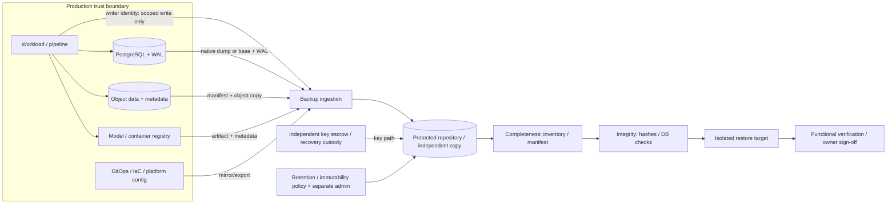

## Unit 2 — Backup Scope, Retention, and Immutability
**Target file:** `02-backup-scope-retention-and-immutability.md`  |  **Estimated time:** 12–18 hours, sequenced across sessions  |  **Prerequisites:** Stage 2E M01–M12; especially M05 stateful workloads, M07 infrastructure lifecycle, M08 GitOps/evidence, M09 secrets and trust, M10 incidents, M11 observability, and M12 supply-chain/security.
**Core tools:** Python 3 standard library, Git, PostgreSQL client tools, `kind`/Kubernetes where already installed, local object storage where already installed, checksums, JSON/CSV, optional Prometheus.  |  **Awareness:** Vault/OpenBao Raft snapshots, etcd snapshots, Kafka-like retention/mirroring, Velero, Restic/Kopia, Barman, pgBackRest, WAL-G, object-lock modes.  |  **Last reviewed:** 2026-10-29  |  **Tool baseline assumed:** Python 3.10+ syntax for examples; PostgreSQL, Kubernetes, CloudNativePG, MinIO, Prometheus, and backup-tool behavior is version-sensitive and marked `[VERIFY]`; use installed-version documentation.  |  **Footprint:** Plan for a laptop with 4 CPU cores, 8 GB RAM, and 30 GB free disk; **measure yours**. Run heavy components sequentially, not all at once.  |  **Destructive labs:** yes — synthetic throwaway data only, with explicit guards.

> **Evidence labels:** `[FACT]` means a general technical property; `[ASSUMPTION]` means a stated design input; `[ILLUSTRATIVE]` means example-only values; `[MEASURED]` is reserved for your own recorded observations. “Representative output — not executed here” is not test evidence. `[VERIFY]` means check behavior against the installed version and official documentation before relying on it.

### 2.0 Why this matters in production
A data/ML platform may have healthy-looking backup jobs while a newly created database is outside the backup scope, object-store references point to data from a different recovery time, or a compromised production credential can delete both the primary data and its copies. A snapshot may share the same storage failure domain, and a replica may faithfully replicate accidental deletion or logical corruption. Retention can also be too short: if corruption is discovered after every clean recovery point has expired, the backup system has preserved data but not a usable recovery path. Production readiness therefore means knowing what is protected, where independent copies live, who can alter them, how long clean points remain available, and whether isolated restores have actually succeeded.

### 2.1 Learning objectives
By the end of this unit, you will be able to:

- **[L1]** Distinguish backup, snapshot, replica, archive, version history, and Git mirror by failure survival and recovery evidence.
- **[L1]** Build a resource inventory and protection matrix spanning databases, objects, Kubernetes state, keys, registries, pipeline state, configuration, and the backup system itself.
- **[L2]** Produce and verify logical PostgreSQL dumps, application-native backup evidence, synthetic file manifests, and Git mirrors without exposing secrets.
- **[L2]** Calculate a transparent retention floor from detection latency, investigation time, and safety margin; simulate a GFS schedule and estimate storage units.
- **[L2]** Plan safe pruning with dry-run as the default, explicit lab allowlisting, hold/incident exclusions, audit records, and last-known-good protection.
- **[L2]** Explain encryption/key custody, least privilege, push versus pull models, versioning, immutability, legal hold, and their limits.
- **[L3]** Express tier-specific protection controls as policy, audit discovered inventory against declared policy and observed evidence, and flag gaps in one audit cycle.
- **[L3]** Reconcile synthetic database rows with object-store objects from aligned recovery points and detect dangling or hash-mismatched references.
- **[L4]** Define measurable protection SLOs, run threat-driven destructive-event drills, and govern exceptions, ownership, lifecycle, and key recovery.

### 2.2 Concept map and vocabulary

| Term | Meaning | Design question |
|---|---|---|
| Backup | An independently restorable point-in-time copy whose loss is not automatically coupled to loss of the source. | Can the source be destroyed while this copy remains readable and usable? |
| Snapshot | A point-in-time view of storage or system state, often sharing infrastructure with the source. | What storage, control plane, and account failures also destroy it? |
| Replica | A maintained copy intended for availability, distribution, or read scaling. | Does it reproduce deletes, corruption, or attacker actions? |
| Archive | Data retained for long-term reference, often optimized for cost or infrequent access. | Can it meet restore time and tooling requirements? |
| Version history | Prior versions retained by a file/object/repository system. | Can privileged users or lifecycle rules remove all versions? |
| Git repository/mirror | Versioned source/configuration history, possibly mirrored elsewhere. | Are untracked data, secrets, generated artifacts, and repository metadata separately protected? |
| RPO | Maximum acceptable data-loss interval; Unit 1 owns the objective register. | Is the achieved recovery point recent enough? |
| Retention | How long recovery points are preserved. | Does it cover detection and investigation latency? |
| Immutability/WORM | Controls that prevent or constrain alteration/deletion for a defined period. | Which actors and failure domains are actually constrained? |
| Legal hold | A hold preventing eligible data from normal expiry/deletion under a product's supported model. | Who authorizes/releases it, and how is it audited? |
| Completeness | Expected objects/records/files are present. | Does the manifest/inventory match? |
| Integrity | Stored bytes and application-level data pass defined integrity checks. | Do hashes and domain checks match expectations? |
| Recoverability | Data restores into an isolated target and the service works. | Has a real restore and functional check succeeded? |
| Clean recovery point | A recovery point believed to precede corruption/compromise and pass validation. | What evidence supports that belief? |
| Failure domain | A set of components that can be lost or controlled by one event. | Do copies fail independently? |
| Key custody | Independent, controlled access to encryption, sealing, and trust keys needed for recovery. | Can keys be recovered if the protected platform is gone? |

**Recovery path and trust boundaries**



The diagram is conceptual, not proof that any local setup has independent failure domains. The production workload must not receive backup deletion privileges. Backup repository administration and key recovery should not depend exclusively on production identity, production secrets, or the cluster being recovered. A laptop-local repository, a second local bucket, a second MinIO instance, or a second `kind` cluster is still vulnerable to loss of the laptop/host/disk.

#### Backup versus adjacent mechanisms

| Mechanism | What it is / may survive | What it does not reliably survive | Independently restorable? | Required evidence |
|---|---|---|---|---|
| Backup | Point-in-time copy separated from source; may survive source deletion or host loss if stored in a separate failure domain. | Not automatically safe from shared credentials, key loss, corruption, or an untested restore path. | Intended to be; must be demonstrated. | Inventory, copy status, manifest/checksums, restore drill, functional test. |
| Snapshot | Storage/system point-in-time view; fast rollback may help with operator error if retained. | Same-volume, same-array, same-account, or host loss; propagated admin deletion; some logical corruption. | Sometimes; depends on snapshot/export mechanics and dependencies. | Snapshot metadata plus an isolated restore test and failure-domain analysis. |
| Replica | Near-current copy for availability/read scaling. | Replicated deletion/corruption, compromised admin, correlated outage. | Often can be promoted, but that is not equivalent to historical backup. | Replication lag/health and failover test; historical recovery test separately. |
| Archive | Long-lived copy for historical/reference needs. | Restore deadlines if retrieval is slow, formats/tools are unavailable, or keys expire. | Only if format and dependencies are retained and tested. | Readability, catalog/metadata, retrieval and restore test. |
| Version history | Earlier versions retained by a service. | Privileged deletion, lifecycle misconfiguration, account loss, versions never enabled. | Sometimes, subject to platform/tool access. | Version listing, policy proof, restore of a prior version. |
| Git mirror | Copy of repository refs/history. | Untracked files, external secrets, LFS/artifacts not mirrored, force-push or shared credentials, source system dependencies. | Usually for repository content; not for the full application state. | Compare refs, clone in isolation, verify required submodules/LFS and build inputs. |

**Explicit M05 recap: snapshot ≠ backup.** A snapshot may be a valuable recovery mechanism, but it counts as a backup only if its independence, retention, access separation, and restore path satisfy the stated threat model. Three directories on one disk are three paths, not three independent copies. A replica that mirrors deletes may be excellent for availability and poor for recovering from a delete.

#### Backup-type catalogue

| Type | Mechanics and example | Restore implications / advantages | Limitations and failure modes | Typical use |
|---|---|---|---|---|
| Full | Copy all selected data at a point; e.g., a full synthetic dataset export. | Simple restore dependency; straightforward baseline. | Larger window/storage; can saturate source or network. | Baseline or periodic independent recovery point. |
| Incremental | Copy changes since a prior backup; e.g., base plus increments A, B, C. | Efficient storage/window, but restore may require the base and every needed increment. | Missing/corrupt chain element may invalidate later recovery points in chain-based designs; product semantics vary. | Large datasets with controlled chain validation. |
| Differential | Copy changes since the last full. | Restore often needs full plus latest differential; differential grows until next full. | Increasing backup size; behavior varies by product. | Simpler chain than many incrementals. |
| Synthetic full | Repository combines existing full/incremental blocks into a full recovery point without rereading all source data. | Can reduce source load; restore may look like a full. | Repository metadata, deduplication maps, or blocks can become critical dependencies; implementation-specific. | Large-data backup systems. |
| Continuous/log-based | Capture transaction/log stream between base points; PostgreSQL WAL is the core concept. | Can restore to a selected point within retained log coverage. | Base backup and continuous complete WAL sequence must align; gaps, retention expiry, or corrupt logs limit PITR. | Database PITR and low data-loss objectives. |
| Snapshot-based | Capture storage state using snapshot APIs. | Fast and often low overhead; useful for coordinated volume recovery. | Crash consistency versus application consistency; shared failure domain; multi-volume coordination. | Volumes or workloads with documented snapshot integration. |
| Logical | Export schema/records through database-native logical tools, e.g. `pg_dump`. | Portable/selective and useful as a second method; may support object-level restore. | Restore may be slower; roles/globals/extensions and external objects may need separate capture. | Small/medium DBs, migrations, secondary recovery method. |
| Physical | Copy database files using a supported physical backup mechanism plus required logs. | Efficient for large databases and PITR when designed correctly. | Version/platform compatibility, WAL continuity, permissions, catalog and recovery-process dependencies. | Database-native physical recovery. |
| File-level | Copy named files and directories. | Simple for static data; easy to inspect. | May miss metadata, hard links, open-file consistency, hidden state, or application transaction boundaries. | Static artifacts, configuration exports. |
| Block-level | Copy changed storage blocks or volume snapshots. | Efficient for large volumes. | Block consistency and chain/repository dependencies; may be hard to selectively restore. | Large disks/VMs where supported. |
| Application-consistent | Application is quiesced/flushed/checkpointed or integrated with a supported backup API. | Better semantic consistency across application state. | Requires integration and may pause writes; implementation-specific. | Databases and multi-file application state. |
| Crash-consistent | Captures state as if power failed at that instant; storage writes may be atomic only within platform guarantees. | Often faster and does not require full quiesce. | Application may need crash recovery; cross-volume state can disagree. | Workloads documented to recover safely from crash-consistent state. |

An incremental chain is not automatically unsafe, but its dependency graph must be understood and tested. Some products synthesize recovery points or maintain redundancy; others require a specific base and sequence. Never generalize one tool's semantics to all tools. Record the exact chain and run repository verification/restore tests for the installed version.

#### 3-2-1 and 3-2-1-1-0

```text
3-2-1 heuristic:   source + copy A + copy B  | at least 2 media/types | at least 1 offsite copy
3-2-1-1-0 heuristic: the above + 1 offline/immutable copy + 0 known verification errors
```

[VERIFY] Attribution and interpretation of the mnemonics are not asserted as a standards citation here. These are **heuristics, not a universal standard or proof of recoverability**. Count failure domains, identities, control planes, network paths, and key custody—not just copies. An offsite copy writable by the same compromised identity may not survive a credential compromise. “Zero errors” means errors found by a defined verification process, not a guarantee that unknown faults do not exist.

#### Scope: what must be protected

Scope must be discovered continuously, not remembered informally. The inventory should include at least:

- Databases, schemas, roles/required globals, and transaction logs/WAL.
- Object-store data, metadata, version IDs, manifests, and all referenced objects.
- Application configuration, platform configuration, Kubernetes resources and CRDs, PVC data where appropriate, and operator-specific state.
- Secrets, encryption keys, Vault/OpenBao sealing/unseal materials, trust roots, certificate recovery material, and custody/recovery records. **Never place secret values in this inventory or evidence.**
- Infrastructure-as-code and Terraform state, with controlled state encryption/access and recovery inputs.
- Container/model registries, signed artifacts, model weights, tokenizer/config files, signatures/provenance, registry metadata, and artifact-to-version mappings.
- Pipeline metadata, checkpoints, offsets, orchestrator state, idempotency state, and assumptions about source retention/replay.
- Git repositories/mirrors, GitOps configuration, submodules/LFS where used, and required build manifests.
- Observability configuration: dashboards, alert rules, recording rules, critical metric definitions, and alert routing configuration.
- Runbooks, architecture/dependency diagrams, service inventory, recovery scripts, bootstrap instructions, and offline instructions.
- Backup software/configuration, repository catalog/metadata, credentials or identity configuration, encryption configuration, schedules, and the backup system's own recovery procedure.

Not every item should be copied as raw files. Prefer supported application-native mechanisms for databases and control-plane state. Separate six decisions: **what** is protected; **how** it is captured; **where** it is stored; **how long** it is retained; **who** can alter/delete it; and **how** restoration is verified.

#### Example protection matrix

All values below are `[ILLUSTRATIVE]`; replace them with measured results and approved business objectives.

| Resource | Owner | Tier | Data/state | Mechanism | Frequency | Retention | Immutable/offline copy | Encryption/key dependency | Restore verification | Last restore test | Status | Exception expiry |
|---|---|---|---|---|---|---|---|---|---|---|---|---|
| `platform-db` | Data platform | T1 | PostgreSQL rows + WAL | Operator-supported base backup/WAL + logical dump | 15 min logs; daily logical dump | 30 days | Separate immutable copy | Independent key escrow | Restore + row/domain queries | `[MEASURED] YYYY-MM-DD` | To measure | N/A |
| `dataset-bucket` | ML data owner | T1 | Objects, versions, manifests | Copy + manifest/checksum | Hourly | 35 days | Separate bucket/account in production design | Separate KMS/key custody | Manifest + reconciliation | `[MEASURED] YYYY-MM-DD` | To measure | N/A |
| `model-registry` | ML platform | T2 | Weights, config, metadata, signatures | Artifact export + metadata DB backup | Daily/on publish | 90 days | Independent protected copy | Escrowed decrypt key | Hash + load model in scratch | `[MEASURED] YYYY-MM-DD` | To measure | N/A |
| `gitops-config` | Platform team | T2 | Git refs/manifests | Mirror clone + bootstrap export | On push/daily | 180 days | Independent mirror | Recovery identity stored separately | Clone + validate refs | `[MEASURED] YYYY-MM-DD` | To measure | N/A |
| `vault-state` | Security | T1 | Vault/OpenBao Raft state | Supported snapshot workflow | Per policy | 30 days | Independent protected copy | Unseal/sealing key custody outside Vault | Restore exercise | `[MEASURED] YYYY-MM-DD` | To measure | N/A |
| `cluster-etcd` | Platform team | T1 | Cluster metadata | Supported etcd snapshot workflow | Per policy | 14 days | Separate protected repository | Encryption key escrow | Isolated recovery rehearsal | `[MEASURED] YYYY-MM-DD` | To measure | N/A |
| `pipeline-state` | Data engineering | T2 | Offsets, checkpoints, orchestrator metadata | Native exports + source replay assumptions | Hourly | 30 days | Protected copy | Relevant key custody | Resume/replay synthetic run | `[MEASURED] YYYY-MM-DD` | To measure | N/A |
| `backup-control-plane` | Backup owner | T1 | Config, catalog, schedules, identities | Export and independent recovery procedure | On change/daily | 90 days | Offline/independent copy | Separate credential/key recovery | Rebuild and list/restore a backup | `[MEASURED] YYYY-MM-DD` | To measure | N/A |

A protection register without a discovery process becomes stale. Discover PVCs, databases, buckets, CRDs/operators, registries, and stateful services; normalize identifiers; compare them to policy and observed backup evidence. Newly discovered resources should fail closed into “unprotected / needs owner” until a policy is approved.

#### Application-native capture and verification

- **PostgreSQL logical dump:** `pg_dump` is a database-aware export; global roles and some cluster-level objects may require separate supported handling. A dump does not automatically provide physical PITR. Command options and compatibility semantics are version-sensitive: `[VERIFY]` using the installed PostgreSQL documentation. Example for a throwaway local database, with credentials supplied through the configured safe client environment rather than embedded in a command or file:
  ```bash
  # [VERIFY] Review pg_dump options for your installed version first.
  pg_dump --format=custom --file=./lab-evidence/platform-db.dump "$LAB_DATABASE_URL"
  test -s ./lab-evidence/platform-db.dump
  ```
  Do not put passwords in shell history, Markdown, logs, or evidence. A successful exit is only one signal; validate file size, expected database identity, restore into a scratch database, and query it.
- **Physical base backup + WAL/PITR:** use the operator/database-supported backup path, including a complete WAL archive and documented recovery process. A base backup without the WAL range required for the target point is not equivalent to PITR. Do not raw-copy a live database directory unless the database documentation explicitly supports that capture method.
- **Object storage:** versioning may retain prior object versions; separately copy the object data plus metadata, version identifiers, manifests, and referenced objects. Verify the source and destination object sets and hashes. Versioning alone is not a universal immutable guarantee.
- **Vault/OpenBao:** awareness/reuse from M09. Capture Raft state using supported version-specific procedures and protect the recovery keys independently. A snapshot without usable unseal/key custody may be unreadable. `[VERIFY]` exact command syntax and recovery compatibility.
- **etcd:** awareness/reuse from M03. Use the established, supported snapshot workflow; this unit addresses scope, storage, retention, and proof rather than re-teaching mechanics. `[VERIFY]` exact command/version semantics.
- **Kafka-like topics:** retention and mirrors can support replay/availability but do not automatically capture consumer offsets, schemas, connector state, external side effects, or every related database/object. Define replay boundary and dependencies.
- **Git mirror:** `git clone --mirror` can preserve repository refs, but validate submodules, LFS, release artifacts, signing keys, and external secrets separately.
- **Model artifacts/registries:** protect the artifact bytes and metadata linking model name/version, digest, tokenizer/config, evaluation results, provenance/signature, and deployment reference. An artifact without metadata may be ambiguous; metadata without bytes is not deployable.

Verification methods prove different things:

| Method | What it proves | What it does not prove |
|---|---|---|
| File/object inventory and manifest | Expected named items appear in the captured set. | Bytes are correct or the application can use them. |
| SHA-256 checksums | The compared bytes match the expected digest, assuming the expected digest is trustworthy. | Application semantics, source consistency, correct identity of the intended dataset, or successful service recovery. |
| Database row counts | Approximate completeness at a chosen table/granularity. | Correct row values, relationships, ordering, or business semantics. |
| Aggregate/domain queries | Selected business invariants hold. | All possible invariants or service behavior. |
| Isolated restore + functional query | The restored service can be started and tested for that scenario. | All failure scenarios, every dependency, or production-scale performance. |

### 2.3 Level 1 — Beginner

#### First principles: define the failure before choosing a copy

Ask: “What event must this mechanism survive?” Accidental delete, logical corruption, host/disk loss, stolen production credentials, account compromise, lost encryption key, and regional failure are different tests. A design can pass one and fail another. Record the target failure, the source of truth, required point in time, recovery dependencies, and proof. Do not label a resource “backed up” merely because a job ran.

#### Guided source → backup → restore → verification walkthrough

Use a synthetic file to learn the mechanics before connecting database tooling. This example creates only local lab files.

```bash
mkdir -p ./m13-lab/source ./m13-lab/backup ./m13-lab/restore
printf 'synthetic-record-001\n' > ./m13-lab/source/records.txt
sha256sum ./m13-lab/source/records.txt > ./m13-lab/source.sha256
cp -- ./m13-lab/source/records.txt ./m13-lab/backup/records.txt
sha256sum -c ./m13-lab/source.sha256
cp -- ./m13-lab/backup/records.txt ./m13-lab/restore/records.txt
cmp -- ./m13-lab/source/records.txt ./m13-lab/restore/records.txt
```

`sha256sum` is available on common Linux environments; on other systems use Python's standard-library `hashlib` implementation in Section 2.10. This copy is **not** independent of host loss because all paths are on the same host. It demonstrates bytes and verification, not production resilience.

#### Beginner mistakes and fixes

| Mistake | Why it fails | Fix |
|---|---|---|
| “The snapshot exists, so we are protected.” | Snapshot may share storage/admin failure domain. | Map failure domains and restore into an isolated target. |
| “The backup job exited zero.” | It may have written zero bytes, captured the wrong source, or produced a corrupt artifact. | Check nonzero/expected size, manifest, integrity, and restore. |
| “The replica has the latest data.” | It may also contain replicated deletion/corruption. | Keep historical recovery points separated from replication. |
| “The backup is encrypted, so it is safe.” | Key loss can make it unusable; access permissions may allow deletion. | Test independent key recovery and role separation. |
| “We keep seven days because daily backups run.” | Cadence and retention answer different questions. | Model detection/investigation latency and clean-point needs. |
| “The DB is backed up, so the app is recoverable.” | Objects, secrets, registry metadata, config, and identity may be missing. | Inventory dependencies and test the whole recovery path. |

### 2.4 Level 2 — Intermediate

This level implements a small protection program. Use synthetic data, a local scratch target, and existing M05 components only. Confirm your current Kubernetes context and target names before any change. Do not run commands against a shared or production cluster.

#### Lab platform preflight and footprint

```bash
python3 --version
uname -a
df -h .
free -h 2>/dev/null || true
kubectl config current-context 2>/dev/null || true
kubectl get namespaces 2>/dev/null || true
```

The outputs are measurements to record, not fixed expected values. If your current context is not an explicitly named lab context, stop before any Kubernetes mutation. `kind` clusters and local buckets share the laptop's host/disk failure domain. Keep datasets small and run database capture, object copy, and restore tests sequentially.

#### PostgreSQL: two recovery methods

**Method A — logical dump.** For a database you own in the M05 lab, set a safe connection variable using your local secret-handling convention. Do not paste the URI into evidence. `[VERIFY]` `pg_dump` flags and server/client compatibility against your installed version.

```bash
mkdir -p ./m13-evidence/postgres
umask 077
: "LAB_DATABASE_URL must point only to the named throwaway M13 database"
test -n "${LAB_DATABASE_URL:-}" || { echo 'Set LAB_DATABASE_URL for the throwaway lab DB'; exit 2; }
pg_dump --format=custom --file=./m13-evidence/postgres/platform-db.dump "$LAB_DATABASE_URL"
test -s ./m13-evidence/postgres/platform-db.dump || { echo 'empty dump: FAIL'; exit 1; }
sha256sum ./m13-evidence/postgres/platform-db.dump > ./m13-evidence/postgres/platform-db.dump.sha256
```

Restore to a newly created scratch database using the local lab's supported administrative process and `pg_restore` options verified for your version. Do not overwrite the source database. Validate with expected table counts, selected aggregates, and application-level queries. Record start/end timestamps, bytes, target identity, and result.

**Method B — operator-managed physical base backup + WAL archive/PITR.** Where the M05 CloudNativePG/operator lab is available, use the operator's documented backup object, object-store configuration, WAL archive, and restore workflow. The exact CRDs, fields, credentials, and commands depend on operator/version: `[VERIFY]` against the installed operator documentation and existing M05 files; do not guess a manifest. Required evidence is: base backup identifier and time, WAL coverage/continuity for the intended recovery point, destination copy status, isolated restored cluster identity, query checks, and elapsed time. If this operator path is unavailable, document the gap and complete the logical path plus a tool-neutral diagram; do not claim PITR has been tested.

A base backup plus WAL supports PITR only when the required WAL is present and valid and the recovery target lies within the retained range. Logical dump and physical/PITR are complementary recovery methods, not interchangeable labels.

#### Object-store data, model artifacts, and Git

For a local directory-based object-store export, use a deterministic synthetic dataset and copy it into a distinct lab backup directory. If MinIO/S3 is already installed, use its client only after checking the installed version's official documentation and target bucket identity `[VERIFY]`; no MinIO flags are assumed here.

```bash
mkdir -p ./m13-lab/objects/source ./m13-lab/objects/backup ./m13-lab/models
printf 'synthetic object alpha\n' > ./m13-lab/objects/source/object-001.txt
printf 'synthetic object beta\n' > ./m13-lab/objects/source/object-002.txt
cp -- ./m13-lab/objects/source/object-*.txt ./m13-lab/objects/backup/
python3 - <<'PY'
from pathlib import Path
import hashlib, json
root = Path('./m13-lab/objects/backup')
items = []
for p in sorted(root.glob('*')):
    if p.is_file():
        items.append({'key': p.name, 'bytes': p.stat().st_size,
                      'sha256': hashlib.sha256(p.read_bytes()).hexdigest()})
Path('./m13-lab/objects/manifest.json').write_text(json.dumps(items, indent=2) + '\n')
print(f'manifest entries={len(items)}')
PY
printf 'synthetic model bytes\n' > ./m13-lab/models/model.bin
sha256sum ./m13-lab/models/model.bin > ./m13-lab/models/model.bin.sha256
```

The manifest creation above should be followed by verification against the stored manifest rather than regenerating the expected digest from potentially corrupted data. Save this verifier as `m13_verify_manifest.py` and run it against the backup directory and manifest:

```python
#!/usr/bin/env python3
import hashlib, json, sys
from pathlib import Path

def sha256(path):
    h = hashlib.sha256()
    with path.open("rb") as stream:
        for chunk in iter(lambda: stream.read(1024 * 1024), b""):
            h.update(chunk)
    return h.hexdigest()

def verify(root, manifest_path):
    root = Path(root)
    manifest = json.loads(Path(manifest_path).read_text())
    if not isinstance(manifest, list):
        raise ValueError("manifest must be a JSON list")
    errors, expected_keys = [], set()
    for entry in manifest:
        key = entry.get("key")
        if not isinstance(key, str) or not key or Path(key).name != key:
            raise ValueError(f"invalid manifest key: {key!r}")
        if key in expected_keys:
            raise ValueError(f"duplicate manifest key: {key}")
        expected_keys.add(key)
        path = root / key
        if not path.is_file():
            errors.append(f"missing: {key}")
        elif path.stat().st_size != entry.get("bytes"):
            errors.append(f"size mismatch: {key}")
        elif sha256(path) != entry.get("sha256"):
            errors.append(f"hash mismatch: {key}")
    actual_keys = {p.name for p in root.iterdir() if p.is_file()}
    for key in sorted(actual_keys - expected_keys):
        errors.append(f"unexpected file: {key}")
    return errors

if __name__ == "__main__":
    if len(sys.argv) != 3:
        raise SystemExit("usage: python3 m13_verify_manifest.py BACKUP_DIR MANIFEST.json")
    problems = verify(sys.argv[1], sys.argv[2])
    if problems:
        print("VERIFY FAIL")
        print("\n".join(problems))
        raise SystemExit(1)
    print("VERIFY PASS: manifest membership, sizes, and hashes match")
```

The model example is a placeholder file, not a trained model. A real artifact bundle needs model bytes, config/tokenizer, version/digest, provenance/signature, and registry metadata. For Git, use a throwaway repository and mirror:

```bash
mkdir -p ./m13-lab/git-source
cd ./m13-lab/git-source
git init
printf 'synthetic config\n' > config.txt
git add config.txt
git -c user.name='M13 Lab' -c user.email='lab@example.invalid' commit -m 'synthetic baseline'
cd ..
git clone --mirror ./git-source ./git-backup.git
git --git-dir=./git-backup.git show-ref
cd - >/dev/null
```

This does not mirror external secrets, non-Git artifacts, or necessarily LFS/submodule payloads. Verify all required repository features before counting the mirror as complete.

#### Vault/OpenBao and etcd awareness procedures

Reuse M09 and M03 procedures rather than inventing commands. Before running a snapshot command, identify product, version, namespace/cluster, destination, encryption, key custody, and restore procedure. `[VERIFY]` the official version-specific snapshot and restore docs. Required evidence: snapshot ID/time, nonzero size, integrity metadata, access restrictions, independent key recovery reference (never the key value), and an isolated restore result. If no safe local lab exists, record `[OPEN — requires human verification]`; do not fabricate a successful test.

#### Scheduling and observability

Schedule only a verified script. Host cron or Kubernetes CronJob may be suitable, but execution identity, environment, storage permissions, concurrency policy, and version-specific fields must be checked `[VERIFY]`. A scheduled job must emit structured fields such as `resource_id`, `backup_id`, `started_at`, `finished_at`, `duration_seconds`, `bytes_written`, `exit_status`, `completeness_status`, and `integrity_status`. Do not log secrets or connection strings.

Example lightweight rule logic (tool-neutral):

```text
if no_successful_backup_timestamp exists: alert = BackupNeverSucceeded
else if now_utc - last_success_utc > allowed_backup_age: alert = BackupTooOld
if latest_job_exit_status != 0: alert = BackupJobFailed
if latest_artifact_bytes == 0: alert = BackupArtifactEmpty
if latest_artifact_bytes outside learned/approved range: alert = BackupSizeAnomaly
if completeness or integrity check != PASS: alert = BackupVerificationFailed
```

Illustrative Prometheus rule syntax, with metric names that your exporter must actually provide:

```yaml
groups:
  - name: m13-backup-health
    rules:
      - alert: BackupNeverSucceeded
        expr: backup_last_success_timestamp_seconds == 0
        for: 5m
        labels: {severity: critical}
        annotations:
          summary: "No successful backup has ever been recorded"
      - alert: BackupTooOld
        expr: (time() - backup_last_success_timestamp_seconds) > backup_max_age_seconds
        for: 5m
        labels: {severity: critical}
        annotations:
          summary: "Latest successful backup is older than policy allows"
      - alert: BackupJobFailed
        expr: backup_last_job_success == 0
        for: 2m
        labels: {severity: warning}
        annotations:
          summary: "Latest backup job failed"
      - alert: BackupArtifactEmpty
        expr: backup_latest_artifact_bytes <= 0
        for: 2m
        labels: {severity: critical}
        annotations:
          summary: "Backup job produced an empty artifact"
      - alert: BackupSizeAnomaly
        expr: backup_latest_artifact_bytes < backup_expected_min_bytes
        for: 5m
        labels: {severity: warning}
        annotations:
          summary: "Backup artifact is below its approved minimum size"
```

This is illustrative and requires matching metric names, labels, and policy thresholds. A metric that is absent may produce no alert unless absence is explicitly handled. Validate YAML and PromQL with the installed Prometheus tooling and documentation `[VERIFY]`; do not claim `promtool` validation until run. Empty-output detection requires the job to publish artifact byte count and a separate completeness/manifest check. Exit code zero and a “Succeeded” Kubernetes Job event do not prove that usable bytes exist.

#### Retention design

Retention is the period a recovery point remains available. Backup cadence is how often points are created; RPO is the acceptable loss interval. A 15-minute backup cadence does not imply 15-minute RPO if jobs fail, logs are missing, or restore points are unusable. Likewise, 90-day retention does not by itself make RPO smaller.

GFS (grandfather-father-son) is a rotation concept: retain selected daily (“son”), weekly (“father”), and monthly (“grandfather”) points. Actual schedules vary; use the smallest schedule that satisfies clean-point and business requirements, not a copied template.

A planning model for minimum retention is:

`minimum retention = detection latency + investigation/decision time + safety margin`

This is a planning model, not a universal standard. It assumes the relevant clean recovery point exists at the start of the detection window, detection latency is bounded by the stated assumption, and retention enforcement does not remove the point early. Include backup cadence/point spacing when converting the duration into a schedule. If corruption is detected after 12 days and retention is 7 days, all available points may be contaminated; that outcome depends on when corruption began and what independent copies remain.

**Worked calculation — all values `[ILLUSTRATIVE]`:** detection latency 12 days + investigation/decision 3 days + safety margin 5 days = 20 days minimum retention floor. If daily points are taken, round up to at least 20 days plus any additional schedule/operational margin required by the policy. A 30-day policy might be selected for this example, but it is not a universal recommendation.

| Input | Example | Unit | Source/assumption |
|---|---:|---|---|
| Detection latency | 12 | days | `[ASSUMPTION]` threat model |
| Investigation/decision | 3 | days | `[ASSUMPTION]` incident process |
| Safety margin | 5 | days | `[ASSUMPTION]` uncertainty buffer |
| Calculated floor | 20 | days | `[ILLUSTRATIVE]` sum |
| Selected policy | 30 | days | `[ILLUSTRATIVE]` rounded policy choice |

Retention must also account for contractual/regulatory obligations, litigation holds, data minimization/privacy rules, cost/space, restore deadlines, and the time needed to validate a clean point. Those are awareness topics only: consult the organization's legal/compliance owner; this unit provides no legal advice or compliance claim.

#### Retention/GFS calculator and simulator

Save as `m13_retention.py`. It uses only the Python standard library, validates units and values, produces an illustrative schedule/storage estimate, and never deletes data.

```python
#!/usr/bin/env python3
"""Planning-only retention and GFS simulator. Never deletes data."""
from dataclasses import dataclass
from datetime import date, timedelta
import argparse

@dataclass(frozen=True)
class RetentionPlan:
    detection_days: int
    investigation_days: int
    margin_days: int
    daily_size_gib: float
    daily_days: int
    weekly_weeks: int
    monthly_months: int

    def validate(self):
        for name in ("detection_days", "investigation_days", "margin_days"):
            if getattr(self, name) < 0:
                raise ValueError(f"{name} must be >= 0 days")
        if self.detection_days + self.investigation_days + self.margin_days <= 0:
            raise ValueError("retention floor must be > 0 days")
        if self.daily_size_gib <= 0:
            raise ValueError("daily_size_gib must be > 0")
        if self.daily_days < 1 or self.weekly_weeks < 0 or self.monthly_months < 0:
            raise ValueError("daily_days >= 1; weekly/monthly counts must be >= 0")

    @property
    def floor_days(self):
        self.validate()
        return self.detection_days + self.investigation_days + self.margin_days

    def schedule(self, start: date, days: int):
        if days < 1 or days > 3660:
            raise ValueError("schedule days must be between 1 and 3660")
        points = []
        for offset in range(days):
            d = start + timedelta(days=offset)
            # Keep every daily point in the simulation; labels identify rotation class.
            labels = ["daily"]
            if d.weekday() == 6:
                labels.append("weekly")
            if d.day == 1:
                labels.append("monthly")
            points.append((d.isoformat(), "+".join(labels)))
        return points

    def rough_storage_gib(self):
        # Simple full-copy upper estimate, not deduplication/compression modelling.
        daily = self.daily_days * self.daily_size_gib
        weekly = self.weekly_weeks * 7 * self.daily_size_gib
        monthly = self.monthly_months * 30 * self.daily_size_gib
        return daily + weekly + monthly

def main():
    p = argparse.ArgumentParser(description=__doc__)
    p.add_argument("--detection-days", type=int, default=12)
    p.add_argument("--investigation-days", type=int, default=3)
    p.add_argument("--margin-days", type=int, default=5)
    p.add_argument("--daily-size-gib", type=float, default=2.0)
    p.add_argument("--daily-days", type=int, default=7)
    p.add_argument("--weekly-weeks", type=int, default=4)
    p.add_argument("--monthly-months", type=int, default=3)
    p.add_argument("--start", default="2026-01-01")
    p.add_argument("--schedule-days", type=int, default=14)
    a = p.parse_args()
    try:
        plan = RetentionPlan(a.detection_days, a.investigation_days, a.margin_days,
                             a.daily_size_gib, a.daily_days, a.weekly_weeks,
                             a.monthly_months)
        start = date.fromisoformat(a.start)
        print(f"[ILLUSTRATIVE] minimum_retention_days={plan.floor_days}")
        print(f"[ILLUSTRATIVE] rough_full_copy_storage_gib={plan.rough_storage_gib():.2f}")
        print("[ILLUSTRATIVE] date,rotation_labels")
        for d, labels in plan.schedule(start, a.schedule_days):
            print(f"{d},{labels}")
    except (ValueError, OverflowError) as exc:
        p.error(str(exc))

if __name__ == "__main__":
    main()
```

Run `python3 m13_retention.py`. The default sizes/counts are `[ILLUSTRATIVE]`. The storage estimate intentionally assumes complete full copies; real incremental/deduplicated/compressed storage must be measured and forecast separately. Boundary tests can be run with the test suite in Section 2.10; add tests if changing this calculator. No tool automatically deletes backups.

#### Safe pruning and lifecycle

A pruning planner should be separate from the deletion executor. The planner inventories candidates, explains each reason, and defaults to dry-run. An executor must revalidate target identity, allowlisted repository/path/bucket, explicit lab label, holds, incident references, retention, and last-known-good count immediately before each deletion. The example below is a **candidate planner only**; it never deletes files or remote objects.

Save as `m13_prune_plan.py`:

```python
#!/usr/bin/env python3
"""Dry-run-only prune planner for synthetic backup inventory JSON."""
import argparse, json
from datetime import datetime, timezone
from pathlib import Path

REQUIRED = {"backup_id", "created_at", "known_good", "legal_hold", "incident_ref", "verified_only_point"}

def parse_ts(value):
    dt = datetime.fromisoformat(value.replace("Z", "+00:00"))
    if dt.tzinfo is None:
        raise ValueError(f"timestamp must include timezone: {value}")
    return dt.astimezone(timezone.utc)

def plan_prune(records, now, retention_days, keep_last_good=3):
    if retention_days < 1 or keep_last_good < 1:
        raise ValueError("retention_days and keep_last_good must be >= 1")
    for r in records:
        missing = REQUIRED - r.keys()
        if missing:
            raise ValueError(f"record missing fields: {sorted(missing)}")
    good = sorted((r for r in records if r["known_good"]),
                  key=lambda r: parse_ts(r["created_at"]), reverse=True)
    protected = {r["backup_id"] for r in good[:keep_last_good]}
    result = []
    for r in sorted(records, key=lambda x: x["backup_id"]):
        age_days = (now - parse_ts(r["created_at"])).total_seconds() / 86400
        reasons = []
        if r["backup_id"] in protected: reasons.append("within last-N known-good backups")
        if r["legal_hold"]: reasons.append("legal hold")
        if r["incident_ref"]: reasons.append("referenced by open incident")
        if r["verified_only_point"]: reasons.append("only verified restore point")
        if age_days < retention_days: reasons.append("inside retention window")
        candidate = not reasons
        result.append({"backup_id": r["backup_id"], "age_days": round(age_days, 2),
                       "candidate": candidate,
                       "decision": "WOULD_DELETE" if candidate else "KEEP",
                       "reasons": reasons or ["outside retention; no listed hold; not protected by last-N rule"]})
    return result

def main():
    ap = argparse.ArgumentParser(description=__doc__)
    ap.add_argument("inventory", type=Path)
    ap.add_argument("--lab-label", required=True)
    ap.add_argument("--allowlisted-target", required=True)
    ap.add_argument("--expected-target", required=True)
    ap.add_argument("--retention-days", type=int, required=True)
    ap.add_argument("--keep-last-good", type=int, default=3)
    ap.add_argument("--now", required=True, help="ISO-8601 timestamp with timezone")
    ap.add_argument("--execute", action="store_true", help="Refused: this planner never deletes")
    a = ap.parse_args()
    if a.execute:
        ap.error("This script is planner-only and never deletes; use a separately reviewed executor")
    if a.lab_label != "M13-THROWAWAY-LAB": ap.error("lab label not allowlisted")
    if a.allowlisted_target != a.expected_target: ap.error("target does not match explicit expected target")
    try:
        records = json.loads(a.inventory.read_text())
        if not isinstance(records, list): raise ValueError("inventory must be a JSON list")
        result = plan_prune(records, parse_ts(a.now), a.retention_days, a.keep_last_good)
    except (OSError, json.JSONDecodeError, ValueError) as e:
        ap.error(str(e))
    print(json.dumps({"mode": "DRY_RUN_ONLY", "target": a.allowlisted_target,
                      "lab_label": a.lab_label, "decisions": result}, indent=2))

if __name__ == "__main__": main()
```

Inventory timestamps must be timezone-aware ISO 8601 values. This planner checks declared holds and the last N known-good records but cannot independently prove those labels are truthful; a production system must fetch hold/incident/verification state from authoritative sources, write tamper-resistant audit events, use a two-person approval path, and revalidate atomically at deletion time. It is not production-ready and has no deletion code. Decommissioning requires an approved final backup, named owner, defined retention, restore evidence, and an auditable purge approval after expiry. Never use broad wildcards or unbounded prune commands.

#### Encryption, key custody, and access separation

Encrypt in transit and at rest using supported mechanisms, but do not confuse encryption with immutability. A backup encrypted with a key stored only in the destroyed Vault/cluster is not usable. Reuse M09's independent escrow/custody design for Vault/OpenBao sealing materials, age keys, etcd encryption-key escrow, trust roots, and recovery identities. The backup evidence should refer to the custody record and test result, never include the key or secret itself.

| Role | Minimum intended authority | Must not have |
|---|---|---|
| Backup writer | Create new backup objects in assigned prefix/repository. | Delete protected backups or alter retention policy where supported. |
| Restore reader | List/read approved backup versions and decrypt through controlled key path. | Delete/overwrite repository or change retention. |
| Retention/prune operator | Propose and, after approval, execute eligible expiry operations. | Unilateral ability to bypass holds or silently alter audit evidence. |
| Security/audit reviewer | Read policy, audit and control evidence. | Routine data mutation. |
| Platform administrator | Operate platform resources. | Automatic authority over independent backup credentials/keys. |

Push backups are initiated by production and can be operationally simple, but a compromised production identity may reach the backup endpoint; restrict it to append/write and separate retention authority. Pull backups are initiated from a protected backup domain that reads production, reducing the need for production to hold repository credentials, but increase inbound access/credential and network design complexity. Neither model is automatically safe.

**Negative test design:** create a synthetic backup in an explicitly allowlisted lab repository; issue a delete request using a constrained workload identity; verify denial (or the expected immutable retention refusal) and record the status/audit event; then use a separately controlled restore-reader identity to read and restore the object into scratch. Never include credentials in the lesson or evidence. Object-store permission semantics vary by implementation/version: `[VERIFY]` official docs and prove the effective permissions with a negative test. The workload identity must not possess backup-infrastructure credentials.

#### Immutability, object lock, versioning, and legal hold

| Control | Intended effect | Important limit |
|---|---|---|
| Versioning | Retain distinct object versions when overwrite/delete behavior is configured to do so. | Permissions/lifecycle/admin actions may remove versions; versioning alone is not a universal immutable guarantee. |
| WORM/object lock | Prevent or constrain changes/deletion to eligible object versions for a configured period. | Exact coverage depends on implementation/mode/version; does not automatically protect account credentials, bucket administration, keys, host, disk, or every copy. |
| Time-based retention | Hold eligible versions until a defined expiry. | Expiry can permit deletion; wrong clock/policy/configuration and privileged administration remain concerns. |
| Legal hold | Hold eligible objects without the same fixed expiry model in products that support it. | Product-specific authority and release semantics; legal process must be handled by the organization's legal/compliance owner. |
| Offline/air-gapped copy | Reduce direct reachability from compromised online systems. | Operationally slower; custody, rotation, and restore process must be tested. |

“Governance” and “compliance” retention modes are product-specific terminology: `[VERIFY]` official docs before relying on names or bypass rules. Some object-lock systems require versioning and lock settings at bucket creation; MinIO-specific prerequisites and flags must be checked for the installed version. Do not invent flags. Verify: (1) version; (2) whether object lock must be enabled at bucket creation; (3) whether versioning is required; (4) retention-mode semantics; (5) who can shorten/override retention; (6) overwrite behavior; (7) expiry behavior; (8) audit evidence; and (9) how to restore. Demonstrate a refused delete of a locked synthetic object and observe whether overwrite creates a new version. If the short safe lab cannot observe expiry, record it as `[OPEN — requires human verification]`. Local MinIO object lock is not protection from laptop/host/disk destruction.

### 2.5 Level 3 — Advanced

#### Tier-to-control design

Use the Unit 1 register in [`01-recovery-time-and-recovery-point-objectives.md`](01-recovery-time-and-recovery-point-objectives.md) as input. That file owns the recovery objectives; this unit maps them to controls. Do not set universal retention periods. For each tier, document:

1. Protected resource scope and owner.
2. Application-native capture mechanism and consistency model.
3. Cadence, log coverage, and achievable recovery point.
4. Retention/clean-point window and detection-latency assumptions.
5. Independent immutable/offline copy and failure-domain boundaries.
6. Encryption, independent key recovery, and identity dependencies.
7. Writer/reader/pruner/auditor separation.
8. Completeness, integrity, and isolated restore method/cadence.
9. Backup-age/failure/size/immutability/key/restore-test alerting and saved evidence.
10. Exception rationale, risk owner, compensating controls, review date, and expiry.

| Tier (example only) | Scope/mechanism | Retention/independence | Verification/evidence | Governance |
|---|---|---|---|---|
| T1 `[ILLUSTRATIVE]` | Critical DB + WAL, core object data, secrets/key custody, backup control plane. | High-frequency recovery points, longer clean-point window based on threat model, separate immutable/offline copy. | Restore drills, WAL continuity, domain queries, key recovery proof. | Named business + technical owners; short exception expiry. |
| T2 `[ILLUSTRATIVE]` | Model/registry artifacts, GitOps, pipeline state. | On-publish/daily points; independent copy for critical artifacts; retention tied to rebuild/replay needs. | Hashes, registry-reference checks, synthetic pipeline replay. | Owner and artifact lifecycle policy. |
| T3 `[ILLUSTRATIVE]` | Rebuildable cache/derived state where documented. | Rebuild inputs preserved; shorter retention may be acceptable only with verified rebuild procedure. | Rebuild test and source availability proof. | Explicitly approved non-backup classification where appropriate. |

#### Policy as code and conformance audit

Use JSON as a dependency-free policy format. JSON is also a subset of YAML, so it is readable by YAML-oriented tools without needing a YAML parser. Save the following sample as `m13-policy.json` and the observed inventory/evidence as `m13-observed.json`. The audit compares three sets: **discovered inventory**, **declared policy**, and **observed backup evidence**.

```json
{
  "policy_version": 1,
  "resources": [
    {"id":"platform-db","owner":"data-platform","tier":"T1","mechanism":"postgres-native-plus-wal","max_age_hours":1,"retention_days":30,"immutable_required":true,"key_recovery_required":true,"restore_test_max_age_days":30},
    {"id":"dataset-bucket","owner":"ml-data","tier":"T1","mechanism":"object-copy-manifest","max_age_hours":2,"retention_days":35,"immutable_required":true,"key_recovery_required":true,"restore_test_max_age_days":30},
    {"id":"model-registry","owner":"ml-platform","tier":"T2","mechanism":"artifact-and-metadata-export","max_age_hours":24,"retention_days":90,"immutable_required":true,"key_recovery_required":true,"restore_test_max_age_days":60},
    {"id":"gitops-config","owner":"platform","tier":"T2","mechanism":"git-mirror","max_age_hours":24,"retention_days":180,"immutable_required":false,"key_recovery_required":false,"restore_test_max_age_days":90}
  ]
}
```

```json
{
  "discovered_inventory": ["platform-db", "dataset-bucket", "model-registry", "gitops-config", "new-db-unregistered"],
  "observed": {
    "platform-db": {"last_success":"2026-10-29T10:00:00Z","artifact_bytes":1048576,"complete":true,"integrity":true,"retention_days":30,"immutable":true,"key_recovery_proven":true,"last_restore_test":"2026-10-01T10:00:00Z"},
    "dataset-bucket": {"last_success":"2026-10-29T09:00:00Z","artifact_bytes":0,"complete":false,"integrity":false,"retention_days":7,"immutable":false,"key_recovery_proven":false,"last_restore_test":null},
    "model-registry": {"last_success":"2026-10-27T00:00:00Z","artifact_bytes":2048,"complete":true,"integrity":true,"retention_days":90,"immutable":true,"key_recovery_proven":true,"last_restore_test":"2026-08-01T00:00:00Z"},
    "gitops-config": {"last_success":"2026-10-29T08:00:00Z","artifact_bytes":4096,"complete":true,"integrity":true,"retention_days":180,"immutable":false,"key_recovery_proven":true,"last_restore_test":"2026-10-10T00:00:00Z"},
    "retired-resource-policy-entry": {"last_success":"2026-10-29T00:00:00Z","artifact_bytes":100,"complete":true,"integrity":true,"retention_days":90,"immutable":false,"key_recovery_proven":true,"last_restore_test":"2026-10-01T00:00:00Z"}
  }
}
```

All sample values and timestamps are `[ILLUSTRATIVE]`. Save this complete audit as `m13_policy_audit.py`:

```python
#!/usr/bin/env python3
"""Dependency-free inventory/policy/evidence conformance audit."""
import json, sys
from datetime import datetime, timezone
from pathlib import Path

POLICY_FIELDS = {"id", "owner", "tier", "mechanism", "max_age_hours", "retention_days",
                 "immutable_required", "key_recovery_required", "restore_test_max_age_days"}

def ts(value):
    if not value: return None
    dt = datetime.fromisoformat(value.replace("Z", "+00:00"))
    if dt.tzinfo is None: raise ValueError(f"timestamp lacks timezone: {value}")
    return dt.astimezone(timezone.utc)

def audit(policy, observed, now):
    entries = policy.get("resources")
    inventory = observed.get("discovered_inventory")
    evidence = observed.get("observed")
    if not isinstance(entries, list) or not isinstance(inventory, list) or not isinstance(evidence, dict):
        raise ValueError("policy.resources, discovered_inventory, and observed must be list/list/object")
    by_id = {}
    for p in entries:
        missing = POLICY_FIELDS - p.keys()
        if missing: raise ValueError(f"policy entry missing fields: {sorted(missing)}")
        if p["id"] in by_id: raise ValueError(f"duplicate policy id: {p['id']}")
        if not p["owner"]: raise ValueError(f"owner missing for {p['id']}")
        if p["max_age_hours"] <= 0 or p["retention_days"] < 1 or p["restore_test_max_age_days"] < 1:
            raise ValueError(f"invalid policy thresholds for {p['id']}")
        by_id[p["id"]] = p
    discovered = set(inventory)
    declared = set(by_id)
    observed_ids = set(evidence)
    findings = []
    for rid in sorted(discovered - declared): findings.append((rid, "UNPROTECTED_RESOURCE", "discovered but no policy"))
    for rid in sorted(declared - discovered): findings.append((rid, "POLICY_RESOURCE_NOT_DISCOVERED", "review stale policy entry"))
    for rid in sorted(discovered & declared):
        p, e = by_id[rid], evidence.get(rid)
        if not e:
            findings.append((rid, "NO_OBSERVED_BACKUP", "no evidence record")); continue
        if not e.get("owner", p["owner"]): findings.append((rid, "MISSING_OWNER", "assign owner"))
        last = ts(e.get("last_success"))
        if not last: findings.append((rid, "NO_BACKUP_EVER", "no successful timestamp"))
        elif (now - last).total_seconds() > p["max_age_hours"] * 3600:
            findings.append((rid, "STALE_BACKUP", "age exceeds policy"))
        if int(e.get("artifact_bytes", 0)) <= 0: findings.append((rid, "EMPTY_BACKUP", "artifact bytes <= 0"))
        if not e.get("complete", False): findings.append((rid, "INCOMPLETE", "completeness check failed"))
        if not e.get("integrity", False): findings.append((rid, "INTEGRITY_FAILURE", "integrity check failed"))
        if int(e.get("retention_days", 0)) < p["retention_days"]:
            findings.append((rid, "RETENTION_MISMATCH", "observed retention below policy"))
        if p["immutable_required"] and not e.get("immutable", False):
            findings.append((rid, "IMMUTABILITY_GAP", "required immutability not observed"))
        if p["key_recovery_required"] and not e.get("key_recovery_proven", False):
            findings.append((rid, "KEY_RECOVERY_UNPROVEN", "independent key recovery proof missing"))
        restore = ts(e.get("last_restore_test"))
        if not restore or (now - restore).total_seconds() > p["restore_test_max_age_days"] * 86400:
            findings.append((rid, "RESTORE_TEST_OVERDUE", "missing or stale restore test"))
    for rid in sorted(observed_ids - declared):
        findings.append((rid, "OBSERVED_POLICY_MISMATCH", "evidence exists for undeclared resource; review"))
    return findings

def main():
    if len(sys.argv) != 4:
        raise SystemExit("usage: python3 m13_policy_audit.py POLICY.json OBSERVED.json NOW_ISO8601")
    try:
        policy = json.loads(Path(sys.argv[1]).read_text())
        observed = json.loads(Path(sys.argv[2]).read_text())
        now = ts(sys.argv[3])
        if now is None: raise ValueError("NOW timestamp required")
        findings = audit(policy, observed, now)
    except (OSError, json.JSONDecodeError, ValueError, TypeError) as exc:
        raise SystemExit(f"AUDIT INPUT ERROR: {exc}")
    print("resource_id\tstatus\tdetail")
    for row in findings: print("\t".join(row))
    print(f"finding_count={len(findings)}")

if __name__ == "__main__": main()
```

The policy uses hours for backup age and days for retention/test age; do not mix units. The audit intentionally flags a discovered DB with no policy, stale backup, retention mismatch, non-existent policy resource, empty artifact, immutability gap, missing key proof, and overdue restore test. A real deployment should ingest discovery and evidence from trusted APIs, validate policy schema before rollout, authenticate data sources, timestamp records at source, and protect audit output from tampering. The sample is a teaching baseline, not a compliance engine.

#### Policy-to-schedule/alert generation

A schedule generator must not silently invent cadence. Use `max_age_hours` as an alert threshold, and map each `mechanism` to an approved job template maintained by the owning team. For example, a policy renderer can generate the inventory of expected jobs and metric thresholds, but should refuse unknown mechanisms or missing owners. Never let a policy change grant itself more deletion authority. A safe minimal schedule table is:

| Resource | Mechanism | Expected job family | Alert source |
|---|---|---|---|
| `platform-db` | `postgres-native-plus-wal` | Operator-native backup + WAL archive | Last successful point, WAL continuity, bytes, restore-test age |
| `dataset-bucket` | `object-copy-manifest` | Copy + manifest | Object count, bytes, hash status, retention/immutability state |
| `model-registry` | `artifact-and-metadata-export` | Artifact/metadata bundle | Hash, registry-reference check, age, restore/load test |
| `gitops-config` | `git-mirror` | Mirror update | Ref comparison, age, clone/build test |

Unknown mechanisms are policy errors, not permission to skip backup. The policy audit runs at least once per agreed audit cycle and on resource creation events where supported.

#### Consistency and application correctness

A crash-consistent capture represents storage around a crash boundary; application recovery may be needed. An application-consistent capture coordinates flush/checkpoint/quiesce or uses a supported API so application transactions and files agree. Copying a running database's raw files with generic `cp` can capture inconsistent pages, omit required WAL, or combine files from different times. For PostgreSQL, use documented logical or physical backup methods and maintain the required WAL chain.

Multi-volume and multi-system data introduces a consistent-cut problem. Example: database row `object-101` references object-store key `features/v7/101.bin` and expected hash `H1`. If the database is restored to 10:00 but object storage to 10:30, the row might reference a deleted/replaced object. If objects are restored to 10:00 and the database to 10:30, newer rows can point to objects that do not exist. Similar alignment concerns apply to queues, registry metadata, model artifacts, pipeline offsets, and configuration.

Safer patterns include writing the object first, validating its durable ID/hash, then committing the database reference; immutable object IDs; versioned objects; a manifest tying object IDs to a dataset/recovery generation; and a reconciliation job. Restore all related systems to a compatible recovery generation, then run reconciliation before serving traffic. If source replay is used, document its retention boundary and idempotency semantics.

Save as `m13_reconcile.py` for a small synthetic example:

```python
#!/usr/bin/env python3
"""Find missing or hash-mismatched objects referenced by synthetic DB rows."""
import hashlib, json, sys
from pathlib import Path

def digest(data: bytes) -> str:
    return hashlib.sha256(data).hexdigest()

def reconcile(rows, objects):
    problems = []
    for row in rows:
        key = row.get("object_key")
        expected = row.get("sha256")
        if not key or not expected:
            problems.append({"row_id": row.get("row_id"), "problem": "invalid_reference"})
        elif key not in objects:
            problems.append({"row_id": row.get("row_id"), "object_key": key, "problem": "missing_object"})
        elif digest(objects[key]) != expected:
            problems.append({"row_id": row.get("row_id"), "object_key": key, "problem": "hash_mismatch"})
    return problems

def main():
    if len(sys.argv) != 3: raise SystemExit("usage: python3 m13_reconcile.py rows.json object-directory")
    rows = json.loads(Path(sys.argv[1]).read_text())
    root = Path(sys.argv[2])
    objects = {p.name: p.read_bytes() for p in root.iterdir() if p.is_file()}
    findings = reconcile(rows, objects)
    print(json.dumps({"checked_rows": len(rows), "problems": findings}, indent=2))
    if findings: raise SystemExit(1)

if __name__ == "__main__": main()
```

Synthetic mismatched-point exercise: create `rows.json` where row 1 expects the hash of `object-001.txt` and row 2 expects `object-002.txt`; create a restored object directory containing only object 1 and an altered object 2. Run the script and expect `missing_object` for the absent key and `hash_mismatch` for the changed bytes. These are deterministic failure classes; actual hashes depend on your synthetic bytes. Correct the procedure by restoring a matched manifest/generation for both DB and objects, verifying hashes, then running application/domain checks. Do not “fix” the mismatch by changing expected hashes to fit an untrusted restored object.

#### Large-data strategies and restore performance

| Strategy | Benefit | Cost/risk to test |
|---|---|---|
| Incremental-forever | Limits routine data transfer. | Chain/repository metadata and reconstruction dependency; test full recovery path. |
| Deduplication/compression | Can reduce stored bytes. | CPU, memory, index/catalog dependencies, and restore contention. |
| Block-level change tracking | Efficient for large volumes. | Tracking reset or snapshot-chain issues; tool-specific `[VERIFY]`. |
| Object versioning/replication | Historical versions or secondary copy. | Delete/overwrite semantics, replication lag, shared identity/account risk; not automatically immutable. |
| Parallel transfer/restore | Can improve throughput. | Source, network, CPU, disk and repository saturation; tune using measurements. |
| Throttling/windowing | Protects production workloads. | Slower backup/restore; ensure window still meets objectives. |
| Pre-staging/smaller restore units | Reduces critical-path delay for selected data. | More operational complexity and dependency ordering. |
| Cold/archive tiers | May reduce storage consumption. | Retrieval delay/cost/availability are product-specific `[VERIFY]`; measure before RTO commitments. |
| Periodic full/synthetic-full point | Can limit chain depth or simplify restore. | Extra capacity/I/O and repository dependencies. |

Measure backup throughput and restore throughput in bytes/second, source I/O impact, CPU, memory, network, artifact growth, and concurrent job contention. Forecast data growth using observed time series plus explicit assumptions; do not infer restore time from backup size alone. A 100 GiB backup at 100 MiB/s has a theoretical transfer floor of about 17 minutes before decompression, verification, database recovery, dependency ordering, and application warm-up; this is an illustrative arithmetic example, not a performance promise. Tie tests to M11 saturation metrics and production load constraints.

#### Ransomware/destructive-event resilience

Threat model: an attacker has production-admin rights and tries to encrypt/delete production data, alter backup configuration, delete online copies, steal keys, or make recovery impossible. Controls should include multiple independent failure domains, separate accounts/security domains, independent identities, append/write-only backup ingestion where supported, offline/air-gapped copies for crown-jewel data, immutable retention, MFA/two-person approval for destructive retention changes, monitoring for delete attempts and anomalous object counts/size/change rates, and retention beyond plausible detection/dwell time. Entropy-based detection can be useful but is product- and workload-specific; it is not proof of ransomware.

Recovery must use a clean-room target: isolate it, establish trustworthy bootstrap and key custody, restore a point believed to precede compromise, scan and validate data/artifacts, rotate credentials and trust material, verify provenance, and reconnect in controlled stages. Newer data may have to be sacrificed to recover a clean point. A backup copied to another bucket under the same admin identity may not survive the threat model.

**Safe negative test:** with only synthetic lab objects and a constrained workload identity, attempt a delete against the lab backup object. Expected result is access denied or immutable-retention refusal, with an audit event. If deletion succeeds, stop and record a control failure; do not use that identity against any other resource. Verify no backup-infrastructure credential is mounted or exposed to the simulated compromised workload. Do not provide real attack commands or test non-lab resources.

#### Secrets and privacy in backups

Backups can contain personal, confidential, or regulated data, as well as secrets that were accidentally written into logs/configuration. Apply encryption, least privilege, audit, retention limits, and restricted restore access. Backup retention can conflict with privacy deletion obligations; awareness concepts include natural expiry, crypto-shredding, and restore-time re-deletion lists, but implementations and legal implications require `[VERIFY]` and review by the organization's privacy/legal owner. A restore process should have a documented way to reapply approved deletion/tombstone lists before exposing recovered data. Do not claim compliance or provide legal advice; never put actual secrets or sensitive data in sample evidence.

#### Kubernetes and backup-tool choices

Prefer application-native database backups unless the chosen platform explicitly documents and verifies a safe alternative. Kubernetes object backup is not equivalent to PVC data backup; PVC data backup is not equivalent to a database-consistent backup. CRDs/operators may need to be restored before custom resources; restore ordering and namespace/dependency handling matter. See [`09-kubernetes-backup-and-restore-with-velero.md`](09-kubernetes-backup-and-restore-with-velero.md) for detailed Velero implementation and [`03-restoring-platform-metadata-and-configuration.md`](03-restoring-platform-metadata-and-configuration.md) for platform metadata/recovery ordering. Those sibling files are links only and are not created here.

| Tool family | Coverage | Consistency model | Immutability support | Restore speed | Security model | Complexity / maintenance | Lock-in | Evidence quality |
|---|---|---|---|---|---|---|---|---|
| Native DB tools | Database-native logical/physical state | Tool-defined, database-aware | Usually depends on destination repository | Measure on actual data | DB credentials + repository identity | Moderate; DB-specific | Low–medium | High when restore-tested |
| Velero | Kubernetes resources and supported data integrations | Resource + plugin/storage-dependent | Repository/object-store-dependent | Measure per resource/PVC | Kubernetes and storage identities | Moderate; plugins/version-sensitive `[VERIFY]` | Medium | Good with restore evidence |
| Restic/Kopia | File/object/repository backup use cases | Filesystem/repository-specific | Destination and configuration dependent `[VERIFY]` | Measure | Repository keys/credentials | Moderate | Medium | Repository checks + restore tests |
| Barman | PostgreSQL backup/PITR workflows | PostgreSQL-aware, exact capabilities `[VERIFY]` | Destination-dependent | Measure | DB/archive/repository credentials | DB-focused operations | Medium | High if WAL and restore tests are captured |
| pgBackRest | PostgreSQL backup/PITR workflows | PostgreSQL-aware, exact capabilities `[VERIFY]` | Destination-dependent | Measure | DB/repository credentials | DB-focused operations | Medium | High if repository and restore checks run |
| WAL-G | Database backup/WAL workflows in supported deployments | Version/deployment-dependent `[VERIFY]` | Destination-dependent | Measure | Cloud/object/repository credentials | Integration-sensitive | Medium | Requires explicit restore proof |
| Commercial platform | Product-dependent | Product-dependent | Product/edition/config-dependent `[VERIFY]` | Benchmark with representative data | Vendor and customer control-plane model | Subscription/operational burden | Potentially higher | Inspectable reports plus independent tests |

Choose by required coverage, consistency, independent immutable storage, restore speed, identity separation, operational complexity, maintainability, portability, and evidence quality—not by feature checklist alone. Verify every version-sensitive claim in official docs and run a restore trial.

#### Backup-system reliability and cost control

Treat the backup scheduler, catalog/repository metadata, credentials, encryption configuration, and recovery scripts as production dependencies. Protect their configuration and prove the backup system can be rebuilt without relying on the system it protects. Monitor schedule concurrency, resource limits, I/O impact, backup window, failure/age, artifact size, copy lag, verification status, and restore throughput. Maintain a second-location copy and verify it independently; two local buckets are not independent locations. Lifecycle rules must account for orphaned backups and dependencies from incremental chains. Do not prune repository metadata or compact repositories without tool-specific documented procedures `[VERIFY]`.

Measure capacity in GiB/TiB, bytes/day, change rate, compression/dedup ratio, retained point count, repository overhead, growth rate, and restore throughput. Do not invent prices or cloud limits. Cost comparisons can use quantities and locally observed resource consumption; price modeling belongs primarily to M15.

### 2.6 Level 4 — Expert

#### Governance and policy enforcement

Every resource must have a named technical owner and accountable business owner. The exception register contains resource, rationale, risk owner, compensating controls, approval, review date, and expiry. Expired exceptions fail the audit. Discovery-to-policy-to-evidence reconciliation should run on a schedule and after resource creation/change. Evidence supports decisions and auditability; it does not by itself prove legal or regulatory compliance.

Recommended policy-as-code enforcement: validate schema; reject duplicate IDs/unknown mechanisms/missing owners/negative retention; generate job expectations and alert thresholds from approved fields; audit discovered inventory against policy and observed evidence; report every mismatch; protect policy and audit logs; require review before increasing scope or retention exceptions. Unknown resources should be marked unprotected until a policy owner accepts responsibility.

#### Failure scenarios and readiness evidence

| Scenario | Expected control | Readiness evidence |
|---|---|---|
| Backup repository unavailable | Job failure/age alerts, queue/retry policy, alternate path where designed. | Failure injection record, alert timestamp, recovery/catch-up record. |
| Scheduler/control plane down | Independent schedule monitoring and documented manual/rebuild path. | Backup-system recovery exercise. |
| Catalog/metadata corrupted | Repository integrity/metadata verification and independent metadata backup. | Successful repository check and restore. |
| Key store unavailable | Independent escrow/custody and tested recovery identity. | Restore with primary key store unavailable, or `[OPEN — requires human verification]`. |
| New DB appears | Discovery-to-policy audit flags within one audit cycle. | Synthetic new-resource test. |
| Immutable copy misconfigured | Negative delete test and observed retention policy. | Denied delete, version listing, config export. |
| Restore target polluted/compromised | Clean-room isolation, scanning, credential rotation. | Drill evidence and approved reconnect gate. |

#### Protection and recovery SLI/SLO definitions

Use explicit numerator, denominator, unit, time window, and alert condition. The following thresholds are `[ILLUSTRATIVE]`, not universal recommendations.

| SLI | Numerator / denominator | Unit and window | Example SLO / alert |
|---|---|---|---|
| Protection coverage | Discovered in-scope stateful resources with current policy and valid backup evidence / all discovered in-scope stateful resources | % per audit cycle | `[ILLUSTRATIVE]` SLO 100%; alert on any unprotected T1 resource. |
| Backup success ratio | Successful scheduled jobs / all scheduled jobs | % over 7 days | `[ILLUSTRATIVE]` 99%; alert on repeated failure or any T1 age breach. Pair with size/completeness/integrity/recoverability. |
| Backup age compliance | Resource-hours within allowed age / total in-scope resource-hours | % over 30 days | Alert immediately when T1 exceeds policy age. |
| Restore-test success | Passed restore tests / attempted restore tests | % over 90 days | `[ILLUSTRATIVE]` 100% for critical tier; any failed critical test creates incident/action. |
| Restore-test freshness | Resources with test within policy window / resources requiring test | % per audit cycle | Alert on overdue tests. |
| Completeness pass rate | Backups whose manifest/inventory matches / backups checked | % over 30 days | Alert on any critical resource mismatch. |
| Integrity pass rate | Backups passing checksum and required DB/domain checks / backups checked | % over 30 days | Alert on any critical failure. |
| Immutable-copy coverage | Resources requiring immutability with observed valid protected copy / resources requiring it | % per audit cycle | Alert on any T1 gap. |
| Key recovery proof coverage | Encrypted resources with current independent key-recovery evidence / encrypted resources requiring it | % per audit cycle | Alert on missing/overdue proof. |
| Retention compliance | Protected points meeting approved retention policy / points sampled | % per audit cycle | Alert on early expiry or mismatch. |
| Size anomaly rate | Backups outside approved expected-size range / backups produced | % over 7 days | Alert on zero bytes or unusual deviation; tune for legitimate growth. |

**Runbook snippet — backup-age breach**

1. Declare incident severity using M10 policy; assign incident commander, backup owner, and resource owner.
2. Confirm resource identity, last known successful backup, actual artifact bytes, manifest/completeness/integrity status, and relevant RPO.
3. Check job logs and repository availability without exposing secrets; do not delete/prune while investigating.
4. If a valid independent copy exists, preserve it and test restore in isolation. If not, record the protection gap and escalate risk.
5. Repair job/credential/storage cause; do not relax immutability to “fix” the job without approved review.
6. Run a new backup, verify bytes and contents, and complete an isolated restore test where severity warrants.
7. Record timeline, lost recovery-point window, catch-up math, follow-up owner/due date, and postmortem actions. Apply M10's error-budget freeze/backlog policy where relevant.

**Blast radius:** an identity that can mutate production and backups can turn a localized compromise into unrecoverable loss. Separate identities/accounts, key custody, repository administration, and immutable/offline copies so one compromised role cannot alter every layer.

#### Threat-driven drills and key-management DR

Run a benign tabletop/live drill using synthetic data only: create a backup, simulate production deletion/overwrite, attempt backup deletion with constrained workload credentials, verify denial/retention/audit, and restore a clean point in isolation. Include an insider who requests retention shortening; require documented approval and two-person review. Preserve the drill record and open corrective actions for any failed control.

Key DR reuses M09: independent escrow/custody, access controls, rotation, and tested retrieval. Where safe, conduct a lab restore while the primary key store is unavailable. If that capability cannot be tested in the local environment, record `[OPEN — requires human verification]` with the precise missing dependency and owner. Never store keys in plaintext beside the backup.

#### Cross-account/cross-region and copy verification

A second copy should use independent credentials and, where the threat model requires it, a separate account/security domain and independent administrative path. Replication lag can contribute to effective RPO; measure it rather than assuming it is zero. Verify copied objects by count, size, hash, metadata, and sample/full restore according to tier. Two buckets or instances on one laptop only demonstrate workflow; they do not prove cross-account, cross-region, or host-loss resilience. M14 owns steady-state multi-cluster/multi-region operation.

#### Lifecycle, compliance evidence, and repository health

An archive is optimized for long retention/reference; a backup is designed for restoration. A final decommissioning backup needs approved scope, owner, expiry, key custody, restore proof, and documented purge authorization. Legal hold/e-discovery are awareness-only: consult legal/compliance owners and do not claim compliance. Verify retention expiry and audit behavior with installed product versions.

At scale, monitor parallelism, bandwidth, throttling, repository health, checksum scrubbing, incremental chain depth, compaction/prune semantics, append-only modes, and recovery-point validity. These are tool-specific `[VERIFY]`. A damaged increment or corrupted repository metadata can undermine recovery points that appear to exist; use documented repository checks and periodic full isolated restores.

#### Anti-pattern diagnosis catalogue

| Symptom / pattern | Hypothesis | Test / evidence | Root cause | Fix | Prevention / owner |
|---|---|---|---|---|---|
| Backups on same volume/cluster/account | Shared failure domain | Map storage/admin dependencies; simulate allowed lab loss | Copy is correlated with source | Independent protected destination | Platform + backup owner; architecture review |
| Snapshot treated as independent backup | No export/independence | Restore after simulated source deletion; inspect storage boundary | Snapshot shares source failure domain | Add independent copy and restore proof | Stateful workload owner |
| Backup credentials equal production admin | Attacker can delete both | Negative permission test and identity audit | Excess privilege | Separate writer/reader/pruner identities | Security owner |
| Job succeeds but writes zero bytes | Status checks only process exit | Inspect bytes, manifest, and restore | No artifact validation | Fail job on empty/incomplete output; alert | Backup operator |
| Retention shorter than detection latency | Clean point expired | Compare detection/investigation model to point inventory | Retention based only on cadence | Increase approved clean-point window | Risk owner + data owner |
| Raw copy of running DB files | Inconsistent files/WAL | Isolated restore and database integrity checks | Unsupported capture | Use database-native method | DBA/data platform |
| Key stored only in protected system | Circular recovery dependency | Restore with primary key store unavailable | No independent custody | Escrow and test recovery access | Security/key custodian |
| No inventory; new DB unprotected | Scope is manual/stale | Create synthetic DB; run audit | No discovery/policy reconciliation | Scheduled/event-driven audit | Platform + service owners |
| Backup config/credentials unprotected | Backup system cannot be rebuilt | Rebuild from independent config and identity recovery | System-of-record omitted | Back up config/catalog and recovery procedure | Backup owner |
| Versioning disabled/overwrite loses point | No historical version survives | Overwrite synthetic object and list versions | Misunderstood storage semantics | Enable verified version/retention controls | Object-store owner |
| Copy shares host failure domain | Local copy mistaken for offsite | Draw host/disk/control-plane boundary | Location label mistaken for independence | Production design requires separate failure domain | Architect |
| Incremental chain corrupt | Recovery dependency broken | Repository check and restore from selected points | Chain/metadata not verified | Validate chain; periodic independent full/synthetic points as appropriate | Backup operator |

#### Illustrative incident scenarios: diagnosis and prevention

These are synthetic scenarios, not claims about real incidents.

1. **Attacker deletes production and backup in the same account.** Diagnosis: shared admin identity/domain; inspect audit logs and effective permissions. Correct with independent account/security domain, separate credentials, immutability/offline copy, and clean-room recovery. Prevent through negative tests, monitoring, and two-person destructive-change approval.
2. **Overwrite is replicated and versioning is off.** Diagnosis: replication copied the latest overwrite and no prior version remains. Correct by restoring from a separate historical backup/manifest. Prevent with versioning where appropriate plus independently retained backup and tested overwrite behavior.
3. **Corruption found after 12 days; retention is 7 days.** Diagnosis: retention was shorter than detection latency. Correct by identifying any remaining independent clean point and documenting data loss; if none exists, state that limitation honestly. Prevent by modeling detection + investigation + margin and approving a sufficient retention window.
4. **A new database was never added to scope.** Diagnosis: inventory/policy drift. Correct by classifying resource, assigning owner/tier, and creating a verified backup. Prevent with discovery-vs-policy audit and a creation gate.
5. **Key custody depends on the destroyed Vault.** Diagnosis: circular key dependency. Correct via independent custody and a tested recovery path. Prevent by requiring key-recovery proof in policy and restore drills.
6. **An incremental chain is broken.** Diagnosis: missing/corrupt dependency or metadata. Correct by selecting a known-good point whose dependency chain verifies. Prevent with repository checks, retained independent recovery points, and full restore exercises.

### 2.7 SRE lens

Backup jobs and repositories are production dependencies, not background housekeeping. Define SLI numerator/denominator, units, window, and alert threshold as in Section 2.6; pair job success ratio with artifact bytes, completeness, integrity, and restore success. Measure last successful backup age by resource/tier against RPO, last restore test, copy lag, size trends, and recovery throughput. Alert on “never succeeded,” not just “became stale.”

Capacity notes must be `[MEASURED]` by the learner: `source_bytes`, `backup_bytes`, `bytes_per_second`, `duration_seconds`, `CPU_peak`, `memory_peak`, `source_IO_latency_change`, `restore_bytes_per_second`, `verification_duration_seconds`, `retained_points`, `growth_bytes_per_day`. Storage forecasts should include retained point count, change rate, full-copy overhead, metadata/catalog overhead, and safety headroom. Use quantities, not invented prices.

Runbook priority: preserve available recovery points; do not prune during an incident; verify key availability; isolate restore; validate completeness/integrity; query the service; then reconnect with rotated credentials. For a backup-system outage, establish whether the last known point remains readable, repair the scheduler/repository without altering protected points, and measure the catch-up backlog. Reuse M10 incident roles and M11 monitoring; M15 owns deeper cost/FinOps and reservation analysis.

### 2.8 Security lens

#### Threat model and controls

| Threat | Control | Negative test / evidence |
|---|---|---|
| Ransomware/production admin compromise | Separate security domain, immutable/offline copy, retention beyond detection window | Workload identity delete denied; clean restore tested |
| Credential theft | Independent backup identities; least privilege; MFA for admin/destructive operations | Effective permission audit; leaked production credential cannot delete protected copy |
| Backup tampering/overwrite | Versioning/immutability where supported, checksums, signed manifests where appropriate | Attempt overwrite/delete in synthetic lab; inspect versions and audit event |
| Insider shortening retention | Separation of duties, approval, two-person review, immutable audit | Simulate request; verify unapproved change rejected/logged |
| Key loss | Independent escrow/custody and recovery drill | Restore while primary key store unavailable, or open issue recorded |
| Compromised restore environment | Clean room, restricted network, scanning, credential rotation | Drill evidence shows isolation and reconnect gate |
| Sensitive data exposure | Encryption, access controls, restricted restore access, redacted evidence | Verify logs/evidence contain no secret values; access test |
| Inventory/policy bypass | Discovery audit and fail-closed unprotected state | Add synthetic unregistered DB; audit flags it |
| Empty/corrupt artifact | Size, manifest, hash, DB integrity, restore tests | Write zero-byte artifact; alert and audit fail |

#### Negative-test procedure

1. Confirm the resource name begins with the agreed lab prefix and the current context/target is the lab. If either check is unclear, stop.
2. Create a synthetic object and backup with a unique ID; record its digest and policy.
3. Use only the constrained workload identity to attempt a delete against that object. Expected: denied or refused by configured retention. Record status and audit event without secrets.
4. Confirm the object remains readable using the restore-reader identity and restore to a scratch directory/target.
5. Attempt a harmless policy-validation failure (e.g., missing owner in a local JSON fixture) and confirm the audit reports it.
6. If a delete succeeds unexpectedly, stop all further tests, mark the control failed, preserve evidence, and do not broaden the target. Never test on production or real customer data.

### 2.9 Production checklist

- [ ] Every discovered stateful resource has a named owner, tier, approved scope, and exception/expiry if applicable.
- [ ] Inventory covers DBs/WAL, objects/metadata, PVCs/CRDs/operators, keys, IaC/Terraform state, registry/model artifacts, pipeline state, GitOps, observability, runbooks, and backup system configuration.
- [ ] Capture mechanism is application-native or documented and validated for the consistency model.
- [ ] Backup cadence and actual age meet approved recovery objectives; log/WAL continuity is checked where relevant.
- [ ] Copies have documented failure-domain independence; local copies are not represented as offsite/region protection.
- [ ] Retention covers detection latency, investigation, decision time, and safety margin under explicit assumptions.
- [ ] Immutability/versioning/holds are verified for installed version; limits and privileged actors are documented.
- [ ] Backup writer cannot delete protected backups; restore reader and pruner are separate; destructive changes require approval.
- [ ] Encryption keys/sealing keys/trust roots and access paths can be recovered independently; no key is stored plaintext beside the backup.
- [ ] Backup software/configuration/catalog/credentials recovery is documented and tested without depending on the protected cluster.
- [ ] Alerts cover never succeeded, age beyond policy, failure, zero/abnormal size, completeness/integrity failure, immutability gap, missing key proof, and overdue restore test.
- [ ] Completeness, integrity, and recoverability are reported separately.
- [ ] Restore tests use isolated targets and functional/domain checks; evidence records elapsed time and target identity.
- [ ] Cross-system references and recovery generations are reconciled before traffic resumes.
- [ ] Prune planner defaults to dry-run; holds, incident references, only verified point, and last N good points are protected.
- [ ] Decommissioning has approved final backup, owner, expiry, and auditable purge authorization.
- [ ] All version-sensitive product behavior is `[VERIFY]`-checked and backed by a recorded test or official documentation reference.
- [ ] All examples/evidence contain synthetic data only and no secrets.

### 2.10 Hands-on lab set

Exactly five labs are defined below. Sequence them to fit the laptop: create tiny synthetic artifacts and evidence first, stop unneeded components, then run isolated restore/immutability checks. Every measurement belongs in your evidence as `[MEASURED]`; all values shown here are `[ILLUSTRATIVE]`. A second local bucket/instance/cluster is not an independent region or host-failure domain.

#### Lab 1 — Protection matrix and failure survival

- **ID:** `M13-U2-LAB1`
- **Goal:** Compare snapshot, replica, versioning, Git mirror, object-lock backup, and pull-based backup across four failure classes.
- **Prerequisites:** Python 3, Git, this unit's protection matrix template; no cloud account required.
- **Time:** 60–90 minutes.
- **Footprint:** Under 100 MB synthetic data; **measure yours**.
- **Safety boundary:** No destructive action against real data. “Delete” means remove only a file in `./m13-lab/lab1/throwaway/` after verifying that exact path. No production credentials.
- **Steps:**
  1. Create the lab folder and a synthetic file; record SHA-256 and bytes.
  2. Create a simple local copy and a Git mirror using the Section 2.4 procedure. Label both as same-host copies.
  3. Fill the table below for each mechanism; use “depends—verify” instead of an inaccurate universal yes/no.
  4. For accidental delete, simulate deletion only in the throwaway source and test which mechanism preserves a prior point.
  5. For logical corruption, replace a synthetic file with different valid bytes and test whether history/backup can restore the prior digest.
  6. For host/disk loss, do not destroy your host; reason from the failure-domain diagram and mark all same-host copies as not proven to survive.
  7. For credential-compromise deletion, perform a permissions review or use a local mock policy; for object lock use Lab 3. Do not use a real production identity.
- **Failure-survival worksheet:**

  | Mechanism | Accidental delete | Logical corruption | Host/disk loss | Credential-compromise deletion | Evidence/unknowns |
  |---|---|---|---|---|---|
  | Snapshot | `[MEASURED/ANALYZED]` | `[MEASURED/ANALYZED]` | `[MEASURED/ANALYZED]` | `[MEASURED/ANALYZED]` | |
  | Replica | | | | | |
  | Versioning | | | | | |
  | Git mirror | | | | | |
  | Object-lock backup | | | | | |
  | Pull-based backup | | | | | |

- **Representative expected output — not executed here:** six mechanism rows completed; each “survives” claim points to a test or explicitly states “not proven”; local-only mechanisms are not claimed to survive host loss.
- **Verification:** Check source and restored digest; confirm the matrix distinguishes behavior from assumptions.
- **Cleanup:** Remove only the named throwaway directory after verifying `pwd` and exact path. Preserve sanitized matrix and digest evidence.
- **Stretch task:** Add a failure domain for key-store loss and test whether each mechanism still provides a usable copy.
- **Laptop-fidelity statement:** Local copies demonstrate workflow only; they do not prove offsite, account-isolated, or regional resilience.

#### Lab 2 — PostgreSQL backup and restore

- **ID:** `M13-U2-LAB2`
- **Goal:** Compare logical dump with operator-managed base backup + WAL archive/PITR, then restore to an isolated target and check completeness, integrity, and recoverability.
- **Prerequisites:** M05 PostgreSQL/CloudNativePG lab if available; PostgreSQL client tools; a synthetic database you own.
- **Time:** 2–4 hours, sequenced; physical/PITR path may remain open if the exact operator setup is unavailable.
- **Footprint:** Small database (target under 50 MB `[ILLUSTRATIVE]`); **measure yours**.
- **Safety boundary:** No production connection string or data. Use a clearly named throwaway DB and scratch restore target. Never overwrite the source DB.
- **Steps:**
  1. Record current Kubernetes context and database identity; stop if not explicitly lab-only.
  2. Insert deterministic synthetic rows and record expected row counts plus a domain aggregate.
  3. Create a logical dump using Section 2.4; record bytes, start/end time, digest, and exit status.
  4. Restore into a new scratch database using version-verified `pg_restore` options; query counts and domain aggregate.
  5. If the installed M05 operator supports the documented physical/base backup and WAL archive path, create a base backup, verify WAL coverage, and restore to an isolated cluster at a selected point. Mark all operator-specific fields/commands `[VERIFY]` before use. Otherwise document the missing capability and do not claim PITR tested.
  6. Compare source and restored content at the chosen point. Record elapsed restore time and identify differences expected from the selected recovery point.
- **Representative expected output — not executed here:** `logical_dump_bytes > 0`; `logical_restore_row_count == expected_count`; `domain_check == PASS`; physical/PITR status is `PASS` only if a real isolated restore and WAL-range validation were performed, otherwise `OPEN`.
- **Verification:** All three levels: inventory/completeness, hash/database integrity, and functional query. A dump file alone is not recoverability proof.
- **Cleanup:** Drop only the named scratch DB/cluster using the version-verified lab procedure after confirming target identity; preserve evidence and the source fixture.
- **Stretch task:** Restore to two different synthetic timestamps and demonstrate which rows should exist at each recovery point.
- **Laptop-fidelity statement:** A local cluster does not prove independent host-loss protection or production-scale throughput.

#### Lab 3 — Immutability and credential separation

- **ID:** `M13-U2-LAB3`
- **Goal:** Test object-lock/versioning behavior and prove workload credentials cannot delete protected backup objects; design a pull-based alternative.
- **Prerequisites:** Local MinIO only if already installed; otherwise complete the conceptual permission model and record the live test as open. Verify installed-version docs before configuration.
- **Time:** 90–150 minutes plus any retention expiry wait.
- **Footprint:** A few small objects; **measure yours**. Avoid running a second storage service concurrently with heavy database tests.
- **Safety boundary:** Bucket/object names must include `m13-throwaway`; no real access keys in commands, shell history, screenshots, or evidence. Never run deletion tests outside the allowlisted lab.
- **Steps:**
  1. Record server/client versions and verify official documentation for bucket-creation object-lock prerequisites, versioning, retention modes, overwrite behavior, and expiry behavior `[VERIFY]`.
  2. Create a new throwaway bucket only after confirming the correct target. If prerequisites require object lock at creation, do not try to retrofit it based on assumption; follow the verified procedure.
  3. Upload a synthetic object and record version ID, bytes, digest, and configured retention metadata.
  4. Attempt delete using the constrained workload identity. Expected: denied or refused by lock; capture status/audit evidence.
  5. Upload different bytes under the same key and list versions. Verify whether a new version is created according to the configured system; do not assume behavior.
  6. If the lab's safe retention duration can expire during the session, observe and record expiry behavior. Otherwise write `[OPEN — requires human verification]` and specify the follow-up test.
  7. Use a separate restore-reader identity to read/restore the object; confirm production/workload identity cannot access backup-admin credentials.
  8. Sketch a pull-based model: isolated backup service reads a scoped production export and writes to repository using credentials unavailable to workloads.
- **Representative expected output — not executed here:** `workload_delete=DENIED` or `RETENTION_REFUSED`; `restore_reader_read=PASS`; overwrite/version result recorded from actual output; expiry is either measured or marked open.
- **Verification:** Read the object back and compare digest; inspect version list and audit events; test effective permissions.
- **Cleanup:** Wait for retention expiry or retain only as the lab policy permits. Do not attempt to bypass a lock. Delete the bucket only after verifying expiry and target; if locked, leave it and document why.
- **Stretch task:** Repeat the design review for stolen production credentials and account-administrator compromise.
- **Laptop-fidelity statement:** Local MinIO object lock protects only the configured object/version under tested semantics; it does not survive destruction of the laptop/disk.

#### Lab 4 — Inventory, policy conformance, alerts, and silent failure

- **ID:** `M13-U2-LAB4`
- **Goal:** Compare discovered resources, policy, and observed backup evidence; catch a new unprotected DB within one audit cycle; test age/failure/size/no-backup alerts and zero-byte artifacts.
- **Prerequisites:** Python 3; `m13-policy.json`, `m13-observed.json`, and `m13_policy_audit.py` from Section 2.5.
- **Time:** 90–120 minutes.
- **Footprint:** Negligible; **measure yours**.
- **Safety boundary:** Use synthetic JSON only. Do not query production inventory or metrics.
- **Steps:**
  1. Save the policy and observed examples exactly, then run `python3 m13_policy_audit.py m13-policy.json m13-observed.json 2026-10-29T12:00:00Z`.
  2. Confirm `new-db-unregistered` is reported as `UNPROTECTED_RESOURCE` and `retired-resource-policy-entry` as `POLICY_RESOURCE_NOT_DISCOVERED`.
  3. Confirm `dataset-bucket` triggers empty/incomplete/integrity, retention, immutability, and key-recovery findings; confirm `model-registry` is stale at the illustrative audit time if its max age is exceeded.
  4. Set a synthetic resource's `last_success` to `null` and verify `NO_BACKUP_EVER`; set a timestamp beyond policy age and verify `STALE_BACKUP`.
  5. Create a zero-byte file using a named temporary path and demonstrate that a `stat().st_size <= 0` check catches it. Do not treat a successful process exit as sufficient.
  6. If using Prometheus, adapt the illustrative rules to actual test metrics and validate them with installed tooling `[VERIFY]`; do not claim syntax validation without running it.
- **Representative expected output — not executed here:** output includes `UNPROTECTED_RESOURCE`, `POLICY_RESOURCE_NOT_DISCOVERED`, `EMPTY_BACKUP`, `RETENTION_MISMATCH`, and `IMMUTABILITY_GAP`; exact finding count depends on fixture contents.
- **Verification:** Add an automated test that a newly discovered database without policy is flagged on the next audit; preserve sanitized output.
- **Cleanup:** Remove only the synthetic fixtures if desired; no external resources are mutated.
- **Stretch task:** Reject a policy with a duplicate resource ID or missing owner before schedule generation.
- **Laptop-fidelity statement:** This verifies local audit logic only; production discovery connectors and metric pipelines need separate integration tests.

#### Lab 5 — Retention, safe pruning, and cross-system consistency

- **ID:** `M13-U2-LAB5`
- **Goal:** Run retention/GFS calculator, dry-run pruning, protect last N known-good backups, detect mismatched DB/object recovery points, and rehearse a benign destructive event/key-custody plan.
- **Prerequisites:** Python 3; `m13_retention.py`, `m13_prune_plan.py`, `m13_reconcile.py`; synthetic JSON and object files.
- **Time:** 2–3 hours, sequenced after other components are stopped.
- **Footprint:** Under 100 MB synthetic data; **measure yours**.
- **Safety boundary:** Prune tool is planner-only and never deletes. Use a lab label and explicit target. No actual deletion is required for this lab; any separate deletion must be limited to named throwaway files and guarded.
- **Steps:**
  1. Run `python3 m13_retention.py --detection-days 12 --investigation-days 3 --margin-days 5`; confirm the planning floor is 20 days `[ILLUSTRATIVE]`.
  2. Create a JSON inventory of at least five synthetic backup points with timezone-aware timestamps, including three known-good, one legal hold, one incident reference, and one only verified restore point.
  3. Run `m13_prune_plan.py` with `--lab-label M13-THROWAWAY-LAB`, matching `--allowlisted-target` and `--expected-target`, a retention threshold, and a fixed `--now` timestamp. Confirm protected points say `KEEP` and candidates say `WOULD_DELETE`; the script must refuse `--execute`.
  4. Create synthetic DB rows and object files; restore rows from one generation and objects from another. Run `m13_reconcile.py`; expect missing/hash-mismatched references.
  5. Restore a matched generation and rerun reconciliation; expect zero findings.
  6. Tabletop: production-admin attacker deletes source; workload identity attempts to delete backup; verify expected denial/audit and identify the clean recovery point. Record how key recovery works if primary Vault/key service is unavailable. If not tested, mark `[OPEN — requires human verification]`.
- **Representative expected output — not executed here:** retention floor `20`; prune mode `DRY_RUN_ONLY`; last N good/held/incident/only-point backups remain `KEEP`; mismatched object generation yields reconciliation problems; aligned generation yields no problems.
- **Verification:** Run normal, boundary, and invalid-input tests. Review audit decisions and the clean-recovery sequence with another learner/reviewer if possible.
- **Cleanup:** Preserve the plan and sanitized evidence; remove only named synthetic files after confirming paths. No backup is actually deleted by the planner.
- **Stretch task:** Add object-generation IDs to the DB rows and require generation match as well as hash match.
- **Laptop-fidelity statement:** The exercise proves local planning and consistency checks, not true air-gap, independent key escrow, cross-account replication, or regional recovery.

#### Required code test suite

Save as `test_m13.py` beside the scripts below. Import the modules from the same directory. These tests cover retention boundaries, timezone requirements, prune protection, checksum mismatch, reconciliation failure, and inventory/policy drift. They are complete unit tests for the core logic shown here; run with `python3 -m unittest -v test_m13.py`. Do not claim they passed until you execute them.

```python
import hashlib, tempfile, unittest
from datetime import date, datetime, timezone, timedelta
from pathlib import Path
from m13_retention import RetentionPlan
from m13_prune_plan import plan_prune, parse_ts
from m13_reconcile import reconcile
from m13_policy_audit import audit

class RetentionTests(unittest.TestCase):
    def test_floor(self):
        p = RetentionPlan(12, 3, 5, 2.0, 7, 4, 3)
        self.assertEqual(p.floor_days, 20)
    def test_invalid_negative(self):
        with self.assertRaises(ValueError): RetentionPlan(-1, 2, 3, 1.0, 7, 1, 1).validate()
    def test_invalid_zero_size(self):
        with self.assertRaises(ValueError): RetentionPlan(1, 1, 1, 0, 7, 1, 1).validate()
    def test_schedule_bounds(self):
        p = RetentionPlan(1, 1, 1, 1.0, 1, 0, 0)
        with self.assertRaises(ValueError): p.schedule(date(2026, 1, 1), 0)

class PruneTests(unittest.TestCase):
    def setUp(self):
        self.now = datetime(2026, 10, 29, tzinfo=timezone.utc)
        self.records = [
            {"backup_id":"good-new","created_at":"2026-10-28T00:00:00Z","known_good":True,"legal_hold":False,"incident_ref":"","verified_only_point":False},
            {"backup_id":"good-old","created_at":"2026-10-20T00:00:00Z","known_good":True,"legal_hold":False,"incident_ref":"","verified_only_point":False},
            {"backup_id":"hold","created_at":"2026-10-01T00:00:00Z","known_good":False,"legal_hold":True,"incident_ref":"","verified_only_point":False},
            {"backup_id":"incident","created_at":"2026-10-01T00:00:00Z","known_good":False,"legal_hold":False,"incident_ref":"INC-1","verified_only_point":False},
            {"backup_id":"only-point","created_at":"2026-10-01T00:00:00Z","known_good":False,"legal_hold":False,"incident_ref":"","verified_only_point":True},
            {"backup_id":"old-candidate","created_at":"2026-09-01T00:00:00Z","known_good":False,"legal_hold":False,"incident_ref":"","verified_only_point":False}]
    def test_last_good_and_holds(self):
        result = {r["backup_id"]: r for r in plan_prune(self.records, self.now, 7, 2)}
        for key in ("good-new", "good-old", "hold", "incident", "only-point"):
            self.assertEqual(result[key]["decision"], "KEEP")
        self.assertEqual(result["old-candidate"]["decision"], "WOULD_DELETE")
    def test_invalid_retention(self):
        with self.assertRaises(ValueError): plan_prune(self.records, self.now, 0, 2)
    def test_timezone_required(self):
        with self.assertRaises(ValueError): parse_ts("2026-10-01T00:00:00")

class ReconcileTests(unittest.TestCase):
    def test_missing_and_mismatch(self):
        rows = [{"row_id":1,"object_key":"a","sha256":hashlib.sha256(b"right").hexdigest()},
                {"row_id":2,"object_key":"missing","sha256":"0"*64}]
        self.assertEqual([x["problem"] for x in reconcile(rows, {"a":b"wrong"})], ["hash_mismatch", "missing_object"])
    def test_match(self):
        b = b"same"
        rows = [{"row_id":1,"object_key":"a","sha256":hashlib.sha256(b).hexdigest()}]
        self.assertEqual(reconcile(rows, {"a":b}), [])

class AuditTests(unittest.TestCase):
    def test_new_resource_and_nonexistent_policy(self):
        policy = {"resources":[{"id":"db1","owner":"team","tier":"T1","mechanism":"native","max_age_hours":1,"retention_days":7,"immutable_required":False,"key_recovery_required":False,"restore_test_max_age_days":30}]}
        observed = {"discovered_inventory":["db1","new-db"],"observed":{"stale-policy":{"last_success":"2026-10-29T00:00:00Z","artifact_bytes":1,"complete":True,"integrity":True,"retention_days":7,"immutable":False,"key_recovery_proven":True,"last_restore_test":"2026-10-29T00:00:00Z"}}}
        findings = audit(policy, observed, datetime(2026,10,29,tzinfo=timezone.utc))
        codes = {f[1] for f in findings}
        self.assertIn("UNPROTECTED_RESOURCE", codes)
        self.assertIn("NO_OBSERVED_BACKUP", codes)
        self.assertIn("OBSERVED_POLICY_MISMATCH", codes)
    def test_duplicate_policy_rejected(self):
        entry = {"id":"db1","owner":"team","tier":"T1","mechanism":"native","max_age_hours":1,"retention_days":7,"immutable_required":False,"key_recovery_required":False,"restore_test_max_age_days":30}
        with self.assertRaises(ValueError): audit({"resources":[entry,entry]}, {"discovered_inventory":[],"observed":{}}, datetime.now(timezone.utc))

if __name__ == "__main__": unittest.main()
```

The tests above validate the reusable functions; test fixtures are synthetic. Run `python3 -m unittest -v test_m13.py` from the directory containing the modules. If an import or test fails, fix it before relying on the output and record the exact Python version. The prune planner deliberately cannot delete, so its “would delete” output is a proposal rather than an action.

### 2.11 Self-check questions

1. **Why is a snapshot not automatically a backup?**
   - **Answer:** It may share storage, host, account, or administrative failure domains and may lack a tested independent restore path.
   - **Tempting wrong answer:** “Because snapshots are always bad.” Snapshots are useful; the issue is failure survival and proof.
2. **What is the difference between cadence, RPO, and retention?**
   - **Answer:** Cadence is capture frequency, RPO is acceptable data-loss interval, and retention is how long points remain available.
   - **Tempting wrong answer:** “Daily backups mean one-day RPO and one-day retention.” None follows automatically from the others.
3. **Why can an incremental chain fail even when the latest backup object exists?**
   - **Answer:** The recovery point may depend on a missing/corrupt base, increment, WAL segment, or repository metadata.
   - **Tempting wrong answer:** “The newest file is enough.” Only some designs are self-contained.
4. **What does a matching SHA-256 digest prove?**
   - **Answer:** The compared bytes match the expected digest, assuming the expected digest is trustworthy.
   - **Tempting wrong answer:** “The service is recoverable.” Hashes do not prove semantic correctness or successful restore.
5. **Why must key recovery be independent of the platform being restored?**
   - **Answer:** Otherwise the disaster can destroy both ciphertext access and the only path to the decryption key.
   - **Tempting wrong answer:** “The backup is encrypted so the key can live next to it.” Co-location can make both vulnerable.
6. **Why is versioning not equivalent to immutability?**
   - **Answer:** Versions may remain deletable by permissions, lifecycle rules, or administrative operations depending on implementation.
   - **Tempting wrong answer:** “Every overwrite preserves a permanent version.” That is product/configuration-specific.
7. **How should minimum retention be estimated for silent corruption?**
   - **Answer:** Model detection latency + investigation/decision time + safety margin, include point spacing, and validate assumptions.
   - **Tempting wrong answer:** “Use the same number of days as backup cadence.” Cadence does not bound detection time.
8. **Why is an empty artifact a separate failure mode from a failed job?**
   - **Answer:** The process may exit zero while producing no usable bytes; size/completeness checks must detect it.
   - **Tempting wrong answer:** “A successful job event proves output.” It proves only what that event records.
9. **What is the minimum useful test for a database/object-store relationship?**
   - **Answer:** Restore aligned generations, verify expected object IDs and hashes, and run application/domain queries; intentionally mismatch generations to confirm reconciliation catches failures.
   - **Tempting wrong answer:** “Restore the DB and count rows.” Rows can point to missing or wrong objects.
10. **Why is a second local bucket not an offsite copy?**
    - **Answer:** It shares the laptop/host/disk and often the same administrator and credentials.
    - **Tempting wrong answer:** “Different bucket names imply separate failure domains.” Names do not create independence.

### 2.12 Evidence artifacts

Save sanitized evidence in a directory such as `m13-evidence/unit-2/`; use synthetic data only and do not save credentials, tokens, private keys, secret values, production connection strings, or sensitive object content.

| Artifact | Suggested filename | Required fields / proof |
|---|---|---|
| Scope inventory | `inventory.json` | Resource ID, owner, tier, discovery source, scope status; no secrets. |
| Protection matrix | `protection-matrix.csv` | All columns from Section 2.2, including exception expiry. |
| Failure-domain diagram | `failure-domains.mmd` | Source, copies, credentials, key custody, host/account boundaries. |
| Backup run record | `backup-run.json` | Resource, backup ID, UTC start/end, duration, bytes, exit status, completeness/integrity status. |
| Checksum manifest | `manifest.json` | Relative object/file key, size, SHA-256, generation ID. |
| Restore record | `restore-test.json` | Source backup ID, isolated target, start/end, duration, completeness/integrity/function checks, outcome. |
| Retention calculation | `retention-plan.json` | Detection/investigation/margin assumptions, calculated floor, selected policy, units. |
| Prune plan | `prune-plan.json` | Lab target, lab label, timestamp, each candidate/reason, held/last-good protections. |
| Policy audit | `policy-audit.tsv` | Discovered/policy/evidence gaps, owner, severity, audit time. |
| Immutability negative test | `immutability-test.json` | Version/tool, target object ID, expected/actual delete result, version behavior, expiry open/pass. |
| Key-custody proof | `key-recovery-reference.txt` | Reference to approved custody procedure and test; never key material. |
| Threat drill | `destructive-event-drill.md` | Scope, roles, synthetic actions, alerts, clean point, outcomes, remediation owners. |
| Capacity measurements | `capacity.csv` | `[MEASURED]` bytes, duration, throughput, resource impact, retained points. |
| Exception registry | `exceptions.csv` | Rationale, risk owner, compensating controls, approval, review date, expiry. |

Evidence should distinguish `[MEASURED]`, `[ILLUSTRATIVE]`, `[ASSUMPTION]`, and open verification. Do not label an illustrative output as measured. Preserve enough metadata to repeat a restore without preserving secrets in the evidence bundle.

### 2.13 Common interview and design-review questions

1. **A team says it has three copies and follows 3-2-1. What do you ask before approving the design?**
   - **Model answer:** Map each copy to storage, host, account, control plane, credentials, network, and key failure domains; test accidental deletion, corruption, credential compromise, host loss, and key loss. Confirm independent restore evidence, not only copy count. Treat 3-2-1 as a heuristic.
2. **How do you choose retention for a critical database?**
   - **Model answer:** Start with recovery objectives and threat model; estimate detection latency, investigation/decision time, point spacing, and safety margin; consider legal/contractual requirements with the appropriate owner, storage growth, and clean-point requirements. Validate through drills and do not claim a universal retention period.
3. **A backup job has succeeded for 30 days, but a restore fails. What does that tell you?**
   - **Model answer:** Job success is not recoverability. Check artifact size/completeness, repository/chain integrity, key access, version compatibility, WAL/log coverage, restore ordering, and functional checks. Treat restore failure as a protection SLO failure and preserve evidence.
4. **How would you protect backups from an attacker with production-admin privileges?**
   - **Model answer:** Remove production delete authority from the backup path; use independent identities/security domain, immutable or offline copies, separate key custody, monitored destructive changes, approval/two-person retention controls, retention beyond detection latency, and clean-room restore drills. Test denial using constrained synthetic lab credentials.
5. **A restored database has rows referencing missing object-store objects. How do you prevent this class of failure?**
   - **Model answer:** Capture manifests and immutable object IDs, align DB/object recovery generations, use write-object-then-commit-reference patterns and reconciliation, and test intentionally mismatched recovery points. Restore related systems to a consistent cut and validate before serving traffic.

### 2.14 Sources and verification notes

#### Source and module boundaries

This unit follows the supplied M13 syllabus requirements and reuses the existing roadmap boundaries: M03 owns etcd mechanics; M05 owns stateful workload/snapshot/CloudNativePG foundations; M07 owns infrastructure-state lifecycle/decommissioning; M08 owns GitOps/evidence conventions; M09 owns secret/key custody; M10 owns incident roles/drills; M11 owns observability/saturation; M12 owns supply-chain security and clean rebuild. Unit 1 supplies the recovery-objectives register. Unit 3 covers platform metadata/configuration restore; Units 4–7 cover pipeline state, model artifacts, regional failure strategies, and restore evidence; Unit 9 covers detailed Velero implementation. M14/M15/M16 are forward references only.

#### Verification notes

- `[VERIFY]` PostgreSQL `pg_dump`/`pg_restore`, base backup, WAL archive, and PITR semantics against the installed server/client versions and official PostgreSQL documentation. The examples intentionally avoid asserting a universal operator-specific command.
- `[VERIFY]` CloudNativePG/operator CRDs, backup object schema, storage credentials, restore procedure, and WAL continuity against the installed operator version. If unavailable, report the capability as open rather than claiming it was tested.
- `[VERIFY]` MinIO version, object-lock bucket-creation prerequisites, versioning, retention modes, overwrite/delete behavior, expiry behavior, and client flags against official documentation for the installed version. No MinIO flags are invented here.
- `[VERIFY]` Vault/OpenBao Raft snapshot/restore and sealing/unseal-key custody; etcd snapshot/restore and encryption-key custody; exact procedures remain in M09/M03.
- `[VERIFY]` Kubernetes CronJob fields, service account/RBAC, storage integration, Velero plugins, Restic/Kopia, Barman, pgBackRest, WAL-G, Prometheus rules, and `promtool` syntax/invocation against the installed versions and official documentation. The tool matrix is a decision framework, not a claim that all versions support identical features.
- `[VERIFY]` GFS mnemonic attribution and any organizational interpretation of 3-2-1-1-0 before presenting it as a formal standard. This unit treats both as heuristics, not standards or recoverability proof.
- Legal/regulatory retention, legal hold, e-discovery, and privacy deletion obligations require review by the applicable legal/compliance/privacy owner; this unit offers no legal advice or compliance claim.
- Every illustrative timestamp, threshold, storage quantity, tier, and example output is a planning fixture. Replace it with `[MEASURED]` learner observations and approved policy values.

#### Roadmap coverage and self-audit

| Pass | Status | Audit result / remaining limitation |
|---|---|---|
| 1 — Structure | PASS | Required headings 2.0–2.14, metadata, five labs, ten self-checks, and five interview questions are present. |
| 2 — L1 foundations | PASS | Mechanism comparison, backup types, heuristics, scope, inventory, and verification levels are included. |
| 3 — L2 retention and operations | PASS | PostgreSQL paths, object/model/Git examples, Vault/etcd awareness, alerts, retention calculator, prune planner, key custody, and immutability are covered. |
| 4 — L3 protection design | PASS | Tier controls, JSON policy, audit logic, consistency/reconciliation, large-data strategies, threat model, tool matrix, and reliability/cost controls are included. |
| 5 — L4 governance | PASS | SLOs, ownership/exceptions, drills, key/copy/lifecycle governance, repository health, and all 12 anti-patterns are addressed. |
| 6 — Labs and safety | PASS | Exactly five labs include goals, prerequisites, time, footprint, safety, steps, expected output, verification, cleanup, stretch, and laptop-fidelity caveat. |
| 7 — Code and tests | FIXED | Copyable standard-library code and a test suite are supplied; execution has not been claimed. The learner must run tests and repair any environment-specific issues before relying on results. |
| 8 — SRE/security | PASS | SLI/SLO numerator/denominator, alert logic, blast radius, runbook, negative tests, and backup-system self-protection are included. |
| 9 — Sources and authenticity | OPEN | Product-specific commands/configuration are deliberately `[VERIFY]`; official version-specific docs and live tests must be checked before operational use. |
| 10 — Cross-check and repair | OPEN | Internal examples are aligned at the teaching level, but this AI self-audit is not a substitute for a human running the code, restore tests, object-lock/permission negative tests, and key recovery with installed versions. |

**Open verification register:** `[OPEN — requires human verification]` any unavailable CloudNativePG physical/PITR path; MinIO lock expiry if the safe lab cannot wait; restore with the primary key store unavailable if local capability is absent; and all version-specific flags, policies, permissions, and scheduler semantics noted above. Record owner, date, installed version, official documentation reference, test command/procedure, observed result, and reviewer before promoting any result into production practice.
