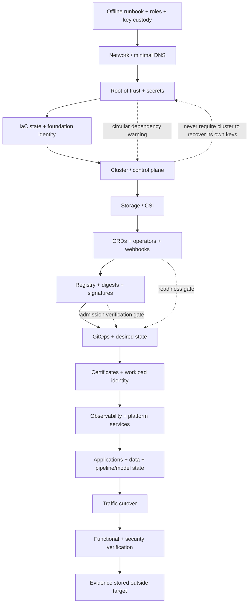

## Unit 3 — Restoring Platform Metadata and Configuration
**Target file:** `03-restoring-platform-metadata-and-configuration.md` | **Estimated time:** 14–20 hours | **Prerequisites:** Stages 0–2D; Stage 2E M01–M12; Git, Python 3, Kubernetes, IaC/GitOps, secrets and backup fundamentals
**Core tools:** Git, Python 3 standard library, `kubectl`, `kind`, JSON/YAML manifests, Terraform/OpenTofu concepts | **Awareness:** etcd restore, Vault/OpenBao, OIDC trust, registry signatures, Velero (implementation deferred to Unit 9), managed Kubernetes limitations | **Last reviewed:** 2026-10-29 | **Tool baseline assumed:** Python 3.10+; Kubernetes/kind/kubectl versions are learner-installed and must be recorded `[VERIFY]`; no provider-specific compatibility assumed | **Footprint:** approximately 4 CPU cores, 8 GB RAM, 30 GB free disk; **measure yours** | **Destructive labs:** yes (named throwaway resources only)

> M03 Unit 10 taught etcd health, snapshot, and restore mechanics; M07 taught Terraform state backends and recovery; M08 made Git the desired-state source for workloads; M09 taught Vault snapshot/unseal and key custody. This unit owns the **platform-level recovery program** that combines them: what constitutes platform metadata and configuration, what is in Git vs what is state, the rebuild-vs-restore decision, the **dependency order of recovery**, and proving a platform can be rebuilt — without re-teaching those mechanics.

**Scope boundary.** This unit teaches the platform-level recovery program, recovery ordering, rebuild-vs-restore decisions, dependency-cycle handling, trust continuity, parity, and proof. Unit 9 (`09-kubernetes-backup-and-restore-with-velero.md`) owns detailed Velero implementation; M14 owns steady-state multi-cluster/multi-region operations; M15 owns deeper DR cost/capacity analysis; M16 owns platform golden paths/templates; M17 is the later capstone. Database, pipeline, and model-data mechanics are handed off to Units 2, 4, and 5.

**Evidence labels:** `[FACT]` stable concept; `[ASSUMPTION]` modelling choice; `[ILLUSTRATIVE]` synthetic example; `[MEASURED]` actual learner measurement; `Representative output — not executed here` means the example was not run; `[VERIFY]` means check the exact installed version/configuration; `[OPEN — requires human verification]` means a laptop-only lesson cannot establish the claim.

---

### 3.0 Why this matters in production
A platform can lose its cluster while its Git repository remains intact, yet still fail to recover because the secrets backend, IaC state, registry artifacts, trust keys, or external resource identifiers were not independently protected. Another failure occurs when an old control-plane snapshot is restored without compatible CRDs and operators: controllers may reconcile stale objects or recreate/delete resources in ways that conflict with current infrastructure. A third occurs when a clean cluster is rebuilt but its new OIDC issuer or CA identity no longer matches Vault, registry, or workload trust. Recovery therefore needs a dependency-aware program that distinguishes derivable configuration from non-derivable state and verifies functional and security outcomes—not merely Running Pods.

### 3.1 Learning objectives
1. **[L1]** Classify platform state as `derivable`, `non-derivable`, or `hybrid`, including owner, source of truth, dependencies, recovery method, and verification.
2. **[L1]** Distinguish Git desired state, live runtime state, external non-derivable state, and recovery evidence.
3. **[L2]** Produce an inventory report that flags unowned resources, missing recovery paths/verification, unknown dependencies, and cycles.
4. **[L2]** Perform a guarded rebuild drill against an allowlisted throwaway `kind` cluster and record phase timings.
5. **[L2]** Choose rebuild, restore, or hybrid recovery and explain stale etcd, version skew, and controller reconciliation risks.
6. **[L3]** Detect circular dependencies, design an offline bootstrap kit, and re-bind trust after an issuer change.
7. **[L3]** Compare a declared DR baseline with observed/synthetic evidence and report `PASS`, `FAIL`, or `NOT_CHECKED` without treating unknowns as success.
8. **[L3]** Use a phase runner with dry-run, checkpoints, fail-stop/resume, and metadata-only expiry checks.
9. **[L4]** Define recovery SLIs/SLOs and governance for inventory, restore tests, exceptions, drills, and cold-read runbooks.
10. **[L4]** Analyze compound failures and balance recovery speed, evidence preservation, least privilege, and clean rebuild requirements.

### 3.2 Concept map and vocabulary

| Term | Meaning | Recovery implication |
|---|---|---|
| Platform metadata | Non-business-data state needed to recreate a working platform: API objects, configuration, identities, mappings, policies and operational metadata | Some is derivable; some needs backup or explicit reconstruction |
| Desired state | Declared target, usually Git manifests, Helm values, Kustomize overlays and IaC | Does not prove external dependencies exist |
| Live/runtime state | Current API objects/status, generated resources, controller state and actual infrastructure | May diverge from Git and contain non-derivable information |
| Non-derivable state | State not safely recreated from declarations without losing data, identity or history | Requires backup, reconstruction procedure, or accepted-loss decision |
| Hybrid state | Declarative definition plus persisted identity/data/status | Needs both rebuild and restore, in dependency order |
| Rebuild | Create a clean environment from known-good declarations and bootstrap inputs | Often preferred for compromised or reproducible layers |
| Restore | Return persisted state from backup to a compatible target | Necessary for non-derivable state; can reintroduce corruption/compromise |
| Recovery bundle | Versioned inventory, manifests/revisions, tool versions, runbooks, checksums and non-secret metadata | Must be accessible outside the failed platform |
| Bootstrap trust | Minimum identity/key path to authenticate and decrypt recovery dependencies | Must not depend circularly on the failed cluster/secrets backend |
| Dependency edge | “A requires B before A can be recovered/verified” | Recovery order is a graph, not just a list |
| Recovery gate | Explicit condition before next phase proceeds | Stops partial/insecure recovery being treated as ready |
| Parity | Agreement between declared baseline and target versions, APIs, trust, capacity and config | Unknowns remain `NOT_CHECKED`, not `PASS` |
| RTA | Actual time from incident/recovery start to verified service restoration | Measure phase times; estimates are not measurements |
| Cold-read runbook | Instructions used by someone other than author without undocumented memory | Exposes hidden dependencies and ambiguity |



This is a dependency-aware baseline, not a universal rigid order. Some key, network, IAM, or provider identity inputs must be staged before provisioning. If A requires B and B requires A, break the cycle with a tested out-of-band path or redesign.

#### Required platform-state inventory

| Category | Examples | Class hints | Recovery / proof notes |
|---|---|---|---|
| Cluster/API state | etcd/API objects, non-GitOps resources, CRs/status, owner refs/UIDs, finalizers, generated resources, external-name mappings | Hybrid/non-derivable | Rebuild declarative objects; restore selected state only with compatible CRDs/controllers and reviewed plan |
| Declarative config | Manifests, Helm values, Kustomize overlays, admission/policy config, NetworkPolicies, GitOps definitions | Usually derivable | Pin commit/digests; verify sync and drift |
| Infrastructure state | Terraform/OpenTofu state, backend config, outputs, resource IDs, account config | Hybrid | Recover backend/state independently; reconcile actual resources before apply |
| Identity/trust | Vault/OpenBao data, unseal/key custody, CA keys, issuers, signing keys, OIDC keys, SOPS/age, Sealed Secrets, etcd encryption keys, KMS/HSM/escrow | Non-derivable/hybrid | Metadata only; independently test old key-version access and break-glass path |
| Registry/artifacts | Images, digests, signatures, attestations/referrers, charts, mirrors, provenance | Hybrid | Restore/mirror bytes and metadata; verify signatures and policy |
| CI/CD | Pipeline definitions, runner registrations/state, credentials/federation | Hybrid | Recreate runners where possible; re-provision identities, not stale credentials |
| Observability | Dashboards, rules/routes, scrape config, Alertmanager state/silences, historical metrics | Config derivable; history may not be | Bring monitoring up early; define history-loss policy |
| DNS/network/certificates | DNS records, TTL, ingress/routes, CA chain and trust distribution | Hybrid | Verify resolution and trust; restore or reissue based on key custody/compromise |
| Catalogs/platform metadata | Service/model registry, orchestrator, feature store, lineage, notebook platform | Hybrid/non-derivable | Coordinate with Units 4 and 5 |
| Documentation | Runbooks, contacts, diagrams, scripts, offline bootstrap instructions | Derivable only if out-of-band copy exists | Test offline copy; failed-platform wiki is insufficient |
| Backup/recovery tooling | Recovery automation, config, repository metadata, credentials, offline bundle | Hybrid | Protect configuration and ensure tools run without target platform |
| Persistent app state | PVC/database/object data, pipeline checkpoints | Outside narrow metadata definition but required for full recovery | Hand off to Units 2, 4, 5 and 9; coordinate recovery point/order |

#### State inventory schema
Use one record per component or cohesive recovery unit. Store secret **metadata only**, never secret values.

```json
{
  "component": "gitops-controller",
  "layer": "platform",
  "owner": "platform-oncall",
  "criticality_tier": "T1",
  "classification": "hybrid",
  "source_of_truth": "git://platform-config@commit-sha",
  "recovery_method": "recreate from pinned manifest; preserve external identity metadata",
  "prerequisites": ["cluster-api", "registry-mirror"],
  "key_identity_dependency": "Git deploy identity via break-glass federation",
  "version_compatibility": "record version; verify official compatibility notes",
  "restore_procedure": "runbook/platform-recovery.md#gitops",
  "verification": "approved revision synced; no unexplained drift",
  "last_tested": null,
  "evidence_location": "offline-evidence/platform-recovery/",
  "exception": null,
  "exception_expiry": null
}
```

#### Git vs live state vs non-derivable state vs evidence

| Plane | Typically contains | Typically does not contain | Recovery role |
|---|---|---|---|
| Git desired state | Manifests, Helm/Kustomize, policy definitions, pipeline definitions, runbooks, IaC code | Business/runtime data, plaintext secrets, PVC contents, generated status, provider state, registry blobs unless mirrored, credentials/runner registrations | Rebuild input; pin revision and verify dependencies |
| Live cluster/runtime | API objects/status, generated resources, CR status, finalizers, Helm history in cluster Secrets, controller state | Independent copy, out-of-band key custody, guaranteed record of deleted objects | Discovery/evidence, not sole recovery source |
| External/non-derivable state | Vault/key custody, Terraform state, registry blobs/signatures, DB/PVC data, external IDs, IdP state, retained metrics | Usually not recoverable from Git alone | Backup or controlled reconstruction required |
| Backup/recovery evidence | Backup metadata, checksums, restore tests, versions, inventory, timings, parity, approvals | Proof that service works unless functional restore was tested | Supports decisions; not a substitute for restore drill |

**Git is not a backup of non-derivable state.** It usually does not contain runtime/business data, plaintext secrets, generated resources/status, PVC contents, Terraform state unless intentionally stored in a suitable secured backend, Helm release history, controller status/external mappings, encryption/unseal/signing/CA keys, registry blobs/signatures/attestations unless separately protected, or external credentials/runner/provider state. Name the actual source of truth for each category.

#### Rebuild vs restore decision matrix

| Strategy | Choose when | Main risks | Required gate |
|---|---|---|---|
| Rebuild from IaC + GitOps | Reproducible layer, known-good sources, especially after suspected compromise | Missing external dependencies, version drift, hidden manual state | Source integrity, dependency availability, parity and functional checks |
| Restore from backup | Non-derivable state: Vault contents, Terraform state, registry blobs, DB data, etcd-only objects, external IDs | Reintroduces corruption/compromise; stale IDs/finalizers; incompatible format | Provenance, compatible target, key availability, isolated restore/integrity checks |
| Hybrid | Rebuild foundations/controllers then restore selected persisted state | Ordering mistakes, controller conflicts, inconsistent points | Dependency graph, gates, reconciliation and evidence |
| Security-driven rebuild | Cluster/credential compromise suspected | Slower restoration and intentional data loss | Incident/security approval; preserve evidence; rotate trust and restore verified state only |

A stale etcd snapshot can roll back API objects and controller state. Controllers may then recreate/remove/roll back resources while external systems have advanced. Do not restore an old snapshot into a live environment casually. Managed Kubernetes may not expose customer-restorable control-plane etcd; recovery may mean recreating the cluster and restoring supported resources. Self-managed Kubernetes and `kind` paths differ by version/configuration. `[VERIFY]` the provider's documented contract and cluster version. M03 covers mechanics; this unit decides whether the operation is appropriate.

#### Recovery dependency order

| Order | Layer | Gate before continuing |
|---:|---|---|
| 1 | Offline instructions, incident roles, break-glass identity, key escrow | Team can access approved instructions/custody without failed platform |
| 2 | Network and minimal DNS/access | Required admin path resolves and is reachable |
| 3 | Root of trust, key access, secrets backend | Proven without circularly requiring target cluster |
| 4 | Infrastructure, account/IAM/RBAC, IaC state | State integrity and actual mapping reconciled; no blind apply |
| 5 | Cluster/control plane/nodes | API reachable; expected nodes Ready |
| 6 | Storage/CSI/StorageClasses | Required classes/controllers exist; scratch PVC binds where relevant |
| 7 | CRDs/operators/webhooks | APIs discoverable; controllers/webhooks healthy before CRs |
| 8 | Registry/mirrors/images/charts/signatures | Required digests available and trusted |
| 9 | GitOps controller/Git identity | Approved revision fetched; reconciliation controlled |
| 10 | Secrets/certificates/trust/federation | Retrieval works without value disclosure; trust tests pass |
| 11 | Admission/policy engines | Correct phase mode; exception pre-approved, bounded and logged |
| 12 | Observability/alerting | Targets scrape and alerts route before later phases |
| 13 | Catalogs/orchestrators/model registry/CI-CD | Metadata and external identities verified |
| 14 | Applications/stateful services/data/pipeline state | Units 2/4/5/9 procedures and consistent points followed |
| 15 | DNS/ingress/traffic cutover | Gates pass and rollback path exists |
| 16 | End-to-end/security verification and communication | Synthetic transaction, evidence, stakeholder update, follow-up assigned |

Adapt to the actual dependency graph. Bootstrap inputs may be needed before infrastructure provisioning; observability should be restored early enough to observe later phases.

#### Readiness is more than “Pods are Running”
Check expected nodes `Ready`; API discovery and critical controllers/operators; CRDs before CRs and webhooks healthy; GitOps synced to approved revision without unresolved drift; intended policy enforcement; secret retrieval without values; valid certificates/trust chains; DNS/network; registry digests/signatures/attestations; storage classes/PVC binding; scrape and alert routing; synthetic application transaction; and no unexplained critical baseline differences. Unsupported checks are `NOT_CHECKED`, never `PASS`.

### 3.3 Level 1 — Beginner

#### First principles: what exactly are you recovering?
Think of the platform as four records: (1) **desired state**—what it should look like in Git/IaC; (2) **live state**—what the API/controllers/external infrastructure currently report; (3) **non-derivable state**—data, keys, external IDs and histories not safely recreated from declarations; and (4) **recovery evidence**—what was protected, rebuilt/restored, which versions were used, and whether gates passed. For each critical item, choose **rebuild**, **restore**, or **explicitly accept loss**. “We have YAML” is incomplete if it references an unavailable image, key, external ID, missing CRD, or secret that existed only in the failed cluster.

#### Guided exercise: trace desired state vs runtime state
Create a scratch directory, not a production repository:

```bash
mkdir -p platform-recovery-lab/{inventory,evidence,manifests,runbook}
cd platform-recovery-lab
python3 --version
kubectl version --client
kind version
```

Record actual output in `evidence/tool-versions.txt`. If a tool is absent, note `NOT_INSTALLED`; do not install every component at once. Use this synthetic example: Git declares a `model-api` Deployment and non-sensitive ConfigMap; the live cluster has generated ReplicaSet/Pod UIDs/status; the app refers to external artifact `model-v17`; a workload identity trusts the current OIDC issuer; and an operator creates a CR plus status. The Deployment is derivable; Pod UIDs/status are generated; the artifact is external state; issuer trust may require re-binding; operator status is not automatically equivalent to desired state.

#### Beginner mistakes and fixes

| Mistake | Why it fails | Fix |
|---|---|---|
| “Everything is in Git” | Omits live status, secrets, PVCs, provider state, registry blobs and key custody | Inventory actual sources of truth and restore tests |
| Treat backup as rebuild plan | Backup may be incompatible or compromised | Decide rebuild/restore/hybrid per component |
| Restore all state at once | CRDs/operators or external dependencies may be missing; controllers can conflict | Restore foundations and CRDs first, then selected state |
| Pods Running means recovered | DNS, identity, data, signatures, policies and workflows may fail | Test trust, storage, monitoring and synthetic transaction |
| Only runbook is on failed platform | Instructions disappear with target | Keep and cold-read offline copy |
| Log secret values to prove access | Evidence becomes credential leak | Log only success/failure, identity, time and non-sensitive key ID |

#### Small guided inventory template

| Component | Class | Source of truth | Method | Prerequisites | Verification | Owner |
|---|---|---|---|---|---|---|
| GitOps manifests | derivable | Git commit | recreate controller, sync pinned commit | API, registry | synced revision + drift review | platform |
| Terraform state | hybrid | secured backend | restore, reconcile actual resources | backend, IAM | metadata review `[VERIFY]`, plan review | infrastructure |
| Vault data | non-derivable/hybrid | snapshot + independent custody | restore compatible snapshot, approved unseal | independent key path | health + controlled access test, no values | security |
| Registry mirror | hybrid | mirror manifest + source registry | re-mirror digests/signatures | network, trust roots | digest/signature verification | supply chain |
| Model artifact | non-derivable | object store/model registry | restore artifact + metadata | object-store access/key | checksum + model-load smoke test | ML platform |

### 3.4 Level 2 — Intermediate
This level creates an inventory, performs a guarded throwaway rebuild, and runs read-only readiness checks. Names and outputs are synthetic; adapt only after confirming your environment.

#### A. Runnable inventory auditor
Save as `inventory_audit.py`. It consumes JSON using only the standard library. External dependencies must be declared manually; `kubectl get` is not a complete inventory of provider, identity, registry, or key-custody state.

```python
#!/usr/bin/env python3
"""Audit a declared platform recovery inventory. No cluster mutation."""
import argparse, json, sys
from collections import defaultdict, deque
from pathlib import Path

VALID_CLASSES = {"derivable", "non-derivable", "hybrid"}
REQUIRED = ("component", "layer", "owner", "classification", "source_of_truth", "recovery_method", "prerequisites", "verification")

def cycle_report(items):
    names = {x.get("component") for x in items if isinstance(x, dict) and x.get("component")}
    indegree = {n: 0 for n in names}; reverse = defaultdict(list); issues = []
    for item in items:
        if not isinstance(item, dict) or not item.get("component"): continue
        deps = item.get("prerequisites", [])
        if not isinstance(deps, list):
            issues.append(f"INVALID_PREREQUISITES: {item['component']}"); continue
        for dep in deps:
            if dep not in names: issues.append(f"UNKNOWN_DEPENDENCY: {item['component']} -> {dep}")
            else: indegree[item["component"]] += 1; reverse[dep].append(item["component"])
    q = deque(n for n, d in indegree.items() if d == 0); seen = 0
    while q:
        n=q.popleft(); seen += 1
        for child in reverse[n]:
            indegree[child]-=1
            if indegree[child]==0: q.append(child)
    if seen != len(names): issues.append("DEPENDENCY_CYCLE_CANDIDATES: " + ", ".join(sorted(n for n,d in indegree.items() if d>0)))
    return issues

def audit(document):
    items = document.get("components")
    if not isinstance(items, list): raise ValueError("top-level 'components' must be a list")
    issues, seen = [], set()
    for i, item in enumerate(items):
        if not isinstance(item, dict): issues.append(f"ROW_{i}: entry is not an object"); continue
        name=item.get("component")
        if not isinstance(name,str) or not name.strip(): issues.append(f"ROW_{i}: missing component name"); continue
        if name in seen: issues.append(f"DUPLICATE_COMPONENT: {name}")
        seen.add(name)
        for key in REQUIRED:
            if key not in item or item[key] is None or item[key] == "" or (key != "prerequisites" and item[key] == []): issues.append(f"MISSING_{key.upper()}: {name}")
        if item.get("classification") not in VALID_CLASSES: issues.append(f"INVALID_CLASSIFICATION: {name}")
        if not isinstance(item.get("prerequisites",[]),list): issues.append(f"INVALID_PREREQUISITES: {name}")
    issues.extend(cycle_report(items))
    total=len(items); complete=sum(1 for x in items if isinstance(x,dict) and x.get("owner") and x.get("recovery_method") and x.get("verification"))
    return {"component_count":total,"complete_recovery_records":complete,"coverage_percent":round(100*complete/total,1) if total else 0.0,"issues":sorted(set(issues)),"status":"PASS" if not issues else "FAIL"}

def main():
    p=argparse.ArgumentParser(); p.add_argument("inventory",type=Path); a=p.parse_args()
    try: result=audit(json.loads(a.inventory.read_text(encoding="utf-8")))
    except (OSError,json.JSONDecodeError,ValueError) as e: print(f"ERROR: {e}",file=sys.stderr); return 2
    print(json.dumps(result,indent=2)); return 0 if result["status"]=="PASS" else 1
if __name__=="__main__": raise SystemExit(main())
```

Save as `inventory/synthetic-platform.json`:

```json
{"components":[
 {"component":"cluster-api","layer":"foundation","owner":"platform","classification":"derivable","source_of_truth":"kind config + recorded version","recovery_method":"recreate allowlisted lab cluster","prerequisites":[],"verification":"API discovery succeeds"},
 {"component":"registry-mirror","layer":"supply-chain","owner":"platform","classification":"hybrid","source_of_truth":"mirror manifest + external registry","recovery_method":"re-mirror pinned digests and signatures","prerequisites":["cluster-api"],"verification":"digest and signature checks pass"},
 {"component":"gitops-controller","layer":"platform","owner":"platform","classification":"derivable","source_of_truth":"pinned Git commit","recovery_method":"apply after CRDs and registry are ready","prerequisites":["cluster-api","registry-mirror"],"verification":"approved revision synced"},
 {"component":"vault-recovery","layer":"trust","owner":"security","classification":"non-derivable","source_of_truth":"approved snapshot and independent key custody","recovery_method":"restore isolated compatible environment","prerequisites":["offline-key-custody"],"verification":"health and controlled access test"},
 {"component":"offline-key-custody","layer":"bootstrap","owner":"security","classification":"hybrid","source_of_truth":"approved offline procedure","recovery_method":"authorized break-glass process","prerequisites":[],"verification":"custodian and second reviewer attest access path"}
]}
```

Run `python3 inventory_audit.py inventory/synthetic-platform.json`.

`Representative output — not executed here`:

```json
{"component_count":5,"complete_recovery_records":5,"coverage_percent":100.0,"issues":[],"status":"PASS"}
```

This coverage is only a completeness proxy for declared fields; it does not prove every real resource was discovered or restored. Optional read-only discovery such as `kubectl get deployments,statefulsets,daemonsets,pvc,crd -A -o json` cannot discover cloud IAM, DNS/provider state, external databases, key custody, or all operator-managed external resources. `[VERIFY]` resource types/permissions; never print Secret data.

#### B. Read-only platform readiness verifier
Save as `platform_readiness.py`. It checks an exact context and namespace, uses read-only commands, and marks environment-specific checks `NOT_CHECKED` until implemented. It never reads Secret values.

```python
#!/usr/bin/env python3
"""Conservative read-only readiness checks; unsupported checks are NOT_CHECKED."""
import argparse, json, shutil, subprocess, sys

def run(cmd, timeout=20):
    try: p=subprocess.run(cmd,text=True,capture_output=True,timeout=timeout,check=False)
    except (OSError,subprocess.TimeoutExpired) as e: return None,str(e)
    return (p.stdout,None) if p.returncode==0 else (None,p.stderr.strip() or f"exit {p.returncode}")

def main():
    ap=argparse.ArgumentParser(); ap.add_argument("--context",required=True); ap.add_argument("--namespace",required=True); a=ap.parse_args(); checks=[]
    if not shutil.which("kubectl"):
        print(json.dumps({"status":"FAIL","checks":[{"name":"kubectl","status":"FAIL","detail":"kubectl not found"}]},indent=2)); return 2
    current,err=run(["kubectl","config","current-context"])
    if err: checks.append({"name":"context-readable","status":"FAIL","detail":err})
    elif current.strip()!=a.context: checks.append({"name":"expected-context","status":"FAIL","detail":f"expected {a.context!r}; got {current.strip()!r}"})
    else: checks.append({"name":"expected-context","status":"PASS","detail":"exact context matched"})
    if any(x["status"]=="FAIL" for x in checks):
        print(json.dumps({"status":"FAIL","checks":checks},indent=2)); return 1
    out,err=run(["kubectl","--context",a.context,"get","nodes","-o","json"])
    if err: checks.append({"name":"nodes-ready","status":"FAIL","detail":err})
    else:
        try:
            nodes=json.loads(out).get("items",[]); bad=[]
            for n in nodes:
                cond={c.get("type"):c.get("status") for c in n.get("status",{}).get("conditions",[])}
                if cond.get("Ready")!="True": bad.append(n.get("metadata",{}).get("name","<unknown>"))
            checks.append({"name":"nodes-ready","status":"PASS" if nodes and not bad else "FAIL","detail":f"nodes={len(nodes)}; not-ready={bad}"})
        except (ValueError,TypeError) as e: checks.append({"name":"nodes-ready","status":"FAIL","detail":f"unexpected JSON: {e}"})
    out,err=run(["kubectl","--context",a.context,"get","--raw","/readyz"])
    checks.append({"name":"api-readyz","status":"PASS" if not err and out and "ok" in out.lower() else "FAIL","detail":"response observed" if not err else err})
    out,err=run(["kubectl","--context",a.context,"-n",a.namespace,"get","deployments","-o","json"])
    if err: checks.append({"name":"deployments-readable","status":"FAIL","detail":err})
    else:
        try:
            ds=json.loads(out).get("items",[]); bad=[]
            for d in ds:
                spec=d.get("spec",{}).get("replicas",1); ready=d.get("status",{}).get("readyReplicas",0)
                if ready<spec: bad.append(d.get("metadata",{}).get("name","<unknown>"))
            checks.append({"name":"deployments-ready","status":"PASS" if ds and not bad else "FAIL","detail":f"deployments={len(ds)}; unready={bad}"})
        except (ValueError,TypeError) as e: checks.append({"name":"deployments-ready","status":"FAIL","detail":f"unexpected JSON: {e}"})
    for name in ("crd-operator-readiness","gitops-reconciliation","secret-access-without-value-disclosure","certificate-chain","dns-and-network","registry-signatures","storage-binding","alert-routing","synthetic-application-transaction","external-iam-quota"):
        checks.append({"name":name,"status":"NOT_CHECKED","detail":"requires environment-specific approved check"})
    status="PASS" if all(x["status"]=="PASS" for x in checks) else "INCOMPLETE_OR_FAIL"
    print(json.dumps({"status":status,"context":a.context,"namespace":a.namespace,"checks":checks},indent=2))
    return 0 if status=="PASS" else 1
if __name__=="__main__": raise SystemExit(main())
```

Example: `python3 platform_readiness.py --context kind-platform-recovery-lab --namespace platform-system`. `Representative output — not executed here`: API/node checks may pass while OIDC, DNS, signatures, secret retrieval, and transactions remain `NOT_CHECKED`; the script exits nonzero. `[VERIFY]` JSON fields and `/readyz` behavior for the installed version. Pod readiness alone is insufficient.

#### C. Guarded throwaway `kind` rebuild procedure
Check `kind create cluster --help`, `kind delete cluster --help`, and official documentation for your installed release. Do not copy this procedure to a non-lab cluster.

1. Inspect `kind get clusters`, `kubectl config current-context`, `kubectl config get-contexts`; save tool versions.
2. Continue only if the target is exactly `platform-recovery-lab`, current context exactly `kind-platform-recovery-lab`, and the cluster contains only synthetic throwaway resources. Otherwise stop.
3. Capture inventory, approved Git commit, manifest checksums, non-secret resource lists, tool versions, and readiness report under `evidence/before-rebuild/`. Never export Secret values or raw sensitive state.
4. Record actual UTC start/end times for each phase.
5. **Destructive action—removes only the named throwaway cluster.** Review every value and verify CLI syntax first:

```bash
TARGET_CLUSTER='platform-recovery-lab'
ALLOWED_CLUSTER='platform-recovery-lab'
CURRENT_CONTEXT="$(kubectl config current-context 2>/dev/null || true)"
printf 'target=%s\nallowed=%s\ncontext=%s\n' "$TARGET_CLUSTER" "$ALLOWED_CLUSTER" "$CURRENT_CONTEXT"
test "$TARGET_CLUSTER" = "$ALLOWED_CLUSTER" || { echo 'REFUSED: not allowlisted'; exit 2; }
test "$CURRENT_CONTEXT" = "kind-${ALLOWED_CLUSTER}" || { echo 'REFUSED: context mismatch'; exit 2; }
echo 'DESTRUCTIVE: removes only the named throwaway kind cluster.'
read -r -p "Type DELETE ${ALLOWED_CLUSTER} to continue: " CONFIRM
test "$CONFIRM" = "DELETE ${ALLOWED_CLUSTER}" || { echo 'Cancelled'; exit 2; }
kind delete cluster --name "$ALLOWED_CLUSTER"
```

Do not run if target/context do not match exactly. If CLI help differs, stop; do not guess flags. Recreate with `kind create cluster --name platform-recovery-lab` only after reviewing local help and the saved config. Restore foundations, storage, CRDs/operators/webhooks, registry artifacts/trust, GitOps, observability, selected non-derivable state, and application data in dependency order. Run all readiness checks; `NOT_CHECKED` means incomplete. Record each component as survived/rebuilt/restored/lost-by-design/manual-intervention. Cleanup with the same explicit gate. A local rebuild is not equivalent to production or regional recovery.

#### D. Patterns and anti-patterns

| Pattern | Why it works | Guardrail |
|---|---|---|
| Pin Git revision, image digests, tool versions | Reproducibility | Verify artifacts/signatures remain available |
| Rebuild declarative layers; restore non-derivable state selectively | Limits stale state | Inventory every exception |
| Install CRDs/operators before CRs | Avoids unknown APIs/webhook races | Wait for discovery/controller readiness |
| Restore observability early | Later phases become observable | Alert destination/credentials independent |
| Keep runbook/bootstrap out-of-band | Recovery is not trapped in target | Cold-read and rotate access path |
| Blindly restore old etcd | Can roll back state and conflict with external systems | Isolated evaluation and approval first |
| Apply all manifests concurrently | Races CRDs, secrets, registry trust and GitOps | Explicit phase gates |
| Terraform apply immediately after state restore | May duplicate/mutate infrastructure | Reconcile actual state, review plan, approval |
| Disable admission without control | May admit untrusted workloads | Bounded pre-approved exception, logs, expiry, restore enforcement |

### 3.5 Level 3 — Advanced

#### A. Design trade-offs

| Decision | Option A | Option B | Trade-off / evidence |
|---|---|---|---|
| Platform | Rebuild | Restore snapshot | Rebuild is cleaner but needs sources/artifacts; restore may be faster but carries stale/corrupt state. Measure RTA and loss. |
| State | Recreate declarative resources | Restore selected non-derivable objects | Selective restore needs precise classification and dependencies. |
| Trust | Preserve issuer/CA if supported | Reissue/rebind | Continuity may simplify recovery; new trust may be safer after compromise. `[VERIFY]` support. |
| Registry | Pull source | Independent mirror | Source may be unavailable; mirror adds maintenance. Verify digest/signature/provenance. |
| Environment | Pre-provisioned | On-demand | Pre-provisioning reduces some delay but can drift; on-demand depends on quota/APIs/identity. M15 owns cost modelling. |
| Policy | Enforce throughout | Bounded recovery mode | Relaxation raises risk; approval, expiry, logs and restoration gate required. |
| IaC state | Restore | Reconstruct/import | Restore preserves state if valid; reconstruction risks duplicates. Never apply before reconciliation. |
| etcd-only objects | Rebuild | Restore selected state | Review snapshot age, APIs, CRDs, UIDs, finalizers, external systems. M03 mechanics assumed. |

#### B. Consistency, security, dependencies and capacity
- **Consistency:** pin Git commit, manifests/charts, controller/operator versions and image digests; record snapshot times. Avoid combining data/config points that cannot work together; Units 2/4/5 own data consistency.
- **Security:** after suspected compromise, preserve evidence where required, rebuild from known-good sources, avoid post-compromise snapshots without approval, rotate credentials and validate provenance.
- **Dependencies:** encode prerequisites as a graph; detect cycles/unknown nodes and require gates.
- **Versioning:** record Kubernetes/API, CRD/operator, Vault/OpenBao, PostgreSQL, registry, GitOps, policy, backup, key and Terraform/OpenTofu versions. Restore to a compatible version; use official release notes, not invented matrices `[VERIFY]`.
- **Capacity/cost:** record image sizes, object counts, provisioning time, CPU/memory/disk high-water marks and measured throughput. Do not invent prices/quotas; M15 owns detailed cost analysis.
- **Proof:** preserve approved revision, inventory diff, parity, timings, readiness, synthetic transaction, signature/trust checks, manual interventions and reviewer sign-off.

#### C. State-to-recovery strategy matrix

| State | Location | Class | Mechanism / recovery | Prerequisites | Verification | Owner / last test |
|---|---|---|---|---|---|---|
| Git/GitOps config | Git + offline mirror | derivable | pinned commit, sync after CRDs | network/mirror, deploy identity | revision sync + drift | platform / `[MEASURED]` ____ |
| Terraform/OpenTofu | secured backend/versioned copy | hybrid | restore, reconcile actual resources | backend auth, provider access | metadata review `[VERIFY]`, plan review | infrastructure / ____ |
| etcd-only objects | snapshot/inventory | hybrid/non-derivable | rebuild if possible; selectively restore | compatible APIs/CRDs, security approval | diff + functional tests | platform / ____ |
| Vault/OpenBao + key custody | protected snapshot + independent custody | non-derivable | compatible restore, approved unseal | offline key path | health + non-secret access test | security / ____ |
| CA/issuer/OIDC | IdP/CA + register | hybrid | preserve/reissue/rebind | identity admins, root trust | token/cert and least-privilege tests | security / ____ |
| CRDs/operators | pinned manifests/artifacts | derivable/hybrid | install CRDs, wait for operator, then CRs | API, registry, signatures | discovery/controller health | platform / ____ |
| PVC/storage metadata | API + storage system | hybrid | recreate CSI/classes; restore data via Unit 2/9 | backend, keys | PVC bind/data integrity | data platform / ____ |
| Registry/signatures | registry/mirror | hybrid | mirror by digest + metadata | credentials, trust roots | digest/signature/provenance | supply chain / ____ |
| CI/CD runners | Git + external runner | hybrid | recreate, re-provision identity | IdP, Git, secrets | least-privileged test pipeline | developer platform / ____ |
| Observability | Git + monitoring store | hybrid | restore config early; history per policy | storage, receiver | test alert reaches receiver | SRE / ____ |
| DNS/certs | DNS/CA/provider config | hybrid | IaC + inventory, restore/reissue | provider access, CA | resolve + chain validation | networking / ____ |
| Model/orchestrator catalog | DB/object store | hybrid/non-derivable | Unit 4/5 restore | DB/store/registry | reference reconciliation/load test | ML platform / ____ |
| Runbooks/automation | Git + offline kit | hybrid | mirror, checksum, cold read | offline access/toolchain | non-author follows steps | platform/SRE / ____ |

#### D. Dependency-cycle detection
Save as `dependency_graph.py`. The graph maps each component to prerequisites. Unknown nodes are reported separately. Nodes left after topological sorting are cycle candidates; this intentionally fails closed, though it does not give an exact cycle path.

```python
#!/usr/bin/env python3
"""Detect unknown prerequisites and cycles in a recovery dependency graph."""
import argparse, json, sys
from collections import defaultdict, deque
from pathlib import Path

def analyze(graph):
    if not isinstance(graph,dict): raise ValueError("graph must be an object")
    if any(not isinstance(k,str) or not k for k in graph): raise ValueError("node names must be non-empty strings")
    for node,deps in graph.items():
        if not isinstance(deps,list) or any(not isinstance(d,str) or not d for d in deps): raise ValueError(f"dependencies for {node} must be a list of non-empty strings")
    nodes=set(graph); unknown=sorted({d for deps in graph.values() for d in deps if d not in nodes})
    indegree={n:0 for n in nodes}; children=defaultdict(list)
    for node,deps in graph.items():
        for dep in deps:
            if dep in nodes: indegree[node]+=1; children[dep].append(node)
    q=deque(sorted(n for n,d in indegree.items() if d==0)); order=[]
    while q:
        n=q.popleft(); order.append(n)
        for child in sorted(children[n]):
            indegree[child]-=1
            if indegree[child]==0: q.append(child)
    candidates=sorted(n for n,d in indegree.items() if d>0)
    return {"order":order,"unknown_dependencies":unknown,"cycle_candidates":candidates,"acyclic":not candidates and not unknown}

def main():
    p=argparse.ArgumentParser(); p.add_argument("graph",type=Path); a=p.parse_args()
    try: r=analyze(json.loads(a.graph.read_text(encoding="utf-8")))
    except (OSError,json.JSONDecodeError,ValueError) as e: print(f"ERROR: {e}",file=sys.stderr); return 2
    print(json.dumps(r,indent=2)); return 0 if r["acyclic"] else 1
if __name__=="__main__": raise SystemExit(main())
```

Example graph: `{"offline-bootstrap":[],"network":["offline-bootstrap"],"secrets":["network"],"cluster":["network","secrets"],"gitops":["cluster","registry"],"registry":["network","secrets"]}` is acyclic. `{"cluster":["vault"],"vault":["cluster"]}` is cyclic; `{"bootstrap":["bootstrap"]}` is a self-cycle. `{"gitops":["registry-mirror"]}` has an unknown dependency unless `registry-mirror` is declared.

#### E. Offline bootstrap kit
Keep outside the failed platform and protect against the same destructive administrator. Include a cold-read runbook; incident roles/contacts; inventory and last signed export; tool versions/checksums; approved break-glass and access/rotation log; encrypted key-custody instructions and custodian contact (not plaintext keys); integrity-verifiable manifests; official compatibility references; blank timing/evidence templates; and instructions for retrieving old key versions needed by retained backups. Authorize/log access, rotate paths, and test with a non-author. Offline copies can be stolen or stale; require custody, tamper evidence and freshness review. Never store plaintext keys beside backups or in Git.

#### F. Trust-continuity dependency register

| Relationship | Metadata only | Symptom | Rebind/test |
|---|---|---|---|
| Vault JWT ↔ cluster OIDC | issuer URL, audience, subject constraints, JWKS/CA reference, role | login denied after recreation | compare issuer/token claims; update approved fields; least-privilege test `[VERIFY]` |
| Cloud workload identity ↔ issuer | provider trust ID, issuer, audience, subject | workloads cannot obtain identity | provider-documented trust test `[VERIFY]` |
| GitOps ↔ Git | repo, revision, auth mechanism reference | sync/auth failure | re-provision short-lived identity and verify scope |
| Workloads ↔ registry | endpoint, trust roots, pull identity, digest policy | pull/signature failure | verify digest/signature and least privilege |
| Certificates ↔ CA | issuer ID, chain, expiry, renewal route | TLS failure | verify SAN/chain; approved reissue if needed |
| SOPS/Sealed Secrets ↔ key custody | key ID/version, custodian path | config cannot decrypt | isolated key-version recovery test; no plaintext logs |
| etcd encrypted Secrets ↔ key | key ID/version, escrow reference | objects exist but values unreadable | key availability and supported restore `[VERIFY]` |

A new cluster can have a different OIDC issuer/JWKS. Inventory issuer, audience, subject, CA and key dependencies. Rebind in controlled order: bootstrap access, verify cluster identity, update relying-party trust, test least-privileged workload, revoke temporary access, record approval. `kind` does not reproduce every managed-cloud federation behavior.

#### G. Registry, signatures and admission

| State | Failure if omitted | Recovery/gate |
|---|---|---|
| Image/chart bytes | cannot pull | restore/mirror by digest; exact digest available |
| Signatures/attestations/referrers | admission may block | restore supported metadata `[VERIFY]`; verify under intended policy |
| Provenance/policy | origin cannot be evaluated | restore known-good provenance and policy; policy evaluates artifacts |
| Registry credentials/trust | pulls fail or broad credentials used | least-privilege identities/trust; authorized pull succeeds, unauthorized fails |
| Admission mode | temporary relaxation persists | pre-approved, bounded, logged exception; verify enforcement restored |

Safe sequence: restore/mirror artifacts and metadata; verify digest/signature/provenance; test admission; use audit/temporary mode only if pre-authorized, narrow and time-bounded; restore enforcement; record transitions. M01/M12 are prerequisites; product-specific signature storage is `[VERIFY]`.

#### H. DNS, certificates, CI/CD, observability
- **DNS/certificates:** restore DNS/ingress and validate TTL/propagation; choose restore vs reissue based on CA/key custody and compromise. ACME limits/behavior are `[VERIFY]`. Check hostname, SAN, chain, expiry and trust distribution.
- **CI/CD:** pipeline definitions live in Git; runners are often safer to recreate. Re-provision registration/credentials via federation or controlled break-glass, not stale secrets. Test a least-privileged pipeline.
- **Observability:** restore dashboards/rules/scrape config/routes early. Historical metrics may be intentionally lost; state that policy. Send a test alert and confirm receiver.
- **Runbooks:** keep instructions out-of-band; a wiki on the failed platform is a circular dependency.

#### I. Terraform/OpenTofu state recovery
1. Recover backend and auth independently of the lost cluster.
2. Retrieve approved state backup and verify integrity/version metadata. Lineage/serial/version semantics are tool-specific `[VERIFY]`.
3. Never put raw state/credentials in Git; state may contain sensitive values even if marked sensitive.
4. Compare state IDs/outputs with actual infrastructure using approved read-only inspection. If unavailable, use synthetic state only.
5. Decide whether state is valid/stale/missing or needs provider import/reconstruction. Reconstructing state is not recreating infrastructure.
6. Generate/review a plan without applying. **Never run `terraform apply`, `tofu apply`, `destroy`, or provider mutations against real infrastructure in this lesson.**
7. Obtain human approval under the organization's process before any real change.

Synthetic example: state says `lab-network-001`, desired config says `lab-network-002`. Do not automatically create the second resource. Mark `STATE_REALITY_MISMATCH`, investigate import/reconciliation vs stale backup, and retain evidence. Import syntax is `[VERIFY]`.

#### J. CRDs/operators and restore ordering

| Order | Item | Required check | Failure if skipped |
|---:|---|---|---|
| 1 | API/namespace foundation | API discovery | later applies fail |
| 2 | StorageClass/CSI | controller healthy, scratch PVC binds | PVC Pending or wrong storage |
| 3 | CRDs | API group/version discoverable | custom kind rejected |
| 4 | Admission webhooks | endpoints/certificates ready | request timeout/validation failure |
| 5 | Operator/controller | healthy and pinned version | CR unreconciled |
| 6 | External-name/identity mapping | external ID maps to intended resource | duplicates/wrong external mutations |
| 7 | Custom resources | compatible API/controller present | stale status, UID/owner refs, finalizer issues |
| 8 | GitOps vs restore ownership | single deliberate reconciler at a time | overwrites/conflicts |
| 9 | PVC/app data | supported DB-native restore | loss/inconsistency |

Owner references/UIDs can refer to missing objects after rebuild; finalizers can block while waiting for external systems; node-local data may be tied to lost nodes. Crossplane/external-name mappings need careful handling. Do not let GitOps and a restore tool unknowingly mutate the same object. Velero details are Unit 9.

#### K. Version-skew checklist
Record and verify official docs for: Kubernetes/client versions and API deprecations; CRD/operator versions; Vault/OpenBao snapshot compatibility; PostgreSQL major version; registry client/server and signature metadata; GitOps/Helm/Kustomize/policy versions; backup format/tool and key version; Terraform/OpenTofu/provider/backend versions; CA/certificate formats; recovery automation interpreter and CLI versions. Restore to a compatible version before planned upgrade. Do not invent compatibility matrices; mark unknowns `[VERIFY]`.

### 3.6 Level 4 — Expert

#### A. Recovery automation and runbook-as-code
Automation makes known-safe operations repeatable but cannot automate every recovery decision. This model runner writes checkpoints only; it does **not** execute shell commands or mutate infrastructure. Real command execution belongs in a separately reviewed, allowlisted adapter.

Save as `recovery_runner.py`:

```python
#!/usr/bin/env python3
"""Model-only recovery phase runner. Does not mutate infrastructure."""
import argparse, json, os, sys
from datetime import datetime, timezone
from pathlib import Path
PHASES=["offline-bootstrap","network","trust","iac-review","cluster","storage","crds-operators","registry-trust","gitops","observability","platform-services","applications-data","traffic-cutover","verification"]
def utc(): return datetime.now(timezone.utc).isoformat()
def load(path):
    if not path.exists(): return {"target":None,"phases":{},"events":[]}
    try: s=json.loads(path.read_text(encoding="utf-8"))
    except (OSError,json.JSONDecodeError) as e: raise ValueError(f"invalid checkpoint: {e}")
    if not isinstance(s,dict) or not isinstance(s.get("phases"),dict) or not isinstance(s.get("events"),list): raise ValueError("invalid checkpoint schema")
    return s
def save(path,state):
    path.parent.mkdir(parents=True,exist_ok=True); tmp=path.with_suffix(path.suffix+".tmp")
    tmp.write_text(json.dumps(state,indent=2)+"\n",encoding="utf-8"); os.replace(tmp,path)
def run_plan(target,allowed,checkpoint,fail_phase=None,resume=False):
    if target not in allowed: raise PermissionError(f"target {target!r} is not allowlisted")
    s=load(checkpoint)
    if s.get("target") not in (None,target): raise ValueError("checkpoint belongs to a different target")
    s["target"]=target
    for phase in PHASES:
        old=s["phases"].get(phase,{})
        if resume and old.get("status")=="VERIFIED": continue
        if old.get("status")=="FAILED" and not resume: raise RuntimeError(f"{phase} previously failed; use reviewed resume")
        event={"phase":phase,"start_utc":utc(),"mode":"DRY_RUN_MODEL_ONLY","status":"STARTED"}; s["events"].append(event); save(checkpoint,s)
        if phase==fail_phase:
            event.update({"end_utc":utc(),"status":"FAILED","detail":"injected benign failure; no infrastructure action"})
            s["phases"][phase]={"status":"FAILED","end_utc":event["end_utc"]}; save(checkpoint,s)
            return {"status":"STOPPED","failed_phase":phase,"completed":[p for p,v in s["phases"].items() if v.get("status")=="VERIFIED"]}
        event.update({"end_utc":utc(),"status":"VERIFIED","detail":"model checkpoint only; readiness not asserted"})
        s["phases"][phase]={"status":"VERIFIED","end_utc":event["end_utc"],"model_only":True}; save(checkpoint,s)
    return {"status":"MODEL_COMPLETE","completed":list(s["phases"]),"warning":"not proof of platform recovery"}
def main():
    p=argparse.ArgumentParser(); p.add_argument("--target",required=True); p.add_argument("--allow",action="append",required=True); p.add_argument("--checkpoint",type=Path,required=True); p.add_argument("--dry-run",action="store_true",help="required: this runner is model-only"); p.add_argument("--inject-failure",choices=PHASES); p.add_argument("--resume",action="store_true"); a=p.parse_args()
    if not a.dry_run: print("REFUSED: this model runner requires --dry-run",file=sys.stderr); return 2
    try: r=run_plan(a.target,set(a.allow),a.checkpoint,a.inject_failure,a.resume)
    except (ValueError,PermissionError,RuntimeError) as e: print(f"REFUSED/ERROR: {e}",file=sys.stderr); return 2
    print(json.dumps(r,indent=2)); return 1 if r["status"]=="STOPPED" else 0
if __name__=="__main__": raise SystemExit(main())
```

Run (model only):

```bash
python3 recovery_runner.py --target platform-recovery-lab --allow platform-recovery-lab --checkpoint evidence/runner.json --dry-run --inject-failure registry-trust
python3 recovery_runner.py --target platform-recovery-lab --allow platform-recovery-lab --checkpoint evidence/runner.json --dry-run --resume
```

`Representative output — not executed here`: first invocation stops at `registry-trust`; the second skips earlier `VERIFIED` phases and retries the failed phase. `VERIFIED` is model-only, not real readiness. A real adapter must check exact context/target, approved command/arguments, timeout, exit code, output redaction and explicit approval for destructive operations. Never execute arbitrary commands from an untrusted phase file. Phase state is idempotent only if the real operation's preconditions/effects are understood; stale checkpoints require review.

#### B. DR parity checker
Missing observations are `NOT_CHECKED`, never success. Save as `dr_parity.py`:

```python
#!/usr/bin/env python3
"""Compare declared DR baseline to observed values; unknown is not PASS."""
import argparse,json,sys
from pathlib import Path
REQUIRED=["kubernetes_version","required_apis","crd_operator_versions","node_capacity","storage_classes","registry_digests","signature_policy","key_availability_status","certificate_trust_status","dns_network_status","iam_rbac_status","gitops_revision","policy_mode","observability_status","recovery_bundle_version"]
def compare(baseline,actual):
    checks=[]
    for k in REQUIRED:
        e=baseline.get(k); a=actual.get(k)
        if e is None: checks.append({"field":k,"status":"NOT_CHECKED","detail":"baseline missing"})
        elif a is None: checks.append({"field":k,"status":"NOT_CHECKED","detail":"actual unavailable"})
        elif e==a: checks.append({"field":k,"status":"PASS","detail":"matches baseline"})
        else: checks.append({"field":k,"status":"FAIL","detail":"baseline differs"})
    return {"status":"PASS" if checks and all(x["status"]=="PASS" for x in checks) else "INCOMPLETE_OR_FAIL","checks":checks,"pass_count":sum(x["status"]=="PASS" for x in checks),"fail_count":sum(x["status"]=="FAIL" for x in checks),"not_checked_count":sum(x["status"]=="NOT_CHECKED" for x in checks)}
def main():
    p=argparse.ArgumentParser(); p.add_argument("baseline",type=Path); p.add_argument("actual",type=Path); a=p.parse_args()
    try: r=compare(json.loads(a.baseline.read_text()),json.loads(a.actual.read_text()))
    except (OSError,json.JSONDecodeError,ValueError) as e: print(f"ERROR: {e}",file=sys.stderr); return 2
    print(json.dumps(r,indent=2)); return 0 if r["status"]=="PASS" else 1
if __name__=="__main__": raise SystemExit(main())
```

Provide all 15 required keys in the baseline and actual JSON to receive a complete comparison. Values should be normalized consistently (e.g. sorted arrays). Production parity needs field-specific comparison, version constraints, signed observations, freshness and source identity; do not compare secret values. `key_availability_status` should be a non-secret status like `tested`/`not-tested`. Cloud IAM/quota that cannot be checked locally remains `NOT_CHECKED` and makes the report nonzero.

#### C. Time-bomb / expiry metadata checker
This inspects metadata only; it never reads secret values. Save as `expiry_check.py`:

```python
#!/usr/bin/env python3
"""Inspect metadata-only expiry timestamps and required key-version availability."""
import argparse,json,sys
from datetime import datetime,timezone,timedelta
from pathlib import Path
def parse_time(value):
    if not isinstance(value,str) or not value.strip(): return None
    try: dt=datetime.fromisoformat(value.replace("Z","+00:00"))
    except ValueError: return None
    if dt.tzinfo is None: return None
    return dt.astimezone(timezone.utc)
def inspect(records,now,threshold_days):
    if threshold_days<0: raise ValueError("threshold_days must be >= 0")
    out=[]
    for rec in records:
        if not isinstance(rec,dict) or not isinstance(rec.get("id"),str) or not rec["id"]: raise ValueError("each record needs a non-empty id")
        expiry=parse_time(rec.get("expires_at"))
        if expiry is None: status="UNKNOWN_EXPIRY"
        elif expiry<=now: status="EXPIRED"
        elif expiry<=now+timedelta(days=threshold_days): status="NEAR_EXPIRY"
        else: status="OK"
        if rec.get("required_key_version_available") is False: status="REQUIRED_KEY_VERSION_UNAVAILABLE"
        out.append({"id":rec["id"],"kind":rec.get("kind","unspecified"),"status":status,"expires_at":rec.get("expires_at"),"key_version_id":rec.get("key_version_id"),"required_key_version_available":rec.get("required_key_version_available")})
    return out
def main():
    p=argparse.ArgumentParser(); p.add_argument("records",type=Path); p.add_argument("--now",required=True); p.add_argument("--threshold-days",type=int,default=30); a=p.parse_args(); now=parse_time(a.now)
    if now is None: print("ERROR: --now must be ISO timestamp with timezone",file=sys.stderr); return 2
    try: r=inspect(json.loads(a.records.read_text()),now,a.threshold_days)
    except (OSError,json.JSONDecodeError,ValueError) as e: print(f"ERROR: {e}",file=sys.stderr); return 2
    print(json.dumps(r,indent=2)); return 1 if any(x["status"]!="OK" for x in r) else 0
if __name__=="__main__": raise SystemExit(main())
```

`expires_at` must include an offset or `Z`; naive local timestamps are unknown, not guessed. Missing/malformed, expired, near-expiry, or unavailable key versions are findings. Thresholds are policy inputs. Retain old key versions as long as approved backups may need them, unless an explicit security/crypto-erasure decision says otherwise. Never put key material in input files.

#### D. Bootstrap cycles, blast radius, and recovery evidence
Common cycle: `cluster → Vault → cluster`; the cluster needs Vault credentials while Vault requires the cluster to recover. Another is `GitOps → registry credentials → secrets backend → GitOps`. Break it with a genuinely independent path: offline custody, out-of-band identity, independently reachable secrets service, or documented reconstruction. A label saying “break-glass” is not proof; test access without the target.

A second operator must cold-read the bootstrap kit and identify the custodian, authorization, key-version retrieval without logging values, bundle integrity procedure, and temporary-access revocation. Record missing steps as defects. For namespace/tenant recovery, capture pre-restore inventory for target and neighbors, state exact object scope, and compare post-restore. Do not restore cluster-scoped resources unless approved. Coordinate GitOps and restore tooling so one deliberate reconciler owns each object at a time. Unit 9 owns Velero namespace mapping; Unit 8 owns broader failure injection.

### 3.7 SRE lens

#### Protection and recovery SLIs/SLOs
Targets are organization-specific; these are example definitions, not universal values. Use Unit 1's recovery objectives register and measured drills to set targets.

| SLI | Numerator / denominator | Unit/window | Example alert `[ILLUSTRATIVE]` | Why it matters |
|---|---|---|---|---|
| Inventory coverage | discovered in-scope resources with records / all discovered in-scope resources | %, daily audit | below approved tier target for one cycle | Unknown state cannot be recovered deliberately |
| Tested non-derivable state | components restored successfully within test window / all non-derivable components | %, rolling policy window | below target or crown-jewel test overdue | Backup existence is not restore proof |
| Procedure completeness | critical components with owner, method, prerequisites and verification / critical components | %, weekly | any T0/T1 required field missing | Missing procedure blocks response |
| Rebuild drill success | drills passing all gates / drills attempted | %, rolling quarter | any critical gate failure | Measures end-to-end behavior |
| Time by phase | elapsed phase start to verified end | minutes per drill | measured p95 exceeds agreed budget | Finds slow dependencies/human bottlenecks |
| Total RTA | incident/recovery start to verified restoration | minutes/hours per drill | exceeds recovery objective | Measures actual outcome |
| Resume success | injected-failure drills resuming correctly / such drills attempted | %, rolling quarter | repeats destructive step or skips gate | Tests automation resilience |
| Trust rebind success | required relationships verified / relationships in scope | %, per drill | any critical relationship unverified | New identity may break workloads |
| Parity coverage | baseline fields with valid observation / required fields | %, per drill | required fields `NOT_CHECKED` at sign-off | Unknowns cannot be silently passed |
| Cold-read pass rate | runs completed by non-author without undocumented help / attempts | %, rolling quarter | any critical ambiguity | Exposes tribal knowledge |
| Exception expiry hygiene | exceptions reviewed/closed by due date / exceptions due | %, monthly | expired exception remains active | Prevents temporary shortcuts becoming permanent |

Backup success ratio and backup age are not enough: pair them with completeness, integrity, restore/rebuild success, key availability, signature validation and synthetic transactions.

#### Blast radius and runbook snippet
Blast radius includes cluster/namespace, shared CRDs/operators, storage, external resources, trust relationships, registry policy and neighboring tenants. State the exact target and check unrelated tenants before/after.

**Trigger → decision → execute → verify → communicate → follow-up:**
1. **Trigger:** control-plane loss, destructive change or failed recovery test; declare incident and assign commander/platform/security/evidence/comms roles (M10).
2. **Decision:** distinguish availability failure from suspected compromise; preserve evidence if required; choose rebuild/restore/hybrid and approved target scope.
3. **Execute:** use offline kit, verify identity/key custody, restore in dependency order, stop at failed gates, record times/manual steps.
4. **Verify:** readiness, trust/signatures, storage, alert routing, synthetic transaction and state diff; Pods alone do not count.
5. **Communicate:** report verified scope, known loss, unresolved checks and next update; separate measurements from estimates.
6. **Follow-up:** revoke break-glass access, restore policy enforcement, retain evidence, close exceptions and assign postmortem actions.

| Phase | Start UTC `[MEASURED]` | End UTC `[MEASURED]` | Duration s `[MEASURED]` | CPU/memory/disk `[MEASURED]` | Gate | Evidence |
|---|---|---|---:|---|---|---|
| Offline bootstrap | ____ | ____ | ____ | ____ | ____ | ____ |
| Trust/secrets | ____ | ____ | ____ | ____ | ____ | ____ |
| Infrastructure/cluster | ____ | ____ | ____ | ____ | ____ | ____ |
| CRDs/operators/registry | ____ | ____ | ____ | ____ | ____ | ____ |
| GitOps/observability | ____ | ____ | ____ | ____ | ____ | ____ |
| Applications/data | ____ | ____ | ____ | ____ | ____ | ____ |
| End-to-end verification | ____ | ____ | ____ | ____ | ____ | ____ |
| **Total RTA** | ____ | ____ | ____ | ____ | ____ | ____ |

Measure image pulls, storage provisioning, operator/webhook readiness, trust rebinding, DNS propagation, human approvals and data restore separately. Do not substitute estimates. Laptop throughput is not production throughput.

### 3.8 Security lens

#### Threat model and negative tests

| Threat | Control | Negative test / evidence |
|---|---|---|
| Cluster admin compromised | known-good rebuild sources, independent keys/evidence | exclude simulated compromised state from accepted restore; record approval |
| Recovery bundle tampering | checksums/signatures, protected copy, pinned revision | alter synthetic file; integrity check must fail |
| Key custody unavailable | independent escrow and tested path | primary secrets service unavailable; test alternate path or mark `[OPEN — requires human verification]` |
| Stale etcd restore | rebuild/restore gate, isolated evaluation, version/CRD check | tabletop/disposable simulation; no blind live restore |
| OIDC issuer changed | trust register, controlled rebinding, least privilege | old issuer fails comparison; unrelated subject denied |
| Signature/attestation lost | mirror metadata and enforce policy | omit synthetic signature; validation must fail/flag |
| Secret leaks in evidence | metadata-only reports; no Secret `.data` output | scan for synthetic canary; it must not appear |
| Temporary access persists | expiry, approval, revocation and audit | verify temporary identity denied after cleanup |
| Insider changes baseline | separation of duties, signed baseline, two-person approval | unauthorized change detected/audited |
| Stale runner checkpoint | target-bound checkpoint, schema/freshness checks | checkpoint for another target refused |

Concrete negative tests: (1) `--target production-cluster --allow platform-recovery-lab` must refuse; (2) unknown graph node must be reported; (3) unsupported readiness checks remain `NOT_CHECKED` and overall nonzero; (4) synthetic issuer/audience/subject mismatch must fail until approved rebind; (5) signature gap must be reported rather than silently disabling admission; (6) never run `kubectl get secret -o yaml` or print `.data`; (7) expired synthetic expiry record must cause a finding/nonzero exit; (8) snapshots taken after suspected compromise require explicit security/forensic approval before acceptance.

During suspected compromise, preserve logs, manifests, image digests, identity/audit records and recovery artifacts before destroying the target when required. Rebuilding too early may destroy evidence; restoring too quickly may reintroduce persistence. Use M10 roles and M12 controls to document the speed/evidence trade-off.

### 3.9 Production checklist
Mark `PASS`, `FAIL`, or `NOT_CHECKED`, attach evidence, and assign every gap. A checklist without evidence is not proof.

- [ ] Every critical component has owner, tier, class, source of truth, method, prerequisites and verification.
- [ ] Live discovery is reconciled with inventory; external dependencies are declared manually.
- [ ] Non-derivable state has protected backup or approved reconstruction/loss decision and recent test.
- [ ] Git, IaC state, Vault/key custody, registry/signatures, DNS/CA, CI/CD, observability and recovery tools are covered.
- [ ] Offline bootstrap instructions work without target platform and passed non-author cold read.
- [ ] No unresolved bootstrap cycle; required key versions accessible via approved custody.
- [ ] Tool/platform versions recorded and compatibility checked from official docs.
- [ ] Storage, CRDs/operators/webhooks precede dependent resources; GitOps/restore ownership coordinated.
- [ ] IaC state reconciled with reality before proposed change; no unreviewed apply/destroy.
- [ ] Digests, signatures, attestations and admission policy work together after restore.
- [ ] Identity/OIDC, certs, DNS/network, secret access, storage and alert routing verified.
- [ ] Readiness includes synthetic transaction and baseline diff, not just Pods.
- [ ] Runner has allowlist, dry-run, target-bound checkpoint, fail-stop and resume tests.
- [ ] Parity has explicit `PASS`/`FAIL`/`NOT_CHECKED`; unknowns are not silently passed.
- [ ] Expiry/key-version policy covers retained backups.
- [ ] Evidence excludes secrets and is stored outside recovered environment.
- [ ] Phase timings/capacity/loss/manual steps and final RTA are recorded.
- [ ] Break-glass access revoked/rotated; policy enforcement restored; exceptions reviewed.
- [ ] Laptop fidelity limits stated; local cluster is not a region.

### 3.10 Hands-on lab set
Exactly five labs are defined below. Use synthetic data. Sequence heavy components: capture evidence, stop/clean up unused stacks, then run the next phase. Planning envelope: 4 CPU cores, 8 GB RAM, 30 GB free disk; **measure yours**. Outputs are representative, not claims of execution.

#### Lab 1 — Platform state inventory and coverage
- **ID:** `M13-U3-LAB1`
- **Goal:** classify state; compare declared inventory with synthetic/optional live discovery; report missing owners, recovery methods, verification, unknown dependencies and cycles.
- **Prerequisites:** Python 3, text editor; optional throwaway `kind` cluster. No cloud account.
- **Time:** 90–120 minutes. **Footprint:** tiny JSON; optional read-only cluster queries; measure yours.
- **Safety:** no mutations; never export Secret values; confirm context before `kubectl` use.
- **Steps:** (1) Save `inventory_audit.py` and `inventory/synthetic-platform.json`. (2) Run auditor; save `evidence/lab1-inventory-report.json`. (3) Remove owner and verification from a copy; confirm findings. (4) Add synthetic DB with no recovery path; confirm flag. (5) Add unknown prerequisite; confirm `UNKNOWN_DEPENDENCY`. (6) Add two-node cycle; confirm audit fails. (7) Optionally collect non-secret live resource list and document discovery blind spots.
- **Representative expected output — not executed here:** complete fixture reports `PASS`; defect fixtures report `MISSING_OWNER`, `MISSING_VERIFICATION`, `UNKNOWN_DEPENDENCY`, or `DEPENDENCY_CYCLE_CANDIDATES`.
- **Verification:** report includes count, completeness percentage and defects; no Secret values appear.
- **Cleanup:** retain synthetic fixtures/evidence only or remove scratch folder. No cluster cleanup unless separately created.
- **Stretch:** CSV export and tests for missing values.
- **Evidence:** inventory report, defect report, graph, tool versions, discovery limitations.
- **Laptop fidelity:** synthetic coverage does not prove live discovery is complete; local inventory cannot reveal all external state.

#### Lab 2 — Full throwaway platform rebuild drill
- **ID:** `M13-U3-LAB2`
- **Goal:** remove/recreate only an allowlisted `kind` cluster, restore declarative resources in order, run gates and measure RTA.
- **Prerequisites:** `kind`, `kubectl`, Git, Python 3, synthetic manifests; inspect tool help/version.
- **Time:** 2–4 hours. **Footprint:** image/cluster dependent; about 4 CPU/8 GB/30 GB planning envelope, measure yours; stop unused stacks first.
- **Safety:** destructive target is only `platform-recovery-lab`; exact context must be `kind-platform-recovery-lab`; no production data/credentials. Type exact confirmation in Section 3.4. If name/context differ, stop.
- **Steps:** (1) Record `kind get clusters`, context, versions. (2) Prepare synthetic manifests, pinned commit and recovery bundle. (3) Capture inventory, non-secret resource lists, checksums and readiness. (4) Record UTC phase times. (5) Review exact-name/context gate and `kind delete cluster --help`; delete only the named lab cluster. (6) Recreate with reviewed config. (7) Restore foundations, storage, CRDs/operators/webhooks, registry/trust, GitOps, observability and app in dependency order. (8) Run readiness plus manual trust/signature/storage/alert/synthetic transaction checks. (9) Compare inventory and record survived/rebuilt/restored/lost/manual. (10) Clean up with same guard.
- **Representative expected output — not executed here:** all required gates PASS, no unexplained critical diff and completed timing record. Any required `NOT_CHECKED` means `INCOMPLETE`.
- **Verification:** nodes/API, CRDs/operators, GitOps revision, trust, signatures, storage, alert route, transaction and baseline diff. Pods alone are insufficient.
- **Cleanup:** save non-secret evidence outside cluster; delete only with same exact guard.
- **Stretch:** omit synthetic registry mirror and verify recovery stops at gate, then repair/resume.
- **Evidence:** versions, inventories, Git commit, checksums, phase timing, readiness/parity, manual-intervention log, RTA.
- **Laptop fidelity:** local rebuild tests workflow only; two clusters on one laptop share host/disk/power/network and are not two regions.

#### Lab 3 — Rebuild vs etcd restore and controller reconciliation
- **ID:** `M13-U3-LAB3`
- **Goal:** compare clean rebuild with selected non-derivable-state restore; explain stale snapshot, CRD/operator, UID/finalizer and external mapping hazards.
- **Prerequisites:** Lab 2 inventory and M03 mechanics; disposable self-managed setup only if a safe supported method exists.
- **Time:** 90–150 minutes. **Footprint:** default to synthetic JSON; actual etcd exercise optional and version dependent; measure yours.
- **Safety:** never restore etcd into shared/production cluster. If `kind` cannot support a documented safe exercise, simulate and mark real restore `[OPEN — requires human verification]`.
- **Steps:** (1) Model desired state `commit-B`, live state `commit-B`, and stale snapshot `commit-A`; include CR, owner ref, finalizer, external-name mapping. (2) Simulate controller reconciliation while external system remains at B. (3) Compare clean rebuild from B with stale restore. (4) Only if documented safe, perform isolated M03-approved self-managed exercise; record versions/approval. (5) Check APIs/CRDs/operator versions/UIDs/finalizers/external IDs. (6) Write rebuild/restore/hybrid/not-supported decision.
- **Representative expected output — not executed here:** clean rebuild matches current declared state; stale restore shows possible rollback/conflict and is rejected absent gates.
- **Verification:** reviewer can explain snapshot age, non-derivable state and required gates.
- **Cleanup:** remove synthetic fixtures; delete disposable cluster only through exact-name guard; detach no real external resources.
- **Stretch:** model CRD version mismatch.
- **Evidence:** state comparison, graph, versions, decision record and `[VERIFY]` notes.
- **Laptop fidelity:** simulation illustrates hazards but does not prove actual etcd or managed-cluster behavior.

#### Lab 4 — Circular dependency and trust continuity
- **ID:** `M13-U3-LAB4`
- **Goal:** detect Vault/cluster bootstrap cycle, design offline kit, and model OIDC issuer re-binding with synthetic metadata.
- **Prerequisites:** Python 3, `dependency_graph.py`, M09 concepts; no real identity provider.
- **Time:** 90–120 minutes. **Footprint:** JSON only; stop optional services before Lab 5; measure yours.
- **Safety:** synthetic issuer/audience/subject/key IDs only; no real tokens, keys, cloud identities or Vault credentials.
- **Steps:** (1) Create `cluster -> vault`, `vault -> cluster`, `gitops -> registry`, `registry -> secrets`; run graph auditor. (2) Add `offline-bootstrap` and change edges so secrets recovery is independent. (3) Draft kit with runbook, checksums, versions, contacts, inventory, encrypted custody instructions, rotation record; ensure no plaintext secret. (4) Record synthetic issuer `https://issuer.example.invalid/old`, audience `platform-lab`, subject `system:serviceaccount:demo:reader`, then new issuer. (5) Identify relying parties requiring rebinding; test synthetic comparison only. (6) Document least-privilege test and access revocation.
- **Representative expected output — not executed here:** cycle candidates include cluster/Vault; revised graph is acyclic; old issuer is a trust mismatch.
- **Verification:** no cycle/unknown dependency; no secret values in kit; every trust relationship has owner, rebind method and test.
- **Cleanup:** delete synthetic fixtures if not evidence; no real trust changed.
- **Stretch:** model audience mismatch too.
- **Evidence:** graph/report, trust register, kit index/checksum, cold-read checklist, synthetic results.
- **Laptop fidelity:** synthetic identity does not reproduce cloud OIDC/JWKS, Vault JWT, KMS or provider federation.

#### Lab 5 — Recovery orchestration, parity and time-bomb checks
- **ID:** `M13-U3-LAB5`
- **Goal:** inject benign failure in model runner, resume from checkpoint, compare parity and flag expiry/key-version issues.
- **Prerequisites:** Python 3 and `recovery_runner.py`, `dr_parity.py`, `expiry_check.py`; no cloud account.
- **Time:** 90–150 minutes. **Footprint:** small JSON/checkpoint files; measure yours.
- **Safety:** runner is model-only, no infrastructure mutation. Use synthetic expiry/key metadata. Never add real provider mutation commands.
- **Steps:** (1) Run runner with target/allowlist `platform-recovery-lab`, explicit `--dry-run`, and inject failure at `registry-trust`. (2) Confirm previous phases VERIFIED, failure FAILED, later phases did not run. (3) Resume; confirm previous verified phases skipped. (4) Create baseline/actual parity with mismatch and missing observation. (5) Add expired, near-expiry, missing-expiry, timezone-aware and unavailable-key records; use fixed timezone-aware `--now`. (6) Run tests below; record actual results only after executing.
- **Representative expected output — not executed here:** runner stops then resumes; parity reports FAIL/NOT_CHECKED; expiry checker flags non-OK and exits nonzero.
- **Verification:** wrong target refused; no mutation in dry-run model; fail-stop/resume work; unknown never passes; timezone boundaries deterministic.
- **Cleanup:** remove synthetic checkpoint/fixtures if not retained; no cluster/provider resource changed.
- **Stretch:** specify adapter contract requiring allowlist, verification function, redaction and approval.
- **Evidence:** runner events, failure/resume outputs, parity and expiry reports, tests, manual interventions.
- **Laptop fidelity:** model runner/tests do not prove real cluster restore, IAM/quota or regional resilience.

### 3.11 Self-check questions
1. **Why is Git alone insufficient?** **Answer:** it omits non-derivable state such as data/PVCs, Vault/key custody, IaC state, registry blobs/signatures, generated status and external IDs. **Temptation:** versioned manifests look comprehensive but are only desired state.
2. **When prefer rebuild over etcd restore?** **Answer:** known-good reproducible sources or suspected compromise; restore only after freshness, compatibility, dependency and security review. **Temptation:** snapshot may seem faster but can roll back state or reintroduce compromise.
3. **Derivable vs non-derivable vs hybrid?** **Answer:** recreate from declarations; backup/reconstruct or accept loss; combination of declarative and persisted state. **Temptation:** a whole service may contain components of different classes.
4. **Why CRDs/operators before CRs?** **Answer:** API type, validation webhook and controller must be available. **Temptation:** applying everything concurrently seems simpler but creates races.
5. **What does `NOT_CHECKED` mean?** **Answer:** no trustworthy observation; recovery remains incomplete until checked or formally risk-accepted. **Temptation:** unknown is often mistaken for probably fine.
6. **Why not apply immediately after IaC state restore?** **Answer:** state may differ from provider reality and create duplicates/mutations; reconcile and review plan first. **Temptation:** restored state feels authoritative but is not proof of live state.
7. **Why can a new cluster break identity with Pods Running?** **Answer:** issuer/JWKS/audience/subject trust may differ. **Temptation:** Pod health does not prove external authentication.
8. **How break a recovery dependency cycle?** **Answer:** test an independent bootstrap path or redesign dependencies. **Temptation:** calling something break-glass does not prove independence.
9. **Why restore signatures with image bytes?** **Answer:** admission may require provenance/trust metadata; digest proves bytes, not publisher or provenance. **Temptation:** matching digest looks like complete trust proof.
10. **What proves rebuild success?** **Answer:** dependency gates, understood inventory/parity, trust/signature/storage/GitOps/observability checks, synthetic transaction, evidence and measured timings, no required unknowns. **Temptation:** successful command or Running Pods tests only a subset.

### 3.12 Evidence artifacts
Save outside the recovered platform, access-control the evidence, and checksum the bundle. Never include Secret values, raw sensitive state, tokens, private keys or credentials.

| Artifact/path | Contents | Exclude |
|---|---|---|
| `evidence/tool-versions.txt` | Python/kind/kubectl/Kubernetes/Git versions and docs actually consulted | credentials/environment dumps |
| `evidence/platform-inventory.json` | component, owner, class, source, method, prerequisites, verification, last test | secret values/private state payloads |
| `evidence/inventory-audit.json` | counts, coverage, missing fields, unknown deps/cycles | sensitive runtime data |
| `evidence/recovery-baseline.txt` | approved commit/revision, manifest checksums, image digests | deploy keys/tokens |
| `evidence/recovery-graph.json` | nodes/prerequisites/cycle result | secret values |
| `evidence/bootstrap-kit-index.md` | item list, custodian path, checksums, versions, rotation record | plaintext keys/tokens |
| `evidence/readiness.json` | PASS/FAIL/NOT_CHECKED, context/namespace/time | Secret values, bearer tokens |
| `evidence/dr-parity.json` | metadata differences/unknowns | secret values/unnecessary provider IDs |
| `evidence/runner-events.json` | phases, times, status, target, evidence refs | secret command arguments/output |
| `evidence/trust-register.csv` | issuer/audience/subject metadata, owner, test status | private keys/live tokens |
| `evidence/expiry-report.json` | ID, expiry, key-version ID/status, finding | key material/token contents |
| `evidence/phase-timings.csv` | UTC start/end/duration, gate, capacity, manual steps | unapproved sensitive host details |
| `evidence/recovery-decision.md` | rebuild/restore/hybrid rationale, approver, risks/loss | credentials |
| `evidence/drill-review.md` | failures, root causes, actions/owners/due dates/exceptions | secrets or unnecessary personal data |

Blank measurement record:

```text
Drill ID: ____________________
Approved lab target: ____________________
Operator / reviewer: ____________________
Start UTC [MEASURED]: ____________________
End UTC [MEASURED]: ____________________
Total RTA [MEASURED]: ____________________
Tool versions / recovery bundle revision: ____________________
CPU / memory / disk high-water [MEASURED]: ____________________
Components rebuilt / restored: ____________________
State lost by design: ____________________
Manual interventions: ____________________
PASS / FAIL / NOT_CHECKED summary: ____________________
Trust/signature/key-version result: ____________________
Evidence path + checksum: ____________________
Reviewer sign-off / date: ____________________
Open defects, owner, due date: ____________________
```

### 3.13 Common interview and design-review questions

#### 1. “The cluster is gone, but Git is intact. Walk me through recovery.”
**Model answer:** Declare scope and whether compromise is suspected; preserve evidence if required. Retrieve out-of-band runbook, break-glass identity and independent key custody. Reconcile IaC state with actual infrastructure before changes, recreate foundations/cluster, install storage/CRDs/operators/webhooks, restore/mirror artifacts/signatures, re-establish GitOps/trust, bring observability up early, then restore selected non-derivable state. Verify parity, OIDC/certificates, storage, alerts, synthetic transaction and inventory diff. Record phase times, state loss, approvals and unknowns. Git is input, not proof non-derivable state exists.

#### 2. “Would you restore etcd or rebuild Kubernetes?”
**Model answer:** Consider control-plane ownership, compromise, snapshot age, API/CRD/operator compatibility, non-GitOps resources and stale controller risks. Managed Kubernetes may not expose customer-restorable etcd. For self-managed clusters, evaluate in isolation using M03 mechanics. After suspected compromise, preserve evidence and require security approval for any post-compromise snapshot. Document decision and verify reconciliation/external IDs.

#### 3. “How stop recovery depending on the system being recovered?”
**Model answer:** Build a dependency graph and detect cycles. Keep a minimal offline kit with runbooks, signed manifests, tool versions/checksums, inventory, contacts and encrypted key-custody instructions. Test a break-glass route independent of target/secrets service. Separate custody/approval, cold-read with another operator, then revoke temporary access and log it.

#### 4. “Image digest is correct but admission rejects it. What do you check?”
**Model answer:** Digest proves byte identity, not provenance/publisher trust. Check signatures, attestations/referrers, provenance, trust roots, policy and version support. Verify under intended admission policy. Any temporary audit/relaxed mode requires approval, narrow scope, expiry, logs and restoration gate. Do not silently disable admission.

#### 5. “How prove DR platform is equivalent enough?”
**Model answer:** Compare a versioned baseline for versions/APIs, CRDs/operators, capacity, storage classes, digests/signatures, key status, certificate/trust, DNS/network, IAM/RBAC, GitOps revision, policy, observability and bundle version. Report PASS/FAIL/NOT_CHECKED; unknown quota/IAM cannot pass by absence. Follow with functional/security checks and synthetic transaction. Local parity is not regional assurance.

### 3.14 Sources and verification notes

#### Source and verification discipline
This lesson makes no provider-specific compatibility, cloud quota, product price, standards-clause, or real-incident claims. Verify exact installed versions/configurations before adapting commands or restore paths. Consult official documentation for the actual release and record exact URLs/releases in `evidence/tool-versions.txt` **only after you have consulted them**:

- Kubernetes documentation: cluster administration, API discovery, CRDs, admission webhooks, security and version-skew policy `[VERIFY]`.
- kind docs and CLI help: cluster create/delete/configuration and node-image compatibility `[VERIFY]`.
- Terraform/OpenTofu docs: state backends/recovery, plan review, import/reconciliation and state metadata semantics `[VERIFY]`.
- Vault/OpenBao docs: snapshot compatibility, unseal/key custody, auth and JWT/OIDC integration `[VERIFY]`.
- Registry/supply-chain tool docs: mirror support for signatures, attestations/referrers, provenance and admission integration `[VERIFY]`.
- cert-manager, DNS, identity provider and cloud workload identity docs: issuance/renewal, issuer/JWKS, trust binding and break-glass behavior `[VERIFY]`.
- Prometheus/Alertmanager or your monitoring docs: configuration recovery and alert routing `[VERIFY]`.
- Velero official docs for Unit 9 implementation only; this unit does not assert detailed Velero commands/features.

#### `[VERIFY]` and open items
- `[VERIFY]` `kind`/`kubectl` flags, context names, config schema, JSON output, `/readyz`, and create/delete behavior for installed versions. Stop if CLI help differs.
- `[VERIFY]` managed Kubernetes control-plane backup/restore contract; never assume customer access to etcd snapshots.
- `[VERIFY]` etcd restore support for exact self-managed cluster and compatibility of snapshot, Kubernetes APIs, CRDs/operators and external state.
- `[VERIFY]` Terraform/OpenTofu state metadata/backend recovery/provider versions/import/plan behavior; do not apply/destroy real resources in this lesson.
- `[VERIFY]` Vault/OpenBao snapshot compatibility and independent recovery route for each required key version.
- `[VERIFY]` OIDC issuer/JWKS/audience/subject, Vault JWT roles, cloud workload identity, KMS/HSM and issuer-continuity options.
- `[VERIFY]` registry mirror support for signatures/attestations/referrers and admission-policy integration.
- `[VERIFY]` cert-manager/ACME behavior, rate limits, DNS TTL/propagation and CA trust distribution.
- `[VERIFY]` CRD/finalizer behavior, external-name mappings, CSI/storage semantics and GitOps/restore-tool ownership.
- `[OPEN — requires human verification]` independent key-custody access while primary secrets service is unavailable, unless the learner safely performs and records it.
- `[OPEN — requires human verification]` actual cloud IAM/quota/provider state, managed control-plane behavior and regional independence; laptop cannot establish these.

#### Required incident-analysis scenarios
All are `[ILLUSTRATIVE]`, not claims about real incidents. Analyze `symptom → hypothesis → test/evidence → root cause → fix → prevention/owner`.

| Scenario | Symptom | Hypothesis / test evidence | Root cause | Fix | Prevention / owner |
|---|---|---|---|---|---|
| 1. Cluster lost; Git intact; Vault cannot recover because unseal/key custody missing | Manifests exist but services cannot authenticate/decrypt | Inspect custody register; approved out-of-band retrieval fails; never expose key values | Key custody depended on lost platform | Use approved independent custody if available; otherwise declare blocked/escalate, do not improvise extraction | Security: independent escrow, tested access path, expiry review |
| 2. Three-day-old etcd snapshot rolls back deployments | Deployments revert or controllers remove/recreate resources | Compare snapshot time/revision with desired state and isolated diff | Blind restore without freshness/compatibility gate | Stop live restore; rebuild or selectively recover after review | Platform: restore-vs-rebuild decision record and isolated test |
| 3. New OIDC issuer breaks Vault JWT/cloud workload identity | Workloads fail identity | Compare issuer/token metadata and trust register | Trust relationship not inventoried | Re-bind approved trust; test least privilege; revoke temporary access | Security/identity: trust register and issuer-change drill |
| 4. Images restored but signatures/attestations missing | Admission blocks workloads although bytes exist | Compare digest/signature/referrer inventory and policy result | Backup scope omitted trust metadata | Restore supported metadata and verify; bounded approved exception only if necessary | Supply chain: digest+signature restore test |
| 5. Terraform state lost with cluster; rebuild duplicates infrastructure | Plan proposes creating resources already present | Read-only actual IDs vs state backup/outputs | State recovery not independent; no reconciliation gate | Recover valid state or reviewed import/reconstruction; plan review, no blind apply | Infrastructure: state backup/backend DR drill |
| 6. Runbook only in failed cluster's wiki | Responders cannot find steps | Test offline access; inspect evidence inventory | Documentation shares failure domain | Use approved independent copy or escalate and document gap | SRE: offline copy and cold-read exercise |
| 7. Recovery environment has older Kubernetes/API mismatch | CRs rejected; controller/webhook fails | Record version/API discovery; compare official release notes | Compatibility not captured | Recreate compatible target or planned migration; no guessed compatibility | Platform: version pinning/review |
| 8. Sealed Secrets controller key absent | Encrypted bootstrap manifests cannot decrypt | Check key custody metadata and approved restore test; never dump key | Key lifecycle omitted from scope | Retrieve approved key or controlled reissue/re-encryption; assess affected secrets | Security: independent key-version retention/restore test |

#### Automated test suite for the standard-library helpers
Save as `test_recovery_helpers.py` alongside the four Python modules. Execute in a scratch directory after saving scripts. **Do not claim tests passed until you run them.**

```python
import unittest, tempfile
from pathlib import Path
from datetime import datetime, timezone
from inventory_audit import audit
from dependency_graph import analyze
from dr_parity import compare, REQUIRED
from expiry_check import inspect
from recovery_runner import run_plan

class InventoryTests(unittest.TestCase):
    def fixture(self):
        return {"components":[{"component":"a","layer":"base","owner":"x","classification":"derivable","source_of_truth":"git","recovery_method":"rebuild","prerequisites":[],"verification":"check"}]}
    def test_complete(self): self.assertEqual(audit(self.fixture())["status"],"PASS")
    def test_missing_owner_and_path(self):
        d=self.fixture(); d["components"][0].pop("owner"); d["components"][0].pop("recovery_method")
        issues=" ".join(audit(d)["issues"]); self.assertIn("MISSING_OWNER",issues); self.assertIn("MISSING_RECOVERY_METHOD",issues)
    def test_invalid_class(self):
        d=self.fixture(); d["components"][0]["classification"]="unknown"
        self.assertIn("INVALID_CLASSIFICATION"," ".join(audit(d)["issues"]))
    def test_unknown_dependency(self):
        d=self.fixture(); d["components"][0]["prerequisites"]=["missing"]
        self.assertIn("UNKNOWN_DEPENDENCY"," ".join(audit(d)["issues"]))

class GraphTests(unittest.TestCase):
    def test_acyclic(self): self.assertTrue(analyze({"a":[],"b":["a"]})["acyclic"])
    def test_simple_and_multi_cycle(self):
        self.assertFalse(analyze({"a":["b"],"b":["a"]})["acyclic"])
        self.assertFalse(analyze({"a":["b"],"b":["c"],"c":["a"]})["acyclic"])
    def test_unknown_node(self): self.assertEqual(analyze({"a":["missing"]})["unknown_dependencies"],["missing"])
    def test_self_cycle(self): self.assertFalse(analyze({"a":["a"]})["acyclic"])

class ParityTests(unittest.TestCase):
    def test_missing_actual_is_not_checked(self):
        b={k:"x" for k in REQUIRED}; a=dict(b); a.pop("iam_rbac_status")
        r=compare(b,a); row=next(x for x in r["checks"] if x["field"]=="iam_rbac_status")
        self.assertEqual(row["status"],"NOT_CHECKED"); self.assertNotEqual(r["status"],"PASS")
    def test_difference_fails(self):
        b={k:"x" for k in REQUIRED}; a=dict(b); a["gitops_revision"]="different"
        self.assertEqual(compare(b,a)["status"],"INCOMPLETE_OR_FAIL")

class ExpiryTests(unittest.TestCase):
    def setUp(self): self.now=datetime(2030,1,1,tzinfo=timezone.utc)
    def test_expired_near_unknown(self):
        rows=[{"id":"old","expires_at":"2029-12-31T23:00:00Z"},{"id":"soon","expires_at":"2030-01-10T00:00:00Z"},{"id":"unknown"}]
        statuses={r["id"]:r["status"] for r in inspect(rows,self.now,30)}
        self.assertEqual(statuses["old"],"EXPIRED"); self.assertEqual(statuses["soon"],"NEAR_EXPIRY"); self.assertEqual(statuses["unknown"],"UNKNOWN_EXPIRY")
    def test_timezone_boundary(self):
        r=inspect([{"id":"edge","expires_at":"2030-01-02T01:00:00+01:00"}],self.now,1)[0]
        self.assertEqual(r["status"],"NEAR_EXPIRY")
    def test_missing_key_version(self):
        r=inspect([{"id":"key","expires_at":"2031-01-01T00:00:00Z","required_key_version_available":False}],self.now,30)[0]
        self.assertEqual(r["status"],"REQUIRED_KEY_VERSION_UNAVAILABLE")
    def test_negative_threshold_rejected(self):
        with self.assertRaises(ValueError): inspect([],self.now,-1)

class RunnerTests(unittest.TestCase):
    def test_out_of_allowlist_refused(self):
        with tempfile.TemporaryDirectory() as d:
            with self.assertRaises(PermissionError): run_plan("prod",{"lab"},Path(d)/"state.json")
    def test_fail_stop_and_resume(self):
        with tempfile.TemporaryDirectory() as d:
            p=Path(d)/"state.json"; first=run_plan("lab",{"lab"},p,fail_phase="registry-trust")
            self.assertEqual(first["status"],"STOPPED"); self.assertNotIn("observability",first["completed"])
            second=run_plan("lab",{"lab"},p,resume=True); self.assertEqual(second["status"],"MODEL_COMPLETE")
    def test_checkpoint_target_mismatch(self):
        with tempfile.TemporaryDirectory() as d:
            p=Path(d)/"state.json"; run_plan("lab-a",{"lab-a"},p)
            with self.assertRaises(ValueError): run_plan("lab-b",{"lab-b"},p)

if __name__=="__main__": unittest.main()
```

Run `python3 -m unittest -v test_recovery_helpers.py`. `Representative output — not executed here`: each test should report `ok`; import/assertion failures must be fixed. Add adapter-specific tests before any real operation. These tests do not exercise Kubernetes, Vault, cloud IAM, registry signature tooling, or provider restore semantics.

#### Roadmap coverage and self-audit

| Pass | Audit focus | Status | Notes / unresolved items |
|---:|---|---|---|
| 1 | Exact headings, verbatim handoff, five labs, 6–10 self-checks, five interviews | PASS | 3.0–3.14 present; five labs, ten questions, five interviews. |
| 2 | L1 state scope, Git/live/external distinction, rebuild/restore, dependency order, readiness | PASS | Required state categories, tables and gates included. |
| 3 | L2 inventory, rebuild, etcd decision, IaC, CRDs, version, trust, registry, DNS, CI/CD, observability | PASS | Runnable inventory/readiness examples and guarded local procedure; product behavior remains `[VERIFY]`. |
| 4 | L3 principles, cycle detector, offline kit, strategy matrix, parity, runner, expiry and RTA | PASS | Code supplied; runner explicitly model-only. |
| 5 | L4 governance, drills, security rebuild, tenant blast radius, drift/key rotation, managed services, eight scenarios | PASS | Governance, scenarios and controls included. |
| 6 | Exactly five labs, destructive safety, no provider mutation, laptop fidelity | PASS | Exact-name/context guard; local clusters are not regions. |
| 7 | Complete code, validation, errors, normal/boundary/invalid/safety tests | OPEN | Test suite is provided but has not been executed here; no tests are claimed as run. |
| 8 | SLIs/SLOs, trigger-to-follow-up runbook, bootstrap/blast radius, readiness beyond Pods | PASS | Metrics include definitions/windows/alerts; functional/security checks required. |
| 9 | Authenticity, no invented product behavior, labels | PASS | Version-sensitive claims marked `[VERIFY]`; output labelled not executed. |
| 10 | Cross-check dependencies, phases, parity, expiry, evidence | OPEN | AI self-audit is not a human execution test; verify unresolved items against installed versions. |

AI self-audit is not a substitute for a human running the safe labs against installed versions, checking official documentation, inspecting evidence, and obtaining platform/security approval. Laptop exercises cannot establish real cloud IAM/quota, managed control-plane restore, key-custody access, or regional independence.
