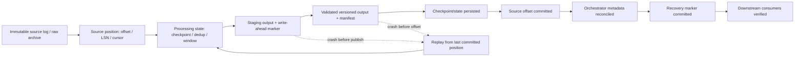
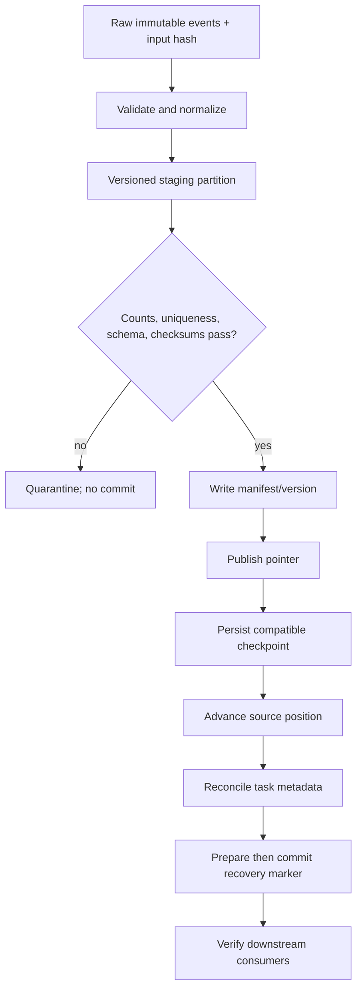

# Unit 4 — Recovering Data Pipeline State and Checkpoints

A pipeline can be green at the process and scheduler layers while still having lost events, duplicated rows, stale aggregates, inconsistent checkpoints, or downstream records that no longer correspond to the recovered source. This unit treats recovery as a **data-correctness protocol** across source positions, processing state, output commits, checkpoint files, orchestration metadata, and downstream consumers. The running example is a synthetic ETL/stream-consumer that reads four events with stable IDs and integer offsets, transforms them deterministically, publishes a versioned output manifest, saves a checkpoint, advances its source position, and records orchestration metadata. The unit shows how to recover safely, reconcile what actually exists, and document what cannot be recovered.

| Metadata | Value |
|---|---|
| Module | M13 — Backup, Disaster Recovery and Resilience Testing |
| Stage | Stage 2E — Production DevOps & Platform Engineering |
| Unit | 4 — Recovering data pipeline state and checkpoints |
| Target file | `04-recovering-data-pipeline-state-and-checkpoints.md` |
| Estimated study time | 8–12 hours; repeat drills until evidence is reproducible |
| Estimated lab time | 4–7 hours; measure yours |
| Last reviewed | 2026-10-29 (authoring date, not a claim that external product docs were live-verified) |
| Tool baseline assumed | Python 3 standard library and a typical WSL2 Ubuntu/Linux shell; run `python3 --version` and verify local tool versions before use. Product-specific baselines remain `[VERIFY]`. |
| Prerequisites | Stages 0–2D; M01–M12; M05 database/PITR concepts; M08 GitOps/data contracts; M09 secret references; M10 incident response; M11 observability/lineage; M12 provenance; M13 Units 1–3 |
| Footprint | Planning baseline: approximately 4 CPU cores, 8 GB RAM and 30 GB free disk; **measure yours**. Core labs use local files and Python. |
| Destructive labs | Yes, only within the explicitly named disposable `pipeline-recovery-lab` directory; guarded cleanup requires typed confirmation. No cluster, cloud, or production resource is mutated. |

## Table of contents

- [4.0 Why this matters in production](#40-why-this-matters-in-production)
- [4.1 Learning objectives](#41-learning-objectives)
- [4.2 Concept map and vocabulary](#42-concept-map-and-vocabulary)
- [4.3 Level 1 — Beginner](#43-level-1--beginner)
- [4.4 Level 2 — Intermediate](#44-level-2--intermediate)
- [4.5 Level 3 — Advanced](#45-level-3--advanced)
- [4.6 Level 4 — Expert](#46-level-4--expert)
- [4.7 SRE lens](#47-sre-lens)
- [4.8 Security lens](#48-security-lens)
- [4.9 Production checklist](#49-production-checklist)
- [4.10 Hands-on lab set](#410-hands-on-lab-set)
- [4.11 Self-check questions](#411-self-check-questions)
- [4.12 Evidence artifacts](#412-evidence-artifacts)
- [4.13 Common interview and design-review questions](#413-common-interview-and-design-review-questions)
- [4.14 Sources and verification notes](#414-sources-and-verification-notes)

## How to use this unit

Work through Levels 1–4 in order. Level 1 establishes vocabulary and crash windows; Level 2 makes the synthetic pipeline repeatable and replay-safe; Level 3 aligns recovery points across stores; Level 4 turns individual techniques into a governed program. Labs follow an evidence-first loop: capture a baseline, state a hypothesis, inject one bounded fault, recover, compare actual state with ground truth, record timing, and clean up. Sample outputs are labelled **Representative output — not executed here** unless explicitly stated otherwise. The code tests were run in the authoring environment; that does not prove the learner’s setup or any production pipeline has been tested.

### 4.0 Why this matters in production

A consumer may acknowledge an offset and then crash before the sink durably commits the corresponding rows; the scheduler can report success even though a partition is incomplete. The reverse window is also possible: the sink commits rows, then the process crashes before its offset is saved, so replay repeats the same input. A database PITR restore can make the source consistent at time T while downstream outputs still contain rows produced after T. Recovery therefore needs explicit ordering, idempotency, versioned outputs, a replay source, and independent correctness checks—not just a restart button. These are representative failure patterns, not claims about specific real incidents.

This unit owns **pipeline-level state consistency, checkpoint/offset recovery, replay and reprocessing, reconciliation, backfill, and proof of data correctness**. It reuses M05 database recovery mechanics rather than reteaching them; model registry/artifact state is handed to Unit 5. Regional strategy belongs to Unit 6, drill governance to Unit 7, failure-injection program to Unit 8, Velero to Unit 9, and chaos-tool implementation to Unit 10.

> **Handoff:** M05 taught database backup/PITR and local object-storage recovery; M07 taught infrastructure-state recovery; M08 taught GitOps and data contracts; M09 taught secret references and key custody; M10 taught incident response and recovery-capacity planning; M11 taught freshness/coverage monitoring and lineage; M13 Unit 1 defined RTO/RPO, Unit 2 covered backup/retention, and Unit 3 covered platform metadata/configuration recovery. This unit owns the **pipeline-level consistency problem**: source positions, processing checkpoints, orchestrator state, output commits, recovery markers, replay/reprocessing, backfill, and proving data correctness after recovery. It introduces the pipeline handoff to Unit 5 for model-artifact/registry state without re-teaching those modules.

### 4.1 Learning objectives

1. **[L1]** Inventory source positions, processing state, orchestrator metadata, staged and committed outputs, checkpoints, manifests, lineage, and downstream dependencies.
2. **[L1]** Explain at-most-once, at-least-once, and exactly-once semantics, including both offset/output crash windows.
3. **[L2]** Implement offset-after-output-commit with deterministic idempotent sink writes and prove replay does not create duplicate logical records.
4. **[L2]** Verify checkpoint integrity and compatibility, fall back to a previous verified checkpoint, replay the gap, and reconcile outputs against ground truth.
5. **[L2]** Calculate replay-retention requirements and catch-up time using unit-consistent inputs; handle missing or impossible conditions safely.
6. **[L3]** Create and validate a prepared/committed recovery marker without claiming cross-store atomicity.
7. **[L3]** Diagnose phantom downstream data after point-in-time source restore and select a versioned remediation strategy.
8. **[L3]** Build a lineage-based recompute plan and verify dataset hash plus code/config compatibility before resuming a synthetic ML training checkpoint.
9. **[L4]** Design a pipeline recovery catalog, planted-defect suite, safe backfill plan, and repeatable evidence package.
10. **[L4]** Govern replay, privacy tombstones, side-effect suppression, and multi-region offset concerns with explicit owners and approval gates.

### 4.2 Concept map and vocabulary

#### Pipeline state map



The local example publishes a versioned output and manifest before advancing the source position. It then saves a checkpoint and task metadata. This is **not a distributed transaction**: a crash can occur between any two writes. Stable event IDs and idempotent upserts make replay safe in the model, while reconciliation detects incomplete cross-file progress. Production systems must identify the actual durability and atomicity guarantees of each sink, offset store, and checkpoint store.

#### Vocabulary

| Term | Meaning and example | Not interchangeable with |
|---|---|---|
| Restart | Start the process again without necessarily changing its position/state. | Replay or restore. |
| Retry | Repeat an operation/task after failure, ideally with the same idempotency key. | A guarantee that repeating the operation is safe. |
| Replay | Read already-seen source events again from a prior position. | Reprocessing with current code or a broader historical backfill. |
| Reprocess | Recompute outputs from inputs, often with changed code/config. | Exact reproduction of the previous execution. |
| Backfill | Deliberately process a historical range or missed interval. | Uncontrolled catch-up. |
| Catch-up | Reduce backlog while new events continue arriving. | Backfill against a quiescent source. |
| Rewind | Move the source position backwards to replay earlier input. | Rolling back output state automatically. |
| Checkpoint restore | Load persisted processing state with a compatible input position. | Restoring the source database or output table. |
| Rollback | Return a published pointer/state to a known prior version. | Deleting arbitrary output files. |
| Reconciliation | Compare task/declarative state with actual output and source truth. | A repair action by itself. |
| Resnapshot | Capture a fresh baseline when incremental history is unusable. | Resuming from a retained CDC position. |
| Compensating action | Explicitly counteract an already-observed side effect. | Replaying that side effect. |

#### State inventory / recovery matrix

| State | Typical location | Owner | Replayability | Recovery method | Verification |
|---|---|---|---|---|---|
| Source offset | Consumer group, CDC cursor, metadata store | Data platform | Within source retention, usually | Resume or reset only after approval | Compare cursor to available source range and output manifest |
| Processing state | Checkpoint/state store/window state | Pipeline owner | Depends on raw history and determinism | Restore compatible checkpoint or replay from raw | Checksum, schema/code compatibility, recomputed aggregate |
| Orchestrator metadata | Metadata DB/table | Platform ops | Task state only partially reconstructable | Application-native backup/PITR, then reconcile | Run/partition state versus manifest and rows |
| Staging data | Temporary file/object path | Pipeline owner | Usually disposable if source retained | Ignore incomplete staging and replay | No staged version advertised as committed |
| Output partitions | Warehouse/table/filesystem | Data owner | Often rebuildable, not always cheaply | Restore matching version or rebuild isolated output | Count, uniqueness, checksums, aggregates, lineage |
| Recovery marker | Metadata record/file | Recovery owner | Only if referenced versions remain | Reject incomplete/mismatched marker | All referenced artifacts exist and match |
| Raw landing archive | Object/file store | Data owner | Replay source of last resort | Replay archived inputs | Inventory, checksums, deletion tombstones |
| Side-effect ledger | Application DB/provider | Application owner | Not safely replayable by default | Suppress replay or compensate | Idempotency key and audit trail |
| ML training checkpoint | Training workspace/checkpoint store | ML platform | Only with compatible data/code/config | Validate then resume or restart | Dataset hash, code/config hash, progress state |

#### Delivery semantics and crash windows

- **At-most-once:** an input is processed zero or one time; a crash may lose work if position advances before output is durable.
- **At-least-once:** an input may be processed more than once; replay is expected after uncertain commits. A practical baseline is at-least-once delivery plus an idempotent sink keyed by stable event ID.
- **Exactly-once:** an end-to-end property only under a specified transaction boundary, connector semantics, and failure model. A broker setting alone does not guarantee exactly-once effects across arbitrary databases, object stores, email APIs, and orchestration metadata. Product-specific claims are `[VERIFY]` against the exact versions and connectors.

| Ordering | Crash window | Risk | Safer pattern |
|---|---|---|---|
| Offset commits before sink output | Position advances; output absent | Silent data loss | Commit position only after durable output; test for this defect. |
| Sink output commits before offset | Output exists; offset remains old | Duplicate output on replay | Idempotent upsert, deterministic batch ID, or a supported cross-system transaction. |
| Output published before checkpoint | Output exists; checkpoint old/missing | Recompute may replay published data | Idempotent sink, manifest reconciliation, and versioned outputs. |
| Checkpoint saved before output publish | State says progress exists; output absent | Skipped input or mismatched state/output | Treat checkpoint and output as a matched pair. |
| Task marked successful before output validation | Orchestrator status lies about correctness | False green / missing partition | Reconcile task metadata against actual manifests and data. |

### 4.3 Level 1 — Beginner

#### What counts as pipeline state

1. **Source positions:** consumer-group offsets, CDC positions/LSNs, last-processed IDs, timestamps, and watermarks. An offset is a position in an input stream, not proof its output committed. The lab uses integer offsets 1–4; `synthetic-db-pos-0000` is a synthetic token, **not a PostgreSQL LSN**.
2. **Processing state:** stream-processing checkpoints/state stores, windows, aggregations, deduplication tables, and accumulated state. Replay can rebuild some state, but window/late-event rules must be reproduced.
3. **Orchestrator metadata:** DAG/task history, schedules, retry state, backfill status, variables, and connection references. Airflow-style schema and restore details are awareness-level and `[VERIFY]` for the deployed version. The lab uses `metadata/tasks.json`, not Airflow.
4. **Output state:** committed partitions/tables, manifests, transaction logs, sink commit markers, idempotency keys, and output-version pointers. Delta Lake, Iceberg, and Hudi are awareness topics; their exact semantics are `[VERIFY]` for the chosen format/version.
5. **Intermediate/staging data:** temporary files, staged partitions, uncommitted batches, manifests, and write-ahead markers. Incomplete staging must not be mistaken for committed output.
6. **Lineage and run metadata:** run IDs, code/config versions, dataset versions/hashes, upstream inputs, and downstream consumers.

If source state is restored to time T, processing state to T−1, and output to T+1, each artifact can be individually readable while the overall pipeline is inconsistent. The result may be duplicates, gaps, orphaned outputs, phantom rows, or misleading task status. Recovery must define a compatible cut across these layers.

#### Nine common failure patterns

| Failure | Signal / likely window | Correctness risk | Safe response | Verification |
|---|---|---|---|---|
| Consumer crashes mid-batch | Heartbeat stops during batch; staging may be partial | Partial or repeated batch | Keep position at last committed offset; ignore incomplete staging and replay idempotently | Ground-truth IDs, count, aggregate, manifest |
| Latest checkpoint lost/corrupt | Checksum fails or file unreadable | Stale/fabricated state | Restore prior verified compatible checkpoint and replay gap | Checksum/schema and gap coverage |
| Source offset reset/moved | Lag jumps or output has a gap | Missing/duplicated range | Stop consumer; record old/new positions; approve rewind/resnapshot | Source position, output IDs, audit log |
| Upstream source changes | Same event ID/range has a different payload | Silent output drift | Use immutable input snapshot or version the reprocess | Input hash and output version |
| Sink write partial | Manifest count/hash differs from output | Incomplete output exposed | Do not commit pointer; replace isolated version after validation | Count, uniqueness, checksum, aggregate |
| Orchestrator metadata DB lost | Scheduler lacks run history | Tasks rerun or are skipped | Restore metadata backup then reconcile outputs | Task-to-manifest reconciliation |
| Staging lost/incomplete | Temp path missing/partial | Confusion if staging treated as committed | Ignore uncommitted staging and replay | Manifest and source position |
| Scheduler unavailable across window | Missed intervals/backlog grows | Gaps or backfill storm | Classify missed intervals, throttle, prioritize by tier | Coverage by interval and lag trend |
| Source retention expires | Required offsets unavailable | Replay gap may be unrecoverable | Use raw archive or resnapshot; quantify loss if neither exists | Archive coverage and explicit gap statement |

A healthy process, green DAG, or `Running` container is a liveness signal, not proof of completeness, uniqueness, semantic correctness, or downstream consistency.

### 4.4 Level 2 — Intermediate

#### Baseline protocol: output first, position second

The core invariant is: **never advance the committed source position beyond input whose output has been durably published and validated**. The shared code writes staged rows, checks unique event IDs, writes a versioned output and manifest/current pointer, and only then advances `source/position.json`. It subsequently saves a checkpoint and task metadata. A crash between output and position can replay input, so the sink uses an upsert keyed by `event_id`. This avoids duplicate logical rows in the model but does not make the protocol atomic. Production recovery must define the actual durability boundary of sink and position stores.

#### Atomic publish and filesystem limitations

The local example uses `os.replace` to replace one local file within the same filesystem. This is not a guarantee for object stores, cross-filesystem moves, network filesystems, or a multi-file commit. Use the selected provider/table-format-supported commit protocol and verify its documented semantics. Consumers should read only versions referenced by a validated manifest; the presence of a data file alone is not commit evidence.

#### Versioned checkpoint validation

The checkpoint includes ID, offset, state version, code version, schema version, output manifest version, processing rows, creation time, and SHA-256 checksum over canonical JSON. A checksum detects accidental change; it does not authenticate a checkpoint if an attacker can rewrite both payload and checksum. A checksum pass also does not prove semantic compatibility. Validate code/schema/state compatibility before loading. If incompatible, use a documented migration or rebuild state from immutable raw inputs.

#### Deduplication, watermarks, and late events

Use a stable source event ID as the logical key. If none exists, derive a deterministic idempotency key from immutable source identity plus partition/offset, not mutable processing time. A bounded event-time deduplication window can miss duplicates outside the window; retention and business contracts must align. Watermarks express a policy about event-time completeness, not proof no later event can arrive. Define whether late data reopens a partition, creates a correction version, or is quarantined.

#### Replay source and retention

Never transform in place the only copy of source data. Keep a protected raw landing zone where data contracts and privacy policies permit it. The planning inequality is:

`required source retention >= detection delay + recovery duration + safety margin`

All terms must use compatible units and represent the relevant planning percentile/worst case, not optimistic averages. This is a planning inequality, not a universal service guarantee. If retention is 72 h, detection delay 24 h, recovery 36 h, and margin 12 h, required retention is 72 h exactly, leaving zero headroom.

#### Catch-up calculation

`catch-up time = backlog / (processing capacity − ongoing arrival rate)`

`[ILLUSTRATIVE]` backlog = 600,000 events; capacity = 150,000 events/hour; ongoing arrivals = 50,000 events/hour. Net catch-up capacity is 100,000 events/hour, so idealized catch-up duration is 6 hours. Units cancel: events ÷ (events/hour) = hours. This excludes pauses, skew, retries, downstream saturation, and validation. If capacity is equal to or below arrival rate, backlog will not shrink.

#### Reprocessing/backfill safety

Backfill must be resumable, idempotent, partition-scoped, rate-limited, and isolated from the current output. Write to `backfill-vN`, validate each partition, compare with source/ground truth, then move a manifest pointer only after approval. Use priority tiers and stop thresholds; pause if database latency, queue lag, error rate, disk headroom, or freshness guardrails cross the approved limit. Keep a rollback pointer. Never replay customer emails, payments, or webhooks by default; use local stubs, stable idempotency keys, and replay suppression.

#### Required failure drills

Lab 2 includes all four: mid-batch crash; newest checkpoint corruption/fallback; loss and restoration of simulated orchestrator metadata; and partial sink write detected by manifest/completeness checks. Each captures baseline evidence, injects one bounded fault, recovers, compares expected/observed values, records timing, and cleans only the named lab root.

### 4.5 Level 3 — Advanced

#### Deterministic architecture

Prefer immutable raw landing, validated/clean, and versioned derived/serving layers. Record input identity/hash, code version, schema version, configuration version, and relevant lookup snapshots. Avoid unrecorded `now()`, unseeded randomness, mutable lookups, and external side effects. Preserve ordering where it matters. Idempotent/commutative operations simplify replay but do not replace business invariants.



#### Consistent recovery point / recovery marker

A recovery marker describes a **logical cut** across independent stores. Record source offsets/cursors, output manifest/version, database LSN or clearly labelled synthetic position, processing checkpoint ID, code/schema versions, input dataset version/hash, marker ID, timestamp, and checksum. A JSON file or database row is not automatically an atomic transaction across source, sink, checkpoint store, and orchestration metadata.

Use a prepare/commit protocol:

1. Freeze or establish a consistent input boundary, or record a supported barrier/cursor protocol.
2. Ensure the referenced output version and checkpoint are durable and validated.
3. Write a `PREPARED` marker with artifact identities/checksums.
4. Verify every referenced artifact and reconcile source/output/checkpoint positions.
5. Mark `COMMITTED` only after checks pass.
6. On restore, reject prepared markers, missing references, checksum mismatch, incompatible code/schema, or output-version mismatch.
7. Reconcile and replay the delta after the marker; a committed marker does not prove remote stores committed atomically.

The code models a marker in a local file. `synthetic-db-pos-0000` is a placeholder, not a database LSN. Chandy–Lamport-style snapshots and stream-processing barriers are conceptual awareness topics; engine-specific behavior is `[VERIFY]`.

#### Multi-store consistent-cut comparison

| Store | Individually valid artifact | Inconsistency example | Required guard |
|---|---|---|---|
| Source DB | PITR restore at T | Source changes after T disappear | Record recovery point and WAL/CDC position |
| CDC/source log | Retained offset O | Cursor refers to different history/schema | Verify validity and retention; resnapshot if invalid |
| Processing state | Checkpoint at O+N | Window/dedup state includes events absent at T | Restore matching checkpoint or rebuild from raw |
| Output table | Manifest `out-0042` | Contains rows produced after T | Restore matching output or rebuild isolated version |
| Orchestrator | Task says complete | Status describes old run, not current output | Reconcile task/partition state to actual data |
| Recovery marker | Marker says committed | Referenced artifact was pruned/mutated | Verify every referenced version/hash |

#### CDC recovery and WAL saturation

Resume from a retained CDC position only when it remains valid, required log/WAL is retained, schema changes can be interpreted, and downstream state is compatible. Resnapshot plus downstream rebuild may be safer when the cursor is invalid, retention expired, or schema evolution makes the stream ambiguous. A stalled consumer or retained replication slot can prevent WAL reclamation and fill the source database disk. Alert on consumer lag, oldest required WAL position, slot activity, free disk, and time-to-saturation; coordinate M05 database operations and M11 saturation monitoring. PostgreSQL commands/semantics vary by version/configuration and are `[VERIFY]` against the installed release’s official docs.

#### Phantom data after point-in-time restore

If the source is restored to T−5 minutes but the downstream warehouse still contains rows produced after T−5, those rows are phantom relative to the restored source. Pause consumers; record the source marker; inspect output versions and lineage; build/restore a matching downstream version or use approved tombstones/compensation; validate counts, unique IDs, checksums, aggregates, and referential integrity; reapply privacy tombstones; publish a new manifest pointer; notify downstream consumers and publish a restore/data-contract event; then reopen normal traffic. Options include replay from a matching marker, restoring downstream data to the same marker, compensating invalid records, or rebuilding derived outputs from immutable raw inputs. Never overwrite the only good output without a versioned rollback path.

#### Orchestrator and streaming recovery

Task status is not output state. Make tasks idempotent, define retry boundaries, and reconcile every partition. A scheduler outage requires a catch-up policy: run every missed interval, skip with documented loss, coalesce, or prioritize by criticality. Do not launch 90 days of missed runs concurrently. Distinguish processed from committed offsets; reset-to-earliest/latest/timestamp has different consequences. Rebalance ordering, dead-letter replay, poison-pill handling, and state-store/changelog restoration are product-specific `[VERIFY]` topics. Orchestrator HA is not backup: code belongs in Git; metadata DB needs application-native backup/PITR; secrets remain externally referenced.

#### Verification after recovery

| Invariant | Detector | Limitation | Owner |
|---|---|---|---|
| Completeness | Expected source IDs/count by partition; gap scan | Counts can match while IDs differ | Pipeline owner |
| Uniqueness | Stable-key duplicate query | Depends on correct key definition | Data owner |
| Integrity | Per-partition content checksum | Cannot prove semantic correctness | Pipeline owner |
| Semantics | Aggregates, referential integrity, domain assertions | Aggregates can hide row-level swaps | Data steward |
| Freshness/coverage | Event-time lag and expected partition coverage | Clock skew and late events complicate interpretation | SRE/data ops |
| Manifest consistency | Manifest row count/hash matches output | Does not prove source correctness | Pipeline owner |
| Lineage | Downstream inventory and shadow comparison | Missing lineage edges hide impact | Data platform |
| ML reproducibility | Dataset/code-config hash and checkpoint compatibility | Does not recover model registry artifacts | ML platform |

#### ML/data pipeline handoff

Feature-store offline/online consistency can diverge when training data and online features use different event-time cutoffs or transforms. Record dataset snapshots/hashes, feature definitions/config versions, training progress/checkpoint metadata, experiment references, and pipeline code/config. Resume training only when integrity, dataset hash, code/config compatibility, and progress semantics match. Unit 5 owns model registry entries and model binaries; this unit records the handoff identifiers only.

#### Time, capacity, and correctness traps

- Persist instants in a defined timezone, commonly UTC; preserve source timezone and schedule policy for business calendars. DST transitions can create missing/duplicated schedule labels.
- Event time describes when an event occurred; processing time describes when handled. Late events can reopen “complete” partitions.
- Historical-code replay may reproduce a defect; current-code reprocessing changes semantics. Choose explicitly, version outputs, and compare when impact matters.
- Recovery consumes CPU, storage, I/O, and possibly egress. Measure resource units; do not invent prices or extrapolate laptop throughput.
- Guard against duplicate loads, off-by-one boundaries, lost updates, schema drift, late-data double counting, ordering changes, and repeated side effects.

### 4.6 Level 4 — Expert

#### Pipeline recovery catalog

Govern the catalog as a generated/reviewed artifact checked against actual outputs, retention, and drill evidence. Required schema:

`pipeline | owner/data steward | criticality tier | RTO/RPO reference | source and position mechanism | source replay horizon | raw archive/immutability | checkpoint/state location and backup | orchestrator metadata backup | sink/manifest/rollback | idempotency and side-effect suppression | code/config/schema versions | recovery marker strategy | verification suite/ground truth | lineage/downstream consumers | runbook | last drill/measured results | open risks/owner`.

Illustrative entry:

| Field | `[ILLUSTRATIVE]` value |
|---|---|
| Pipeline / owner | `synthetic-etl` / `lab-owner` |
| Criticality / objectives | T2 / see Unit 1 RTO/RPO register |
| Source / position | `source/events.json` / integer `offset` |
| Replay horizon / raw archive | 72 hours / `archive/raw-events.json` |
| Checkpoint | `checkpoints/cp-NNNN.json`, SHA-256 plus code/schema versions |
| Orchestrator metadata | `metadata/tasks.json`; back up and reconcile after restore |
| Sink / rollback | `outputs/out-NNNN.json`; publish only through validated manifest |
| Idempotency / side effects | `event_id` upsert; replay effects suppressed by default |
| Marker | `markers/marker-0001.json`, PREPARED then COMMITTED |
| Verification | ground-truth ID set, row count, unique IDs, amount sum, manifest checksum |
| Lineage | raw → clean → features → training reference; synthetic only |
| Drill evidence | blank until learner records actual date/timing/findings |
| Open risks | local files do not prove production store durability; real CDC semantics `[VERIFY]` |

#### Retention policy checker

For detection delay D, recovery duration R, and margin M, required replay horizon is `D + R + M`. Report `PASS` only when retention is at least that sum, `WARN` for missing inputs, and `FAIL` for negative or insufficient values. A retention pass is necessary but insufficient: source records, schema history, keys, and compatible replay code must exist. Exactly 72 h for 24 h + 36 h + 12 h leaves zero headroom.

#### Recoverability CI-style suite and planted-defect corpus

The shared test harness covers mid-batch replay, checkpoint corruption, incompatible schema, partial-manifest mismatch, retention boundaries, capacity ≤ arrival rate, uncommitted markers, duplicate output, lineage cycle/missing node, timezone-aware expiry, side-effect suppression, ML hash mismatch, and missing catalog owner. It is a bounded synthetic harness, not a complete production CI system. Expand with these distinct defects and expected gates:

| Defect | Injected fault | Expected detector | Expected result / cleanup |
|---|---|---|---|
| D1 offset-before-output | Advance source position before publishing rows | Ground-truth gap scan | FAIL; reset only lab position to last verified checkpoint and replay |
| D2 duplicate append | Append an existing event ID | Uniqueness/manifest check | FAIL; republish validated version |
| D3 late-event double count | Apply an event-time aggregate twice | Per-window ground truth | FAIL; rebuild isolated partition with dedup policy |
| D4 partial sink | Alter manifest count or omit row | Manifest count/hash check | FAIL; keep prior good pointer and republish |
| D5 incompatible checkpoint | Change schema version | Compatibility gate | FAIL; migrate or replay |
| D6 too-short retention | Replay horizon below D+R+M | Retention checker | FAIL; archive or document unrecoverable gap |
| D7 repeated side effect | Replay emits an existing notification | Side-effect ledger/idempotency test | FAIL; suppress or deduplicate |
| D8 mismatched marker | Marker references `out-0003`, active manifest is `out-0004` | Marker verifier | FAIL; restore matching output/checkpoint pair |
| D9 task/output drift | Task says committed but manifest is absent | Reconciliation report | FAIL; restore metadata then reconcile actual outputs |
| D10 data hash drift | Training checkpoint dataset hash differs | ML resume guard | FAIL; locate matching dataset or restart |

False-positive controls: a valid repeat run passes with no duplicate IDs; a valid matching checkpoint loads; retention exactly at the boundary passes but has zero headroom; a distant expiry remains `OK`; an acyclic graph produces an order. Never weaken a gate merely to make a drill green.

#### Chaos/resilience scenarios

| Scenario | Hypothesis | Guardrails / blast radius | Abort condition | Signal/recovery | Evidence |
|---|---|---|---|---|---|
| Kill worker mid-commit | Position stays at last committed point and replay is safe | Four synthetic events only | Any path outside lab root | Exception; replay idempotently | Counts, offsets, manifest versions |
| Duplicate synthetic messages | Stable IDs prevent duplicate logical rows | Local file only | Unexpected/unbounded fixture growth | Duplicate detector | Test output/correction record |
| Corrupt checkpoint | Checksum/compatibility gate rejects it | Copy first | Any production checkpoint path | Restore prior verified checkpoint/replay | Checksum and timeline |
| Scheduler outage | Catch-up can be throttled/prioritized | Simulated intervals | Resource guardrail crossed | Backlog/freshness signal; resume by partition | Coverage and timing |
| Optional bounded disk pressure | Resource alerts fire early | Not required; never fill real filesystem | Learner-defined free-space stop threshold | Stop generator and remove only lab file | Disk before/after |

Link tool-specific injection to Unit 8 and Litmus/Chaos Mesh implementation to Unit 10. Heavyweight tooling is not required for this laptop lesson.

#### Large-scale reprocessing design

For multi-day backfill, create a new output version and durable work ledger keyed by partition/range. Record status, attempts, input hash, code/config version, output manifest, validation, and last update. Set quotas/priorities by criticality, cap concurrency, rate-limit reads/writes, and pause when latency, queue lag, disk headroom, error rate, or freshness crosses guardrails. Resume only incomplete/failed partitions; validate each partition before manifest-pointer cutover. Notify consumers, retain the previous good version for rollback, and record approval. Record laptop throughput as `[MEASURED]` only after running; do not extrapolate it to production.

#### Lineage impact analyzer

The shared `lineage_plan` accepts a directed graph whose keys are declared nodes and values are downstream consumers. It calculates downstream closure and topological recompute order; it fails when a referenced node is missing or the affected graph has a cycle. Example:

```json
{
  "raw_events": ["clean_events"],
  "clean_events": ["feature_snapshot", "warehouse_mart"],
  "feature_snapshot": ["training_dataset"],
  "training_dataset": ["training_run"],
  "warehouse_mart": ["dashboard"],
  "training_run": [],
  "dashboard": []
}
```

If `clean_events` is restored, recompute feature snapshot, training dataset/run reference, warehouse mart, and dashboard in dependency order. A model is only a reference here; registry recovery remains Unit 5. Production lineage should include owners, freshness criticality, privacy classification, and whether each consumer is automatically recomputable or requires approval.

#### Privacy deletion and multi-region awareness

Older backups/raw archives may reintroduce records deleted under a privacy process. Maintain a separately protected deletion ledger/tombstone mechanism appropriate to organizational policy; reapply tombstones after restore/replay and before publishing. Prove deleted records do not reappear, assign an owner, and preserve minimal evidence. This is technical guidance, not legal advice.

Across regions, source offsets may not map one-to-one after failover, replicated sink state may lag, and consumer restart can create gaps or duplicates. Decide which source is authoritative and how offsets are translated or resnapshotted. Product-specific offset synchronization is `[VERIFY]`; a local lab is not evidence of multi-region recovery. See Unit 6.

#### Eight expert incident analyses

All scenarios are `[ILLUSTRATIVE]`, not reports of real incidents.

| Symptom | Hypothesis / evidence | Root cause | Immediate safe fix | Prevention / owner / recurrence test |
|---|---|---|---|---|
| Offset committed before sink; 40-minute gap | Compare cursor, manifest, IDs, task logs | Commit ordering bug | Pause; identify gap; replay from last valid position; validate IDs/aggregates | Pipeline owner: D1 test and ordering review |
| Old checkpoint corrupts aggregates | Inspect checkpoint schema/code and aggregate diff | Compatibility gate missing | Restore compatible checkpoint or rebuild from raw into new version | Data/ML platform: D5 and migration tests |
| Seven-day retention; detected day nine | Compare requested cursor with source/archive coverage | Retention omitted detection/recovery margin | Use raw archive or resnapshot; otherwise quantify gap | Data owner: alert and D6 test |
| Source restored to T, warehouse rows after T remain | Marker/manifest and lineage diff | Stores restored to different points | Rebuild/restore matching output, tombstone/compensate, validate before cutover | Data owner: phantom-row test and marker gate |
| Scheduler launches 90 days of missed DAGs | Queue depth, concurrency, DB latency, interval coverage | No catch-up limits | Pause, classify intervals, resume throttled by tier | SRE: outage/capacity drill |
| Replay sends emails again | Side-effect ledger and replay run ID | Non-idempotent external side effect | Stop effects; suppress or use stable keys/compensation | App owner: D7 and stub test |
| Stalled CDC retains WAL until disk fills | Lag, retained WAL, disk trend, slot status | No lag-to-disk alert/ownership | Protect DB; repair consumer or resnapshot under approval | DBA/data platform: saturation alert/drill |
| Backfill overwrites good partitions with wrong logic | Manifest history, code version, partition checksums | In-place writes, no rollback | Stop writer; restore prior version if intact; rebuild and reconcile | Data owner: partial-publish test and rollback artifact |

### 4.7 SRE lens

Pipeline recovery is a **correctness SLI**, not only an availability concern. A consumer can be available while data is stale or wrong. Define objectives with the data contract and business owner; do not invent numeric targets. Unit 1 owns RTO/RPO definitions; this unit translates them into replayability and validation gates.

| Metric | Definition / unit | Source | Alert intent | Limitation |
|---|---|---|---|---|
| `pipeline_freshness_lag` | Now minus newest accepted event time; seconds/minutes | Pipeline metrics/watermark | Alert before freshness objective breach | Clock skew/late events distort lag |
| `partition_coverage` | Completed expected partitions / expected partitions; ratio/% | Schedule/catalog/manifests | Missing intervals | Calendar/DST expectations must be correct |
| `event_completeness` | Verified expected IDs/count present / expected IDs/count | Source/ground truth/output | Detect gaps after recovery | Full ground truth can be costly/unavailable |
| `duplicate_logical_records` | Duplicate stable-key count | Sink reconciliation | Unexpected duplicates block cutover | Depends on key definition |
| `checkpoint_age` | Time since last verified checkpoint | Checkpoint metadata | Protect RPO/replay budget | Fresh can still be corrupt/incompatible |
| `source_retention_headroom` | Retention − detection − recovery − margin; hours | Retention and incident estimates | Alert before headroom reaches zero | Estimates include approval/queue delays |
| `recovery_success_rate` | Successful drills / attempted drills; % over window | Drill register | Trend failures/overdue tests | Small sample sizes are noisy |
| `backfill_progress` | Validated work units / planned units; % | Work ledger | Detect stalls | Percent may hide a blocked critical partition |
| `recovery_phase_duration` | Elapsed time per phase | Timeline | Find bottlenecks | Laptop time is not production target |
| `downstream_reconciliation_failures` | Consumers failing version/quality checks | Lineage/data-quality checks | Block cutover | Incomplete lineage hides consumers |

Alert before retention headroom reaches zero. Define backfill stop policy in advance: pause when source DB latency, queue lag, storage headroom, or error rate crosses the approved threshold. Data-consumer impact belongs in the error-budget discussion, not just HTTP uptime.

**Runbook snippet — trigger → decide → execute → verify → communicate → follow-up:** (1) Trigger on freshness/coverage alert, checkpoint integrity failure, offset jump, or reconciliation failure. (2) Incident lead pauses writes/cutover; data owner chooses resume/replay/resnapshot/documented loss; security owner approves if compromise/privacy deletion is involved. (3) Capture positions/manifests; choose compatible marker/checkpoint; replay with throttles and side-effect suppression. (4) Verify counts, uniqueness, hashes, aggregates, referential integrity, freshness, coverage, tombstones, and downstream versions. (5) Communicate affected intervals, gaps, validation, and next update. (6) Attach evidence, assign actions, update catalog/retention, and schedule an independent cold-read drill.

Blank `[MEASURED]` record: detection delay `____`; restore/replay duration `____`; throughput `____ events/min`; peak CPU/memory/disk `____`; missing IDs `____`; duplicates `____`; unresolved semantic differences `____`.

### 4.8 Security lens

- **Synthetic-only data:** do not add customer records, production endpoints, real credentials, or secrets to checkpoints, task logs, markers, or evidence.
- **Least privilege:** separate read-source, write-staging, publish-manifest, advance-offset, restore-checkpoint, and approve-backfill permissions where supported. Replay should not automatically trigger business effects.
- **Untrusted replay payloads:** suppress emails/payments/webhooks by default; use local stubs, stable idempotency keys, and allowlisted effects.
- **Audit trail:** record approval and outcome for offset reset, checkpoint restore, backfill, pointer change, tombstone replay, and break-glass access. Log identifiers/outcomes, not secrets or raw payloads.
- **Integrity/provenance:** verify checkpoint/manifest checksums and M12 code/config provenance. SHA-256 detects accidental change but does not authenticate an artifact if an attacker can replace both payload and checksum; use signing/MAC and protected key custody when required.
- **Checkpoint poisoning:** protect write access; validate schema, offset bounds, referenced manifest, code/config compatibility, and source identity before loading.
- **Log injection/exfiltration:** sanitize identifiers/errors, cap diagnostic payload sizes, avoid dumping full records/environment variables, and minimize evidence.
- **Privacy deletion:** reapply tombstones after restore and before publishing; prove deleted IDs are absent downstream.
- **Credentials/tokens:** use M09 references; rotate/rebind when needed; never copy secret values into Git, raw archives, checkpoints, or bootstrap bundles.
- **High-impact actions:** use two-person review for source rewind, broad backfill, pointer rollback, privacy re-deletion, and externally visible changes. Preserve incident evidence before cleanup when required.

### 4.9 Production checklist

#### Before incident

- [ ] Every pipeline has owner/data steward, tier, RTO/RPO reference, source-position mechanism, and runbook.
- [ ] Retention satisfies `detection delay + recovery duration + safety margin`; archive coverage/integrity are tested.
- [ ] Checkpoints are versioned, checksummed, protected, and tied to code/schema/input versions.
- [ ] Sink writes are idempotent or transactionally safe under documented assumptions.
- [ ] Outputs are versioned and published through validated manifests or a supported commit protocol.
- [ ] Orchestrator metadata backup is independent of scheduler runtime; restore is followed by output reconciliation.
- [ ] External side effects are suppressible or protected by stable idempotency keys.
- [ ] Recovery marker records source/output/checkpoint/database-position identities and status.
- [ ] Lineage, downstream consumers, privacy deletion process, and contacts are documented.

#### During recovery — go/no-go gates

- [ ] **GO only if** source replay position is valid and the range is retained or archived.
- [ ] **GO only if** checkpoint integrity and code/schema compatibility pass, or the plan explicitly rebuilds from raw input.
- [ ] **GO only if** manifest/partition versions match the marker and incomplete staging is not advertised as committed.
- [ ] **GO only if** idempotency and side-effect suppression are active and tested.
- [ ] **GO only if** marker is committed and referenced artifacts are independently verified; unresolved cross-store atomicity is documented.
- [ ] Restore orchestrator metadata if needed, then reconcile it against actual outputs.
- [ ] Identify lineage impact and choose replay, version restore, rebuild, tombstone/compensation, or documented loss.
- [ ] Reapply privacy tombstones before publishing.
- [ ] Run completeness, uniqueness, aggregate, referential-integrity, checksum, freshness, coverage, and semantic checks.
- [ ] Throttle backfill and pause if production-protection thresholds are crossed.

#### Validation/cutover and after recovery

- [ ] **GO only if** invariants pass or a named owner accepts a bounded documented exception.
- [ ] New output has a rollback path to the prior known-good version.
- [ ] Downstream consumers acknowledge the new marker/version and restore/data-contract event.
- [ ] Capture per-phase timing, positions, checkpoint IDs, manifest versions, task metadata, and verification output.
- [ ] Record expected-versus-observed results and manual interventions.
- [ ] Preserve required security evidence, then clean only disposable lab artifacts.
- [ ] Assign root-cause actions; update retention, replay, compatibility, and catalog entries.
- [ ] Have someone other than the author cold-read the runbook and record drill recency/exceptions.

### 4.10 Hands-on lab set

All five labs use Python 3 standard library and synthetic local files. No Kafka, Airflow, PostgreSQL, cloud account, external endpoint, or paid product is required. Save the complete shared module below in your **own disposable example workspace** at `~/pipeline-recovery-workspace/pipeline_recovery_lab.py`; this lesson does not create repository files for you.

#### Shared code: `pipeline_recovery_lab.py`

The code implements the synthetic pipeline, versioned output/manifest, checkpoint validation, marker prepare/commit, retention/catch-up calculators, inventory coverage, lineage analysis, expiry checks, side-effect suppression, ML checkpoint compatibility, and standard-library tests. `os.replace` is only a local same-filesystem file replacement, not a cross-store transaction.


```python
#!/usr/bin/env python3
"""Synthetic pipeline recovery lab. Standard library only; no network calls."""
from __future__ import annotations
import argparse, hashlib, json, os, shutil, sqlite3, sys, tempfile, time, unittest
from collections import defaultdict, deque
from datetime import datetime, timezone, timedelta
from pathlib import Path
from typing import Any

LAB_ROOT_NAME = "pipeline-recovery-lab"
EVENTS = [
    {"event_id": "evt-001", "offset": 1, "account": "acct-A", "amount": 10},
    {"event_id": "evt-002", "offset": 2, "account": "acct-B", "amount": 20},
    {"event_id": "evt-003", "offset": 3, "account": "acct-A", "amount": 5},
    {"event_id": "evt-004", "offset": 4, "account": "acct-C", "amount": 7},
]
CODE_VERSION, SCHEMA_VERSION = "etl-v1", "event-schema-v1"

def canonical_bytes(obj: Any) -> bytes:
    return json.dumps(obj, sort_keys=True, separators=(",", ":")).encode()
def digest(obj: Any) -> str:
    return hashlib.sha256(canonical_bytes(obj)).hexdigest()
def write_json(path: Path, obj: Any) -> None:
    path.parent.mkdir(parents=True, exist_ok=True)
    tmp = path.with_suffix(path.suffix + ".tmp")
    tmp.write_bytes(canonical_bytes(obj) + b"\n")
    # Atomic replacement only within the same local filesystem; not a distributed transaction.
    os.replace(tmp, path)
def read_json(path: Path) -> Any:
    return json.loads(path.read_text())
def init_lab(root: Path) -> None:
    if root.name != LAB_ROOT_NAME:
        raise ValueError(f"refusing unexpected lab root name: {root}")
    if root.exists():
        raise FileExistsError(f"lab path already exists; inspect or use cleanup first: {root}")
    root.mkdir(parents=True)
    for d in ("source", "staging", "outputs", "checkpoints", "markers", "evidence", "archive"):
        (root / d).mkdir()
    write_json(root / "source/events.json", EVENTS)
    write_json(root / "ground_truth.json", EVENTS)
    write_json(root / "source/position.json", {"committed_offset": 0})
    write_json(root / "metadata/tasks.json", {"runs": []})
    write_json(root / "archive/raw-events.json", EVENTS)
    write_json(root / "catalog.json", {"pipeline":"synthetic-etl", "owner":"lab-owner", "criticality":"T2", "source_replay_horizon_hours":72, "raw_archive":True, "idempotent_sink":True, "side_effect_suppression":True})

def transform(event: dict[str, Any]) -> dict[str, Any]:
    return {"event_id":event["event_id"], "account":event["account"], "amount":int(event["amount"]), "code_version":CODE_VERSION, "schema_version":SCHEMA_VERSION}

def current_rows(root: Path) -> list[dict[str, Any]]:
    p = root / "outputs/current.json"
    return read_json(p) if p.exists() else []
def publish_rows(root: Path, rows: list[dict[str, Any]], version: str) -> dict[str, Any]:
    # Stage, validate, version, then atomically switch a local manifest pointer.
    staged = root / "staging" / f"{version}.json"
    write_json(staged, rows)
    ids = [r["event_id"] for r in rows]
    if len(ids) != len(set(ids)):
        raise ValueError("duplicate event_id in staged output")
    manifest = {"version":version, "path":f"outputs/{version}.json", "row_count":len(rows), "event_ids_sha256":digest(sorted(ids)), "content_sha256":digest(rows), "code_version":CODE_VERSION, "schema_version":SCHEMA_VERSION}
    write_json(root / manifest["path"], rows)
    write_json(root / "outputs/manifest.json", manifest)
    write_json(root / "outputs/current.json", rows)
    return manifest

def save_checkpoint(root: Path, offset: int, rows: list[dict[str, Any]], state_version: str="state-v1") -> dict[str, Any]:
    cp = {"checkpoint_id":f"cp-{offset:04d}", "offset":offset, "state_version":state_version, "code_version":CODE_VERSION, "schema_version":SCHEMA_VERSION, "output_manifest_version":f"out-{offset:04d}", "rows":rows, "created_at":datetime.now(timezone.utc).isoformat()}
    cp["sha256"] = digest(cp)
    write_json(root / "checkpoints" / f"{cp['checkpoint_id']}.json", cp)
    return cp

def verify_checkpoint(cp: dict[str, Any], expected_code: str=CODE_VERSION, expected_schema: str=SCHEMA_VERSION) -> tuple[bool, str]:
    got = cp.get("sha256")
    body = {k:v for k,v in cp.items() if k != "sha256"}
    if not got or got != digest(body): return False, "integrity checksum mismatch"
    if cp.get("code_version") != expected_code: return False, "incompatible code version"
    if cp.get("schema_version") != expected_schema: return False, "incompatible schema version"
    if not isinstance(cp.get("offset"), int) or cp["offset"] < 0: return False, "invalid offset"
    return True, "verified"

def process_batch(root: Path, events: list[dict[str, Any]], crash_after: int|None=None) -> dict[str, Any]:
    pos = read_json(root / "source/position.json")["committed_offset"]
    rows = {r["event_id"]:r for r in current_rows(root)}
    consumed = [e for e in events if e["offset"] > pos]
    staged = dict(rows)
    for i, event in enumerate(consumed, 1):
        staged[event["event_id"]] = transform(event)  # stable key = idempotent upsert
        if crash_after == i:
            # Simulate process death before publish and before offset commit.
            write_json(root / "staging/interrupted.json", list(staged.values()))
            raise RuntimeError("injected crash before output commit")
    max_offset = max((e["offset"] for e in consumed), default=pos)
    version = f"out-{max_offset:04d}"
    manifest = publish_rows(root, sorted(staged.values(), key=lambda r:r["event_id"]), version)
    # Critical ordering: durable output + manifest first, source position second.
    write_json(root / "source/position.json", {"committed_offset":max_offset})
    cp = save_checkpoint(root, max_offset, sorted(staged.values(), key=lambda r:r["event_id"]))
    metadata = read_json(root / "metadata/tasks.json")
    metadata["runs"].append({"run_id":f"run-{max_offset:04d}", "offset":max_offset, "manifest_version":manifest["version"], "checkpoint_id":cp["checkpoint_id"], "status":"committed"})
    write_json(root / "metadata/tasks.json", metadata)
    return {"offset":max_offset, "manifest":manifest, "checkpoint":cp["checkpoint_id"], "rows":len(staged)}

def restore_checkpoint(root: Path, checkpoint_path: Path) -> dict[str, Any]:
    cp = read_json(checkpoint_path)
    ok, reason = verify_checkpoint(cp)
    if not ok: raise ValueError(f"checkpoint rejected: {reason}")
    publish_rows(root, cp["rows"], cp["output_manifest_version"])
    write_json(root / "source/position.json", {"committed_offset":cp["offset"]})
    return cp

def reconcile(root: Path) -> dict[str, Any]:
    rows = current_rows(root); ids = [r.get("event_id") for r in rows]
    manifest_path = root / "outputs/manifest.json"
    manifest = read_json(manifest_path) if manifest_path.exists() else {}
    tasks = read_json(root / "metadata/tasks.json").get("runs", [])
    task_versions = {t.get("manifest_version") for t in tasks if t.get("status")=="committed"}
    actual_version = manifest.get("version")
    gt = read_json(root / "ground_truth.json")
    expected_ids = {e["event_id"] for e in gt}
    actual_ids = set(ids)
    return {"row_count":len(rows), "unique_ids":len(set(ids)), "duplicate_ids":sorted({x for x in ids if ids.count(x)>1}), "missing_ids":sorted(expected_ids-actual_ids), "unexpected_ids":sorted(actual_ids-expected_ids), "manifest_count_matches":manifest.get("row_count")==len(rows), "manifest_content_matches":manifest.get("content_sha256")==digest(rows), "manifest_version":actual_version, "orphaned_output_versions":sorted(p.stem for p in (root/"outputs").glob("out-*.json") if p.stem not in task_versions and p.stem != actual_version), "task_manifest_mismatch":bool(tasks and actual_version not in task_versions), "amount_sum":sum(int(r["amount"]) for r in rows)}

def prepare_marker(root: Path, marker_id: str, offset: int, manifest_version: str, checkpoint_id: str, synthetic_db_position: str="synthetic-db-pos-0000") -> dict[str, Any]:
    marker={"marker_id":marker_id,"status":"PREPARED","source_offset":offset,"output_manifest_version":manifest_version,"synthetic_db_position":synthetic_db_position,"checkpoint_id":checkpoint_id,"code_version":CODE_VERSION,"schema_version":SCHEMA_VERSION,"input_hash":digest(read_json(root/"source/events.json")),"created_at":datetime.now(timezone.utc).isoformat()}
    marker["sha256"]=digest(marker)
    write_json(root/"markers"/f"{marker_id}.json",marker)
    return marker

def commit_marker(root: Path, marker_id: str) -> dict[str, Any]:
    p=root/"markers"/f"{marker_id}.json"; marker=read_json(p)
    checksum=marker.pop("sha256",None)
    if checksum != digest(marker): raise ValueError("marker checksum mismatch")
    if marker.get("status")!="PREPARED": raise ValueError("only PREPARED markers can be committed")
    # This state transition is atomic for this file only; other stores must be reconciled separately.
    marker["status"]="COMMITTED"; marker["sha256"]=digest(marker); write_json(p,marker)
    return marker

def verify_marker(root: Path, marker_id: str) -> tuple[bool,str]:
    p=root/"markers"/f"{marker_id}.json"
    if not p.exists(): return False,"missing marker"
    m=read_json(p); checksum=m.pop("sha256",None)
    if checksum != digest(m): return False,"marker checksum mismatch"
    if m.get("status")!="COMMITTED": return False,"marker is not committed"
    manifestp=root/"outputs"/"manifest.json"
    if not manifestp.exists(): return False,"output manifest missing"
    manifest=read_json(manifestp)
    if manifest.get("version") != m.get("output_manifest_version"): return False,"output version mismatch"
    cp=root/"checkpoints"/f"{m.get('checkpoint_id')}.json"
    if not cp.exists(): return False,"checkpoint missing"
    ok,why=verify_checkpoint(read_json(cp))
    if not ok: return False,why
    return True,"marker and referenced local artifacts verified; external stores not atomically proven"

def retention_check(retention_hours: float|None, detection_hours: float|None, recovery_hours: float|None, margin_hours: float|None) -> dict[str,Any]:
    vals=[retention_hours,detection_hours,recovery_hours,margin_hours]
    if any(v is None for v in vals): return {"status":"WARN","reason":"missing input"}
    if any(v<0 for v in vals): return {"status":"FAIL","reason":"negative duration"}
    required=float(detection_hours)+float(recovery_hours)+float(margin_hours)
    return {"status":"PASS" if retention_hours>=required else "FAIL","required_hours":required,"headroom_hours":retention_hours-required}

def catchup_time(backlog: float, capacity_per_hour: float, arrival_per_hour: float) -> dict[str,Any]:
    if min(backlog,capacity_per_hour,arrival_per_hour)<0: return {"status":"FAIL","reason":"rates and backlog must be non-negative"}
    net=capacity_per_hour-arrival_per_hour
    if net<=0: return {"status":"FAIL","reason":"capacity must exceed ongoing arrival rate","net_catchup_per_hour":net}
    return {"status":"PASS","net_catchup_per_hour":net,"hours":backlog/net}

def inventory_report(catalog: dict[str,Any]) -> dict[str,Any]:
    required=["pipeline","owner","criticality","source_replay_horizon_hours","raw_archive","idempotent_sink","side_effect_suppression"]
    missing=[k for k in required if k not in catalog or catalog[k] in (None,"")]
    risks=[]
    if not catalog.get("owner"): risks.append("missing owner")
    if not catalog.get("raw_archive"): risks.append("no raw landing archive")
    if not catalog.get("idempotent_sink"): risks.append("sink is not declared idempotent")
    if not catalog.get("side_effect_suppression"): risks.append("side effects not suppressed")
    return {"coverage":"PASS" if not missing and not risks else "WARN","missing_fields":missing,"risks":risks}

def lineage_plan(graph: dict[str,list[str]], restored: str) -> dict[str,Any]:
    # graph maps node -> downstream consumers
    nodes=set(graph)
    if restored not in nodes: return {"status":"FAIL","reason":f"unknown restored node: {restored}"}
    for n,ds in graph.items():
        for d in ds:
            if d not in nodes: return {"status":"FAIL","reason":f"missing node {d} referenced by {n}"}
    affected=set(); q=deque([restored])
    while q:
        n=q.popleft()
        for d in graph.get(n,[]):
            if d not in affected: affected.add(d); q.append(d)
    indeg={n:0 for n in affected}
    for n in affected:
        for d in graph.get(n,[]):
            if d in affected: indeg[d]+=1
    q=deque(sorted(n for n,v in indeg.items() if v==0)); order=[]
    while q:
        n=q.popleft(); order.append(n)
        for d in graph.get(n,[]):
            if d in indeg:
                indeg[d]-=1
                if indeg[d]==0:q.append(d)
    if len(order)!=len(affected): return {"status":"FAIL","reason":"cycle in affected lineage subgraph"}
    return {"status":"PASS","restored":restored,"affected":sorted(affected),"recompute_order":order}

def time_bomb(records: list[dict[str,Any]], now: datetime, threshold: timedelta) -> list[dict[str,Any]]:
    if now.tzinfo is None: raise ValueError("now must be timezone-aware")
    result=[]
    for r in records:
        raw=r.get("expires_at")
        if not raw: status="UNKNOWN"
        else:
            dt=datetime.fromisoformat(raw)
            if dt.tzinfo is None: status="UNKNOWN"
            elif dt <= now: status="EXPIRED"
            elif dt <= now+threshold: status="NEAR_EXPIRY"
            else: status="OK"
        result.append({"id":r.get("id","unknown"),"status":status})
    return result

def side_effect_stub(event_id: str, replay: bool, seen_keys: set[str], allow_replay: bool=False) -> str:
    key=f"notification:{event_id}"
    if replay and not allow_replay: return "SUPPRESSED_REPLAY"
    if key in seen_keys: return "DEDUPLICATED"
    seen_keys.add(key); return "WOULD_SEND_LOCAL_STUB"

def train_checkpoint(dataset_hash: str, code_config_hash: str, progress: int) -> dict[str,Any]:
    return {"dataset_hash":dataset_hash,"code_config_hash":code_config_hash,"progress":progress,"sha256":digest({"dataset_hash":dataset_hash,"code_config_hash":code_config_hash,"progress":progress})}
def resume_training(cp: dict[str,Any], dataset_hash: str, code_config_hash: str) -> tuple[bool,str]:
    body={k:v for k,v in cp.items() if k!="sha256"}
    if cp.get("sha256")!=digest(body): return False,"checkpoint integrity mismatch"
    if cp.get("dataset_hash")!=dataset_hash: return False,"dataset hash mismatch"
    if cp.get("code_config_hash")!=code_config_hash: return False,"code/config mismatch"
    return True,f"resume from progress {cp['progress']}"

class RecoveryTests(unittest.TestCase):
    def setUp(self):
        self.tmp=Path(tempfile.mkdtemp()); self.root=self.tmp/LAB_ROOT_NAME; init_lab(self.root)
    def tearDown(self): shutil.rmtree(self.tmp)
    def test_pipeline_idempotent_and_ground_truth(self):
        process_batch(self.root,EVENTS); process_batch(self.root,EVENTS)
        r=reconcile(self.root); self.assertEqual(r["row_count"],4); self.assertEqual(r["unique_ids"],4); self.assertEqual(r["missing_ids"],[]); self.assertEqual(r["amount_sum"],42)
    def test_mid_batch_crash_replay_safe(self):
        with self.assertRaises(RuntimeError): process_batch(self.root,EVENTS,crash_after=2)
        process_batch(self.root,EVENTS); r=reconcile(self.root); self.assertEqual(r["row_count"],4); self.assertEqual(r["unique_ids"],4)
    def test_checkpoint_corruption_detected(self):
        cp=save_checkpoint(self.root,0,[]); cp["offset"]=99
        ok,why=verify_checkpoint(cp); self.assertFalse(ok); self.assertIn("checksum",why)
    def test_incompatible_checkpoint_rejected(self):
        cp=save_checkpoint(self.root,0,[]); cp["sha256"]=digest({k:v for k,v in cp.items() if k!="sha256"}); cp["schema_version"]="schema-v0"; cp["sha256"]=digest({k:v for k,v in cp.items() if k!="sha256"})
        self.assertEqual(verify_checkpoint(cp)[1],"incompatible schema version")
    def test_partial_sink_manifest_detected(self):
        process_batch(self.root,EVENTS); m=read_json(self.root/"outputs/manifest.json"); m["row_count"]=99; write_json(self.root/"outputs/manifest.json",m)
        self.assertFalse(reconcile(self.root)["manifest_count_matches"])
    def test_retention_boundaries(self):
        self.assertEqual(retention_check(72,24,36,12)["status"],"PASS")
        self.assertEqual(retention_check(71.9,24,36,12)["status"],"FAIL")
        self.assertEqual(retention_check(-1,0,0,0)["status"],"FAIL")
        self.assertEqual(retention_check(None,1,1,1)["status"],"WARN")
    def test_catchup_capacity_boundary(self):
        self.assertAlmostEqual(catchup_time(600,150,50)["hours"],6)
        self.assertEqual(catchup_time(1,50,50)["status"],"FAIL")
        self.assertEqual(catchup_time(1,-1,0)["status"],"FAIL")
    def test_marker_requires_commit_and_matches_versions(self):
        process_batch(self.root,EVENTS)
        prepare_marker(self.root,"marker-0001",4,"out-0004","cp-0004")
        self.assertFalse(verify_marker(self.root,"marker-0001")[0])
        commit_marker(self.root,"marker-0001")
        self.assertTrue(verify_marker(self.root,"marker-0001")[0])
    def test_reconcile_duplicate_and_phantom(self):
        process_batch(self.root,EVENTS)
        rows=current_rows(self.root); rows.append(rows[0]); write_json(self.root/"outputs/current.json",rows)
        r=reconcile(self.root); self.assertGreater(r["row_count"],r["unique_ids"]); self.assertTrue(r["manifest_count_matches"] is False)
    def test_lineage_order_and_cycle(self):
        self.assertEqual(lineage_plan({"raw":["clean"],"clean":["features"],"features":["train"],"train":[]},"raw")["recompute_order"],["clean","features","train"])
        self.assertEqual(lineage_plan({"a":["b"],"b":["a"]},"a")["status"],"FAIL")
        self.assertEqual(lineage_plan({"a":["missing"]},"a")["status"],"FAIL")
    def test_time_bomb_timezone_and_boundaries(self):
        now=datetime(2026,1,1,tzinfo=timezone.utc)
        records=[{"id":"old","expires_at":"2025-12-31T23:59:59+00:00"},{"id":"soon","expires_at":"2026-01-02T00:00:00+00:00"},{"id":"naive","expires_at":"2026-01-02T00:00:00"},{"id":"missing"}]
        out={x["id"]:x["status"] for x in time_bomb(records,now,timedelta(days=1))}
        self.assertEqual(out,{"old":"EXPIRED","soon":"NEAR_EXPIRY","naive":"UNKNOWN","missing":"UNKNOWN"})
    def test_side_effect_suppression_and_dedup(self):
        seen=set(); self.assertEqual(side_effect_stub("evt-001",True,seen),"SUPPRESSED_REPLAY")
        self.assertEqual(side_effect_stub("evt-001",False,seen),"WOULD_SEND_LOCAL_STUB")
        self.assertEqual(side_effect_stub("evt-001",False,seen),"DEDUPLICATED")
    def test_training_resume_compatibility(self):
        cp=train_checkpoint("data-hash","code-hash",50)
        self.assertTrue(resume_training(cp,"data-hash","code-hash")[0])
        self.assertFalse(resume_training(cp,"other-data","code-hash")[0])
        self.assertFalse(resume_training(cp,"data-hash","other-code")[0])
    def test_catalog_missing_owner(self):
        r=inventory_report({"pipeline":"p","owner":"","criticality":"T2","source_replay_horizon_hours":1,"raw_archive":True,"idempotent_sink":True,"side_effect_suppression":True})
        self.assertEqual(r["coverage"],"WARN"); self.assertIn("missing owner",r["risks"])

def demo(root: Path) -> None:
    init_lab(root); print("initialized synthetic lab:",root)
    result=process_batch(root,EVENTS); print("committed:",json.dumps(result,sort_keys=True))
    print("reconciliation:",json.dumps(reconcile(root),sort_keys=True))
    prepare_marker(root,"marker-0001",4,"out-0004","cp-0004"); commit_marker(root,"marker-0001")
    print("marker:",verify_marker(root,"marker-0001"))

def allowed_cli_root(root: Path) -> bool:
    expected = (Path.home() / "pipeline-recovery-workspace" / LAB_ROOT_NAME).resolve()
    return root.expanduser().resolve() == expected

def main() -> int:
    ap=argparse.ArgumentParser(description=__doc__); sub=ap.add_subparsers(dest="cmd",required=True)
    d=sub.add_parser("demo"); d.add_argument("--root",type=Path,required=True)
    c=sub.add_parser("cleanup"); c.add_argument("--root",type=Path,required=True)
    sub.add_parser("test")
    args=ap.parse_args()
    if args.cmd=="test": return 0 if unittest.main(argv=[sys.argv[0]],exit=False).result.wasSuccessful() else 1
    if args.cmd=="demo":
        if not allowed_cli_root(args.root): print("REFUSED: target must be exactly ~/pipeline-recovery-workspace/pipeline-recovery-lab",file=sys.stderr); return 2
        try: demo(args.root)
        except Exception as e: print(f"ERROR: {e}",file=sys.stderr); return 1
        return 0
    if args.cmd=="cleanup":
        if not allowed_cli_root(args.root) or not args.root.exists() or not (args.root/"catalog.json").is_file(): print("REFUSED: cleanup requires the exact allowlisted lab path and catalog.json",file=sys.stderr); return 2
        confirm=input(f"Type DELETE {LAB_ROOT_NAME} to remove only {args.root}: ")
        if confirm!=f"DELETE {LAB_ROOT_NAME}": print("cancelled"); return 2
        shutil.rmtree(args.root); print("removed lab root; verify path no longer exists"); return 0
    return 2
if __name__=="__main__": raise SystemExit(main())

```

#### Safe setup and shared commands

```bash
python3 --version
uname -a
free -h 2>/dev/null || true
df -h "$HOME"
mkdir -p "$HOME/pipeline-recovery-workspace"
cd "$HOME/pipeline-recovery-workspace"
# Save the complete shared code block above as pipeline_recovery_lab.py
python3 -m py_compile pipeline_recovery_lab.py
python3 pipeline_recovery_lab.py test
```

**Representative output — not executed here** (on the learner's environment):

```text
..............
----------------------------------------------------------------------
Ran 14 tests in ...s
OK
```

In authoring validation, the shared module passed 14 standard-library unit tests after the lineage fixture was corrected. This is evidence about the generated module in the authoring environment only—not the learner's machine, a real database, or production. The module makes no network calls. Before any destructive lab step, confirm the exact directory and named lab root.

#### Lab 1 — Build a recoverable pipeline and ground-truth verifier

**Goal/outcomes:** run synthetic ETL; observe output-before-offset ordering; prove stable-key upsert; validate counts, uniqueness, amount sum, manifest, checkpoint metadata, and source position. **Prerequisites:** Python 3. **Time/footprint:** 30–45 minutes; a few MB, measure yours. **Safety boundary:** only `$HOME/pipeline-recovery-workspace/pipeline-recovery-lab`.

**Preflight and steps:**

1. Inspect `pwd`, `ls -la "$HOME/pipeline-recovery-workspace"`, and confirm the target path does not exist or contain valuable data.
2. Run `python3 pipeline_recovery_lab.py test` before creating the lab.
3. Run `python3 pipeline_recovery_lab.py demo --root "$HOME/pipeline-recovery-workspace/pipeline-recovery-lab"`.
4. Inspect synthetic `source/position.json`, `outputs/manifest.json`, `outputs/current.json`, `checkpoints/cp-0004.json`, `metadata/tasks.json`, and `catalog.json`.
5. Verify IDs `evt-001` through `evt-004`, amount sum 42, offset 4, output version `out-0004`, checkpoint `cp-0004`.
6. Re-run the test suite; tests use temporary directories and clean them automatically.

**Flow:** synthetic events → stable-ID transform/upsert → staging and duplicate check → versioned output/manifest → source offset → checkpoint/task metadata → ground-truth reconciliation.

**Representative output — not executed here:**

```text
initialized synthetic lab: .../pipeline-recovery-lab
committed: {"checkpoint": "cp-0004", "offset": 4, "rows": 4, ...}
reconciliation: {"amount_sum": 42, "duplicate_ids": [], "missing_ids": [], "row_count": 4, "unique_ids": 4, ...}
marker: (True, 'marker and referenced local artifacts verified; external stores not atomically proven')
```

**Expected failure/recovery:** duplicate IDs in staging raise `ValueError` before publication. A crash before sink commit leaves the source position unchanged. If output commits but position does not, replay repeats input; upsert by `event_id` preserves one logical row.

| Check | Expected | Observed `[MEASURED]` |
|---|---|---|
| Source committed offset | 4 | `____` |
| Output manifest version | `out-0004` | `____` |
| Rows / unique IDs | 4 / 4 | `____ / ____` |
| Amount sum | 42 | `____` |
| Missing / duplicate IDs | 0 / 0 | `____ / ____` |
| Duration | actual learner measurement | `____ seconds` |

**Verification/success criteria:** all counts and IDs match ground truth; manifest content hash matches rows; no unexpected versions/missing IDs; position never exceeds committed output. **Troubleshooting:** if root exists, inspect it; do not use `--force`. If tests fail, diagnose the invariant rather than changing expected values. **Cleanup:** run `python3 pipeline_recovery_lab.py cleanup --root "$HOME/pipeline-recovery-workspace/pipeline-recovery-lab"`, type `DELETE pipeline-recovery-lab`, then `test ! -e "$HOME/pipeline-recovery-workspace/pipeline-recovery-lab" && echo CLEAN`. Cleanup requires the exact resolved allowlisted path and `catalog.json`. **Stretch:** change a synthetic amount while preserving original ground truth and publish a new version. **Evidence:** manifest, test log, correctness report, timing row. **Fidelity caveat:** local files do not prove real broker/database/table-format/object-store durability.

#### Lab 2 — Four failure drills and reconciliation

**Goal:** run all four required drills. **Prerequisites:** shared module and a fresh disposable root. **Time:** 45–90 minutes; measure yours. **Safety:** only mutate files under the named lab root; copy evidence before corrupting any fixture.

1. **Consumer killed mid-batch:** after initializing the lab, call `process_batch(root, read_json(root / "source/events.json"), crash_after=2)` and catch the expected `RuntimeError`. `source/position.json` must remain at 0 and no output should be advertised as committed. Run the batch normally and reconcile; expected four unique rows and sum 42.
2. **Latest checkpoint corruption/fallback:** copy `checkpoints/cp-0004.json` to `evidence/cp-0004.saved.json`; alter the working copy’s offset without updating its checksum; `verify_checkpoint` must reject it. For fallback, keep a previously verified checkpoint and its matching output version, restore that pair, replay the gap, and reconcile. A checkpoint alone does not recreate a missing output version.
3. **Orchestrator metadata loss/restore:** copy `metadata/tasks.json` to `evidence/tasks-backup.json`; remove only the synthetic metadata file; copy the backup back; compare task manifest versions with `outputs/manifest.json`. This is a file-based simulation, not a real DB PITR drill. Production restore uses M05’s application-native procedure followed by reconciliation.
4. **Partial sink write:** save the manifest, alter its row count or omit one row from `outputs/current.json`, then run `reconcile`. It must report count/content mismatch or missing IDs. Restore the previous output/manifest or republish a validated version from immutable synthetic input; do not expose the partial output as committed.

Crash-drill invocation helper (check the root first):

```bash
python3 - <<'PY'
from pathlib import Path
from pipeline_recovery_lab import *
root = Path.home()/"pipeline-recovery-workspace"/"pipeline-recovery-lab"
assert root.name == "pipeline-recovery-lab" and (root/"catalog.json").is_file()
try:
    process_batch(root, read_json(root/"source/events.json"), crash_after=2)
except RuntimeError as exc:
    print("EXPECTED INJECTED FAILURE:", exc)
print("position after failure:", read_json(root/"source/position.json"))
PY
```

| Drill | Expected | Observed `[MEASURED]` | Detection time | Recovery time |
|---|---|---|---|---|
| Mid-batch crash | Position stays at last committed point; replay yields 4 unique rows | `____` | `____` | `____` |
| Checkpoint corruption | Checksum fails; fallback is compatible | `____` | `____` | `____` |
| Metadata loss/restore | Metadata restored and outputs independently reconciled | `____` | `____` | `____` |
| Partial sink | Manifest/data mismatch blocks cutover | `____` | `____` | `____` |

**Verification:** record offset, checkpoint ID, manifest version, counts, sum, missing/duplicate IDs, task/output mismatch, and manual steps. **Cleanup:** save synthetic evidence, guarded cleanup, verify root absent. **Stretch:** create a task marked committed while its manifest is absent and extend reconciliation to flag it. **Fidelity caveat:** JSON metadata does not simulate concurrent database transactions or an orchestrator’s native recovery semantics.

#### Lab 3 — Consistent recovery marker and phantom-data recovery

**Goal:** show that independently valid store versions can make an invalid combined recovery point; implement marker prepare/commit and reject mismatches. **Prerequisites:** shared module and M05 PITR concepts. **Time:** 45–75 minutes.

1. Run the pipeline; record source offset 4, output `out-0004`, checkpoint `cp-0004`, synthetic DB token `synthetic-db-pos-0000`, code `etl-v1`, schema `event-schema-v1`, and input hash.
2. Call `prepare_marker(root, "marker-0001", 4, "out-0004", "cp-0004")`. `verify_marker` must reject status `PREPARED`.
3. Call `commit_marker`; verify that local-reference checks pass. State clearly that this is not proof of atomicity across stores.
4. In the disposable fixture, create a marker/output-version mismatch (save the good manifest first); `verify_marker` must reject it. Do not overwrite the only known-good artifact.
5. Simulate phantom downstream data by retaining a row produced after the selected source point while resetting the source position to the earlier marker. Reconciliation should show unexpected/missing IDs or manifest mismatch. In a fresh run, restore matching output/checkpoint versions, replay the delta, validate, and publish a new version.
6. Compare restoring a matching downstream version, replaying from marker, rebuilding from raw archive, and tombstone/compensation. Select based on raw-input availability and rollback capability.

| Gate | Expected | Observed `[MEASURED]` |
|---|---|---|
| PREPARED marker | Rejected | `____` |
| COMMITTED matching marker | Local reference checks pass | `____` |
| Mismatched output version | Rejected | `____` |
| Phantom-row detection | Missing/unexpected IDs or hash mismatch reported | `____` |
| Post-recovery correctness | Ground-truth IDs/counts/uniqueness/aggregate pass | `____` |

**Success:** explain the source/processing/output/metadata cut; incomplete markers fail closed; restored output is validated before publication. **Cleanup:** preserve synthetic evidence, guarded cleanup, verify root absent. **Stretch:** add a synthetic DB position and a human reconciliation gate. **Fidelity caveat:** this is not a distributed transaction or proof of PostgreSQL PITR alignment; real CDC/LSN behavior is `[VERIFY]`.

#### Lab 4 — Retention, catch-up, and safe backfill

**Goal:** calculate retention/catch-up, simulate a too-short source replay window, and plan a throttled backfill. **Prerequisites:** shared module. **Time:** 45–60 minutes.

```bash
python3 - <<'PY'
from pipeline_recovery_lab import retention_check, catchup_time
print("retention exact boundary:", retention_check(72, 24, 36, 12))
print("retention too short:", retention_check(71, 24, 36, 12))
print("catch-up:", catchup_time(600000, 150000, 50000))
print("capacity not above arrivals:", catchup_time(600000, 50000, 50000))
PY
```

Expected behavior: exact boundary `PASS` with zero headroom; 71 hours `FAIL`; 600,000 / (150,000−50,000) gives 6 idealized hours; capacity equal to arrival rate `FAIL`. These are `[ILLUSTRATIVE]`, not throughput measurements.

**Retention-gap simulation:** create a synthetic replay view shorter than detection + recovery + margin while retaining `archive/raw-events.json`. Show that the live replay view cannot fill the gap and replay from archive instead. If neither source nor archive contains the missing range, document the unrecoverable gap—do not invent rows.

**Backfill:** model missed intervals as partition work; prioritize critical intervals, cap concurrency, checkpoint each partition, write a new output version, validate per partition, and move the manifest pointer only after approval. Define pause conditions before execution. Do not load a real DB or call external services.

| Measure | Unit | `[MEASURED]` value |
|---|---|---|
| Backlog at start | events | `____` |
| Sustainable lab capacity | events/min | `____` |
| Ongoing arrival rate | events/min | `____` |
| Net catch-up rate | events/min | `____` |
| Predicted catch-up duration | min | `____` |
| Actual lab elapsed time | min | `____` |
| Validation time | min | `____` |
| Pause/abort events and reason | count/text | `____` |

**Verification:** unit consistency, retention boundary, archive coverage, output isolation, idempotency, per-partition checks, rollback pointer, pause/resume record. **Cleanup:** guarded removal of the synthetic root only. **Stretch:** compare historical-code replay and current-code reprocessing into separate versions. **Fidelity caveat:** laptop throughput is not a production capacity estimate.

#### Lab 5 — Recoverability CI suite, side-effect safety, lineage, and ML resume

**Goal:** run tests, exercise side-effect suppression, produce a lineage plan, and validate synthetic ML checkpoint compatibility. **Prerequisites:** Python 3. **Time:** 60–90 minutes.

1. Run `python3 pipeline_recovery_lab.py test` and save the summary.
2. Review D1–D10 in Level 4 and implement tests for selected defects against temporary fixtures. Do not change expected results just to make tests pass.
3. Check `side_effect_stub("evt-001", True, set())`: replay should be suppressed. A non-replay call can return `WOULD_SEND_LOCAL_STUB`; a second call with the same key should be `DEDUPLICATED`. No network call occurs.
4. Run lineage analysis on an acyclic graph; test a cycle and a missing declared node and verify failure.
5. Create a synthetic training checkpoint with fixed dataset and code/config hashes. Resume only if both match; alter one hash and verify rejection. This is training progress, not model registry recovery.
6. Produce a report with counts, uniqueness, aggregates, manifest/checkpoint/marker versions, tombstone status, lineage plan, ML hash compatibility, and unresolved differences.

| Test class | Expected | Observed `[MEASURED]` |
|---|---|---|
| Valid repeat run | Pass, no duplicate logical rows | `____` |
| Selected D1–D10 defects | Intended gate fails closed | `____` |
| Replay side effect | Suppressed/deduplicated | `____` |
| Acyclic lineage graph | Valid recompute order | `____` |
| Cycle/missing lineage node | `FAIL` | `____` |
| Matching ML hashes | Resume permitted | `____` |
| Dataset/code hash mismatch | Resume rejected | `____` |

**Success:** false-positive controls pass, defect cases fail at the intended gate, no external effects occur, and report distinguishes observation from assumption. **Cleanup:** save synthetic evidence, guarded cleanup, verify root absent. **Stretch:** cold-read the runbook with a second learner. **Fidelity caveat:** tests do not prove distributed transactions, production throughput, regional failover, or any particular streaming engine’s semantics.

### 4.11 Self-check questions

Answer before reading the key. Numerical values are `[ILLUSTRATIVE]` unless measured.

1. Why can a pipeline be healthy but incorrect after restart?
2. What is the risk if source offset commits before sink output, and what risk remains if output commits before the offset?
3. Why use offset-after-output-commit together with an idempotent sink?
4. Source retention is 96 h; detection 30 h; recovery 42 h; margin 18 h. Does it pass, and what is headroom?
5. Backlog 900,000 events; capacity 120,000 events/hour; arrivals 45,000 events/hour. What is idealized catch-up time and what assumptions limit it?
6. A marker is `COMMITTED`, but its referenced output manifest is missing. Should restore proceed?
7. After restoring a source database to T, downstream contains records produced after T. Name two safe remediations and one validation requirement.
8. A training checkpoint checksum passes but dataset hash differs from selected snapshot. Can training resume safely?

#### Answer key with reasoning

1. A restart proves liveness, not correctness. State may have advanced past uncommitted output, replay may duplicate rows, task metadata may be stale, or downstream outputs may be at another recovery point. Verify completeness, uniqueness, manifest consistency, semantics, freshness, and lineage.
2. Offset-first can silently lose data because the source no longer replays the missing sink write. Output-first can duplicate because a crash before offset commit replays the input. Idempotent writes or a supported transaction protocol controls the latter window.
3. Offset-after-output prevents acknowledging input before durable output, but does not prevent replay after output succeeds and offset persistence fails. Stable keys/upserts or transactionally coupled commits make replay safe within the sink contract.
4. Required = 30 + 42 + 18 = 90 hours. Headroom = 96 − 90 = **6 hours**. Arithmetic pass does not prove records, schema history, keys, or replay code are available.
5. Net rate = 120,000 − 45,000 = 75,000 events/hour. Duration = 900,000 / 75,000 = **12 hours**. Assumes stable rates, no retries/pauses/skew/saturation; excludes validation/cutover.
6. No. Fail closed. Recover the referenced version, choose another verified marker, or rebuild/replay from compatible input. Status alone is not proof.
7. Restore a matching downstream version; replay/rebuild from marker/raw archive; or tombstone/compensate invalid rows. Validate IDs/counts, uniqueness, checksums, aggregates/referential integrity, and consumer versions.
8. No. Checksum proves byte integrity only, not dataset compatibility. Reject it or locate the matching dataset; resume requires compatible dataset and code/config hashes.

### 4.12 Evidence artifacts

Save evidence only in the private synthetic workspace. Never include secrets, production identifiers, private raw data, tokens, or generated credentials.

| Artifact | Suggested filename | Proves | Does not prove |
|---|---|---|---|
| Recovery catalog entry | `evidence/pipeline-recovery-catalog.json` | Owner, replay horizon, recovery paths and verification declared | External dependencies are available |
| Architecture/state-transition diagram | `evidence/pipeline-state-flow.mmd` | Ordering and crash windows understood | Distributed atomicity |
| Code/tests and log | `evidence/pipeline_recovery_lab.py`, `evidence/test-log.txt` | Reproducible synthetic implementation | Production correctness/version compatibility |
| Source-position snapshot | `evidence/source-position-before-after.json` | Offset movement during drill | Semantic correctness of every row |
| Checkpoint inventory/checksum | `evidence/checkpoint-verification.json` | IDs, versions, integrity checks | Authenticity if checksum can be rewritten |
| Output manifests | `evidence/output-manifests.json` | Which versions were prepared/published | Source correctness by itself |
| Recovery markers | `evidence/recovery-markers.json` | Prepare/commit status and references | Atomicity across stores |
| Failure drill table | `evidence/failure-drills.md` | Expected vs observed outcomes | General reliability outside test setup |
| Data correctness report | `evidence/data-correctness-report.json` | IDs/counts/uniqueness/aggregates/manifest | Full semantic correctness without domain assertions |
| Retention/catch-up calculations | `evidence/retention-catchup.json` | Assumptions and unit-consistent arithmetic | Actual source retention/production throughput |
| Lineage recompute plan | `evidence/lineage-plan.json` | Declared downstream closure/order | Completeness of lineage catalog |
| ML resume report | `evidence/ml-resume-check.json` | Dataset/code-config compatibility decision | Model registry/artifact recovery |
| Timeline | `evidence/recovery-timeline.md` | Phase timing and actual measurements | Future duration guarantee |
| Runbook/findings | `evidence/runbook.md`, `evidence/findings.md` | Repeatable steps and assigned actions | Fixes closed until retested |

Blank recovery timeline:

| Phase | Start | End | Elapsed | Result/evidence | Manual intervention |
|---|---|---|---|---|---|
| Detect/declare | `____` | `____` | `____` | `____` | `____` |
| Freeze/capture | `____` | `____` | `____` | `____` | `____` |
| Select marker/checkpoint | `____` | `____` | `____` | `____` | `____` |
| Restore/replay | `____` | `____` | `____` | `____` | `____` |
| Reconcile/validate | `____` | `____` | `____` | `____` | `____` |
| Cutover/communicate | `____` | `____` | `____` | `____` | `____` |

| Correctness check | Expected | Observed `[MEASURED]` | Pass/fail | Owner/follow-up |
|---|---|---|---|---|
| Expected IDs/count | `____` | `____` | `____` | `____` |
| Unique logical IDs | `____` | `____` | `____` | `____` |
| Missing/unexpected IDs | `0 / 0` or approved exception | `____ / ____` | `____` | `____` |
| Aggregate/referential integrity | Agreed assertions | `____` | `____` | `____` |
| Manifest/checkpoint/marker alignment | Matching IDs | `____` | `____` | `____` |
| Privacy tombstones reapplied | All required | `____` | `____` | `____` |
| Downstream consumers reconciled | All critical declared consumers | `____` | `____` | `____` |

### 4.13 Common interview and design-review questions

Exactly five questions are included here.

**1. Why can restoring a database and a checkpoint independently create an inconsistent pipeline?**

**Model answer:** Each restore can be valid alone but represent a different logical point. PITR at T may remove source changes already reflected in checkpoint/output; checkpoint state may contain windows/dedup information for events absent from the restored source. Align source cursor, checkpoint, output manifest/version, code/schema/input identity, and orchestrator metadata with a recovery marker or compatible rebuild/replay protocol. Validate artifacts and reconcile the delta.

**Evaluation rubric:** Full credit for independent timelines, phantom/gap/duplicate risks, marker/rebuild strategy, and validation. Partial credit for saying “restore the same time” without explaining how to prove alignment.

**2. Why is offset-after-commit plus an idempotent sink practical?**

**Model answer:** Committing the source offset only after durable output avoids advancing beyond missing output. If the process crashes after output commit but before offset commit, replay occurs; stable-key upserts/deterministic batch IDs prevent duplicate logical rows. This is at-least-once with an idempotent sink, not universal exactly-once. It depends on sink durability, stable keys, and side-effect/checkpoint handling.

**Evaluation rubric:** Full credit for both crash windows, idempotency, and qualified semantics. Partial credit for only saying “commit offset last.”

**3. How would you recover after the source replay window expired?**

**Model answer:** Pause processing and determine the missing range. Check protected raw archives and their schema/version/integrity; replay from them into isolated output versions if available. Otherwise assess resnapshot/rebuild. If required inputs are irretrievable, quantify the gap, identify affected consumers, communicate it, and document an approved loss/compensation plan. Do not claim unavailable data can be replayed.

**Evaluation rubric:** Full credit for gap quantification, archive/resnapshot options, validation, and honest unrecoverability. Partial credit for only increasing retention after the incident.

**4. How would you find and remove phantom downstream rows after PITR?**

**Model answer:** Pause publication, record source marker, compare manifest versions and lineage, and identify rows after T. Build/restore a matching downstream version or use approved tombstones/compensation; preserve a rollback path. Validate IDs, counts, uniqueness, aggregates, referential integrity, deletion tombstones, and consumer acknowledgements before cutover.

**Evaluation rubric:** Full credit for marker/lineage, versioned rollback, safe remediation, and multiple correctness checks. Partial credit for an in-place delete without a recovery path.

**5. How would you prove a pipeline is recoverable rather than merely restartable?**

**Model answer:** Maintain a catalog of owner, replay horizon, checkpoint/metadata backup, sink idempotency, marker strategy, lineage, and runbook. Drill mid-batch crash, checkpoint corruption, metadata loss, and partial sink; measure phase times; verify completeness, uniqueness, aggregates, manifests, compatibility, downstream state, and side-effect suppression. Save evidence, retest fixes, and have someone else cold-read the runbook. A local drill does not prove regional resilience.

**Evaluation rubric:** Full credit for catalog + drills + correctness checks + evidence + limitations. Partial credit for a restart test without data validation.

### 4.14 Sources and verification notes

#### Source and verification policy

The local code and arithmetic are authoring artifacts. The code tests were run in the authoring environment; external product behavior was not live-verified during generation. The source families below are authoritative starting points; verify the exact URL, release/version, and behavior before operational use. No benchmark, product limit, quote, or incident is asserted here.

- **Python standard library:** official documentation for `json`, `hashlib`, `pathlib`, `os.replace`, `unittest`, and `datetime`; verify installed Python version.
- **PostgreSQL:** official documentation for backup/PITR, WAL, logical decoding, replication slots, and replication monitoring. `[VERIFY]` release-specific commands, slot/WAL retention, and recovery semantics.
- **Apache Airflow:** official docs for scheduler catch-up, DAG/task states, metadata DB backup, and backfill. `[VERIFY]` version-specific configuration; lab does not install Airflow.
- **Apache Kafka:** official docs for consumer offsets, delivery semantics, transactions, and consumer groups. `[VERIFY]` exact broker/client/connector combination and whether guarantees span the sink.
- **Delta Lake, Apache Iceberg, Apache Hudi:** official docs for transaction logs, snapshots/time travel, and commit behavior. `[VERIFY]` format/engine/catalog/object-store semantics; lab uses local JSON manifests.
- **Stream-processing engines:** official docs for checkpoint/barrier/state compatibility in the chosen engine. Chandy–Lamport-style snapshots are conceptual background, not a claim about a specific engine.
- **M05/M08/M09/M10/M11/M12 and M13 Units 1–3:** repository lessons for PITR, GitOps/data contracts, key custody, incident/capacity, observability/lineage, provenance, RTO/RPO, backup scope, and platform recovery.

#### Cross-module handoffs

- [Unit 1 — Recovery Time and Recovery Point Objectives](01-recovery-time-and-recovery-point-objectives.md): RTO/RPO and protection tiers.
- [Unit 2 — Backup Scope, Retention, and Immutability](02-backup-scope-retention-and-immutability.md): raw data protection and retention.
- [Unit 3 — Restoring Platform Metadata and Configuration](03-restoring-platform-metadata-and-configuration.md): platform recovery order and trust dependencies.
- [Unit 5 — Recovering Model Artifacts and Registry Metadata](05-recovering-model-artifacts-and-registry-metadata.md): model artifact/registry recovery.
- [Unit 6 — Regional Failure and Dependency Outage Strategies](06-regional-failure-and-dependency-outage-strategies.md): regional failover strategy.
- [Unit 7 — Restore Drills and Recovery Evidence](07-restore-drills-and-recovery-evidence.md): drill evidence/governance.
- [Unit 8 — Failure Injection and Resilience Exercises](08-failure-injection-and-resilience-exercises.md): failure injection program.
- [Unit 10 — Chaos Engineering with Litmus and Chaos Mesh](10-chaos-engineering-with-litmus-and-chaos-mesh.md): chaos tooling.
- M05: database/PITR and local object storage. M07: infrastructure state/lifecycle. M08: GitOps/data contracts. M09: secret references/key custody. M10: incident roles/catch-up/runbooks. M11: observability/freshness/lineage/saturation. M12: signed artifacts/provenance.

#### Roadmap coverage and self-audit

| Pass | Result | Notes / unresolved items |
|---|---|---|
| 1 — Structure and boundaries | PASS | Metadata, TOC, headings 4.0–4.14, verbatim handoff, exactly five labs, eight self-checks, five interview questions. |
| 2 — L1 concepts | PASS | State categories, vocabulary, delivery semantics, nine failure scenarios, correctness vs availability. |
| 3 — L2 implementation | PASS | Output-before-offset, idempotent upsert, versioned checkpoint, four failure drills and reconciliation. Local model is not a distributed transaction. |
| 4 — Retention/backfill | PASS | Inequality, unrecoverable-gap case, catch-up formula, throttling and rollback/cutover. |
| 5 — L3 consistent recovery | PASS | Prepare/commit marker, phantom-data analysis, CDC/WAL risk, orchestrator/ML/side-effect boundaries. |
| 6 — L4 program | PASS | Catalog, D1–D10 defect corpus, false-positive controls, lineage, ML hashes, privacy and multi-region awareness. |
| 7 — Code/tests | FIXED | Shared standard-library module passed 14 unit tests in authoring environment. It remains a bounded synthetic harness; D1–D10 should be expanded into explicit learner tests. |
| 8 — Safety/security | PASS | Synthetic fixtures, guarded lab root, no network/production mutations, side-effect suppression and evidence minimization. |
| 9 — Consistency/handoffs/evidence | PASS | Consistent four-event example, evidence limitations, and correct module boundaries. |
| 10 — Final audit | OPEN | `[OPEN — requires human verification]` exact Python/product versions, database/CDC behavior, Airflow/Kafka/table-format semantics, real sink durability, and production recovery tests. |

**Limitations:** the lab simulates source position, metadata, checkpoint, manifest, and marker with local JSON files. It cannot prove database transaction semantics, object-store consistency, production throughput, resistance to a privileged attacker, or regional recovery. Product/version-specific behavior remains `[VERIFY]`. AI self-audit does not replace a human running safe labs against installed versions and validating the actual data contract.
