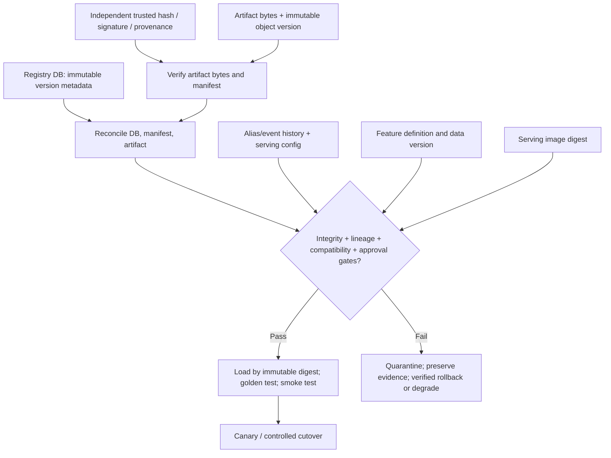

# Unit 5 — Recovering Model Artifacts and Registry Metadata

A model is recoverable only when the expected artifact bytes and the metadata that gives them meaning can be recovered together, verified against an independent trusted reference, loaded in a compatible runtime, traced to their training inputs and build, evaluated against known expectations, and safely returned to serving. A file existing in an object store is not proof that it is the right model; a registry row existing is not proof that its artifact still exists; and a successful load is not proof of acceptable predictions. This unit builds a small local registry and recovery workflow to make those claims testable without cloud services, a GPU, or real model data.

**Module:** M13 — Backup, Disaster Recovery and Resilience Testing  | **Stage:** 2E — Production DevOps & Platform Engineering  | **Unit:** 5  
**Estimated time:** 8–12 hours study and labs, depending on pace  | **Prerequisites:** M01, M05, M07–M12; M13 Units 1–4  
**Tool baseline assumed:** Python 3 standard library (`sqlite3`, `hashlib`, `json`, `unittest`); POSIX-like shell for commands. Exact installed versions: `[VERIFY]` with `python3 --version` and `sqlite3 --version` if installed. No MLflow, cloud account, GPU, or external endpoint required.  
**Last reviewed:** authored 2026-10-29; live product documentation was not verified for this lesson.  
**Footprint:** plan for about 4 CPU cores, 8 GB RAM and 30 GB free disk; **measure yours** before starting.  
**Safety:** synthetic artifacts only; destructive steps are guarded to a named disposable workspace.

## Table of contents

- [How to use this unit](#how-to-use-this-unit)
- [5.0 Why this matters in production](#50-why-this-matters-in-production)
- [5.1 Learning objectives](#51-learning-objectives)
- [5.2 Concept map and vocabulary](#52-concept-map-and-vocabulary)
- [5.3 Level 1 — Beginner](#53-level-1--beginner)
- [5.4 Level 2 — Intermediate](#54-level-2--intermediate)
- [5.5 Level 3 — Advanced](#55-level-3--advanced)
- [5.6 Level 4 — Expert](#56-level-4--expert)
- [5.7 SRE lens](#57-sre-lens)
- [5.8 Security lens](#58-security-lens)
- [5.9 Production checklist](#59-production-checklist)
- [5.10 Hands-on lab set](#510-hands-on-lab-set)
- [5.11 Self-check questions](#511-self-check-questions)
- [5.12 Evidence artifacts](#512-evidence-artifacts)
- [5.13 Common interview and design-review questions](#513-common-interview-and-design-review-questions)
- [5.14 Sources and verification notes](#514-sources-and-verification-notes)

### How to use this unit

Work through the levels in order. Level 1 builds the recovery model; Level 2 implements a registry with SQLite and local files; Level 3 adds multi-store consistency, supply-chain trust, feature compatibility, and recovery choices; Level 4 turns the exercise into a governed program. Labs are evidence-first: save expected-versus-observed results and actual measurements. Sample outputs are illustrative, not measurements. Use a throwaway folder only. Never point a lab command at a real model store or production registry.

### 5.0 Why this matters in production

Consider a registry database restored from yesterday while the artifact store has retained only some of yesterday's model objects. Its `production` alias may now reference a missing artifact, a model built against an incompatible feature schema, or a version that was not approved. Alternatively, every file may be present but a poisoned artifact may have been faithfully copied into the backup before the compromise was detected. Recovery therefore needs a consistent relationship among artifact bytes, immutable version metadata, mutable aliases, lineage, trust evidence, serving configuration, and feature definitions. The recovery decision must fail closed when integrity or trust cannot be established, while allowing a controlled rollback to a verified-good version when one exists.

### 5.1 Learning objectives

By the end, the learner can:

- **[L1]** Distinguish artifact payloads, registry metadata, aliases, lineage, serving configuration, feature state, and trust records.
- **[L1]** Explain why restore, retrain, rollback, and quarantine are different decisions.
- **[L2]** Register a synthetic artifact using write-before-metadata ordering, SHA-256, a self-describing manifest, and an audit event.
- **[L2]** Verify and load a model by immutable version/digest rather than an ambiguous `latest` path.
- **[L2]** Reconcile missing, orphaned, corrupt, unmanifested, or incompatible registry/artifact records without silently repairing them.
- **[L3]** Design a recovery marker that relates database state to artifact/manifest versions while acknowledging the lack of a cross-store transaction.
- **[L3]** Verify model/image/feature-definition compatibility and synthetic golden predictions before serving.
- **[L4]** Operate a recovery catalog, policy gate, tampered-backup exercise, three-model tabletop, and evidence-backed recovery drill.

### 5.2 Concept map and vocabulary



| Term | Meaning | Recovery implication |
|---|---|---|
| Artifact | Model weights, binary, adapter, tokenizer/config bundle, or other payload | Verify exact bytes and format; a filename is not identity. |
| Immutable model version | Stable record for a specific artifact digest and metadata | Do not overwrite a released version in place. |
| Alias/stage | Mutable pointer such as `production` or `staging` | Recover from verified history/configuration, not blindly from a stale DB snapshot. |
| Manifest | Self-describing record adjacent to an artifact | Helps reconstruct metadata, but does not prove that its claims are trustworthy. |
| Digest/hash | Cryptographic checksum such as SHA-256 over bytes | Detects changes only relative to a trusted expected digest. |
| Signature | Cryptographic evidence that a signer signed particular content/claims | Requires trusted key identity and verification policy. A hash is not a signature. |
| Provenance/attestation | Structured claim about how an artifact was built or evaluated | Must be verified against the appropriate trust policy. |
| Lineage | References to code, data, features, environment, base model, run, evaluation and approval | Missing lineage must be reported, not fabricated. |
| Recovery marker | Record connecting a DB recovery point to artifact/manifest/alias state | Helps detect mismatched cuts; does not create a distributed transaction. |
| Golden prediction test | Known inputs and expected output/tolerance for a specific model version | Detects behavior changes that byte/hash checks cannot detect. |
| Quarantine | Isolated, non-serving state for suspect objects | Preserves evidence and prevents unsafe promotion. |
| `[VERIFY]` | Product/version-specific detail that must be checked against installed official documentation | Do not infer provider behavior from this local exercise. |

**ML recovery state map**

| Layer | Example location | Source of truth / recovery path | Verification gate |
|---|---|---|---|
| Artifact bytes | `artifacts/models/risk-score/v1/artifact.bin` | Immutable versioned object plus independent backup copy | Digest and byte size match trusted reference |
| Manifest | Adjacent `manifest.json` | Versioned sidecar and separately protected evidence | Schema, digest, required lineage fields |
| Registry DB | SQLite in lab; PostgreSQL in production | Application-native backup/PITR per M05 | DB restore integrity and record reconciliation |
| Alias/event history | DB and optionally reviewed Git config | Last verified-good alias event / serving config | Target exists, is verified and approved |
| Lineage/evaluation | Evidence directory or artifact store | Run metadata, dataset/code/image/feature references | Required references resolve; metrics reviewed |
| Serving image | Registry digest or synthetic record | M01/M12 recovery path | Digest/signature/provenance policy passes |
| Feature state | Offline dataset + synthetic online table | Versioned offline data and rebuild recipe | Definition version, point-in-time and row/hash checks |
| Trust record | Independent reviewed record/evidence store | Trusted hash/signature/provenance source | Trust anchor is not solely from suspect registry/backup |

**Immutable versions versus mutable aliases**

| Property | Immutable model version | Mutable alias (`production`) |
|---|---|---|
| Meaning | Identifies a specific artifact and metadata set | Selects which version a consumer should use |
| Expected mutation | Create a new version | Move pointer with an audited event |
| Backup concern | Preserve payload, digest, manifest and lineage | Preserve history and last verified-good target |
| Failure mode | Missing/corrupt payload or incomplete metadata | Stale/dangling/unapproved target |
| Recovery rule | Verify exact bytes and metadata | Rebind only after target passes all gates |

### 5.3 Level 1 — Beginner

#### What must be recoverable

**Model artifacts** include weights, binaries, serialized files, adapters/LoRA files, tokenizer and configuration bundles, and other model payloads. Record an immutable version, artifact URI, byte size, SHA-256, media/format, creation time, runtime compatibility and source version. Large-model weights, embeddings, prompts/templates and third-party APIs are awareness topics here; no multi-GB model is needed for the lab.

**Registry metadata** describes stable model identity, immutable version, run ID, owner, metrics, tags, signature/provenance references, approvals, timestamps and audit events. An alias is a mutable pointer and must be separately audited. A stale `production` alias can point to an artifact that was pruned or is no longer approved.

**Lineage/provenance** should answer: which training-code commit, dependency lockfile, environment/container digest, dataset hash/version, feature-definition version, hyperparameters, random seeds, base-model reference, training run, evaluation report and approval produced this version? “Model v7” alone cannot answer that. M12 covers supply-chain evidence in greater depth.

**Related serving/retraining state** includes offline and online feature data, feature definitions, golden/evaluation datasets, serving image and its signature/attestation, canary traffic split, rollback target, experiment metadata, Git-controlled code/configuration, and secret references. Do not put credentials or secret values in manifests.

A coherent lab layout is:

```text
unit5-lab/                         # disposable root; never use real model data
  artifacts/models/risk-score/v1/
    artifact.bin
    manifest.json
  backups/artifacts/
  registry.sqlite
  trusted/expected-digests.json     # independent trust fixture for this synthetic lab
  evidence/
    evaluation.json
    restore-report.json
    drill-record.md
  fixtures/
    golden.json
    features-offline.json
    features-online.json
```

#### Failure scenarios and first response

| Scenario | Detection / risk | Immediate containment | Recovery choice and verification |
|---|---|---|---|
| Artifact store loss/corruption | Missing object, digest mismatch | Stop serving that version | Restore exact trusted copy; hash, load, golden-test, smoke-test |
| Registry DB loss | Registry unavailable or records missing | Freeze alias changes | Restore application-native DB backup/PITR; reconcile with artifacts |
| Metadata points to missing artifact | Dangling URI/version | Fail closed for that target | Restore artifact or rebind to a verified-good version with approval |
| Artifact exists without metadata | Orphan object | Do not auto-register/serve | Validate manifest and independent trust; reconstruct as `needs_review` |
| Production version accidentally deleted | Alias points to absent version | Freeze promotions/deletes | Restore immutable object/backup and audit record; verify before alias movement |
| Poisoned/tampered model | Trusted digest/signature/provenance mismatch | Quarantine; preserve evidence | Select pre-compromise trusted version, rotate relevant credentials, reevaluate |
| Registry rollback leaves stale alias | Alias target missing/unapproved | Block serving from alias | Resolve alias to last verified-good target in event history/Git and revalidate |
| Lineage/evaluation missing | Required fields/reports absent | Do not approve new promotion | Rebuild only from trustworthy evidence; otherwise quarantine or document loss |
| Feature definition/data mismatch | Version mismatch or golden prediction drift | Stop cutover | Restore/rebuild compatible feature state and rerun golden tests |
| Image/signature/attestation missing | Image unavailable or policy fails | Do not bypass trust checks | Restore image and required trust evidence; verify against policy |
| Model loads but golden predictions fail | Regression beyond declared tolerance | Keep out of production | Investigate environment/features; rollback or quarantine |
| Backup already contains compromise | Hash may match compromised metadata | Treat backup as suspect | Compare independent trusted record; preserve evidence and restore pre-compromise copy |

#### Restore, retrain, roll back, or quarantine

| Choice | Use when | Key caveat |
|---|---|---|
| Restore exact artifact | Trusted exact bytes exist and runtime is compatible | Fastest path to exact bytes, not proof of safe behavior by itself |
| Retrain | Exact artifact cannot be recovered and inputs/environment are sufficient | May not reproduce weights/behavior due to nondeterminism, changed data, hardware or dependencies |
| Roll back | A previous verified-good version exists | Check image/feature compatibility and consumer effects |
| Quarantine/degrade | Integrity, provenance or compatibility is unresolved | Temporary degradation is safer than serving an untrusted model |
| Accept documented loss | No trustworthy restore/retrain/rollback path exists | Requires owner decision, impact statement and evidence; never disguise loss as success |

#### Verification basics

1. Artifact exists and size/digest match a trusted expected value.
2. Signature/provenance is verified independently where required; a digest alone does not authenticate origin.
3. Artifact loads in a compatible environment without unsafe deserialization assumptions.
4. Golden-dataset predictions and evaluation metrics stay within predeclared tolerances.
5. Serving smoke test succeeds and model/image/feature versions match.
6. Alias points to an immutable verified-good version and audit history is intact.

A restored process becoming healthy is not enough. Correct recovery requires integrity, lineage, compatibility and behavior checks.

### 5.4 Level 2 — Intermediate

This level implements a local registry with SQLite and files. It is a teaching implementation, not a production registry or substitute for access control, cryptographic signing, PostgreSQL PITR, object-store immutability or independent backup.

#### Workspace setup and safety boundary

The examples below are self-contained and can be saved as `unit5-lab/registry_lab.py` in a disposable directory. They use synthetic bytes and metadata only. The code does not invoke a network, load pickle files, or call a real model runtime.

```bash
mkdir -p "$HOME/unit5-lab"
cd "$HOME/unit5-lab"
printf 'UNIT5_DISPOSABLE_LAB\n' > .unit5-lab-marker
python3 --version
```

Before any destructive exercise, confirm the path and marker:

```bash
pwd
 test "$(cat .unit5-lab-marker)" = "UNIT5_DISPOSABLE_LAB"
case "$(pwd)" in "$HOME/unit5-lab") ;; *) echo "Refusing: unexpected path" >&2; exit 2;; esac
```

Do not use `rm -rf` with an arbitrary variable. Cleanup instructions later remove only named lab files after the marker check.

#### Registry schema and representative data

The logical schema has `models` (stable identity/owner), `model_versions` (immutable version records), `aliases` (mutable pointers), and `events` (append-only audit history). Production mappings may use PostgreSQL, but SQLite in this unit is not PostgreSQL PITR.

```sql
CREATE TABLE IF NOT EXISTS models (
  model_name TEXT PRIMARY KEY,
  owner TEXT NOT NULL,
  description TEXT NOT NULL
);
CREATE TABLE IF NOT EXISTS model_versions (
  model_name TEXT NOT NULL,
  version TEXT NOT NULL,
  artifact_relpath TEXT NOT NULL,
  sha256 TEXT NOT NULL,
  byte_size INTEGER NOT NULL CHECK(byte_size >= 0),
  manifest_sha256 TEXT NOT NULL,
  run_id TEXT NOT NULL,
  code_commit TEXT NOT NULL,
  dataset_hash TEXT NOT NULL,
  image_digest TEXT NOT NULL,
  feature_version TEXT NOT NULL,
  schema_version TEXT NOT NULL,
  evaluation_ref TEXT NOT NULL,
  provenance_ref TEXT NOT NULL,
  status TEXT NOT NULL,
  created_at TEXT NOT NULL,
  PRIMARY KEY(model_name, version),
  FOREIGN KEY(model_name) REFERENCES models(model_name)
);
CREATE TABLE IF NOT EXISTS aliases (
  model_name TEXT NOT NULL,
  alias TEXT NOT NULL,
  version TEXT NOT NULL,
  updated_at TEXT NOT NULL,
  PRIMARY KEY(model_name, alias)
);
CREATE TABLE IF NOT EXISTS events (
  event_id INTEGER PRIMARY KEY AUTOINCREMENT,
  at TEXT NOT NULL,
  actor TEXT NOT NULL,
  action TEXT NOT NULL,
  model_name TEXT NOT NULL,
  version TEXT NOT NULL,
  detail_json TEXT NOT NULL
);
```

#### Complete local registry implementation

Save the following as `registry_lab.py`. It creates its own schema and supports synthetic registration, verification, alias promotion, load-by-digest, manifest export, reconciliation, and metadata reconstruction in `needs_review` status. It deliberately does not implement real cryptographic signatures; `provenance_ref` is a reference string only.

```python
#!/usr/bin/env python3
"""Synthetic model registry lab. Python standard library only."""
from __future__ import annotations
import argparse, hashlib, json, re, sqlite3, sys
from datetime import datetime, timezone
from pathlib import Path

ROOT = Path(__file__).resolve().parent
LAB_MARKER = ROOT / ".unit5-lab-marker"
DB = ROOT / "registry.sqlite"
ART = ROOT / "artifacts" / "models"
BACKUPS = ROOT / "backups" / "artifacts"
TRUST = ROOT / "trusted" / "expected-digests.json"
SAFE_ID = re.compile(r"^[A-Za-z0-9][A-Za-z0-9._-]{0,79}$")

SCHEMA = """
PRAGMA foreign_keys=ON;
CREATE TABLE IF NOT EXISTS models(model_name TEXT PRIMARY KEY, owner TEXT NOT NULL, description TEXT NOT NULL);
CREATE TABLE IF NOT EXISTS model_versions(
 model_name TEXT NOT NULL, version TEXT NOT NULL, artifact_relpath TEXT NOT NULL,
 sha256 TEXT NOT NULL, byte_size INTEGER NOT NULL CHECK(byte_size>=0), manifest_sha256 TEXT NOT NULL,
 run_id TEXT NOT NULL, code_commit TEXT NOT NULL, dataset_hash TEXT NOT NULL,
 image_digest TEXT NOT NULL, feature_version TEXT NOT NULL, schema_version TEXT NOT NULL,
 evaluation_ref TEXT NOT NULL, provenance_ref TEXT NOT NULL, status TEXT NOT NULL,
 created_at TEXT NOT NULL, PRIMARY KEY(model_name,version),
 FOREIGN KEY(model_name) REFERENCES models(model_name));
CREATE TABLE IF NOT EXISTS aliases(model_name TEXT NOT NULL, alias TEXT NOT NULL, version TEXT NOT NULL,
 updated_at TEXT NOT NULL, PRIMARY KEY(model_name,alias));
CREATE TABLE IF NOT EXISTS events(event_id INTEGER PRIMARY KEY AUTOINCREMENT, at TEXT NOT NULL,
 actor TEXT NOT NULL, action TEXT NOT NULL, model_name TEXT NOT NULL, version TEXT NOT NULL,
 detail_json TEXT NOT NULL);
"""

def now(): return datetime.now(timezone.utc).isoformat()
def digest(data: bytes) -> str: return hashlib.sha256(data).hexdigest()
def valid_id(value: str, field: str) -> str:
    if not isinstance(value, str) or not SAFE_ID.fullmatch(value):
        raise ValueError(f"invalid {field}: use letters, digits, dot, underscore, hyphen")
    return value

def require_lab():
    if ROOT == Path.home() or not ROOT.exists() or not LAB_MARKER.is_file():
        raise RuntimeError("lab marker missing or unsafe root; create/use a disposable unit5-lab directory")
    if LAB_MARKER.read_text(encoding="utf-8").strip() != "UNIT5_DISPOSABLE_LAB":
        raise RuntimeError("lab marker content mismatch")

def connect():
    require_lab(); ROOT.mkdir(parents=True, exist_ok=True)
    con = sqlite3.connect(DB)
    con.row_factory = sqlite3.Row
    con.executescript(SCHEMA)
    return con

def record_event(con, actor, action, model, version, detail):
    con.execute("INSERT INTO events(at,actor,action,model_name,version,detail_json) VALUES(?,?,?,?,?,?)",
                (now(), actor, action, model, version, json.dumps(detail, sort_keys=True)))

def artifact_path(model, version):
    model, version = valid_id(model,"model"), valid_id(version,"version")
    path = (ART / model / version / "artifact.bin").resolve()
    if ART.resolve() not in path.parents: raise ValueError("artifact path escaped root")
    return path

def manifest_path(model, version): return artifact_path(model,version).with_name("manifest.json")

def required_manifest(model, version, payload, meta):
    required = ["owner","run_id","code_commit","dataset_hash","image_digest","feature_version",
                "schema_version","evaluation_ref","provenance_ref"]
    missing = [k for k in required if not meta.get(k)]
    if missing: raise ValueError("missing required metadata: " + ", ".join(missing))
    return {"model_name":model,"version":version,"artifact":"artifact.bin","sha256":digest(payload),
            "byte_size":len(payload),"created_at":now(),**{k:meta[k] for k in required}}

def register(model, version, payload, meta, actor="lab-user"):
    require_lab(); model=valid_id(model,"model"); version=valid_id(version,"version")
    m = required_manifest(model,version,payload,meta)
    path=artifact_path(model,version); mp=manifest_path(model,version)
    if path.exists() or mp.exists(): raise FileExistsError("immutable version already exists; never overwrite it")
    path.parent.mkdir(parents=True,exist_ok=True)
    stage=path.with_suffix(".bin.staging")
    stage.write_bytes(payload)
    if digest(stage.read_bytes()) != m["sha256"]: stage.unlink(missing_ok=True); raise IOError("staged digest mismatch")
    # Local same-filesystem replace is used as a lab publication abstraction only.
    stage.replace(path)
    mp.write_text(json.dumps(m,indent=2,sort_keys=True)+"\n",encoding="utf-8")
    if digest(path.read_bytes()) != m["sha256"]: raise IOError("read-back verification failed")
    manifest_hash=digest(mp.read_bytes())
    con=connect()
    try:
        con.execute("INSERT OR IGNORE INTO models VALUES(?,?,?)",(model,meta["owner"],meta.get("description","synthetic model")))
        con.execute("INSERT INTO model_versions VALUES(?,?,?,?,?,?,?,?,?,?,?,?,?,?,?,?)",
          (model,version,str(path.relative_to(ROOT)),m["sha256"],len(payload),manifest_hash,m["run_id"],m["code_commit"],
           m["dataset_hash"],m["image_digest"],m["feature_version"],m["schema_version"],m["evaluation_ref"],
           m["provenance_ref"],"registered",m["created_at"]))
        record_event(con,actor,"register",model,version,{"sha256":m["sha256"],"manifest_sha256":manifest_hash})
        con.commit()
    except Exception:
        con.rollback(); raise
    finally: con.close()
    return m

def verify(model,version):
    con=connect()
    try: row=con.execute("SELECT * FROM model_versions WHERE model_name=? AND version=?",(model,version)).fetchone()
    finally: con.close()
    if not row: raise KeyError("registry version not found")
    path=ROOT / row["artifact_relpath"]; mp=manifest_path(model,version)
    if not path.is_file() or not mp.is_file(): raise FileNotFoundError("artifact or manifest missing")
    data=path.read_bytes(); raw=mp.read_bytes(); m=json.loads(raw)
    if digest(data)!=row["sha256"] or digest(data)!=m.get("sha256"): raise ValueError("artifact digest mismatch; fail closed")
    if len(data)!=row["byte_size"] or len(data)!=m.get("byte_size"): raise ValueError("artifact size mismatch")
    if digest(raw)!=row["manifest_sha256"]: raise ValueError("manifest digest mismatch")
    if m.get("model_name")!=model or m.get("version")!=version: raise ValueError("manifest identity mismatch")
    return {"model":model,"version":version,"sha256":digest(data),"byte_size":len(data),"status":"PASS_INTEGRITY_ONLY"}

def promote(model,alias,version,approval_ref,actor="approver"):
    model=valid_id(model,"model"); alias=valid_id(alias,"alias"); version=valid_id(version,"version")
    if not approval_ref: raise ValueError("approval reference required")
    verify(model,version)
    con=connect()
    try:
        row=con.execute("SELECT status FROM model_versions WHERE model_name=? AND version=?",(model,version)).fetchone()
        if not row or row["status"] not in ("registered","verified_good"): raise ValueError("version not eligible")
        con.execute("INSERT INTO aliases VALUES(?,?,?,?) ON CONFLICT(model_name,alias) DO UPDATE SET version=excluded.version,updated_at=excluded.updated_at",
                    (model,alias,version,now()))
        record_event(con,actor,"promote_alias",model,version,{"alias":alias,"approval_ref":approval_ref})
        con.commit()
    except Exception: con.rollback(); raise
    finally: con.close()

def load_by_digest(model,version,expected_digest):
    result=verify(model,version)
    if result["sha256"] != expected_digest: raise ValueError("requested digest does not match; fail closed")
    return (artifact_path(model,version)).read_bytes()

def export_manifest(model,version,dest):
    verify(model,version); src=manifest_path(model,version); dest=Path(dest)
    if dest.resolve().is_relative_to(ROOT.resolve()): raise ValueError("export destination must be outside lab root to model independent evidence")
    dest.parent.mkdir(parents=True,exist_ok=True); dest.write_bytes(src.read_bytes()); return digest(dest.read_bytes())

def reconcile():
    findings=[]; con=connect()
    try:
        rows=con.execute("SELECT * FROM model_versions").fetchall()
        known={(r["model_name"],r["version"]) for r in rows}
        for r in rows:
            p=ROOT/r["artifact_relpath"]; mp=manifest_path(r["model_name"],r["version"])
            if not p.is_file(): findings.append(["CRITICAL",r["model_name"],r["version"],"missing_artifact","restore trusted copy; fail closed"])
            elif digest(p.read_bytes())!=r["sha256"]: findings.append(["CRITICAL",r["model_name"],r["version"],"artifact_hash_mismatch","quarantine and restore trusted copy"])
            if not mp.is_file(): findings.append(["HIGH",r["model_name"],r["version"],"missing_manifest","recover verified manifest; review metadata"])
            elif digest(mp.read_bytes())!=r["manifest_sha256"]: findings.append(["HIGH",r["model_name"],r["version"],"manifest_hash_mismatch","preserve evidence; do not overwrite silently"])
            if not r["provenance_ref"]: findings.append(["HIGH",r["model_name"],r["version"],"missing_provenance","review before promotion"])
        for p in ART.glob("*/*/artifact.bin"):
            model,version=p.parts[-3],p.parts[-2]
            if (model,version) not in known: findings.append(["MEDIUM",model,version,"orphan_artifact","verify trust and manifest; do not auto-approve"])
        for a in con.execute("SELECT * FROM aliases"):
            target=con.execute("SELECT status FROM model_versions WHERE model_name=? AND version=?",(a["model_name"],a["version"])).fetchone()
            if not target: findings.append(["CRITICAL",a["model_name"],a["version"],"dangling_alias:"+a["alias"],"restore/rebind only to verified-good version"])
            else:
                try: verify(a["model_name"],a["version"])
                except Exception: findings.append(["CRITICAL",a["model_name"],a["version"],"alias_target_unverified:"+a["alias"],"fail closed; rollback after review"])
        return findings
    finally: con.close()

def rebuild_metadata_from_manifests():
    """Reconstruct missing rows as needs_review; never auto-approve or set aliases."""
    require_lab(); con=connect(); count=0
    try:
        for mp in ART.glob("*/*/manifest.json"):
            m=json.loads(mp.read_text(encoding="utf-8")); model=valid_id(m["model_name"],"model"); version=valid_id(m["version"],"version")
            payload=artifact_path(model,version).read_bytes()
            if digest(payload)!=m.get("sha256") or len(payload)!=m.get("byte_size"): continue
            con.execute("INSERT OR IGNORE INTO models VALUES(?,?,?)",(model,m.get("owner","unknown-owner"),"reconstructed; review required"))
            con.execute("INSERT OR IGNORE INTO model_versions VALUES(?,?,?,?,?,?,?,?,?,?,?,?,?,?,?,?)",
              (model,version,str(artifact_path(model,version).relative_to(ROOT)),m["sha256"],len(payload),digest(mp.read_bytes()),
               m.get("run_id","missing"),m.get("code_commit","missing"),m.get("dataset_hash","missing"),m.get("image_digest","missing"),
               m.get("feature_version","missing"),m.get("schema_version","missing"),m.get("evaluation_ref","missing"),
               m.get("provenance_ref","missing"),"needs_review",m.get("created_at",now())))
            record_event(con,"recovery-tool","metadata_reconstructed_needs_review",model,version,{"source":"manifest","approval":False}); count+=1
        con.commit(); return count
    except Exception: con.rollback(); raise
    finally: con.close()

def seed():
    meta={"owner":"ml-platform","run_id":"run-001","code_commit":"git:abc123","dataset_hash":"sha256:dataset-demo",
          "image_digest":"sha256:image-demo","feature_version":"features-v1","schema_version":"toy-v1",
          "evaluation_ref":"evidence/evaluation.json","provenance_ref":"lab-only:synthetic-attestation","description":"synthetic risk score"}
    payload=b"synthetic-risk-score-model-v1\n"
    m=register("risk-score","v1",payload,meta)
    TRUST.parent.mkdir(parents=True,exist_ok=True)
    TRUST.write_text(json.dumps({"risk-score/v1":m["sha256"]},indent=2)+"\n",encoding="utf-8")
    promote("risk-score","production","v1","approval-demo-001")
    return m

def main():
    ap=argparse.ArgumentParser(); sub=ap.add_subparsers(dest="cmd",required=True)
    sub.add_parser("init"); sub.add_parser("seed"); sub.add_parser("list"); sub.add_parser("reconcile"); sub.add_parser("rebuild-metadata")
    v=sub.add_parser("verify"); v.add_argument("model"); v.add_argument("version")
    p=sub.add_parser("promote"); p.add_argument("model"); p.add_argument("alias"); p.add_argument("version"); p.add_argument("approval_ref")
    l=sub.add_parser("load-by-digest"); l.add_argument("model"); l.add_argument("version"); l.add_argument("sha256")
    args=ap.parse_args()
    try:
        if args.cmd=="init": connect().close(); print("initialized synthetic registry")
        elif args.cmd=="seed": print(json.dumps(seed(),indent=2))
        elif args.cmd=="verify": print(json.dumps(verify(args.model,args.version),indent=2))
        elif args.cmd=="promote": promote(args.model,args.alias,args.version,args.approval_ref); print("alias promotion recorded; integrity checked (approval is a lab reference)")
        elif args.cmd=="load-by-digest": print("verified bytes:",len(load_by_digest(args.model,args.version,args.sha256)))
        elif args.cmd=="reconcile": print(json.dumps(reconcile(),indent=2))
        elif args.cmd=="rebuild-metadata": print("reconstructed records needing review:",rebuild_metadata_from_manifests())
        elif args.cmd=="list":
            con=connect(); print(json.dumps([dict(r) for r in con.execute("SELECT model_name,version,sha256,status FROM model_versions ORDER BY model_name,version")],indent=2)); con.close()
    except Exception as exc:
        print(f"ERROR: {type(exc).__name__}: {exc}",file=sys.stderr); return 2
    return 0
if __name__=="__main__": raise SystemExit(main())
```

The local publication sequence writes and hashes staged bytes before creating metadata. The `Path.replace` operation is only a local same-filesystem lab abstraction; it is not a claim about object-store atomicity or a transaction across artifact storage and SQLite. If a crash occurs after artifact publication but before DB commit, an orphan remains and reconciliation detects it. If the DB commit succeeds but later artifact loss occurs, reconciliation detects a missing artifact. Retrying registration must be idempotent at the application level; the sample refuses to overwrite an existing immutable version.

#### Registry regression tests

Save as `test_registry_lab.py` beside `registry_lab.py`. Tests patch the module paths to a fresh temporary directory; they do not touch the learner's existing lab data.

```python
import tempfile, unittest
from pathlib import Path
from unittest.mock import patch
import registry_lab as r

class RegistryTests(unittest.TestCase):
    def setUp(self):
        self.tmp = tempfile.TemporaryDirectory(prefix="unit5-registry-test-")
        root = Path(self.tmp.name)
        marker = root / ".unit5-lab-marker"
        marker.write_text("UNIT5_DISPOSABLE_LAB", encoding="utf-8")
        self.patches = [
            patch.object(r, "ROOT", root), patch.object(r, "LAB_MARKER", marker),
            patch.object(r, "DB", root / "registry.sqlite"), patch.object(r, "ART", root / "artifacts" / "models"),
            patch.object(r, "BACKUPS", root / "backups" / "artifacts"),
            patch.object(r, "TRUST", root / "trusted" / "expected-digests.json")]
        for item in self.patches: item.start()
        self.meta = {"owner":"test-owner", "run_id":"run-test", "code_commit":"git:test",
            "dataset_hash":"sha256:dataset-test", "image_digest":"sha256:image-test",
            "feature_version":"features-v1", "schema_version":"toy-v1",
            "evaluation_ref":"eval-test.json", "provenance_ref":"lab-only:test"}

    def tearDown(self):
        for item in reversed(self.patches): item.stop()
        self.tmp.cleanup()

    def test_register_and_verify(self):
        m = r.register("toy-model", "v1", b"toy-bytes", self.meta)
        self.assertEqual(r.verify("toy-model", "v1")["sha256"], m["sha256"])

    def test_missing_owner_rejected(self):
        bad = dict(self.meta); bad.pop("owner")
        with self.assertRaisesRegex(ValueError, "owner"): r.register("toy-model", "v1", b"x", bad)

    def test_path_traversal_rejected(self):
        with self.assertRaises(ValueError): r.artifact_path("../outside", "v1")

    def test_duplicate_immutable_version_rejected(self):
        r.register("toy-model", "v1", b"toy-bytes", self.meta)
        with self.assertRaises(FileExistsError): r.register("toy-model", "v1", b"other", self.meta)

    def test_corrupt_artifact_fails_closed(self):
        r.register("toy-model", "v1", b"toy-bytes", self.meta)
        p = r.artifact_path("toy-model", "v1"); p.write_bytes(b"tampered")
        with self.assertRaisesRegex(ValueError, "digest mismatch"): r.verify("toy-model", "v1")

    def test_promotion_requires_approval_reference(self):
        r.register("toy-model", "v1", b"toy-bytes", self.meta)
        with self.assertRaisesRegex(ValueError, "approval reference"): r.promote("toy-model", "production", "v1", "")

    def test_bad_lab_marker_blocks_operations(self):
        r.LAB_MARKER.write_text("NOT_A_LAB", encoding="utf-8")
        with self.assertRaisesRegex(RuntimeError, "marker content mismatch"): r.connect()

if __name__ == "__main__": unittest.main(verbosity=2)
```

Run with `python3 -m unittest -v test_registry_lab.py`. The tests use temporary synthetic files and should not alter the main lab fixture. Save the output as evidence. They test the educational implementation, not a production registry's durability or security.

Initialize and seed synthetic data:

```bash
python3 - <<'PY'
from pathlib import Path
p=Path.cwd()
assert p.name == "unit5-lab", f"unexpected directory: {p}"
(p/".unit5-lab-marker").write_text("UNIT5_DISPOSABLE_LAB\n", encoding="utf-8")
PY
python3 registry_lab.py init
python3 registry_lab.py seed
python3 registry_lab.py verify risk-score v1
python3 registry_lab.py list
python3 registry_lab.py reconcile
```

`seed` is intended to run once in a fresh lab. If the version already exists, stop and inspect the lab rather than deleting files blindly. A digest in `trusted/expected-digests.json` is a synthetic independent reference for the exercise; in production, protect trust records in a separate controlled system and use the appropriate signature/provenance verification.

#### Registry policy gate

Before registration/promotion, require owner, digest, size, manifest, code and dataset references/hashes, serving image digest, feature version, evaluation reference, provenance/signature reference, and an approval event for production. The sample validates most required metadata at registration and requires an approval reference for alias promotion. A real policy gate must verify that evaluation and approval evidence exists and is authentic; non-empty strings alone are not enough.

A suitable negative-test matrix is:

| Input | Expected result | Reason |
|---|---|---|
| Complete synthetic metadata and new version | PASS registration | Required references present and bytes hashed |
| Missing owner | Reject | Ownership is required for accountability |
| Missing dataset hash or code commit | Reject | Lineage incomplete |
| Missing image digest or feature version | Reject | Serving compatibility cannot be established |
| Missing evaluation/provenance reference | Reject | Required evidence absent |
| Promotion without approval reference | Reject | No recorded authorization |
| Artifact bytes changed after registration | Verify fails closed | Digest no longer matches |
| Artifact path contains `../` | Reject identifier | Prevent path traversal |
| Attempt to register same immutable version again | Reject | Released version is not overwritten |

#### Restore drills and reconciliation

The reconciliation report reports findings; it does not auto-repair. Each finding includes severity, object/version, evidence category and a safe action. A production-grade report should also include timestamps, source backup IDs, approver and serving-block decision.

**Lab-only safe mutations:**

```bash
# Confirm the disposable workspace before touching any fixture.
test "$(cat .unit5-lab-marker)" = "UNIT5_DISPOSABLE_LAB"
test "$(pwd)" = "$HOME/unit5-lab"

# Artifact deletion drill: move the exact named artifact into the lab backup.
mkdir -p backups/artifacts/risk-score/v1
mv artifacts/models/risk-score/v1/artifact.bin backups/artifacts/risk-score/v1/artifact.bin
python3 registry_lab.py reconcile
# Restore exact named artifact, then verify. This is only a synthetic file.
mv backups/artifacts/risk-score/v1/artifact.bin artifacts/models/risk-score/v1/artifact.bin
python3 registry_lab.py verify risk-score v1
```

For corruption, preserve the original synthetic bytes first, change only the named lab artifact, run `verify`, observe failure, quarantine the corrupt bytes under a named evidence folder, and restore the known-good copy. Do not overwrite the only copy. For DB loss, copy `registry.sqlite` to `backups/registry-before-drill.sqlite` before the drill; simulate loss by moving only `registry.sqlite` to a named lab backup, recreate schema, run manifest reconstruction, and confirm reconstructed records remain `needs_review`. To test actual DB backup restoration, restore the saved SQLite file to the exact lab DB path and reconcile. For a bad alias migration, record the prior alias target, make a lab-only change, inspect the append-only event history, then restore the last verified-good target only after re-verification. The sample CLI does not expose arbitrary deletion or bulk alias mutation commands by design.

**Recovery marker example**

```json
{
  "marker_id": "registry-cut-001",
  "state": "committed",
  "db_position": "sqlite-backup-sha256:ILLUSTRATIVE_DB_DIGEST",
  "db_backup_time": "[ILLUSTRATIVE] 2026-10-28T12:00:00Z",
  "artifact_versions": [{"model":"risk-score","version":"v1","object_version":"local-file-v1","manifest_sha256":"ILLUSTRATIVE_MANIFEST_DIGEST"}],
  "alias_event_sequence": 4,
  "event_log_digest": "ILLUSTRATIVE_EVENT_DIGEST",
  "capture_method": "freeze alias changes; enumerate DB and artifacts; verify pair; commit marker",
  "limitations": "timestamps alone do not establish a consistent cut across independent stores"
}
```

The values labelled illustrative are placeholders, not actual digests. A recovery marker should be captured while alias changes and artifact deletion/promotion are frozen or coordinated. Record a prepared marker, inventory and verify the related DB backup/artifact versions/manifests/event sequence, then mark committed only when checks pass. If capture is interrupted, leave the marker uncommitted and reject it during restore. This protocol improves detection; it does not make the DB and artifact store one atomic transaction.

#### MLflow-style registry awareness

An MLflow-style architecture typically separates a backend metadata store from an artifact store and may add model-version/alias concepts. Exact APIs, backend requirements, alias semantics, artifact URI behavior and version compatibility are `[VERIFY]` against the official documentation for the installed release. This lesson's SQLite registry is intentionally a small local teaching implementation and is not a compatibility claim about MLflow.

### 5.5 Level 3 — Advanced

#### Reproducibility versus recoverability

Reproducibility means a process can be repeated under stated assumptions; recoverability means the system can return to an acceptable known state. Neither implies the other. Training can vary because of nondeterministic kernels, hardware/runtime differences, dependency changes, unrecorded seeds, changed data, mutable external base models, feature drift, or missing preprocessing code. Preserve the exact released artifact as the primary route to exact recovery, alongside its dataset hash/version, code commit, lockfile, image digest, feature definition, hyperparameters/seeds, base model/tokenizer/prompt versions, evaluation and approval evidence.

#### Registry architecture and failure windows

| Step | Durable result | Crash window / recovery action |
|---|---|---|
| Validate request | Required metadata accepted | Reject incomplete input; no object published |
| Write staging bytes | Temporary payload exists | Remove/quarantine stale staging only after checking exact lab path |
| Hash and verify | Digest and size known | Retry verification; never trust filename alone |
| Publish immutable artifact + manifest | Versioned payload exists | If DB row absent, reconciliation reports orphan; verify then register/review |
| Read back | Published bytes rechecked | Quarantine on mismatch; do not create metadata |
| Insert immutable registry record + event | DB references artifact | If commit outcome unknown, query by idempotency key/version and reconcile before retry |
| Evaluate/approve | Evidence and approval recorded | Do not promote while pending |
| Move alias | Consumer pointer changes | Audit before/after targets; rollback only to verified-good version |

Registry DB HA reduces interruption but does not replace backup/PITR. Artifact versioning/immutability and an independent copy protect bytes; the DB backup protects metadata. Independent credentials/failure domains matter. Two-phase-style registration is an application workflow, not a distributed transaction: use durable transitions, idempotent retries, and reconciliation.

#### Registry recovery decision framework

| Decision | Trust confidence | Availability / lineage | RTO considerations | Gate |
|---|---|---|---|---|
| Restore exact artifact | Trusted digest/signature and provenance available | Exact artifact and required metadata available | Retrieve + verify + load | Hash, manifest, compatibility, golden and smoke tests pass |
| Retrain | Trusted artifact unavailable; data/code/features adequate | Reproducibility assumptions documented | Training duration uncertain; may exceed RTO | Evaluate output and obtain approval; not assumed byte-identical |
| Roll back | Prior verified-good immutable version exists | Compatible image and features available | Often reduces time to safe service | Revalidate triple and consumer compatibility |
| Quarantine/degrade | Integrity/provenance unresolved | Safe fallback or reduced service may exist | May prolong degraded state | Fail closed; communicate and preserve evidence |
| Accept documented loss | No trusted recovery path | Owner accepts explicit impact | RTO/RPO cannot be met | Formal decision, scope, owner, consumer notice, evidence |

#### Tampered-backup recovery

Backups can faithfully preserve malicious bytes. If compromise is suspected, preserve evidence and identify the compromise window before overwriting or cleaning up. Compare the suspect artifact against an independent trusted digest/signature/provenance record that is not stored solely in the suspect registry or backup. Quarantine the suspect copy; select a pre-compromise trusted version; rotate relevant credentials/trust material; verify signatures and provenance; rerun evaluation and serving tests; record the incident. A hash matching metadata from a potentially compromised database is insufficient.

#### Large artifact RTO contributors

Measure artifact size, retrieval/read throughput, checksum duration, decompression/loading time, cold-start latency, image pull time and cache state. Pre-stage verified copies or mirrors where justified. Use resumable transfer if supported by the chosen storage client `[VERIFY]`; quarantine partial files and verify after transfer before publication. Do not serve partially downloaded artifacts. Cost factors include storage, replication, egress and reserved capacity; this unit invents no prices. Laptop measurements are laptop measurements, not production throughput claims.

#### Feature-store recovery

Offline feature data and online feature state have different recovery paths. Where architecture permits, rebuild online state from a versioned offline dataset using the matching feature-definition version; measure rebuild time and validate row counts, key uniqueness, hashes and point-in-time rules. The model expects the feature contract used for training or an explicitly approved compatible contract. A mismatch can change predictions despite a valid model digest. The lab uses `features-offline.json` and `features-online.json`; no real feature store is required.

```python
# Minimal synthetic compatibility check; save as feature_check.py if desired.
def check_triple(model_digest, expected_image, actual_image,
                 expected_feature, actual_feature, dataset_hash, expected_dataset_hash):
    errors=[]
    if not model_digest.startswith("sha256:"): errors.append("model digest missing/invalid")
    if expected_image != actual_image: errors.append("serving image mismatch")
    if expected_feature != actual_feature: errors.append("feature-definition mismatch")
    if dataset_hash != expected_dataset_hash: errors.append("dataset hash mismatch")
    return {"status":"FAIL" if errors else "PASS", "errors":errors}

assert check_triple("sha256:toy", "sha256:image-a", "sha256:image-a", "features-v1", "features-v1", "data-h1", "data-h1")["status"] == "PASS"
assert check_triple("sha256:toy", "sha256:image-a", "sha256:image-b", "features-v1", "features-v2", "data-h1", "data-h1")["status"] == "FAIL"
```

#### Experiment tracking and lineage verification

A lineage report for `risk-score/v1` should answer: which dataset hash/version, code commit, dependency/environment, serving image, feature definition, base model, hyperparameters, run ID, evaluation and approval produced it? If a field or referenced evidence is missing, emit `MISSING` or `UNKNOWN`; do not fill it with plausible guesses. Recovered metadata is not the same as verified provenance.

#### Version-triple consistency

| Model artifact | Serving image | Feature definition | Result |
|---|---|---|---|
| `risk-score/v1`, digest matches | `sha256:image-demo` | `features-v1` | Eligible for deeper checks, not automatically safe |
| `risk-score/v1` | `sha256:image-other` | `features-v1` | Fail: image contract mismatch |
| `risk-score/v1` | `sha256:image-demo` | `features-v2` | Fail unless a documented compatibility test approves it |
| Digest mismatch | Any | Any | Fail closed regardless of compatibility |

A matching triple is necessary but not sufficient: the golden prediction suite, lineage, policy and smoke test must also pass.

### 5.6 Level 4 — Expert

#### ML recovery catalog schema

Use one row per immutable model version, with mutable alias state recorded separately. A governed catalog should include: model name, owner/data steward, criticality, RTO/RPO reference, immutable version, current alias, artifact URI/object version/digest/size, immutable-copy location, registry DB backup/PITR method and last tested restore, manifest/recovery-marker location, code commit, environment/image digest and lockfile, dataset hash/version, feature version, base model and hyperparameters/seeds, signature/attestation and independent trusted reference, evaluation/golden report, approval, serving/canary config, rollback target, feature-store rebuild plan, downstream consumers, recovery decision, last drill with measured values clearly labelled, open risks and owner.

**Three-model synthetic catalog**

| Model/version | Role / criticality | Artifact / trust | Lineage / compatibility | Recovery plan / open risk |
|---|---|---|---|---|
| `risk-score/v1` | Batch risk scoring / Tier A `[ILLUSTRATIVE]` | `sha256:toy-risk-v1`; independent digest record | `features-v1`, `sha256:image-demo`, `dataset-h1`; golden report `eval-risk-v1.json` | Restore exact artifact, verify, canary; risk: feature rebuild duration unmeasured |
| `demand-forecast/v2` | Forecasting / Tier B `[ILLUSTRATIVE]` | `sha256:toy-forecast-v2`; immutable backup copy | `features-demand-v2`, `sha256:image-forecast`, `dataset-h2` | Roll back to verified `v1` if compatible; risk: seasonal evaluation coverage |
| `anomaly-detector/v3` | Platform anomaly signal / Tier B `[ILLUSTRATIVE]` | `sha256:toy-anomaly-v3`; signature reference `[VERIFY]` | `features-ops-v3`, `sha256:image-anomaly`, `dataset-h3` | Rebuild online features then verify; risk: approval evidence must be confirmed |

All digests and tiers above are illustrative labels, not real computed hashes or measured criticality. Catalog values must be replaced with verified records in an actual environment.

#### Registry-side policy gate

Require, at minimum, artifact digest and byte size, self-describing manifest, owner, code and dataset references/hashes, serving image digest, feature version, evaluation report, provenance/signature reference or explicitly lab-only synthetic attestation, and an approval/promotion event for a production alias. A lab-only reference string is not a cryptographic signature. Real verification requires a supported signing format, trusted identity/key, policy, revocation/rotation handling, and verification at restore and load; tool integrations are `[VERIFY]` against M12 and current official documentation.

#### Restore and serving verification suite

A release/recovery gate should run, in order:

1. Resolve alias to immutable model/version/digest; never load an ambiguous `latest` path.
2. Verify artifact hash/size against independent trusted reference and manifest.
3. Verify signature/provenance and approval under policy; fail closed if trust fails.
4. Verify image/model/feature-definition/data contract compatibility.
5. Load using a safe, compatible format/runtime; do not load untrusted pickle-like content.
6. Run golden predictions and metric checks using predeclared tolerances.
7. Run serving smoke test, then canary/rollback gate.
8. Record evidence and keep suspect versions quarantined.

| Test | Planted defect | Expected gate |
|---|---|---|
| Artifact integrity | Alter one byte | FAIL closed; quarantine |
| Loadability | Missing/corrupt config or adapter | FAIL; do not promote |
| Triple compatibility | Wrong image or feature version | FAIL pending documented compatibility evidence |
| Golden regression | Prediction outside tolerance | FAIL or controlled rollback |
| Alias freshness | `production` points to absent/unverified version | FAIL serving gate |
| Trust reference | Independent expected digest/signature mismatch | FAIL closed |
| Lineage/evaluation | Missing required lineage or report | Block approval/promotion |
| Feature availability | Required online feature absent/stale | Block cutover or use approved safe fallback |
| Smoke test | Endpoint stub fails | Do not cut over; preserve current verified-good target |

#### Retrain-versus-restore experiment

Use a tiny deterministic model represented by synthetic bytes and a deterministic function rather than a real ML framework. Record restore time, hash verification time, load/test time, retrain/construction time, digest equality, golden prediction differences, and dependency assumptions. A byte-identical artifact restore is expected to preserve the bytes; a reconstructed artifact may differ even when predictions match. This toy experiment cannot establish production-scale training time or reproducibility.

#### Feature-store rebuild and point-in-time consistency

Rebuild the synthetic online feature table from versioned offline rows, verifying row counts, unique entity keys, source timestamp cutoff, feature-definition version and deterministic hash. Before switching the online pointer, run the golden suite against the candidate features; retain the previous version for rollback. A valid artifact plus mismatched features can silently change predictions.

#### Poisoned-model tabletop

**Scenario:** an attacker or compromised build path promotes a tampered model. This is an illustrative exercise, not a claim about a real incident.

| Time / role | Action | Evidence / gate |
|---|---|---|
| T+0 Incident commander | Declare severity, freeze promotions and preserve logs | Incident ID, scope and comms channel |
| T+5 Security lead | Quarantine suspect artifact/alias; preserve hashes and relevant audit events | Chain-of-custody notes; no destructive cleanup yet |
| T+10 ML platform owner | Compare with independent trusted digest/signature/provenance and identify compromise window | Trusted reference and artifact inventory |
| T+20 Serving owner | Select pre-compromise verified-good version; validate image/feature triple | Compatibility and golden report |
| T+30 Incident commander + approver | Canary/rollback only after gates pass; communicate consumer impact | Approval, before/after alias event, smoke test |
| After containment | Rotate affected credentials, investigate build/registry path, add test and review backup window | Findings, owners, due dates, recurrence test |

Times are `[ILLUSTRATIVE]` sequence markers, not promised durations. The response should preserve evidence before overwriting or deleting anything.

#### Expert incident analysis

| Scenario | Detection and immediate action | Recovery / verification | Prevention, owner and recurrence test |
|---|---|---|---|
| DB restored but `production` alias points to pruned version | Dangling alias; freeze serving/promotion | Restore artifact or bind to last verified-good version; hash, compatibility and golden checks | Platform owner: retention/alias reconciliation test before restore sign-off |
| Versioning off, artifact overwritten, no hash metadata | Exact bytes cannot be established; preserve remaining copies | Search independent backup/trusted records; if none, quarantine and document loss or retrain with explicit uncertainty | Artifact owner: immutable released versions and registration policy negative test |
| Retraining changed metrics/behavior | Compare digest and golden report | Treat as a new candidate; do not label it restored exact model | ML owner: restore-vs-retrain test and approval gate |
| Backup contains tampered model | Independent trust mismatch or compromise window | Quarantine; restore pre-compromise verified copy; re-evaluate | Security/M12: tampered-backup test using separate trusted reference |
| Serving loads path without hash check | Audit shows load path bypasses verification | Stop unsafe serving, verify current bytes, rollback if trust is unknown | Serving owner: load-by-digest test and policy enforcement |
| Feature definitions differ from training | Triple mismatch and prediction drift | Restore/rebuild compatible feature version; golden and point-in-time checks | Feature owner: compatibility checker and feature-store rebuild test |
| All models in one region/bucket | Failure-domain inventory reveals single copy | Follow Unit 6 dependency/region strategy; this unit does not design federation | Platform owner: independent-copy restore drill; real regional proof required |
| Notebook is only final-model copy | Catalog shows no registered artifact/manifest | Preserve notebook and evidence, assess trust/lineage; do not promote unverified output | Model owner: registration required before release; orphaned-artifact audit |

### 5.7 SRE lens

Model-serving recoverability is both availability and correctness. A service returning HTTP 200 with the wrong model, wrong feature schema, or an unverified artifact is not a successful recovery. Tie objectives to [Unit 1 — RTO/RPO](01-recovery-time-and-recovery-point-objectives.md); artifact protection to [Unit 2](02-backup-scope-retention-and-immutability.md); platform ordering to [Unit 3](03-restoring-platform-metadata-and-configuration.md); dataset/checkpoint state to [Unit 4](04-recovering-data-pipeline-state-and-checkpoints.md); regional strategy to [Unit 6](06-regional-failure-and-dependency-outage-strategies.md); and drill evidence governance to [Unit 7](07-restore-drills-and-recovery-evidence.md).

| Metric | Definition / unit | Source | Alert intent | Limitation |
|---|---|---|---|---|
| Artifact retrieval duration | Time from request to complete local/object retrieval; seconds | Restore job timestamps | Warn before RTO budget is consumed | Depends on size, cache and environment |
| Integrity verification duration | Hash/signature/provenance verification time; seconds | Verification logs | Identify slow or skipped verification | Fast verification does not prove trust policy quality |
| Registry restore duration | Time to DB restore and reconciliation; seconds/minutes | Drill timeline | Detect backup/restore regression | SQLite lab is not production DB evidence |
| Verified model coverage | Critical models with a successful restore + serving test / critical models; % | Recovery catalog | Identify untested critical models | Catalog completeness must be audited |
| Alias incidents | Count of dangling/unverified alias targets per window | Registry reconciliation | Page on any critical serving alias failure | Depends on complete event history |
| Lineage completeness | Required lineage fields/evidence present / required fields; % | Lineage report | Block promotion for missing mandatory fields | Presence does not prove truth |
| Golden regression pass rate | Passing golden cases / total cases; % | Model verification suite | Fail cutover on required-case failures | Dataset may not cover all real-world behavior |
| Feature rebuild duration | Time to build/validate online state; seconds/minutes | Feature rebuild job | Compare with RTO and freshness budget | Laptop timings do not predict production throughput |
| Restore drill success | Drills meeting all declared gates / drills attempted; % | Evidence bundle | Track trend and overdue critical-model tests | A passing drill is bounded by tested scope |

Do not invent universal SLO targets. Define targets from business impact, model tier and measured restore behavior. Recovery capacity includes artifact bytes, verification, load time, feature rebuild, registry recovery, human approval and canary observation. A cold-read drill by someone other than the author is useful because hidden assumptions often dominate elapsed time.

### 5.8 Security lens

- **Synthetic-only lab data:** manifests and logs contain no secrets or customer data. Credentials are referenced through approved secret-management mechanisms (M09), not embedded in artifacts or manifests.
- **Least privilege:** separate rights to read artifacts, write staging, publish immutable objects, modify registry metadata, move aliases and delete data. Production alias changes and destructive deletes may require two-person approval.
- **Independent trust:** keep trusted hash/signature/provenance records outside the potentially compromised registry and backup. Hash equality only detects changes relative to the expected digest; it does not authenticate the publisher.
- **Integrity at multiple boundaries:** verify during registration, after restore, and before load/serving. Never promote solely because the registry row says `verified`.
- **Poisoning and backup compromise:** a backup can preserve malicious bytes. Quarantine, preserve evidence, determine the compromise window, select a pre-compromise trusted version and rotate affected credentials/trust material.
- **Safe deserialization:** do not load untrusted serialized objects. Prefer safer formats compatible with the application and verify format/runtime expectations; exact format guidance is `[VERIFY]` for the selected library.
- **Auditability:** record actor, timestamp, action, before/after alias, approval reference, artifact digest, restore source and verification result. Avoid logging payloads or secret values.
- **Encryption and key custody:** protect artifact stores, registry backups and manifests according to sensitivity. Confirm historical backup decryptability after key rotation; retain required key versions under policy without placing plaintext keys beside backups.
- **Privacy deletion:** after restore, reapply deletion/tombstone records where applicable so deleted records do not reappear in datasets or feature stores. Assign an owner and verification evidence; this is technical awareness, not legal advice.
- **Fail closed:** integrity/trust failures block serving. If a verified rollback exists, use it through a controlled approval/canary path; otherwise degrade or quarantine rather than bypassing checks.

### 5.9 Production checklist

#### Before an incident

- [ ] Every critical model/version has an owner, immutable artifact URI/version, digest, byte size and independent trusted reference.
- [ ] Artifact and registry metadata are backed up independently; restore procedures are tested together.
- [ ] Manifests include code, dataset, environment/image, feature, evaluation and provenance references.
- [ ] Released artifact versions are protected from silent overwrite; retention and deletion approvals are defined.
- [ ] Alias history and last verified-good target are preserved outside a single mutable DB snapshot where appropriate.
- [ ] Golden inputs, tolerances, compatibility rules and serving smoke tests are versioned.
- [ ] Feature-store offline/online rebuild plan and point-in-time checks exist.
- [ ] Secrets/key custody and break-glass access are documented (M09); runbook is available out of band (M10).

#### During recovery

- [ ] Declare incident, freeze risky promotions/deletions, preserve evidence and identify suspected compromise window.
- [ ] Restore registry DB and artifacts from identified sources; record backup IDs and recovery marker.
- [ ] Reconcile DB rows, artifact bytes, manifests, aliases and event history; do not auto-repair mismatches.
- [ ] Verify digest against an independent trusted record and verify required signature/provenance policy.
- [ ] Mark reconstructed metadata `needs_review`; never auto-approve it.
- [ ] Verify lineage, image digest, feature-definition version, dataset hash and evaluation evidence.

#### Before serving/cutover — explicit go/no-go

- [ ] **GO only if** artifact exists, byte size/digest match, trust policy passes and manifest identity is consistent.
- [ ] **GO only if** model/image/feature/data contract compatibility passes or a documented compatibility approval exists.
- [ ] **GO only if** golden prediction regression and smoke test pass within predeclared tolerance.
- [ ] **GO only if** alias target is immutable, verified-good, approved and audit history is intact.
- [ ] **NO-GO** on missing signature/provenance where policy requires it, hash mismatch, missing required lineage/evaluation, or unresolved compromise.
- [ ] Canary and rollback target are prepared; communication to downstream consumers is ready.

#### After recovery

- [ ] Record measured phase timings, restored bytes, digest results, prediction results and manual interventions.
- [ ] Confirm feature-store state and downstream consumer behavior; monitor freshness and correctness.
- [ ] Reapply privacy deletion/tombstones where applicable.
- [ ] Preserve suspect artifacts and logs under incident evidence policy; rotate affected credentials if needed.
- [ ] Update catalog, exceptions, owners, runbook and recurrence tests; communicate residual risk.

### 5.10 Hands-on lab set

All five labs use the same synthetic `risk-score/v1` example unless a lab explicitly adds the other catalog entries. Use Python 3 standard library and local files; optional MinIO/PostgreSQL/MLflow is not required. Resource planning baseline: 4 CPU cores, 8 GB RAM, 30 GB disk; **measure yours**. Keep the lab root at `$HOME/unit5-lab`, marked with `.unit5-lab-marker`. Never point commands at a real registry or model store.

#### Lab 1 — Build the minimal recoverable model registry

**Outcomes:** create schema, artifact manifest, immutable version, audit event, alias and digest verification. **Prerequisites:** Python 3 and shell. **Estimated time:** 90–120 minutes. **Footprint:** under a few small files; measure yours. **Safety boundary:** synthetic bytes only; no real model or credentials.

Flow: validate metadata → stage bytes → hash → publish artifact/manifest → read back → insert registry metadata/event → evaluate/approve → promote alias.

**Steps**

1. Create the disposable directory and marker using the commands in 5.4.
2. Save the complete `registry_lab.py` code from 5.4 in the lab root.
3. Run `python3 registry_lab.py init`, then `python3 registry_lab.py seed` once.
4. Run `python3 registry_lab.py verify risk-score v1`, `list`, and `reconcile`.
5. Run a negative test by attempting to register a version missing `owner` in a short Python snippet that imports `required_manifest`; expect `ValueError`. Run a path traversal check with `valid_id('../outside','model')`; expect `ValueError`.
6. Inspect `manifest.json`, registry rows and `events`; confirm the manifest contains references and hashes but no secret values.

**Representative output — not executed here**

```text
initialized synthetic registry
status: PASS_INTEGRITY_ONLY
model: risk-score
version: v1
sha256: <computed synthetic digest>
reconcile: []
```

**Expected-versus-observed**

| Check | Expected | Observed |
|---|---|---|
| Manifest/artifact digest | Same digest | `[MEASURED: fill in]` |
| Byte size | Matches actual file | `[MEASURED: fill in]` |
| Duplicate version registration | Rejected | `[MEASURED: fill in]` |
| Promotion without approval reference | Rejected | `[MEASURED: fill in]` |

**Measurement record:** registration duration ___ s; bytes ___; verify duration ___ s; run date/time ___; host/runtime ___; failures/manual steps ___. **Success criteria:** immutable version exists, digest verifies, audit event exists, alias points to that version only after the gate. **Troubleshooting:** check marker/path first; inspect traceback without exposing payloads; if seed already exists, do not rerun blindly. **Cleanup:** after confirming `pwd` and marker, remove only named `registry.sqlite`, `artifacts/`, `trusted/`, and `evidence/` under the lab root. Verify `find "$HOME/unit5-lab" -maxdepth 2 -type f -print` shows only intended remaining lab files. **Evidence:** schema, manifest, verify report, alias/event history. **Fidelity caveat:** local SQLite/filesystem does not prove multi-store atomicity, independent failure domains or production signing.

#### Lab 2 — Artifact integrity and registry metadata recovery

**Outcomes:** restore deleted artifact, detect corruption, recover DB metadata, and repair a bad alias safely. **Prerequisites:** completed Lab 1 with a verified copy of the synthetic artifact and `registry.sqlite`. **Estimated time:** 90–150 minutes. **Footprint:** a few duplicate small files; measure yours. **Safety:** all moves are within the marked disposable lab.

**Steps**

1. Copy the exact artifact to `backups/artifacts/risk-score/v1/artifact.bin` and the DB to `backups/registry-before-drill.sqlite`; record hashes.
2. Move `artifacts/models/risk-score/v1/artifact.bin` to that backup path only after verifying it is the synthetic file. Run reconciliation; expected missing-artifact finding. Restore it and verify digest.
3. Copy a known-good artifact to a named backup, alter one byte in the working copy, and run `verify`; expected failure. Move the corrupt copy to `evidence/quarantine/`; restore known-good bytes and verify. Do not discard the corrupt evidence until the drill record is complete.
4. Simulate DB loss by moving `registry.sqlite` to `backups/registry-lost.sqlite`. Run `init`, then `rebuild-metadata`; confirm reconstructed records are `needs_review`. Alternatively restore `registry-before-drill.sqlite` to the exact DB path and compare reconciliation results.
5. Record the `production` alias target, make a lab-only alias change through the CLI, inspect `events`, and restore the previous verified-good target after running `verify`. Do not edit or mass-update aliases in a real registry.

**Representative output — not executed here**

```text
CRITICAL missing_artifact risk-score/v1 -> restore trusted copy; fail closed
ERROR ValueError: artifact digest mismatch; fail closed
reconstructed records needing review: 1
```

**Expected-versus-observed**

| Drill | Expected failure | Recovery gate | Observed |
|---|---|---|---|
| Deleted artifact | Missing artifact | Digest matches after restore | `[MEASURED: fill in]` |
| Corrupted artifact | Hash mismatch | Quarantined and trusted copy verifies | `[MEASURED: fill in]` |
| Lost DB | Metadata absent | DB backup restored or manifest reconstruction marked review | `[MEASURED: fill in]` |
| Bad alias | Alias target differs | Last verified-good target restored and event recorded | `[MEASURED: fill in]` |

**Measurement:** each drill start/end ___; bytes restored ___; hash result ___; manual intervention ___; total elapsed ___; actual vs expected ___. **Success criteria:** no suspect artifact is served, all recoveries are recorded, reconstructed metadata is not approved automatically. **Troubleshooting:** a manifest is not proof of trust; compare with the independent lab trust file. **Cleanup:** restore a consistent known-good lab state, then remove only named backups/quarantine after evidence capture; verify the registry reconciles. **Evidence:** drill report, hashes, quarantine record, alias audit. **Fidelity caveat:** SQLite file moves model a lab DB loss, not PostgreSQL PITR or a production registry outage.

#### Lab 3 — Serving recovery, prediction regression and compatibility

**Outcomes:** load by digest, test model/image/feature compatibility, detect stale aliases and missing features, run golden predictions, and make a controlled rollback decision. **Prerequisites:** Lab 1 registry and synthetic golden fixture. **Estimated time:** 60–90 minutes. **Footprint:** negligible; measure yours. **Safety:** inference is a local deterministic stub; no network calls.

Use this tiny synthetic predictor and gate, saved as `serving_check.py`:

```python
import hashlib, json
from pathlib import Path

def sha256(p): return hashlib.sha256(Path(p).read_bytes()).hexdigest()
def predict(features):
    # Synthetic deterministic behavior, not a trained model.
    return round(float(features["x"]) * 2.0 + float(features["bias"]), 6)
def verify_serving(artifact, expected_digest, image, expected_image, feature_version, expected_feature,
                   feature_record, golden, tolerance=1e-9):
    errors=[]
    if sha256(artifact)!=expected_digest: errors.append("artifact digest mismatch")
    if image!=expected_image: errors.append("serving image mismatch")
    if feature_version!=expected_feature: errors.append("feature definition mismatch")
    if not feature_record: errors.append("required feature data missing")
    if errors: return {"status":"FAIL_CLOSED","errors":errors}
    actual=[predict(row["input"]) for row in golden]
    expected=[row["expected"] for row in golden]
    diffs=[abs(a-e) for a,e in zip(actual,expected)]
    if any(d>tolerance for d in diffs): errors.append("golden prediction regression")
    return {"status":"FAIL_CLOSED" if errors else "PASS","errors":errors,"actual":actual,"max_abs_diff":max(diffs,default=0.0)}

# Synthetic fixture. Digest is computed from the actual lab artifact.
if __name__ == "__main__":
    p=Path("artifacts/models/risk-score/v1/artifact.bin")
    if not p.is_file(): raise SystemExit("missing lab artifact; run Lab 1 first")
    g=[{"input":{"x":1,"bias":0.5},"expected":2.5},{"input":{"x":2,"bias":0.0},"expected":4.0}]
    print(json.dumps(verify_serving(p,sha256(p),"sha256:image-demo","sha256:image-demo",
          "features-v1","features-v1",True,g),indent=2))
```

**Steps:** save the script; run it; change the feature version in the invocation to `features-v2` and confirm fail-closed; change an expected golden prediction and confirm regression failure; use an incorrect digest and confirm failure; restore correct inputs and rerun. The stub does not load the bytes as executable ML code. **Representative output — not executed here:** `status: PASS`, `max_abs_diff: 0.0` for the valid fixture. **Expected-versus-observed:** valid triple ___; bad image ___; bad feature version ___; bad digest ___; golden regression ___; smoke-test stub ___. **Measurement:** load/check duration ___; test count ___; tolerance ___; host/runtime ___. **Success criteria:** no integrity/trust failure can pass; compatibility and golden checks gate canary. **Cleanup:** preserve evidence then restore fixture values; remove only named `serving_check.py` and lab-generated report. **Evidence:** compatibility report, golden output and decision. **Fidelity caveat:** a deterministic stub does not prove real model loadability, production latency, calibration or safety.

#### Lab 4 — Tampered backup and retrain-versus-restore

**Outcomes:** detect a backup that contains altered synthetic bytes using a trusted reference outside the suspect registry/backup; quarantine it; restore a trusted version; compare exact restore to deterministic reconstruction. **Prerequisites:** Lab 1 and a copied trusted artifact/digest. **Estimated time:** 60–90 minutes. **Footprint:** tiny files; measure yours. **Safety:** no malware, real models, or external service.

**Steps**

1. Copy the known-good artifact and its digest into the lab's independent `trusted/expected-digests.json` and `backups/` before mutation. The trusted fixture must not be recomputed from the suspect file after corruption.
2. Alter a byte in a copy under `backups/tampered/`; calculate its digest and compare with the independent trusted digest. Expected mismatch.
3. Quarantine the suspect copy and preserve a report containing path, digest, time, and action. Do not overwrite the trusted copy.
4. Restore the trusted artifact into the named lab version path and verify the digest and manifest. Run the serving/golden suite from Lab 3.
5. Construct the same tiny deterministic predictor/artifact again and compare bytes, digest, outputs and elapsed time. If the serialization includes timestamps or non-deterministic metadata, byte equality is not expected; record that explicitly.

**Representative output — not executed here**

```text
trusted_digest_match: false
action: quarantine suspect backup
restored_trusted_copy: true
prediction_comparison: PASS within declared tolerance
```

**Expected-versus-observed:** suspect digest ___; trusted digest ___; quarantine path ___; restored digest ___; restore duration ___; reconstruction duration ___; digest equality ___; prediction difference ___; decision/reason ___. **Success criteria:** altered backup is not served, trusted copy verifies, comparison separates byte identity from behavioral similarity. **Troubleshooting:** never update the trusted reference from the suspect copy. **Cleanup:** preserve evidence, then remove only named tampered fixture after report review; confirm no suspect file is referenced by the production alias in the lab DB. **Evidence:** trusted-hash comparison, quarantine record, restore report, retrain comparison. **Fidelity caveat:** this demonstrates integrity-check logic, not a real signing system or production compromise response.

#### Lab 5 — Feature-store rebuild, ML recovery catalog and tabletop

**Outcomes:** rebuild online feature state from synthetic offline data; verify feature-definition and point-in-time consistency; produce lineage report; complete three-model catalog; run a poisoned-model tabletop. **Prerequisites:** Labs 1–4 and synthetic fixtures. **Estimated time:** 90–120 minutes. **Footprint:** small JSON files; measure yours. **Safety:** all data are synthetic; no cloud or real model endpoint.

**Synthetic feature rebuild exercise**

Create `features-offline.json`:

```json
{
  "definition_version": "features-v1",
  "as_of": "2026-10-28T12:00:00Z",
  "rows": [
    {"entity_id":"entity-001","event_time":"2026-10-28T11:00:00Z","x":1.0,"bias":0.5},
    {"entity_id":"entity-002","event_time":"2026-10-28T11:30:00Z","x":2.0,"bias":0.0}
  ]
}
```

Write a small script to parse JSON, assert `definition_version == "features-v1"`, require unique `entity_id`, reject rows later than `as_of`, then write a deterministic sorted online JSON fixture. Hash both files and compare counts/keys. Change online version to `features-v2` to demonstrate compatibility failure. Do not switch the active feature pointer until checks pass; keep the previous online file for rollback.

**Lineage report:** for each catalog entry, list code commit, dataset hash, image digest, feature version, run ID, base-model reference, evaluation report and approval. Missing fields must be `MISSING`/`UNKNOWN`, never guessed. Complete the three-model table in 5.6 with actual lab evidence and identify which fields are illustrative.

**Tabletop:** use the timeline in 5.6. Record role, action, evidence, decision, approval and consumer communication. Ask: what if the trusted hash is also unavailable? Expected answer: quarantine and do not serve until an authorized trust decision establishes a safe path; do not trust the suspect registry by default.

**Expected-versus-observed:** offline rows ___; online rows ___; duplicate keys ___; late rows ___; feature hash ___; compatibility result ___; lineage missing fields ___; tabletop decisions ___; action owners/dates ___. **Measurement:** rebuild time ___; bytes ___; hash time ___; checks passed/total ___; host/runtime ___. **Success criteria:** deterministic rebuild matches the intended feature contract, incompatible version is rejected, catalog/tabletop evidence is complete. **Cleanup:** retain only synthetic evidence needed for the learning record; remove only named lab fixture files after marker/path checks. Verify no external endpoint or credential was used. **Evidence:** feature rebuild report, lineage report, catalog, tabletop timeline and final evidence bundle. **Fidelity caveat:** local JSON does not prove production feature-store point-in-time guarantees, multi-region consistency, or recovery capacity.

### 5.11 Self-check questions

1. Why is a model file present in storage not sufficient evidence of recoverability?
2. What is the difference between an immutable model version and a mutable alias?
3. Why should artifact bytes be written and verified before registry metadata points to them? What failure window remains?
4. What can a SHA-256 digest prove, and what can it not prove?
5. Why is rebuilding registry metadata from manifests not allowed to auto-approve models?
6. A model digest verifies but golden predictions regress. What should happen next?
7. Why might retraining fail to reproduce the exact model even with the same code and nominal dataset?
8. A restored model expects `features-v1`, but the online feature store is at `features-v2`. What is the safe recovery decision?

#### Answer key with reasoning

1. The bytes may be wrong, corrupt, untrusted, incompatible, or detached from lineage. Recoverability requires independent integrity/trust evidence, loadability, evaluation, compatibility and serving verification.
2. An immutable version identifies a specific artifact/metadata set; an alias is a mutable pointer. Restoring the DB can restore a stale alias, so target verification is required before serving.
3. Write-before-metadata reduces the chance of a registry row pointing at bytes never published. It does not make object storage and DB atomic; a crash after artifact publication but before DB commit can leave an orphan. Reconciliation and idempotent retry handle that state.
4. SHA-256 can detect a change relative to a trusted expected digest. It does not identify who created the bytes, prove benign intent, or provide provenance. A compromised registry may hold a matching malicious digest; trust must be independent.
5. A manifest can be stale, forged or incomplete. Reconstructed records are leads for review, not proof of approval, signature validity or evaluation. Mark them `needs_review` and rebuild trust/evaluation evidence.
6. Fail the serving gate, preserve evidence, investigate runtime/features/preprocessing and regression causes, and use a verified-good rollback or controlled degradation. Do not bypass integrity checks; a hash alone cannot prove semantic correctness.
7. Hardware, nondeterministic operations, dependency versions, mutable data/base models, missing seeds, preprocessing and environment can change weights or behavior. Retraining is a fallback candidate that requires evaluation, not an exact restore guarantee.
8. Do not cut over. Restore/rebuild the compatible feature definition/data or obtain documented compatibility evidence, then rerun point-in-time and golden prediction checks. Keep the prior safe serving state until gates pass.

### 5.12 Evidence artifacts

Retain the following in the learner's own disposable lab workspace. Use synthetic records only; never commit secrets, private datasets, generated credentials or real model payloads.

| Artifact | What it proves | What it does not prove |
|---|---|---|
| Registry schema and synthetic rows | Data model and sample registration state | Production database durability or access control |
| Artifact manifest + digest report | Recorded identity/size and bytes matched at test time | Publisher authenticity unless trusted signature/provenance was independently verified |
| Registry/artifact reconciliation report | Detected listed missing/orphan/corrupt/dangling cases | Complete discovery of all external stores unless inventory is complete |
| Recovery marker | Recorded DB/artifact/alias consistency claim for a named cut | A global atomic transaction across independent systems |
| Restore-drill expected-vs-observed tables | Which scenarios were attempted and what checks passed | Untested failure modes or real regional resilience |
| Alias event history and rollback record | Pointer movement and stated approval reference | Authentic human approval unless identity/signature controls were verified |
| Trusted-hash comparison/quarantine record | Suspect bytes differ from the separate expected digest | Malware attribution or full compromise scope |
| Golden prediction and smoke report | Behavior matched declared test inputs/tolerances at test time | Generalization to all production inputs |
| Model/image/feature compatibility report | Declared triple and dataset references matched rules | Semantic compatibility beyond tested contracts |
| Feature-store rebuild report | Synthetic row/key/hash/version checks passed | Production-scale throughput or all point-in-time guarantees |
| Retrain-vs-restore comparison | Local elapsed time, digest and prediction comparison | Production training time or guaranteed reproducibility |
| Three-model recovery catalog | Owners, restore path and evidence gaps are explicit | Catalog completeness unless audited against live systems |
| Tabletop timeline and decisions | Roles, gates, evidence and actions were rehearsed | That the incident procedure works without a live drill |
| Blank and completed measurement forms | Separates planned fields from actual learner measurements | Any value left blank or labelled illustrative |

Suggested evidence bundle:

```text
evidence/
  registry-schema.sql
  manifest-risk-score-v1.json
  artifact-verification.json
  reconciliation-report.json
  recovery-marker.json
  drill-expected-vs-observed.md
  alias-audit.json
  trusted-hash-check.json
  golden-prediction-report.json
  compatibility-report.json
  feature-rebuild-report.json
  retrain-vs-restore.md
  recovery-catalog.md
  tabletop-timeline.md
  measurements-blank.md
```

#### Blank measurement record

| Phase | Start | End | Elapsed | Bytes | Digest/result | Manual action / issue |
|---|---|---|---|---:|---|---|
| Locate backup | ___ | ___ | ___ | ___ | ___ | ___ |
| Restore artifact | ___ | ___ | ___ | ___ | ___ | ___ |
| Restore registry DB | ___ | ___ | ___ | ___ | ___ | ___ |
| Reconcile metadata | ___ | ___ | ___ | n/a | ___ | ___ |
| Verify trust/compatibility | ___ | ___ | ___ | n/a | ___ | ___ |
| Golden/smoke tests | ___ | ___ | ___ | n/a | ___ | ___ |
| Canary/cutover decision | ___ | ___ | ___ | n/a | ___ | ___ |

Mark learner measurements `[MEASURED]` only after actually recording them. Mark sample values `[ILLUSTRATIVE]`.

### 5.13 Common interview and design-review questions

#### 1. Why must model artifacts and registry metadata be backed up and restored as a consistent pair?

**Model answer:** The registry records identity, digest, lineage, evaluation and alias targets, while the artifact store holds the actual bytes. Independent restores can leave dangling metadata, orphaned artifacts, stale aliases or a model whose lineage/feature contract does not match. Use a recovery marker, artifact-before-metadata ordering, independent trusted integrity evidence and reconciliation; do not claim a cross-store atomic transaction.

**Evaluation rubric:** strong answers distinguish bytes from metadata, immutable versions from aliases, explain crash windows, and name verification gates. Weak answers assume a DB snapshot plus object-store copy is automatically consistent.

#### 2. Why is retraining not a guaranteed replacement for restoring the exact model artifact?

**Model answer:** Retraining may differ due to nondeterministic kernels, hardware/runtime differences, changed data, dependency versions, unrecorded seeds or mutable base models. Restore the exact trusted artifact when possible; treat retraining as a new candidate requiring lineage, evaluation, compatibility and approval.

**Evaluation rubric:** strong answers distinguish byte identity from behavioral similarity and discuss missing inputs/environment. Weak answers equate same code with same weights.

#### 3. How would you detect and recover when metadata points to a missing or corrupted artifact?

**Model answer:** Freeze the affected alias, reconcile registry rows against artifacts/manifests, compare digest and size to an independent trusted reference, preserve evidence, restore a verified copy or select a verified-good rollback, rerun compatibility/golden/smoke checks, and update the alias with an audited approval. Never overwrite the only suspect copy.

**Evaluation rubric:** strong answers include fail-closed behavior, independent trust, rollback and evidence. Weak answers simply re-upload a file with the same name.

#### 4. How do you recover safely from a poisoned or tampered model backup?

**Model answer:** Preserve logs and suspect bytes, identify the compromise window, compare against trusted pre-compromise hash/signature/provenance outside the suspect system, quarantine the copy, rotate relevant credentials, restore a trusted version, revalidate lineage/evaluation and serving compatibility, then canary or roll back with incident communication. A matching digest in a compromised DB is not sufficient.

**Evaluation rubric:** strong answers recognize that backups can preserve compromise and prioritize evidence. Weak answers restore the newest backup automatically.

#### 5. How do you prove a restored model, serving image and feature definitions are compatible and safe to serve?

**Model answer:** Resolve alias to immutable version/digest; verify bytes and trust; check the image digest, feature-definition/schema and dataset contract; verify lineage and approval; load in a compatible runtime; run golden prediction regression within declared tolerance and serving smoke test; then use a controlled canary with rollback ready. Integrity/trust failures are non-bypassable.

**Evaluation rubric:** strong answers combine cryptographic/integrity checks, semantic tests, feature compatibility and staged cutover. Weak answers rely only on pod health or a matching hash.

### 5.14 Sources and verification notes

#### Source families and verification status

Live documentation was not consulted during authoring. The following are authoritative documentation families to check for the actual installed versions; product-specific details remain `[VERIFY]`.

- **Python standard library:** `hashlib`, `sqlite3`, `pathlib`, `json`, and `unittest` documentation at `https://docs.python.org/3/library/`. Verify the installed Python version and filesystem semantics for the target OS.
- **PostgreSQL:** official backup/PITR and WAL documentation at `https://www.postgresql.org/docs/`. M05 owns detailed DB recovery mechanics; check the actual major-version documentation before applying production procedures.
- **MLflow:** official documentation at `https://mlflow.org/docs/latest/` for registry, backend store and artifact-store concepts. Exact APIs, alias semantics and supported versions are `[VERIFY]`.
- **Container image digests and registries:** check the official documentation for the chosen registry/runtime and its digest/signature support; M01 owns registry mechanics. Do not infer attestation/referrer storage semantics across products.
- **Supply-chain signatures/provenance:** use the official documentation for the actual M12 tools and formats (for example, Sigstore/Cosign and SLSA where applicable). Exact commands, trust roots, verification policy and attestation formats are `[VERIFY]`.
- **Model serialization:** consult the official documentation for the selected framework/format. Unsafe deserialization risks and compatibility differ by format; do not load untrusted pickle-like payloads.
- **Object-store versioning/immutability:** consult the selected provider's official docs for version IDs, retention/object-lock semantics, deletion behavior and consistency guarantees. This lesson makes no provider-specific guarantee.

#### What is supported versus assumed

| Category | Statement | Treatment |
|---|---|---|
| General architectural principle | Artifact bytes and registry metadata are separate state that must be reconciled | Taught as a design principle; exact recovery mechanics depend on systems |
| General integrity principle | A digest detects changes relative to an expected digest but does not authenticate publisher identity | Applies to hash verification; signatures/provenance need separate trust validation |
| Lab assumption | SQLite and local files model registry and artifact storage | Synthetic teaching abstraction only; not production HA/PITR or cross-store atomicity |
| Lab assumption | `provenance_ref` and approval references are strings | References are not cryptographic proof; real policy must verify evidence |
| Product-specific | MLflow API/alias/backend/artifact-store behavior | `[VERIFY]` against installed release |
| Product-specific | Object-store versioning, immutable retention and replication semantics | `[VERIFY]` against selected provider and configuration |
| Product-specific | Signature/attestation formats and verification flags | `[VERIFY]` against actual M12 toolchain |
| Open issue | Whether restored artifacts remain decryptable after key rotation and whether historical trust records are available | `[OPEN — requires human verification]` for each real environment |
| Open issue | Whether the production serving runtime and feature store can satisfy the model's declared compatibility contract | `[OPEN — requires human verification]` until tested in the target environment |

#### Cross-module handoff

> **Handoff:** M01 taught container-registry and image-recovery fundamentals; M05 taught database backup/PITR; M08 taught GitOps serving configuration, canary and rollback; M09 taught secrets and key custody; M11 taught observability and lineage; M12 taught ML supply-chain provenance, signatures and attestations; M13 Units 1–4 covered recovery objectives, backup protection, platform metadata and pipeline state/checkpoints. This unit owns the **ML-specific recovery contract**: model artifact bytes, registry metadata, immutable versions, mutable aliases, lineage/provenance, artifact-to-metadata consistency, trusted integrity verification, feature/image/model compatibility, and proving a restored model is safe to serve. It hands regional/dependency strategy to Unit 6 and drill-evidence governance to Unit 7 without re-teaching those modules.

#### Roadmap coverage and self-audit

| Pass | Result | Notes / remaining limitation |
|---|---|---|
| 1 — Structure and scope | PASS | Required headings, TOC, handoff and five labs are present; only this Unit 5 document is delivered. |
| 2 — L1 recoverability concepts | PASS | Artifact, metadata, aliases, lineage, feature state, serving config and failure cases covered. |
| 3 — Registry implementation | FIXED | SQLite schema and local registry example included; lab policy references are not real signature verification. |
| 4 — Protection and consistency | PASS | Recovery marker and reconciliation explain cross-store limitations. |
| 5 — Restore drills | PASS | Deleted/corrupt artifact, DB loss/rebuild and alias rollback drills specified. |
| 6 — L3/L4 architecture | PASS | Tampered backup, feature-store rebuild, catalog and tabletop included. |
| 7 — Serving verification | PASS | Digest, compatibility, golden and smoke gates fail closed in the lab model. |
| 8 — Code quality and evidence | OPEN | Embedded code should be run by the learner in the target environment; no live production or external integration tests are claimed here. |
| 9 — Safety and security | PASS | Synthetic data, disposable-path checks, independent trust concept and quarantine guidance included. |
| 10 — Final audit report | OPEN | Product/version integrations, actual signature verification, production restore times and independent backup-domain proof require human verification. |

**Limitations:** This lesson's local code is a teaching reference, not a hardened production registry. The synthetic `provenance_ref` and approval references are not signatures or proof of human authorization. Product/version behavior, cryptographic trust integration, database PITR, object-store immutability, and real serving compatibility must be verified against the installed systems. AI self-audit does not replace a human running the safe labs and reviewing the actual environment.
