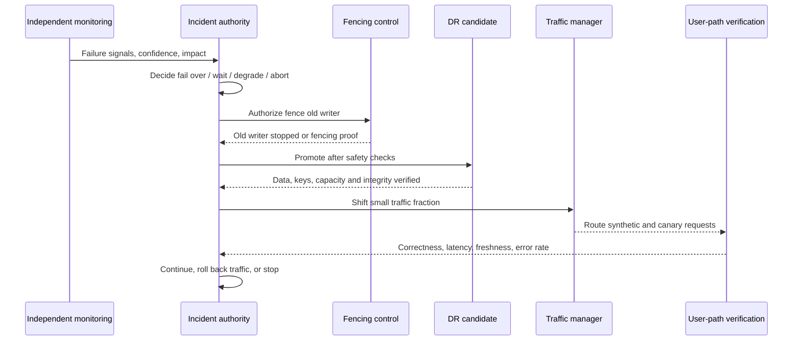

# Unit 6 — Regional Failure and Dependency Outage Strategies

**Target file:** `06-regional-failure-and-dependency-outage-strategies.md` | **Estimated time:** 18–26 hours | **Prerequisites:** M01–M12 and M13 Units 1–5 | **Core tools:** Python 3, shell, `kind`, `kubectl`, local Git, PostgreSQL, `sha256sum`; optional MinIO and local DNS/certificate tools | **Awareness:** cloud global load balancers, provider-native replication, managed DR, queue mirroring, multi-provider DNS | **Last reviewed:** 2026-10-29 | **Tool baseline:** record installed versions; implementation-specific behavior is `[VERIFY]` | **Footprint:** target 4 CPU / 8 GB RAM / 30 GB free disk; sequence components and measure yours | **Destructive labs:** yes, synthetic data and explicitly named lab resources only

> **Evidence rule:** an architecture diagram is a design claim; a successful, recorded, bounded exercise is evidence for the exact conditions tested. Neither a standby environment nor a script proves recovery by existing.

## 6.0 Why this matters in production

Process and node failures are often bounded: a supervisor restarts a process or a scheduler replaces a pod. A regional or dependency outage can affect many apparently unrelated components that share identity, networking, keys, DNS, registries, Git, or a control plane. Partial failures and gray failures are particularly dangerous because some requests succeed while others time out, causing health checks to disagree and retries to amplify load. The data plane may keep serving while the control plane cannot provision nodes, refresh credentials, pull images, or apply configuration. A standby that exists but lacks quota, trusted images, keys, valid credentials, certificates, data consistency, monitoring, or an independent failover path is not a ready recovery site.

### Illustrative incident narrative

**Synthetic example, not a real company incident.** A model-serving API begins returning intermittent errors during severe object-storage latency. Responders initially assume the primary region is down and propose switching traffic to the DR cluster. The DR cluster is running, but its artifact copy is behind, its image cache lacks the latest digest, and the runbook requires the unavailable primary-region identity console to mint an emergency credential. Retries from serving pods add load to the failing object store. The dependency graph shows that already-running pods can safely use a verified in-memory model for a bounded period, while new pods and retraining jobs cannot initialize. Responders bound retries, freeze model promotion, enable a freshness-bounded degraded mode, use governed break-glass access, verify data markers and writer authority, and only then authorize a controlled failover. They validate predictions, data freshness, security, and monitoring before shifting traffic. The lesson is not “always fail over”; it is “choose the least risky action using evidence and pre-agreed authority.”

### Scope and handoff

This unit owns DR strategy and failure-handling design. M13 Units 1–5 provide objectives, backup/immutability, platform metadata recovery, pipeline checkpoint recovery, and model artifact/registry recovery. M14 owns steady-state multi-cluster operations, fleet management, traffic federation, cross-cluster GitOps, and policy distribution.

> This unit teaches **DR strategy and failure-handling design** for regional/zonal loss and for outages of dependencies (cloud services, SaaS, registries, DNS, identity providers, Git hosts, secrets backends). M14 teaches the **steady-state operation of multi-cluster and multi-region platforms** (fleet management, traffic federation, GitOps across clusters, policy distribution). The labs here simulate region failure with two kind clusters on one laptop — **a simulation of the workflow, not a real regional failure domain** — and must never be presented as regional-failure assurance.

### Failure classes

- **Process/node failure:** a process or node is lost; other control and data paths may remain independent.
- **Zone/region failure:** a larger set of compute, storage, network, or managed services is unavailable/degraded; exact provider boundaries are `[VERIFY]`.
- **Dependency outage:** an external/shared service fails while the workload may remain healthy: DNS, identity, Git, package index, secrets, certificate authority, observability, or upstream data.
- **Partial failure / gray failure:** only some requests, tenants, operations, or paths fail. Health depends on which probe and user path is measured.
- **Control-plane unavailability:** provisioning, reconciliation, credential issuance, or configuration changes fail while already-running data-plane traffic may continue.
- **Shared fate:** apparently redundant components fail together because they share provider, credential, key, network, control plane, or human access path.

## 6.1 Learning objectives

By completion, the learner can:

1. **[L1]** Map process-to-global failure domains and identify at least five shared-fate relationships.
2. **[L1/L2]** Classify hard/soft dependencies by operation and distinguish declared from observed edges.
3. **[L2]** Produce a dependency register with owner, signals, mitigation, test status, and residual risk.
4. **[L2/L3]** Defend a DR strategy against RTO/RPO, consistency, cost, capacity, and operational burden.
5. **[L2]** Design bounded timeouts, retries, jitter, retry budgets, circuit breakers, bulkheads, freshness-bounded fallbacks, idempotency, load shedding, and dependency-aware health.
6. **[L3]** Calculate a hypothetical asynchronous replication loss window and explain why lag does not fully determine business RPO.
7. **[L3]** Align database, object-store, and queue recovery points with markers and reconciliation.
8. **[L3]** Make failover/fail-back decisions with authority, fencing, abort conditions, and verification gates.
9. **[L3]** Validate capacity, quota, image, identity, secret, key, certificate, DNS, configuration, and monitoring parity.
10. **[L2/L3]** Run safe local outage and two-`kind` workflow simulations while documenting fidelity limits.
11. **[L3/L4]** Execute fail-back as a second migration and re-establish protection.
12. **[L4]** Design a sustained resilience program with owners, game days, evidence, and remediation tracking.

## 6.2 Concept map and vocabulary

```text
Failure-domain inventory → declared + observed dependency graph
 → failure-mode/blast-radius analysis → strategy + bounded mitigations
 → failover decision/authority → fence → promote → verify → shift traffic
 → fail-back/reconciliation/re-protection → evidence and continuous improvement
```

| Term | Definition used here | Common misconception |
|---|---|---|
| Failure domain | Resources likely to fail together because of physical, logical, administrative, or dependency boundary. | Two named clusters are independent. |
| Blast radius | Users, services, data and operations affected by a failure. | Only the directly failed component matters. |
| Correlated failure/shared fate | Multiple components fail from one cause or shared dependency. | Different vendors/regions guarantee independence. |
| Zone/region/provider/global dependency | Increasingly broad boundaries; provider definitions `[VERIFY]`. Global dependencies include DNS, identity or SaaS control planes. | Multi-region removes all common dependencies. |
| Hard/soft dependency | Hard: operation cannot safely proceed without it. Soft: operation can continue in a defined degraded mode. Classification is per operation and state. | A dependency is always hard or soft. |
| Declared/observed dependency | Declared in configuration/catalog; observed in runtime telemetry or tests. | A service catalog is complete. |
| Outage/partial failure/partition | Unavailable service; some operations failing; or communication disrupted between components. | A timeout proves the remote service is down. |
| Gray failure/brownout/blackout | Ambiguous partial degradation / reduced capability / effectively unavailable service. | Health is binary. |
| RTO/RPO | Recovery Time Objective and Recovery Point Objective: target time to restore and target maximum acceptable loss. | They are measured results. |
| RTA/RPA | Achieved Recovery Time and Achieved Recovery Point measured using declared start/end and data-marker definitions. Other sources may use these terms differently. | A target proves it was achieved. |
| Failover/fail-back/flapping | Transfer authority to recovery target / later migrate to chosen normal site / repeated switching from unstable signals. | Fail-back is just DNS reversal. |
| Split-brain/fencing/single writer/quorum | Multiple authoritative writers / prevent old writer continuing / one write authority / system-specific voting threshold. | Two sites can always resolve a partition safely. |
| Sync/async replication and lag | Replication waits for a defined remote acknowledgement condition / acknowledges earlier / delay or position difference. Exact semantics `[VERIFY]`. | Async RPO always equals lag; sync always means zero loss. |
| Recovery marker/consistent cut | Durable business marker that helps align related state across systems / set of recovery points preserving application relationships. | Newest copy from each store is consistent. |
| Backup/restore, pilot light, warm standby, active/passive, active/active | Spectrum from rebuild-and-restore to continuously running sites; active/passive has one authority; active/active has concurrent traffic/work. | Active/active is always simpler or safer. |
| Static stability | Awareness-level principle: safe running data-plane functions survive certain control-plane failures using bounded cached state/credentials. Formal meaning varies `[VERIFY]`. | Cache credentials indefinitely. |
| Timeout/retry budget/circuit breaker/bulkhead | Bound waiting / cap retry work / stop repeated calls / isolate concurrency and resources. | More retries always help. |
| Fallback/load shedding/graceful degradation | Safe reduced function / reject lower-priority work / preserve critical path while optional capability is disabled. | Any fallback is safe. |
| DNS TTL/client cache | Advertised DNS cache lifetime; recursive resolvers and applications may cache independently `[VERIFY]`. | TTL guarantees universal propagation time. |
| Control plane/data plane/break-glass | Provision/configure / serve workload traffic / approved, audited emergency path independent of failed normal path where feasible. | Healthy API means control operations work. |
| Dependency register/degradation matrix/game day | Owned inventory / feature-to-failure behavior / planned exercise of a hypothesis. | One drill certifies resilience. |
| Abort condition/fidelity limitation | Predeclared signal to stop / statement of what a simulation does not reproduce. | Cleanup can be improvised later. |

### Synthetic data/ML platform map

```text
                     [Global DNS / IdP / SaaS]
                       |                |
                [Traffic endpoint] [Human access]
                       |                |
 Region A (primary)                 Region B (DR target)
 +-----------------------+          +-----------------------+
 | API -> model artifact |          | API -> model artifact |
 |   | PostgreSQL        |          |   | DB replica         |
 |   | queue -> workers  |          |   | queue/replay state  |
 | Kubernetes control   |          | Kubernetes control    |
 +-----------------------+          +-----------------------+
     ^       ^       ^                  ^       ^       ^
 Registry  Git/CI  Secrets/KMS       Mirror  Git mirror Keys
       \______ shared provider, credentials, network, operator ______/

Recovery order: authority/access → trust/keys/secrets → network/DNS
→ compute/images/config → data/markers → app verification → traffic.
```

| Component | Failure domain to map | Shared-fate question |
|---|---|---|
| API/worker | process, node, zone, cluster | Can running pods continue if control plane is unreachable? |
| PostgreSQL | storage, primary, zone, replication link | Is promotion fenced; what is the last recovered write? |
| Object store | bucket/account, endpoint, KMS, region/provider | Are objects and keys independently reachable? |
| Queue | broker quorum, offsets, replication link | Can replay duplicate effects; are offsets aligned with DB? |
| Registry | endpoint, auth, DNS, provider, local cache | Can replacement nodes pull exact digest and verify provenance? |
| Git/CI | host, CI control plane, identity, signing service | Can recovery proceed without primary Git/CI? |
| Secrets | backend, KMS/unseal, identity, network | Are credentials valid; can new ones be issued safely? |
| DNS | authoritative provider, registrar, resolver/client cache | Is failover control path independent? |
| IdP/SSO | tenant, federation, MFA, network | Can responders use emergency access without bypassing audit? |
| Observability | SaaS, agent path, alert delivery, credentials | Is there independent signal when dashboards fail? |

Ask of every dependency: **If X fails, what breaks, how fast, and how do we know?** Record affected operations, user impact, maximum stale age/queue age/error rate, distinguishing telemetry, fallback independence, authority, and abort conditions. M11 telemetry can reveal runtime edges, but it cannot prove the absence of dependencies never exercised or instrumented.

## 6.3 Level 1 — Beginner

### Failure domains and blast radius

```text
process → container → node → rack/power → zone → region → provider
        ↘ identity / DNS / registry / Git / secrets / keys ↙
                         global dependency
```

A process restart cannot repair corrupted persistent data. A replacement node cannot start a pod if it cannot pull the image. A second zone may share region-level services. A second region may still share DNS, IdP, CI, key custody, or operator access. Independence must be demonstrated for the failure under consideration.

- **Compute loss:** workloads cannot run in a zone; storage may or may not remain intact.
- **Storage loss:** API is alive but cannot read the system of record or model artifact.
- **Network partition:** both sites are alive but cannot coordinate write authority.
- **Control-plane loss:** existing pods may serve while new pods/autoscaling/configuration fail.
- **Gray dependency:** some SaaS calls are slow; retries may turn degradation into overload.

### Hard versus soft depends on operation

| Dependency | Hard for | May be soft for | Caveat |
|---|---|---|---|
| Registry | Cold start/new node if image absent | Existing pod with image cached | Rescheduling changes outcome. |
| Git/CI | New release or build | Already-applied runtime config | Drift/scale-out can expose outage. |
| Secrets | Startup fetch/dynamic renewal | Valid mounted credential | Do not extend validity to mask outage. |
| IdP | Human login/new token issuance | Valid workload identity | Expiry/revocation semantics `[VERIFY]`. |
| DNS | New lookup without cached answer | Existing connection/cached answer | Runtime cache differs. |
| CA/certificate validation | Issuance/renewal or validation path | Existing valid certificate | Never routinely disable TLS validation. |
| Observability SaaS | Central dashboards/alerts | Application runtime | Detection can fail silently. |
| Upstream data | Fresh ingestion | Last-known-good serving within policy | Staleness must be bounded and visible. |

Static stability means preserving safe running operation during certain control-plane outages without accepting expired credentials or unsafe writes. Its formal interpretation varies; verify against the chosen architecture’s primary design source `[VERIFY]`.

### Regional strategy spectrum

| Strategy | Recovery shape | RTO/RPO factors | Relative cost/operational burden | Test failure modes |
|---|---|---|---|---|
| Backup/restore | Rebuild, restore, verify, serve | Usually longer RTO; RPO follows backup cadence/consistency | Lower always-on compute; restore/capacity uncertainty | Corrupt backup, missing key, slow restore, unavailable dependencies |
| Pilot light | Minimal foundations/data retained; compute scales during event | Faster if prerequisites/capacity work | Moderate replication/automation | Quota, image, identity, or freshness gap |
| Warm standby | Reduced stack running and periodically verified | Potentially shorter RTO; RPO depends on replication | Continuous cost and drift maintenance | Undersized capacity, stale config, untested promotion |
| Active/passive | Two sites, one authoritative writer/traffic site | Fencing and consistency dominate safety | More complex than restore/pilot light | Old writer remains, false failover, divergence on fail-back |
| Active/active | Multiple sites serve/process concurrently | Depends on data design and conflict semantics | High coordination burden; cost varies | Write conflict, global dependency, partition, cross-site latency |

Do not invent numerical ranges for these labels. Choose per service/data tier and measure. A replica is not necessarily a backup: it may copy deletion/corruption and share credentials or failure domains.

### Failover versus fail-back

Failover transfers authority to a recovery site and requires fencing, promotion, consistency checks, application verification and traffic shifting. Fail-back is a second migration: verify the original site, reconcile divergent state, reverse-sync, fence/promote safely, shift traffic gradually, and re-establish the DR relationship. It is not “switch DNS back.”

### Beginner scenario matrix

| Failure | Domain/dependency | Symptom | Possible impact | First safe action | Evidence |
|---|---|---|---|---|---|
| Node loss | Compute | Pods pending/rescheduled | Interruption; image pull may fail | Check storage/workload state before restarting | Events, placement, digest, recovery time |
| Region degraded | Network/provider | Latency/partial errors | Brownout/backlog | Bound retries; assess user SLOs | Latency/error distribution, traces, status feed |
| Git host down | Git/CI/identity | Reconciliation/build blocked | Serving may continue; releases stop | Freeze nonessential releases | Last applied revision, controller status, audit |
| Registry down | Registry/auth/DNS | Image pull errors | Scale-out/recovery blocked | Check digest/cache | Pod events, mirror result, provenance |
| Secrets down | Secrets/KMS/IdP | Startup/refresh fails | New workloads fail; leases expire | Identify credential type/TTL | Age/lease metadata, audit (no values) |
| DNS down | Authority/resolver | New lookups fail or stale target | New connections fail | Use independent probe and approved path | Authoritative/resolver/client answers |
| Replica lag | DB/replication link | Replica trails primary | Recent writes absent after promotion | Measure markers; constrain writes if policy says | Position/LSN `[VERIFY]`, marker IDs |
| Key service down | KMS/key custody | Encrypted data unreadable | Backup exists but unusable | Verify key recovery path | Key ID/status, error and audit (no key) |
| Observability down | Monitoring provider | Dashboard/alerts missing | Delayed detection | Switch to independent heartbeat | Local logs, probe, alert receipt |
| Quota shortage | DR account/region | Nodes pending | DR cannot carry load | Apply pre-approved priorities | Capacity/quota evidence, events |

## 6.4 Level 2 — Intermediate

### Dependency-outage patterns

| Pattern | Helps when | Failure mode | Test |
|---|---|---|---|
| Timeout | Remote call can stall | Too long consumes concurrency; too short causes false failures | Inject delay; measure deadline |
| Exponential backoff + jitter | Retry is safe | Synchronized retries or unbounded attempts | Count attempts and total retry rate |
| Retry budget/one retry owner | Multiple layers exist | SDK/proxy retries multiply silently `[VERIFY]` | Trace attempts across layers |
| Circuit breaker | Sustained failure | Bad thresholds flap or block recovery | Force failure/recovery; inspect half-open semantics `[VERIFY]` |
| Bulkhead/concurrency cap | Dependency pools compete | Shared pool still couples workloads | Saturate one path; test critical path |
| Freshness-bounded cache | Last-known-good data is safe temporarily | Cache silently stale/schema-incompatible | Assert max age and stale status |
| Graceful degradation/feature flag | Optional feature can be disabled | Flag control plane unavailable or combinations untested | Test default and rollback locally |
| Bounded queue | Brief downstream outage | Unbounded backlog exhausts disk/memory | Cap size/age; pause consumer and test replay |
| Idempotency/dedupe | Events may replay | Wrong key scope/retention; external side effect outside transaction | Replay duplicate IDs; assert one effect |
| Load shedding/priority | Overload | Critical traffic dropped or starvation | Verify low-priority rejection and critical latency |
| Dependency-aware health | Process health differs from user health | Deep probe triggers cascading restarts/failover | Compare liveness, readiness and user-path probe |

**Retry-storm warning:** 100 workers retrying 10 times can generate up to 1,000 attempts for one layer’s logical operations; multiple retrying layers multiply load. Backoff without jitter synchronizes clients. Unbounded queues turn outages into disk incidents. Fallbacks sharing the same provider/network/DNS/identity are not independent. A health check including every optional dependency can mark a whole fleet dead when degraded service is safe.

### Runnable standard-library resilience example

Save as `resilience_demo.py`. This is a teaching example, not a production library; the breaker is per invocation and has no distributed coordination or half-open recovery.

```python
#!/usr/bin/env python3
import argparse, json, random, time
class DependencyError(RuntimeError): pass
class RetryBudget:
    def __init__(self, remaining): self.remaining=remaining
    def consume(self):
        if self.remaining <= 0: return False
        self.remaining -= 1; return True
class CircuitBreaker:
    def __init__(self, threshold=2): self.threshold=threshold; self.failures=0; self.opened=False
    def success(self): self.failures=0; self.opened=False
    def failure(self):
        self.failures += 1
        if self.failures >= self.threshold: self.opened=True
def call_with_retry(call, max_attempts, budget, rng, sleep):
    for attempt in range(max_attempts):
        try: return call()
        except DependencyError:
            if attempt + 1 >= max_attempts or not budget.consume(): raise
            sleep(rng.uniform(0, min(0.2, 0.05 * (2 ** attempt))))
    raise AssertionError('unreachable')
def main():
    p=argparse.ArgumentParser(); p.add_argument('--mode',choices=['healthy','flaky','down'],default='flaky'); p.add_argument('--max-attempts',type=int,default=3); p.add_argument('--retry-budget',type=int,default=2); p.add_argument('--cache-max-age',type=float,default=60); p.add_argument('--dependency-delay',type=float,default=0); a=p.parse_args()
    if a.max_attempts < 1 or a.retry_budget < 0 or a.cache_max_age < 0 or a.dependency_delay < 0: p.error('invalid negative/zero retry setting')
    calls={'n':0}; rng=random.Random(17); breaker=CircuitBreaker(2); cache_time=time.monotonic()
    def dependency():
        calls['n']+=1
        if a.dependency_delay: time.sleep(min(a.dependency_delay,2))
        if a.mode=='down' or (a.mode=='flaky' and calls['n']==1): raise DependencyError('synthetic failure')
        return 'synthetic-fresh-response'
    try:
        result={'status':'fresh','value':call_with_retry(dependency,a.max_attempts,RetryBudget(a.retry_budget),rng,time.sleep)}; breaker.success()
    except DependencyError as e:
        breaker.failure(); age=time.monotonic()-cache_time
        result=({'status':'degraded','value':'synthetic-last-known-good','cache_age_seconds':round(age,3),'reason':str(e)} if age <= a.cache_max_age else {'status':'unavailable','cache_age_seconds':round(age,3),'reason':str(e)})
    result.update({'attempts':calls['n'],'circuit_open':breaker.opened,'mode':a.mode,'synthetic':True}); print(json.dumps(result,sort_keys=True)); return 0 if result['status']!='unavailable' else 2
if __name__=='__main__': raise SystemExit(main())
```

Run `python3 resilience_demo.py --mode healthy`, then `--mode flaky --retry-budget 2`, `--mode down --cache-max-age 60`, and `--mode down --cache-max-age 0`. Expected statuses: fresh, fresh after bounded retry, degraded while fallback is fresh, and generally unavailable when max age is zero. Attempt counts/cache ages are observations from that run, not production predictions.

### Required dependency-specific strategies

| Dependency | Mitigation | Residual risk | Detection/owner | Test |
|---|---|---|---|---|
| Container registry | Pull-through mirror/cache, pre-pull critical images, pin digest, alternate trusted endpoint | Cache miss, auth/DNS failure, missing provenance, shared provider | Pull errors/digest check; platform/release | Block primary in isolated lab; verify exact digest/signature from mirror |
| Package index | Internal allow-list mirror, locked versions and hashes | Stale/compromised mirror, missing transitive package | Build failure/hash mismatch; build/security | Build from cache with upstream blocked; integrity checks stay enabled |
| Git/CI | Local mirror, last applied state, signed bundle, approved expiring break-glass | Stale mirror, unreviewed change, signing service outage | Revision/drift/audit; release/platform | Simulate outage; audit emergency path and reconcile later |
| Secrets backend | Distinguish mounted/synced values, startup fetch and dynamic leases; independent key path | TTL expiry/revocation; ESO/CSI behavior `[VERIFY]` | Secret age/lease metadata; security/platform | Fake mounted secret, startup fetch failure, expired fake lease |
| IdP/SSO | Governed emergency account, separate audit, service identity where appropriate, rotate afterward | Federation/MFA/key path also fails | Auth errors/audit; identity owner | Local fake outage; prove emergency use is logged and time-bounded |
| DNS | Independent provider/path if justified; controlled fallback only for critical path | Resolver/client caches, registrar/shared identity | Authoritative vs recursive answer; network owner | Lab-only name; compare resolver/client; TTL not a deadline |
| CA/certificate | Expiry runbook, full trust chain, alternate issuance path | Expired cert, intermediate/OCSP/CRL failure | Expiry/handshake; security owner | Throwaway valid/expired/untrusted cert; never disable verification |
| Data source | Bounded queue, last-known-good data, freshness SLO, stakeholder status | Stale data unsafe, backlog overflow, duplicate replay | Freshness/queue age; data owner | Stop synthetic source; test age cap and idempotent replay |
| Cloud service | Multi-zone/region awareness, independent status/probes, quota/capacity plan | Provider-wide control plane/identity/network shared | External probes/status; cloud owner | Tabletop/local simulator; provider behavior `[VERIFY]` |
| Observability SaaS | Local buffer, independent heartbeat and alternate paging path | Buffer fills; alert path shares IdP/network | External probe/alert receipt; SRE | Block fake central endpoint and verify independent alert |
| Object store/KMS | Protected copies, independent key custody, restore tests | Copy lag, unavailable key, replicated deletion | Hashes/markers/key audit; data/security | Copy synthetic object and compare digest/key readiness |
| Queue/stream | Bounded replay, idempotent consumer, offset/marker alignment | Lag, duplicate/order differences | Lag/event IDs/dedupe; data platform | Pause consumer, replay duplicate IDs and verify one effect |

### Required dependency failure-mode matrix

The same dependency can be hard for one operation and soft for another. “Tested?” records actual evidence status, not whether a test is planned.

| Dependency | Hard/soft by operation | Failure symptom | User/business impact | Detection/telemetry | Mitigation/fallback | Degraded behavior | Owner/escalation | Tested? | Residual risk |
|---|---|---|---|---|---|---|---|---|---|
| Container registry | Hard for cold start; soft for cached running pod | Image pull error | Scale-out/recovery blocked | Pod events, digest/cache probe | Trusted mirror and pre-pull | Existing pods continue; new starts may pause | Platform/release | Planned lab test | Cache may lack digest/signature |
| Package index | Hard for build; soft for already-running app | Dependency download failure | Release/build delayed | CI logs, hash check | Internal allow-list mirror/lockfile | Freeze builds; no integrity bypass | Build/security | Planned lab test | Missing transitive artifact |
| Git/CI | Hard for deploy/reconcile; often soft for serving | Repo/pipeline unavailable | Releases stop; drift persists | Controller revision, CI status | Local mirror, signed approved bundle | Freeze routine releases | Release engineering | Planned tabletop | Mirror or signing service shares fate |
| Secrets backend | Hard for startup/refresh; soft only while valid credential remains | Fetch/renewal failure | New pods fail; access may expire | Lease age/status, audit | Recover backend/key path | Continue only within credential validity | Security/platform | Planned fake-credential test | Revocation/TTL semantics `[VERIFY]` |
| IdP/SSO | Hard for human login; soft for valid workload token | Authentication failure | Operators blocked; automation may continue | Auth errors, independent audit | Governed break-glass | Emergency actions only with audit | Identity/security | Tabletop planned | Emergency path can share federation/key |
| DNS | Hard for uncached name lookup; soft for existing connections | Lookup timeout/stale target | New connections fail or hit old site | Authoritative/recursive/client probes | Independent control path/secondary provider | Existing connection may continue | Network/platform | Planned local test | Resolver/runtime cache variability |
| CA/certificate | Hard for new TLS trust/renewal; existing cert works until expiry/policy event | Handshake/renewal error | Connections or recovery access fail | Expiry/handshake checks | Renewal and full chain plan | Fail closed for untrusted paths | Security/platform | Planned throwaway cert test | CA/OCSP/CRL dependencies `[VERIFY]` |
| Upstream data provider | Hard for fresh ingestion; soft for serving bounded last-known-good data | Timeouts/missing updates | Freshness degrades | Source freshness, queue age | Bounded queue and age-limited cache | Mark stale; pause at cap | Data/domain owner | Planned simulator | Stale data may be unsafe |
| Cloud service/quota | Hard for new capacity; possibly soft for running resources | Provisioning throttled/unavailable | Failover target undersized | Events, quota evidence, status feed | Pre-approved quota/capacity, load shedding | Protect critical tier; pause lower tier | Cloud/platform | Tabletop only | Provider-wide control plane/capacity unknown |
| Observability SaaS | Hard for central alerting; soft for application runtime | Dashboard/export unavailable | Detection delayed | Independent heartbeat/local logs | Local buffer and alternate alert path | Service runs with reduced visibility | SRE/observability | Planned simulator | Buffer/alert route can share fate |
| Object store/KMS | Hard for artifact fetch/decryption; soft if verified object already in memory | Read/decrypt failure | Model/data unavailable on restart | Hash/marker/key-access telemetry | Protected copy and independent key path | Serve only approved cached version within policy | Data/security | Planned copy/hash test | Copy lag or key custody failure |
| Queue/stream | Hard for ingestion/replay; possibly soft for serving | Consumer lag/offset gap | Delayed data or duplicate effects | Lag, event IDs, dedupe counts | Bounded replay and idempotency | Shed low-priority work | Data platform | Planned replay test | Ordering/consistency across stores |

Classify each dependency for deploy, startup, serving, ingestion, recovery and fail-back. A registry can be soft for a running pod and hard for recovery; secrets can be soft until credential expiry. This matrix is an operational contract, not a one-time spreadsheet.

### Git/CI outage walkthrough

1. Freeze routine releases and record last applied revision/image digest.
2. Distinguish Git host, CI, identity, DNS, signing, and network failures.
3. Verify serving with user-path probes, not only pod status.
4. If no change is needed, preserve current state and monitor drift. GitOps behavior while Git is down is controller/version-specific `[VERIFY]`.
5. If emergency change is essential, require a pre-reviewed bundle, named approver, scoped credentials, expiry and audit; do not build unknown binaries.
6. When Git returns, reconcile emergency state into reviewed source, revoke access and rotate exposed credentials.

### Secrets-backend outage walkthrough

- **Running workload with valid mounted credential:** may continue only until permitted expiry/revocation or refresh need.
- **New pod requiring startup fetch:** may fail before readiness; healthy old pods do not prove cold-start readiness.
- **Dynamic credential:** may stop at lease/TTL expiry. Never cache beyond permitted lifetime.
- **ESO / Secrets Store CSI Driver:** last-synced Secret, mount, refresh and pod-start behavior depends on controller/provider/configuration `[VERIFY]` in official docs. Do not assume a new value is delivered automatically or revocation is immediate.

Use fake credentials; record IDs/age/expiry but not values. Restore backend/key path, validate identity binding, refresh safely and confirm expired/revoked credentials are rejected.

### Registry and DNS walkthroughs

Existing pods may continue because their image is present. Replacement nodes may fail if they must pull. Kubernetes `imagePullPolicy` affects pull attempts; it does not create a mirror or guarantee image presence. Defaults depend on image reference/tag and Kubernetes version `[VERIFY]` against official docs. Pin digest and verify signature/provenance; never disable checks. DNS TTL is not a universal propagation guarantee: recursive/client caches and established connections vary, and JVM/Python behavior is implementation-dependent `[VERIFY]`. Test authoritative, recursive and application resolution separately. A hosts-file fallback is narrow, temporary and explicitly removed—not global failover.

### Failover decision table

| Choice | Required signals | Authority | Expected impact | Stop/abort conditions |
|---|---|---|---|---|
| Fail over now | Independent evidence of domain loss; candidate within accepted RPO; capacity, keys, images, identity and fencing verified | Pre-authorized incident/data owner | Controlled interruption, possible bounded loss | Cannot fence; integrity unknown; keys inaccessible; critical capacity insufficient |
| Wait and observe | Gray failure, probes disagree, safe degraded mode | Incident commander with deadline | Degradation continues while evidence improves | Impact exceeds threshold or deadline expires; never wait indefinitely |
| Degrade | Core path works; optional dependency fails; freshness bound enforceable | Service owner/incident policy | Features disabled, stale banner, lower throughput | Bound exceeded, correctness affected, fallback shares failed domain |
| Abort automation | Wrong target, conflicting signals, no fencing/authority/audit path | Guardrail stops; human investigates | Recovery delayed | Do not silently override; reviewed approval and evidence required |

Human approval for stateful tier-0 failover is `[ASSUMPTION]`, not universal. Automation can be safe where consensus, fencing and detection are designed and tested; choose policy based on system semantics and false-failover cost.

## 6.5 Level 3 — Advanced

### Replication choices and consistent recovery

Synchronous replication waits for a configured remote acknowledgement condition before reporting success, trading latency and potentially write availability during network trouble for stronger durability. Define exactly which replicas acknowledge and what “acknowledged” means. Asynchronous replication can acknowledge earlier, but acknowledged writes may be absent from the recovery target. PostgreSQL streaming/logical replication and operator promotion semantics vary by version/configuration `[VERIFY]` against the installed PostgreSQL/operator documentation.

Object-store copy/replication has separate lag, versioning and deletion semantics. MinIO site/bucket replication prerequisites and behavior are version/edition/configuration-specific `[VERIFY]`; a successful write to one endpoint does not prove the object is present in the other. Queue mirroring does not automatically align with database transactions. Registry replication must preserve exact image digests and associated signatures/attestations, or make trusted provenance independently available. Git mirrors preserve configuration history, not runtime state. Vault DR replication is an edition/product capability question; verify current edition and features. Snapshot-copy patterns in an OSS workflow are not equivalent to live DR replication.

#### Hypothetical lag example A

All values are **hypothetical**. Primary acknowledges event `evt-1042` at 10:00:00.000. The last confirmed DR marker is `evt-1038` at 09:59:52.000. Primary fails at 10:00:03.000 before events 1039–1042 are confirmed at DR.

1. Time from last confirmed marker to failure: 10:00:03 − 09:59:52 = **11 seconds**.
2. Four events are potentially missing, assuming IDs are contiguous and each ID denotes one business event.
3. This time window informs potential loss, but business RPO also depends on acknowledged writes, replication semantics, transaction order and recovery verification. It is not automatically “RPO equals lag.”
4. If `evt-1042` was acknowledged but is absent at DR, identify/replay/reconcile it or document accepted loss under the incident policy.

#### Hypothetical lag example B: database/object-store mismatch

The DB replica contains `model_version=42` referencing `models/42.bin`, but the DR object store only has `models/41.bin` because the copy has not arrived. Restoring each store to its “newest available” state leaves a DB pointer to a missing object. The reverse can happen: object exists but metadata row does not. A recovery marker should bind model version, object digest, dataset snapshot, queue offset and DB commit marker. Verify referenced objects and either choose a consistent earlier cut, replay the missing operation idempotently, or quarantine the incomplete version.

**Why it works:** markers encode application relationships that independent timestamps cannot guarantee. **When it fails:** markers are not durably/atomically written or omit a store. **Verify:** marker consistency, object hash/existence, DB referential integrity, queue replay/deduplication.

Example marker (digest is a schema placeholder, not a real hash):

```json
{
  "marker_id": "recovery-2026-10-29T10:00Z-0007",
  "application_epoch": 17,
  "database_commit_marker": "evt-1038",
  "object_manifest_sha256": "<computed-sha256-of-synthetic-manifest>",
  "queue_checkpoint": "partition-0:offset-812",
  "model_version": "41",
  "created_at_utc": "2026-10-29T10:00:00Z",
  "status": "verified"
}
```

Do not infer a consistent cut from timestamps alone. M13 Unit 4 covers pipeline checkpoints/replay; this unit defines how they participate in regional recovery.

### Capacity and quota parity

The recovery target must carry the **critical workload**, not merely start a few pods. Check pre-provisioned capacity versus on-demand provisioning, CPU/memory/storage/network quota, database throughput, image cache, autoscaling delay, surge behavior, and failover-shifted load. A target with half of primary capacity may be sufficient only if the degraded-service contract states which work is shed; no universal percentage is implied.

For region-level N+1 reasoning, estimate critical demand, usable surviving capacity, failover surge, warm-up, image pulls, cache cold-start, promotion, backlog replay and background work. Quotas may be region-specific and are not assumed shared `[VERIFY]` with the provider/environment owner.

- [ ] Critical workload requests/limits are inventoried and measured.
- [ ] Target compute/storage/network quota is confirmed with dated evidence and escalation contact.
- [ ] Cold-cache scale-out has been tested, not just warm-cache behavior.
- [ ] Priority/load-shedding rules protect critical serving and recovery.
- [ ] Trusted images, signatures, packages and manifests are available.
- [ ] DB/object-store throughput supports recovery plus live workload.
- [ ] Quota escalation does not require the failed control plane.
- [ ] Capacity test includes backlog replay and observability overhead.
- [ ] Results are compared with objectives, not a guessed universal number.

### Traffic management and RTA decomposition

DNS health-check failover, global load balancers, weighted shifting and staged fail-back are awareness-level unless a provider is chosen. Provider routing semantics, health checks and SLA terms must be `[VERIFY]`. TTL is not a universal propagation deadline because resolver/client caches and existing connections vary. Deep health checks can catch broken user paths but may mark every instance unhealthy when one optional dependency is degraded. Use independent external probes, service SLOs, data correctness, replication state, and fencing/promote readiness.



`RTA = detection + decision/authorization + fencing + promotion + verification + traffic shift + stabilization`.

Some stages overlap; use actual timestamps and do not double-count. “First successful request” is not the same recovery gate as “service meets SLO and data correctness is proven.” Define the gate before the drill.

#### Integrated regional failover example `[ILLUSTRATIVE]`

All values are hypothetical, not recommended targets. The incident starts at 10:00:00 when two independent probes and a data-path check show primary-region loss. The last confirmed DR marker is 09:59:52; primary fails at 10:00:03, so the wall-clock interval from marker to failure is 11 seconds and four business events may be absent (subject to the replication and acknowledgement semantics described above).

| RTA phase | Hypothetical duration | Evidence gate |
|---|---:|---|
| Detection | 45 s | Independent probes agree; incident opened |
| Decision/authorization | 90 s | Incident authority records failover decision and accepted loss assumption |
| Fence | 30 s | Old writer rejects a synthetic write / supported fencing proof collected |
| Promotion | 120 s | Candidate reaches the product-defined writable state `[VERIFY]` |
| Verification | 180 s | Marker, DB invariants, object hashes, keys, images and user-path tests pass |
| Traffic shift | 60 s | Canary and routing checks pass |
| Stabilization | 240 s | Error rate, freshness, queue age and capacity remain within declared bounds |
| **Total RTA** | **765 s = 12 min 45 s** | Full recovery gate is met |

Calculation: 45 + 90 + 30 + 120 + 180 + 60 + 240 = 765 seconds. This sum assumes sequential phases for teaching; real phases may overlap and must be calculated from actual timestamps without double-counting. Suppose the DR site has only 70% of primary peak capacity but critical serving demand after shedding retraining and low-priority ingestion is 55% of primary peak. It may be feasible to fail over in the declared degraded mode, but only if capacity evidence, queue caps and freshness bounds support that assumption; raw percentages alone do not prove readiness. Decision: fail over only after the old writer is fenced, the candidate marker and key path are verified, and the reduced-capacity mode is authorized. Abort if fencing or data integrity is uncertain. Post-failover verification checks correct responses, model digest/provenance, DB constraints, object presence/hashes, queue deduplication, identity/secrets/certificates, independent alerts, backups from the new primary, and a new DR target. Record missing business events explicitly; do not label the 11-second marker interval as exact business RPO without checking acknowledged writes and semantics.

### Identity, secrets, keys and configuration parity

The DR site needs a valid trust path: identity issuer/federation, service accounts, RBAC, secrets backend, decryption keys, signing/verification keys, certificates, network policies and overlays. A new cluster may use a different workload identity issuer; rebind and verify trust. Encrypted backups are useless if the key is unavailable or the recovery principal cannot use it. Replication credentials must be least-privileged and separate from workload credentials. Recovery must not depend on the failed site’s IAM console, Git host, DNS control panel or secrets service.

Parity does not mean copying every primary setting blindly. Regional endpoints, data-residency constraints, traffic weights, identity issuers and secret references may intentionally differ. Use diffs to distinguish expected differences from drift and preserve audit/security controls.

### Split-brain, fencing, quorum and authority

A network partition can leave both sites alive but unable to prove the other is dead. If both accept writes, both can produce plausible but divergent state. Fencing must prevent the old writer from committing before the candidate becomes authoritative. A fencing token/epoch works only if every relevant write path enforces it; a number in a script does not stop a writer. **STONITH** (“shoot the other node in the head”) is a concept for forcibly isolating/powering off the former owner; implementation is infrastructure-specific and can be dangerous `[VERIFY]`.

Quorum is not a generic “add three sites” fix. Consensus systems define voters, fault tolerance and membership rules. A witness may help only if the system supports it and the witness has suitable independent placement/trust. A two-site design may not safely resolve a partition. Do not promote merely because a local health check fails.

**Synthetic split-brain example:** Site A records `evt-2`; incorrectly promoted site B records `evt-3` from a different history. Detect epoch/event divergence, stop writes if authority is unclear, fence the old writer, choose an authoritative log/epoch, reconcile by application rules, and manually resolve conflicts when automatic merge is unsafe. Last-writer-wins can discard valid business intent under clock skew or noncommutative operations. CRDTs (conflict-free replicated data types) are `[AWARENESS]` and only fit data types with appropriate merge semantics.

#### Decision record mini-template

```text
ADR ID / date / owner:
Context and business objective:
Options considered:
Chosen option and why:
Rejected alternatives and why:
Assumptions and unknowns [VERIFY]:
Failure modes and blast radius:
Data consistency and fencing model:
Validation plan and evidence gates:
Abort conditions / manual override:
Rollback or exit strategy:
Review date / remediation owners:
```

Use it for at least three choices: active/passive vs active/active; automatic vs human-approved failover; and DNS/registry redundancy. State assumptions; do not claim one topology is universally best.

**Example ADR A — Active/passive vs active/active `[ILLUSTRATIVE]`:** Context: system-of-record writes are not mergeable and the business accepts a measured promotion interval. Options: active/passive, active/active with conflict resolution, backup/restore. Chosen: active/passive, conditional on a supported fence and marker validation. Rejected: active/active until write-conflict semantics and partition behavior are demonstrated; backup/restore until measured RTA meets objective. Validation: simulate partition, reject stale writer epoch, reconcile markers, test cold capacity. Exit: revisit if objective or data model changes.

**Example ADR B — Automatic vs approved failover `[ILLUSTRATIVE]`:** Context: false promotion can create split-brain, while a prolonged outage is costly. Options: fully automatic, human-approved, automatic only after preconditions. Chosen: pre-authorized automation with stop-and-page on any missing safety proof. Assumptions: independent probes and fencing are available. Rejected: unconditional automatic promotion because probe loss alone cannot prove the old writer is fenced. Validation: negative tests for stale marker, missing key, wrong target and unavailable audit. Rollback: do not promote; retain degraded mode while authority investigates.

**Example ADR C — Secondary DNS/registry path `[ILLUSTRATIVE]`:** Context: routing and cold-start depend on shared providers. Options: single provider, second provider, local mirror/cache plus independently controlled DNS. Chosen: only adopt the second path after testing identity, registrar, network, digest and signature independence. Rejected: a second endpoint managed by the same failed identity as “independent.” Validation: fail primary endpoint in an isolated lab, confirm identical digest and trusted provenance, record client cache behavior. Exit: remove unused path only after dependency graph and runbooks are updated.

### Fail-back runbook — second migration

1. Establish the original site is stable and trustworthy; rule out ongoing compromise/shared dependency failure.
2. Verify current DR state, backups, logs and recovery-marker integrity.
3. Agree maintenance/traffic plan, freeze, decision authority and communication schedule.
4. Reverse-sync with the supported mechanism; record lag/errors.
5. Reconcile writes and divergence, including duplicate/missing business events.
6. Validate markers, object hashes, DB invariants, queue offsets, registry metadata and application behavior.
7. Verify capacity, secrets, keys, certificates, DNS, config parity and monitoring at destination.
8. Fence destination/old primary as required by the promotion protocol.
9. Shift traffic in stages with canary and rollback gates.
10. Verify user-path SLOs/data correctness; monitor delayed errors and replay backlog.
11. Restore intended DR relationship and confirm backups from new primary.
12. Capture evidence, revoke temporary access, update runbooks and close remediation.

Fail-back can be riskier because it is a second state migration under pressure to “return to normal.” It is not DNS-only.

### Architecture trade-offs

| Choice | Benefit | Cost/risk | Choose when | Defer when |
|---|---|---|---|---|
| Active/passive | One write authority simplifies consistency | Standby drift, delay, fencing/capacity risk | One writer fits data model and RTO permits promotion | Concurrent regional serving is required or fencing is unproven |
| Active/active | Multiple sites can serve/work | Conflict, consistency, routing and operations complexity | Data is partitioned or conflict semantics are defined | Shared state is coupled and conflicts unresolved |
| Async replication | Lower acknowledgement latency | Acknowledged writes can be missing; lag spikes | Business accepts measured loss window and reconciliation | Zero-loss objective lacks a guarantee |
| Sync replication | Stronger remote acknowledgement condition | Latency; partition may reduce write availability | Actual implementation meets required semantics | Team assumes sync always means zero loss |
| Secondary DNS/provider | Can reduce single provider dependence | Registrar, identity, automation may still be shared | Independence can be tested | Second provider uses same failed identity/network |
| Pre-warmed capacity | Faster scale-out/cold start | Continuous cost and drift burden | RTO cannot tolerate cold provisioning | Warm state is not tested or rebuild meets objective |
| Backup/restore | Separation from replicated mistakes | Longer restore/verification | RTO allows restore and independent backup exists | Keys/capacity/throughput cannot meet objective |

### Graceful degradation matrix

| Feature | Dependency | Failure mode | Degraded behavior | User impact | Freshness/quality bound | Flag | Owner |
|---|---|---|---|---|---|---|---|
| Inference with loaded model | Registry/object store | Registry unavailable | Continue verified in-memory model; block promotion | Predictions continue; model freshness delayed | Display model version/age; owner defines max | `model_promotion_enabled=false` | ML platform |
| Live features | Feature store | High latency | Cache only within approved freshness window | Stale/reduced quality label | `max_feature_age` | `live_features_enabled=false` | Feature platform |
| Ingestion | Upstream provider | Timeout | Bounded queue; pause before cap | Freshness SLO degrades | Queue age/size cap | `ingestion_enabled=false` after cap | Data engineering |
| Dashboard | Observability SaaS | Export endpoint down | Local buffer + alternate heartbeat | Dashboard incomplete | Buffer age/size cap | `central_export_enabled=false` | SRE |
| Release | Git/CI | Host unavailable | Freeze; approved bundle only if essential | Routine deploys stop | Bundle expiry/approval | `break_glass_deploy_enabled` | Release engineering |
| Credential refresh | Secrets backend | Backend unavailable | Use only still-valid credentials; stop new work when required | Startup/refresh can fail | Never exceed TTL/lease | `new_work_enabled=false` if needed | Security/platform |
| Name resolution | DNS | Resolver/authority issue | Existing connection/cache only where safe | New connections may fail | Cache age and fallback expiry | `secondary_endpoint_enabled` | Network/platform |
| Queue consumers | Queue | Lag spike | Prioritize critical topics; pause low-priority replay | Background delay | Max age/depth + dedupe guarantee | `bulk_replay_enabled=false` | Data platform |

### Control-plane-in-the-blast-radius audit

**Bad runbook:** sign in through primary SSO, open primary DNS console, fetch token from primary secrets, run CI on primary Git host, then promote DR. Every step depends on the failed domain. **Redesign:** independently reachable access-controlled runbook/bundle; governed emergency identity; staged signed manifests/images and verification keys; alternate traffic authority; recoverable keys; tested access while primary dependencies are unavailable. This does not mean putting plaintext secrets in Git.

### Cost, provider SLA, portability and third parties

Use relative cost units, not invented prices:

`relative cost = standby compute-hours × compute weight + replicated storage GB-months × storage weight + transfer GB × transfer weight + labor estimate`.

Weights are organization-defined, not a quote. Compare strategies with identical workload/retention assumptions. Cross-region copies may have data-residency constraints; consult relevant legal/compliance owners (no legal advice here). A provider SLA is a contractual commitment with scope/exclusions, not the application’s end-to-end RTO/RPO. Test portable exports, IaC rebuilds, configuration recovery, artifact provenance and provider exit. Record third-party criticality, contacts, escalation paths, status feeds, outage runbooks, contractual references and concentration risk. Different vendors may share cloud, DNS, identity, CA, package or network dependencies.

## 6.6 Level 4 — Expert

### Sustainable resilience program

A program needs service tiers, an owned dependency register, scenario library, game-day calendar, pre-authorized decisions, fail-safe automation, evidence retention, independent alerting, after-action reviews and tracked remediation. A passing drill without fixes is not progress.

Dependency register fields: ID/name/provider; tier and operations affected; objective and SLA/contract reference/date; declared and observed edges plus source; reliability/latency/error/freshness observation window; failure behavior/fallback/staleness limit/abort condition; owner and backup owner; escalation path available during outage; independence assumptions/shared-fate groups; last test/date/result/evidence/defects; residual risk, exception approver/expiry and review date.

Example tiers are `[ILLUSTRATIVE]`, not standards:

| Tier | Objective framing | Questions |
|---|---|---|
| Tier 0 recovery control | Authority, keys, identity and minimum monitoring usable during primary loss | Can operators authenticate, recover keys, fence writes and communicate? |
| Tier 1 critical serving/system of record | Correct critical path; bounded degraded mode | Maximum data loss, stale age and decision delay? |
| Tier 2 ingestion/retraining | Bounded backlog and replay | Is replay idempotent; can it catch up without starving serving? |
| Tier 3 analytics/noncritical | Pause or shed | What can be recomputed and how is backlog bounded? |

Game-day entries include hypothesis, scope, preconditions, target resources, fault, expected behavior, abort conditions, measurements, participants, communications, evidence and cleanup. A quarterly cadence is `[ILLUSTRATIVE]`; tune to risk, change rate and defect history.

| Scenario | Hypothesis/measurement | Guardrail |
|---|---|---|
| Zone/region loss | Critical service recovers; measure RTA/RPA, markers and capacity | No promotion without fencing and consistency gate |
| Provider degradation | Retries bounded, fallback age visible | Stop on declared SLO/resource threshold |
| DNS outage | Independent access/routing path works | Never alter real public DNS in lab |
| IdP outage | Emergency access is audited | No production identity changes in laptop lab |
| Git/CI outage | Running workloads remain stable; emergency changes controlled | Freeze unreviewed releases |
| Registry outage | Cold start preserves digest/provenance | Stop if verification fails; never bypass policy |
| Secrets outage | Mounted/startup/expiring credential cases behave as designed | Fake credentials only; do not extend real TTLs |
| Expired certificate | Expiry detected while TLS validation stays enabled | Never disable validation globally |
| Quota exhaustion | Priority rules protect critical service | Synthetic limits only; no provider quota mutation |
| Clock skew | Marker ordering understood | Use simulator/isolated container; do not change host clock |
| Cascading slowdown | Bulkheads/retry budgets limit amplification | Kill switch stops injection |

### Failover automation governance

- Preflight target identity/context, candidate state, capacity, marker, key access, image/provenance and fencing.
- Default to **stop-and-page** when safety cannot be verified.
- Provide kill switch, dry-run, rate limits, bounded retries, audit events and manual override.
- Record named authorization and evidence reviewed for high-impact actions.
- Test negative cases: wrong target, stale marker, missing key, unfenced writer, unavailable audit path, partial promotion and interrupted traffic shift.
- “Automation ran” is not “service recovered”; final gates include data correctness, security, SLO and evidence.
- Test fail-back with equal rigor.

### “Now we’re primary and unprotected” gap

After failover, the DR site may be production primary while its former target is unavailable or stale. Immediately establish backups from the new primary, protected copies in an independent failure/security domain, key access, new DR target/replication, backup-age alerts, capacity/cost monitoring, security parity, on-call ownership and updated runbooks. Verify at least one backup can be restored before declaring the gap closed. Do not wait for the old site to return.

### Divergence and graph analysis

Measure divergence with business event/transaction IDs, replication positions, object manifests/hashes, queue offsets, model versions and invariants—not just timestamps. Freeze writes, select an authoritative log, replay idempotently, merge only under defined semantics, or manually resolve conflicts. Last-writer-wins can discard intent under clock skew. CRDTs are awareness-only and fit only operations with valid merge semantics.

The following script detects cycles, candidate single points of failure and declared shared-fate labels. It cannot discover unrecorded dependencies; a “single point” finding is only as accurate as the input graph.

Save as `graph_audit.py`:

```python
#!/usr/bin/env python3
import argparse, json, sys
from pathlib import Path

def audit(doc):
    if not isinstance(doc,dict) or not isinstance(doc.get('nodes'),list) or not isinstance(doc.get('edges'),list): raise ValueError('expected nodes[] and edges[]')
    names=set(); labels={}
    for node in doc['nodes']:
        if not isinstance(node,dict) or not isinstance(node.get('id'),str) or not node['id']: raise ValueError('each node needs id')
        if node['id'] in names: raise ValueError('duplicate node id: '+node['id'])
        names.add(node['id']); labels[node['id']]=node.get('shared_fate',[])
    graph={n:[] for n in names}; incoming={n:[] for n in names}
    for edge in doc['edges']:
        if not isinstance(edge,dict) or edge.get('from') not in names or edge.get('to') not in names: raise ValueError('edge endpoint missing')
        graph[edge['from']].append(edge['to']); incoming[edge['to']].append(edge['from'])
    cycles=[]; visiting=set(); visited=set(); stack=[]
    def dfs(n):
        if n in visiting:
            cycles.append(stack[stack.index(n):]+[n]); return
        if n in visited: return
        visiting.add(n); stack.append(n)
        for child in graph[n]: dfs(child)
        stack.pop(); visiting.remove(n); visited.add(n)
    for n in sorted(names): dfs(n)
    alternatives=doc.get('alternatives',{})
    spofs=sorted(n for n,consumers in incoming.items() if consumers and not alternatives.get(n))
    groups={}
    for node,values in labels.items():
        if not isinstance(values,list): raise ValueError('shared_fate must be a list')
        for value in values: groups.setdefault(value,[]).append(node)
    shared={k:sorted(v) for k,v in groups.items() if len(v)>1}
    return {'node_count':len(names),'edge_count':len(doc['edges']),'cycles':cycles,'candidate_single_points_of_failure':spofs,'shared_fate_groups':shared,'limitation':'Declared graph only; unknown/unobserved edges cannot be discovered.'}
def main():
    p=argparse.ArgumentParser(description=__doc__); p.add_argument('input',type=Path); p.add_argument('--output',type=Path); a=p.parse_args()
    try: result=audit(json.loads(a.input.read_text(encoding='utf-8')))
    except (OSError,json.JSONDecodeError,ValueError) as e: print(f'graph_audit: {e}',file=sys.stderr); return 2
    out=json.dumps(result,indent=2,sort_keys=True)
    if a.output: a.output.write_text(out+'\n',encoding='utf-8')
    else: print(out)
    return 1 if result['cycles'] or result['candidate_single_points_of_failure'] else 0
if __name__=='__main__': raise SystemExit(main())
```

Synthetic `dependency-graph.json`:

```json
{
 "nodes":[{"id":"api","shared_fate":["region-a"]},{"id":"postgres","shared_fate":["region-a","cloud-x"]},{"id":"object-store","shared_fate":["region-a","cloud-x"]},{"id":"dns","shared_fate":["dns-vendor-z"]},{"id":"idp","shared_fate":["identity-tenant-q"]},{"id":"git","shared_fate":["identity-tenant-q"]}],
 "edges":[{"from":"api","to":"postgres"},{"from":"api","to":"object-store"},{"from":"api","to":"dns"},{"from":"git","to":"idp"},{"from":"idp","to":"git"}],
 "alternatives":{"dns":["secondary-dns-lab"]}
}
```

Run `python3 graph_audit.py dependency-graph.json`. Expected: cycle `git → idp → git`; shared-fate groups `region-a`, `cloud-x`, `identity-tenant-q`; candidate SPOFs such as PostgreSQL/object store/IdP. Exit status is nonzero when cycles or candidate SPOFs exist. An alternative in the file is a declaration, not proof of independence.

### Program metrics

Track critical dependency coverage with current test evidence; percentage of critical failure modes exercised in review window; failover/fail-back outcomes against gates; RTA/RPA gap trends; lag distribution and marker failures; retry amplification and stale/fallback ratios; abort/cleanup failures; remediation age/repeat defects; and post-failover re-protection completion. Each metric needs definition, source, target placeholder, alert, owner and caveat. Drill count alone is a vanity metric. Preserve audit evidence but do not claim legal/regulatory compliance.

## 6.7 SRE lens

### SLOs, SLIs and dependency-aware telemetry

An SLI (service-level indicator) is a measured property; an SLO (service-level objective) is its target. Define objectives from user-visible behavior and business criticality. Pod readiness is insufficient if the API serves incorrect predictions or stale data. Track user-path success/latency, freshness age, fallback ratio, queue age/depth, replication lag, image pull success, secret-refresh errors, certificate expiry, and independent alert delivery.

| Metric | Definition / unit | Source | Target placeholder | Alert condition | Owner | Caveat |
|---|---|---|---|---|---|---|
| Time to detect | Failure marker to actionable alert, seconds | Independent probe/event log | `<tier target>` | Exceeds detection budget | SRE | Failure start can be uncertain |
| Time to decide | Alert to authorized decision, seconds | Incident timeline | `<policy target>` | Decision deadline exceeded | Incident commander | People availability matters |
| Time to fence | Authorization to verified old-writer isolation, seconds | Fence audit + write test | `<system target>` | No proof or deadline exceeded | Data/platform | Exit code alone is not proof |
| Time to promote | Fence complete to candidate promoted, seconds | DB/control-plane logs | `<measured target>` | Promotion stalls/gate fails | Data platform | Semantics `[VERIFY]` |
| Time to verify | Promotion to correctness/security gate, seconds | Verification suite | `<measured target>` | Any correctness gate fails | Service owner | HTTP 200 is insufficient |
| Time to traffic shift | Verified service to routing gate, seconds | Routing/canary logs | `<measured target>` | Shift stalls | Network/platform | DNS cache complicates measurement |
| RTA | Defined start to defined recovered gate | Incident timeline | `<RTO>` | RTA exceeds RTO | SRE + owner | Gate must be declared first |
| RPA | Missing accepted business markers/time | DB/object/queue markers | `<RPO>` | Loss exceeds RPO | Data owner | Time alone can hide high-value loss |
| Replication lag | Position/time gap | Product metrics `[VERIFY]` | `<RPO-derived>` | Lag exceeds threshold | Data platform | Not automatically business RPO |
| Stale-data age | Age under declared semantics, seconds | Application metadata | `<freshness SLO>` | Bound exceeded | Domain owner | Source/cache age differ |
| Fallback ratio | Fallback requests / eligible requests | App telemetry | `<degradation budget>` | Sustained rise/breach | Service owner | Fallback can hide failure |
| Retry amplification | Attempts / logical operations | Traces/client metrics | `<bounded>` | Budget exceeded | Service owner | Include SDK/proxy retries |
| Post-failover protection | Backup age/success + restore verification | Backup system | `<policy target>` | No protected copy by deadline | Data owner | Job success alone is not restore proof |

### Runbook fragment

1. **Trigger:** independent user-path and dependency signals breach a declared threshold.
2. **Decide:** incident commander classifies confirmed loss, gray failure, dependency-only outage, or local overload; records confidence/authority.
3. **Execute:** bound retries/load; choose degrade, wait or failover; verify target/key access; fence old writer; promote only after consistency gates.
4. **Verify:** user path, invariants, markers, image/provenance, security, freshness and capacity.
5. **Communicate:** impact, uncertainty, accepted loss if any, next update time and degraded mode.
6. **Follow up:** re-establish backup/DR, revoke temporary access, reconcile GitOps, save evidence and assign remediation owners.

Prevent cascading failures with concurrency limits, bounded queues, timeouts, one retry owner, jitter and priority-aware load shedding. Test whether health checks couple the fleet to an optional dependency. Monitoring itself needs independent heartbeat and notification. Report laptop timings with environment details; never extrapolate local RTA, latency or throughput to production.

## 6.8 Security lens

A DR site can become an overlooked attack surface: stale policy, broad replication credentials, unrotated emergency accounts, expired certificates, unverified images, or secrets copied into Git. Preserve security policy and auditability while keeping recovery usable when the primary control plane fails.

- **Access parity:** diff RBAC, network/admission policy, service identity, audit logging and emergency access. Accessible does not mean authorized.
- **Replication credentials:** least privilege; separate replication/read/restore/admin roles; scoped targets, rotation, and a negative test that production workload credentials cannot delete protected recovery material.
- **Secrets/keys:** keep plaintext secrets/private keys out of Git/evidence. Document independent key custody and recovery authorization. A backup encrypted by a key only available in the failed site is not recoverable for that event.
- **Trust rebinding:** verify issuer, SANs, roots, expiry and workload identity in DR. Never disable TLS validation as a generic workaround.
- **Supply chain:** preserve image digests, signatures, attestations, package hashes and verification keys/policies. A checksum detects change relative to a trusted digest; it does not identify the producer. A signature binds content to a key/trust policy; provenance records build origin/process.
- **Protected recovery material:** separate copies from production credentials/failure domain. Immutability does not prevent restoring malware from a compromised backup.
- **Compromise recovery:** isolate, select a pre-compromise point when evidence supports it, scan/verify, restore trust roots, rotate credentials, reconnect only after gates pass.
- **Evidence hygiene:** redact tokens, private keys, secret values, personal data and sensitive endpoints.
- **Data residency:** cross-region copies may be constrained; consult appropriate owners. No legal advice here.

**Availability workaround vs security bypass:** a fallback is an approved alternate path with defined limits and audit. Disabling TLS validation, package signatures, admission controls or authorization is a security bypass, not a routine recovery method. If a temporary policy mode is exceptionally considered, require explicit authorization, narrow scope, audit, expiry, owner and a tested path back to enforcement. Prefer stopping/degrading an unsafe operation over silently weakening trust.

## 6.9 Production checklist

Each checkbox must be supported by a test or artifact.

### 1. Dependency inventory and ownership
- [ ] Critical dependencies have owner, backup owner, escalation contact, declared/observed edges, last test, residual risk and review date.
- [ ] Hard/soft status is recorded separately for deploy, startup, serving, ingestion, recovery and fail-back.
- [ ] Service catalog/telemetry discrepancies have tracked review items.

### 2. Failure-domain and shared-fate analysis
- [ ] Zone/region/provider/global dependencies include DNS, IdP, Git/CI, registry, secrets, KMS and observability.
- [ ] Graph cycles, candidate single points and shared-fate groups are reviewed manually.
- [ ] Each alternate path has evidence that it does not require the failed provider/control plane.

### 3. Objectives and service tiers
- [ ] RTO/RPO and degraded-mode objectives are approved by service/data owners.
- [ ] RTA/RPA start/end and marker definitions are written before drills.
- [ ] Maximum stale age, queue age/depth, fallback ratio and load-shedding priorities are explicit.

### 4. Dependency-specific mitigations
- [ ] Timeout, retry/jitter/budget, breaker and concurrency controls have fault-injection evidence.
- [ ] Fallback freshness/quality bounds and shared-fate checks are documented.
- [ ] Registry/package mirror retains digest/signature/provenance checks.
- [ ] Git/CI break-glass is approved, audited and expiring.
- [ ] Secrets/IdP, DNS/certificate and observability outage tests have owners.

### 5. Regional data consistency and recovery markers
- [ ] PostgreSQL replication/restore semantics and positions are documented for actual versions.
- [ ] Object copies, queue offsets, registry artifacts and metadata share a consistent-cut plan.
- [ ] Marker, object hash, referential integrity and dedupe/reconciliation assertions are automated.
- [ ] Lag distribution/failure-time lag is recorded, not equated blindly with RPO.

### 6. Compute, quota, image and storage readiness
- [ ] DR quota/capacity has dated evidence; quotas are not assumed shared.
- [ ] Cold-start scale-out and trusted image pulls are tested.
- [ ] Storage throughput, replay and warm-up fit target capacity.
- [ ] Load shedding protects critical traffic in a test.

### 7. Identity, secrets, keys, certificates and DNS
- [ ] Recovery access/key custody do not depend solely on failed site.
- [ ] Workload identity binding, secret TTL/lease and certificate trust are tested.
- [ ] DNS checked at authoritative, recursive and application/client layers.
- [ ] No plaintext secrets/private keys in Git/evidence.

### 8. Failover authority, fencing and split-brain prevention
- [ ] Declaration authority, thresholds, pre-authorization, escalation and abort rules are written.
- [ ] Old writer is fenced with supported mechanism and proof before promotion.
- [ ] Quorum/witness assumptions and stale-token rejection are tested or marked unproven.
- [ ] Automation has target preflight, dry-run, kill switch, audit, bounded retries and negative tests.

### 9. Fail-back and reconciliation
- [ ] Original site is trustworthy before reverse synchronization.
- [ ] Reverse sync, divergence reconciliation, markers and staged traffic shift are rehearsed.
- [ ] Conflict policy is explicit: freeze, replay, defined merge, reject or manual resolution.
- [ ] Fail-back evidence and new replication/backup relationship are verified.

### 10. Security and supply-chain continuity
- [ ] DR policy/RBAC/audit parity is reviewed.
- [ ] Replication credentials are least-privileged and cannot perform unrelated destructive actions.
- [ ] Images/packages remain verifiable during registry outage.
- [ ] Compromise scenario includes quarantine, clean point selection and credential rotation.

### 11. Observability and independent alerting
- [ ] Local buffer and independent heartbeat/alert path are tested.
- [ ] Alerts distinguish dependency degradation from service failure and avoid single-signal false failover.
- [ ] SLO, lag, freshness, retry, queue and fallback signals have owners/targets.

### 12. Game days, abort conditions and evidence
- [ ] Each scenario has hypothesis, scope, preconditions, roles, expected behavior, aborts, measurements, evidence and cleanup.
- [ ] Fault application is verified; empty selector cannot pass.
- [ ] Cleanup proves no lab fault/resources remain.
- [ ] After-action fixes have severity, owner, due date and retest evidence.

### 13. Post-failover steady state and re-establishing DR
- [ ] New primary monitoring, backups, protected copy, key access, restore test and DR target are established.
- [ ] Capacity, scaling, cost, security, on-call load and vendor dependencies are reviewed after stabilization.
- [ ] Protection gap closure has evidence.

### 14. Vendor, cost, residency and exit considerations
- [ ] SLA/contract exclusions are recorded without treating provider SLA as app objective.
- [ ] Relative cost uses measured standby compute-hours, storage and transfer, not unverified prices.
- [ ] Residency and third-party concentration are reviewed with owners.
- [ ] Portable exports, IaC rebuild and provider-exit paths are exercised.

## 6.10 Hands-on lab set

### Lab-wide safety contract and resource plan

All labs use synthetic records, fake credentials, local-only names, and resources named `m13-u6-lab-*`. Never run destructive commands against an unreviewed kubeconfig context, non-lab namespace, real bucket/Git remote, cloud account or real credential. Every mutation requires preflight, backup/export where appropriate, rollback/cleanup and target validation. If a component exceeds the laptop budget, sequence components or use the documented lightweight alternative.

**Regional fidelity limitation:** two `kind` clusters on one laptop share host hardware and often network, storage, power and failure domains. This lab does not prove independent physical failure domains, real inter-region latency/packet loss/bandwidth/partition behavior, Internet-scale DNS propagation/client caching, real cloud control-plane/regional failures, provider quotas/capacity/managed-service behavior, or SLA performance. Laptop numbers are observations from that run. This is a **workflow simulation, not regional-failure assurance**.

#### Shared scratch directory and preflight

```bash
mkdir -p "$HOME/m13-u6-lab" && cd "$HOME/m13-u6-lab"
printf '%s\n' 'M13-U6-LAB-ONLY' > LAB-ID.txt
cat > guard.sh <<'SH'
#!/usr/bin/env bash
set -euo pipefail
LAB_ROOT="${LAB_ROOT:-$HOME/m13-u6-lab}"
[[ -f "$LAB_ROOT/LAB-ID.txt" && "$(cat "$LAB_ROOT/LAB-ID.txt")" == 'M13-U6-LAB-ONLY' ]] || { echo 'Refusing: lab identifier mismatch' >&2; exit 20; }
[[ "$(realpath "$LAB_ROOT")" == "$(realpath "$HOME/m13-u6-lab")" ]] || { echo 'Refusing unexpected lab root' >&2; exit 21; }
printf 'Preflight OK: %s\n' "$LAB_ROOT"
SH
chmod 700 guard.sh
./guard.sh
```

This protects a local directory only. Before Kubernetes actions, inspect `kubectl config current-context`; require the exact `kind-m13-u6-lab-*` context and lab namespace. Optional MinIO/operators/monitoring are not prerequisites. If memory is tight, create primary, export, stop it, then create DR; use PostgreSQL dump/restore plus directory copy.

### Lab 1 — Dependency register and blast-radius inventory

**Goal/outcomes:** validate at least 10 dependencies; report missing owners/tests/fallbacks and declared/observed discrepancies. **Prerequisites/topology:** Python 3; JSON → validator → Markdown/JSON report. **Fidelity:** only declared data is checked; unknown edges cannot be discovered automatically.

Create `dependencies.json`:

```json
{"dependencies":[
 {"id":"postgres","criticality":"critical","declared":true,"observed":true,"owner":"data-platform","fallback":"read-only replica","test":"db-drill"},
 {"id":"object-store","criticality":"critical","declared":true,"observed":true,"owner":"data-platform","fallback":"freshness-bounded copy","test":"hash-test"},
 {"id":"queue","criticality":"high","declared":true,"observed":true,"owner":"pipeline","fallback":"bounded replay","test":"replay-test"},
 {"id":"registry","criticality":"high","declared":true,"observed":true,"owner":"platform","fallback":"approved mirror","test":"mirror-test"},
 {"id":"git-ci","criticality":"high","declared":true,"observed":true,"owner":"release","fallback":"approved signed bundle","test":"git-outage"},
 {"id":"secrets","criticality":"critical","declared":true,"observed":true,"owner":"security","fallback":"independent recovery path","test":"fake-secret-test"},
 {"id":"idp","criticality":"critical","declared":true,"observed":true,"owner":"identity","fallback":"audited emergency access","test":"idp-tabletop"},
 {"id":"dns","criticality":"high","declared":true,"observed":true,"owner":"network","fallback":"controlled alternate path","test":"dns-cache-test"},
 {"id":"certificates","criticality":"high","declared":true,"observed":false,"owner":"security","fallback":"expiry runbook","test":"cert-lab"},
 {"id":"observability","criticality":"critical","declared":true,"observed":true,"owner":"sre","fallback":"local buffer + heartbeat","test":"monitoring-outage"},
 {"id":"upstream-data","criticality":"medium","declared":false,"observed":true,"owner":"domain-data","fallback":"last-known-good with age bound","test":"source-outage"}
]}
```

Save as `register_check.py`:

```python
import argparse,json,sys
from pathlib import Path
REQ=('id','criticality','declared','observed','owner','fallback','test')
def check(doc):
 if not isinstance(doc,dict) or not isinstance(doc.get('dependencies'),list): raise ValueError('expected dependencies[]')
 ids=set(); findings=[]
 for i,x in enumerate(doc['dependencies']):
  if not isinstance(x,dict): raise ValueError(f'row {i} must be object')
  missing=[k for k in REQ if k not in x or x[k] in ('',None)]
  if missing: findings.append({'id':x.get('id',f'row-{i}'),'issue':'missing_fields','fields':missing})
  if x.get('id') in ids: findings.append({'id':x.get('id'),'issue':'duplicate_id'})
  ids.add(x.get('id'))
  if x.get('declared') is True and x.get('observed') is False: findings.append({'id':x.get('id'),'issue':'declared_not_observed'})
  if x.get('declared') is False and x.get('observed') is True: findings.append({'id':x.get('id'),'issue':'observed_not_declared'})
 return {'count':len(doc['dependencies']),'findings':findings}
def main():
 p=argparse.ArgumentParser();p.add_argument('input',type=Path);p.add_argument('--json',type=Path);p.add_argument('--markdown',type=Path);a=p.parse_args()
 try:r=check(json.loads(a.input.read_text(encoding='utf-8')))
 except (OSError,json.JSONDecodeError,ValueError) as e:print(e,file=sys.stderr);return 2
 out=json.dumps(r,indent=2,sort_keys=True)
 if a.json:a.json.write_text(out+'\n',encoding='utf-8')
 if a.markdown:a.markdown.write_text('# Register report\n\n'+f"Count: {r['count']}\n\n"+'\n'.join(f"- {x['id']}: {x['issue']}" for x in r['findings'])+'\n',encoding='utf-8')
 if not a.json and not a.markdown:print(out)
 return 1 if r['findings'] else 0
if __name__=='__main__':raise SystemExit(main())
```

Run `./guard.sh`; `python3 register_check.py dependencies.json --json report.json --markdown report.md` should return non-zero because the fixture deliberately contains declared/observed mismatches. Plant missing owner and duplicate ID in a copy and confirm both are detected. **Evidence:** source, report, exit code, Python version. **Cleanup:** remove only files under the guarded scratch directory. **Common failure:** malformed JSON; correct the fixture rather than suppressing validation. **Safety:** no real endpoint.

### Lab 2 — Dependency resilience implementation

**Goal:** test timeout/retry bounds, jitter, retry budget, breaker state and freshness-bounded fallback. **Prerequisites/topology:** Python, local script from §6.4. **Files:** `resilience_demo.py`. **Fault injection:** `--mode down`/`flaky`, optional bounded `--dependency-delay`; no network fault.

```bash
./guard.sh
python3 resilience_demo.py --mode healthy
python3 resilience_demo.py --mode flaky --max-attempts 3 --retry-budget 2
python3 resilience_demo.py --mode down --cache-max-age 60
python3 resilience_demo.py --mode down --cache-max-age 0
```

**Expected:** fresh, bounded retry success, degraded fresh cache, then usually unavailable with zero freshness. Test helpers with `unittest`:

```python
import unittest,random
from resilience_demo import RetryBudget,CircuitBreaker,DependencyError,call_with_retry
class T(unittest.TestCase):
 def test_budget(self):
  b=RetryBudget(1);self.assertTrue(b.consume());self.assertFalse(b.consume())
 def test_breaker(self):
  c=CircuitBreaker(2);c.failure();self.assertFalse(c.opened);c.failure();self.assertTrue(c.opened)
 def test_bounded(self):
  calls={'n':0}
  def down():calls['n']+=1;raise DependencyError('x')
  with self.assertRaises(DependencyError):call_with_retry(down,3,RetryBudget(2),random.Random(1),lambda _:None)
  self.assertEqual(calls['n'],3)
if __name__=='__main__':unittest.main()
```

**Evidence:** test output, per-mode JSON, expected/observed attempts and cache age. **Cleanup:** local files only. **Common failure:** treating per-process demo breaker as production-ready; production needs durable state/half-open policy as appropriate. **Safety/fidelity:** no external services; all timings are local observations.

### Lab 3 — Registry and package-index outage

**Goal:** show cached image/package availability and safe integrity checks. **Prerequisites/topology:** container runtime and optional `kind`; local image/package cache. **Fidelity:** not real registry-provider failure or cross-region replication.

```bash
./guard.sh
mkdir -p registry-lab/packages
printf 'synthetic artifact\n' > registry-lab/packages/example-1.0.txt
sha256sum registry-lab/packages/example-1.0.txt > registry-lab/packages/SHA256SUMS
sha256sum -c registry-lab/packages/SHA256SUMS
cat > registry-lab/Dockerfile <<'DOCKER'
FROM busybox:1.36
CMD ["sh","-c","echo m13-u6-lab; sleep 3600"]
DOCKER
docker build -t m13-u6-lab/registry-demo:1 registry-lab
kind create cluster --name m13-u6-lab-registry
kind load docker-image m13-u6-lab/registry-demo:1 --name m13-u6-lab-registry
kubectl --context kind-m13-u6-lab-registry create namespace m13-u6-lab
kubectl --context kind-m13-u6-lab-registry -n m13-u6-lab run registry-demo --image=m13-u6-lab/registry-demo:1 --image-pull-policy=IfNotPresent
kubectl --context kind-m13-u6-lab-registry -n m13-u6-lab wait --for=condition=Ready pod/registry-demo --timeout=90s
```

This explicit pull policy is illustrative; defaults depend on image reference/tag and Kubernetes version `[VERIFY]` against official docs. To test cold-start failure, use another throwaway cluster without loading the image and a lab-only unreachable registry name; restore the approved cache and verify start. Do not change host registry config. **Expected:** package checksum verifies; preloaded image starts. **Assertions/evidence:** hash, image digest, pod events for expected pull failure, recovery result, signature/provenance result or “not tested.” **Cleanup:** verify context, export evidence, delete only named lab namespace/cluster. **Common failures:** missing base image, wrong context, resource pressure. **Safety:** never bypass signature/admission checks. **Fidelity:** local cache only, not vendor replication.

### Lab 4 — Git/CI outage and break-glass workflow

**Goal:** distinguish running state from blocked deployment/reconciliation and audit an emergency path. **Prerequisites/topology:** local Git bare repo + clone, no cluster required. **Fidelity:** no real CI/IdP/signing outage.

```bash
./guard.sh
mkdir -p git-lab && cd git-lab
git init --bare origin.git
git clone origin.git work
git -C work config user.name 'M13 U6 Lab'
git -C work config user.email 'lab@example.invalid'
printf 'replicas: 1\nfeature: stable\n' > work/app-config.yaml
git -C work add app-config.yaml
git -C work commit -m 'approved baseline'
git -C work push -u origin HEAD
mv origin.git origin.git.lab-disabled
if git -C work ls-remote ../origin.git >/dev/null 2>&1; then echo 'Unexpected'; exit 1; else echo 'Expected: origin unavailable'; fi
git -C work archive --format=tar HEAD > approved-baseline.tar
cat > approval.json <<'JSON'
{"lab_id":"M13-U6-LAB-ONLY","change_id":"BG-0001","approver":"synthetic-approver","approved":true,"expires_utc":"2030-01-01T00:00:00Z"}
JSON
mkdir scratch-deploy && tar -xf approved-baseline.tar -C scratch-deploy
echo 'BG-0001 applied to scratch only' >> audit.log
mv origin.git.lab-disabled origin.git
git -C work ls-remote ../origin.git
sha256sum approved-baseline.tar > approved-baseline.sha256
```

The approval fixture does not implement expiry/signature verification; learners must not call it production authorization. **Expected:** Git remote fails while moved; reviewed archive remains available; audit entry exists; remote returns. **Evidence:** commit, failure output, approval, audit, checksum, reconciliation note. **Cleanup:** remove only `git-lab` after evidence export. **Common failure:** accidentally using a real remote; inspect `git remote -v`. **Safety:** scratch copy only, no real deployment.

### Lab 5 — Secrets-backend and IdP outage

**Goal:** compare mounted, startup-fetch and expiring dynamic credential cases. **Prerequisites/topology:** Python and JSON state; fake credential metadata only; no need to install full Vault/ESO/CSI on a small laptop.

Create `secrets-lab/state.json`:

```json
{"lab_id":"M13-U6-LAB-ONLY","now_epoch":90,"mounted":{"credential_id":"fake-mounted-1","valid_until_epoch":200},"startup_fetch":{"backend_available":false},"dynamic":{"credential_id":"fake-lease-1","expires_epoch":100,"now_epoch":90},"emergency_access":{"approved":true,"expires_epoch":120}}
```

Create `secrets-lab/check.py`:

```python
import json,sys
from pathlib import Path
d=json.loads(Path(sys.argv[1] if len(sys.argv)>1 else 'secrets-lab/state.json').read_text())
if d.get('lab_id')!='M13-U6-LAB-ONLY':raise SystemExit('wrong lab ID')
now=d.get('now_epoch',d['dynamic']['now_epoch'])
r={'mounted':'valid_until_epoch' in d['mounted'] and d['mounted']['valid_until_epoch']>now,
   'startup_fetch':'available' if d['startup_fetch']['backend_available'] else 'blocked',
   'dynamic':'valid' if d['dynamic']['expires_epoch']>now else 'expired',
   'emergency':'allowed' if d['emergency_access']['approved'] and d['emergency_access']['expires_epoch']>now else 'denied'}
print(json.dumps(r,indent=2,sort_keys=True))
```

Run `python3 secrets-lab/check.py`; copy state and advance `now_epoch` beyond expiry; toggle backend availability and compare. Add synthetic emergency-use and credential-rotation audit lines without values. **Expected:** startup fetch blocked; mounted case is only potentially valid within allowed expiry; dynamic lease expires; emergency access requires approval and expiry. **Evidence:** scrubbed metadata/output/audit. **Cleanup:** remove synthetic files. **Common failure:** assuming mounted means permanently valid; never widen TTL to mask outage. **Safety/fidelity:** no real secrets/IdP changes. ESO/CSI refresh, revocation and lease semantics `[VERIFY]` against actual versions.

### Lab 6 — DNS and certificate/CA outage

**Goal:** observe local name and trust failures with throwaway files. **Prerequisites/topology:** `getent`, OpenSSL optional; no public DNS or system trust changes.

```bash
./guard.sh
mkdir -p dns-cert-lab && cd dns-cert-lab
printf '127.0.0.1 m13-u6-lab.invalid\n' > hosts-lab.txt
getent hosts m13-u6-lab.invalid || echo 'Expected: name not configured'
awk '$2=="m13-u6-lab.invalid" {print $1,$2}' hosts-lab.txt
openssl req -x509 -newkey rsa:2048 -nodes -keyout lab-key.pem -out lab-cert.pem -days 1 -subj '/CN=m13-u6-lab.invalid' >/dev/null 2>&1
openssl x509 -in lab-cert.pem -noout -subject -dates
openssl verify -CAfile lab-cert.pem lab-cert.pem
```

Self-signed cert is trust-chain illustration only; this does not test hostname/SAN, revocation, OCSP or full client handshake. Test a wrong trust root and expect failure. For a client test, use a local server and explicitly trust the throwaway cert for that command; do not use insecure `-k` as the fix. DNS TTL experiments need an isolated resolver; otherwise use a scripted cache model and label it simulation. **Expected/evidence:** resolver result, cert dates/trust, wrong-root failure, versions. **Cleanup:** remove local folder and verify no hosts/trust/DNS changes. **Common failure:** confusing subject with SAN; mark details `[VERIFY]`. **Fidelity:** no public CA, DNS provider or Internet-scale cache.

### Lab 7 — Regional DR workflow simulation: two `kind` clusters

**Goal:** workflow through primary/DR clusters, data/object copy, Git mirror, readiness/fencing gate, simulated traffic switch, and verification. **Prerequisites:** `kind`, `kubectl`, Python; PostgreSQL optional. **Topology:** two local clusters plus object directories and local Git. **Fidelity:** two `kind` clusters share laptop failure domains; this is a workflow simulation, not regional-failure assurance. It does not reproduce independent physical domains, real inter-region latency/partition, Internet DNS caching, cloud control planes, provider quotas/capacity/managed services, or SLA performance.

Create primary first. If resources permit, keep both minimal clusters running. If RAM is constrained, export the local files/database dump, delete the primary cluster, then create the DR cluster; that sequential variant validates the workflow but cannot demonstrate simultaneous cluster state. The object directories below are the required lightweight substitute for two object-store locations; two MinIO instances are optional and their replication behavior is `[VERIFY]`.

```bash
kind create cluster --name m13-u6-lab-primary
kubectl --context kind-m13-u6-lab-primary create namespace m13-u6-lab
kubectl --context kind-m13-u6-lab-primary get nodes
# If resources permit, keep both minimal clusters running; this second cluster shares the same laptop failure domain.
kind create cluster --name m13-u6-lab-dr
kubectl --context kind-m13-u6-lab-dr create namespace m13-u6-lab
kubectl --context kind-m13-u6-lab-dr get nodes
mkdir -p regional/{primary-object,dr-object,git-mirror,evidence}
printf 'model-41\tsha256:synthetic-digest-41\n' > regional/primary-object/model-manifest.tsv
cp regional/primary-object/model-manifest.tsv regional/dr-object/
sha256sum regional/primary-object/model-manifest.tsv > regional/primary-object/SHA256SUMS
sha256sum -c regional/primary-object/SHA256SUMS
cat > regional/data.sql <<'SQL'
CREATE TABLE IF NOT EXISTS recovery_events(event_id TEXT PRIMARY KEY, payload TEXT NOT NULL);
INSERT INTO recovery_events VALUES ('evt-100','synthetic-one') ON CONFLICT DO NOTHING;
INSERT INTO recovery_events VALUES ('evt-101','synthetic-two') ON CONFLICT DO NOTHING;
SQL
```

If feasible, run the SQL against a disposable PostgreSQL container, export with `pg_dump`, and restore into a separate disposable instance. Example skeleton (record the resolved image digest and exact version before use; `postgres:16` is a major-tag illustration, not a production pin):

```bash
docker run --name m13-u6-lab-pg-primary -e POSTGRES_PASSWORD=lab-only -e POSTGRES_DB=labdb -p 55432:5432 -d postgres:16
# Bounded readiness poll; abort if PostgreSQL does not become ready.
for i in $(seq 1 30); do if docker exec m13-u6-lab-pg-primary pg_isready -U postgres; then break; fi; sleep 2; done
docker exec m13-u6-lab-pg-primary pg_isready -U postgres
docker exec -i m13-u6-lab-pg-primary psql -U postgres -d labdb < regional/data.sql
docker exec m13-u6-lab-pg-primary pg_dump -U postgres -d labdb > regional/primary.dump
# After the dump is safely stored, stop the source before starting the restore target if memory is constrained.
docker stop m13-u6-lab-pg-primary
docker run --name m13-u6-lab-pg-dr -e POSTGRES_PASSWORD=lab-only -e POSTGRES_DB=labdb -p 55433:5432 -d postgres:16
for i in $(seq 1 30); do if docker exec m13-u6-lab-pg-dr pg_isready -U postgres; then break; fi; sleep 2; done
docker exec m13-u6-lab-pg-dr pg_isready -U postgres
docker exec -i m13-u6-lab-pg-dr psql -U postgres -d labdb < regional/primary.dump
docker exec m13-u6-lab-pg-dr psql -U postgres -d labdb -c 'TABLE recovery_events'
```

The container password is synthetic and local-only. `pg_isready` is a one-shot check; poll it with a bounded loop if the container has not started yet. Do not use these commands with real data. If PostgreSQL is not feasible, model rows in CSV and mark PostgreSQL not exercised. Create a local Git mirror and synthetic config:

```bash
git init --bare regional/git-mirror/config.git
git clone regional/git-mirror/config.git regional/config-work
git -C regional/config-work config user.name 'M13 U6 Lab'
git -C regional/config-work config user.email 'lab@example.invalid'
printf 'region: primary\nreplicas: 1\n' > regional/config-work/platform.yaml
git -C regional/config-work add platform.yaml
git -C regional/config-work commit -m 'synthetic config'
git -C regional/config-work push -u origin HEAD
```

Create `regional/readiness.json`:

```json
{"lab_id":"M13-U6-LAB-ONLY","capacity_ready":true,"quota_evidence":"synthetic-only","images_ready":true,"secrets_ready":true,"certificates_ready":true,"dns_ready":true,"monitoring_ready":true,"data_marker":"evt-101","old_writer_fenced":false}
```

Gate:

```bash
python3 - <<'PY'
import json
x=json.load(open('regional/readiness.json')); assert x.get('lab_id')=='M13-U6-LAB-ONLY'
keys=['capacity_ready','images_ready','secrets_ready','certificates_ready','dns_ready','monitoring_ready','old_writer_fenced']
missing=[k for k in keys if x.get(k) is not True]
print('ABORT: '+', '.join(missing) if missing else 'READY')
PY
```

It must initially abort due to unfenced old writer. Change the synthetic field only after logging a simulated fence; this is not production fencing. Simulate traffic target using `regional/traffic-target.txt`; change it only after verifying marker, hashes, DB rows/CSV, no duplicate IDs, model object, image digest/provenance (if tool available), and single writer. Record timestamps for detection/decision/fence/promote/verify/shift/stabilize and compute RTA/RPA from declared gates. **Expected:** gate aborts before fence; hashes match; then workflow permits simulated shift. **Evidence:** topology, contexts, hashes, DB dump/restore if run, readiness, decisions, RTA/RPA and fidelity statement. **Cleanup:** export evidence, verify context, delete only named lab cluster(s)/namespace and scratch data; for example, after verifying contexts and exporting evidence, use `kind delete cluster --name m13-u6-lab-primary` and `kind delete cluster --name m13-u6-lab-dr`, plus `docker rm -f m13-u6-lab-pg-primary m13-u6-lab-pg-dr` only if those exact synthetic containers exist. **Common failure:** RAM pressure/wrong context/stale marker. **Safety:** no cloud, real DNS, secrets or credentials.

### Lab 8 — Split-brain and fencing demonstration

**Goal:** two isolated stores diverge; detect, choose synthetic authority, mark old writer fenced, preserve conflicts for reconciliation. **Prerequisites/topology:** Python, JSON stores. **Fidelity:** decision-control simulation only; not production fencing or consensus.

Save as `split-brain-lab.py`:

```python
import json
from pathlib import Path
root=Path('split-brain-lab');root.mkdir(exist_ok=True);lab='M13-U6-LAB-ONLY'
def put(name,epoch,events): (root/f'{name}.json').write_text(json.dumps({'lab_id':lab,'epoch':epoch,'events':events},indent=2)+'\n')
def get(name):
 d=json.loads((root/f'{name}.json').read_text())
 if d.get('lab_id')!=lab:raise RuntimeError('wrong lab ID')
 return d
put('site-a',1,[{'id':'evt-1','value':'A'},{'id':'evt-2','value':'A2'}]);put('site-b',2,[{'id':'evt-1','value':'A'},{'id':'evt-3','value':'B3'}])
a,b=get('site-a'),get('site-b');ia={e['id'] for e in a['events']};ib={e['id'] for e in b['events']}
print('divergence',json.dumps({'only_a':sorted(ia-ib),'only_b':sorted(ib-ia),'epochs':[a['epoch'],b['epoch']]}))
a['writable']=False;b['writable']=True
(root/'authority.json').write_text(json.dumps({'lab_id':lab,'writer':'site-b','epoch':2,'fenced':['site-a']},indent=2)+'\n')
assert not a['writable'] and b['writable']
r={'lab_id':lab,'authoritative_site':'site-b','automatic_merge':False,'manual_review_required':sorted(ia^ib),'decision':'synthetic only'}
(root/'reconciliation.json').write_text(json.dumps(r,indent=2)+'\n');print('single_writer_gate=PASS',r['manual_review_required'])
```

Run it; expected divergence includes `evt-2` and `evt-3`; authority file lists site A fenced and B writer; reconciliation preserves differences for review. **Evidence:** stores, output, authority, reconciliation, assertions. **Cleanup:** remove only `split-brain-lab/`. **Common failure:** assuming an epoch stops writes unless every real write path enforces it. **Safety:** synthetic files only; no real data mutation.

### Lab 9 — Failover decision and pre-authorization

**Goal:** choose fail over/wait/degrade/abort with authority and evidence. **Prerequisites/topology:** tabletop only. **Scenario cards:**

1. **Confirmed loss:** two independent probes and status feed indicate primary path loss; DR marker is within approved loss budget; capacity, key access and fencing prechecks pass.
2. **Gray failure:** p95 rises and one probe fails, but another succeeds; DB reachable; fallback within freshness bound; lag increasing but below declared threshold.
3. **Dependency-only outage:** Git/CI and central observability down; user path/data correctness healthy; deployments blocked.

Record decision, authority, evidence, impact, abort conditions and next review. Sample answers: (1) fail over only if policy thresholds and fence proof pass, otherwise abort promotion; (2) time-bounded wait/degrade, not immediate failover from one ambiguous signal; (3) freeze releases and use independent monitoring, no regional failover solely for Git/CI outage. Other choices may be defensible if assumptions are explicit.

Illustrative policy, not controller config:

```yaml
policy_id: m13-u6-lab-failover-policy
lab_id: M13-U6-LAB-ONLY
eligible_targets: [m13-u6-lab-dr]
require_independent_failure_signals: 2
require_candidate_marker_verified: true
require_key_path_verified: true
require_capacity_parity: true
require_old_writer_fenced: true
abort_if: [target_context_mismatch, marker_missing_or_invalid, old_writer_not_fenced, key_access_unverified, audit_path_unavailable, conflicting_signals_without_authority]
manual_authority: synthetic-incident-commander
```

Score 0–2 for evidence quality, objective alignment, authority, data/fencing, abort rules and communication (max 12). **Evidence:** filled scenario sheets, score and decision record. **Cleanup:** none. **Safety/fidelity:** tabletop only; no real failover.

### Lab 10 — Capacity/quota parity and post-failover steady state

**Goal:** validate synthetic inventory and post-failover protection plan. **Prerequisites/topology:** Python JSON; no cloud APIs.

`capacity-parity.json`:

```json
{"lab_id":"M13-U6-LAB-ONLY","primary":{"cpu_units":8,"memory_gib":16},"dr":{"cpu_units":6,"memory_gib":12,"quota_ready":true,"images_ready":true,"secrets_ready":true,"certificates_ready":true,"dns_ready":true,"monitoring_ready":true},"critical_demand":{"cpu_units":5,"memory_gib":10},"surge":{"cpu_units":1,"memory_gib":1}}
```

Save `parity_check.py`:

```python
import json,sys
from pathlib import Path
d=json.loads(Path(sys.argv[1] if len(sys.argv)>1 else 'capacity-parity.json').read_text())
if d.get('lab_id')!='M13-U6-LAB-ONLY':raise SystemExit('wrong lab ID')
r=d['dr'];issues=[]
for k in ['quota_ready','images_ready','secrets_ready','certificates_ready','dns_ready','monitoring_ready']:
 if r.get(k) is not True:issues.append(k+' not ready')
for k in ['cpu_units','memory_gib']:
 need=d['critical_demand'][k]+d['surge'][k]
 if r[k]<need:issues.append(f'{k}: available {r[k]} < required {need}')
print(json.dumps({'ready':not issues,'issues':issues},indent=2));raise SystemExit(0 if not issues else 1)
```

Run it; lower DR CPU to 5 in a copy and confirm non-zero exit. Optional local surge test uses a time-bounded synthetic workload only; stop if host load is uncomfortable. Record before/during/after CPU and memory as local observations, not production forecasts. **Evidence:** JSON/report, observed metrics, checklist for monitoring, backups from new primary, restore test, security parity, on-call, scaling/cost, new DR target and gap-closure date. **Cleanup:** synthetic files only. **Common failure:** treating quota boolean as evidence; real environments need dated provider proof. **Safety/fidelity:** no provider quota/reservation tested.

### Lab 11 — Control-plane blast-radius audit and degradation matrix

**Goal:** identify runbook steps depending on failed IAM/DNS/Git/CI/secrets/observability and test at least six degradations. **Prerequisites/topology:** text/CSV; no infrastructure required.

Synthetic `bad-runbook.md`:

```text
1. Sign in through primary-region SSO.
2. Open primary DNS console.
3. Fetch emergency token from primary secrets service.
4. Run CI on primary Git host.
5. Observe success in central observability SaaS.
6. Promote DR database and switch traffic.
```

Audit: steps 1–5 depend on potentially failed control paths; step 6 omits fencing, marker, key, capacity and correctness gates. Redesign with an independently reachable access-controlled runbook, governed emergency identity, signed manifests/images and verification keys, alternate traffic authority, recoverable keys and independent telemetry. No plaintext secrets in the bundle.

Create `degradation.csv` using §6.5’s matrix; require columns `feature,dependency,failure_mode,degraded_behavior,user_impact,freshness_bound,feature_flag,owner`. Example rows should cover registry with model loaded vs cold start, source within vs beyond freshness, Git/CI while serving, expired secrets, observability and DNS. Save this runnable validator as `validate_degradation.py`:

```python
import csv,sys
from pathlib import Path
REQUIRED=('feature','dependency','failure_mode','degraded_behavior','user_impact','freshness_bound','feature_flag','owner')
def main(path):
 with Path(path).open(newline='',encoding='utf-8') as f:
  reader=csv.DictReader(f)
  if not reader.fieldnames or any(k not in reader.fieldnames for k in REQUIRED):
   print('FAIL: required columns missing');return 2
  rows=list(reader)
 issues=[];seen=set()
 for i,row in enumerate(rows,2):
  missing=[k for k in REQUIRED if not (row.get(k) or '').strip()]
  if missing:issues.append(f'row {i}: missing {",".join(missing)}')
  pair=((row.get('feature') or '').strip(),(row.get('dependency') or '').strip())
  if pair in seen:issues.append(f'row {i}: duplicate feature/dependency {pair}')
  seen.add(pair)
 if len(rows)<6:issues.append('at least six rows required')
 print('PASS' if not issues else 'FAIL')
 for x in issues:print('-',x)
 return 1 if issues else 0
if __name__=='__main__':
 if len(sys.argv)!=2: print('usage: python3 validate_degradation.py degradation.csv');raise SystemExit(2)
 raise SystemExit(main(sys.argv[1]))
```

Run `python3 validate_degradation.py degradation.csv`; remove the owner or freshness field in a copy and confirm it fails. **Expected:** validator rejects missing owner/freshness bound; runbook audit flags control-plane dependencies. **Evidence:** before/after runbook, matrix, validation results. **Cleanup:** none. **Safety:** no real credentials; no production changes. **Fidelity:** logic review only.

### Lab 12 — Shared-fate analysis, gray failure and tabletop

**Goal:** graph audit, safe delay simulation, health-check analysis and tabletop for region loss + IdP outage + key staff unavailable. **Prerequisites:** Python; optional `tc` only inside an isolated container/network namespace after preflight `[VERIFY]`. **Default:** script simulator; never apply generic `tc` rules to the host interface.

1. Run `python3 graph_audit.py dependency-graph.json`; preserve cycles, candidate SPOFs and shared-fate groups. Add a synthetic alternate and explain why it may still share fate.
2. Run `python3 resilience_demo.py --mode flaky --dependency-delay 0.2`; compare attempts/status/cache age. This is application delay, not packet loss.
3. If `tc` is safely isolated, verify the exact namespace/interface and fault application and provide immediate cleanup. Otherwise skip it and record fidelity gap. Chaos Mesh is optional only after verifying CRD/runtime/privilege compatibility `[VERIFY]`.
4. Compare shallow liveness and deep user-path probes. Define threshold from independent signals and false-failover cost; deep checks can overload dependencies or mark all replicas unhealthy.
5. Assign tabletop roles: incident commander, data owner, identity/security, platform operator, communications lead, observer/safety officer. Scenario: primary region unavailable, IdP degraded and database expert unavailable. Use independent runbook, verify emergency authority, identify alternate approver, check keys/markers/capacity, choose action and communicate uncertainty.
6. Action log: timestamp, observation, confidence, decision, authority, action, expected/observed, evidence ID, follow-up owner. Review unknown edges, abort behavior and retest items.
7. Complete post-failover checklist: monitoring, backups from new primary, protected copy, new DR target, capacity, security, cost, on-call and fail-back.

**Expected:** graph findings match fixture; retries are bounded; tabletop identifies emergency access/key custody as dependencies. **Evidence:** graph report, observations, timeline/action log, decision record, post-failover/fail-back plan, cleanup proof. **Cleanup:** remove isolated faults and verify connectivity; if Chaos Mesh was used, confirm no experiment CRs/residual rules and delete only lab resources. **Safety:** no production faults, host-wide network changes or real IdP actions. **Fidelity:** graph/delay simulation is not regional or real packet-loss assurance.

## 6.11 Self-check questions

Answer before reading the key. For scenario questions, multiple answers may be defensible when assumptions are explicit.

1. Why do two `kind` clusters on the same laptop not prove independent regional recovery?
2. Give an example where a dependency is soft for serving but hard for startup or recovery.
3. Distinguish declared from observed dependency edges. Can telemetry prove no other edge exists?
4. A primary acknowledged a write absent at DR. How does lag inform but not fully define business RPO?
5. DB replica contains a row referencing an object not copied to DR. Why is restoring each store to its newest state unsafe, and how can a marker help?
6. Registry is down but existing pods are healthy. What changes when a node is replaced? How do you verify image digest/provenance?
7. Git/CI is unavailable while serving remains healthy. What stops, what may continue, and what controls are required for break-glass?
8. A running pod has a mounted secret while a new pod needs backend fetch. What differs, and what happens when a dynamic credential expires?
9. Why does DNS TTL not guarantee all clients switch at the same time?
10. Explain gray failure and one way a deep health check can cause cascading failure.
11. What is split-brain? Why is a fencing token useful only if every write path enforces it?
12. Why can a two-site design fail to resolve a partition safely? What can a witness do, and not do?
13. DR has enough CPU in a dashboard, but image cache is empty and quota unconfirmed. Is it ready? What evidence is missing?
14. Distinguish failover and fail-back. Why can fail-back be riskier?
15. API process is healthy but served data exceeds the freshness bound. Is service recovered?
16. Central observability SaaS is down. What independent signal and alert path should remain?
17. Dependency outage blocks deployments but not serving. Defend fail over, wait, degrade or abort.
18. What must happen after DR becomes primary to avoid being “primary and unprotected”?
19. Why is checksum different from signature and provenance?
20. What can a graph script detect, and what can it never discover from the graph alone?

### Answer key with reasoning

1. Both clusters share host hardware, power, storage and often network, so a host failure can remove both. The lab validates a workflow only; it cannot reproduce independent regional domains, provider behavior, quota or Internet-scale routing.
2. Registry may be soft for a running pod with the image cached, but hard for a cold start. Secrets may be soft until a credential refresh/expiry makes it hard. Classification depends on operation/state.
3. Declared edges are in configuration/catalogs; observed edges are seen in telemetry/tests. Telemetry is limited to instrumented and exercised paths and cannot prove absence of unknown edges.
4. Lag estimates a gap, but actual loss depends on acknowledged writes, replication semantics, event ordering and reconciliation. Count missing business markers/events as well as elapsed time.
5. DB can reference a missing object or the store can have an orphan. A marker binds DB commit, object manifest/digest, queue offset and model version; integrity checks/reconciliation select a valid cut.
6. Existing pods may use cached images; replacement nodes may need a pull and fail. Use trusted mirror/cache, immutable digest, signature/attestation verification and exact artifact evidence; never disable checks.
7. Routine releases/builds may stop; running workloads may continue if runtime dependencies remain intact. Break-glass requires pre-approval, scope, audit, expiry, reversibility and post-incident Git reconciliation.
8. Mounted bytes may remain readable while the credential expires/revokes; startup fetch fails when backend is unavailable. Dynamic leases obey their TTL/renewal policy; never cache past permitted lifetime. ESO/CSI behavior `[VERIFY]`.
9. Recursive resolvers, clients and runtimes can cache independently; established connections may persist. TTL is not an end-to-end propagation guarantee.
10. Gray failure is partial/inconsistent degradation. A deep probe tied to an optional/overloaded dependency can mark all replicas unhealthy and trigger restarts/failover that worsen load.
11. Split-brain means multiple sites accept authoritative writes. A token is effective only if all relevant services reject stale epochs; a token in a runbook does not stop an old writer.
12. Each site may be unable to prove the other is dead. A witness helps only when supported by the system’s quorum protocol and independently placed; “add a third site” is not universal.
13. No. Require dated quota evidence, cold-start image pull and provenance, key/secret/certificate availability, data marker and traffic verification.
14. Failover transfers authority. Fail-back requires reverse sync, divergence reconciliation, fencing, integrity checks, staged traffic and a restored DR relationship; not merely DNS reversal.
15. Not if freshness is part of the service contract. A healthy process can serve unsafe stale data; expose degraded status or stop that operation when the bound is exceeded.
16. Local logs/metrics, independent external probes/heartbeats and alternate notification that does not share the same provider/identity dependency. Test actual alert receipt.
17. Usually freeze releases and preserve healthy serving under independent monitoring; regional failover is not justified without evidence of regional/user-path failure. Another choice can be defensible if assumptions are stated.
18. Establish backups from the new primary, protected independent copies, key access, monitoring, new DR target/replication, capacity and on-call ownership; verify a restore and record gap closure.
19. Checksum detects change relative to a known digest; signature authenticates relative to a key/trust policy; provenance records build origin/process. Use as complementary controls.
20. A script can find cycles, declared shared-fate labels and candidate single points in supplied data. It cannot infer unrecorded runtime edges or prove provider independence without telemetry/tests and human review.

## 6.12 Evidence artifacts

Save a reproducible evidence bundle with timestamps, tool versions, target IDs, commands, outputs, expected/observed results, caveats and cleanup status. Name files `YYYYMMDDTHHMMSSZ-labNN-artifact-name.ext`. Use UTC timestamps. Never include secret values, tokens, private keys, personal data or production identifiers. A SHA-256 manifest shows files match the manifest, not that the underlying claim is true.

Required artifacts:

1. Dependency register and graph with declared/observed edges, owner, criticality, shared-fate labels, test date and residual risk.
2. Failure-mode table with required columns and operation-specific classification.
3. Blast-radius analysis: affected operations, impact, detection, fallback and first safe action.
4. Dependency-outage expected-vs-observed report.
5. Retry/breaker/fallback results: attempts, delay, budget, cache age and degradation outcome.
6. Registry/package mirror verification: exact digest/hash, cache result and signature/provenance result—or explicit “not tested.”
7. Git/CI break-glass audit: revision, approval, artifact hash, action log, expiry/revocation and reconciliation.
8. Secrets/IdP evidence with credential IDs/age/expiry and audit metadata only; secrets scrubbed.
9. DNS/certificate results at resolver/client layers, trust outcome and limitations.
10. Regional simulation architecture with shared laptop failure domains and workflow-only disclaimer.
11. Capacity/quota parity report, cold-start behavior, image availability and unmet prerequisites.
12. Replication lag/recovery-marker measurements: positions, marker integrity, object hashes, queue offsets and reconciliation.
13. RTA/RPA sheet with start/end definitions, timestamps, intervals, last accepted/recovered marker, missing events and assumptions.
14. Failover decision record: action, authority, signals, confidence, impact, preconditions, aborts and communication.
15. Split-brain/fencing/reconciliation results, including simulation limitations and conflict decisions.
16. Fail-back runbook/verification: reverse sync, reconciliation, staged shift, data correctness and new DR relationship.
17. Degradation matrix: features/dependencies, impact, freshness bound, flag and owner.
18. Shared-fate graph report: cycles, candidate SPOFs, groups and manual review.
19. Gray-failure report: injection, proof fault applied, latency/errors, health-check behavior and cleanup.
20. Tabletop timeline/action log: roles, confidence, decisions, authority, communication, escalation and findings.
21. Post-failover steady-state checklist: new-primary backups, monitoring, DR target, security, cost, scaling and on-call owner.
22. Cleanup verification: contexts/namespaces/clusters, fault rules, fake credentials and temporary files checked/removed.
23. `manifest.sha256` with hashes of evidence files, excluding itself unless a separate signed manifest is used.

Generate the manifest **only from the dedicated evidence directory** after reviewing paths:

```bash
find . -type f ! -name 'manifest.sha256' -print0 | sort -z | xargs -0 sha256sum > manifest.sha256
sha256sum -c manifest.sha256
```

This hashes every file below the current directory. Keep evidence according to access/retention policy. Report failed tests, missing prerequisites and untested features honestly; never replace failure with a guessed successful result.

## 6.13 Common interview and design-review questions

1. **Why don’t two local clusters prove regional DR?** They share laptop failure domains and cannot reproduce physical/provider/network/DNS behavior; they validate only the tested workflow.
2. **When choose active/passive over active/active?** When one write authority and simpler consistency fit the data model and objective permits promotion; active/active requires defined conflict/partition semantics.
3. **RTO/RPO vs RTA/RPA?** Objectives are targets; achieved values are measured under a defined test/incident and recovery gate.
4. **What does asynchronous lag tell you?** A replication gap at a point in time; possible data loss depends on acknowledged writes, semantics, markers and reconciliation.
5. **How recover DB + object store consistently?** Application markers/manifests, object hashes, DB invariants, aligned queue offsets and reconciliation to a valid cut.
6. **What prevents split-brain?** Supported single-writer protocol, authority/quorum policy, fencing, and proof stale epochs cannot write. DNS switching is not fencing.
7. **Why is fail-back a second migration?** Reverse sync, divergent-write reconciliation, fencing/promotion, data validation and staged traffic are required.
8. **Why is DNS TTL insufficient?** Recursive/client caches, app resolver behavior and existing connections vary; test actual path and independent control.
9. **What happens when IdP/secrets/Git/registry fails?** State and operation matter: current pods may continue while startup, token refresh, deployment or cold pulls fail. Separate cases and test fallbacks.
10. **What is static stability?** Safe data-plane operation through certain control-plane outages using bounded cached state/credentials; never bypass expiry or unsafe writes. Formal meaning `[VERIFY]`.
11. **What is control-plane-in-the-blast-radius?** Recovery requires failed IAM/DNS/Git/CI/secrets. Keep independently reachable runbook, authority, bootstrap material and verification.
12. **How validate capacity/quota parity?** Dated quota evidence, cold-start scale-out, image/secret access, throughput, replay load and tier priorities.
13. **How assess third-party concentration?** Map declared/observed edges, group common providers/identity/network/key paths, test alternate paths, track unknown edges as residual risk.
14. **When should automated failover abort?** Wrong target, missing marker/key, unproven fencing, insufficient capacity, conflicting signals, unavailable authority/audit or failed integrity gate.
15. **Provider SLA vs business objective?** SLA is contractual and scoped; app RTO/RPO includes the whole dependency chain and must be measured end-to-end.
16. **What evidence proves failover?** Timestamps, fence proof, marker/data integrity, user-path verification, security/capacity, traffic state and measured RTA/RPA—not a successful command alone.
17. **Checksum vs signature vs provenance?** Checksum detects changed bytes; signature authenticates relative to key/trust; provenance describes build origin/process.
18. **What after failover?** Re-protect new primary, verify backups/restore, establish new DR target, update monitoring/security/on-call and document gap closure.
19. **How test registry mirror safely?** Pin digest, prove mirror serves it, verify signature/attestation under normal policy, cold-start test; never disable checks.
20. **Risk of deep health checks?** They couple service to optional dependencies and trigger cascades; align probes to operation, use independent user-path signals and bounded behavior.

### Design-review prompts

- **A:** RTO is short, but DR has no reserved capacity and depends on primary IdP. Choose strategy, identify first two changes, and state what evidence would change your recommendation.
- **B:** Async lag is normally low but spikes during backfills. Define alert/failover thresholds using lag distribution, business markers and loss budget; explain when to pause writes.
- **C:** Product requests active/active “for availability.” Ask which data is written in both sites, conflict rules, global dependencies and partition behavior before recommending topology.
- **D:** Primary can serve but cannot create pods; DR can handle only 60% of peak. Choose wait/degrade/failover and define load-shed/abort thresholds.
- **E:** DNS, IdP and monitoring are separate vendors but share cloud identity and network. Explain concentration risk and test an out-of-band path.
- **F:** Old primary returns with divergent writes. Define freeze/fence/reconciliation and evidence needed before rejoining it as replica.

## 6.14 Sources and verification notes

This lesson covers general design principles and synthetic local workflows. Product behavior must be verified against installed versions/configurations before production adoption. These are official documentation entry points/categories; this authoring environment did not run a real cloud-region test or claim live verification of current product semantics.

### Kubernetes

- [Kubernetes Images](https://kubernetes.io/docs/concepts/containers/images/): verify image pull policy defaults, digest references and cache behavior for deployed version.
- [Kubernetes Liveness, Readiness and Startup Probes](https://kubernetes.io/docs/concepts/configuration/liveness-readiness-startup-probes/): verify probe semantics and avoid checks that trigger needless restarts/failover.
- [Kubernetes Pod Lifecycle](https://kubernetes.io/docs/concepts/workloads/pods/pod-lifecycle/): verify workload behavior relevant to rescheduling/readiness.

### PostgreSQL and object storage

- [PostgreSQL High Availability, Load Balancing, and Replication](https://www.postgresql.org/docs/current/high-availability.html): verify sync/async semantics, monitoring, promotion and recovery for deployed major version.
- [PostgreSQL Continuous Archiving and PITR](https://www.postgresql.org/docs/current/continuous-archiving.html): verify WAL/recovery against selected process.
- [MinIO documentation](https://min.io/docs/): `[VERIFY]` site/bucket replication prerequisites, versioning/delete-marker behavior, topology and edition; do not infer behavior from S3 compatibility alone.

### Secrets, identity, DNS and GitOps

- [HashiCorp Vault docs](https://developer.hashicorp.com/vault/docs): `[VERIFY]` edition and DR replication availability; distinguish snapshot/restore from live DR replication.
- [External Secrets Operator docs](https://external-secrets.io/): `[VERIFY]` refresh intervals, last-synced Secret and provider outage behavior.
- [Secrets Store CSI Driver docs](https://secrets-store-csi-driver.sigs.k8s.io/): `[VERIFY]` mount, rotation and pod-start behavior for deployed provider.
- [CoreDNS manual](https://coredns.io/manual/toc/): `[VERIFY]` plugin/cache behavior in installed configuration.
- [Argo CD docs](https://argo-cd.readthedocs.io/) and [Flux docs](https://fluxcd.io/flux/): `[VERIFY]` reconciliation, repository outage, retry and drift behavior for deployed version.

### SRE and resilience

- [Google SRE Book: Addressing Cascading Failures](https://sre.google/sre-book/addressing-cascading-failures/): overload/retry principles; map them to the actual system.
- [Google SRE Book: Service Best Practices](https://sre.google/sre-book/service-best-practices/): monitoring, dependency behavior and production readiness.
- [AWS Well-Architected Framework — Reliability Pillar](https://docs.aws.amazon.com/wellarchitected/latest/reliability-pillar/welcome.html): `[VERIFY]` strategy terminology and provider-specific recommendations; no provider SLA numbers are asserted here.

### Explicit `[VERIFY]` register

Before production use, verify: (1) Kubernetes image pull defaults for exact version/reference; (2) registry mirror auth/digest/signature/provenance/cache semantics; (3) PostgreSQL replication acknowledgement, WAL/LSN, promotion/fencing and operator behavior; (4) MinIO replication/object-lock/versioning semantics for installed edition/version; (5) Vault edition and DR vs snapshot/restore capabilities; (6) ESO/CSI refresh, mount, startup and lease behavior; (7) CoreDNS, recursive resolver, JVM/Python DNS cache behavior; (8) TLS trust chain and OCSP/CRL soft-fail policy; (9) GitOps controller behavior when Git is unavailable; (10) provider region boundaries, quota scope, capacity, traffic routing and SLA exclusions; (11) supported fencing/quorum mechanism; (12) `tc`/Chaos Mesh compatibility with kernel/runtime/privileges. Use script-based simulation if uncertain.

### What this lesson does not claim

- No live cloud account, provider quota, regional service, paid DR product or production credential was used.
- No provider SLA percentage, quota number, price or unverified product flag is asserted.
- No code is claimed to have been executed by the author in production/cloud. Commands are instructional; run in isolated lab and record actual output.
- Two local `kind` clusters are a workflow simulation, not regional-failure assurance.
- A successful script/lab does not certify resilience or prove all dependencies are known; repeated drills, independent failure-domain tests, operational ownership and remediation remain necessary.
