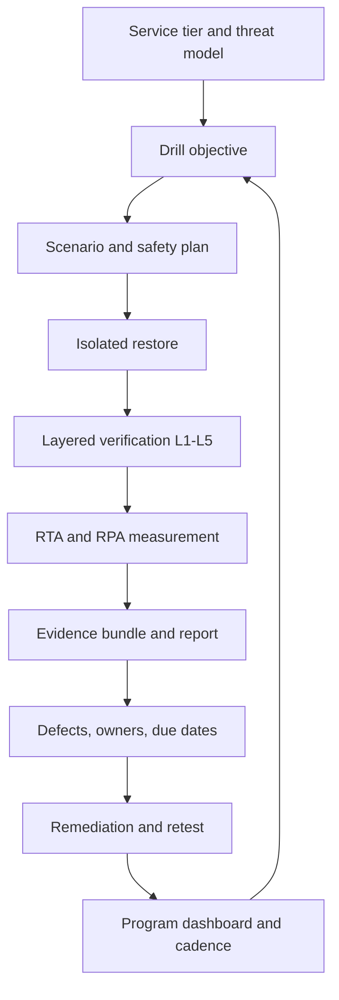

# Unit 7 — Restore drills and recovery evidence

**Module:** M13 — Backup, Disaster Recovery, and Resilience Testing  
**Target path:** `Stage 2E — Production DevOps & Platform Engineering/13-Backup-Disaster-Recovery-and-Resilience-Testing/07-restore-drills-and-recovery-evidence.md`  
**Audience:** practitioners progressing from beginner to expert  
**Environment:** zero-budget laptop lab using synthetic data only

> **Operating rule:** a backup job that reports success is evidence of a job outcome, not evidence that the service can be recovered. Recovery is proven only to the extent that a protected copy is restored into a safe target, independently verified, measured against stated objectives, and supported by trustworthy evidence.

## 7.0 Why this matters in production

### Backup success is not recovery success

A backup pipeline can complete while leaving a recovery gap. The backup may contain no rows, omit a table or object prefix, capture mutually inconsistent database and object-store states, depend on a missing encryption key, be readable only by a retired identity, or be incompatible with the version used during restore. A restore command may exit zero while the restored data is stale or incomplete. A process may start while its business function is broken.

Use three distinct claims:

1. **Backup success:** the protection job completed according to its own checks.
2. **Restore success:** a protected copy was transferred or reconstructed into the intended isolated target.
3. **Functional recovery:** the restored service passed completeness, integrity, consistency, functional, and operational checks at a measured recovery point.

A drill closes the gap between a design claim and observed evidence. It can also expose that a plan is not yet recoverable. That is useful information, provided the failure is recorded, assigned, fixed, and retested rather than hidden to preserve a pass rate.

### Illustrative incident narrative

[ILLUSTRATIVE] A team restores a synthetic billing database after a simulated storage loss. The restore utility exits successfully and the database process becomes healthy. The dashboard shows green because it checks only connection success. A known-answer report then returns fewer invoices than expected. Investigation shows that the drill restored a snapshot from the prior day and never checked the expected table inventory or a business-level aggregate. The runbook equated “database accepts connections” with “service recovered.”

Responders contain the test environment, preserve the failed output, identify the backup timestamp and source, compare expected table inventory and marker rows, and discover that the drill never asserted freshness. They add L1 completeness checks, L3 recovery-marker checks, and an L4 known-answer query. They update the runbook, rerun the drill against a selected older backup as well as the latest backup, and verify that the new checks fail against the planted stale fixture. The lesson is not that the database tool was necessarily defective; the assurance boundary was too narrow.

### Why drills need safety boundaries

A restore must not overwrite production or a source backup. A mistaken Kubernetes context, database DSN, bucket name, or filesystem path can turn a useful exercise into an incident. Every lab in this lesson uses a throwaway target with a recognizable identifier, synthetic records, explicit preflight checks, bounded resources, and cleanup verification. If target identity cannot be established, stop rather than guess.

### Unit remit and cross-unit boundaries

Unit 7 owns the discipline of proving recovery: drill design, safe execution, layered verification, measurement, evidence integrity, runbook validation, remediation, automation, governance, and portfolio assurance. M05 provides database backup/PITR foundations; M03 covers etcd and Kubernetes control-plane concepts; M08 covers GitOps and audit controls; M09 covers secrets and key custody; M10 covers incident roles and postmortems; M11 covers observability and freshness metrics; M12 covers provenance and trust. M13 Units 1–6 provide recovery objectives, backup protection, platform metadata, pipeline state, model artifacts, and regional/dependency strategies. Units 8–10 cover failure injection, platform-resource restore patterns, and chaos tooling. Do not confuse this lesson with a complete regional-DR architecture or chaos-tool course.

## 7.1 Learning objectives

By completing the lesson, the learner should be able to:

- Select a drill type from documentation review through controlled game day and state what it does and does not prove.
- Define an objective, scope, target, roles, communications plan, safety preconditions, and abort criteria before execution.
- Restore synthetic database, object-store, registry-pair, and platform-state examples into isolated targets.
- Implement L1–L5 verification: completeness, integrity, consistency, functional correctness, and operational readiness.
- Measure achieved recovery time (RTA) by phase and achieved recovery point (RPA) against a known marker, with explicit uncertainty.
- Generate structured JSON and Markdown results, hash evidence files, verify the manifest, and distinguish hashes from signatures and provenance.
- Write a blameless drill report that records failures, deviations, limitations, owners, due dates, and retest criteria.
- Build a scheduled restore-test workflow with least privilege, bounded concurrency, cleanup, failure alerts, and stale-test detection.
- Use cold-read reviews, planted defects, version-drift tests, and repeated drills to test the test process itself.
- Design tier-based drill policies, exception expiry, readiness reporting, and portfolio-level recovery assurance without claiming compliance or certainty.

## 7.2 Concept map and vocabulary



| Term | Meaning in this lesson | Example / caution |
|---|---|---|
| Recovery objective | A target agreed before the drill. | RTO and RPO are objectives, not observed results. |
| RTO | Recovery Time Objective: maximum target time to restore the agreed service level, with start/end points defined. | “From declared incident to verified read-only API” is more precise than “restore in 30 minutes.” |
| RPO | Recovery Point Objective: maximum tolerable data loss expressed as time. | A data system may have a different RPO from a cache. |
| RTA | Achieved/actual recovery time measured during the drill. | Record phase durations and the end condition. |
| RPA | Achieved/actual recovery point: age/gap between the defined failure-time marker and the newest valid restored marker. | Marker cadence and clock uncertainty limit precision. |
| Restore test | Restore a protected copy to an isolated target and verify it. | Does not automatically prove full-service recovery. |
| Recovery drill | Planned exercise of a recovery capability, procedure, system, or team. | Can include a restore, decision-making, and evidence capture. |
| Tabletop | Discussion-only scenario. | Tests decisions and roles, not actual restore mechanics. |
| Walkthrough | Step-by-step runbook review, generally without full execution. | Can find ambiguous commands but not prove data integrity. |
| Component restore | Restore one component into isolation. | Database or object prefix. |
| Full-service restore | Recover dependencies and service behavior end-to-end. | Requires functional and operational checks. |
| Platform rebuild | Reconstruct platform layers from declarative sources and required non-derivable state. | Rebuildability is not proof that application data is recoverable. |
| Failover test | Switch operation to an alternate environment/site. | Different from restoring a backup. |
| Game day / chaos exercise | Controlled failure with hypothesis, guardrails, measurements, and abort conditions. | Must not endanger production. |
| Surprise drill | Unannounced to some participants, but still authorized and bounded. | Mature-program option; never use as an excuse for unsafe unannounced production impact. |
| Facilitator / game master | Controls injects and keeps the exercise within scope. | Does not silently rescue the team. |
| Incident commander (IC) | Owns decisions, priorities, communication, and escalation. | May stop the exercise. |
| Operator | Executes approved steps. | Verbal “it worked” is not independent evidence. |
| Observer / scribe | Captures timeline, decisions, surprises, and deviations. | Use UTC timestamps and monotonic durations separately. |
| Independent verifier | Checks evidence and results against declared criteria. | Should not rely solely on the operator's summary. |
| Isolation | Separation of the restore target from production and protected sources. | Enforce network, identity, namespace, and storage boundaries appropriate to the lab. |
| Scratch namespace / throwaway cluster | Temporary isolated target for a test. | Explicitly identify it and clean it up. |
| Abort condition | Predeclared signal requiring stop or rollback. | Wrong context, target mismatch, unexpected production connectivity, or resource pressure. |
| L1 completeness | Expected objects, tables, partitions, files, and inventory exist. | Existence alone says nothing about correctness. |
| L2 integrity | Bytes and structures satisfy hashes, checksums, constraints, and applicable integrity tools. | A hash proves equality to a recorded digest, not business truth. |
| L3 consistency | Related datasets agree on references, markers, timestamps, and recovery cut. | Database and object store may have different recovery points. |
| L4 functional | Known-answer queries, API calls, model predictions, or business checks work. | Process startup is not enough. |
| L5 operational | Monitoring, permissions, backup-from-restored-system, alerts, ownership, and runbooks work. | Recovery is incomplete if the new system cannot be operated safely. |
| Canary / heartbeat | Synthetic marker written at known intervals. | Helps estimate freshness; it does not prove every transaction. |
| PITR | Point-in-time recovery. | Exact commands depend on backup/WAL setup and versions `[VERIFY]`. |
| LSN | PostgreSQL log sequence number, a position in the write-ahead log stream. | LSN interpretation depends on the recovery/replication context `[VERIFY]`. |
| Evidence bundle | Indexed evidence files plus a manifest and integrity checks. | A hash-only manifest can itself be replaced unless separately protected. |
| Signature / provenance | Cryptographic attestation about identity/origin/process. | Not equivalent to a checksum; trust depends on key custody and verification. |
| Cold-read runbook test | Someone unfamiliar with the runbook executes or critiques it without coaching. | Exposes hidden assumptions and tribal knowledge. |
| Inject | A planned scenario event, such as a missing backup or expired fake credential. | Injects must be safe and bounded. |
| Defect corpus | Known broken fixtures used to test verification sensitivity. | Include negative tests to avoid false positives. |
| N-1 compatibility test | Restore an older protected copy into a newer supported target version. | Supported version combinations must be checked `[VERIFY]`. |
| Drill freshness | Whether a drill is within the organization's required interval. | A lapsed drill means “unproven,” not necessarily “broken.” |
| Exception register | Explicit risk acceptance with owner, rationale, and expiry. | Exceptions should expire and be reviewed. |
| Readiness score | Summary of defined signals. | Not a guarantee; false precision is a risk. |

### The five verification layers

| Layer | Question | Example | A common false-green |
|---|---|---|---|
| L1 — Completeness | Is the expected inventory present? | Expected tables, object keys, partitions, registry records. | Only checking that the database exists. |
| L2 — Integrity | Are bytes/structures intact? | SHA-256 match, constraints, aggregate checks. | Hashing a file against a manifest generated after corruption. |
| L3 — Consistency | Do related records and stores agree? | Every DB object reference resolves; canary markers align. | Database and object store each look internally valid but represent different times. |
| L4 — Functional | Does the service produce expected outcomes? | Known-answer report, API smoke test, golden model input. | Health endpoint returns 200 while business queries are wrong. |
| L5 — Operational | Can the team safely run it? | Alerts route, access is correct, new backup succeeds. | Restored service works once but cannot be monitored or re-protected. |

No layer replaces another. A restore can pass L1 and fail L3; it can pass L1–L3 but fail L4 because a migration or configuration is incompatible; it can pass L1–L4 and fail L5 because no one can rotate credentials or take a new backup.

## 7.3 Level 1 — Beginner

### 7.3.1 The drill ladder

| Drill type | Objective and suitable use | What it proves | What it does not prove | Risk / prerequisites | Expected evidence and abort criteria |
|---|---|---|---|---|---|
| 1. Documentation review | Confirm procedures and artifacts exist and are current. | Runbook has owner, prerequisites, commands, verification, rollback. | That commands work or backups restore. | Low; access to docs and version history. | Review checklist, stale links; abort if scope/owner is unclear. |
| 2. Tabletop | Practice decisions and communications. | Roles, escalation, trade-offs, decision authority. | Actual restore duration or integrity. | Low; facilitator and scenario. | Timeline, decisions, assumptions; stop if discussion turns into real production changes. |
| 3. Walkthrough | Cold-read runbook step-by-step. | Instructions are understandable and dependencies identified. | Tool behavior or full recovery. | Low; safe copy of runbook. | Ambiguity list; abort if steps target live systems. |
| 4. Component restore | Restore one database/object/registry component in isolation. | Selected backup is readable and passes defined checks. | Whole service or cross-component consistency unless explicitly tested. | Moderate; scratch target, synthetic data. | Restore logs, L1–L3 checks; abort on target mismatch or resource pressure. |
| 5. Full-service restore | Recover dependencies and verify end-to-end behavior. | The scoped service path works under tested conditions. | Every failure mode, region, or scale. | Higher; isolated dependencies and verifier. | L1–L5, RTA/RPA; abort on unsafe external connectivity or unintended writes. |
| 6. Platform rebuild | Reconstruct platform from declarative sources plus state backups. | Bootstrap order and non-derivable state recovery work. | Application data recovery unless included. | Higher; throwaway cluster and compatible versions. | Build log, parity report, access/cleanup proof; abort on wrong cluster context. |
| 7. Failover test | Switch to alternate environment. | Traffic decision and alternate operation under the test. | Backup restore unless separately included; independent region if simulated locally. | Higher; explicit authority and fencing. | Decision record, cutover timeline; abort if single-writer safety is uncertain. |
| 8. Game day / chaos | Inject a controlled failure and observe system/team behavior. | The specified hypothesis under the tested conditions. | General resilience or all failure combinations. | Higher; safety officer, abort path, scoped fault. | Fault-applied proof, observed impact, cleanup proof. |
| 9. Surprise drill | Test response without advance notice to selected participants. | Preparedness under bounded uncertainty. | Safe use without governance or production assurance. | Highest; explicit authorization and communication safeguards. | Scope authorization, timeline, debrief; abort immediately on unexpected customer impact. |

A mature program uses a mix. Documentation review is cheap and frequent; component restores catch backup defects; full-service drills find dependency and operational gaps; game days test controlled failure handling. Do not use a tabletop as evidence of actual data recoverability.

### 7.3.2 Roles and responsibilities

- **Facilitator/game master:** declares the scenario, provides injects, tracks scope, and confirms the exercise has stopped when asked.
- **IC:** owns decisions, safety, communications, and escalation; has explicit authority to abort.
- **Operators:** execute only the approved runbook steps and record deviations.
- **Observer/scribe:** records UTC event timestamps, monotonic elapsed durations, decisions, and unexpected behavior.
- **Independent verifier:** checks objective criteria and evidence, including negative cases.

Small teams may combine roles, but the verifier should be independent of the claim being verified where practical. A person who ran the restore can explain it; a verifier confirms it with evidence.

### 7.3.3 Safety contract

Before a drill, write down: target identifier, source backup identifier, expected environment/context, allowed operations, prohibited targets, time box, resource ceiling, abort conditions, cleanup owner, and evidence location. Confirm the source remains unchanged. Use synthetic data by default. For a Kubernetes lab, print and check the current context and namespace; for a database, display a synthetic lab marker; for object storage, validate the bucket/prefix. If a guard fails, do not bypass it merely to finish the exercise.

### 7.3.4 Beginner scenario examples

| Scenario | Objective | Safe first action | Evidence |
|---|---|---|---|
| Backup archive exists but may be empty | L1/L2 verification | Copy to scratch and inspect inventory before service startup. | Source identity, file size, inventory, checksum. |
| Database process starts but report is wrong | L3/L4 verification | Stop declaring recovery; compare known-answer query and marker. | Query output, expected result, backup timestamp. |
| Object prefix is missing files | Completeness/integrity | Restore to a new prefix and compare manifest. | Expected vs actual object keys and hashes. |
| Encryption key is unavailable | Key recovery readiness | Stop; do not weaken encryption. Escalate through approved key-custody path. | Error class, key dependency record, decision log. |
| Wrong cluster context is detected | Safety | Abort before mutation. | Context output, guard failure, no-mutation proof. |

## 7.4 Level 2 — Intermediate

### 7.4.1 Component restore workflow

Use a repeatable sequence regardless of technology:

1. Declare objective, source backup ID/time, target ID, expected version, and abort conditions.
2. Verify that the target is isolated and that the source is read-only to the drill operator.
3. Capture source metadata and integrity information before restore.
4. Provision a scratch target with compatible software and sufficient space.
5. Restore without overwriting source data or production.
6. Capture phase timestamps and command output, with secrets scrubbed.
7. Run L1–L5 checks that apply to the stated scope; record `SKIP` or `NOT_RUN` explicitly.
8. Compare RTA/RPA with the objectives and state measurement uncertainty.
9. Export evidence, hash files, and verify the manifest.
10. Clean up and prove the target was removed or retained under an approved evidence policy.

#### PostgreSQL latest backup and PITR

For PostgreSQL, a logical `pg_dump` restore and a physical base-backup plus write-ahead log (WAL) recovery path are different mechanisms. Point-in-time recovery requires a compatible base backup and the necessary continuous WAL history. Exact flags, archive configuration, target-time semantics, and version compatibility must be checked against the chosen PostgreSQL version `[VERIFY]`. Use M05 for backup implementation foundations. The core lesson here is to record the exact source, target, recovery point, and verification result.

Safe conceptual sequence:

```text
identify backup + version → create isolated target → restore → start target
→ check expected schema/tables → check constraints/aggregates → check marker time
→ run known-answer query → confirm monitoring/access/new-backup path
```

Do not restore over a live source. For the laptop labs below, a deterministic SQLite fixture provides a lightweight harness when running PostgreSQL/WAL infrastructure is too expensive. That alternative tests the drill method, not PostgreSQL PITR semantics.

#### Object-store dataset

Restore to a new bucket or prefix. Compare expected object names and SHA-256 digests to a manifest captured before the test. Then query the database table that references those objects. A successful copy does not prove that database references and object bytes belong to the same recovery point.

#### Model registry pair

Restore registry metadata and artifact bytes as a pair. Verify every registry record resolves to an artifact, artifact hashes match independently recorded digests, metadata is associated with the expected model version, and a tiny synthetic model passes a golden-input test. A database-only restore can leave dangling metadata; an artifact-only restore can leave the model undiscoverable.

#### Vault snapshot and etcd snapshot

[AWARENESS] Vault snapshot restore semantics, edition availability, seal/unseal behavior, and compatibility depend on the product version and edition `[VERIFY]`. Use fake secrets and a throwaway instance only. Never imply that enterprise DR replication is available in an OSS workflow. Likewise, etcd snapshot restoration is a control-plane recovery procedure with strict version and cluster-identity caveats `[VERIFY]`; never restore a snapshot into an active cluster as a learning shortcut. Lab 5 and Lab 6 use explicit simulations if the full local setup is impractical.

### 7.4.2 A runnable verification harness

The following harness uses only Python's standard library and a deterministic JSON fixture. It is a **teaching harness**, not a database restore utility. It demonstrates target guards, L1–L5 checks, timestamps, durations, status semantics, JSON/Markdown output, and evidence hashing. Save as `restore_harness.py` inside a dedicated lab directory.

```python
#!/usr/bin/env python3
"""Synthetic recovery verification harness; no production integrations."""
from __future__ import annotations
import argparse, hashlib, json, os, sys, time
from datetime import datetime, timezone
from pathlib import Path

LAB_ID = "restore-drill-lab-v1"
REQUIRED_TABLES = {"customers", "invoices", "heartbeats"}

def utc_now() -> str:
    return datetime.now(timezone.utc).isoformat(timespec="milliseconds").replace("+00:00", "Z")

def sha256(path: Path) -> str:
    h = hashlib.sha256()
    with path.open("rb") as f:
        for chunk in iter(lambda: f.read(65536), b""):
            h.update(chunk)
    return h.hexdigest()

def load_json(path: Path) -> dict:
    data = json.loads(path.read_text(encoding="utf-8"))
    if not isinstance(data, dict):
        raise ValueError("fixture root must be an object")
    return data

def check(name, fn):
    start_utc = utc_now(); start = time.monotonic()
    try:
        detail = fn()
        status = "PASS" if detail is not False else "FAIL"
        message = str(detail)
    except SkipCheck as e:
        status, message = "SKIP", str(e)
    except Exception as e:
        status, message = "FAIL", f"{type(e).__name__}: {e}"
    return {"name": name, "status": status, "message": message,
            "started_utc": start_utc, "ended_utc": utc_now(),
            "duration_seconds": round(time.monotonic() - start, 6)}

class SkipCheck(Exception): pass

def run(args):
    target = Path(args.target).resolve()
    expected_root = Path(args.lab_root).resolve()
    if args.lab_id != LAB_ID:
        raise ValueError(f"lab identifier mismatch: expected {LAB_ID!r}")
    if target == expected_root or expected_root not in target.parents:
        raise ValueError("target must be a child of --lab-root and not the root itself")
    if "production" in str(target).lower() or "prod" in target.name.lower():
        raise ValueError("target name resembles production; refusing to proceed")
    if not target.is_dir():
        raise ValueError("target directory must already exist and be a lab-owned directory")
    fixture_path = target / "restored_fixture.json"
    if not fixture_path.is_file():
        raise ValueError("missing restored_fixture.json in guarded target")
    fixture = load_json(fixture_path)
    checks = []
    def completeness():
        tables = set(fixture.get("tables", {}))
        missing = sorted(REQUIRED_TABLES - tables)
        if missing: raise AssertionError(f"missing tables={missing}")
        return f"tables present={sorted(REQUIRED_TABLES)}"
    checks.append(check("L1_completeness", completeness))
    def integrity():
        expected = fixture.get("integrity", {}).get("fixture_sha256")
        actual = sha256(fixture_path)
        # A self-hash stored inside the file would be circular; expected digest is in a sidecar.
        sidecar = target / "expected.sha256"
        if not sidecar.is_file(): raise ValueError("expected.sha256 sidecar missing")
        expected = sidecar.read_text(encoding="utf-8").strip().split()[0]
        if actual != expected: raise AssertionError(f"digest mismatch expected={expected} actual={actual}")
        return f"sha256={actual}"
    checks.append(check("L2_integrity", integrity))
    def consistency():
        invoices = fixture.get("tables", {}).get("invoices", [])
        customers = {r.get("id") for r in fixture.get("tables", {}).get("customers", [])}
        dangling = [r.get("customer_id") for r in invoices if r.get("customer_id") not in customers]
        if dangling: raise AssertionError(f"dangling customer references={dangling}")
        return "invoice customer references resolve"
    checks.append(check("L3_consistency", consistency))
    def functional():
        rows = fixture.get("tables", {}).get("invoices", [])
        total = sum(int(r.get("amount_cents", 0)) for r in rows)
        expected = int(fixture.get("known_answer", {}).get("invoice_total_cents", -1))
        if total != expected: raise AssertionError(f"known-answer mismatch expected={expected} actual={total}")
        return f"known-answer invoice_total_cents={total}"
    checks.append(check("L4_functional", functional))
    def operational():
        ops = fixture.get("operational", {})
        missing = [k for k in ("monitoring_configured", "backup_path_documented", "owner") if not ops.get(k)]
        if missing: raise AssertionError(f"operational prerequisites missing={missing}")
        return "monitoring, backup path, and owner recorded"
    checks.append(check("L5_operational", operational))
    overall = "PASS" if all(c["status"] == "PASS" for c in checks) else "FAIL"
    result = {"lab_id": LAB_ID, "target": str(target), "started_utc": checks[0]["started_utc"],
              "ended_utc": utc_now(), "overall": overall, "checks": checks,
              "note": "Synthetic fixture only; not a production restore test."}
    out = target / "verification.json"
    out.write_text(json.dumps(result, indent=2) + "\n", encoding="utf-8")
    lines = ["# Restore verification report", "", f"- Overall: **{overall}**", f"- Lab: `{LAB_ID}`",
             f"- Target: `{target}`", "", "| Check | Status | Duration (s) | Result |", "|---|---|---:|---|"]
    lines += [f"| {c['name']} | {c['status']} | {c['duration_seconds']} | {c['message'].replace('|', '/')} |" for c in checks]
    lines += ["", "> Synthetic fixture only; this report does not prove production recoverability."]
    (target / "verification.md").write_text("\n".join(lines) + "\n", encoding="utf-8")
    print(json.dumps({"overall": overall, "checks": {c["name"]: c["status"] for c in checks},
                      "report": str(out)}, indent=2))
    return 0 if overall == "PASS" else 2

def main():
    p = argparse.ArgumentParser(description=__doc__)
    p.add_argument("--lab-id", required=True)
    p.add_argument("--lab-root", required=True, help="existing dedicated lab root")
    p.add_argument("--target", required=True, help="existing child directory holding restored_fixture.json")
    a = p.parse_args()
    try: return run(a)
    except (OSError, ValueError, json.JSONDecodeError) as e:
        print(f"ERROR: {e}", file=sys.stderr); return 3

if __name__ == "__main__": raise SystemExit(main())
```

**Important harness note:** The integrity sidecar must be generated from the exact fixture bytes before running the harness. A sidecar created after a corrupt restore only proves the corrupted file matches its new sidecar. In a real recovery system, compare against an independently protected backup-time manifest/signature. The harness intentionally treats missing sidecar as `FAIL`; it never converts a missing test into `PASS`.

A minimal fixture is:

```json
{
  "tables": {
    "customers": [{"id": 1}, {"id": 2}],
    "invoices": [{"id": 101, "customer_id": 1, "amount_cents": 2500}, {"id": 102, "customer_id": 2, "amount_cents": 1750}],
    "heartbeats": [{"sequence": 10, "timestamp_utc": "2026-01-01T00:00:00Z"}]
  },
  "known_answer": {"invoice_total_cents": 4250},
  "operational": {"monitoring_configured": true, "backup_path_documented": true, "owner": "synthetic-lab-owner"}
}
```

Generate the sidecar only after saving the fixture, and preserve it separately as the expected digest:

```bash
# Run only in a newly created, dedicated lab directory.
export LAB_ROOT="$PWD/restore-drill-lab"
export LAB_TARGET="$LAB_ROOT/target-pass"
mkdir -p "$LAB_TARGET"
# Save the JSON above as "$LAB_TARGET/restored_fixture.json".
sha256sum "$LAB_TARGET/restored_fixture.json" > "$LAB_TARGET/expected.sha256"
python3 restore_harness.py --lab-id restore-drill-lab-v1 --lab-root "$LAB_ROOT" --target "$LAB_TARGET"
```

For a deliberately failing run, copy the fixture to another target, remove the `heartbeats` table or change the invoice total, and keep the original expected digest so L2 also detects modification. A skipped check is not a pass. The harness's duration is a local lab observation, not a production performance estimate.

### 7.4.3 RTA: measure phases, not just the final stopwatch

Record event timestamps in UTC for audit correlation and use a monotonic clock for elapsed durations, because wall clocks can be adjusted. Synchronize clocks where separate hosts are involved and record uncertainty. Define the start and end before the drill begins.

| Phase | Start/end definition | Evidence |
|---|---|---|
| Detection/declaration | Declared drill start to authorized recovery decision | IC timeline and alert/inject time |
| Provision target | Target request to isolated target ready | Provision logs and target ID |
| Locate/transfer backup | Source selection to protected copy available at target | Backup ID, transfer log, size/hash |
| Restore | Restore command start to restore operation completion | Tool logs and exit status |
| Start services | Service start to basic readiness | Process/service events |
| Verify | Start verification to all required checks resolved | L1–L5 output, including failures/skips |
| Cut over/declare recovered | Approved traffic switch or formal recovery declaration | Decision record and routing evidence |
| Stabilize/monitor | Recovery declaration to end of agreed observation window | SLI/SLO snapshot, alert status |

[ILLUSTRATIVE] Hypothetical phase durations: detection/declaration 4 min + provisioning 6 min + transfer 8 min + restore 12 min + startup 3 min + verification 7 min + cutover 2 min + stabilization 5 min = **47 minutes RTA** under this definition. If the target RTO is 45 minutes, the illustrative result misses by 2 minutes. This is arithmetic for learning, not a benchmark or measured result. A real report should include phase overlap explicitly; do not add overlapping phases twice.

### 7.4.4 RPA: marker/canary measurement

A heartbeat marker is a synthetic record written at known intervals before a simulated failure. Capture the failure-time marker and timestamp, restore, then query the newest valid marker. The age/gap between the defined failure point and the latest surviving marker estimates the observed recovery-point gap. Sampling cadence bounds precision; clock skew and write delay add uncertainty. A heartbeat does not prove that every business transaction or cross-store reference is correct.

Example schema for PostgreSQL:

```sql
CREATE TABLE IF NOT EXISTS recovery_heartbeat (
  sequence_no BIGINT PRIMARY KEY,
  written_at TIMESTAMPTZ NOT NULL,
  marker_id TEXT NOT NULL UNIQUE
);

-- Synthetic lab marker only; increment sequence_no for each heartbeat.
INSERT INTO recovery_heartbeat(sequence_no, written_at, marker_id)
VALUES (1, clock_timestamp(), 'restore-drill-lab-v1-heartbeat-1');

SELECT sequence_no, written_at, marker_id
FROM recovery_heartbeat
ORDER BY sequence_no DESC
LIMIT 1;
```

If the simulated failure marker is at 12:00:00Z and the latest restored marker was written at 11:58:00Z, the observed gap is 2 minutes. If the marker is written every 60 seconds, the estimate has at least sampling uncertainty on the order of the cadence, plus clock and transaction uncertainty. Do not claim that RPA is exactly 2 minutes without those caveats. Exact database LSN-based comparisons require a known replication/recovery topology `[VERIFY]`.

### 7.4.5 Drill report template

```markdown
# Recovery drill report
- Drill ID / service / tier:
- Scenario and objective:
- Date/time window (UTC):
- Participants and roles:
- Source backup ID, age, version and integrity reference:
- Target ID and isolation proof:
- Target RTO / target RPO:
- Preconditions, safety controls and abort criteria:
- Timeline: event UTC, monotonic duration, operator, evidence reference
- RTA: start/end definition, phase breakdown, total, uncertainty:
- RPA: failure marker, restored marker, gap, cadence/clock caveat:
- L1 completeness: PASS / FAIL / SKIP / NOT_RUN + evidence
- L2 integrity: PASS / FAIL / SKIP / NOT_RUN + evidence
- L3 consistency: PASS / FAIL / SKIP / NOT_RUN + evidence
- L4 functional: PASS / FAIL / SKIP / NOT_RUN + evidence
- L5 operational: PASS / FAIL / SKIP / NOT_RUN + evidence
- Runbook deviations and unexpected behavior:
- Defects: category, severity, owner, due date, retest criteria
- What went well / poorly / was merely lucky:
- Limitations and confidence statement:
- Evidence manifest and integrity verification:
- Cleanup verification:
- Reviewer / approval / follow-up date:
```

A blameless report describes system conditions and decisions, not personal blame. A failed drill should say which criterion failed, what was observed, what remains unknown, and how it will be retested. Do not relabel a failure “passed with caveats” if a required check failed.

### 7.4.6 Evidence bundles and integrity

A useful bundle contains a plan, scope and role list, source/target identifiers, timestamped logs, verification output, RTA/RPA calculations, report, action tracker, and a manifest of evidence file hashes. Use least-privilege access and versioned or immutable storage where available. Scrub secrets and personal data before hashing or sharing evidence.

- **Hash/checksum:** detects a change relative to a trusted digest.
- **Digital signature:** can bind a digest to a signing identity, if key custody and verification are sound.
- **Provenance/attestation:** records origin or process claims and requires a trusted producer and policy.

A hash manifest stored beside the files can be replaced together with the files. For stronger assurance, protect the manifest independently or sign it with a separately governed key. None of these controls alone proves that the test scope was appropriate or that the report is truthful.

### 7.4.7 Scheduled restore-test automation

A scheduled restore-test workflow should: select a recent backup; provision a scratch target; restore; run L1–L5 checks; record metrics and evidence; tear down even after failure; and alert on failure or stale last-success time. Keep service-account permissions scoped to scratch resources. Limit concurrency and storage/CPU usage. Never give the restore job permission to mutate production. Test the cleanup path by deliberately failing verification.

Use the metric names:

- `restore_test_last_success_timestamp`
- `restore_duration_seconds`
- `restore_verification_failures`

[VERIFY] Exact Prometheus exposition, recording-rule and `promtool` test syntax depend on versions and configuration. A lightweight script-based assertion is acceptable: fail if the last-success timestamp is absent/older than the policy interval, if verification failures are nonzero, or if a required test was skipped. Do not confuse a successful backup job metric with a successful restore-test metric.

## 7.5 Level 3 — Advanced

### 7.5.1 Scenario and inject design

Choose one primary objective per drill: RTO, RPO, runbook accuracy, dependency behavior, people/communications, integrity, compatibility, key recovery, or evidence quality. A drill can collect secondary observations, but should not claim to test everything equally deeply.

Derive scenarios from a threat model and dependency register. Examples include accidental table drop, synthetic ransomware-style destruction, bad migration, corrupt object, region loss, secrets backend loss, registry loss, key unavailability, and compound failures. Injects can include a missing backup, expired throwaway credential, unavailable responder, slow DNS, absent dependency, or misleading success signal. The inject should be deterministic and scoped; record when it was introduced and how it was removed.

### 7.5.2 Realism versus safety

A useful lab mirrors the properties that matter: version compatibility, data shape, access controls, backup age, dependency ordering, and failure signals. It does not need real customer data. Synthetic data is preferred; masked production-derived data requires a separately approved environment with equivalent privacy controls. Define a time box, resource budget, abort criteria, and target guard. Record fidelity limits: a local container cannot prove provider behavior, production scale, network isolation, key custody, or regional independence.

### 7.5.3 Measurement quality and repeated drills

A single result is a sample, not a stable guarantee. Repeat drills across backup ages and data volumes, record RTA/RPA distributions, manual steps, unexpected errors, runbook deviations, evidence completeness, and cleanup failures. Avoid statistical thresholds unless the organization has enough data and a stated method. Tiny fresh datasets can understate restore time; a recently created backup can conceal old-backup corruption; a warm cache can hide dependency startup time.

[ILLUSTRATIVE] Hypothetical trend table:

| Run | Dataset profile | RTA | RPA | Manual interventions | Verification defects |
|---|---|---:|---:|---:|---:|
| A | Small/fresh | 9 min | 0 min observed | 2 | 0 |
| B | Medium/older | 22 min | 3 min observed | 4 | 1 |
| C | Medium/older, corrected runbook | 18 min | 3 min observed | 2 | 0 |

These values are invented for illustration and are not performance predictions. Explain differences before comparing them; dataset and backup age differ.

### 7.5.4 Verification beyond process health

Use known-answer tests with explicit expected outputs, heartbeat markers, backup-time manifests, business-level aggregate recomputation, downstream consumer validation, DB/object-store reference checks, golden model inputs, and a small pipeline partition where relevant. Verify permissions, secrets resolution, monitoring and alert routing, and the ability to take a new backup from the restored system. The last check is important: recovery can restore service but leave the new primary unprotected.

### 7.5.5 Failed-drill handling and remediation

Classify defects as backup, verification, runbook, tooling/automation, access/identity/key, dependency, compatibility/version, capacity/resource, evidence-integrity, or knowledge/staffing gaps.

[ASSUMPTION] A practical prioritization model uses impact (1–5), likelihood of recurrence (1–5), and exposure (1–3). The product can rank work, but it is not a formal risk model and should not replace engineering judgment. Record an accountable owner, due date, containment, fix, and a retest that would fail before the fix and pass after it. A documentation-only change does not prove a technical defect is fixed. A finding is **fixed** when the change is made; **verified fixed** only when the defined retest passes and evidence is linked.

| Severity | Example | Expected response |
|---|---|---|
| Critical | Restore can overwrite production; required keys unavailable; silent corruption undetected for tier-0 data. | Stop unsafe drills; immediate containment and accountable escalation. |
| High | Required L1–L4 check missing or RPO/RTO objective missed without accepted exception. | Prioritized remediation and explicit risk owner. |
| Medium | Manual step, stale runbook link, partial evidence gap with safe recovery still possible. | Scheduled fix and retest. |
| Low | Non-blocking report readability or redundant manual step. | Track and improve without hiding higher-risk defects. |

### 7.5.6 Audit-oriented evidence

Credible evidence normally demonstrates scope, date, target, source, objective, observed result, verification, exceptions, and follow-up. Hashing/signing and retention strengthen integrity. They do not establish legal or regulatory compliance by themselves. Standard-specific evidence requirements must be checked against the applicable current source `[VERIFY]`; this lesson is not legal advice.

### 7.5.7 Drill automation maturity

```text
manual → scripted → automated pipeline → scheduled restore verification
       → continuous/portfolio recovery assurance → chaos-integrated assurance
```

At each stage, add explicit inputs, isolated targets, test results, cleanup, and failure alerts before increasing frequency or complexity. A scheduled restore is valuable only if its verification is meaningful and failures are visible. Random selection can expose coverage gaps, but selection must remain bounded by quotas and service-tier policy. [ASSUMPTION] A team may choose a cadence such as daily for critical data or monthly for lower-risk services; there is no universal cadence that fits every service.

### 7.5.8 Human game days and cold reads

A game day should include an IC, facilitator, operators, scribe, and verifier; a declared hypothesis; controlled injects; a timestamped action log; and explicit abort criteria. Psychological safety matters: participants should be rewarded for surfacing defects. [ILLUSTRATIVE] Debrief within 24–48 hours while details remain fresh. For long recovery exercises, plan shift handoffs and a fatigue boundary; do not require unsafe overnight destructive work.

A cold-read reviewer receives the runbook without oral coaching and must identify prerequisites, verify target context, perform safe steps in the lab, and explain rollback. Record every point where the author had to explain undocumented knowledge.

### 7.5.9 CI restore tests and version drift

Use ephemeral `kind` or a temporary local database for quick regression checks: fixture restore, harness tests, and GitOps rebuild of sample resources. Keep larger restore drills on a scheduled cadence because CI fixtures may be too small to reveal capacity or long-tail issues. N-1 compatibility means restoring an older backup into a newer supported database/operator/Kubernetes/Velero version; actual supported combinations must be verified against the relevant release support matrix `[VERIFY]`. Record versions with backup metadata. Never infer compatibility solely from a successful container build.

### 7.5.10 Reporting and governance

Track drill recency by tier, pass/fail rate, RTA versus RTO, RPA versus RPO, open defect age, evidence completeness, automation coverage, expired/unproven services, last-success timestamps, and resource/cost impact. A service whose required drill has lapsed should be marked **unproven** under the declared policy, not silently treated as green.

[ASSUMPTION] Example readiness score formula: `score = 0.25*objective_coverage + 0.25*verification_depth + 0.20*evidence_integrity + 0.15*drill_freshness + 0.15*remediation_health`, each component normalized to 0–100. The weights are a policy choice, not a standard. Display component values and hard blockers beside the score; a high average must not hide a failed critical restore or an expired exception. Do not reward teams only for easy passing drills.

A drill policy should define minimum cadence by service tier, required drill type, evidence retention, exception approver, expiry, status impact when overdue, management review, and budget owner. A risk exception needs an owner and expiry date; it is not a permanent waiver.

## 7.6 Level 4 — Expert

### 7.6.1 Continuous recovery assurance

Build a portfolio program around repeatable contracts: each service declares its tier, backup source, restore target, RTO/RPO, verification profile, owner, cadence, and evidence destination. Scheduled tests should collect evidence automatically and page or ticket the accountable owner on failure or overdue status. Tier-0/1 data stores usually deserve more frequent and deeper testing than disposable caches, but exact tiers and cadence are organizational policy `[ASSUMPTION]`.

A portfolio view should include:

| Service | Tier | Last successful restore | RTA vs RTO | RPA vs RPO | L1–L5 status | Evidence link | Open findings | Status |
|---|---|---|---|---|---|---|---|---|
| `synthetic-ledger` | T1 | timestamp or `NEVER` | observed / target | observed / target | pass/fail/skip | bundle ID | count | proven/unproven |

Do not fill this with fabricated observed values. In an actual report, `NEVER`, stale timestamp, missing evidence, or a failed critical layer should be visible rather than converted to zero or green.

### 7.6.2 Exception handling and maturity model

Every untested/failing service needs a risk-register entry, accountable owner, reason, compensating controls, expiry date, approval, and retest plan. An expired exception returns to unproven status automatically. Maturity stages and example exit criteria:

1. **Ad hoc:** no consistent evidence contract. Exit when owners and objectives are identified.
2. **Documented:** runbooks and scopes exist. Exit when a walkthrough and safe target guards pass.
3. **Periodic manual:** isolated restores are performed and reported. Exit when repeatability and evidence quality are demonstrated.
4. **Automated:** standard harness, cleanup, and alerts. Exit when failure and stale-test alerts are tested.
5. **Continuous:** portfolio coverage, exception expiry, trend reporting, and defect retests. Exit when the test process itself is regularly challenged.
6. **Chaos-integrated:** recovery drills combine controlled failure and restore assurance with reliable abort and cleanup. This is not a universal maturity destination; use only when it adds evidence.

### 7.6.3 Meta-drills and defect corpus

A meta-drill tests whether the verification system catches deliberately broken recovery outputs. Include at least these eight defects:

| Injected defect | Expected detection layer | Example check | False-positive test |
|---|---|---|---|
| Missing table | L1 | Expected table inventory | An intentionally optional table is excluded by explicit policy. |
| Truncated file | L2 | Digest and parse/length checks | A legitimately small file with valid manifest remains accepted. |
| Shifted timestamps/time zone | L3/L4 | UTC marker and known-answer time-window query | Equivalent timezone representation of same instant is accepted. |
| Swapped partitions | L1/L3/L4 | Partition inventory and range aggregates | Same partition contents with valid names remains accepted. |
| Stale replica/backup | L3 | Latest heartbeat and source timestamp | Expected old point-in-time target is accepted when requested explicitly. |
| Wrong collation/order | L4 | Known-answer ordering test | Dataset with no ambiguous sort keys does not falsely imply collation tested. |
| Missing extension/dependency | L4/L5 | Startup and feature-specific query | A non-required extension is explicitly marked optional. |
| Dangling object references | L3 | Join DB references against object manifest | Deleted objects are accepted only if tombstone/business policy says so. |
| Silent skipped table | L1/L4 | Expected inventory and business aggregate | Explicitly excluded table is not treated as missing. |

Detection rate should be calculated from executed fixtures, not assumed. If eight defects were injected and six detected, observed detection is 6/8 = 75% for that defect set. That is not a universal probability of catching production defects. False positives are cases where a valid fixture is incorrectly rejected; record them too.

### 7.6.4 Scale, orchestration, and cleanup

Use standard restore harnesses per technology with a shared report contract. Queue jobs to respect CPU, I/O, storage, and service quotas. Limit concurrent restores, apply timeouts, enforce namespace/bucket isolation, and clean up on success, failure, cancellation, and runner crash. Track orphaned resources. A controller that silently marks a failed restore as successful is a high-severity defect; inject failure and prove the alert path.

### 7.6.5 Sensitive-data protection

Restored data may be more sensitive than the original environment because the scratch target can be less monitored. Encrypt at rest and in transit, restrict access, isolate the network, record access audit logs, mask production-derived data, and use synthetic data for routine labs. Secure deletion must be defined for the storage substrate and verified where possible; on a laptop, deleting a file is not proof of forensic erasure from all media snapshots. Never put secrets or PII in screenshots, terminal transcripts, manifests, or issue trackers.

### 7.6.6 External evidence and management reporting

External requests should receive a scoped statement: what was tested, on what target, with which source/version, which criteria passed/failed/skipped, observed RTA/RPA, known limitations, and open findings. Do not claim legal or regulatory compliance from a lab. Management reporting should connect gaps to service tier and operational consequence, identify remediation investment, and show trends without inventing downtime costs.

### 7.6.7 Human performance and incident-to-drill loop

Test less-experienced responders, staff availability, handoffs, and fatigue in controlled scenarios. A drill that only works on the day-shift expert's laptop reveals a systemic dependency on undocumented knowledge. Convert real incidents and near misses into scenarios; track whether the corrective action changed the next drill result. Reward defects found and fixed, not just high pass rates.

### 7.6.8 Organizational failure analyses

| Scenario | Symptom | Why the drill missed it | Root/systemic cause | Containment | Corrective action | Prevention | Evidence of fix |
|---|---|---|---|---|---|---|---|
| First real restore was first ever; backups empty | Restore finds no usable data | Only backup job status was monitored | No restore verification ownership | Preserve source, stop unsafe recovery claim | Restore newest protected copy in scratch; repair backup | Scheduled restore test | L1/L2 evidence and retest report |
| Wrong context targets production | Unexpected live resource mutation | No context guard | Unsafe automation defaults | Abort; follow incident procedure | Require allow-listed lab context and target ID | Negative tests in CI | Guard test failure on wrong context; no mutation proof |
| Table exists but data is one day old | Stale report | L1 only | No recovery marker or business check | Keep service in recovery state | Add RPA and known-answer check | Test old backups too | Stale fixture fails; current fixture passes |
| Only expert can run drill | Runbook stalls during handoff | Oral coaching masked gaps | Tribal knowledge | Pause and record blocker | Rewrite prerequisites and recovery decisions | Cold-read review by rotating operator | New responder completes without coaching |
| Screenshot contains credential | Secret exposed in evidence | No scrub step | Evidence process lacks security review | Restrict access and rotate fake/real credential per policy | Redaction scanner and review | Safe logging templates | Scanner catches planted token; clean bundle passes |
| Automation skips table but reports success | L1/L4 discrepancy | Exit status alone used | Missing expected inventory | Mark result failed; preserve logs | Make verification gate authoritative | Silent-failure meta-drill | Test catches omitted table and exits non-zero |
| Key recovery never tested | Encrypted backup unreadable | Key path assumed available | Key custody coupled to failed system | Preserve backup and escalate key custodian | Test key recovery with fake/approved materials | Independent key-recovery drill | Successful isolated decryption/restore evidence |
| Only fresh backups tested | Older corrupt copy fails | Backup selection biased | Drill policy never samples backup age | Select safe alternate copy | Add age/corruption scenarios | Rotation-based selection | Older-copy drill report and remediation |
| Tiny dataset understates RTA | Production restore exceeds objective | Lab data unrepresentative | No size profile or scaling model | State uncertainty; do not claim target met | Test representative volume in approved environment | Tiered load profiles | Measured profile, extrapolation caveat, capacity plan |

### 7.6.9 N-1 and compatibility strategy

Record the versions used to create the backup and the versions used to restore it. Test supported upgrade paths and at least one older backup against the newer target where policy requires. For Kubernetes, PostgreSQL, Vault, Velero, operators, and extensions, compatibility matrices and restore semantics are version-specific `[VERIFY]`. Keep a scaffold in CI to run the compatibility test, but do not label a scaffold as a verified compatibility result.

## 7.7 SRE lens

Recovery assurance should be connected to service-level objectives (SLOs), service-level indicators (SLIs), error budgets, and business criticality. A restore test is a synthetic measurement of a recovery path; it is not the same as a production SLO. It should still be monitored as a service of its own: test execution, verification, evidence generation, cleanup, and alerting can fail.

### Sample recovery scorecard

| Metric | Definition | Unit | Source | Target | Alert condition | Owner | Caveat |
|---|---|---|---|---|---|---|---|
| Restore-test last success | UTC time of latest fully verified restore | Unix timestamp / age | Scheduler + evidence index | Policy-defined | Missing or older than tier cadence | Service owner | A recent run can still be shallow. |
| `restore_duration_seconds` | Duration from declared restore start to defined recovery end | seconds | Monotonic phase recorder | RTO-derived placeholder | Exceeds objective or trend changes materially | SRE / data owner | Data size and warm caches affect it. |
| `restore_verification_failures` | Required verification checks that failed | count | Harness result | 0 for required checks | Any non-zero count | Recovery tooling owner | Must not hide skipped checks. |
| RPA gap | Failure marker to newest valid restored marker | seconds/minutes | Canary query | RPO-derived placeholder | Exceeds RPO or cannot be measured | Data owner | Sampling and clock uncertainty. |
| L1–L5 coverage | Required layers executed and passed | percent plus blockers | Verification report | Policy-defined | Required layer missing/failing | Service owner | Percent can hide a critical failed layer. |
| Evidence completeness | Required artifacts present and hash-verified | percent plus missing list | Manifest verifier | All required items | Missing or mismatch | Drill owner | Hash verification does not prove truth. |
| Cleanup success | Lab resources removed or retained by policy | count/status | Cleanup checker | No unexplained orphans | Cleanup failed / orphan detected | Platform owner | Deletion is not always secure erasure. |
| Open defect age | Age of unresolved drill findings | days | Issue tracker | Severity-based placeholder | Critical/high item overdue | Engineering manager | Track verified remediation, not ticket closure alone. |
| Cost/resource impact | CPU, memory, storage, I/O used by test | measured units | Host/container metrics | Budget placeholder | Budget exceeded | Platform owner | Laptop values do not predict production. |

Alert through a path independent enough to survive failure of the primary monitoring provider where feasible. For example, keep a local job exit status and a second notification channel. Avoid retry storms in the test system; use bounded retries, concurrency limits, and timeouts. Automation must stop-and-page when it cannot verify target identity or cleanup safety.

Metrics can be gamed: teams may run only small restores, avoid older backups, omit hard checks, or classify failures as skipped. Counter this with representative scenarios, explicit `SKIP`/`NOT_RUN`, random or policy-based backup selection, independent review, defect-corpus tests, and metrics that include coverage and remediation quality—not pass rate alone. Use blameless postmortems that assign system improvements and owners.

## 7.8 Security lens

- **Isolation and target identity:** allow-list scratch contexts, namespaces, directories, and buckets. Fail closed on missing or unexpected context. Do not use a production credential as a shortcut.
- **Least privilege:** the restore operator reads protected backup data and writes only to scratch targets. It should not have permission to delete protected backups or mutate production.
- **Network isolation:** prevent a restored service from calling real payment, email, or customer endpoints. Use fake endpoints and synthetic data.
- **Encryption and keys:** verify that required keys are recoverable through an independently governed path. Do not copy plaintext secrets into Git or evidence.
- **Sensitive restored data:** production-derived data may remain sensitive even when restored into a test environment. Mask it or use synthetic records; enforce access, audit, and retention controls.
- **Evidence hygiene:** scrub secrets and PII from command output, logs, screenshots, reports, manifests, and issue comments. A manifest should hash scrubbed artifacts, not preserve a secret-bearing original.
- **Integrity and trust:** a hash is not a signature; a signature is not proof that the data is semantically correct; provenance must be validated against a trust policy.
- **Compromised backup:** isolate and quarantine suspicious copies; compare independent manifests, signatures/provenance, and known-answer checks before allowing the data to serve users.
- **Old credentials/certificates:** restored configuration may contain expired credentials or old trust relationships. Test renewal/rotation as an operational check.
- **Safe teardown:** confirm that scratch resources are removed or retained under a documented evidence policy. On local disks, simple deletion is not a guarantee of secure erasure.

Never disable authorization, TLS verification, package-signature verification, or integrity checks to make a drill pass. If a policy mode is temporarily changed in a tightly controlled test, require explicit authorization, narrow scope, audit logging, a time limit, and a verified return to enforcement. If target identity, key custody, or integrity is uncertain, fail closed.

## 7.9 Production checklist

Every checked item must have observable proof. “Reviewed” without a review record is not proof.

### 1. Drill objectives and scope
- [ ] Objective names a single primary claim (RTO, RPO, integrity, runbook, key recovery, or functional recovery).
- [ ] Start/end points for RTA and failure marker for RPA are defined.
- [ ] Source backup, target, versions, and excluded scope are recorded.

### 2. Roles, communication and scheduling
- [ ] Facilitator, IC, operator, scribe, and verifier are assigned or role combinations documented.
- [ ] Schedule, communication channel, escalation path, and stop authority are confirmed.
- [ ] Shift handoff and fatigue boundaries exist for long drills.

### 3. Isolation, target/context guards and abort criteria
- [ ] Context/namespace/DSN/bucket/path matches a lab allow-list before mutation.
- [ ] Wrong-target negative test fails closed and proves no mutation occurred.
- [ ] Abort conditions include unexpected production connectivity, target mismatch, resource exhaustion, and unclear write authority.

### 4. Backup selection and restore prerequisites
- [ ] Backup ID, age, integrity reference, version, and key dependencies are captured.
- [ ] Restore target has compatible software and enough declared capacity.
- [ ] Source backup is not modified by the restore procedure.

### 5. L1 completeness checks
- [ ] Expected table/object/partition/registry inventory is versioned and compared.
- [ ] Missing/extra inventory has an explicit policy and causes failure when required.

### 6. L2 integrity checks
- [ ] Hashes/checksums are compared with an independently protected manifest.
- [ ] Database constraints/appropriate integrity tooling run where applicable.
- [ ] Missing digest, parse error, or mismatch is `FAIL`, not `SKIP` or `PASS`.

### 7. L3 consistency checks
- [ ] Recovery markers and time window are checked.
- [ ] Cross-store references resolve; dangling object references are reported.
- [ ] DB/object/queue checkpoints are reconciled where the service uses multiple stores.

### 8. L4 functional/business checks
- [ ] Known-answer query/report has an explicit expected output.
- [ ] API, pipeline, or model golden-input smoke test runs against the restored target.
- [ ] Functional tests cannot accidentally call real external services.

### 9. L5 operational checks
- [ ] Monitoring and alert routing work for the restored environment.
- [ ] Permissions, secrets, certificates, and ownership are verified.
- [ ] A new backup can be taken from the restored system and its result checked.

### 10. RTA/RPA measurement
- [ ] UTC event timestamps and monotonic phase durations are captured.
- [ ] RTA includes the declared end condition and no overlapping phases are double-counted.
- [ ] RPA includes marker cadence, clock/sampling uncertainty, and a comparison to RPO.

### 11. Evidence capture, hashing, scrubbing and retention
- [ ] Required artifacts are indexed and hashed after secret/PII scrubbing.
- [ ] Manifest verification is tested; stronger signing/provenance is described where used.
- [ ] Evidence access and retention follow the service's approved policy.

### 12. Report, defects, owners and retest
- [ ] Report records failures, deviations, limitations, and what was merely lucky.
- [ ] Each defect has severity, owner, due date, retest criterion, and evidence link.
- [ ] “Verified fixed” requires a passing retest, not only a closed ticket.

### 13. Automation, metrics and alerts
- [ ] Failed restore and failed verification create an alert/ticket.
- [ ] Stale last-success time and skipped required checks are visible.
- [ ] Concurrency, timeouts, resource quotas, cleanup-on-failure, and orphan detection are tested.

### 14. Runbook cold-read and version compatibility
- [ ] A reviewer unfamiliar with the runbook completes a lab walkthrough without hidden coaching.
- [ ] Tool/runtime versions are recorded and relevant compatibility matrix checked `[VERIFY]`.
- [ ] Older-backup/newer-target compatibility is tested where required.

### 15. Tier-based cadence, exceptions and expired/unproven status
- [ ] Each service tier has an approved drill type and cadence.
- [ ] Exceptions have an owner, rationale, compensating controls, approver, and expiry.
- [ ] Expired or missing drill evidence marks service `UNPROVEN` under policy.

### 16. Secure teardown and post-test protection
- [ ] Scratch resources are removed or retained with explicit evidence policy.
- [ ] Cleanup verification shows no unexpected namespace, container, bucket, or directory remains.
- [ ] Restored service has a new backup/DR plan before it is treated as fully protected.

## 7.10 Hands-on lab set

### Common lab contract

All 12 tracks use synthetic data and throwaway targets. Use a dedicated working directory such as `~/restore-drill-labs`; do not point scripts at the user's repository or real application paths. Record the exact target ID and failure being simulated before each lab. Any command that would delete or overwrite data must validate the expected lab identifier and target. If any preflight check fails, stop. Local measurements are observations from that run only.

Suggested resource profile: one small local process at a time, no simultaneous heavy clusters on an 8 GB laptop. Use the Python/JSON substitute first; add PostgreSQL, MinIO, Vault, or `kind` only when the laptop has headroom. Product commands and version-specific restore behavior are `[VERIFY]` unless explicitly validated against official docs for the selected version.

### Lab 1 — Restore harness and layered verification

**Goal/outcomes:** run L1–L5 checks against a deterministic fixture; emit JSON/Markdown; prove a planted defect fails; generate a manifest. **Resources:** Python standard library, negligible CPU/RAM. **Creates:** `restore-drill-lab-v1` directory, fixture, reports, and hashes. **Failure injected:** missing table or altered invoice total. **Not simulated:** actual database backup/restore or production isolation. **Never target:** production DB, real repository, or non-lab directories.

1. Create an isolated directory and save the `restore_harness.py` and fixture from Section 7.4.2.
2. Preflight:

```bash
set -eu
LAB_ROOT="$HOME/restore-drill-labs/restore-drill-lab-v1"
case "$LAB_ROOT" in "$HOME"/restore-drill-labs/restore-drill-lab-v1) ;; *) echo 'bad lab root' >&2; exit 2;; esac
mkdir -p "$LAB_ROOT/target-pass"
printf '%s\n' 'restore-drill-lab-v1' > "$LAB_ROOT/LAB_ID"
test "$(cat "$LAB_ROOT/LAB_ID")" = 'restore-drill-lab-v1'
```

3. Save the JSON fixture as `target-pass/restored_fixture.json`, generate `expected.sha256` from its original bytes, and run the harness command shown in Section 7.4.2.
4. Create `target-fail` with a modified fixture but retain the original expected digest; run the harness. The expected assertion is non-zero exit and at least one `FAIL`; do not hardcode timing values.
5. Save `verification.json`, `verification.md`, command output, and a manifest. Verify the manifest after copying it to a second directory.

**Pass criteria:** correct target passes all required checks; modified fixture fails integrity and/or functional/completeness checks; missing sidecar fails; incorrect lab ID fails. **Evidence:** fixture version, source digest, reports, test log, manifest. **Cleanup:** remove only the exact lab directory after verifying its `LAB_ID` file; if preserving evidence, export it first to the designated evidence folder. **Common failures:** sidecar created after corruption; running from wrong directory; fixture JSON malformed. **Safety/fidelity:** directory is local and synthetic; this proves harness logic, not real restore recoverability.

### Lab 2 — PostgreSQL latest-backup and PITR component drills

**Goal/outcomes:** distinguish logical latest restore from PITR; run completeness, integrity, consistency and known-answer queries. **Resources:** local PostgreSQL container if available; otherwise use Lab 1 fixture as a clearly labelled simulation. **Creates:** `restore-drill-pg-v1` database/container/volume only. **Failure injected:** restore from an older snapshot or select an earlier target time. **Not simulated by lightweight alternative:** WAL archive continuity or PostgreSQL recovery semantics. **Never target:** any non-lab database or shared Docker volume.

**Full path (version-specific commands `[VERIFY]`):**

1. Record `psql --version`, server version, backup ID, backup time, and the target DSN. Use a dedicated disposable container/volume and a synthetic database named `restore_drill_lab`; verify the target banner before applying SQL.
2. Create synthetic tables for customers, invoices, and `recovery_heartbeat`; insert deterministic rows and record a known-answer aggregate.
3. Create a logical backup using the documented `pg_dump` form for the selected version `[VERIFY]`; restore into a separately named scratch database using the documented `pg_restore` or `psql` flow `[VERIFY]`.
4. Run L1 table inventory, L2 constraints/aggregate checks, L3 heartbeat freshness and foreign-key checks, and L4 known-answer queries. Record start/end with monotonic time.
5. If a WAL archive and base backup are already configured, create a second scratch instance and restore to a target time using the official procedure for the chosen PostgreSQL version `[VERIFY]`. Never point recovery configuration at the source data directory.
6. Compare latest-backup and point-in-time outcomes: expected row counts, latest heartbeat, aggregate, and RPA. The latest backup may be newer but not match a requested historical target.

**Lightweight alternative:** use Lab 1 JSON fixture with two snapshots labelled `latest` and `pitr-target`; the older fixture has fewer heartbeat rows. This tests measurement and assertions but does not prove PostgreSQL PITR. **Pass criteria:** source remains unchanged; scratch inventory and known answers match the selected recovery point; PITR claim is marked `NOT_RUN` if WAL recovery was not actually configured. **Evidence:** version, backup identity, restore logs, SQL outputs, RTA/RPA sheet, L1–L5 report. **Cleanup:** stop/remove only the lab-named container and volume after checking labels/names and exporting evidence. **Common failures:** insufficient disk, mismatched major version, missing WAL, wrong DSN, timezone assumptions. **Fidelity:** all timings are local lab observations.

### Lab 3 — Object-store dataset restore and cross-store consistency

**Goal/outcomes:** restore a synthetic object set to a new prefix, verify hashes, and detect DB references to absent objects. **Resources:** Python standard library; optional local MinIO. **Creates:** `restore-drill-objects-v1/source`, `restore-target`, `objects.json`, and manifests. **Failure injected:** omit one object from target and pair DB fixture with a different recovery point. **Not simulated:** cloud object-lock/replication guarantees. **Never target:** user files or non-lab buckets.

Use a self-contained local directory substitute first:

```bash
set -eu
ROOT="$HOME/restore-drill-labs/restore-drill-objects-v1"
case "$ROOT" in "$HOME"/restore-drill-labs/restore-drill-objects-v1) ;; *) exit 2;; esac
mkdir -p "$ROOT/source" "$ROOT/restore-target"
printf 'synthetic-object-A\n' > "$ROOT/source/object-A.txt"
printf 'synthetic-object-B\n' > "$ROOT/source/object-B.txt"
( cd "$ROOT/source" && sha256sum object-A.txt object-B.txt > ../source.sha256 )
cp "$ROOT/source/object-A.txt" "$ROOT/restore-target/"
# Intentionally omit object-B.txt to test completeness and references.
```

Create a synthetic DB reference file such as `object-A.txt` and `object-B.txt`; compare it with the target inventory. The following assertion should fail while the target is incomplete:

```bash
python3 - "$ROOT" <<'PY'
import hashlib, pathlib, sys
root = pathlib.Path(sys.argv[1])
expected = {"object-A.txt", "object-B.txt"}
actual = {p.name for p in (root / "restore-target").iterdir() if p.is_file()}
missing = sorted(expected - actual)
print({"expected": sorted(expected), "actual": sorted(actual), "missing": missing})
if missing: raise SystemExit(2)
PY
```

The non-zero result is expected for the planted defect. Copy the missing object, rerun the inventory check, and verify hashes against the independently recorded source manifest. For cross-store consistency, require every DB object reference to exist in the target manifest and compare recovery marker IDs. **Pass criteria:** incomplete target fails; repaired target passes inventory/hash/reference checks. **Evidence:** source and target manifests, missing-reference output, fixed retest. **Cleanup:** remove only `restore-drill-objects-v1` after checking the path and `LAB_ID` marker. **Common failures:** generating the manifest after omission; hidden files ignored by inventory; confusing a successful copy with a consistent application state. **Fidelity:** local filesystem substitute; MinIO behavior is not proven unless separately run and version-checked `[VERIFY]`.

### Lab 4 — Model registry pair restore

**Goal/outcomes:** verify registry metadata/artifact pairing, artifact digest, and a deterministic golden prediction. **Resources:** Python standard library; tiny synthetic model represented as JSON. **Creates:** `restore-drill-model-v1/registry.json`, `artifacts/model-v1.json`, and report. **Failure injected:** missing artifact or wrong digest. **Not simulated:** production model-serving performance or real signing infrastructure. **Never target:** a real registry, model artifact, or secret store.

1. Create metadata containing model ID `synthetic-linear-v1`, version `1`, artifact path, SHA-256, input/output schema, and expected output for a fixed input. Use a tiny formula such as `y = 2*x + 1`.
2. Store the formula and metadata in the lab directory. Record the artifact digest independently in a fixture manifest.
3. Verify the metadata path stays within the lab artifact directory; reject absolute paths and `..` traversal. Recompute the digest and compare it with the recorded digest.
4. Run the golden input `x=3`; expected output is `7`. Mark L1 metadata/artifact existence, L2 digest, L3 registry-to-artifact linkage, L4 prediction, and L5 owner/monitoring/backup path.
5. Rename the artifact or change its bytes and prove the verifier fails. Restore the correct artifact and rerun.

**Pass criteria:** metadata and artifact both exist, digest matches, golden result matches, and wrong/missing artifact fails. **Evidence:** metadata, artifact digest, prediction output, negative test, report. **Cleanup:** remove only the lab directory after evidence export. **Common failures:** digest generated after tampering; comparing floats without a defined tolerance; accepting a path outside the lab root. **Fidelity:** synthetic metadata and a formula, not proof that a real model loads or that signatures/provenance validate.

### Lab 5 — Vault snapshot and key recovery in a throwaway instance

**Goal/outcomes:** demonstrate the recovery decision flow for a secrets system without handling real secrets. **Resources:** no Vault required; optional throwaway Vault only after version/edition verification. **Creates:** `restore-drill-vault-v1` fake snapshot manifest and recovery state. **Failure injected:** key unavailable or snapshot marked incompatible. **Not simulated by default:** Vault's actual encrypted snapshot format, seal/unseal, edition-specific DR replication. **Never target:** a real Vault endpoint, production token, real secret, or key.

**Safe scripted simulation:** create a JSON object with synthetic secret path names and non-authenticating values such as `FAKE_VALUE_DO_NOT_USE`. Create a recovery manifest listing required key ID, expected version, and required paths. Run assertions that fail if the key ID is unavailable, a required path is absent, or version compatibility is unknown. Do not print fake values in evidence; print only path names and status. The exercise teaches that encrypted backup recovery depends on key custody and that a backup copy is not usable when the decryption path is lost.

**Optional full path:** only in a throwaway local instance, use official Vault documentation for the selected version and edition to confirm snapshot/restore commands and seal behavior `[VERIFY]`. Use fake data only; never imply Enterprise DR replication exists in OSS. Capture audit logs and verify access to required synthetic paths. **Pass criteria:** scripted missing-key case fails closed; complete fake manifest passes; optional actual restore is separately labelled `RUN` or `NOT_RUN`. **Evidence:** version/edition note, fake manifest, test output, cleanup check. **Cleanup:** stop the throwaway instance and remove only its named data directory after confirming the marker. **Common failures:** edition mismatch, confusing snapshot restore with DR replication, secret values leaking to logs. **Fidelity:** simulation unless an actual isolated instance was used and verified.

### Lab 6 — etcd snapshot restore in a throwaway `kind` environment

**Goal/outcomes:** understand why etcd restore is a control-plane operation with version and identity constraints. **Resources:** documentation/runbook simulation is recommended for an 8 GB laptop; optional disposable cluster only if supported procedure is verified. **Creates:** `restore-drill-etcd-v1` runbook record and synthetic snapshot metadata. **Failure injected:** incompatible version or missing encryption-key dependency. **Not simulated by default:** actual etcd data-dir restore or Kubernetes control-plane recovery. **Never target:** existing non-lab cluster or active control-plane data directory.

1. Capture the current Kubernetes context and cluster list. The lab must not mutate any existing cluster.
2. Write a recovery plan recording etcd/Kubernetes versions, snapshot time, encryption-at-rest key dependency, and target cluster identity.
3. Run a validator against synthetic metadata. It must refuse if the target cluster ID does not equal `kind-restore-drill-etcd-v1`, if versions are unknown, or if required encryption material is absent.
4. Review official Kubernetes/etcd documentation for the selected version before any optional actual restore `[VERIFY]`. A safe disposable `kind` cluster alone does not make every etcd restore sequence supported; the control-plane topology and snapshot semantics must match the procedure.
5. Record each step as `PASS`, `FAIL`, `SKIP`, or `NOT_RUN`; do not label a runbook simulation as a real restore.

**Pass criteria:** unsafe target and missing dependency cases fail closed; simulation report explicitly says what was not executed. **Evidence:** context output, synthetic metadata, validator output, version/source references, cleanup verification. **Cleanup:** delete only the named lab cluster after confirming its exact name and checking that it is not the current context for any unrelated work. **Common failures:** version skew, snapshot/key mismatch, confusing Kubernetes resource backup with etcd state restore. **Fidelity:** runbook simulation unless actual isolated control-plane recovery was performed; do not claim the latter from a checklist.

### Lab 7 — Canary heartbeat and achieved RPA measurement

**Goal/outcomes:** measure a recovery-point gap from synthetic markers and test missing/stale-marker handling. **Resources:** Python standard library or local PostgreSQL. **Creates:** `restore-drill-rpa-v1/heartbeats.csv` and report. **Failure injected:** restore stops at an older marker or marker sequence has a gap. **Not simulated:** every business transaction's durability. **Never target:** production heartbeat tables.

Use this deterministic example data (UTC timestamps are illustrative fixture values, not current observations):

```csv
sequence,timestamp_utc,marker_id
100,2026-01-01T11:57:00Z,restore-drill-rpa-v1-100
101,2026-01-01T11:58:00Z,restore-drill-rpa-v1-101
102,2026-01-01T11:59:00Z,restore-drill-rpa-v1-102
103,2026-01-01T12:00:00Z,restore-drill-rpa-v1-103
```

Set the simulated failure marker at sequence 103 / 12:00:00Z and the restored data at sequence 101 / 11:58:00Z. The observed gap is `12:00:00 - 11:58:00 = 120 seconds`. Add a script that parses ISO timestamps, rejects missing or malformed markers, and prints the gap. If the latest marker is absent or older than the declared maximum allowed gap, exit non-zero. A marker every minute does not prove all writes within that minute are durable; report cadence and clock assumptions.

**Pass criteria:** expected 120-second calculation for the fixture; missing marker fails; newer marker than declared failure marker is flagged as inconsistent input. **Evidence:** input fixture, calculation, test outputs, uncertainty note. **Cleanup:** remove only `restore-drill-rpa-v1`. **Common failures:** naive local timestamps, treating wall-clock equality as exact, ignoring sequence gaps. **Fidelity:** deterministic calculation, not an actual database restore.

### Lab 8 — Scheduled restore-test workflow, metrics and alert tests

**Goal/outcomes:** exercise a scheduled workflow's status contract, failure handling, stale-test alert, and cleanup logic. **Resources:** shell/Python; optional local Kubernetes CronJob. **Creates:** `restore-drill-schedule-v1` report/metrics files. **Failure injected:** verification fails or success timestamp is stale. **Not simulated by default:** production Prometheus alert delivery or cluster scheduling guarantees. **Never target:** production namespace, production credentials, or live restore endpoint.

The minimum local workflow should write the three metric names from Section 7.4.7 and exit non-zero if any required check fails. Use a fake clock timestamp for the stale-status test, not a fabricated observed run. Test these assertions:

- success timestamp updates only after all required checks pass;
- `restore_duration_seconds` is measured with a monotonic clock;
- `restore_verification_failures` increases for failed required checks;
- failed restore still triggers cleanup;
- a missing/stale success timestamp triggers an alert result;
- skipped required checks do not update the last-success timestamp.

Optional Kubernetes implementation: create a dedicated namespace named `restore-drill-schedule-v1`, use a least-privilege service account with no production permissions, apply a resource-limited Job/CronJob manifest, and use only lab images. Exact `batch/v1` behavior and fields should be checked against the selected Kubernetes version `[VERIFY]`. If you do not have a local cluster, the script-based workflow is sufficient. `promtool` syntax is `[VERIFY]`; use script assertions as the mandatory path.

**Pass criteria:** injected verification failure yields a failed job/result and cleanup; stale status alerts; success is recorded only after L1–L5 pass. **Evidence:** run logs, metric text/JSON, alert assertion output, cleanup result. **Cleanup:** delete only the named lab namespace after confirming its exact label/ID, or remove only the lab directory. **Common failures:** job retries hide initial failure; metrics update before verification; cleanup skipped after exception. **Fidelity:** script or local cluster observation only; no production scheduling claim.

### Lab 9 — Verification-suite defect corpus

**Goal/outcomes:** test sensitivity and false positives across at least eight planted defects. **Resources:** Python standard library. **Creates:** `restore-drill-defects-v1` fixtures and detection matrix. **Failure injected:** missing table, truncated file, shifted timestamp, swapped partitions, stale backup, wrong collation/order, missing extension marker, dangling object reference, and optional silent table skip. **Not simulated:** all possible production corruption modes. **Never target:** real backups or datasets.

For each fixture, record expected detection layer, actual result, and whether the result is a false positive. Suggested assertions:

1. Remove `invoices` → L1 fail.
2. Truncate an artifact while retaining the original digest → L2 fail.
3. Shift marker timestamp by an hour → L3/L4 fail when the known time window is enforced.
4. Swap partition labels → L1/L3/L4 fail if range and aggregate expectations exist.
5. Use stale marker → L3 fail when it exceeds the declared policy threshold.
6. Change an ordering result where collation matters → L4 fail; mark `NOT_RUN` if the fixture cannot test collation semantics.
7. Remove a required extension/dependency marker → L4/L5 fail; optional dependency should be explicit.
8. Remove an object referenced by a DB row → L3 fail.
9. Simulate silent skip of a required table while returning restore exit code zero → L1/L4 fail.

Compute observed detection rate as `detected injected defects / executed injected defects`; compute false-positive rate only with a defined set of valid fixtures. Do not claim a perfect score unless the supplied tests are actually executed. Include unit tests that assert expected detection and include a valid control fixture to prevent “reject everything” from looking good.

**Pass criteria:** every injected defect has a documented expected layer and an actual result; valid controls pass; unexecuted cases remain `NOT_RUN`. **Evidence:** corpus definitions, test output, detection matrix, false-positive controls. **Cleanup:** remove only the lab fixture directory. **Common failures:** defect injected after manifest creation incorrectly, control fixture missing, treating expected negative tests as harness errors. **Fidelity:** defect-suite coverage is limited to the planted cases.

### Lab 10 — Drill report, evidence bundle and tamper-evidence check

**Goal/outcomes:** create an evidence bundle and demonstrate manifest mismatch after modification; test redaction of a fake credential. **Resources:** Python standard library and `sha256sum`. **Creates:** `restore-drill-evidence-v1/bundle`. **Failure injected:** alter one report file after manifest generation and add an unmistakable fake token string such as `FAKE_TOKEN_DO_NOT_AUTHENTICATE_12345`. **Not simulated:** trusted signing service or immutable storage. **Never target:** real credentials or a real evidence store.

1. Create a report, JSON result, timeline, and action tracker using synthetic values; avoid inventing actual measurements—label example values as illustrative.
2. Run `sha256sum` on each evidence file and save a sorted manifest. Recompute and compare all digests with a verifier script.
3. Modify a copy of the report after manifest creation; verify the digest comparison fails.
4. Run a redaction scan against the fake token string. The test must fail while the token is present and pass after replacement with `[REDACTED_SYNTHETIC_TOKEN]`.
5. State that the manifest is hash-only; a separately protected signature or attestation would improve trust but requires key custody and verification policy.

**Pass criteria:** original bundle verifies; altered file fails; redaction scanner catches planted token; clean bundle passes. **Evidence:** manifest, verifier output, redaction test, report and limitation statement. **Cleanup:** remove only `restore-drill-evidence-v1` after exporting the scrubbed bundle. **Common failures:** hashing before final scrubbing, manifest not sorted, checking the manifest against itself rather than file digests. **Fidelity:** local integrity check only; does not establish compliance or truthfulness.

### Lab 11 — Tabletop, bounded game day and runbook cold-read

**Goal/outcomes:** practice decisions, roles, timestamping, abort criteria, and a cold-read of the runbook. **Resources:** paper/Markdown and a harmless local fixture. **Creates:** `restore-drill-game-day-v1/timeline.md`, inject cards, and report. **Failure injected:** missing backup, expired fake credential, and unavailable responder. **Not simulated:** production outage or real credential expiry. **Never target:** production systems, on-call paging without agreement, or real identity systems.

Roles: facilitator, IC, operator, scribe, verifier. Predeclare abort conditions: wrong target, unexpected external network call, resource pressure, unclear authorization, or any indication of production impact. Inject in order: (1) selected backup missing, (2) synthetic credential is expired by fixture metadata, (3) primary operator becomes unavailable and a second learner must cold-read the runbook. Record UTC event time, decision, owner, evidence, and unresolved uncertainty.

The cold-read check should confirm the runbook includes purpose, target, prerequisites, commands, expected output, rollback/cleanup, verification, and escalation. The script below checks required headings in a lab-only copy:

```python
from pathlib import Path
import sys
required = ["Purpose", "Target and preflight", "Prerequisites", "Procedure",
            "Verification", "Abort conditions", "Cleanup", "Escalation"]
p = Path(sys.argv[1])
text = p.read_text(encoding="utf-8").lower()
missing = [h for h in required if h.lower() not in text]
print({"runbook": str(p), "missing_sections": missing})
raise SystemExit(1 if missing else 0)
```

**Pass criteria:** all inject decisions are logged; abort criteria are understood; a cold reader identifies ambiguities; the debrief assigns remediation and retest. **Evidence:** role list, inject timeline, cold-read output, blameless report. **Cleanup:** remove only the lab directory; no external faults were injected. **Common failures:** facilitator coaches too much, missing event timestamps, exercise continues after abort trigger. **Fidelity:** tabletop and harmless local fixture only.

### Lab 12 — Calendar, expiry/unproven status, readiness score, N-1 scaffold and safety audit

**Goal/outcomes:** implement policy-as-data for cadence, expiry, score components, compatibility scaffold, and safety checks. **Resources:** Python standard library. **Creates:** `restore-drill-policy-v1/policy.json`, dashboard JSON, audit output. **Failure injected:** expired drill, wrong target string, secret-like pattern in evidence, incomplete cleanup marker, and broad destructive command in a synthetic runbook. **Not simulated:** actual compatibility of any product version or legal/compliance status. **Never target:** a real repository, production context, or real service.

Policy data should include service, tier, required drill type, last successful drill date, max age in days, exception owner/expiry, RTA/RPO objectives, and verification status. Compute `UNPROVEN` when no passing drill exists, required evidence is missing, or the test age exceeds policy and no valid unexpired exception exists. A valid exception should show `EXCEPTION` with owner and expiry, not `PROVEN`.

[ASSUMPTION] Use the score formula in Section 7.5.10 only as a transparent heuristic. Hard blockers—failed critical layer, unsafe target guard, or overdue unaccepted exception—must override the score and produce `UNPROVEN`. Add a scaffold that records old-backup version and target version and requires a test-result field; an empty result must be `NOT_RUN`, not pass. Run safety audits against synthetic text and fixtures. Do not execute broad deletion commands; scan for risky patterns and test that they are rejected.

**Pass criteria:** overdue service becomes unproven; unexpired approved exception is explicit; expired exception becomes unproven; wrong-target and secret-leak fixtures fail the audit; incomplete cleanup is a failure; N-1 scaffold without actual run is `NOT_RUN`. **Evidence:** policy input, dashboard output, audit test logs, exception record, compatibility caveat. **Cleanup:** remove only the lab directory after export. **Common failures:** timezone confusion in expiry; treating an exception as a pass; score hides hard blocker; compatibility scaffold reported as test. **Fidelity:** policy logic only; does not prove product compatibility or recovery.

## 7.11 Self-check questions

Answer before reading the key. Scenario questions may have more than one defensible answer if assumptions are explicit.

1. Why does a successful backup job not prove that the service is recoverable?
2. When is a tabletop sufficient, and what claims must it not make?
3. Explain the difference between L1, L2, L3, L4, and L5 verification.
4. Distinguish RTO from RTA and RPO from RPA.
5. A marker is written every 60 seconds. What uncertainty remains when the newest restored marker is 2 minutes old?
6. Why is a healthy database process insufficient evidence of functional recovery?
7. A restore exits zero but omits a required table. Which checks should detect it, and how should automation report the outcome?
8. Database metadata restores to 12:00 while referenced objects restore to 11:50. Why might each store look valid while the service is inconsistent?
9. What additional prerequisites does PostgreSQL PITR require beyond a logical dump? What must be version-verified?
10. How can Vault snapshot/key recovery be tested safely, and why must edition-specific claims be verified?
11. Why is restoring etcd into an active cluster unsafe as a generic lab exercise?
12. What does a SHA-256 manifest prove, and what does it not prove? How do signature and provenance differ?
13. A scheduled restore job failed but its cleanup also failed. Which metrics/alerts and owner actions are needed?
14. What is the value of a cold-read runbook test?
15. What does an N-1 restore test validate, and why is an empty scaffold not a pass?
16. How should evidence containing a fake or real secret be handled?
17. A service's last restore test is beyond the policy cadence. Should it be called broken or unproven? Explain.
18. How can a team prevent a green pass-rate dashboard from hiding shallow tests?
19. **Scenario:** a recent backup restores quickly and passes all tests, but a three-week-old backup has never been tested. Which next drill would you choose and why?
20. **Scenario:** a tier-1 restore test fails L3 consistency but passes L1/L2. Should the service be declared recovered? Defend the answer and state what evidence is needed.
21. **Scenario:** a restore meets RTO but misses RPO. What decisions and communication are required? Could the service be available but still not recovered to the agreed objective?
22. **Scenario:** the lab has 8 GB RAM and a full PostgreSQL WAL archive setup is too heavy. What lightweight alternative is acceptable, and what claim must remain `NOT_RUN`?

### Answer key with reasoning

1. Backup success describes the job, not completeness, integrity, consistency, functionality, key availability, or operational readiness. Restore to isolation and verify the intended recovery path.
2. Tabletop is useful for decisions, roles, and communication. It does not prove actual restore commands, data integrity, RTA/RPA, or service behavior.
3. L1 checks inventory; L2 checks integrity; L3 checks relationships/recovery point; L4 checks business behavior; L5 checks operations, monitoring, access, and re-protection. All required layers need explicit status.
4. RTO/RPO are predeclared objectives; RTA/RPA are observed results from a drill/incident. State start/end and failure marker precisely.
5. Sampling cadence bounds the precision; clock skew, write delay, transaction semantics, and marker loss also matter. A 2-minute observed gap is an estimate under those assumptions, not proof that every transaction is lost only within that window.
6. Startup tests only a narrow process-level property. Schema, data freshness, references, permissions, business queries, monitoring, or downstream dependencies may still be broken.
7. L1 inventory and L4 known-answer checks should fail; L3 may fail if missing rows/relations affect consistency. The job must return non-zero and report `FAIL`; exit-zero restore status must not override verification.
8. Database references may point to objects that did not exist at the DB recovery time, or objects may be newer than the metadata. Use recovery markers and reconciliation; newest copy of each store is not necessarily a consistent cut.
9. PITR generally requires a suitable base backup and continuous required WAL archive/replay. Exact procedures and target-time semantics depend on version and configuration `[VERIFY]`.
10. Use fake data and an isolated instance or a scripted metadata simulation. Verify snapshot format, edition, seal/key dependencies, and official procedure. Do not claim enterprise DR replication exists in an OSS setup.
11. etcd restore affects cluster state and must follow topology/version-specific recovery instructions. An active cluster can be corrupted or made inconsistent. Use a throwaway target and verified procedure or explicitly label a simulation.
12. Hash verifies equality to a trusted digest; it does not prove origin, truth, or correct test scope. A signature binds a digest to a signing identity under a trust model; provenance records origin/process claims and must also be validated.
13. Record restore failure and cleanup failure separately, alert the owner, keep the target isolated, prevent orphan accumulation, and require cleanup verification before closure. Last-success should not update.
14. It reveals undocumented assumptions, missing prerequisites, unclear expected outputs, and dependence on oral coaching. A passing author-led walkthrough may conceal those gaps.
15. It checks whether an older backup can be restored to a newer supported target version. Compatibility must be checked and run; a scaffold with no result is `NOT_RUN`.
16. Do not share it. Restrict evidence access, scrub the artifact, rotate/revoke if it could authenticate, preserve an appropriate incident record, and verify redaction. Fake tokens must be clearly non-authenticating.
17. Mark it `UNPROVEN` under the declared policy. It may still work, but there is no current evidence. The label communicates uncertainty, not a prediction of failure.
18. Track test depth, representative backup age/size, L1–L5 coverage, false positives, skipped checks, open defects, evidence integrity, and overdue status. Use independent verification and planted defects.
19. Test the older backup because backup age and corruption exposure differ. Use an isolated target and explicit source ID; do not infer that a recent successful restore covers older copies.
20. Do not declare full recovery if L3 is required and fails. Preserve evidence, identify inconsistent recovery points, reconcile data, and rerun consistency and functional checks. Any service availability decision must be explicitly risk-accepted and communicated.
21. Record both outcomes, inform the accountable business/incident authority, assess data loss and reconciliation, and follow the service's risk policy. A service can be reachable while failing its recovery objectives.
22. Use the deterministic fixture harness to exercise verification and measurement logic. PostgreSQL PITR semantics remain `NOT_RUN` until a real isolated WAL/PITR setup is tested.

## 7.12 Evidence artifacts

Produce a named evidence bundle for each drill. A recommended convention is `YYYYMMDDThhmmssZ_<service>_<drill-id>_<target-id>/`; do not include secrets or personal data in filenames. Use UTC timestamps and record monotonic durations separately. Retain artifacts according to an approved policy with least-privilege access. Evidence existence is not evidence validity: verify target/source identity, completeness, hash manifest, and consistency between the report and raw outputs.

Required evidence and purpose:

- **Drill plan and objective:** scenario, primary claim, RTO/RPO, start/end, scope and exclusions.
- **Scope, roles, safety and abort criteria:** who could decide/execute/stop and what boundaries applied.
- **Backup identity/age and target context proof:** source ID, version, time, target marker, context/DSN/bucket guard output.
- **Restore commands/logs with secrets scrubbed:** reproducible actions and exit status without credential leakage.
- **Per-phase timeline and RTA calculation:** UTC events, monotonic durations, overlaps, and defined end condition.
- **Canary/heartbeat and RPA calculation:** failure marker, restored marker, gap, cadence and uncertainty.
- **L1–L5 verification output:** status and evidence for each layer; include `SKIP`/`NOT_RUN` explicitly.
- **Known-answer/business validation:** expected and observed outputs.
- **Database/object-store consistency report:** reference resolution, marker alignment and reconciliation.
- **Registry/model verification evidence:** metadata-to-artifact links, digest/signature status where available, golden-input result.
- **Vault/etcd simulation or restore evidence:** actual run vs simulation, version/edition caveats, key dependencies, cleanup proof.
- **Scheduled restore-test metrics and alert tests:** last-success timestamp, duration, verification failure count, stale/failure alert results.
- **Silent-failure test output:** proof that an exit-zero restore with a missing required table is still rejected.
- **Defect corpus and detection results:** injected defect, expected layer, actual result, false positives, unexecuted cases.
- **Runbook cold-read findings:** reviewer, undocumented assumptions, missing sections, remediation.
- **Tabletop inject log and game-day timeline:** role decisions, timestamps, escalation, abort events.
- **Blameless drill report and remediation tracker:** findings, owner, due date, severity, retest criteria, verified-fix link.
- **Evidence manifest/index and tamper-evidence result:** sorted paths, SHA-256 digests, verifier output, signature/attestation reference if used.
- **Drill calendar, expiry/unproven status and readiness scorecard:** policy, exception owner/expiry, hard blockers, score components.
- **N-1 compatibility result or scaffold:** versions, actual result or explicit `NOT_RUN`, official support reference `[VERIFY]`.
- **Safety audit and cleanup verification:** wrong-target negative test, redaction scan, orphan scan, remaining resources and their policy.

### Evidence manifest example

The manifest itself should not contain secret values. This simple format is hash-only and must be protected separately for stronger trust.

```text
# manifest.sha256 — generated after final scrubbing
<sha256>  report.md
<sha256>  verification.json
<sha256>  timeline.csv
<sha256>  action-items.csv
```

Generate and verify it from the evidence directory with `sha256sum` or a standard-library script. If any file changes, verification should fail. Record tool/version information when relevant. Do not invent RTA/RPA values; report actual observations or clearly labelled illustrative examples. If a required test was not run, record `NOT_RUN` and explain why.

## 7.13 Common interview and design-review questions

1. **Why is backup job success weaker than restore success?** It usually validates the backup process, not a usable isolated restore or business correctness. Require L1–L5 evidence.
2. **Component restore vs full-service restore?** Component restore validates a bounded asset; full-service restore includes dependencies and end-to-end behavior. State the boundary in the claim.
3. **What do L1–L5 mean?** Completeness, integrity, consistency, functional behavior, and operational readiness. No layer is a substitute for the others.
4. **RTA/RPA vs RTO/RPO?** Objectives are targets; achieved values are measurements with defined boundaries and uncertainty.
5. **What are heartbeat limitations?** Cadence, clock skew, write delays, and transaction semantics limit precision; a marker does not prove all transactions.
6. **What makes an evidence bundle credible?** Scope, source/target, timestamps, raw outputs, verification, limitations, remediation, manifest, and controlled retention.
7. **Hash vs signature vs provenance?** Hash checks content against a digest; signature authenticates a digest under a trust model; provenance describes origin/process claims. None proves business correctness by itself.
8. **How should scheduled restore tests alert?** Alert on failed restore, failed required check, stale/missing last-success, skipped required layer, cleanup failure, and orphan resources.
9. **How do you detect silent failure?** Inject a restore that omits a required table but exits zero; inventory and known-answer gates must fail the run.
10. **How do you guard against production-target mistakes?** Allow-listed context/namespace/DSN/bucket/path, target marker, least privilege, dry-run/preflight, negative tests, and fail-closed defaults.
11. **Why cold-read runbooks?** They reveal missing prerequisites, hidden knowledge, unclear outputs, and absent rollback/cleanup steps.
12. **What is drill freshness?** Time since last qualifying successful drill; overdue services become unproven under policy, with explicit exceptions rather than silent green status.
13. **Why test version drift/N-1?** Backups and tools age; a restore path can fail under a newer target version. Verify official support and test the actual combination.
14. **How do you protect restored sensitive data?** Isolated network, least privilege, encryption, masking/synthetic data, audit logs, redaction, retention, and teardown verification.
15. **Why should a failed drill trigger remediation and retest?** A finding without an owner, due date, and retest does not improve recoverability. Ticket closure alone is not proof.
16. **What does portfolio assurance provide?** Coverage, freshness, objective comparisons, open risks, evidence links, and investment priorities—not a guarantee or compliance certificate.
17. **How do you avoid false precision in readiness scores?** Publish inputs/weights and hard blockers, keep unknowns explicit, show trends and qualitative risk, and avoid treating a weighted score as probability of recovery.
18. **How should an older backup be selected?** By a declared scenario or policy-based sampling; preserve source identity and ensure it remains isolated and protected.
19. **Why is a restore to the newest backup not always the right result?** It may be newer than the requested PITR point or inconsistent with another store's state. Recovery must match the defined consistency point.
20. **When should a drill abort?** Wrong target, unclear authority, unexpected external connectivity, safety threshold breach, or inability to verify single-writer/integrity assumptions. Abort is a valid outcome.

### Design-review prompts

- A tier-1 ledger meets RTO but misses RPO in two drills. Defend whether you change replication/backup design, recovery objective, or business procedure. State assumptions, data-loss tolerance, and validation evidence.
- A service passes weekly small restores but has never restored a month-old backup. Design a representative scenario selection policy and explain the cost/confidence trade-off.
- A scorecard is 94/100 while a required L3 check is missing. Decide the status and justify how hard blockers override the aggregate.
- A team proposes real production-derived data in a shared test cluster to improve realism. Identify privacy, access, network, retention, and deletion controls—or choose a synthetic alternative.
- A vendor asks for proof of recovery readiness. Produce a bounded evidence statement with tested scope, measured results, limitations, open findings, and no unsupported compliance claim.
- A restore works only when the original operator coaches the responder. Redesign the runbook and cold-read/retest process.

## 7.14 Sources and verification notes

This lesson separates general recovery-assurance principles from product-specific procedures. Use official documentation for the exact version and edition in the lab. The source list below points to authoritative documentation families; before using a command in an actual environment, open the relevant current page and record the version checked. Product behavior that has not been verified is marked `[VERIFY]` above.

- **PostgreSQL documentation:** official PostgreSQL manual, sections on `pg_dump`, `pg_restore`, continuous archiving and point-in-time recovery, backup utilities, and database integrity. Start at <https://www.postgresql.org/docs/>. Verify version-specific options, WAL archive requirements, recovery target behavior, and compatibility before running a PITR procedure.
- **Kubernetes documentation:** official concepts and task pages for Jobs/CronJobs, namespaces, cluster administration, and control-plane/etcd backup and restore guidance. Start at <https://kubernetes.io/docs/>. Verify API versions, CronJob semantics, and the exact etcd recovery procedure for the selected cluster version; never assume a generic snapshot restore is safe for an active cluster.
- **Velero documentation:** <https://velero.io/docs/>. Verify the selected release's backup/restore behavior, plugin compatibility, resource filtering, and supported Kubernetes versions `[VERIFY]`.
- **HashiCorp Vault documentation:** <https://developer.hashicorp.com/vault/docs>. Verify snapshot restore, seal/unseal, edition-specific DR replication, and version compatibility `[VERIFY]`. Do not infer Enterprise features in OSS.
- **MinIO documentation:** <https://min.io/docs/>. Verify bucket versioning, object locking, replication, and client/server version behavior if MinIO is used `[VERIFY]`.
- **Prometheus documentation:** <https://prometheus.io/docs/>. Verify metric exposition, alerting rules, and `promtool` rule-test syntax for the installed version `[VERIFY]`.
- **Python standard-library documentation:** <https://docs.python.org/3/library/>. Relevant modules include `argparse`, `datetime`, `hashlib`, `json`, `pathlib`, `time`, and `unittest`. Verify supported Python version in the chosen WSL environment rather than assuming it.
- **kind documentation:** <https://kind.sigs.k8s.io/docs/>. Verify cluster lifecycle commands and supported Kubernetes node images before creating or deleting a throwaway cluster.

### Verification ledger

| Claim / procedure | Status in this lesson | What to verify before production use |
|---|---|---|
| Five-layer verification and evidence principles | General design guidance | Adapt expected inventories, consistency rules, and business checks to the service. |
| Python standard-library harness | Inline teaching example | Run tests in a disposable directory; review path guards and fixture contract before reuse. |
| PostgreSQL logical restore/PITR commands | `[VERIFY]` where version-specific | Official manual for selected version, base backup/WAL completeness, target time, and compatibility. |
| Vault snapshot/edition behavior | `[VERIFY]` | Exact edition, version, snapshot/restore procedure, seal/key requirements. |
| etcd snapshot restore | `[VERIFY]` | Kubernetes/etcd version, cluster topology, encryption keys, official recovery steps. |
| Kubernetes CronJob/`promtool` details | `[VERIFY]` | API/version support, job retry/cleanup semantics, alert-rule syntax and test behavior. |
| MinIO bucket/replication behavior | `[VERIFY]` | Server/client versions, versioning/replication configuration and actual test results. |
| Local timing and resource use | Not supplied as measured result | Record actual observations from each run; do not extrapolate to production. |
| Compliance or legal adequacy | Not claimed | Consult applicable authoritative standards and qualified internal/legal advisors. |

**Final operating principle:** recovery assurance is a maintained evidence program. A restore that passes once proves only that the tested path worked under the recorded conditions. Confidence grows through representative scenarios, layered verification, safe repeated drills, honest limitations, independent evidence checks, and verified remediation of every important defect.
