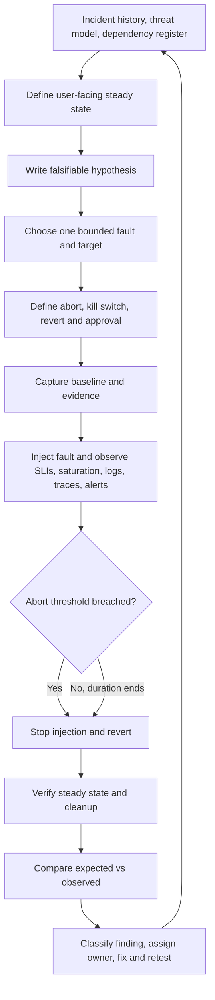

# Unit 8 — Failure Injection and Resilience Exercises

**Module:** M13 — Backup, Disaster Recovery, and Resilience Testing  
**Target file:** `08-failure-injection-and-resilience-exercises.md`  
**Audience:** Engineers progressing from beginner to expert in DevOps/SRE  
**Lab budget:** Zero-cost local laptop; WSL2 Ubuntu or native Linux  
**Safety classification:** All mandatory experiments use synthetic services and lab-only targets.

> **Operating rule:** A fault is not an experiment until there is a falsifiable hypothesis, measurable steady state, bounded scope, duration limit, explicit abort conditions, a tested kill switch, observation, rollback, cleanup, and evidence.

## Scope and handoff

> This unit teaches the **methodology** of failure injection and resilience exercises — hypotheses, steady state, blast radius, safety, scoring, game days — using manual and scripted faults that need no special tooling. Unit 10 then teaches **dedicated chaos engineering tooling** (Chaos Mesh, with Litmus compared). The experiments, safety rules, and scorecards defined here are reused unchanged by the tools in Unit 10.

Unit 8 owns experiment design and safe execution. Unit 10 owns dedicated chaos tooling and comparisons. This unit is not a substitute for M13 Unit 7 restore drills: Unit 7 asks whether protected data and recovery procedures work; Unit 8 asks how the service behaves when a bounded fault is introduced. They share safety and evidence practices, but the primary questions differ.

Prerequisites and cross-references:
- **M03:** Kubernetes pods, nodes, PodDisruptionBudgets (PDBs), control plane, drain and autoscaling.
- **M04:** DNS, NetworkPolicy, ingress, certificates and traffic.
- **M05:** databases, primary failover, queues/stateful services and storage.
- **M08:** progressive delivery, feature flags and deployment safety.
- **M09:** Vault, leases, secret rotation, identity and credentials.
- **M10:** SLOs/SLIs, incident command, runbooks, error budgets and postmortems.
- **M11:** monitoring, alerting, saturation, queues and dashboards.
- **M12:** threat models, admission controls, supply-chain trust and privileged tooling.
- **M13 Unit 6:** dependency register and blast-radius analysis.
- **M13 Unit 7:** restore drills, evidence and recovery measurements.
- **M13 Unit 10:** dedicated chaos tooling.

All measurements from a laptop are **local lab observations**, not production forecasts. The lab does not prove behavior at production scale, across independent regions, or under real provider failure. Never run a destructive lab action against a production context.

---

## 8.0 Why this matters in production

Production incidents often arise not because a component fails in an unexpected way, but because the system's response to that failure was never measured. A dependency slows, requests wait longer, retries multiply traffic, a shared worker pool saturates, and unrelated endpoints begin failing. A dashboard may show that each process is alive while users experience timeouts. A runbook may exist but be unreachable or ambiguous. Failure injection tests these assumptions before an incident does.

Disciplined experiments can:
- test fault tolerance, dependency behavior, alerts, runbooks and automation;
- reveal hidden dependencies, retry amplification, cascading failures and weak health checks;
- measure detection, acknowledgement, mitigation and recovery;
- train responders to make decisions with incomplete information;
- produce regression tests for defects found in incidents.

They cannot prove that all failure modes are known or that a service is universally resilient. A passing experiment proves only that the specified fault, scope, workload, environment, observation window and checks produced the recorded result.

### Hypothetical incident narrative

[ILLUSTRATIVE] A service calls a downstream enrichment API. The API becomes slow rather than fully unavailable. The client has three retry layers, each with its own retry policy, and no shared deadline. The number of attempts grows as latency rises. All requests occupy a shared worker pool while waiting; queue depth rises and latency breaches the service-level objective (SLO). The initial dashboard shows that the application process and database are healthy, so responders first suspect a database issue. Dependency tracing reveals that most request time is spent waiting for enrichment. The service has no retry budget and no experiment abort rule.

A useful pre-incident experiment would have defined the user-facing success ratio and latency as steady-state indicators, introduced a bounded delay into a synthetic dependency, measured attempts per logical request and queue depth, and automatically stopped if error ratio or queue depth crossed a threshold. The experiment would likely have exposed the retry amplification before customer traffic was involved.

Corrective actions might include an end-to-end deadline, bounded retries with jitter and a retry budget, a circuit breaker or explicit degraded response, a bulkhead for enrichment, an alert on queue saturation, and a regression experiment that demonstrates the new behavior. These controls must be tested; the presence of a configuration field is not evidence that it works.

**Fault injection without measurement, scope limits, or a tested abort is reckless rather than disciplined resilience engineering.** A human saying “stop” is not sufficient when the same failure being injected may impair the operator's ability to observe or revert it.

### A useful result has three parts

1. **System result:** Did the user-facing behavior meet the stated criterion?
2. **Detection/response result:** Did the expected alert, route, runbook and responder behavior occur?
3. **Learning result:** What assumption was confirmed or refuted, what was surprising, and what will change?

A refuted hypothesis can be a successful learning exercise. The service behavior may have failed the desired criterion, but the experiment can still succeed as a learning mechanism if it was safe, measured, and converted into remediation and a retest.

---

## 8.1 Learning objectives

By the end of this unit, the learner can:

1. Define a measurable steady state using user-facing service-level indicators (SLIs).
2. Write a falsifiable hypothesis tied to a service objective or a bounded behavior.
3. Classify fault types and map them to dependencies and threat models.
4. Design a safe experiment with an allow-listed scope, duration limit, abort conditions and tested kill switch.
5. Execute bounded manual and scripted faults in a local lab.
6. Implement and test a lightweight experiment runner with dry-run, locking, timeline capture and automatic revert.
7. Evaluate alerts and runbooks as part of the experiment, not as afterthoughts.
8. Test timeouts, bounded retries, circuit breakers, bulkheads, load shedding and fallback behavior.
9. Design compound-failure and second-failure-during-recovery scenarios only after simpler experiments are safe.
10. Build a component-by-fault coverage matrix and prioritize gaps by risk.
11. Run a tabletop/game day and write a blameless report.
12. Create a CI-style resilience smoke suite and handle flaky gates.
13. Generate an evidence-based scorecard from experiment results.
14. Audit authorization, freeze windows, context, cleanup and evidence handling.
15. Distinguish local simulation evidence from production assurance.

---

## 8.2 Concept map and vocabulary

### Experiment loop



### Core terms

- **Resilience:** ability to maintain acceptable service under faults and recover from failures.
- **Robustness:** ability to withstand a fault without unacceptable impact.
- **Recoverability:** ability to return to an acceptable state after disruption.
- **Adaptability:** ability to change behavior or configuration as conditions change.
- **Failure injection:** deliberately introducing a controlled fault to observe system behavior.
- **Testing:** checking specified behavior against criteria. Failure injection is one technique for testing behavior under fault.
- **Chaos engineering:** experimentation intended to build confidence in a system's ability to withstand turbulent conditions. The precise wording attributed to the Principles of Chaos Engineering should be checked against its current primary source: `[VERIFY]`.
- **Game day:** planned, human-in-the-loop scenario exercising technology and people.
- **Disaster recovery (DR) drill:** recovery-focused exercise; see Unit 7.
- **Steady state:** measurable acceptable normal and user-facing behavior before and during the experiment.
- **Hypothesis:** falsifiable statement linking a fault to a predicted outcome and measurable limit.
- **Blast radius:** maximum system, user, data or resource scope that an experiment could affect.
- **Abort condition:** objective condition that stops or reverts an experiment.
- **Kill switch:** tested mechanism that stops injection and initiates safe reversion.
- **Experiment runner:** guarded automation that validates scope, performs bounded actions, checks abort conditions, records evidence and reverts.
- **Alert-driven validation:** verifies that the correct alert fires with the right severity, route and useful context within an expected interval.
- **Failure-mode coverage matrix:** component × fault type map marking tested, failed, untested and not-applicable combinations.
- **Blind spot:** fault or impact that should have been detected but did not produce useful observability or alerting.
- **Second failure during recovery:** an additional fault introduced while the system is already recovering.
- **Resilience scorecard:** evidence-based view of coverage, outcomes, findings, detection/mitigation times and freshness.

### Fault catalog

| Fault class | Example | Likely symptoms/indicators | Safe lab method | Key hazard |
|---|---|---|---|---|
| Resource | CPU, memory, disk, I/O, file descriptors | saturation, latency, OOM, throttling | bounded synthetic process or app endpoint | host exhaustion |
| Process/pod | kill one replica, crash loop | restart count, reduced capacity, errors | exact named pod in disposable namespace | all replicas affected |
| Node | drain, cordon, worker loss, `NotReady` | pending pods, scheduling delay | disposable `kind` worker | loss of quorum/capacity |
| Network | latency, loss, partition, DNS, egress | timeouts, retransmits, connection errors | app-level delay or scoped policy | broad traffic impact |
| Dependency | unavailable, slow, wrong response, rate limited | dependency latency/errors, retry count | synthetic dependency toggle | retry amplification |
| State/data | corrupt synthetic file, missing object, disk full, clock skew | checksum failure, missing reference, time anomalies | disposable fixture | irreversible data loss |
| Control plane/platform | API unavailable, controller stopped, webhook failure, slow etcd | reconciliation lag, failed mutations | simulation or disposable cluster only | cluster management unavailable |
| Identity/credentials | token expiry, secret rotation, revoked certificate | auth failures, lease renewal errors | fake credentials and local CA | credential leakage or lockout |
| Deployment | bad release, configuration error, bad feature flag | regression after rollout | intentionally faulty local version | bad version propagates |
| Human/process | responder unavailable, ownership unclear | delayed acknowledgement, missed escalation | tabletop inject | blame or unsafe surprise |

High-risk methods include privileged `tc`, stopping a worker container, control-plane interruption, persistent-volume-claim deletion, and editing CoreDNS. Prefer application-level fault endpoints or scoped lab NetworkPolicies when they teach the same concept. Only use higher-risk methods in a disposable local environment with exact target checks, a tested revert, and an explicit reason the safer simulation is insufficient.

### Experiment specification template

The following YAML is a schema example, not a command that a chaos tool can consume without an adapter. The runner in Lab 1 uses JSON to keep parsing in the Python standard library.

```yaml
id: lab-dependency-delay-001
title: Bound enrichment latency
owner: learner
service: synthetic-api
risk_tier: lab
hypothesis: "Injected 150 ms delay keeps logical request completion within 500 ms."
steady_state:
  success_ratio_min: 0.98
  p95_latency_ms_max: 500
  queue_depth_max: 20
fault_type: dependency
fault_action: toggle-lab-delay
target_allow_list:
  - lab-dependency
duration_limit_seconds: 15
blast_radius_limit: one synthetic dependency
abort_conditions:
  - "success ratio below 0.90 for two consecutive samples"
  - "queue depth exceeds 20"
rollback: "turn off dependency delay and verify health"
kill_switch: "runner abort flag"
observers:
  - learner
incident_commander: learner
stakeholder_communication: "local lab only"
freeze_check: "no other lab experiment active"
approval: "self-approved lab"
success_criteria:
  - "fault reverted within duration limit"
  - "steady state returns within 10 seconds"
expected_alerts:
  - name: synthetic_dependency_degraded
    severity: warning
    route: local-test-receiver
    time_limit_seconds: 30
evidence_paths:
  - evidence/experiment.json
cleanup_checks:
  - "delay disabled"
  - "no background load process remains"
results: {}
findings: []
```

**Fail-closed rule:** a missing hypothesis, target allow-list, duration, abort condition, rollback, or kill switch must prevent execution. A warning is not enough.

---

## 8.3 Level 1 — Beginner

### Resilience concepts in practice

A robust service withstands a bounded fault without unacceptable user impact. A recoverable service returns to acceptable behavior after impact. An adaptable service changes behavior—for example, disabling a noncritical enrichment feature when a dependency is unavailable. A service may be robust but not recoverable, or recoverable but not robust. These properties should be tested separately.

| Activity | Primary question | What it proves | What it does not prove |
|---|---|---|---|
| Ordinary functional test | Does the feature work under specified conditions? | behavior in tested cases | behavior under injected failures |
| Failure-injection experiment | How does the system behave under a controlled fault? | measured response in stated scope | all failure modes or production-scale behavior |
| Chaos engineering program | Are resilience hypotheses continuously challenged? | repeated, disciplined learning if evidence is sound | certainty that no failure remains |
| Game day | Can people and technology coordinate during a scenario? | observed process and system response | untested technical paths |
| DR drill (Unit 7) | Can protected state and service be recovered? | tested recovery path for the scenario | unrelated runtime resilience |

### Write a falsifiable hypothesis

A hypothesis needs a trigger, expected behavior, metric, threshold and time window. Avoid vague statements such as “the system will be resilient.”

1. **Pod termination:** `[ILLUSTRATIVE]` If one of three synthetic API replicas is terminated, request-success ratio stays above 98% over the experiment window and p95 latency returns below 300 ms within 10 seconds.
2. **Dependency delay:** `[ILLUSTRATIVE]` If the synthetic enrichment dependency adds 150 ms latency, request deadlines and a bounded retry policy keep attempts at no more than two per logical request and queue depth below 20.
3. **Dependency outage and alert:** If the synthetic dependency is unavailable, the API returns the documented degraded response and the expected warning alert reaches the local test receiver within the declared time limit.

These thresholds are examples for learning, not universal SLOs. Choose thresholds from a service's actual objectives and baseline in real programs.

### Before, during and after

- **Before:** confirm target, context, owner, approval, baseline, freeze calendar, abort criteria and kill switch; start evidence capture.
- **During:** observe user-facing success, latency, throughput, queue depth, saturation, dependency metrics, logs/traces and alerts.
- **After:** revert fault, verify recovery, check no fault remains, compare expected with observed, record gaps, assign owners and retest.

Internal health checks are useful but insufficient. A process may be alive while requests fail or return stale/incorrect results.

### Six starter experiments

| Fault | Hypothesis | User-facing SLI | Expected alert | Abort condition | Evidence |
|---|---|---|---|---|---|
| Kill one API pod | Remaining replicas maintain acceptable service | success ratio, p95 | replica-capacity warning | success ratio crosses lab floor | request log, pod events |
| Delay dependency | Deadline bounds request time | latency, timeout ratio | dependency latency warning | queue exceeds limit | attempts and latency samples |
| Disable optional feature | Core endpoint remains useful | success ratio, feature result | degraded-mode notice | core endpoint fails | feature-flag and API output |
| Fill bounded test file | App detects no-space condition safely | write failures, error class | storage warning | test directory exceeds cap | disk usage and app logs |
| Expire fake token | Access is denied safely and alert fires | auth failures | credential-expiry alert | any real identity is involved | scrubbed auth logs |
| Remove test object | Reference check detects missing data | integrity-check result | missing-object alert | target is not synthetic | manifest and check output |

### Beginner preflight checklist

- [ ] Hypothesis is falsifiable and tied to a user-facing metric.
- [ ] Target is an explicitly named lab resource.
- [ ] Baseline is recorded.
- [ ] Scope and maximum duration are bounded.
- [ ] Abort conditions are objective and observable.
- [ ] Kill switch and revert were tested before fault injection.
- [ ] Owner, incident commander (IC), observer and communication channel are known.
- [ ] No active incident, freeze, or conflicting experiment exists.
- [ ] Synthetic data and fake credentials are used.
- [ ] Evidence capture works before the experiment starts.
- [ ] Cleanup is defined and can be verified.
- [ ] The report will state what was not tested.

---

## 8.4 Level 2 — Intermediate

### 8.4.1 Manual and scripted fault techniques

Every technique below is for disposable lab resources only. Verify command semantics against the installed tool versions before use.

#### Terminate one named pod

**Hypothesis:** one replica can be removed without breaching the declared user-facing lab SLI.

**Preflight and command:**

```bash
set -euo pipefail
EXPECTED_CONTEXT="kind-resilience-lab"
NS="resilience-lab"
POD="synthetic-api-one"

test "$(kubectl config current-context)" = "$EXPECTED_CONTEXT" || {
  echo "Refusing: unexpected Kubernetes context" >&2; exit 2;
}
kubectl get namespace "$NS" -o jsonpath='{.metadata.labels.lab-owner}' | grep -qx 'unit8'
kubectl -n "$NS" get pod "$POD" >/dev/null
kubectl -n "$NS" get pod "$POD" -o jsonpath='{.metadata.labels.lab-only}' | grep -qx 'true'

# Explicitly destructive: deletes exactly one named lab pod.
kubectl -n "$NS" delete pod "$POD" --wait=true
```

The namespace and labels must be created as part of the lab, and the expected context must be confirmed from the learner's actual disposable cluster. Do not substitute a production context. Capture request metrics before and after. Verify the controller creates a replacement if that is the intended topology.

**Cleanup/recovery:** no persistent fault is intended; verify the replacement pod is Ready and the user-facing smoke check passes. If the command's target labels/context do not match, stop.

#### Node drain and PodDisruptionBudget

A node drain tests scheduling/disruption behavior, not real hardware loss. In a disposable `kind` cluster, create a multi-node topology and a workload with more than one replica. Compare behavior with and without a PDB. PDB behavior depends on the API and drain path; `[VERIFY]` the installed Kubernetes documentation for eviction semantics and exact commands.

Safe outline:
1. Confirm cluster context and exact node name.
2. Capture node list, pod placement, replicas and PDB status.
3. Apply a lab-only PDB and validate it exists.
4. Drain one named worker using a documented command for the installed version.
5. Observe eviction response, availability and scheduling.
6. Uncordon the exact node and verify workloads recover.
7. Repeat without the PDB only if the scenario remains bounded and there are sufficient replicas.

Do not drain the control-plane node or a node whose role/topology you have not verified. A PDB is not a general guarantee against every failure mode; it constrains certain voluntary disruptions through the eviction API.

#### Stop a `kind` worker container

`kind` nodes are containers. Stopping a worker container is a coarse failure simulation and can affect all pods on that node. It is optional. Before attempting it, document the cluster topology and prove that the target is a worker in the named disposable cluster. Prefer pod deletion or node drain for the core lesson. Exact container names and behavior are environment-specific `[VERIFY]`.

#### Resource pressure and storage pressure

Prefer an application-level test endpoint that consumes a bounded amount of CPU or delays a request. If using a process-based stress utility, constrain CPU, memory and duration and ensure it runs in a disposable container with resource limits. `stress-ng` options and ephemeral-container support are version-dependent `[VERIFY]`.

For disk pressure, use a disposable directory with a hard cap and a synthetic file, not the host root filesystem. Check available space before and after; stop well before host free space approaches a safety floor. PVC deletion is only acceptable for a throwaway namespace and only after verifying the exact claim and data are disposable.

#### Network and DNS faults

Preferred order:
1. Application-level delay/failure toggle.
2. A narrowly scoped NetworkPolicy that affects only a synthetic workload and named dependency.
3. `tc netem` only in an isolated disposable environment after verifying interface, privileges, and cleanup; `[VERIFY]` the exact Linux/kernel behavior.
4. CoreDNS changes only in a disposable cluster with an exported original configuration and tested restoration path.

Do not alter host networking or the normal DNS resolver to simulate an application dependency failure.

#### Dependency outage

Scale a lab-only dependency to zero or use an application-level toggle that returns a controlled error. Capture attempts per logical request, queue depth, latency and success ratio. Confirm retries stop at the configured budget and that fallback behavior is explicit.

#### Certificate and credential faults

Use a throwaway local certificate authority and fake credentials that cannot authenticate to real systems. Test expiration, trust failure and rotation in a local endpoint. Never solve the experiment by disabling TLS verification. Vault lease details and exact commands are product/edition/version dependent `[VERIFY]`.

#### Bad release and clock effects

Deploy an intentionally faulty version to a lab-only namespace and verify that the smoke gate detects it. Clock skew should be simulated in an application that accepts a synthetic clock input or test fixture; changing the host clock is prohibited. Control-plane/webhook interruption is optional and should normally be represented by a deterministic failure adapter rather than stopping critical components.

### 8.4.2 Lightweight experiment runner

The following standard-library Python runner supports a deterministic fake-metrics mode. It validates the experiment metadata, enforces a lab target allow-list, dry-runs by default, locks against concurrent runs, records UTC timestamps and monotonic durations, checks abort conditions, executes an abstract fault/revert action, and writes JSON and Markdown evidence. It deliberately does not accept arbitrary shell commands, Kubernetes contexts, production endpoints, or credentials. The fake action simulates a fault so learners can test control logic safely; it is not a real Prometheus adapter or proof of a real system's resilience.

Save as `experiment_runner.py` in a new temporary lab directory.

```python
#!/usr/bin/env python3
"""Safe, local-only experiment runner with deterministic fake metrics."""
from __future__ import annotations

import argparse
import json
import os
import sys
import time
import uuid
from datetime import datetime, timezone
from pathlib import Path
from typing import Any

REQUIRED = {
    "id", "title", "owner", "service", "risk_tier", "hypothesis",
    "steady_state", "fault_type", "target_allow_list",
    "duration_limit_seconds", "blast_radius_limit", "abort_conditions",
    "rollback", "kill_switch", "success_criteria", "expected_alerts",
    "cleanup_checks",
}
ALLOWED_TARGETS = {"lab-api", "lab-dependency"}
MAX_DURATION_SECONDS = 30


def utc_now() -> str:
    return datetime.now(timezone.utc).isoformat()


def load_spec(path: Path) -> dict[str, Any]:
    spec = json.loads(path.read_text(encoding="utf-8"))
    if not isinstance(spec, dict):
        raise ValueError("spec must be a JSON object")
    missing = sorted(REQUIRED - set(spec))
    if missing:
        raise ValueError("missing required fields: " + ", ".join(missing))
    if not str(spec["hypothesis"]).strip():
        raise ValueError("hypothesis must be non-empty")
    if not str(spec["rollback"]).strip() or not str(spec["kill_switch"]).strip():
        raise ValueError("rollback and kill_switch must be non-empty")
    targets = spec["target_allow_list"]
    if not isinstance(targets, list) or not targets:
        raise ValueError("target_allow_list must be a non-empty list")
    if any(t not in ALLOWED_TARGETS for t in targets):
        raise ValueError("target outside lab allow-list")
    duration = spec["duration_limit_seconds"]
    if not isinstance(duration, int) or duration < 1 or duration > MAX_DURATION_SECONDS:
        raise ValueError(f"duration_limit_seconds must be 1..{MAX_DURATION_SECONDS}")
    if not isinstance(spec["abort_conditions"], list) or not spec["abort_conditions"]:
        raise ValueError("at least one abort condition is required")
    if not isinstance(spec["success_criteria"], list) or not spec["success_criteria"]:
        raise ValueError("at least one success criterion is required")
    if not isinstance(spec["cleanup_checks"], list) or not spec["cleanup_checks"]:
        raise ValueError("cleanup_checks must be non-empty")
    if spec["risk_tier"] != "lab":
        raise ValueError("runner supports risk_tier='lab' only")
    return spec


def load_spec_from_dict(spec: dict[str, Any]) -> dict[str, Any]:
    missing = sorted(REQUIRED - set(spec))
    if missing:
        raise ValueError("missing required fields: " + ", ".join(missing))
    if not str(spec.get("hypothesis", "")).strip():
        raise ValueError("hypothesis must be non-empty")
    if not str(spec.get("rollback", "")).strip() or not str(spec.get("kill_switch", "")).strip():
        raise ValueError("rollback and kill_switch must be non-empty")
    targets = spec.get("target_allow_list")
    if not isinstance(targets, list) or not targets or any(t not in ALLOWED_TARGETS for t in targets):
        raise ValueError("target outside lab allow-list")
    duration = spec.get("duration_limit_seconds")
    if not isinstance(duration, int) or duration < 1 or duration > MAX_DURATION_SECONDS:
        raise ValueError("duration out of range")
    if not isinstance(spec.get("abort_conditions"), list) or not spec["abort_conditions"]:
        raise ValueError("abort_conditions required")
    if spec.get("risk_tier") != "lab":
        raise ValueError("runner supports risk_tier='lab' only")
    return spec


def acquire_lock(lock_path: Path):
    try:
        fd = os.open(str(lock_path), os.O_CREAT | os.O_EXCL | os.O_WRONLY, 0o600)
        os.write(fd, f"pid={os.getpid()} started={utc_now()}\n".encode())
        os.close(fd)
    except FileExistsError as exc:
        raise RuntimeError(f"experiment lock exists: {lock_path}; inspect before removing") from exc


def fake_metrics(phase: str, abort_mode: str) -> dict[str, float]:
    # Deterministic fixtures; values are not measured service telemetry.
    if phase == "baseline":
        return {"success_ratio": 0.999, "p95_latency_ms": 80.0, "queue_depth": 1.0}
    if abort_mode == "true" and phase == "fault":
        return {"success_ratio": 0.50, "p95_latency_ms": 900.0, "queue_depth": 25.0}
    return {"success_ratio": 0.995, "p95_latency_ms": 140.0, "queue_depth": 3.0}


def write_evidence(outdir: Path, report: dict[str, Any]) -> None:
    outdir.mkdir(parents=True, exist_ok=True)
    (outdir / "experiment.json").write_text(
        json.dumps(report, indent=2, sort_keys=True) + "\n", encoding="utf-8"
    )
    lines = [
        f"# Experiment {report['id']}", "",
        f"- Status: **{report['status']}**",
        f"- Started (UTC): `{report['started_utc']}`",
        f"- Ended (UTC): `{report['ended_utc']}`",
        f"- Elapsed seconds: `{report['elapsed_seconds']:.3f}`",
        f"- Fault reverted: `{report['fault_reverted']}`",
        "", "## Events", "",
    ]
    for event in report["events"]:
        lines.append(
            f"- `{event['utc']}` +{event['elapsed_seconds']:.3f}s — "
            f"{event['event']}: {event.get('details', '')}"
        )
    lines += ["", "## Metrics", "", "```json",
              json.dumps(report["metrics"], indent=2, sort_keys=True), "```", ""]
    (outdir / "experiment.md").write_text("\n".join(lines), encoding="utf-8")


def run(spec: dict[str, Any], outdir: Path, dry_run: bool, abort_mode: str) -> int:
    run_id = str(uuid.uuid4())
    started_utc = utc_now()
    start = time.monotonic()
    events: list[dict[str, Any]] = []

    def event(name: str, details: str = "") -> None:
        events.append({
            "utc": utc_now(),
            "elapsed_seconds": time.monotonic() - start,
            "event": name,
            "details": details,
        })

    report: dict[str, Any] = {
        "id": spec["id"], "run_id": run_id, "started_utc": started_utc,
        "status": "NOT_RUN", "fault_reverted": False, "events": [],
        "metrics": {}, "target": spec["target_allow_list"],
        "mode": "dry-run" if dry_run else "fake-metrics",
    }
    lock = outdir.parent / ".experiment.lock"
    lock_acquired = False
    outdir.mkdir(parents=True, exist_ok=True)
    try:
        acquire_lock(lock)
        lock_acquired = True
        event("preflight_pass", "metadata and target allow-list validated")
        report["metrics"]["baseline"] = fake_metrics("baseline", abort_mode)
        event("baseline_captured", "deterministic fake metrics")
        if dry_run:
            report["status"] = "SKIP"
            event("dry_run", "no fault action executed")
            return_code = 0
        else:
            # The action is a simulated fault, not an external command.
            event("fault_started", "simulated local fault")
            report["metrics"]["fault"] = fake_metrics("fault", abort_mode)
            fault_elapsed = time.monotonic() - start
            abort = (
                abort_mode == "true"
                or report["metrics"]["fault"]["queue_depth"] > 20
                or report["metrics"]["fault"]["success_ratio"] < 0.90
            )
            if abort or fault_elapsed >= spec["duration_limit_seconds"]:
                event("abort_triggered", "abort condition evaluated true")
                event("kill_switch", "simulated fault injection stopped")
                event("revert_started", "rollback adapter invoked")
                report["fault_reverted"] = True
                event("revert_verified", "simulated fault disabled")
                report["status"] = "ABORTED" if abort else "FAIL"
                return_code = 1
            else:
                event("fault_window_complete", "no abort condition crossed")
                event("revert_started", "bounded fault window ended")
                report["fault_reverted"] = True
                event("revert_verified", "simulated fault disabled")
                report["metrics"]["recovery"] = fake_metrics("recovery", "false")
                report["status"] = "PASS"
                return_code = 0
        return return_code
    except Exception as exc:
        report["status"] = "FAIL"
        event("runner_error", type(exc).__name__ + ": " + str(exc))
        return_code = 2
        return return_code
    finally:
        report["ended_utc"] = utc_now()
        report["elapsed_seconds"] = time.monotonic() - start
        report["events"] = events
        report["fault_reverted"] = bool(report["fault_reverted"])
        write_evidence(outdir, report)
        if lock_acquired:
            try:
                lock.unlink(missing_ok=True)
            except OSError:
                report["status"] = "FAIL"
        # Rewrite after lock cleanup so the report includes the final status.
        write_evidence(outdir, report)


def main() -> int:
    parser = argparse.ArgumentParser(description=__doc__)
    parser.add_argument("--spec", required=True, type=Path)
    parser.add_argument("--out", type=Path, default=Path("evidence/run"))
    parser.add_argument("--dry-run", action="store_true", default=True,
                        help="validate and record without executing a fault (default)")
    parser.add_argument("--simulate-fault", action="store_true",
                        help="run deterministic fake-metrics fault simulation")
    parser.add_argument("--abort-mode", choices=("true", "false"), default="false",
                        help="true forces an abort for runner-control tests")
    args = parser.parse_args()
    try:
        spec = load_spec(args.spec)
    except (OSError, json.JSONDecodeError, ValueError) as exc:
        print(f"spec rejected: {exc}", file=sys.stderr)
        return 2
    return run(spec, args.out, dry_run=not args.simulate_fault, abort_mode=args.abort_mode)


if __name__ == "__main__":
    raise SystemExit(main())
```

The runner's default is dry-run. `--simulate-fault` runs only a deterministic fake fault. It intentionally cannot execute arbitrary commands or connect to a real monitoring endpoint. For a real lab adapter, keep the same metadata and guardrails but implement a separate, reviewed adapter with explicit target identity checks.

Example spec, `experiment.json`:

```json
{
  "id": "lab-delay-001",
  "title": "Bounded synthetic dependency delay",
  "owner": "learner",
  "service": "lab-api",
  "risk_tier": "lab",
  "hypothesis": "A bounded fault is reverted and an abort is recorded when fake queue depth exceeds 20.",
  "steady_state": {"success_ratio_min": 0.98, "p95_latency_ms_max": 500},
  "fault_type": "dependency",
  "target_allow_list": ["lab-api", "lab-dependency"],
  "duration_limit_seconds": 10,
  "blast_radius_limit": "one synthetic dependency",
  "abort_conditions": ["queue_depth > 20", "success_ratio < 0.90"],
  "rollback": "invoke the simulated revert adapter",
  "kill_switch": "runner abort flag",
  "success_criteria": ["revert is recorded", "JSON report is written"],
  "expected_alerts": [{"name": "synthetic_dependency_degraded", "severity": "warning", "route": "local-test-receiver"}],
  "cleanup_checks": ["fault disabled", "lock removed"]
}
```

Commands, run in the temporary directory:

```bash
python3 experiment_runner.py --spec experiment.json --out evidence/dry-run
python3 experiment_runner.py --spec experiment.json --out evidence/normal --simulate-fault
python3 experiment_runner.py --spec experiment.json --out evidence/abort --simulate-fault --abort-mode true
python3 -m json.tool evidence/abort/experiment.json >/dev/null
grep -E 'ABORTED|fault_reverted' evidence/abort/experiment.md
```

Expected assertions, not claimed observations:
- Dry-run status is `SKIP`; it must not be counted as a passing fault experiment.
- Normal fake-metrics mode records a bounded fault and revert.
- Forced abort mode records `ABORTED`, a kill-switch event and a verified simulated revert.
- Reports contain UTC event times and monotonic elapsed durations.
- If `.experiment.lock` already exists, execution refuses to start. Inspect the lock before removing it; do not blindly delete a potentially live lock.

Unit tests, `test_experiment_runner.py`:

```python
import json
import tempfile
import unittest
from pathlib import Path
import experiment_runner as er


def valid_spec():
    return {
        "id": "test-001", "title": "test", "owner": "learner",
        "service": "lab-api", "risk_tier": "lab",
        "hypothesis": "abort reverts the simulated fault",
        "steady_state": {"success_ratio_min": 0.98},
        "fault_type": "dependency",
        "target_allow_list": ["lab-api", "lab-dependency"],
        "duration_limit_seconds": 5, "blast_radius_limit": "one fake dependency",
        "abort_conditions": ["queue_depth > 20"],
        "rollback": "simulated revert", "kill_switch": "simulated stop",
        "success_criteria": ["revert recorded"],
        "expected_alerts": [{"name": "test-alert"}],
        "cleanup_checks": ["lock absent"]
    }


class RunnerTests(unittest.TestCase):
    def test_missing_hypothesis_rejected(self):
        s = valid_spec()
        del s["hypothesis"]
        with self.assertRaises(ValueError):
            er.load_spec_from_dict(s)  # adapter helper below

    def test_wrong_target_rejected(self):
        s = valid_spec()
        s["target_allow_list"] = ["production"]
        with self.assertRaises(ValueError):
            er.load_spec_from_dict(s)

    def test_abort_causes_revert(self):
        with tempfile.TemporaryDirectory() as td:
            s = valid_spec()
            rc = er.run(s, Path(td) / "evidence", False, "true")
            report = json.loads((Path(td) / "evidence/experiment.json").read_text())
            self.assertEqual(rc, 1)
            self.assertEqual(report["status"], "ABORTED")
            self.assertTrue(report["fault_reverted"])
            self.assertTrue(any(e["event"] == "kill_switch" for e in report["events"]))
            self.assertTrue(any(e["event"] == "revert_verified" for e in report["events"]))


if __name__ == "__main__":
    unittest.main()
```

The dictionary helper is included directly in `experiment_runner.py`, so the unit tests use the same allow-list and duration validation path. The runner's fault action is simulated; this lab tests experiment control logic, not Kubernetes fault injection.

### 8.4.3 Observability during experiments

Capture three windows: baseline, fault, and recovery. At minimum observe:
- user-facing success/error ratio and latency percentiles;
- throughput and request volume;
- queue depth and queue age;
- CPU, memory, I/O, connection pools and worker saturation;
- dependency latency/error rate and attempts per logical request;
- logs and traces correlated with the experiment ID;
- alert name, severity, route, first-fire time, acknowledgement and runbook action.

A dashboard panel or internal `/health` endpoint alone does not establish user impact. If Prometheus is present, use service-level metrics and query windows appropriate to the experiment. PromQL and `promtool` syntax can vary by version; `[VERIFY]` against official documentation. If no monitoring stack is available, a deterministic request script and timestamped application logs are an acceptable lightweight substitute, provided the report explicitly says which signals were not captured.

**Alert-driven validation:** record the expected alert, expected severity, route, useful labels/context, and time limit before injection. After injection, record the actual alert. “No alert observed” is a finding, not a pass. Do not create a test whose only success criterion is that a metric changed.

### 8.4.4 Game day basics

A game day is a facilitated scenario with a bounded scope and a timeline. Roles:
- **Facilitator/game master:** controls injects and keeps the exercise within scope.
- **Incident commander (IC):** owns decisions, coordination and abort authority.
- **Operators:** execute approved runbook actions.
- **Observer/scribe:** records timestamps, decisions, communications and surprises.
- **Verifier:** independently checks expected system behavior and cleanup.

Injects may include “dependency latency is increasing,” “the primary responder is unavailable,” or “the alert fired but routed to the wrong team.” An inject is information given to participants, not necessarily an actual fault. Follow M10 for incident-command conventions. Debrief without blame and turn findings into owned, testable work.

---

## 8.5 Level 3 — Advanced

### 8.5.1 Meaningful experiment design

A useful experiment tests one primary objective. Avoid a scenario that claims to test retries, node failure, secret rotation, and failover simultaneously if the results cannot identify which behavior caused the outcome.

Design sequence:
1. Select a risk from incident history, a dependency register or threat model.
2. Define the user-facing SLI and baseline.
3. Specify the fault, target, scope, duration and workload.
4. State the hypothesis and success criteria before seeing results.
5. Define abort conditions tied to user impact, saturation, duration or loss of observability.
6. Test the kill switch and revert with a harmless rehearsal.
7. Start with one target or a small traffic fraction; expand only after evidence supports it.
8. Capture expected alerts and routing as test criteria.
9. Revert and verify the steady state.
10. Classify the result as confirmed, refuted, invalid, aborted or inconclusive.
11. Assign remediation and a regression experiment.

Automatic abort should be preferred where a metric is machine-observable and a delay in human response could expand the blast radius. If observability is lost, abort by default unless a separately approved design establishes a safe alternative.

### 8.5.2 Resilience patterns — experiment catalog

Each pattern needs a hypothesis, fault, expected metric, abort, and evidence. These are experiment designs, not claims that the patterns work automatically.

| Pattern | Experiment | Expected evidence | Failure signature / abort |
|---|---|---|---|
| Timeout | Synthetic dependency hangs | logical request ends by deadline; timeout count rises | in-flight requests grow beyond cap; abort |
| Bounded retries | Inject transient failures | attempts per logical request stay within budget | attempt amplification or queue growth |
| Circuit breaker | Dependency repeatedly fails | breaker opens, calls are rejected/fallback used, recovery is gradual | endless half-open probes or no recovery |
| Bulkhead | Slow one dependency class | unrelated requests retain worker capacity | shared pool saturates; abort |
| Load shedding | Send bounded synthetic burst | controlled rejection before collapse | critical endpoint errors/latency cross abort |
| Rate limiting | Generate bounded burst | accepted/rejected counts match declared policy | limiter bypass or unbounded queue |
| Graceful degradation | Disable optional feature | core service remains useful; degraded status visible | silent incorrect output |
| Autoscaling | Small synthetic load increase | scale-up lag and service behavior recorded | resource budget exceeded |
| PDB/drain | Drain a lab worker | expected evictions and availability recorded | quorum or minimum replicas endangered |
| Leader election/failover | Stop synthetic primary | client errors and failover time measured | two writers or unsafe promotion |
| Queue durability | Restart lab broker | retained/delivered messages meet declared contract | loss/duplication outside tolerance |
| Idempotency | replay a synthetic message | one business effect despite duplicate delivery | duplicate effect |
| Checkpoint/restart | restart worker after checkpoint | replay resumes at expected offset/marker | skipped or duplicated work |
| Config/secret rotation | rotate fake credential | consumer reloads or fails closed as designed | expired credential accepted or service locks out |
| Certificate rotation | rotate throwaway certificate | trust and expiry alerts behave correctly | verification disabled or trust mismatch |
| Warm-up/cold start | restart under bounded load | readiness is withheld until service is usable | traffic sent before functional readiness |

For every row, write down observed values and compare them with the predeclared expected behavior. A configuration review is not an experiment.

### 8.5.3 Compound and cascading failures

Compound experiments should follow successful, bounded single-fault tests. Examples:
- dependency slowdown + retries;
- node loss during a deployment;
- disk pressure + log growth;
- fake credential expiry + secrets backend unavailable;
- second failure during recovery, such as a worker restarting while a degraded dependency is still slow.

To make results interpretable, record a baseline, introduce one fault, verify its signature, then introduce the second only after the first state is understood. Define a separate abort condition for each fault and a global stop condition. If the first fault crosses the abort threshold, do not inject the second. The second-failure scenario should be simulated in a local lab and must not require an overnight destructive exercise.

### 8.5.4 People, process, alerting and learning

Measure time-to-detect (MTTD) from the defined fault start to the first useful detection signal; time-to-acknowledge from alert delivery to acknowledgement; and time-to-mitigate from incident declaration to verified mitigation. Definitions must be fixed for comparable runs. Include runbook accuracy, communication quality, decisions made under uncertainty and whether the responder could find the required evidence.

Classify findings as:
- system behavior;
- missing or incorrect alert;
- runbook/ownership;
- capacity;
- architecture/dependency;
- tooling/automation;
- experiment design/safety;
- evidence/measurement.

A CI resilience gate can run pod-kill and dependency-delay smoke experiments in an ephemeral `kind` environment. Keep the suite short and deterministic; do not run broad chaos in every commit. A flaky gate should be investigated, not silently retried until green. Record the original failure and retry reason. A test that intermittently misses a real defect can create false confidence.

### 8.5.5 Coverage matrix and resilience scorecard

Example coverage matrix:

| Component | Pod/process | Dependency slow | Dependency down | Node drain | Credential expiry | Alert verified |
|---|---|---|---|---|---|---|
| API | tested | tested | tested | untested | n/a | failed |
| Worker | tested | tested | untested | untested | tested | tested |
| Database client | n/a | tested | tested | n/a | untested | untested |
| Queue consumer | tested | untested | tested | untested | n/a | untested |

Use `tested`, `failed`, `untested`, `not applicable`, and `invalid` consistently. Do not count not-applicable cells as tested. Prioritize gaps by criticality, incident history, dependency centrality and blast radius—not just by number of empty cells.

Metrics:
- **Coverage:** applicable cells with valid experiments / all applicable cells.
- **Hypothesis outcome:** confirmed, refuted, invalid, aborted or inconclusive counts.
- **MTTD/MTTR:** use documented start/end events.
- **Finding age:** elapsed time from opening to verified fix.
- **Alert success:** expected alert received with correct severity/route within the declared interval.
- **Safety violations:** wrong target, unexpected scope, missing revert or cleanup failure.
- **Freshness:** age since last valid experiment for a service/risk.
- **Maturity:** observable program capabilities, not a vanity label.

Passing experiments are not inherently good. A refuted hypothesis can reveal a critical weakness. A scorecard that rewards pass rate alone encourages trivial faults and easy criteria. Reward risk coverage, quality of evidence, defect discovery, verified remediation and repeatability.

### 8.5.6 Safety engineering and production awareness

Fault injection is a privileged capability. Use RBAC and least privilege; allow-list namespaces/endpoints; impose duration, concurrency and resource limits; record initiator, approver, start/stop and result; and verify kill-switch operation. Check change freezes, active incidents, peak events and error-budget policy before running. Do not run during an active incident or freeze unless a specific approved policy explicitly permits it.

Production experiments are **[AWARENESS]** here, not mandatory labs. They require mature observability, automatic abort, tiny blast radius, stakeholder notification, explicit change control, tolerated customer impact, tested rollback, and appropriate leadership approval. Begin in local labs and staging. An error budget is a deliberate policy input, not permission to cause unlimited impact.

### 8.5.7 Design records

Use a mini decision record for important experiments:

```text
Context:
Risk/threat addressed:
Hypothesis and user-facing SLI:
Options considered:
Chosen fault and target scope:
Assumptions:
Abort conditions and kill switch:
Expected alerts and routes:
Revert and cleanup:
Evidence to capture:
Success/refutation criteria:
Known fidelity limits:
Owner, approver and retest date:
```

---

## 8.6 Level 4 — Expert

### 8.6.1 Resilience program architecture

A sustainable program requires a versioned experiment library, service/owner catalog, schedules and prerequisites, risk classifications, a results store, dashboards, and a feedback loop from incidents to regression experiments. Each experiment should link to a service, dependency/threat, hypothesis, risk approval, implementation version, result and evidence bundle.

A lightweight architecture is sufficient to start:

```text
Service catalog + dependency register
              |
              v
Versioned experiment specifications
              |
              v
Policy/preflight gate ----> approval/freeze status
              |
              v
Bounded runner + kill switch + adapters
              |
              +----> SLI/alert observations (M11)
              |
              v
JSON/SQLite result store + evidence files
              |
              v
Coverage matrix + scorecard + finding tracker
              |
              v
Incident learning / remediation / regression experiment
```

A dedicated chaos platform adds value when experiment orchestration, scheduling, distributed targeting, policy, history and reusable fault types exceed what reviewed scripts can safely maintain. Unit 10 covers platform-specific implementation. Scripts remain useful for small, explicit experiments. Tooling does not remove the need for hypothesis quality and safety controls.

### 8.6.2 Maturity model

| Stage | Observable entry criteria | Exit criteria |
|---|---|---|
| 1. No testing | No repeatable experiment record | Named owner, basic hypothesis, lab-only scope |
| 2. Manual/ad hoc | Individual executes documented experiment | Repeatable checklist, evidence, revert and review |
| 3. Scheduled game days | Calendar and participants exist | Findings tracked and fixes retested |
| 4. Automated CI/staging | Runner, tests and safety policy are versioned | Reliable gates, failure/cleanup alerts, trend history |
| 5. Continuous low-blast-radius | Mature telemetry, automatic abort and governance | Ongoing review demonstrates value and no unaddressed safety drift |

Thresholds and entry/exit criteria are `[ASSUMPTION]` examples and should be tailored to risk. A cadence such as quarterly cross-team game days is `[ILLUSTRATIVE]`, not universal policy. Surprise exercises need stronger authorization, safeguards and communication rules; never surprise people by changing shared production systems without consent and explicit governance.

### 8.6.3 Results store and metrics export

A JSONL file or SQLite database can store one record per run: experiment ID/version, service, owner, start/end UTC, elapsed duration, fault, outcome, alert result, cleanup status, findings and evidence path. Export dashboard-ready metrics to M11 using a supported adapter. Avoid high-cardinality labels such as unique run UUID on long-lived Prometheus time series; keep detailed run IDs in logs/results store. Exact metric naming and exposition should match the existing monitoring conventions `[VERIFY]`.

Program metrics should include:
- experiment coverage and recency by service tier;
- confirmed/refuted/invalid/aborted outcomes;
- MTTD, time-to-acknowledge and time-to-mitigate;
- open findings, severity, owner, due date and age;
- alert routing success;
- cleanup failures and experiment-induced incidents;
- CI gate reliability and flaky test rate;
- resource consumption and observer time.

### 8.6.4 Incident-to-experiment loop

For each incident or near miss:
1. Identify the failure mechanism, not just the visible symptom.
2. Update the dependency register and threat model if a hidden dependency was found.
3. Create a lab reproduction with synthetic data.
4. Define a falsifiable hypothesis for the fix.
5. Run the experiment and capture evidence.
6. Add a regression gate where cost and determinism justify it.
7. Track recurrence and the age of related findings.

FMEA (Failure Modes and Effects Analysis), fault-tree analysis and Safety-II/resilience engineering are **[AWARENESS]** topics in this unit; verify authoritative definitions and context before applying a formal method `[VERIFY]`.

### 8.6.5 Hypothetical organizational failure patterns

These are syllabus-style hypothetical patterns, not real company incidents.

| Symptom | Why experiment missed it | Systemic cause | Containment | Corrective action | Prevention | Evidence of fix |
|---|---|---|---|---|---|---|
| Experiment became an outage | No abort condition | Review gate accepted unsafe spec | stop fault; restore service | require abort and revert tests | schema/policy validation | test rejects missing abort |
| Retry storm under slowdown | Retries assumed safe | no end-to-end budget | disable retry amplification safely | add deadlines/budget | fault experiment in CI | attempts bounded under delay |
| Staging passed but production bottleneck remained | Scale was 1/100 of production | test workload unrepresentative | reduce rollout/rate | test capacity model and representative shape | record fidelity gap | scaled test catches bottleneck |
| No alert during impact | Only service metrics inspected | alert validation omitted | page manually, restore service | assert route/severity/timing | alert-driven test | receiver evidence |
| Experiment ran during incident | Freeze calendar not checked | approval process incomplete | abort experiment | gate on incident/freeze state | audit trail and owner | planted freeze defect rejected |
| Broad injection token leaked | Overprivileged credentials | no least-privilege policy | revoke/rotate token | scoped identity and secret redaction | credential scanning | leak fixture detected |
| Experiment passed while users failed | Internal health check used | wrong steady-state metric | restore service | use user-facing SLIs | independent verifier | synthetic request fails test |
| Same experiment fails repeatedly | Findings not remediated | no owner/due date/retest | prioritize high-risk issue | assign and verify fix | overdue escalation | regression test passes after fix |

### 8.6.6 Limits and ethics

Experiments cannot prove the absence of unknown failure modes. Lab-to-production differences, workload shape, scale, provider behavior and unobserved dependencies remain. A few passing experiments are not proof of resilience. Customer impact, notice, change approval and regulated environments require context-specific review; this unit is not legal advice and does not establish compliance.

---

## 8.7 SRE lens

### Tie experiments to service objectives

An SLO defines the acceptable level of service over a window. An SLI measures the relevant behavior. Experiments should use the same user-facing signals where possible:
- request success ratio and error ratio;
- latency percentiles with a stated aggregation window;
- throughput and queue depth/age;
- saturation (CPU, memory, connections, worker pool);
- dependency latency, errors and attempts;
- fallback ratio and stale-data age where relevant.

Set a baseline before fault injection and observe during and after. The abort threshold should be more conservative than the point at which an outage is already unavoidable. If a service has an error-budget policy, use it as a governance input; do not invent a universal threshold.

### Time metrics

Define events before measuring:
- **MTTD:** fault start → first useful detection signal.
- **Time-to-acknowledge:** alert delivery → responder acknowledgement.
- **Time-to-mitigate:** incident declaration → verified mitigation.
- **Recovery time:** start of impact or declared incident → return to agreed steady state; state which convention is used.

Do not compare metrics from runs that use different start/end definitions. Record UTC wall-clock timestamps for cross-system evidence and monotonic durations for elapsed time within one process. Clock synchronization, sampling cadence and alert pipeline delays introduce uncertainty.

### Sample scorecard

| Metric | Exact definition | Unit | Evidence source | Target | Alert/decision use | Owner | Caveat |
|---|---|---:|---|---|---|---|---|
| Fault-mode coverage | valid tested applicable cells / applicable cells | % | coverage matrix | `<service-specific>` | prioritize gaps | service owner | depends on inventory completeness |
| Hypothesis outcomes | counts by confirmed/refuted/invalid/aborted | count | runner report | `<policy>` | review learning quality | SRE | refuted is not automatically bad |
| MTTD | fault start to first useful detection | seconds | timeline/alert receiver | `<objective>` | alert improvement | on-call owner | event definition matters |
| Time-to-mitigate | declaration to verified mitigation | seconds/minutes | timeline | `<objective>` | runbook improvement | IC/service owner | scenario-dependent |
| Alert routing success | correct route/severity within limit | pass/fail | receiver/audit log | `<required>` | fix blind spots | monitoring owner | notification delivery isn't user recovery |
| Cleanup success | no injected fault or orphan remains | pass/fail | cleanup assertions | `100% required` as policy assumption | stop next experiment if false | experiment owner | local checks have limited scope |
| Finding age | now minus finding-open time | days | tracker | `<policy>` | escalate stale risk | engineering manager | don't hide reopened defects |
| Experiment freshness | age since last valid run | days | results store | `<tier policy>` | mark stale/unproven | service owner | easy experiments can game freshness |
| Gate flakiness | nondeterministic failures / total runs | % | CI history | `<policy>` | quarantine only with owner/expiry | CI owner | retries can hide defects |
| Experiment-induced incident | unintended impact caused by experiment | count/severity | incident system | `<policy>` | program safety review | program owner | underreporting risk |

Avoid a pass-rate-only incentive. Review risk coverage, evidence completeness, defect discovery, fix verification and safety violations together. A metric can be gamed by choosing easy faults, weakening thresholds, excluding difficult services or relabeling failed experiments as not applicable.

### Observability when the observability stack fails

A resilience experiment should include a fallback observation method: local logs, an independent test receiver, timestamped command output, or a separate heartbeat. If the experiment loses the ability to observe safety signals, stop injection and revert unless the experiment was explicitly designed and approved to test observability loss. Do not disable monitoring to make a test easier.

---

## 8.8 Security lens

Failure injection is a high-impact capability. Treat it like a privileged operational tool:
- Use least-privilege identities and narrowly scoped permissions.
- Default to no production context, no production endpoint and no cloud credentials.
- Allow-list namespace, resource and endpoint names; reject wildcard or ambiguous targets.
- Bound duration, concurrency and resource consumption.
- Require owner, approval, freeze check, hypothesis, abort and revert metadata.
- Use synthetic data and fake credentials only.
- Record who initiated, approved, stopped and reviewed the experiment.
- Keep evidence access-controlled; scrub tokens, secrets, private keys and personal data.
- Verify kill switch and revert before the fault is introduced.
- Audit cleanup for NetworkPolicies, `tc` rules, stress processes, modified config, temporary certificates and credentials.
- Preserve integrity checks and access controls. Do not disable TLS validation, authorization, admission controls or observability to make an experiment pass.
- Have an experiment-induced incident process and stop the program if repeated safety failures show that controls are ineffective.

If target identity cannot be proven, fail closed. Never use a broad command and rely on the operator to notice a dangerous target.

---

## 8.9 Production checklist

Each item needs observable proof. A checked box without evidence is not complete.

1. **Hypothesis quality and measurable success criteria**
   - [ ] Hypothesis names a fault, user-facing behavior, threshold and time window.
   - [ ] Success and refutation criteria are fixed before execution.
2. **User-facing steady state and baseline**
   - [ ] Baseline includes success/error ratio, latency and relevant saturation/queue metrics.
   - [ ] Baseline period and request volume are recorded.
3. **Scope, target allow-list and blast-radius limits**
   - [ ] Target IDs, namespace/endpoint and maximum affected replicas/traffic are explicit.
   - [ ] Preflight rejects non-lab or wildcard targets.
4. **Duration limit, abort conditions and tested kill switch**
   - [ ] Maximum duration is enforced by code.
   - [ ] Abort thresholds are machine-checkable where possible.
   - [ ] A harmless rehearsal proves the kill switch and revert.
5. **Owner, IC, observer and stakeholder communication**
   - [ ] Roles and contact channel are in the experiment record.
   - [ ] Start/stop and abort authority are unambiguous.
6. **Freeze-calendar, active-incident and error-budget checks**
   - [ ] Approval record shows no conflict or documents an authorized exception.
7. **Preflight and environment/context verification**
   - [ ] Exact context, target labels and allow-list pass.
   - [ ] Baseline and evidence capture are available before fault start.
8. **Fault implementation and rollback/revert**
   - [ ] Fault action is bounded and documented.
   - [ ] Revert is idempotent and its result is verified.
9. **Observability before/during/after**
   - [ ] User-facing metrics and saturation signals are captured for all three windows.
10. **Expected alerts, routing and time-to-page**
    - [ ] Expected alert name/severity/route/time limit is declared.
    - [ ] Receiver or alert log proves actual delivery and timing.
11. **Expected-vs-observed comparison**
    - [ ] Every success criterion has a result, or is marked `SKIP`/`NOT_RUN`.
12. **Evidence capture and timeline**
    - [ ] UTC events, monotonic durations, fault start/stop and report are retained.
13. **Cleanup and post-revert verification**
    - [ ] No injected fault, temporary policy, stress process or fake credential remains.
    - [ ] User-facing smoke check returns to steady state.
14. **Findings, owners, due dates and retest**
    - [ ] Each finding has severity, owner, due date and objective retest criteria.
15. **Coverage matrix and risk-prioritized gaps**
    - [ ] Untested cells are prioritized using criticality and dependency/threat model.
16. **CI/gate reliability and test flakiness**
    - [ ] Flaky failures are retained and investigated; retries do not silently turn red into green.
17. **RBAC, credentials and data safety**
    - [ ] Permissions are least-privilege; evidence is scrubbed and synthetic.
18. **Results storage, metrics and scorecard**
    - [ ] Results are linked to versioned specs and evidence.
19. **Game-day debrief and blameless learning**
    - [ ] Timeline, observer notes and action items are reviewed without blame.
20. **Explicit statement of what the experiment did not prove**
    - [ ] Report names scope, scale, fault-fidelity and unobserved dimensions.

---

## 8.10 Hands-on lab set

### Lab safety contract for every lab

Use a separate temporary directory such as `/tmp/unit8-lab-<random-suffix>`; do not work in the user's repository. Only create resources with the `unit8` or `resilience-lab` marker. The permitted targets are synthetic services, fake metrics, and explicitly named disposable Kubernetes resources. Never touch production clusters, customer data, real cloud resources or credentials. Every state-changing action must have a preflight check, duration/scope limit, abort condition, revert and cleanup verification.

For each lab record the hypothesis, baseline, start/stop time, expected alerts, observed results, limitations and cleanup proof. The examples below provide expected assertions, not fabricated execution results.

### Lab 1 — Experiment specification, runner and automated abort

**Goal/outcomes:** validate a fail-closed specification, dry-run, locking, timeline output, fake-metrics execution, abort handling and automatic simulated revert.  
**Prerequisites/resources:** Python 3 standard library; under 1 CPU and a few MB.  
**Topology/fault:** local runner and deterministic fake metrics; no real service fault.  
**Allowed target:** `lab-api`, `lab-dependency`. **Never target:** Kubernetes, production endpoints, cloud APIs or arbitrary shell commands.  
**Hypothesis/steady state:** missing safety metadata is rejected; forced abort records `ABORTED` and a verified simulated revert. Baseline metrics are deterministic fixtures, not service observations.  
**Duration/abort:** runner enforces a maximum duration of 30 seconds; any invalid target aborts before the action.  
**Kill switch:** `abort_mode=true` simulates a threshold-triggered stop.  
**Files:** `experiment_runner.py` and `experiment.json` from Section 8.4.2. Also create `test_experiment_runner.py` as below.

```python
import json
import tempfile
import unittest
from pathlib import Path
import experiment_runner as er


def spec():
    return {
        "id": "lab-runner-test", "title": "test", "owner": "learner",
        "service": "lab-api", "risk_tier": "lab",
        "hypothesis": "an abort causes the simulated fault to revert",
        "steady_state": {"success_ratio_min": 0.98},
        "fault_type": "dependency",
        "target_allow_list": ["lab-api", "lab-dependency"],
        "duration_limit_seconds": 5,
        "blast_radius_limit": "one synthetic dependency",
        "abort_conditions": ["queue_depth > 20"],
        "rollback": "simulated revert", "kill_switch": "simulated stop",
        "success_criteria": ["revert is recorded"],
        "expected_alerts": [{"name": "synthetic_dependency_degraded"}],
        "cleanup_checks": ["lock absent"]
    }


class RunnerTests(unittest.TestCase):
    def test_missing_hypothesis_rejected(self):
        s = spec()
        del s["hypothesis"]
        with self.assertRaises(ValueError):
            er.load_spec_from_dict(s)

    def test_wrong_target_rejected(self):
        s = spec()
        s["target_allow_list"] = ["production"]
        with self.assertRaises(ValueError):
            er.load_spec_from_dict(s)

    def test_abort_reverts(self):
        with tempfile.TemporaryDirectory() as td:
            s = spec()
            rc = er.run(s, Path(td) / "evidence", False, "true")
            report = json.loads((Path(td) / "evidence/experiment.json").read_text())
            self.assertEqual(rc, 1)
            self.assertEqual(report["status"], "ABORTED")
            self.assertTrue(report["fault_reverted"])
            self.assertTrue(any(e["event"] == "kill_switch" for e in report["events"]))
            self.assertTrue(any(e["event"] == "revert_verified" for e in report["events"]))


if __name__ == "__main__":
    unittest.main()
```

**Important:** Include the `load_spec_from_dict` helper below in `experiment_runner.py` (place it after `load_spec`) so the tests use the same validation rules:

```python
def load_spec_from_dict(spec: dict[str, Any]) -> dict[str, Any]:
    missing = sorted(REQUIRED - set(spec))
    if missing:
        raise ValueError("missing required fields: " + ", ".join(missing))
    if not str(spec.get("hypothesis", "")).strip():
        raise ValueError("hypothesis must be non-empty")
    if not str(spec.get("rollback", "")).strip() or not str(spec.get("kill_switch", "")).strip():
        raise ValueError("rollback and kill_switch must be non-empty")
    targets = spec.get("target_allow_list")
    if not isinstance(targets, list) or not targets or any(t not in ALLOWED_TARGETS for t in targets):
        raise ValueError("target outside lab allow-list")
    duration = spec.get("duration_limit_seconds")
    if not isinstance(duration, int) or duration < 1 or duration > MAX_DURATION_SECONDS:
        raise ValueError("duration out of range")
    if not isinstance(spec.get("abort_conditions"), list) or not spec["abort_conditions"]:
        raise ValueError("abort_conditions required")
    if spec.get("risk_tier") != "lab":
        raise ValueError("runner supports risk_tier='lab' only")
    return spec
```

**Commands:**

```bash
mkdir -p /tmp/unit8-lab-01
cd /tmp/unit8-lab-01
# Save the runner, spec and tests inline from this lesson.
python3 experiment_runner.py --spec experiment.json --out evidence/dry-run
python3 experiment_runner.py --spec experiment.json --out evidence/normal --simulate-fault
python3 experiment_runner.py --spec experiment.json --out evidence/abort --simulate-fault --abort-mode true
python3 -m unittest -v
```

**Expected assertions:** dry-run is `SKIP`, not `PASS`; abort mode is `ABORTED`; the report includes a kill-switch event, a revert verification and an elapsed duration. No real fault is injected.  
**Expected-vs-observed:** compare these assertions with the JSON/Markdown reports generated by your run; do not copy expected results into an observed-results column.  
**Expected alerts:** synthetic degraded-dependency event in report; no external alert system is involved.  
**Evidence:** spec, test output, three reports and an observation note.  
**Cleanup:** remove only the exact temporary directory after checking its path: `case "$PWD" in /tmp/unit8-lab-01) ;; *) echo "wrong directory"; exit 2;; esac`; then move to `/tmp` and remove `/tmp/unit8-lab-01`. Verify it no longer exists.  
**Common failures:** missing helper, invalid JSON, stale lock, output directory permissions. Inspect stale locks before removal.  
**Fidelity:** tests the runner's control logic with deterministic fixtures, not real Prometheus, Kubernetes or service behavior.

### Lab 2 — Pod kill and PDB/node-drain experiment

**Goal/outcomes:** measure the impact of terminating one lab pod and compare disruption behavior with a PDB where feasible.  
**Prerequisites/resources:** `kind`, `kubectl`; one small disposable cluster, 2–3 worker nodes if node-drain comparison is attempted.  
**Topology/fault:** synthetic API deployment with at least two replicas; one named pod termination, then optional worker drain.  
**Allowed target:** context `kind-resilience-lab`, namespace `resilience-lab`, pod labels `lab-only=true`. **Never target:** any other cluster or namespace.  
**Hypothesis:** `[ILLUSTRATIVE]` terminating one replica leaves the smoke endpoint available and replacement returns within 30 seconds.  
**Steady state:** record repeated local HTTP requests, success ratio and p95 latency before the fault.  
**Duration/abort:** one pod at a time; stop if the service becomes unavailable or target identity checks fail.  
**Kill switch/revert:** the fault is a one-time pod deletion; verify controller replacement and stop further actions if recovery does not occur.

Example minimal deployment (use a local image you have already built; image name is a placeholder that must be replaced with the verified local synthetic image, not pulled from an unknown registry):

```yaml
apiVersion: apps/v1
kind: Deployment
metadata:
  name: unit8-synthetic-api
  namespace: resilience-lab
  labels:
    lab-only: "true"
spec:
  replicas: 2
  selector:
    matchLabels:
      app: unit8-synthetic-api
  template:
    metadata:
      labels:
        app: unit8-synthetic-api
        lab-only: "true"
    spec:
      containers:
        - name: api
          image: unit8-synthetic-api:local
          imagePullPolicy: IfNotPresent
          ports:
            - containerPort: 8080
          resources:
            requests:
              cpu: 50m
              memory: 64Mi
            limits:
              cpu: 250m
              memory: 128Mi
```

**Commands:** create the namespace and mark it lab-only, apply the deployment, and wait for both replicas before proceeding. Confirm `kubectl config current-context` equals the expected context and verify the namespace label. If the local image or deployment is not available, use a pre-existing synthetic app from M03 and adapt its name only after verifying the target labels. Before deletion, list pods and select one exact pod name with `lab-only=true`; do not use a selector-based mass deletion.

```bash
kubectl config current-context
kubectl -n resilience-lab get pods -l app=unit8-synthetic-api,lab-only=true -o wide
# Set POD to one exact name from the output after verifying it.
test -n "${POD:-}" || { echo "Set POD to one verified pod name"; exit 2; }
kubectl -n resilience-lab get pod "$POD" -o jsonpath='{.metadata.labels.lab-only}' | grep -qx true
# Explicit destructive action against one named lab pod only:
kubectl -n resilience-lab delete pod "$POD" --wait=true
kubectl -n resilience-lab get pods -l app=unit8-synthetic-api,lab-only=true -w
```

For node drain, first inspect the cluster nodes and identify a worker by role and placement. Apply a lab-only PDB with `minAvailable: 1`, verify it is selected by the correct pods, then use the installed Kubernetes version's documented drain command against one exact worker. Compare with no PDB only in a disposable cluster with adequate capacity. Drain/eviction behavior and supported PDB API semantics are `[VERIFY]` against official Kubernetes documentation.

**Expected assertions:** pod termination is recorded; a replacement is scheduled if the controller and capacity permit; user-facing request success is measured rather than assumed. PDB may block or constrain voluntary eviction depending on topology and current availability.  
**Expected alerts:** replica deficit or availability warning if configured; verify actual receiver evidence rather than assuming.  
**Evidence:** pod events, request observations, PDB state, node/pod placement, timestamps and cleanup check.  
**Cleanup:** uncordon the exact drained node; delete only the namespace after verifying its `lab-owner=unit8` marker and exact cluster context. Verify the namespace is absent and no test process remains.  
**Common failures:** image unavailable, single replica, no spare capacity, PDB selector mismatch, wrong context.  
**Fidelity:** local pod deletion and node drain do not reproduce physical node failure or production traffic scale.

### Lab 3 — Resource pressure and disk/storage fault

**Goal/outcomes:** prove the service or test harness detects bounded resource pressure without exhausting the host.  
**Prerequisites/resources:** local synthetic app or disposable container with explicit CPU/memory limits; at least 1 GB free safety margin above the lab's planned disk use.  
**Topology/fault:** application-level CPU delay or synthetic write pressure in a temporary directory.  
**Allowed target:** `/tmp/unit8-resource-lab` and the named disposable container. **Never target:** host root filesystem, production volumes or user data.  
**Hypothesis:** `[ILLUSTRATIVE]` a bounded 5-second CPU load causes measurable latency change but is automatically stopped before the host safety floor is crossed.  
**Steady state:** record free disk, CPU/memory and a small request sample.  
**Duration/abort:** maximum 5 seconds for the core exercise; abort if free disk drops below the declared floor, memory pressure rises unexpectedly or target path is not exact.  
**Kill switch:** terminate the exact child process/container and remove the synthetic file.

Safe synthetic disk exercise:

```bash
set -euo pipefail
LAB_DIR="/tmp/unit8-resource-lab"
MARKER="$LAB_DIR/.unit8-lab-marker"
mkdir -p "$LAB_DIR"
printf 'unit8-lab-only\n' > "$MARKER"
test "$(cat "$MARKER")" = "unit8-lab-only"
df -Pk "$LAB_DIR"
# Generate only a small synthetic file; never fill a filesystem.
dd if=/dev/zero of="$LAB_DIR/synthetic.bin" bs=1K count=256 status=none
sha256sum "$LAB_DIR/synthetic.bin"
du -h "$LAB_DIR/synthetic.bin"
```

This creates a small file rather than filling a disk. To test a disk-full response, prefer an application fixture with an artificial quota or a disposable filesystem/PVC with a strict cap; do not attempt to fill the host filesystem. For CPU pressure, use an application delay/fault endpoint or a container with a resource limit. If using a third-party stress tool, verify options and cap duration/CPU/memory `[VERIFY]`.

**Expected assertions:** the file hash is recorded, disk usage remains bounded, and the synthetic endpoint returns the documented response. If a real stress signal is not available, mark that part `SKIP`, not `PASS`.  
**Expected alerts:** resource-pressure alert if configured; absence of an alert is a finding.  
**Evidence:** baseline/post resource readings, file hash, command timeline and alert result.  
**Cleanup:** require the marker before removing only the named synthetic file and directory. Confirm both are absent and disk space returned to baseline range.  
**Common failures:** low host disk space, wrong path, process outlives test, alert threshold not calibrated.  
**Fidelity:** small local files and app-level pressure do not model production I/O or kernel pressure precisely.

### Lab 4 — Dependency slowdown, outage and retry amplification

**Goal/outcomes:** measure attempts per logical request, latency, error ratio and queue behavior under a local synthetic dependency slowdown; demonstrate why bounded retries are safer than unbounded retry loops.  
**Prerequisites/resources:** Python 3 standard library; no network listener required.  
**Topology/fault:** local request simulation calls a synthetic dependency function with a deterministic delay/failure toggle.  
**Allowed target:** synthetic function only. **Never target:** real upstream URLs or customer traffic.  
**Hypothesis:** bounded retries keep attempts at or below the declared maximum; a simulated abort stops the test when queue depth or error ratio crosses the threshold.  
**Steady state:** successful dependency call, one attempt per request, no queue growth.  
**Duration/abort:** at most 20 synthetic requests and 10 seconds; abort if any request exceeds deadline or attempt count exceeds budget.  
**Kill switch:** disable fault flag and stop request loop.

```python
import random
import time

def call_dependency(fault: str, timeout_s: float = 0.05) -> str:
    if fault == "slow":
        time.sleep(min(timeout_s * 3, 0.2))
    if fault in {"slow", "down"}:
        raise TimeoutError("synthetic dependency unavailable")
    return "ok"

def request_with_budget(fault: str, max_attempts: int = 2,
                        deadline_s: float = 0.15) -> dict:
    start = time.monotonic()
    attempts = 0
    while attempts < max_attempts:
        if time.monotonic() - start >= deadline_s:
            break
        attempts += 1
        try:
            result = call_dependency(fault)
            return {"status": "ok", "attempts": attempts,
                    "elapsed_s": time.monotonic() - start, "result": result}
        except TimeoutError:
            if attempts < max_attempts:
                # Deterministic bounded jitter substitute for this tiny lab.
                time.sleep(0.005 * attempts)
    return {"status": "degraded", "attempts": attempts,
            "elapsed_s": time.monotonic() - start, "result": None}

if __name__ == "__main__":
    for mode in ("healthy", "slow", "down"):
        result = request_with_budget(mode)
        assert result["attempts"] <= 2
        print(mode, result)
```

**Expected assertions:** no logical request performs more than two attempts; failure is explicit and bounded; no infinite loop exists. Run a comparison version with an intentionally unbounded retry only as a code review/tabletop, not as an uncontrolled load test.  
**Expected alerts:** dependency degradation warning and retry-budget signal if configured; for this standard-library example, alert behavior is a separate assertion/test receiver.  
**Evidence:** script, output, request count, attempts, elapsed time and expected-vs-observed table.  
**Cleanup:** process exits naturally; verify no background processes or listeners exist.  
**Common failures:** counting per-attempt latency as end-to-end latency, retries at multiple layers, ignoring cancellation/deadlines.  
**Fidelity:** this is a deterministic local function, not a networked dependency or real retry-storm load test.

### Lab 5 — Network, DNS and egress fault

**Goal/outcomes:** show that a scoped dependency failure is detected and the original state is restored.  
**Prerequisites/resources:** synthetic app; optional disposable `kind` cluster.  
**Topology/fault:** preferred path is an app-level dependency toggle. Optional path is a namespace-scoped NetworkPolicy blocking only the synthetic API-to-dependency flow.  
**Allowed target:** `resilience-lab` namespace and named synthetic dependency. **Never target:** host resolver, shared CoreDNS, host routes or production networks.  
**Hypothesis:** blocking the synthetic dependency produces a documented degraded response and a dependency alert while unrelated endpoints remain functional.  
**Steady state:** dependency success and core API smoke test pass.  
**Duration/abort:** maximum 15 seconds; abort if unrelated endpoint fails or target namespace label is absent.  
**Kill switch:** remove the exact lab policy or disable the app fault toggle.

A NetworkPolicy only has effect if the cluster networking implementation enforces it; verify this in the installed environment `[VERIFY]`. If enforcement is uncertain, use the application-level toggle and state the fidelity limit. Do not edit CoreDNS for the core lab. `tc netem` requires careful interface/privilege scoping and is optional `[VERIFY]`.

**Commands:** record the existing lab namespace state, apply only a policy whose labels select the synthetic pod and dependency, run a bounded smoke check, then remove that exact policy. Do not use a broad `kubectl delete networkpolicy --all`.

```bash
set -euo pipefail
CTX="$(kubectl config current-context)"
test "$CTX" = "kind-resilience-lab" || { echo "wrong context"; exit 2; }
kubectl get ns resilience-lab -o jsonpath='{.metadata.labels.lab-owner}' | grep -qx unit8
kubectl -n resilience-lab get pods --show-labels
# Apply a reviewed, lab-only NetworkPolicy manifest if the CNI enforces it.
# Run the synthetic smoke check and capture its result.
# Remove only the exact policy by name after verifying namespace and context.
```

**Expected assertions:** dependency call fails/degrades, core path stays within criteria, policy is removed and baseline connectivity returns.  
**Expected alerts:** dependency unavailable/egress blocked; verify receiver route and timing.  
**Evidence:** policy manifest, before/after connectivity, alert record, cleanup check.  
**Common failures:** CNI does not enforce NetworkPolicy, selector mismatch, accidentally selecting unrelated pods.  
**Fidelity:** app-level fault is a dependency simulation, not packet loss; a NetworkPolicy does not reproduce arbitrary network partitions.

### Lab 6 — Identity, credential and certificate fault

**Goal/outcomes:** observe safe rejection of expired/untrusted synthetic credentials and verify rotation alerting.  
**Prerequisites/resources:** Python or local TLS test service; fake credential string such as `FAKE-UNIT8-NOT-A-REAL-TOKEN`.  
**Topology/fault:** local validator accepts a fake token while a boolean expiry flag is false; toggle expiry to simulate expiration. Optional local CA/certificate scenario requires understanding of local TLS tooling.  
**Allowed target:** synthetic validator and temporary files. **Never target:** real Vault, IdP, production CA or actual credentials.  
**Hypothesis:** expired fake credential is rejected; the expected warning is recorded; a valid replacement restores access without disabling validation.  
**Steady state:** fake token accepted by local validator only.  
**Duration/abort:** 10 seconds; abort if any real endpoint or credential is introduced.  
**Kill switch:** restore the fake fixture to the known valid state and remove temporary certificate files.

```python
FAKE_VALID = "FAKE-UNIT8-NOT-A-REAL-TOKEN"
FAKE_EXPIRED = "FAKE-UNIT8-EXPIRED-TOKEN"

def validate(token: str, expired: bool) -> bool:
    return token == FAKE_VALID and not expired

assert validate(FAKE_VALID, False)
assert not validate(FAKE_EXPIRED, False)
assert not validate(FAKE_VALID, True)
print("synthetic credential expiry assertions passed")
```

For TLS, use a local test certificate with a deliberately wrong hostname or an expired throwaway certificate and confirm the client fails verification. Exact `openssl` flags and certificate options should be checked against the installed official docs `[VERIFY]`. Never set a global “skip certificate verification” option as a recovery method. Vault lease and edition-specific semantics are `[VERIFY]`.

**Expected assertions:** expired/untrusted credential is rejected, correct alert is emitted by the test harness, and valid rotation restores access.  
**Evidence:** fake fixture, validation output, alert record, scrubbed timeline.  
**Cleanup:** delete only temporary files with a lab marker; verify no private key or certificate remains.  
**Common failures:** using a real token accidentally, testing only a successful request, confusing expiration with revocation.  
**Fidelity:** boolean expiry is a logic simulation, not a real identity-provider outage or Vault lease test.

### Lab 7 — Resilience-pattern verification suite

**Goal/outcomes:** exercise timeout, bounded retry, circuit-breaker state, bulkhead isolation, load shedding and fallback independently.  
**Prerequisites/resources:** Python standard library.  
**Topology/fault:** local synthetic calls with deterministic latency/error values.  
**Allowed target:** in-process test functions only. **Never target:** real endpoints.  
**Hypothesis:** each pattern produces its documented observable behavior under a deterministic injected fault.  
**Steady state:** healthy calls succeed within the deadline.  
**Duration/abort:** at most 100 synthetic calls; abort on assertion failure or runtime above 10 seconds.  
**Kill switch:** test loop ends; no external state changes.

```python
from collections import deque
import time

def timeout_pattern(delay_s: float, deadline_s: float) -> bool:
    return delay_s > deadline_s  # True means deadline should reject the call.

def bounded_retry(max_attempts: int, failures_before_success: int) -> int:
    attempts = 0
    while attempts < max_attempts:
        attempts += 1
        if attempts > failures_before_success:
            return attempts
    return attempts

class Breaker:
    def __init__(self, threshold=2):
        self.threshold = threshold
        self.failures = 0
        self.open = False
    def failure(self):
        self.failures += 1
        if self.failures >= self.threshold:
            self.open = True
    def allow(self):
        return not self.open

def bulkhead(max_inflight: int, inflight: int) -> bool:
    return inflight < max_inflight

def load_shed(queue_depth: int, max_queue: int) -> str:
    return "accept" if queue_depth < max_queue else "reject"

def fallback(dependency_ok: bool, cached_age_s: int, max_stale_s: int):
    if dependency_ok:
        return "live"
    if cached_age_s <= max_stale_s:
        return "stale-bounded"
    return "unavailable"

assert timeout_pattern(0.2, 0.1)
assert bounded_retry(2, 3) == 2
b = Breaker(threshold=2); b.failure(); b.failure(); assert not b.allow()
assert bulkhead(4, 3) and not bulkhead(4, 4)
assert load_shed(3, 4) == "accept" and load_shed(4, 4) == "reject"
assert fallback(False, 10, 30) == "stale-bounded"
assert fallback(False, 31, 30) == "unavailable"
print("pattern assertions passed")
```

This is a behavior model, not a production-grade circuit breaker, concurrency pool, or load balancer. Add tests for recovery/half-open transitions if a real library is used. Measure attempts, queue depth, rejected requests and fallback age in the real service adapter.

**Expected alerts:** timeout ratio, breaker open, rejected load or stale fallback as applicable. The pure function demo does not emit production alerts.  
**Evidence:** assertions, metrics plan, expected-vs-observed table and limitations.  
**Cleanup:** no persistent state; confirm script exited and no background process remains.  
**Common failures:** treating a simplified model as a production implementation; omitting freshness bounds.  
**Fidelity:** tests pattern logic in-process only.

### Lab 8 — Compound failure and second failure during recovery

**Goal/outcomes:** design and run a safe tabletop/synthetic simulation of two faults in sequence; demonstrate that the second fault is not injected after the first has breached abort criteria.  
**Prerequisites/resources:** Lab 1 runner and Lab 4 dependency simulator.  
**Topology/fault:** synthetic dependency slowdown, followed by a simulated worker-capacity reduction. No real node is stopped in the core version.  
**Allowed target:** fake metrics and local simulation. **Never target:** a production node or real deployment.  
**Hypothesis:** the experiment stops before introducing fault two if the first fault crosses the abort threshold; otherwise the sequence records the contribution of each fault separately.  
**Steady state:** baseline success ratio, latency and queue depth are recorded.  
**Duration/abort:** 10 seconds total, one fault at a time. Abort if error ratio, queue depth or observability threshold is crossed.  
**Kill switch:** runner abort flag and simulated revert.

Procedure:
1. Capture baseline.
2. Introduce dependency delay in fake metrics.
3. Evaluate abort conditions.
4. If any threshold is crossed, revert and do not inject fault two.
5. Only if safe, introduce the simulated capacity reduction.
6. Record separate event timestamps and metrics.
7. Revert both simulated flags and verify baseline.
8. Run a separate tabletop prompt for a second failure during recovery.

**Expected assertions:** no second fault starts after the first fault's abort; both faults have separate start/stop events when the sequence is allowed; final state records revert verification.  
**Expected alerts:** dependency degraded and capacity constrained in the scenario; mark as simulated unless a real receiver was used.  
**Evidence:** scenario spec, timeline, decision, metrics and debrief.  
**Cleanup:** ensure all simulated flags are off; no real resources were modified.  
**Common failures:** introducing both faults at once, ambiguous timeline, no global abort.  
**Fidelity:** the core is a simulation; it does not reproduce scheduler, node or distributed-system behavior.

### Lab 9 — Blind-spot discovery and game day

**Goal/outcomes:** verify whether an expected alert fires, routes and arrives within the declared limit; exercise people and runbooks.  
**Prerequisites/resources:** local test receiver or a scripted alert fixture; no production paging.  
**Topology/fault:** facilitator provides an “expected alert” inject; the operator must identify it and execute the lab runbook.  
**Allowed target:** local receiver and synthetic service. **Never target:** on-call production paging systems.  
**Hypothesis:** the expected alert reaches the local receiver with correct severity and useful labels within the declared time limit; responder follows the runbook and verifies mitigation.  
**Steady state:** local test receiver is reachable; baseline request succeeds.  
**Duration/abort:** 15 minutes for the tabletop; stop if the exercise attempts to contact a real paging destination or changes shared infrastructure.  
**Kill switch:** facilitator calls “STOP EXERCISE”; operators revert the synthetic fault.

Roles: facilitator, IC, operator, observer/scribe, verifier. Injects may include missing first responder, alert with wrong severity, missing runbook link or dependency degradation that should not trigger regional failover. The facilitator timestamps each inject and each decision.

**Expected assertions:** alert delivery and timing are recorded; missing/wrong alert is a finding; runbook mitigation is independently verified; debrief assigns owner and due date.  
**Evidence:** inject list, timeline, alert payload scrubbed, runbook deviations, debrief and remediation.  
**Cleanup:** confirm no test receiver configuration, fake alert rule or synthetic fault remains.  
**Common failures:** no clear abort authority, observer does not capture timestamps, treating a tabletop answer as proof of runtime behavior.  
**Fidelity:** tabletop validates coordination and reasoning, not real paging infrastructure.

### Lab 10 — Coverage matrix, CI smoke suite, scorecard and safety review

**Goal/outcomes:** create a component × fault matrix, run a deterministic regression test, compute a transparent scorecard and detect planted safety defects.  
**Prerequisites/resources:** Python standard library; optional disposable `kind` cluster for a pod-kill adapter.  
**Topology/fault:** local JSON fixtures with a planted regression where a synthetic request fails after a fault.  
**Allowed target:** local fixtures and test files. **Never target:** production contexts, wildcards or real endpoints.  
**Hypothesis:** safety audit rejects missing abort metadata, wildcard target, non-lab target and absent cleanup evidence; regression assertion detects a service failure.  
**Steady state:** all baseline assertions pass.  
**Duration/abort:** local tests under 10 seconds; abort if a real target appears.  
**Kill switch:** stop test runner; no external fault action in core version.

Example coverage data:

```json
{
  "components": {
    "api": {"pod_kill": "tested", "dependency_delay": "tested", "node_drain": "untested"},
    "worker": {"pod_kill": "tested", "dependency_delay": "untested", "node_drain": "untested"}
  },
  "risk": {"api": 3, "worker": 2},
  "findings_open": 2,
  "valid_experiments": 4
}
```

Example safety audit:

```python
def audit(spec):
    issues = []
    if not spec.get("hypothesis"): issues.append("missing_hypothesis")
    if not spec.get("abort_conditions"): issues.append("missing_abort")
    if not spec.get("rollback"): issues.append("missing_rollback")
    targets = spec.get("target_allow_list", [])
    if not targets or any("*" in str(t) or "prod" in str(t).lower() for t in targets):
        issues.append("unsafe_target")
    if spec.get("risk_tier") != "lab": issues.append("non_lab_risk_tier")
    if not spec.get("cleanup_checks"): issues.append("missing_cleanup")
    return issues

clean = {"hypothesis": "x", "abort_conditions": ["q>2"], "rollback": "revert",
         "target_allow_list": ["lab-api"], "risk_tier": "lab", "cleanup_checks": ["off"]}
planted = dict(clean, abort_conditions=[], target_allow_list=["*"])
assert audit(clean) == []
assert "missing_abort" in audit(planted)
assert "unsafe_target" in audit(planted)
print("safety audit assertions passed")
```

**Expected assertions:** the clean spec has no audit findings; the planted spec has `missing_abort` and `unsafe_target`; untested matrix cells remain untested, not counted as passes.  
**Expected alerts:** CI regression failure is visible in test output; alert routing must be tested separately if required.  
**Evidence:** matrix, script, test output, scorecard and safety findings.  
**Cleanup:** remove only the temporary lab directory after checking its marker; confirm it is absent.  
**Common failures:** denominator excludes difficult cells, score treats untested as success, test retries hide a regression.  
**Fidelity:** local fixtures demonstrate the workflow; a real `kind` smoke adapter needs its own context guard and verification.

---

## 8.11 Self-check questions

Answer before reading the key. Scenario questions can have more than one defensible answer if assumptions and safety constraints are explicit.

1. Distinguish resilience, robustness, recoverability and adaptability.
2. How does failure injection differ from chaos engineering, a game day and a DR restore drill?
3. What makes a hypothesis falsifiable? Give an example with a user-facing SLI.
4. Why are steady state and baseline needed before injecting a fault?
5. Define blast radius, abort condition and kill switch. What happens if observability disappears?
6. Why does “the pod restarted” not prove resilience?
7. How would you measure retry amplification during a dependency slowdown?
8. What evidence shows that a circuit breaker works beyond merely being configured?
9. What does a PDB protect, and what does it not guarantee during node failure?
10. Why should compound experiments follow successful single-fault experiments?
11. What is a second failure during recovery, and how would you safely test it?
12. What does alert-driven validation measure beyond a change in a metric?
13. How should expected and observed outcomes be recorded when a check was skipped?
14. What protections must an experiment runner enforce before state-changing actions?
15. How should a CI resilience gate handle flaky tests without hiding defects?
16. How does a coverage matrix help prioritize resilience work?
17. Why can a pass-rate-only scorecard encourage unsafe or trivial experiments?
18. What conditions should gate any production experiment?
19. What cleanup checks are needed after network, resource or credential faults?
20. What can a passing local experiment not prove about production?

### Answer key

1. **Resilience** is the broader ability to maintain acceptable service and recover; **robustness** is withstanding a fault; **recoverability** is returning to acceptable state; **adaptability** is changing behavior to handle conditions.
2. Failure injection is a technique. Chaos engineering is a disciplined experimentation practice. A game day exercises people and technology with a facilitator. A DR drill primarily tests recovery of protected state/service.
3. It specifies fault, predicted behavior, metric, threshold and time window. Example: “If the synthetic dependency adds 100 ms, p95 remains below the predeclared limit and queue depth stays under 20 for the 10-second window.”
4. Without baseline, changes cannot be attributed to the fault and there is no measurable definition of acceptable behavior.
5. Blast radius is maximum affected scope; abort condition is an objective stop criterion; kill switch stops injection and initiates revert. If safety telemetry disappears, default to abort and revert.
6. Restart proves only a process/container lifecycle response. It says nothing by itself about request success, latency, data correctness, alerting or capacity.
7. Count attempts per logical request, total dependency calls, retries per second, queue depth/age, latency and error ratio before/during/after; compare against a declared retry budget.
8. Inject repeated failures, verify breaker state transitions, call suppression, fallback behavior, safe half-open recovery, and alerting; test the actual implementation under controlled conditions.
9. A PDB constrains certain voluntary disruptions through the eviction API. It does not prevent all involuntary failures or guarantee application correctness or capacity.
10. Single-fault results establish baseline behavior and help attribute causality. Compound faults otherwise obscure which failure caused the result and can expand blast radius.
11. It is a new fault introduced while recovering from a first fault. Test with a simulation first; only proceed if the first fault remains below abort thresholds and the second has separate bounds and revert.
12. It validates alert name, severity, route, useful context and time-to-fire/page, plus whether the runbook response worked.
13. Mark it `SKIP` or `NOT_RUN` with a reason. It must never count as a pass.
14. Required metadata, allow-listed target, lab-only risk tier, duration ceiling, preflight, lock, abort conditions, revert, evidence and cleanup verification.
15. Preserve first failure and retry context, identify nondeterminism, quarantine only with an owner and expiry, and do not silently turn a failed run green.
16. It exposes untested component/fault combinations; prioritize using criticality, incident history, dependency centrality and blast radius, not raw count alone.
17. Teams may choose easy faults or weaken thresholds. Combine coverage, evidence quality, findings fixed, alert success, cleanup and safety metrics.
18. Strong observability, automatic abort, tiny blast radius, tested revert, explicit approval, notification, change/freeze checks, tolerated impact, mature service and clear governance.
19. Verify temporary NetworkPolicies and `tc` rules are removed, stress processes stopped, modified config restored, fake credentials/certificates removed and user-facing steady state recovered.
20. It does not prove production-scale capacity, real provider/region failure behavior, all unknown faults, or correctness outside the tested workload, scope and time window.

---

## 8.12 Evidence artifacts

Create an evidence directory per experiment, for example `evidence/2026-10-29T120000Z-lab-delay-001/`. Use UTC in filenames and metadata. Keep detailed results in access-controlled storage; do not include credentials, private keys, personal data or raw sensitive payloads.

Required evidence:
1. **Experiment specification and risk review:** versioned spec, hypothesis, scope, risk tier and approval.
2. **Hypothesis, steady-state baseline and success criteria:** metric names, baseline window and thresholds.
3. **Target/context preflight proof:** exact lab context, namespace/resource labels and allow-list result.
4. **Approval/freeze/communication record:** owner, IC, observer, approval and calendar check.
5. **Timeline:** UTC event timestamps plus monotonic durations from one process where possible.
6. **Fault start/stop and revert records:** action, target, start/end, abort reason and revert verification.
7. **Before/during/after observations:** SLIs, saturation, queue depth, logs/traces and limitations.
8. **Expected-vs-observed table:** each criterion and alert with result state.
9. **Alert evidence:** expected alert, actual alert, severity, route, first-fire time and acknowledgement.
10. **Runner JSON/Markdown and test output:** including exit code and software revision.
11. **Cleanup verification:** proof that injected faults, temporary policies, stress processes and credentials are gone.
12. **Coverage matrix and prioritized gaps:** include untested and invalid cells.
13. **Resilience-pattern results:** attempts, deadlines, breaker/bulkhead/load-shed/fallback behavior.
14. **Compound/second-failure results:** sequence, abort decisions and fidelity limits.
15. **Game-day timeline and report:** injects, observer notes, decisions and blameless debrief.
16. **CI smoke-suite results:** including a planted regression detected by the gate.
17. **Scorecard/results-store entries:** formula, denominator and source for each metric.
18. **Safety review findings:** permission, target, freeze, revert and cleanup audit.
19. **Action items:** owner, due date, severity, retest criterion and retest evidence.

A hash manifest can detect accidental changes relative to recorded hashes, but a hash alone does not prove who created the file, whether the observation is truthful, or whether evidence was complete. A digital signature/attestation can bind an identity to a digest, but trust depends on key custody and signing process. Provenance is a separate record of origin/process. See M12 for the trust chain.

Example manifest generation (run from the evidence directory; it excludes itself):

```python
from pathlib import Path
import hashlib, json
root = Path("evidence")
entries = []
for p in sorted(root.rglob("*")):
    if p.is_file() and p.name != "manifest.json":
        digest = hashlib.sha256(p.read_bytes()).hexdigest()
        entries.append({"path": str(p), "sha256": digest, "bytes": p.stat().st_size})
(root / "manifest.json").write_text(json.dumps(entries, indent=2) + "\n")
print(f"manifest entries: {len(entries)}")
```

Keep observed values separate from expected assertions. A report should state what was tested, what happened, what was not observed, and what the evidence cannot establish.

---

## 8.13 Common interview and design-review questions

1. **What makes a hypothesis falsifiable?**  
   It states a fault, expected user-facing behavior, metric, threshold and window such that data can refute it.

2. **Why use user-facing SLIs rather than internal health checks?**  
   Internal checks may pass while users see timeouts, incorrect results or degraded latency. Use both, but judge impact with user-facing measures.

3. **How do you constrain blast radius?**  
   Exact target allow-lists, one resource or small traffic fraction, duration and concurrency caps, lab-only identity, and automatic abort/revert.

4. **Failure injection vs chaos engineering vs DR?**  
   Failure injection is a technique; chaos engineering is an experimentation discipline; DR tests restoration/recovery of protected state. Their objectives and evidence differ.

5. **Why are unbounded retries dangerous?**  
   A slow dependency causes requests to wait and retries multiply load. Use end-to-end deadlines, bounded attempts, jitter and retry budgets.

6. **How do circuit breakers and bulkheads differ?**  
   A circuit breaker suppresses calls to an unhealthy dependency; a bulkhead limits resource sharing so one failure cannot exhaust unrelated capacity. Both need behavioral tests.

7. **What is alert-driven validation?**  
   Testing that the expected alert fires with correct severity, routing and context within a declared time—not merely observing a metric change.

8. **How do you test a second failure during recovery?**  
   First validate a single fault, then inject the second only if the first remains below abort limits. Record each phase separately and stop if safety telemetry degrades.

9. **What does a PDB guarantee?**  
   It constrains some voluntary disruptions; it is not a guarantee against involuntary failure, insufficient capacity or application-level errors. Verify version-specific semantics.

10. **When are scripts sufficient and when is a chaos platform useful?**  
    Scripts suit narrow deterministic tests with simple scope. A platform helps coordinate, schedule and govern broader experiments, but still requires hypotheses, policy and evidence. Unit 10 covers tools.

11. **How should RBAC for fault injection be designed?**  
    Least privilege, explicit lab namespace/resource allow-lists, short-lived identities, no broad cluster-admin credentials, and audit of initiator/approver/stop events.

12. **What makes a game day useful?**  
    A clear scenario, roles, injects, timestamped decisions, abort authority, observer notes and owned corrective actions, followed by a retest.

13. **How does the coverage matrix link to threat modeling?**  
    It maps known risks and dependencies to tested fault modes. Gaps are prioritized by business criticality, incident history and blast radius.

14. **How should scorecards avoid gaming?**  
    Don't optimize pass rate alone. Track risk-weighted coverage, findings discovered and fixed, alert success, evidence completeness, safety violations and freshness.

15. **What should make a production experiment ineligible?**  
    Missing abort/revert, inadequate observability, active incident/freeze, broad target, weak authorization, no stakeholder notice or unacceptable customer risk.

16. **How do you handle a flaky CI resilience gate?**  
    Preserve failures, identify nondeterminism, measure flakiness and quarantine only with owner/expiry. Never silently retry to green.

17. **What does a passing experiment not prove?**  
    It does not prove absence of unknown failure modes or production-scale behavior beyond the tested fault, workload, environment, scope and duration.

18. **How do you verify a fault is gone?**  
    Check resource/config state, stop background processes, remove temporary policy/rules, validate baseline connectivity and user-facing SLIs, and record cleanup evidence.

### Design-review prompts

- Design a tiered resilience experiment program for a synthetic data API and worker. Which faults belong in CI, scheduled staging drills or tabletop-only scenarios? Defend the risk trade-offs.
- A dependency is slow but not dead. Should the experiment test timeout, retry budget, circuit breaker or all three? State the hypothesis and how you would attribute the result.
- Your service passed 20 experiments but has no node-drain test and its alert routing has never been tested. Explain why the pass count is misleading.
- The experiment runner has a tested abort but no independent telemetry path. Is it safe to run? State the assumptions and conditions for proceeding or refusing.
- A staging experiment passes at low traffic but production has a larger shared worker pool. What evidence would increase confidence, and what remains unproven?

---

## 8.14 Sources and verification notes

The lesson emphasizes general engineering controls and keeps product-specific behavior behind verification gates. Consult the relevant official documentation for the exact installed version before using commands or APIs.

1. **Principles of Chaos Engineering** — primary source for the definition and methodology of chaos engineering. Verify exact current wording and any attribution before quoting it: `[VERIFY]`. Website: https://principlesofchaos.org/
2. **Kubernetes documentation** — Pods, disruptions, PodDisruptionBudgets, drain/eviction behavior, NetworkPolicy, Jobs and cluster behavior. Start at https://kubernetes.io/docs/ and navigate to the exact topic/version used. `[VERIFY]` API versions and behavior against the installed cluster.
3. **Prometheus documentation** — metrics concepts, PromQL and rule testing if used. https://prometheus.io/docs/ . Verify exact PromQL and `promtool` syntax against the installed version.
4. **Grafana documentation** — dashboards and annotations if used. https://grafana.com/docs/ . Verify API and UI behavior for the installed version.
5. **Linux `tc` / `netem` documentation** — only if using packet delay/loss injection. Verify interface scope, privilege and cleanup commands against the host/kernel documentation; `[VERIFY]`. The core labs do not require `tc`.
6. **Docker documentation** — container lifecycle and resource constraints if used. https://docs.docker.com/ . Verify commands for the installed version.
7. **kind documentation** — cluster topology and node containers. https://kind.sigs.k8s.io/docs/ . Verify the exact topology and cluster context before any node-level action.
8. **HashiCorp Vault documentation** — leases, credentials and certificate behavior if a Vault-backed variant is attempted. https://developer.hashicorp.com/vault/docs . Edition and version-specific behavior is `[VERIFY]`; the core lab uses fake credentials only.
9. **Python standard library documentation** — `argparse`, `json`, `pathlib`, `time`, `datetime`, `hashlib`, `unittest`, and file operations. https://docs.python.org/3/library/ . Verify Python version in the local environment.
10. **Chaos Mesh and Litmus documentation** — relevant only for the Unit 10 handoff and comparison; this unit does not require their installation. Verify current product behavior from the respective official project documentation before using it.

### Verification register

| Claim or operation | Verification needed | Safe fallback |
|---|---|---|
| PDB/drain semantics | Kubernetes version and eviction path | tabletop or pod-level lab test |
| NetworkPolicy enforcement | CNI support and selectors | application-level dependency toggle |
| `tc netem` | kernel, interface, privileges and revert | app-level delay |
| Vault lease/rotation | edition/version and local setup | fake credential state machine |
| PromQL/`promtool` | installed version and syntax | local script assertions |
| Worker-container stop | kind topology and container identity | exact pod deletion |
| Production experiment | service maturity and policy approval | lab/staging experiment |

No provider-specific performance, SLA, or universal SLO numbers are asserted. No lab is evidence of regulatory compliance or production resilience by itself. Record the actual environment, commands, observed outputs, and limitations for every run.

