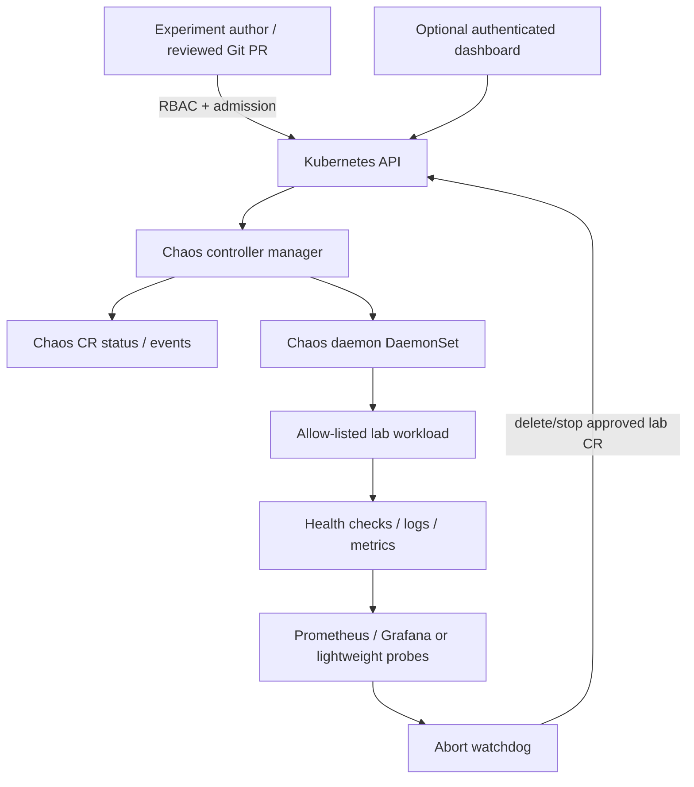
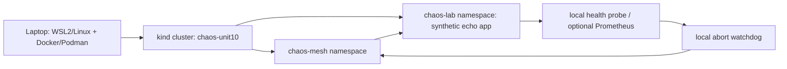

# 10.0 Learning outcomes, prerequisites, and safety contract

**Stage:** Stage 2E — Production DevOps & Platform Engineering  
**Module:** M13 — Backup, Disaster Recovery, and Resilience Testing  
**Unit:** 10 — Chaos engineering with Litmus and Chaos Mesh  
**Target file:** `10-chaos-engineering-with-litmus-and-chaos-mesh.md`

> Unit 8 defined the experiment methodology, safety rules, templates, abort logic, and scorecards using manual and scripted faults. This unit introduces **dedicated chaos engineering platforms** — **Chaos Mesh (hands-on)** and **LitmusChaos (compared; optional lab)** — and applies Unit 8's methodology through them. The tooling-map lists both tools as Awareness; they are taught here at working depth because this folder has a dedicated module. Faults injected through these tools can disrupt a cluster: they run only on lab-created resources with guardrails, abort conditions, and a kill switch.

## Learning map

| Level | Focus | Exit evidence |
|---|---|---|
| **L1 — Beginner** | Principles, steady state, architecture, first PodChaos | Hypothesis, preflight, observed fault, recovery evidence |
| **L2 — Practitioner** | Catalog of faults, selectors, telemetry, cleanup, Litmus comparison | Experiment records with independent injection proof and cleanup checks |
| **L3 — Advanced** | RBAC/admission, watchdog, freeze gate, compound workflows, DR game day, CI | Negative tests, bounded abort, game-day report, CI smoke evidence |
| **L4 — Expert** | Platform SLOs, threat model, governance, upgrade lifecycle, program value | Approved experiment catalog, metrics review, incident runbooks, ADR and traceability |

## Measurable outcomes

By completion, you should be able to:

1. Define a falsifiable hypothesis tied to service-level indicators (SLIs) and service-level objectives (SLOs).
2. Explain the trust boundaries and operational risks of Chaos Mesh and LitmusChaos.
3. Install one pinned Chaos Mesh release in a disposable `kind` cluster only after verifying official chart values, CRDs, runtime compatibility and kernel requirements.
4. Prove a target selector matches only explicitly allow-listed lab pods before creating a fault.
5. Run a bounded PodChaos experiment and distinguish resource status from independent proof that injection occurred.
6. Design safe examples for network, stress, DNS, HTTP, I/O and time faults while declining unsupported experiments honestly.
7. Implement least-privilege author access, admission controls, freeze gates and an abort watchdog.
8. Conduct a bounded compound experiment and a simulated disaster-recovery game day.
9. Compare LitmusChaos and Chaos Mesh based on observed requirements rather than preference.
10. Produce a versioned evidence bundle, incident analysis, cleanup proof and a defensible tool decision.

## Prerequisites and boundaries

Assume familiarity with Kubernetes, `kind`, `kubectl`, Helm, Git/GitOps, RBAC, basic monitoring, SLOs, incident response and Unit 8's manual/scripted fault-injection method. M05 covers stateful workload behavior; M08 covers configuration ownership; M09 covers secrets; M10 covers incident command and error budgets; M11 covers observability; M12 covers supply-chain security. Unit 6 supplies regional/dependency-failure patterns and Unit 7 supplies recovery evidence and RTA/RPA measurement. M14 is the future boundary for multi-cluster/environment parity; fleet management is not this unit's primary subject.

**Zero-budget constraint:** use a laptop, a disposable `kind` cluster, synthetic workloads and no cloud accounts, paid products, production credentials, real SaaS endpoints or customer data. Run **one chaos platform at a time**. Every footprint estimate below is `[ILLUSTRATIVE]`; measure your own environment before installing anything.

**Fidelity rule:** `kind` clusters share the laptop's host, power, network and usually storage failure domains. Stopping a `kind` node or simulating a region loss is a workflow exercise, not proof of regional resilience.

### Non-negotiable safety contract

- Never point an experiment at production, a shared cluster, `kube-system`, monitoring, platform services or any namespace not created for this lab.
- Never use wildcard selectors, `mode: all`, host-level blanket network cleanup, or an unbounded experiment.
- Never rely on `duration` alone as the kill switch. Prepare the abort command and an operator able to run it before injection.
- Do not run `KernelChaos` in this course. It remains awareness-only.
- Do not run I/O or time faults unless host/runtime/kernel preflight and the pinned release documentation explicitly support them.
- Stop immediately if the context, target, health baseline, abort query or cleanup path is uncertain.
- Do not print secrets in logs or evidence. Do not use a public dashboard endpoint.
- Every experiment must show (1) intended target, (2) actual fault evidence, (3) user/workload effect, (4) recovery, and (5) absence of residual faults.

### Reusable lab identity and safety preamble

Use a new, dedicated cluster name such as `chaos-unit10`. The examples use `chaos-lab` for experiments and `chaos-mesh` for the controller. Adapt release-specific labels/annotations only after checking the pinned release's official docs.

```bash
set -euo pipefail
export LAB_CLUSTER="chaos-unit10"
export LAB_CONTEXT="kind-${LAB_CLUSTER}"
export LAB_NS="chaos-lab"

# Fail closed: never silently switch context.
ACTUAL_CONTEXT="$(kubectl config current-context)"
if [[ "${ACTUAL_CONTEXT}" != "${LAB_CONTEXT}" ]]; then
  printf 'Refusing: current context is %s; expected %s\n' "$ACTUAL_CONTEXT" "$LAB_CONTEXT" >&2
  exit 20
fi
kubectl --context "$LAB_CONTEXT" get namespace "$LAB_NS" >/dev/null 2>&1 || {
  echo "Refusing: required lab namespace does not exist" >&2; exit 21;
}
LAB_LABEL="$(kubectl --context "$LAB_CONTEXT" get ns "$LAB_NS" -o jsonpath='{.metadata.labels.training\.example\.com/lab}')"
[[ "$LAB_LABEL" == "unit10" ]] || { echo "Refusing: namespace identity label missing" >&2; exit 22; }
```

Create the cluster and namespace only in a terminal where you intentionally control the local Docker/Podman runtime:

```bash
kind create cluster --name chaos-unit10 --wait 120s
kubectl --context kind-chaos-unit10 create namespace chaos-lab
kubectl --context kind-chaos-unit10 label namespace chaos-lab training.example.com/lab=unit10
kubectl --context kind-chaos-unit10 label namespace chaos-lab chaos-mesh.org/inject=enabled
kubectl --context kind-chaos-unit10 annotate namespace chaos-lab training.example.com/owner=learner
```

The `chaos-mesh.org/inject` annotation above is a lab marker, **not a claim that it is the correct Chaos Mesh opt-in annotation**. `[VERIFY]` the actual namespace-filter/annotation mechanism and key for the pinned release before installation; enforce the release's real opt-in in addition to this local marker. Do not continue if those differ and you have not updated the lab manifests and checks.

## Glossary

- **Chaos engineering:** controlled experiments that test whether a system maintains expected behavior under faults.
- **Steady state:** measurable service behavior considered healthy before the experiment.
- **Hypothesis:** falsifiable statement predicting service behavior under a named fault.
- **SLI/SLO:** service-level indicator/objective; the measurement and target used to judge impact.
- **Blast radius:** maximum scope of possible impact.
- **Abort condition:** measurable threshold that requires stopping the experiment.
- **Kill switch:** pretested operator action that stops injection and starts recovery.
- **Injection evidence:** independent evidence the intended fault actually took effect.
- **Cleanup evidence:** proof the experiment resource and underlying fault state are gone.
- **CRD:** CustomResourceDefinition, which extends the Kubernetes API.
- **RTA/RPA:** achieved recovery time / achieved recovery point, defined in Unit 7.

# 10.1 Chaos engineering principles and experiment methodology

## 1.1 Principles

A well-designed experiment is not “break something and see what happens.” It is a controlled test of an explicit resilience claim. The commonly published Chaos Engineering principles include establishing a steady-state hypothesis, varying real-world events, running experiments continuously when safe, and minimizing blast radius. `[VERIFY]` Compare the current wording with the authoritative principles page linked in §10.14; do not treat a paraphrase as a quotation.

A sound experiment follows this sequence:

1. **Claim:** state the resilience behavior the service should preserve.
2. **Baseline:** collect healthy latency, error rate, throughput, saturation and business-level checks.
3. **Fault model:** specify one fault, target, duration and dependencies.
4. **Prediction:** define expected SLI bounds and behavior.
5. **Guardrails:** define abort thresholds, allowed scope, approver, freeze checks and kill switch.
6. **Injection:** apply one bounded fault after confirming selector results.
7. **Observation:** verify the fault independently, then watch service and dependency signals.
8. **Abort or complete:** remove the fault when the planned duration ends or any threshold is crossed.
9. **Recovery verification:** confirm workload health and no residual fault.
10. **Learning:** compare prediction with observation, create remediation items and rerun after the fix.

### Worked hypothesis `[ILLUSTRATIVE]`

> HYP-0101: If one replica of the synthetic `echo` Deployment in namespace `chaos-lab` is deleted for at most 20 seconds, the remaining replica will keep `/healthz` successful and the synthetic request error ratio will remain below 1% over a rolling 60-second window. Abort if health checks fail for 10 seconds, error ratio reaches 2%, or the selector matches more than one pod.

| Element | Definition |
|---|---|
| Scope | `kind-chaos-unit10`, namespace `chaos-lab`, app label `app=echo` |
| Baseline | 60 seconds of `/healthz`, ready replicas, request success/error ratio |
| Fault | Delete exactly one matching pod using version-verified PodChaos schema |
| Expected | Controller recreates pod; endpoint remains healthy; no persistent error increase |
| Abort | Health failure 10 seconds, error ratio ≥2%, target count >1, or metric source unavailable |
| Recovery proof | Ready replica count restored, health check passes, CR removed, controller/daemon healthy |
| Limitation | A tiny local echo service does not model production traffic, zonal failure or stateful failover |

Use a result template rather than inventing results:

| Field | Value to record |
|---|---|
| Experiment ID / owner / approval | `[fill]` |
| Version matrix / Git commit | `[fill]` |
| Baseline interval and measurements | `[fill]` |
| Start/end timestamps | `[UTC timestamps]` |
| Intended selector / actual matches | `[fill]` |
| CR status/events | `[attach redacted output]` |
| Independent proof fault applied | `[metrics/logs/workload observation]` |
| Abort threshold crossed? | `[yes/no; evidence]` |
| Recovery and cleanup | `[checks]` |
| Conclusion | `supported / rejected / inconclusive` plus limitations |

A status such as `Running`, `Finished` or `Succeeded` is not enough by itself. A selector can match zero pods, a daemon can fail to inject, or the fault can affect a different network layer than intended. Require both platform status and independent evidence from the workload or telemetry.

## 1.2 Why a platform instead of only scripts?

| Dimension | Manual/scripted faults (Unit 8) | Dedicated platform |
|---|---|---|
| Definition | Shell/Python/runbook steps | Declarative Kubernetes resources and platform-specific workflows |
| Repeatability | Depends on script quality | Versioned CRs, controller status and reusable catalog |
| Scope | Script must implement target guards | Selectors and platform filters help, but are not a security boundary alone |
| Scheduling/workflows | External scheduler/orchestration | Supported Schedule/Workflow primitives in some releases `[VERIFY]` |
| Evidence | Script logs and telemetry | CR status/events plus independent telemetry |
| Main risk | Script error or unscoped command | Powerful controller/daemon, privileged host access, CRD drift, misleading status |
| Best use | Simple, transparent faults and portability | Repeatable experiments integrated with Kubernetes governance |

Platforms improve consistency; they do not automatically improve safety. A platform controller may have broad API permissions, while a daemon may need host/container-runtime access. A compromised experiment author may create denial of service if RBAC and admission are weak. Upgrades can change CRDs/defaults, and a “successful” CR can hide an injection failure. Keep methodology and controls independent of the chosen product.

## 1.3 Steady state and abort policy

Choose SLIs appropriate to the service: success ratio, p95/p99 latency, queue lag, freshness, replica readiness, database leadership, checkpoint progress, or fallback-model ratio. Define the observation window and data source before the fault. Use synthetic endpoints and bounded request volume for laptop labs.

Do not set universal SLO targets here. Use your service's agreed target. For labs, thresholds are deliberately conservative examples `[ILLUSTRATIVE]`; replace them only with an explicit written rationale.

# 10.2 Why a platform: Chaos Mesh and LitmusChaos architecture

## 2.1 Chaos Mesh architecture

Chaos Mesh commonly uses a controller manager, a daemon component for certain fault mechanisms, Kubernetes CRDs, and an optional dashboard. Exact components, namespaces, chart values, CRD schemas, API versions and capabilities depend on the release. `[VERIFY]` Check the chart and release documentation for the pinned version before installing.



**Trust boundaries:** experiment authors must not receive host-level privileges. The controller/daemon components are high-risk infrastructure. The daemon may be privileged and access host networking, namespaces or container runtime, depending on fault type. Restrict installation to a throwaway cluster, pin images, inspect permissions, and monitor daemon health. Dashboard access is administrative; leave it disabled unless needed, and never expose it publicly.

Source-listed Chaos Mesh CRDs/fault types include `PodChaos`, `NetworkChaos`, `StressChaos`, `IOChaos`, `TimeChaos`, `DNSChaos`, `HTTPChaos`, `KernelChaos`, `BlockChaos`, `JVMChaos`, `PhysicalMachineChaos`, `Schedule`, `Workflow` and `StatusCheck`. **This is a vocabulary list, not a guarantee that every CRD is present or supported in every release.** `[VERIFY]` Check installed CRDs and the pinned release's API reference. The syllabus mentions `chaos-mesh.org/v1alpha1`; verify the actual served version instead of copying it blindly.

Selector concepts include namespace, labels, pod names and other selector fields supported by the release. `mode` examples may include `one`, `all`, `fixed`, `fixed-percent` and `random-max-percent`; verify exact allowed values and semantics. For required labs, avoid `all`, use an explicit selector and constrain the number of matching pods.

## 2.2 LitmusChaos architecture

Litmus has version-dependent deployment modes. Concepts commonly include ChaosCenter (portal/control plane), a `chaos-operator`, `ChaosExperiment`, `ChaosEngine` and `ChaosResult` resources, experiment catalogs often called ChaosHub, runner/helper pods, and probes such as `httpProbe`, `cmdProbe`, `k8sProbe` and `promProbe`. `[VERIFY]` the exact architecture, MongoDB dependency, supported install mode, schema and verdict semantics for the chosen Litmus release. Litmus 2.x and 3.x schemas/architecture must not be mixed.

A probe is a gate on application behavior; it should verify steady state before/after injection. A completed injection with a failed application probe is not a successful resilience outcome. The `ChaosResult` values often discussed as `Pass`, `Fail` and `Awaited` are version-specific; consult the selected release's CRD/docs before interpreting them.

## 2.3 Criteria-based comparison

| Criterion | Chaos Mesh | LitmusChaos |
|---|---|---|
| Architecture / footprint | Kubernetes-native controller and daemon; privileged footprint varies by fault | Operator/engine and optional ChaosCenter; portal/database can be heavy `[VERIFY]` |
| Fault catalog | Pod, network, stress, DNS, HTTP and other release-dependent types | Experiment catalog/ChaosHub and engine-based execution; catalog availability varies |
| Probes | Use external health/metrics and supported checks | Probes are a prominent experiment concept; exact schemas are version-sensitive |
| Workflow/scheduling | Schedule/Workflow capabilities depend on version | Workflow/portal orchestration depends on install mode/version |
| UI | Optional dashboard | ChaosCenter available in relevant architectures |
| RBAC | Kubernetes CR permissions plus privileged controller/daemon | Engine/service account permissions plus operator/control-plane access |
| CI | CR apply/wait/verify and telemetry checks | Pipeline/workflow integration depends on version and installation mode |
| Extensibility | CRDs and platform integrations | Custom experiments/catalog mechanisms depend on release |
| Upgrade burden | CRD/chart/daemon/runtime compatibility | CRD/catalog/engine/portal and schema compatibility |
| Maintenance | `[VERIFY]` review official releases, advisories and repository activity | `[VERIFY]` review official releases, advisories and repository activity |
| Best fit | Teams wanting Kubernetes-native experiment definitions and fault controls | Teams valuing probe/experiment catalog workflows and supported portal experience |

**Decision framework:** choose by the faults you need, probe semantics, scheduling, kernel requirements, CI integration, RBAC model, resource budget, evidence format and team ownership. Run one platform at a time in this course. Coexistence is possible in some organizations but increases footprint, attack surface, duplicate controllers and inconsistent result semantics; do not install both simultaneously on this laptop merely for comparison.

# 10.3 Safe local lab architecture and preflight checks

## 3.1 Topology



This topology shares a single failure domain. A node stop, host reboot, disk failure or network interruption may affect everything. Do not call it multi-region or independent DR.

## 3.2 Preflight and version record

```bash
mkdir -p ./unit10-evidence
chmod 700 ./unit10-evidence
{
  date -u +'%Y-%m-%dT%H:%M:%SZ'
  uname -a
  docker version 2>&1 || true
  podman version 2>&1 || true
  kind version
  kubectl version --client -o yaml
  helm version --short
} > ./unit10-evidence/preflight.txt

kubectl config get-contexts
kind get clusters
free -h 2>/dev/null || true
df -h .
```

Create `versions.txt` after selecting a release using official release/chart docs:

```text
kind=<observed version>
kubernetes-node-image=<exact kind node image digest/tag>
kubectl=<observed client version>
helm=<observed version>
chaos-mesh-chart=<PINNED VERSION AFTER OFFICIAL DOC CHECK>
chaos-mesh-images=<exact image tags/digests from rendered manifests>
chaos-mesh-crd-api-versions=<kubectl api-resources output>
container-runtime=<observed runtime and socket path>
linux-kernel=<uname -r; note WSL2 if applicable>
verification-date=<UTC date>
official-docs-checked=<URLs and release tags>
```

Before installation, inspect CPU/RAM/disk, cluster context, container runtime, node image, kernel features and chart schema. Do not copy a random chart value from a blog. Run `helm show values <verified-chart-reference> --version <PINNED_CHART_VERSION>` and compare with the release-specific official installation page. Containerd socket paths and values such as `enableFilterNamespace` are `[VERIFY]` and can vary by chart/runtime. If the docs do not establish compatibility, stop or use the read-only path.

## 3.3 Safety preflight requirements

Before every fault, record:

- expected context exactly `kind-chaos-unit10`;
- namespace identity label `training.example.com/lab=unit10`;
- real Chaos Mesh opt-in annotation/filter configured for the pinned release;
- a label selector such as `app=echo,training.example.com/lab=unit10`;
- exact matching pod list and count;
- max allowed match count (1 for PodChaos labs);
- baseline checks passing;
- experiment CR name, maximum duration and owner/hypothesis annotations;
- abort operator, command and evidence path;
- no incident/freeze window and no unexpected cluster load.

A script that lists pods is not a transactional guarantee: pods can change between preflight and injection. Admission policy and namespace isolation remain necessary.

# 10.4 Install and secure Chaos Mesh on kind

## 4.1 Pin and verify before installation

No current chart version or compatible version matrix is asserted here. Use `<CHART_VERSION>` and `<APP_VERSION>` placeholders until verified against the official Chaos Mesh installation page and release notes. Do not install `latest` in a reproducible lesson.

```bash
# Replace only after checking the official docs for the chosen release.
export CHAOS_CHART_VERSION='<CHART_VERSION_VERIFIED_FROM_OFFICIAL_DOCS>'
export CHAOS_NAMESPACE='chaos-mesh'
export LAB_CONTEXT='kind-chaos-unit10'

[[ "$CHAOS_CHART_VERSION" != *'<'* ]] || { echo 'Pin chart version first' >&2; exit 2; }
[[ "$(kubectl config current-context)" == "$LAB_CONTEXT" ]] || { echo 'Wrong context' >&2; exit 3; }
helm repo list
# Add the repository using the exact URL from official docs; do not guess it.
# helm repo add <VERIFIED_REPO_ALIAS> <OFFICIAL_REPO_URL>
# helm repo update
# helm show values <VERIFIED_REPO_ALIAS>/<VERIFIED_CHART_NAME> --version "$CHAOS_CHART_VERSION" > ./unit10-evidence/chaos-mesh-chart-values.txt
```

After validating the official repository/chart name and values, render first and inspect all resources:

```bash
# Fill verified placeholders from the official installation guide.
helm template chaos-mesh <VERIFIED_CHART_REFERENCE> \
  --namespace "$CHAOS_NAMESPACE" --version "$CHAOS_CHART_VERSION" \
  -f ./unit10-evidence/approved-values.yaml \
  > ./unit10-evidence/rendered-chaos-mesh.yaml

# Review images, securityContext, service accounts, RBAC, host mounts, dashboard
# exposure, namespace filters, and the exact CRD apiVersions before installation.
```

The `approved-values.yaml` is a file you create locally after copying only verified settings into it; this lesson does not invent its schema. Check whether the selected release supports namespace filtering and annotation-based opt-in, then set them according to the official chart reference. Keep dashboard disabled or authenticated, with no public ingress/LoadBalancer.

```bash
# Only after the rendered manifest and values are reviewed and approved:
helm upgrade --install chaos-mesh <VERIFIED_CHART_REFERENCE> \
  --namespace "$CHAOS_NAMESPACE" --create-namespace \
  --version "$CHAOS_CHART_VERSION" -f ./unit10-evidence/approved-values.yaml

kubectl --context "$LAB_CONTEXT" -n "$CHAOS_NAMESPACE" get pods -o wide
kubectl --context "$LAB_CONTEXT" get crd | grep -E 'chaos-mesh.org' || true
kubectl --context "$LAB_CONTEXT" api-resources --api-group=chaos-mesh.org
```

Do not proceed until the controller/daemon are healthy and the needed CRDs are established. Confirm that the target namespace has the exact opt-in label/annotation required by the pinned release. If the namespace filter cannot be enabled or verified, do not run an experiment.

## 4.2 Install a synthetic workload

```yaml
apiVersion: apps/v1
kind: Deployment
metadata:
  name: echo
  namespace: chaos-lab
  labels:
    app: echo
    training.example.com/lab: unit10
spec:
  replicas: 2
  selector:
    matchLabels:
      app: echo
      training.example.com/lab: unit10
  template:
    metadata:
      labels:
        app: echo
        training.example.com/lab: unit10
    spec:
      containers:
        - name: echo
          image: hashicorp/http-echo:1.0.0
          args: ["-listen=:5678", "-text=unit10-ok"]
          ports:
            - name: http
              containerPort: 5678
          readinessProbe:
            httpGet:
              path: /
              port: http
            initialDelaySeconds: 1
            periodSeconds: 2
          resources:
            requests:
              cpu: 10m
              memory: 16Mi
            limits:
              cpu: 100m
              memory: 64Mi
---
apiVersion: v1
kind: Service
metadata:
  name: echo
  namespace: chaos-lab
spec:
  selector:
    app: echo
    training.example.com/lab: unit10
  ports:
    - name: http
      port: 80
      targetPort: http
```

`hashicorp/http-echo` image availability and tag must be verified before use `[VERIFY]`; pin by digest in a supply-chain-controlled environment. This is synthetic traffic only. Apply only after safety preamble:

```bash
kubectl --context kind-chaos-unit10 -n chaos-lab apply -f ./unit10-evidence/echo.yaml
kubectl --context kind-chaos-unit10 -n chaos-lab rollout status deploy/echo --timeout=90s
kubectl --context kind-chaos-unit10 -n chaos-lab get pods -l 'app=echo,training.example.com/lab=unit10' -o wide
```

For a lightweight health check, use a temporary local port-forward and curl from a second terminal; terminate the port-forward after use. A production-grade lab may add Prometheus/Grafana from M11, but the core PodChaos lab can use Kubernetes readiness plus repeated HTTP requests.

# 10.5 First experiment: PodChaos with measured steady state

## 5.1 Establish baseline

Start a port-forward only in the lab context:

```bash
kubectl --context kind-chaos-unit10 -n chaos-lab port-forward svc/echo 18080:80
```

In another terminal, record 60 baseline requests (example uses Python standard library):

```bash
python - <<'PY'
import time, urllib.request
ok = fail = 0
start = time.monotonic()
for _ in range(60):
    try:
        with urllib.request.urlopen('http://127.0.0.1:18080/', timeout=1.0) as r:
            if r.status == 200 and b'unit10-ok' in r.read(): ok += 1
            else: fail += 1
    except Exception:
        fail += 1
    time.sleep(1)
print({'requests': ok + fail, 'success': ok, 'failed': fail,
       'error_ratio': fail / max(ok + fail, 1),
       'duration_seconds': round(time.monotonic() - start, 2)})
PY
```

These are learner measurements, not prefilled results. Save output with timestamp and note that port-forward itself is not a production ingress path.

## 5.2 Verify selector before authoring CR

```bash
kubectl --context kind-chaos-unit10 -n chaos-lab get pods \
  -l 'app=echo,training.example.com/lab=unit10' -o wide
```

For this experiment, require exactly one target pod name. If there are zero or more than one, do not apply the CR. Choose one exact pod only if the pinned Chaos Mesh schema supports pod-name selection in the chosen selector structure; otherwise reduce the Deployment to one replica for this throwaway experiment, record that change, and restore the baseline configuration afterward.

## 5.3 PodChaos manifest template

The following is a **schema template**. `[VERIFY]` `apiVersion`, selector structure, action enum, duration and mode against the installed release's official PodChaos API reference and live CRD schema before applying. Do not run it unchanged if schema validation fails.

```yaml
apiVersion: chaos-mesh.org/v1alpha1 # [VERIFY] live CRD served version
kind: PodChaos
metadata:
  name: hyp-0101-pod-kill
  namespace: chaos-lab
  annotations:
    training.example.com/hypothesis-id: HYP-0101
    training.example.com/owner: learner
    training.example.com/risk-class: low
spec:
  action: pod-kill # [VERIFY] exact action for pinned release
  mode: one
  selector:
    namespaces:
      - chaos-lab
    labelSelectors:
      app: echo
      training.example.com/lab: unit10
    # Add an exact pod selector only if supported by the pinned schema.
  duration: "20s"
```

Before apply, validate the manifest against the cluster's CRD schema with `kubectl apply --dry-run=server -f ...` where supported, inspect the CRD OpenAPI schema, and confirm target pod count. Server-side dry-run checks schema/admission; it does not prove that injection will be safe or that the fault will occur.

```bash
# Run the shared safety preamble, then:
kubectl --context kind-chaos-unit10 -n chaos-lab apply --dry-run=server -f ./unit10-evidence/podchaos.yaml
kubectl --context kind-chaos-unit10 -n chaos-lab apply -f ./unit10-evidence/podchaos.yaml
kubectl --context kind-chaos-unit10 -n chaos-lab get podchaos hyp-0101-pod-kill -o yaml
kubectl --context kind-chaos-unit10 -n chaos-lab describe podchaos hyp-0101-pod-kill
kubectl --context kind-chaos-unit10 -n chaos-lab get events --sort-by=.lastTimestamp
```

Observe HTTP checks, pod replacement, readiness, controller/daemon logs and events. A CR status/event is one evidence source; a changed pod UID plus continued HTTP success/failure data is independent evidence. If the pod UID never changes or no expected symptom appears, classify the experiment as **inconclusive / injection not proven**, not as a pass.

## 5.4 Kill switch and recovery

The planned duration is a backstop, not the kill switch. Pre-stage this command and use it only after confirming context and exact lab CR name:

```bash
[[ "$(kubectl config current-context)" == "kind-chaos-unit10" ]] || exit 30
kubectl --context kind-chaos-unit10 -n chaos-lab delete podchaos hyp-0101-pod-kill --wait=true
kubectl --context kind-chaos-unit10 -n chaos-lab get podchaos hyp-0101-pod-kill
# Expected: NotFound; a nonzero get exit status is normal for the final check.
kubectl --context kind-chaos-unit10 -n chaos-lab rollout status deploy/echo --timeout=90s
kubectl --context kind-chaos-unit10 -n chaos-lab get pods -l 'app=echo,training.example.com/lab=unit10' -o wide
```

Also repeat the health check, inspect controller/daemon health, and verify no residual faults. If deletion does not stop injection, stop creating experiments; follow §10.7 and the release-specific cleanup runbook. Do not indiscriminately flush host networking.

# 10.6 Build and observe the Chaos Mesh experiment catalog

## 6.1 Experiment inventory and mandatory metadata

Each experiment record should include `id`, owner, service, namespace, exact selector, risk class, hypothesis, baseline window, SLIs, duration, abort thresholds, kill switch, injection proof, recovery proof and cleanup check. Do not execute a catalog item just because a CRD exists.

| Fault type | What it tests | Core guardrail | Proof of injection | Feasibility |
|---|---|---|---|---|
| PodChaos `pod-kill` | Replica redundancy | Exactly one lab pod | Pod UID changes / controller event | Core lab; schema `[VERIFY]` |
| PodChaos `pod-failure` | Unavailable pod behavior | One pod, bounded duration | Readiness/endpoint changes | `[VERIFY]` action semantics |
| PodChaos `container-kill` | Container restart policy | One container in lab pod | Restart count increases | `[VERIFY]` |
| NetworkChaos delay | Timeout/retry behavior | Only lab pod/dependency pair | Measured latency change | `tc`/kernel support `[VERIFY]` |
| NetworkChaos loss | Retry budget and errors | Small percentage first | Packet/request failures increase | `sch_netem` support `[VERIFY]` |
| NetworkChaos partition | Dependency isolation | Synthetic service only | Connection failure and route checks | Higher risk; review first |
| StressChaos CPU/memory | Limits/noisy-neighbor behavior | Single low-limit lab pod | CPU/throttling/OOM signals | Resource headroom required |
| DNSChaos | Resolver/client retry behavior | Synthetic name only | Lookup failures / query logs | DNS component requirements `[VERIFY]` |
| HTTPChaos | Dependency 5xx/latency handling | Lab-only HTTP target | HTTP status/latency changes | Feature availability `[VERIFY]` |
| IOChaos | I/O error/latency behavior | Disposable PVC/path | I/O latency/errors | FUSE/kernel/host support `[VERIFY]`; may be infeasible |
| TimeChaos | Clock-dependent logic | Synthetic isolated app | Controlled clock-sensitive test | Mechanism/privileges `[VERIFY]`; may be infeasible |
| KernelChaos | Kernel fault injection | **Never in this lab** | Not applicable | Awareness only; special kernel risk |

The `Schedule`, `Workflow`, `StatusCheck`, `BlockChaos`, `JVMChaos` and `PhysicalMachineChaos` resources are version-dependent. Check `kubectl api-resources --api-group=chaos-mesh.org`, the installed CRD schemas and the official docs. Do not claim an experiment type is available merely because it appears in this curriculum vocabulary.

## 6.2 Example record for a network delay experiment

Use this as a planning record, not as an executable CR:

```yaml
experiment_id: HYP-0102
owner: learner
risk_class: medium
namespace: chaos-lab
selector: "app=echo,training.example.com/lab=unit10"
hypothesis: "A bounded delay on the synthetic service path stays within the lab latency budget."
baseline_window: "60s"
sli:
  - "HTTP success ratio"
  - "request latency p95"
abort:
  - "health check fails for 5 consecutive samples"
  - "request error ratio >= 0.02"
  - "metric source unavailable"
duration_max: "15s"
kill_switch: "delete the exact reviewed NetworkChaos CR"
injection_proof: "request latency distribution changes during the fault"
recovery_proof: "latency returns to baseline range and requests succeed"
cleanup_proof: "CR absent; node-specific network state reviewed if applicable"
```

Only after the official release documentation verifies the exact `NetworkChaos` fields, direction, target selector and `externalTargets` behavior should you author a runnable manifest. Do not use a real external endpoint. Model dependency failures with a second disposable workload inside `chaos-lab`.

## 6.3 Fault-to-method mapping from Unit 8

| Unit 8 fault | Platform/tool | Expected symptom | Abort | Cleanup proof | Limitation |
|---|---|---|---|---|---|
| Pod kill | PodChaos | Pod UID changes; controller replaces it | Health/error threshold | CR absent, pod ready | Does not model node/zone loss |
| Node stop/pause | `kind` node container action, **outside Chaos Mesh** | Node NotReady/workload rescheduling | Any control-plane instability | Node resumed and Ready | Shares laptop failure domain |
| Network delay/loss | NetworkChaos | Latency/errors change | SLI threshold | CR absent; network state checked | Kind networking may differ from production |
| DNS failure | DNSChaos if supported | Lookup failures/retries | App health threshold | DNS returns to baseline | Cache can hide injected effect |
| CPU/memory stress | StressChaos | Saturation/throttling | Memory pressure or SLO breach | stress CR gone; resources normalize | Laptop contention can distort results |
| I/O latency | IOChaos if feasible | I/O latency increases | App health/disk threshold | CR gone; path/volume checked | FUSE/kernel limitations common |
| HTTP abort/delay | HTTPChaos if supported | Synthetic dependency errors/latency | Error/latency threshold | CR gone; HTTP baseline restored | No real SaaS call permitted |
| Clock skew | TimeChaos if feasible | Expiry/ordering behavior changes | Any unexpected auth/data effect | CR gone; clock behavior validated | WSL2/kernel mechanism may be unavailable |

## 6.4 Selector preflight script and tests

The script below lists the exact target pods and fails closed on wrong context, non-allow-listed namespace, missing lab opt-in, empty selector, unexpected labels, zero matches or excessive matches. It does **not** apply a chaos resource. It uses `kubectl` JSON output and Python's standard library. The local marker annotation/label must be reconciled with the actual pinned Chaos Mesh opt-in configuration.

```python
#!/usr/bin/env python3
"""Safe selector preflight; deliberately does not apply experiments."""
import json, subprocess, sys

EXPECTED_CONTEXT = "kind-chaos-unit10"
ALLOWED_NAMESPACES = {"chaos-lab"}
REQUIRED_LABELS = {"training.example.com/lab": "unit10"}
REQUIRED_NAMESPACE_LABEL = ("training.example.com/lab", "unit10")
MAX_MATCHES = 1


def run(*args):
    p = subprocess.run(args, check=False, text=True, capture_output=True)
    if p.returncode:
        raise RuntimeError(f"command failed ({p.returncode}): {args[0]} {args[1:]}; stderr={p.stderr.strip()}")
    return p.stdout


def preflight(context, namespace, selector):
    if context != EXPECTED_CONTEXT:
        raise ValueError("wrong context")
    if namespace not in ALLOWED_NAMESPACES:
        raise ValueError("namespace is not allow-listed")
    pairs = [part.split("=", 1) for part in selector.split(",") if part.strip()]
    if not pairs or any(len(p) != 2 or not p[0].strip() or not p[1].strip() for p in pairs):
        raise ValueError("selector must contain explicit key=value pairs")
    selector_map = {k.strip(): v.strip() for k, v in pairs}
    if not selector_map:
        raise ValueError("empty selector")
    for k, v in REQUIRED_LABELS.items():
        if selector_map.get(k) != v:
            raise ValueError(f"selector must include {k}={v}")
    current = run("kubectl", "config", "current-context").strip()
    if current != context:
        raise ValueError(f"current context {current!r} != expected {context!r}")
    ns = json.loads(run("kubectl", "--context", context, "get", "namespace", namespace, "-o", "json"))
    if ns.get("metadata", {}).get("labels", {}).get(REQUIRED_NAMESPACE_LABEL[0]) != REQUIRED_NAMESPACE_LABEL[1]:
        raise ValueError("namespace lab identity label missing")
    selector_text = ",".join(f"{k}={v}" for k, v in selector_map.items())
    pods = json.loads(run("kubectl", "--context", context, "-n", namespace, "get", "pods", "-l", selector_text, "-o", "json"))
    items = pods.get("items", [])
    if not items:
        raise ValueError("selector matched zero pods")
    if len(items) > MAX_MATCHES:
        raise ValueError(f"selector matched {len(items)} pods; max is {MAX_MATCHES}")
    for pod in items:
        labels = pod.get("metadata", {}).get("labels", {})
        for k, v in REQUIRED_LABELS.items():
            if labels.get(k) != v:
                raise ValueError(f"matched pod lacks required label {k}={v}")
    return [{"name": p["metadata"]["name"], "uid": p["metadata"].get("uid"),
             "labels": p["metadata"].get("labels", {})} for p in items]


if __name__ == "__main__":
    if len(sys.argv) != 4:
        print(f"usage: {sys.argv[0]} CONTEXT NAMESPACE 'key=value,key=value'", file=sys.stderr)
        sys.exit(2)
    try:
        matches = preflight(*sys.argv[1:])
        print(json.dumps({"approved_for_review_only": True, "matches": matches}, indent=2))
    except Exception as exc:
        print(f"REFUSED: {exc}", file=sys.stderr)
        sys.exit(1)
```

Example invocation:

```bash
python selector_preflight.py kind-chaos-unit10 chaos-lab \
  'app=echo,training.example.com/lab=unit10'
```

Tests (save inline as `test_selector_preflight.py` beside the script):

```python
import json
import unittest
from unittest.mock import patch
import selector_preflight as s

NS = {"metadata": {"labels": {"training.example.com/lab": "unit10"}}}
def pod(name):
    return {"metadata": {"name": name, "uid": "uid-" + name,
            "labels": {"app": "echo", "training.example.com/lab": "unit10"}}}

def mocked_run_for(items):
    def fake_run(*args):
        if args[:3] == ("kubectl", "config", "current-context"):
            return "kind-chaos-unit10"
        if "namespace" in args and "-o" in args:
            return json.dumps(NS)
        if "pods" in args and "-o" in args:
            return json.dumps({"items": items})
        raise AssertionError("unexpected kubectl call: " + repr(args))
    return fake_run

class SelectorTests(unittest.TestCase):
    def test_wrong_context_rejected_before_kubectl(self):
        with self.assertRaisesRegex(ValueError, "wrong context"):
            s.preflight("prod", "chaos-lab", "app=echo,training.example.com/lab=unit10")

    def test_disallowed_namespace_rejected(self):
        with self.assertRaisesRegex(ValueError, "not allow-listed"):
            s.preflight("kind-chaos-unit10", "kube-system", "app=echo,training.example.com/lab=unit10")

    def test_missing_lab_label_rejected(self):
        with self.assertRaisesRegex(ValueError, "must include"):
            s.preflight("kind-chaos-unit10", "chaos-lab", "app=echo")

    def test_empty_selector_rejected(self):
        with self.assertRaisesRegex(ValueError, "explicit key=value"):
            s.preflight("kind-chaos-unit10", "chaos-lab", "")

    def test_one_approved_pod_is_listed(self):
        with patch.object(s, "run", mocked_run_for([pod("echo-a")])):
            result = s.preflight("kind-chaos-unit10", "chaos-lab", "app=echo,training.example.com/lab=unit10")
        self.assertEqual([x["name"] for x in result], ["echo-a"])

    def test_too_many_pods_refused(self):
        with patch.object(s, "run", mocked_run_for([pod("echo-a"), pod("echo-b")])):
            with self.assertRaisesRegex(ValueError, "max is 1"):
                s.preflight("kind-chaos-unit10", "chaos-lab", "app=echo,training.example.com/lab=unit10")

    def test_zero_matches_refused(self):
        with patch.object(s, "run", mocked_run_for([])):
            with self.assertRaisesRegex(ValueError, "zero pods"):
                s.preflight("kind-chaos-unit10", "chaos-lab", "app=echo,training.example.com/lab=unit10")

if __name__ == "__main__":
    unittest.main()
```

Run `python -m unittest -v test_selector_preflight.py`. The negative tests should fail closed without querying a cluster. The script uses the current kubeconfig context check as an additional guard, but the explicit `--context` is still used for all cluster queries. A context can be misconfigured; namespace isolation and admission policy are still required.

# 10.7 Experiment safety, abort watchdog, and verified cleanup

## 7.1 Safety lifecycle

1. **Before:** verify context, allow-listed namespace, opt-in, selector, max matches, baseline, incident/freeze gate, metric source and kill switch.
2. **During:** monitor SLIs, experiment status, events, controller/daemon health and application logs.
3. **Abort:** delete/pause only the exact reviewed lab CR when an abort condition fires. If metrics are unavailable or malformed, fail safe and abort.
4. **After:** verify CR deletion, application health, controller/daemon health and node fault state where applicable. Capture evidence before teardown.
5. **If cleanup fails:** stop experiments, preserve logs, isolate the disposable cluster, inspect exact lab node and fault state, and follow the release-specific recovery runbook. Never run a blanket `iptables -F`, `tc qdisc del dev ... root` against an unverified interface, or host-wide cleanup.

A duration is a second line of defence, not a complete kill switch. Chaos Mesh pause-annotation behavior is `[VERIFY]` for the pinned release. A daemon crash during network injection can leave state that requires targeted cleanup; controller availability does not guarantee the fault is gone.

## 7.2 Freeze/approval gate

A gate must refuse to start if an incident is open, a freeze window is active, the error budget is exhausted, the SLO is already breached, or the safety officer/approver is unavailable. A production implementation should query the incident system and authoritative SLO/error-budget source; do not use a local environment variable as proof of organizational state.

Lab gate example:

```python
#!/usr/bin/env python3
"""Lab-only manual gate; production integrations must query authoritative systems."""
import os, sys
required = {
    "LAB_CONTEXT_CONFIRMED": "yes",
    "INCIDENT_OPEN": "no",
    "FREEZE_ACTIVE": "no",
    "ERROR_BUDGET_EXHAUSTED": "no",
    "SAFETY_OFFICER_AVAILABLE": "yes",
    "APPROVAL_ID": None,
}
errors = []
for key, expected in required.items():
    value = os.getenv(key, "").strip()
    if not value:
        errors.append(f"{key} missing")
    elif expected is not None and value.lower() != expected:
        errors.append(f"{key} must equal {expected}")
if errors:
    print("REFUSED: " + "; ".join(errors), file=sys.stderr)
    sys.exit(1)
print("Gate passed for the explicitly approved lab experiment only.")
```

This gate is a teaching scaffold; a user can lie to environment variables. Production-grade controls must use authenticated, auditable integrations and admission enforcement.

## 7.3 Watchdog design and bounded abort time

Define abort bound `T = poll interval + query timeout + API deletion latency + recovery verification allowance`. `[ILLUSTRATIVE]` For a 2-second poll interval, 2-second query timeout and 5-second deletion budget, the detection/deletion objective is at most 9 seconds under healthy local control-plane conditions. This is not a guaranteed bound during API/control-plane failure; in that case the experiment must be independently bounded by a short duration and isolation.

The watchdog must be preconfigured with one context, one namespace, an exact allow-list of experiment names/kinds, a Prometheus endpoint reachable only inside the lab, a query whose semantics are known, and a maximum polling interval. It must fail safe on missing metrics, malformed values, HTTP/API errors, stale samples, or an unexpected target. Never allow arbitrary URL, namespace or CR name as an untrusted command-line argument.

The following Python watchdog is a **reviewable reference implementation**. It uses the Python standard library and the local `kubectl` CLI. Verify Prometheus query semantics and local CLI compatibility before use. It only deletes the single configured CR in `chaos-lab`; it does not act cluster-wide.

```python
#!/usr/bin/env python3
"""Lab-only abort watchdog. Fail-safe: invalid/unavailable metric aborts the named CR."""
import json, os, subprocess, sys, time, urllib.parse, urllib.request
from datetime import datetime, timezone

PROM_URL = os.environ.get("LAB_PROM_URL", "http://127.0.0.1:9090")
PROM_QUERY = os.environ.get("LAB_ABORT_QUERY", 'up{job="unit10-lab-app"} == 0')
EXPECTED_CONTEXT = "kind-chaos-unit10"
NAMESPACE = "chaos-lab"
ALLOWED = {("PodChaos", "hyp-0101-pod-kill"), ("NetworkChaos", "hyp-0102-network-delay")}
POLL_SECONDS = 2
QUERY_TIMEOUT_SECONDS = 2
MAX_SAMPLE_AGE_SECONDS = 10


def now():
    return datetime.now(timezone.utc).isoformat()


def query_metric():
    url = PROM_URL.rstrip("/") + "/api/v1/query?" + urllib.parse.urlencode({"query": PROM_QUERY})
    req = urllib.request.Request(url, headers={"Accept": "application/json"})
    with urllib.request.urlopen(req, timeout=QUERY_TIMEOUT_SECONDS) as response:
        payload = json.load(response)
    if payload.get("status") != "success":
        raise RuntimeError("Prometheus query status not success")
    result = payload.get("data", {}).get("result")
    if not isinstance(result, list) or len(result) != 1:
        raise RuntimeError("query must return exactly one vector sample")
    value = result[0].get("value")
    if not isinstance(value, list) or len(value) != 2:
        raise RuntimeError("invalid Prometheus sample")
    timestamp, raw = float(value[0]), float(value[1])
    if time.time() - timestamp > MAX_SAMPLE_AGE_SECONDS:
        raise RuntimeError("stale Prometheus sample")
    if raw not in (0.0, 1.0):
        raise RuntimeError("expected binary 0/1 abort signal")
    return int(raw), timestamp


def validate_target(kind, name):
    if (kind, name) not in ALLOWED:
        raise RuntimeError("target is not in hard-coded allow-list")


def should_abort(signal):
    if signal not in (0, 1):
        raise RuntimeError("invalid abort signal")
    return signal == 1


def delete_exact_lab_cr(kind, name):
    validate_target(kind, name)
    if os.popen("kubectl config current-context").read().strip() != EXPECTED_CONTEXT:
        raise RuntimeError("current kube context mismatch; fail safe")
    # Exact resource and namespace only; no wildcard selector.
    import subprocess
    result = subprocess.run([
        "kubectl", "--context", EXPECTED_CONTEXT, "-n", NAMESPACE,
        "delete", kind.lower(), name, "--wait=true", "--ignore-not-found=true"],
        text=True, capture_output=True, timeout=10)
    if result.returncode != 0:
        raise RuntimeError("delete failed: " + result.stderr.strip())
    return result.stdout.strip()


def main():
    kind = os.environ.get("LAB_EXPERIMENT_KIND", "PodChaos")
    name = os.environ.get("LAB_EXPERIMENT_NAME", "hyp-0101-pod-kill")
    if (kind, name) not in ALLOWED:
        print("REFUSED: unapproved experiment target", file=sys.stderr); return 20
    deadline = time.monotonic() + float(os.environ.get("LAB_WATCHDOG_SECONDS", "45"))
    while time.monotonic() < deadline:
        try:
            signal, ts = query_metric()
            print(json.dumps({"time": now(), "signal": signal, "sample_epoch": ts,
                              "experiment": name, "namespace": NAMESPACE}))
            # Query is defined so 1 means the abort condition is true.
            if should_abort(signal):
                output = delete_exact_lab_cr(kind, name)
                print(json.dumps({"time": now(), "action": "delete_exact_cr", "output": output}))
                return 0
        except Exception as exc:
            print(json.dumps({"time": now(), "action": "fail_safe_abort", "reason": str(exc)}), file=sys.stderr)
            try:
                delete_exact_lab_cr(kind, name)
            except Exception as delete_exc:
                print(json.dumps({"time": now(), "action": "manual_intervention_required",
                                  "reason": str(delete_exc)}), file=sys.stderr)
                return 30
            return 10
        time.sleep(POLL_SECONDS)
    print(json.dumps({"time": now(), "action": "watchdog_timeout_abort", "experiment": name}), file=sys.stderr)
    try:
        delete_exact_lab_cr(kind, name)
    except Exception as exc:
        print(f"manual intervention required: {exc}", file=sys.stderr); return 31
    return 11

if __name__ == "__main__":
    sys.exit(main())
```

**Important implementation notes:** the example's default query is only a placeholder; replace it with a single, well-defined lab signal and test its polarity. The watchdog checks the current context and hard-coded target allow-list, but a shelling-out reference implementation is not a hard isolation boundary. A production watchdog needs authenticated Prometheus access, Kubernetes API client authentication, structured logging, clock validation, unit tests and a separately controlled execution identity. Do not run it until you have verified that the query returns exactly one fresh sample and that `1` means “abort.”

Watchdog unit tests (save the implementation above as `watchdog.py` and this as `test_watchdog.py`). These exercise decision logic and failure paths; they do not replace an integration test against a running cluster.

```python
import unittest
from unittest.mock import patch, Mock
import urllib.error
import watchdog as w

class WatchdogTests(unittest.TestCase):
    def test_healthy_signal_does_not_abort(self):
        self.assertFalse(w.should_abort(0))

    def test_breach_requests_abort(self):
        self.assertTrue(w.should_abort(1))

    def test_invalid_signal_fails_safe(self):
        with self.assertRaisesRegex(RuntimeError, "invalid abort signal"):
            w.should_abort(7)

    def test_prometheus_timeout_is_error(self):
        with patch.object(w.urllib.request, "urlopen", side_effect=TimeoutError("timeout")):
            with self.assertRaises(TimeoutError):
                w.query_metric()

    def test_unapproved_target_is_rejected_before_kubectl(self):
        with self.assertRaisesRegex(RuntimeError, "not in hard-coded allow-list"):
            w.validate_target("PodChaos", "arbitrary-name")

    def test_kubernetes_delete_api_error_is_reported(self):
        fake = Mock(returncode=1, stderr="Forbidden", stdout="")
        with patch("os.popen") as popen, patch.object(w.subprocess, "run", return_value=fake):
            popen.return_value.read.return_value = w.EXPECTED_CONTEXT
            with self.assertRaisesRegex(RuntimeError, "delete failed"):
                w.delete_exact_lab_cr("PodChaos", "hyp-0101-pod-kill")

if __name__ == "__main__":
    unittest.main()
```

Required test cases before any fault: healthy signal keeps experiment running; breach deletes exact CR; no result / multiple results / stale sample aborts; Prometheus timeout aborts; wrong context refuses; unapproved CR refuses; API deletion failure reports manual intervention. A deliberately harmful test such as 100% packet loss between a lab API and lab DB is permitted only if both endpoints are synthetic, selectors are exact, the abort query is independent of the path being broken, the CR is bounded, and the operator has a second kill-switch path. Never make the only monitoring or control path depend on the faulted network.

## 7.4 Targeted cleanup of residual network faults

First delete the exact experiment CR and verify workload recovery. If the daemon crashed, inspect the exact kind node and the interface/rule touched by the pinned mechanism. A command such as `docker exec <EXACT_KIND_NODE_CONTAINER> tc qdisc show dev <EXACT_INTERFACE>` is diagnostic only; both node name and interface must be discovered and confirmed. `[VERIFY]` the cleanup procedure for the actual fault implementation and release. Remove only the known lab rule, with a reviewed command for that exact interface/rule. Never flush all `tc`, iptables, nftables or ipsets on a host.

# 10.8 LitmusChaos architecture, probes, and comparison

## 8.1 Optional lab versus read-only walkthrough

Chaos Mesh is the mandatory hands-on platform. Litmus is optional because the portal/database and controller footprint can exceed the 4-CPU/8-GB laptop budget. Stop/uninstall Chaos Mesh from the disposable cluster before attempting Litmus; do not run both platforms concurrently in this course.

Before any Litmus install, select a supported release, verify the official install mode, chart/schema and resource requirements, and record them in `versions.txt`. Do not assume ChaosCenter/MongoDB is mandatory or optional for every version; this is `[VERIFY]`.

## 8.2 `ChaosEngine` concepts

A version-verified `ChaosEngine` may define an application target (`appinfo`), a dedicated experiment service account (`chaosServiceAccount`), a list of experiments and their component environment (`experiments[].spec.components.env`), probes, cleanup policy (`jobCleanUpPolicy`) and engine state (`engineState`). **Field names and nesting are schema-sensitive.** The following is a non-runnable schema map, not a manifest:

```yaml
# [TEMPLATE ONLY — do not apply until replaced with the selected release's schema]
apiVersion: litmuschaos.io/<VERIFY_API_VERSION>
kind: ChaosEngine
metadata:
  name: unit10-echo-pod-delete
  namespace: chaos-lab
spec:
  appinfo: <VERIFY_TARGET_SCHEMA>
  chaosServiceAccount: <DEDICATED_LEAST_PRIVILEGE_SERVICE_ACCOUNT>
  engineState: active
  jobCleanUpPolicy: <VERIFY_SUPPORTED_VALUE>
  experiments:
    - name: <VERIFY_CATALOG_EXPERIMENT_NAME>
      spec:
        components:
          env: <VERIFY_EXPERIMENT_ENV_SCHEMA>
  # Probe structure must be copied from official docs for the pinned release.
```

`appinfo` determines the workload target, the service account governs experiment permissions, `experiments` selects a catalog experiment and parameters, `probe` validates steady state, `jobCleanUpPolicy` governs cleanup of experiment jobs, and `engineState` controls engine execution in releases where those fields exist. Do not use a reusable overprivileged service account.

## 8.3 Probe and verdict reasoning

An `httpProbe` can assert that a synthetic endpoint remains healthy; a `promProbe` can assert a Prometheus condition if supported and correctly configured. `cmdProbe` and `k8sProbe` have their own permission and execution implications. Confirm exact probe fields and evaluation timing in the chosen version. A probe must run before, during/after as appropriate, and fail closed if its signal is missing. A `ChaosResult` verdict is not a substitute for reviewing probe output and raw evidence.

ChaosCenter's “resilience score” is discussed in some Litmus versions; `[VERIFY]` its availability and calculation before using it. Any weighted score is a heuristic, not certification. The underlying hypothesis, probe outcomes, fault evidence and remediation completion matter more than an aggregate number.

## 8.4 Read-only walkthrough

1. Open the official Litmus documentation for the pinned release.
2. Compare operator-only/lightweight and ChaosCenter install modes, required database and resource budget.
3. Inspect the release-specific `ChaosExperiment`, `ChaosEngine` and `ChaosResult` schemas.
4. Locate the current catalog entries for `pod-delete`, `pod-network-latency`, `node-cpu-hog` and `disk-fill`. These names are `[VERIFY]`; availability and safety are not universal.
5. Read the `pod-delete` example and identify the target selector, service account, duration, probe, cleanup and verdict rules.
6. Fill the comparison matrix in Lab 10 without claiming execution.

`[ILLUSTRATIVE — NOT EXECUTED]` A desired outcome is: the experiment targets one synthetic pod; an HTTP probe remains healthy or fails according to the hypothesis; the result CR and pod events corroborate injection; the application returns to steady state; no experiment job or residual fault remains. This is an expected evidence shape, not a measured result.

# 10.9 Guardrails as code, RBAC, and admission policy

## 9.1 Least-privilege author access

First inspect the actual API resources and names:

```bash
kubectl --context kind-chaos-unit10 api-resources --api-group=chaos-mesh.org
kubectl --context kind-chaos-unit10 get crd <EXACT_CHAOS_CRD_NAME> -o yaml
```

A namespace-scoped Role should grant only the exact experiment resource kinds needed in `chaos-lab`. The following is a **template** because resource names, API group and verbs must match the pinned release and intended workflow. Do not add wildcard resources or broad cluster roles.

```yaml
apiVersion: rbac.authorization.k8s.io/v1
kind: ServiceAccount
metadata:
  name: unit10-experiment-author
  namespace: chaos-lab
---
apiVersion: rbac.authorization.k8s.io/v1
kind: Role
metadata:
  name: unit10-experiment-author
  namespace: chaos-lab
rules:
  - apiGroups: ["chaos-mesh.org"] # [VERIFY] installed API group
    resources: ["podchaos"]       # [VERIFY] exact lower-case resource name
    verbs: ["get", "list", "watch", "create", "delete"]
  - apiGroups: [""]
    resources: ["pods", "events"]
    verbs: ["get", "list", "watch"]
---
apiVersion: rbac.authorization.k8s.io/v1
kind: RoleBinding
metadata:
  name: unit10-experiment-author
  namespace: chaos-lab
subjects:
  - kind: ServiceAccount
    name: unit10-experiment-author
    namespace: chaos-lab
roleRef:
  apiGroup: rbac.authorization.k8s.io
  kind: Role
  name: unit10-experiment-author
```

The author does not need permission to edit `chaos-mesh` components, privileged DaemonSets, CRDs, namespaces, cluster roles or arbitrary workloads. Controller/daemon permissions are a separate platform privilege boundary. Verify with `kubectl auth can-i --as=system:serviceaccount:chaos-lab:unit10-experiment-author create podchaos.chaos-mesh.org -n chaos-lab` and a negative check against `kube-system`. Impersonation testing requires permission to impersonate; if not available, use an authorized test identity rather than broadening permissions.

## 9.2 Admission policy

A Kubernetes ValidatingAdmissionPolicy (VAP) is one possible path, but CEL fields, policy binding semantics and CRD object schemas vary with Kubernetes version. Kyverno/Gatekeeper alternatives also have version-specific syntax. The policy must validate the *actual* Chaos Mesh schema, not merely the YAML shown in this lesson. `[VERIFY]` the VAP API version and CEL schema for the Kubernetes version in your `kind` node image.

Required policy assertions:

- duration is mandatory and no greater than a conservative maximum;
- `mode: all` is denied (for this lab, deny it altogether);
- target namespace is exactly `chaos-lab` and has verified opt-in;
- selector includes `training.example.com/lab=unit10`;
- hypothesis ID and owner metadata are present;
- `KernelChaos` is denied;
- non-lab namespaces and sensitive namespaces are denied;
- unsupported kinds and unreviewed experiment types are denied.

**Do not apply a fabricated CEL policy.** Generate the policy from the selected release's CRD schema and the cluster's Kubernetes VAP documentation. A schema-independent admission contract to implement/test is shown below; it is not an API manifest:

```text
ADMISSION CONTRACT (implement in verified VAP/Kyverno/Gatekeeper syntax)
ALLOW only when all conditions hold:
  request.namespace == "chaos-lab"
  namespace label training.example.com/lab == "unit10"
  kind in reviewed allow-list: PodChaos, NetworkChaos, StressChaos, DNSChaos, HTTPChaos
  metadata.annotations["training.example.com/hypothesis-id"] is non-empty
  metadata.annotations["training.example.com/owner"] is non-empty
  spec.duration exists and parses to <= 30 seconds
  spec.mode != "all"
  selector contains training.example.com/lab == "unit10"
DENY always:
  KernelChaos
  any target namespace outside allow-list
  missing/empty selector
  unsupported kind
```

Negative tests must be denied: (1) no duration, (2) `mode: all`, (3) `kube-system` target, (4) `KernelChaos`, (5) missing hypothesis/owner metadata, and (6) broad/missing selector. Use server-side dry-run or policy-engine test tooling and capture denial messages. A sample policy is not production-ready until tested against the installed CRD schema and admission engine.

## 9.3 Namespace and target controls

Use independent controls in depth:

1. Dedicated throwaway cluster (strongest lab boundary).
2. Namespace allow-list and opt-in filter in the pinned Chaos Mesh release.
3. Label selector with a required lab marker.
4. Preflight script with maximum match count.
5. Namespace-scoped RBAC for experiment authors.
6. Admission policy that validates duration, type, selector and metadata.
7. Automated abort and independent health checks.

Do not rely on a single annotation or client-side script. A privileged controller may still act on a malformed/overbroad CR if server-side policy permits it.

# 10.10 Compound workflows, DR game days, and CI smoke tests

## 10.1 Schedule and Workflow

Chaos Mesh `Schedule`, `Workflow`, `StatusCheck`, suspension and serial/parallel workflow fields are `[VERIFY]` against the pinned release. Confirm CRDs exist, schema matches, and execution semantics are understood before creating runnable manifests. For laptop labs, a manually orchestrated sequence is an acceptable fallback if the platform workflow is unavailable; record the fidelity gap.

A compound experiment should introduce only the faults necessary to test the hypothesis. Example sequence:

1. Baseline the synthetic service and database client.
2. Apply a bounded delay to the lab replica/dependency path.
3. Kill one synthetic primary pod only if the app is designed to tolerate it.
4. Optionally generate a low, bounded `k6` load if already installed and resource headroom is confirmed.
5. Abort on service error/latency thresholds, stale metrics, or unexpected selector count.
6. Remove all CRs, verify workload recovery and compare expected versus observed.

Do not combine DB primary kill + replica delay + load on a real database. Use synthetic state and a disposable database only. A workflow should not continue to the next step if the prior step failed its steady-state gate.

## 10.2 DR game day

Roles: safety officer (can abort), incident commander, observers, recorder and experiment operator. Use Unit 6's dependency/failover scenario and Unit 7's evidence bundle.

- Simulate “primary region unavailable” by stopping/isolating a disposable primary `kind` cluster or its nodes **outside Chaos Mesh**.
- Use NetworkChaos/NetworkPolicy only against a synthetic dependency to model a dependency blackhole.
- If a database partition is included, use a disposable test database and predefined recovery procedure.
- Verify alert delivery, runbook discovery, decision authority, recovery ordering, data correctness and RTA/RPA.
- Capture start of impact, detection, decision, mitigation, recovery and final verification timestamps.
- Produce a blameless report with expected/observed differences, remediations, owners and retest date.

Two clusters on one laptop share host, power, network and often storage. This game day tests the **workflow and decision process only**; it is not regional resilience evidence.

## 10.3 Chaos in CI

Minimal CI smoke design aligned with M02:

1. Create an ephemeral `kind` cluster with a unique name.
2. Assert context equals that exact name and cluster carries a CI-specific lab identity.
3. Install the pinned Chaos Mesh release from a verified chart and values file.
4. Deploy a tiny synthetic workload and health check.
5. Run only two low-risk experiments (for example, single-pod kill and short CPU stress), with exact selectors and abort checks.
6. Assert explicit service outcomes and that the fault was observed.
7. Capture rendered manifests, tool versions, CR status/events, workload logs, baseline/during/after measurements and cleanup checks.
8. Run teardown in an `always`/`finally` path even when an assertion fails.
9. Fail CI on missing injection evidence, failed cleanup, SLO breach, wrong context or unapproved schema changes.

A minimal shell pattern, with install and manifest paths supplied by reviewed CI artifacts:

```bash
#!/usr/bin/env bash
set -Eeuo pipefail
CLUSTER="unit10-ci-${CI_PIPELINE_ID:-local}"
CTX="kind-${CLUSTER}"
cleanup() {
  rc=$?
  if kind get clusters | grep -Fxq "$CLUSTER"; then
    # Exact cluster name created by this job only.
    kind delete cluster --name "$CLUSTER" || rc=1
  fi
  exit "$rc"
}
trap cleanup EXIT INT TERM
kind create cluster --name "$CLUSTER" --wait 120s
[[ "$(kubectl config current-context)" == "$CTX" ]]
# Install the pinned, verified Chaos Mesh chart and deploy reviewed synthetic app.
# Run two reviewed low-risk experiments; fail if fault proof, SLO or cleanup checks fail.
# Store evidence before EXIT cleanup in the CI artifact directory.
```

Do not paste production kubeconfig into CI. Use ephemeral credentials, restricted runners, a small suite, and a timeout. Handle flakiness by classifying infrastructure failure versus product regression; do not automatically rerun a failed experiment until it passes and thereby hide a real defect. Record each attempt.

## 10.4 Security and dependency outage scenarios

| Scenario | Expected behavior | Guardrail / detection | Recovery / evidence | Untested boundary |
|---|---|---|---|---|
| Policy-engine outage under load | Documented fail-open/fail-closed behavior; no silent policy bypass | Admission metrics/events; synthetic requests | Restore policy pod; test allow/deny cases | Does not establish production control-plane capacity |
| Secrets backend outage | Existing cached credentials may work only within defined validity; new retrieval fails safely | Auth errors, secret-fetch latency, expiry alarms | Restore synthetic backend; rotate test credential | No real Vault/customer secrets |
| Registry outage | Cached image may start; uncached pull fails | ImagePullBackOff, registry probe | Restore lab registry; verify digest/signature | No external registry tested |
| DNS failure | Bounded retries, fallback only if designed, no poisoning outside lab | DNS errors, resolution latency | Remove fault; verify resolver/cache behavior | Real recursive resolver topology not reproduced |
| Admission webhook outage | Behavior matches explicit failurePolicy and availability design | API request errors and webhook metrics | Restore webhook and verify denied/allowed operations | No production API server load model |
| Pipeline worker killed mid-commit | Transaction/idempotency prevents duplicate or partial writes | Commit/checkpoint/freshness metrics | Replay from safe checkpoint; compare records | Synthetic data only |
| Duplicate/delayed messages | Consumer idempotency and bounded lag | Duplicate count, queue lag | Drain/replay lab queue; reconcile state | No real broker scale/retention model |
| Disposable checkpoint corrupted | Pipeline detects invalid checkpoint and fails safely | Checksum/parse validation | Restore prior checkpoint; record RPA | Not a backup durability proof |
| Database failover under load | Clients retry within budget; writes remain correct | Query errors, leader/replica state | Follow M05 native recovery; compare rows | No real multi-zone failover |
| MinIO latency/errors | Client retry/backoff bounded; freshness alert fires | Request latency/error and stale data | Remove lab fault; verify checksum | No cloud object-store semantics |
| ML model slow load | Readiness/fallback policy behaves as designed | Startup latency, readiness, fallback ratio | Restore model artifact; test requests | No GPU required or inferred |
| Feature store slow/unavailable | Timeout, bounded retries, fallback policy | Feature latency and stale-feature SLI | Restore lab dependency; verify outputs | No production feature store scale |
| Model registry unavailable at startup | Service fails safely or uses explicitly approved cached model | Startup failure/fallback ratio | Restore lab registry; verify model digest | Cache persistence and supply chain not proven |

GPU/accelerator stress is optional and not required. Do not contact real SaaS endpoints; use a synthetic in-cluster HTTP dependency.

# 10.11 Production-grade operations, governance, and security

## 11.1 Chaos platform SLOs

Track quality and safety, not the number of experiments run. Define numerator, denominator, source, owner and review cadence before selecting targets.

| Indicator | Definition | Unit / source | Target placeholder | Caveat |
|---|---|---|---|---|
| Injection success rate | Experiments with independent proof of intended fault / attempted experiments | %; CR status + workload/telemetry evidence | `[set by owner]` | CR completion alone does not qualify |
| Cleanup success rate | Experiments with no residual fault / experiments requiring cleanup | %; CR/node/workload checks | `[set by owner]` | Some host state needs targeted inspection |
| Experiment-induced incident count/severity | Count by severity attributable to experiment | count/severity; incident system | Zero unauthorized incidents | Attribution needs review |
| Time to detect failed injection | Injection start to classification as failed/inconclusive | seconds; timestamps | `[set by owner]` | Depends on telemetry cadence |
| Abort latency | Threshold breach to CR stop and fault removal | seconds; watchdog + health | `[set by owner]` | Control plane failure may violate bound |
| Evidence completeness | Required evidence fields present / required fields | %; evidence validator | `[set by owner]` | Complete evidence can still describe bad experiment |
| Inconclusive verdict rate | Experiments without enough proof / attempts | %; result store | Trend downward after fixes | Do not relabel as pass to improve score |
| Remediation completion | Due findings closed and retested / findings due | %; issue tracker | `[set by owner]` | Closure without retest is not fixed |

Review weekly during initial adoption and on each platform upgrade. A low injection success rate may mean invalid configuration, unsupported kernel behavior or a broken platform; it is not evidence that the service is resilient.

## 11.2 Risk classes and approvals

| Risk class | Example | Minimum controls |
|---|---|---|
| Low | Single synthetic pod kill in isolated dev cluster | Reviewed hypothesis, exact selector, short duration, health check, operator kill switch |
| Medium | Short network delay or CPU stress in isolated staging | SLO monitor, safety officer, automated abort, freeze gate, post-check |
| High | Network partition, I/O fault, database primary/replica fault | Elevated review, disposable state, independent monitoring path, rehearsed cleanup, explicit approval |
| Critical / awareness | Kernel fault, host/network-wide fault, production disruption | Not in this lab; specialized expertise and formal authorization required |

Production experiments are awareness-only here. They require mature service ownership, customer-impact policy, consent, incident response, robust observability, automated abort, scoped infrastructure and formal approval. Never run unannounced experiments that can page an on-call engineer at night. Blind game days require governance, pre-agreed boundaries and a safety officer who can abort.

## 11.3 Version and upgrade management

- Pin chart, controller, daemon and image versions/digests where supported.
- Save `helm get values`, rendered manifests, CRD schemas and `kubectl api-resources` output as evidence.
- Review release notes, security advisories, kernel/runtime requirements and API removals before upgrading.
- Upgrade only in a new ephemeral `kind` cluster first; re-run selector, injection, abort, cleanup and scheduled-workflow regression tests.
- Compare CRD defaults and selectors. A changed default must not silently expand the blast radius.
- Keep a rollback plan that includes CRD compatibility; Helm rollback alone may not safely reverse a CRD schema change.
- Rehearse uninstall/teardown and verify no residual fault before promoting the version.

## 11.4 Threat model

| Threat | Impact | Mitigations | Detection / response | Residual risk |
|---|---|---|---|---|
| Developer gains chaos CR create permission | Deliberate/accidental denial of service | Namespace-scoped RBAC, admission policy, approvals, allow-list | Audit events, alert on high-risk CR, revoke access and abort | Privileged controller may still amplify a permitted CR |
| Chaos daemon compromised | Potential node-level compromise depending on privileges | Pin/verify images, restrict cluster, dedicated nodes where available, minimize privileges | Runtime/audit/Falco signals, isolate cluster, rotate credentials | Host privileges cannot be fully removed for some fault types |
| Dashboard exposed | Unauthorized experiment control | Disable or authenticate; no public ingress; network restriction | Access logs and scans | Auth misconfiguration / compromised credentials |
| Supply-chain compromise | Malicious controller/daemon image | M12 signature/provenance verification and digest pinning | Admission and image audit | Verification chain can itself be compromised |
| Experiment escapes namespace | Shared workload outage | Separate throwaway cluster, namespace filter, admission deny, target preflight | Audit logs, selector output, immediate abort | Cluster-level implementation bugs remain possible |
| Evidence leaks secrets | Credential disclosure | Synthetic values, redaction, access controls, retention limits | Secret scanning and access audit | False negatives in scanning |

Use Pod Security exemptions only for the smallest required platform namespace and only in the throwaway cluster. Monitor privileged DaemonSets. Apply NetworkPolicy to limit dashboard/control-plane access where supported, but do not assume NetworkPolicy can constrain host-level daemon behavior.

## 11.5 Runbooks

### Runbook A — runaway experiment

1. Safety officer announces abort and records UTC time.
2. Confirm context is `kind-chaos-unit10`; inspect exact CR name/kind/namespace.
3. Delete the exact lab CR. Do not use broad label deletion unless the labels and target set have been independently enumerated and approved.
4. If CR deletion fails, capture events/logs and scale down the lab controller only if the release-specific runbook supports it. Controller shutdown may **not** remove an already injected fault.
5. Verify workload health and inspect the exact kind node/fault state.
6. Preserve evidence, keep the cluster isolated and stop further experiments until reviewed.

### Runbook B — stuck CR/finalizer

1. Save CR YAML, events and controller logs.
2. Check controller/daemon health and version-matched known issues.
3. Try the documented cleanup procedure for the pinned release.
4. Do not strip finalizers blindly: finalizers may be the cleanup safety mechanism. If a finalizer removal is ever approved in a lab, record the exact object and prove no residual fault remains.
5. If uncertain, delete the entire disposable kind cluster only after capturing evidence and verifying its exact name. Recreate it rather than risking host/shared resources.

### Runbook C — residual network rules

1. Stop new experiments and identify the exact CR, node container, interface and fault mechanism.
2. Capture `tc qdisc show`, relevant namespace-specific diagnostics and daemon logs using verified, read-only commands.
3. Follow release-specific cleanup for the exact rule. Never flush all rules.
4. Verify baseline traffic, no residual CR and node health.
5. If targeted cleanup cannot be proven, preserve evidence and destroy only the exact disposable cluster.

### Runbook D — daemon crash mid-fault

1. Delete the exact lab CR and collect pod logs/events.
2. Inspect node state and the exact affected fault layer.
3. Apply documented targeted cleanup or destroy the disposable cluster if safe cleanup is uncertain.
4. Re-run a low-risk experiment only after cleanup proof and root-cause review.

### Runbook E — experiment “passes” but injection did not occur

1. Mark verdict inconclusive.
2. Compare selector preflight output, CR status/events, controller/daemon logs and actual pod/network/metric evidence.
3. Check zero matches, namespace filter, unsupported CRD/action, runtime socket and kernel support.
4. Correct one issue, rerun only after baseline and guardrails pass.
5. Update the catalog so this false-success mode is regression-tested.

### Runbook F — dashboard/controller unavailable during a running fault

1. Use the pre-staged `kubectl` kill switch with explicit context and exact CR identity.
2. If API access is down, use the preapproved isolation path; do not improvise host-level changes.
3. Verify workload and residual fault independently after control plane recovers.
4. Document control-plane dependency as a finding; platform health and experiment cleanup are separate SLOs.

## 11.6 Program value and limits

Measure value using defect severity, failure-mode matrix coverage, repeat-incident rate, remediation completion, cleanup/abort reliability and regression prevention. MTTD/MTTR comparisons before/after experimentation may be confounded by staffing, observability and incident mix; do not claim causal attribution without analysis.

Chaos engineering can find classes of weaknesses; it cannot certify resilience. Unrealistic scenarios, missing telemetry, false injection, incomplete cleanup or unaddressed findings can create false confidence. Pair experiments with SLOs, backup/restore drills, application-level verification and a prioritized hypothesis backlog. Do not run chaos for “maturity theatre.”

## 11.7 Adjacent tools and LLM assistance

`[AWARENESS]` Commercial/cloud tools and adjacent techniques include Gremlin, AWS Fault Injection Service (FIS), Azure Chaos Studio, service-mesh fault injection (for example Istio/Linkerd), proxy-based fault injection (for example Toxiproxy), and eBPF-based mechanisms. Verify current product names, status, capabilities, pricing and support before making a selection; none is required for this zero-budget course.

LLM-generated experiment manifests are untrusted advisory output. Require human review, schema validation, static policy checks, target preflight, explicit approval, lab scoping and a tested kill switch. Never let an LLM apply experiments directly to a production/shared cluster.

# 10.12 Labs, deliverables, acceptance criteria, and teardown

**All labs use synthetic workloads in a disposable cluster.** Resource figures are `[ILLUSTRATIVE]`; record your actual measurements. For each lab save an evidence bundle containing the experiment manifest, pinned versions, hypothesis, baseline, selector output, timestamps, CR status/events, controller/daemon health, independent fault evidence, abort/alert timeline, recovery checks, cleanup proof, expected-versus-observed analysis and limitations. Redact tokens, secrets, internal hostnames and user data.

## Lab 1 — Install Chaos Mesh and prove guardrails (L1)

- **Goal:** install one pinned Chaos Mesh release in `kind-chaos-unit10` and prove only the opted-in lab namespace is eligible.
- **Time:** 60–120 minutes. **Footprint `[ILLUSTRATIVE]`:** 1–2 CPU cores, 1–2 GB additional RAM, 2–5 GB disk; measure locally.
- **Setup:** follow §10.3–10.4; verify chart and CRD schemas from official docs. Create `chaos-lab` and a second negative-test namespace `not-allowlisted` with no opt-in.
- **Safety contract:** creates a disposable kind cluster, controller components and synthetic namespaces; changes only that cluster; permits deletion only of the exact named cluster. It does not simulate host/region independence. Never target production, shared contexts, `kube-system` or platform namespaces.
- **Procedure:** record versions; render and inspect Helm manifests; install with verified namespace filter/opt-in; deploy echo; inspect API resources; attempt a dry-run/apply of a harmless, reviewed test CR against `not-allowlisted` and confirm the platform filter/admission denies it. Do not attempt a real fault in the negative namespace.
- **Expected assertion:** controller/daemon healthy; needed CRDs established; lab namespace has verified opt-in; non-opted namespace is denied by a server-side control, not merely by the local script.
- **Evidence:** `versions.txt`, chart values, rendered manifest, CRD list, namespace labels/annotations (no secrets), negative-test denial.
- **Cleanup:** delete test CR if any, remove app, uninstall Helm release only from the disposable cluster, then delete the exact kind cluster after verifying current context/name.
- **Common failures:** chart mismatch, unsupported kernel/runtime, incorrect opt-in key, missing CRDs. **Acceptance:** no experiment is allowed until all controls are verified.

## Lab 2 — Selector verification preflight script (L2)

- **Goal:** prevent empty, broad or non-lab selectors from reaching injection.
- **Time:** 30–45 minutes. **Footprint `[ILLUSTRATIVE]`:** negligible beyond Python and `kubectl`.
- **Safety contract:** reads namespace/pod metadata only; no fault or deletion. Target is `kind-chaos-unit10/chaos-lab`. Never point at production/shared context.
- **Procedure:** save §10.6's script and tests inline to local files, run `python -m unittest -v test_selector_preflight.py`, then invoke it against the lab selector. Change `MAX_MATCHES` to one and confirm a selector matching two pods is refused.
- **Expected assertion:** wrong context, non-allow-listed namespace, missing lab label, empty selector, zero matches and too many matches all return non-zero.
- **Evidence:** script/test source, test output, approved selector list and pod UIDs.
- **Cleanup:** remove local test files if desired; no cluster cleanup required. Verify no CR was created (`kubectl get podchaos -n chaos-lab` after checking actual resource name).
- **Troubleshooting:** missing Python, kubectl auth errors, label mismatch. **Acceptance:** tests pass and script never auto-applies an experiment.

## Lab 3 — Suite of eight-plus Chaos Mesh experiment types (L2)

- **Goal:** build a catalog and safely execute only types supported by the host/release.
- **Time:** 2–4 hours across separate sessions. **Footprint `[ILLUSTRATIVE]`:** 1–2 CPU cores, 1 GB RAM plus workload; stress can increase host contention.
- **Safety contract:** only one experiment at a time against `chaos-lab` synthetic pods/dependencies. Permitted faults: one pod, bounded synthetic network, bounded stress, synthetic DNS/HTTP if supported. IOChaos/TimeChaos are skipped if preflight cannot prove support. KernelChaos prohibited. Never use real SaaS endpoints or shared namespaces.
- **Procedure:** create a catalog record for PodChaos kill/failure/container-kill, NetworkChaos delay/loss/partition, StressChaos, DNSChaos and HTTPChaos. For each, verify CRD/action/schema, preflight selector, baseline, abort, kill switch and cleanup. Use only one low-risk action per run; do not apply a template until validated against the installed schema. For IOChaos/TimeChaos, record “not feasible on this host” when kernel/runtime support is absent.
- **Expected assertion:** each executed fault has both CR/event evidence and independent workload/metric proof; unsupported faults are marked not feasible, not passed.
- **Evidence:** per-experiment record and expected-vs-observed table, start/end timestamps, alerts, recovery and cleanup checks.
- **Cleanup:** delete the exact CR after each run; confirm workload steady state before next run; inspect residual fault state for network/I/O faults.
- **Common failures:** zero selector matches, network fault does not traverse expected interface, DNS cache hides failures, stress saturates host. **Acceptance:** at least eight catalog entries documented; execute only feasible, approved low-risk subset; no false claim of coverage for skipped types.

## Lab 4 — Abort watchdog (L3)

- **Goal:** prove a threshold breach or missing/stale metrics triggers a bounded abort.
- **Time:** 90–150 minutes. **Footprint `[ILLUSTRATIVE]`:** watchdog process plus lightweight Prometheus or a mocked HTTP endpoint; measure actual usage.
- **Safety contract:** the watchdog may delete only an exact allow-listed CR in `chaos-lab` and only in `kind-chaos-unit10`. It does not manage arbitrary namespaces. The fault is a bounded synthetic lab fault; never disrupt the monitoring/control path or real database.
- **Procedure:** configure a lab-only Prometheus query returning one fresh binary sample; test query polarity; run watchdog tests for healthy, breach, missing result, multiple results, stale sample, HTTP error, wrong context and unapproved CR. Then run a low-risk PodChaos CR. Optional harmful variant: only with synthetic lab API/database endpoints and an independent abort path, apply a bounded 100% packet-loss fault and demonstrate auto-abort.
- **Expected assertion:** breach or unavailable/invalid metrics causes deletion of the exact CR; recovery is verified independently; elapsed breach-to-abort is recorded and compared to defined `T`.
- **Evidence:** query, watchdog source/tests, logs, timestamps, CR before/after, health before/during/after.
- **Cleanup:** delete exact CR, stop watchdog, remove port-forwards, verify no fault remains.
- **Common failures:** query returns empty vector, wrong polarity, Prometheus unreachable, API delete denied. **Acceptance:** all failure paths fail safe; if cleanup cannot be proven, destroy only the verified disposable cluster.

## Lab 5 — Schedule + Workflow compound exercise (L3)

- **Goal:** validate sequencing, gating and abort between two faults.
- **Time:** 90–180 minutes. **Footprint `[ILLUSTRATIVE]`:** 1–2 CPU cores; optional k6 adds load.
- **Safety contract:** synthetic application and disposable DB only. No real DB or external dependency. Schedule/Workflow fields are used only after checking installed CRDs and official schema; otherwise use a reviewed manual sequence.
- **Procedure:** design sequence: baseline; bounded replica delay; one synthetic primary pod kill; optional bounded k6 load; abort on health/error/latency breach; remove CRs and verify recovery. Confirm the workflow stops when an earlier step fails its steady-state gate. Do not combine faults beyond the approved hypothesis.
- **Expected assertion:** each step has an independent start/end and evidence record; abort prevents later steps; all CRs removed.
- **Evidence:** workflow/CR schema, sequence diagram, metrics, fault proof, abort timeline, recovery report.
- **Cleanup:** delete exact workflow/schedule/experiment CRs; verify no scheduled future run; remove synthetic DB/app.
- **Troubleshooting:** missing CRDs, unsupported workflow fields, schedule fires unexpectedly. **Acceptance:** no unbounded recurring experiment; if schema unverified, submit manual-sequence fallback and mark platform workflow unverified.

## Lab 6 — Admission-policy guardrails (L3)

- **Goal:** deny dangerous or malformed experiment resources server-side.
- **Time:** 90–180 minutes. **Footprint `[ILLUSTRATIVE]`:** policy engine/VAP adds small-to-moderate resource overhead depending on selection.
- **Safety contract:** apply policy only in the disposable cluster; do not change shared admission policy. Target namespace is `chaos-lab`; no actual fault is needed for negative tests.
- **Procedure:** choose VAP, Kyverno or Gatekeeper supported by the cluster; verify policy API/schema; implement §10.9 contract; test no duration, `mode: all`, `kube-system`, KernelChaos, missing hypothesis/owner and broad/missing selector. Confirm each request is denied. Test one valid low-risk lab CR using dry-run first.
- **Expected assertion:** six required negative cases denied with actionable messages; valid reviewed case accepted only when all conditions hold.
- **Evidence:** policy version, policy source, test commands/results, admission events.
- **Cleanup:** remove only policy resources created for this lab after confirming no other workload uses them; in the dedicated cluster, teardown cluster at end.
- **Troubleshooting:** VAP unsupported on chosen Kubernetes version, CEL path mismatch, policy not bound/enforced. **Acceptance:** schema-specific tests pass; policy remains labelled lab-only until audited.

## Lab 7 — Fail-open/fail-closed verification (L3)

- **Goal:** document and test behavior when a policy engine or secrets backend is unavailable.
- **Time:** 60–120 minutes. **Footprint `[ILLUSTRATIVE]`:** one small test policy component or mocked secrets service; avoid full Vault if budget is insufficient.
- **Safety contract:** only a lab admission component and fake credentials; do not disable real security policy or touch real Vault. If the component is too heavy, use a local HTTP mock and label the fidelity gap.
- **Procedure:** define intended fail-open/fail-closed behavior; create synthetic allow/deny requests; record baseline; stop only the named lab component or return controlled errors from the mock; test request outcomes and alerts; restore component and re-run allow/deny checks.
- **Expected assertion:** observed behavior matches documented policy; unavailability is detected; no secret value appears in logs.
- **Evidence:** configuration, before/during/after requests, component logs, alert timeline, limitations.
- **Cleanup:** restore component replicas and verify readiness; delete mock credentials and resources.
- **Troubleshooting:** webhook timeout, API request hangs, stale cache. **Acceptance:** behavior is explicit and evidenced; simulation is not presented as production control-plane resilience.

## Lab 8 — DR game day (L3)

- **Goal:** rehearse dependency failure and recovery decisions using Unit 6 and Unit 7 artifacts.
- **Time:** 2–3 hours. **Footprint `[ILLUSTRATIVE]`:** two small `kind` clusters may exceed 8 GB; use one cluster and a simulated primary/dependency if necessary.
- **Safety contract:** stopping a node/cluster is outside Chaos Mesh and applies only to a disposable cluster with exact name `chaos-unit10-primary`; no cloud or real region is involved. Never stop an unverified container or shared cluster.
- **Procedure:** assign safety officer, incident commander, observers and recorder; baseline synthetic workload; inject bounded dependency blackhole and optional disposable DB partition; simulate primary cluster loss by isolating/stopping exact lab nodes; follow runbook; measure detection, decision, recovery, RTA/RPA; restore connectivity and verify data/application state.
- **Expected assertion:** roles work, alerts/runbooks are discoverable, abort remains available, recovery objective comparison is documented.
- **Evidence:** timeline, alerts, runbook deviations, RTA/RPA, Unit 7 evidence bundle and blameless report.
- **Cleanup:** restore node containers and confirm Ready, remove exact faults, verify health and delete only named lab clusters after evidence capture.
- **Limitations:** laptop simulation is not regional assurance. **Acceptance:** evidence clearly separates measured local timings from assumptions about a real region.

## Lab 9 — Chaos-in-CI smoke (L3)

- **Goal:** gate changes on two low-risk experiments in ephemeral `kind`.
- **Time:** 2–4 hours. **Footprint `[ILLUSTRATIVE]`:** one CI runner with Docker-in-Docker or a compatible container runtime; measure actual cost.
- **Safety contract:** runner creates a uniquely named cluster and uses no shared kubeconfig or production secrets. It installs only pinned versions and two approved experiments.
- **Procedure:** implement §10.10 CI shell pattern; add health assertion and injection proof; plant a controlled regression such as changing the app to return HTTP 500; ensure the suite fails; capture evidence before teardown; confirm cleanup runs on failure.
- **Expected assertion:** normal path passes only with injection and recovery evidence; planted regression is caught; cluster is removed on both pass and fail.
- **Evidence:** CI logs, commit SHA, versions, manifests, test results, teardown result.
- **Cleanup:** pipeline `trap`/`finally`; independently confirm cluster name absent. Delete temporary credentials/artifacts with retention controls.
- **Troubleshooting:** kind runner cannot access Docker, flakiness, artifact capture after teardown. **Acceptance:** failure cannot be hidden by automatic retry-to-green.

## Lab 10 — Litmus comparison (L2; optional hands-on)

- **Goal:** compare Litmus probes/results with Chaos Mesh using evidence.
- **Time:** 45–90 minutes read-only; 2–4 hours optional install. **Footprint `[ILLUSTRATIVE]`:** read-only negligible; portal/database may need multiple GB RAM.
- **Safety contract:** stop/uninstall Chaos Mesh before optional Litmus install; use a dedicated disposable cluster and synthetic echo app only. No real external endpoints. Never run both platforms concurrently in this course.
- **Procedure:** follow §10.8 read-only walkthrough. If budget permits, pin a supported release, verify install mode and schema, create a dedicated least-privilege service account, run one `pod-delete` experiment with supported HTTP and/or Prometheus probe, inspect `ChaosResult` and cleanup. Otherwise mark all example output `[ILLUSTRATIVE — NOT EXECUTED]`.
- **Expected assertion:** comparison covers architecture, probes, workflows, security, footprint, upgrade burden and evidence; verdict semantics are verified for the release.
- **Evidence:** version matrix, official schema references, probe definition, CR/result output if executed, comparison matrix, ADR.
- **Cleanup:** remove exact engine/experiment, uninstall from disposable cluster and verify no experiment jobs remain.
- **Acceptance:** tool choice is justified by requirements, not by a resilience score alone.

## Lab 11 — Chaos incident drill (L3)

- **Goal:** respond to a simulated runaway experiment and verify kill switch/cleanup.
- **Time:** 60–90 minutes. **Footprint `[ILLUSTRATIVE]`:** existing lab cluster only.
- **Safety contract:** inject only one short-lived synthetic PodChaos or bounded network fault. The safety officer has the pre-staged kill command. No shared cluster or broad selectors.
- **Procedure:** safety officer declares the simulated fault has exceeded its approved window; operator records timestamp, verifies context/CR identity, deletes exact CR, checks workload, controller/daemon and residual state, preserves evidence and writes a blameless postmortem. Optional scenario: controller becomes unavailable; use pre-agreed fallback without host-wide cleanup.
- **Expected assertion:** abort path is executable under pressure; cleanup proof is independent of controller status.
- **Evidence:** timeline, command transcript, CR/events, health checks, postmortem with corrective actions.
- **Cleanup:** verify no CR remains and app is healthy; if uncertain, isolate and delete only the disposable cluster after evidence capture.
- **Acceptance:** no blame language; identify detection/guardrail gaps and retest date.

## Lab 12 — Chaos platform threat-model addendum (L4)

- **Goal:** document what an attacker with chaos permissions can do and how it would be detected.
- **Time:** 60–120 minutes. **Footprint `[ILLUSTRATIVE]`:** no additional cluster footprint beyond existing lab; audit/Falco integration optional.
- **Safety contract:** tabletop plus read-only audit inspection; do not perform an attack against a real system. Use a synthetic audit event or authorized test CR in the disposable cluster only.
- **Procedure:** map assets, trust boundaries, privileged daemon, CR author permissions, controller permissions, dashboard, images and evidence store; model attacker actions; map mitigations to RBAC/admission, M12 image verification, audit alerts, namespace isolation and cleanup. If Falco is already available in the lab, use it; do not install a heavy stack solely to pass this lab.
- **Expected assertion:** each threat has preventive control, detection signal, response action, owner and residual risk.
- **Evidence:** threat-model table, audit-rule draft, negative-test evidence, review sign-off.
- **Cleanup:** remove synthetic CRs and test identities; verify no extra RBAC bindings or policy exceptions remain.
- **Acceptance:** no production exploit steps; report explicitly distinguishes tabletop assumptions from tested controls.

## Common evidence bundle template

```yaml
experiment_id: HYP-____
owner: ____
cluster_context: kind-chaos-unit10
namespace: chaos-lab
platform: Chaos Mesh
platform_version: ____
crd_api_version: ____
git_commit: ____
hypothesis: ____
baseline_window: ____
selector: ____
preflight_match_uids: []
start_utc: ____
end_utc: ____
abort_condition: ____
abort_triggered: false
injection_evidence: []
independent_sli_evidence: []
recovery_checks: []
cleanup_checks: []
result: supported | rejected | inconclusive
limitations: []
remediation_owner: ____
retest_due: ____
```

## Teardown acceptance

Before uninstalling, capture evidence. Verify there are no active experiment CRs, schedules or workflows; no residual network/I/O faults; no running test jobs; no temporary credentials; and no unintended resources. Uninstall Chaos Mesh only from the dedicated throwaway cluster created for this unit. Verify the actual Helm release and namespace before uninstalling, then verify CRDs/daemon/controller removal if the cluster itself is being retired. Deleting CRDs in a shared cluster can disrupt other workloads; do not do so outside this dedicated lab. Remove the exact kind cluster by name, verify it no longer appears in `kind get clusters`, and remove local files containing secrets or sensitive output.

# 10.13 Troubleshooting, incident analysis, and decision framework

## 13.1 Troubleshooting matrix

| Symptom | Likely causes | Safe diagnostics | Corrective action | Stop condition |
|---|---|---|---|---|
| Helm install fails / CRDs not established | Chart/release mismatch, incompatible Kubernetes version, bad values | `helm status`, `helm get values`, pod events, CRD conditions | Compare official release matrix and rendered manifests | Stop if version/schema unclear |
| Daemon cannot access runtime socket | Wrong runtime/socket mount or node image | Inspect daemon logs, pod spec mounts, runtime docs | Set only the documented socket value for pinned release | Stop if host path/privilege implications unclear |
| Namespace filter blocks lab | Opt-in key or filter configuration mismatch | Inspect release docs, namespace labels/annotations, controller logs | Correct verified opt-in configuration | Do not disable filtering just to proceed |
| Selector matches zero pods | Wrong labels/namespace or workload not ready | `kubectl get pods --show-labels` in explicit lab context | Fix selector/workload, rerun preflight | Never apply to broaden scope casually |
| Selector matches too many pods | Broad labels or unexpected replicas | Preflight list and UIDs | Reduce target count/selector and retest | Abort if exact scope cannot be proven |
| CR accepted but fault absent | Unsupported action, daemon issue, kernel limitation, zero targets | CR status/events, daemon logs, workload/metric evidence | Mark inconclusive; verify schema and support | Stop if injection cannot be proven |
| NetworkChaos no effect on kind/WSL2 | Traffic path bypasses targeted namespace/interface, `sch_netem` unavailable | Inspect exact topology, kernel/module support, release docs | Use a supported synthetic path or document not feasible | Never add broader host rules to force effect |
| IOChaos/TimeChaos unsupported | FUSE/kernel/ptrace/privilege constraints | Preflight docs and host/kernel facts | Mark not feasible; use read-only analysis | Do not bypass host security controls |
| Prometheus metric missing/stale | Scrape not configured, query wrong, endpoint down | Check query response, target health and sample timestamp | Fix telemetry before experiment; fail safe | No fault without an independent abort signal |
| Watchdog cannot reach Prometheus/API | Network/auth/context error | Watchdog logs and exact endpoint health | Abort exact CR if API available; manual intervention otherwise | Stop experiments until path restored |
| Residual network rules | Daemon crash or cleanup failure | Exact node/interface diagnostics and logs | Targeted release-specific cleanup | Destroy only disposable cluster if uncertain |
| Controller/daemon crashes mid-fault | Resource pressure, runtime issue, defect | Events, logs, pod status, workload checks | Kill switch, inspect fault state, isolate cluster | No further experiments until cleanup proven |
| Litmus exceeds resource budget | Portal/database footprint | `kubectl top`, pod events, host memory/disk | Use read-only walkthrough; stop Chaos Mesh first | Do not run both platforms simultaneously |
| Litmus schema differs from example | 2.x/3.x mismatch or docs version mismatch | CRD schema and official release docs | Rewrite manifest for selected release | Never apply a guessed schema |

## 13.2 Required incident-analysis cases

All scenarios below are `[ILLUSTRATIVE]`, not claims about a real organization. For each, preserve evidence and use a blameless review.

| Symptom | Unsafe assumption / failed control | Immediate containment | Evidence and diagnosis | Fix / prevention / validation |
|---|---|---|---|---|
| 1. `mode: all` with loose selector deletes shared platform pods | “Namespace filter alone is enough”; admission did not constrain mode/target | Stop exact CR, use safety officer, isolate lab; follow incident process if shared resources were impacted | CR YAML, selector result, audit events, workload timeline | Deny `all`, require lab labels/namespace, max match count and pre-apply review; test negative case |
| 2. Daemon crashes mid-NetworkChaos; latency remains | “Deleting CR means all host state is gone” | Stop experiments; inspect exact lab node/interface | CR/events, daemon logs, `tc` diagnostics for exact node/interface | Release-specific targeted cleanup, daemon health alert, fault-residual checklist; retest cleanup failure path |
| 3. No abort automation; SLO burns for minutes | “An operator watching the dashboard is sufficient” | Manual kill switch; stop further experiments | SLI timeline, notification/ack timestamps, CR lifecycle | Add independent watchdog and bounded abort test; measure breach-to-removal time |
| 4. Experiment passes but selector matched zero pods | “CR accepted means injection happened” | Mark inconclusive; do not report pass | Selector output, CR status, no pod/metric change | Fail closed on zero matches; independent injection proof; regression test |
| 5. Cluster-wide controller permissions; compromised developer disrupts production (tabletop) | “Author permission is harmless because daemon is internal” | Revoke identity, abort active lab CRs, incident response | Audit logs, RBAC graph, admission events | Separate author/controller permissions, restrict cluster and namespaces, image/daemon monitoring; authorized negative tests |
| 6. Chaos runs during incident freeze | “Scheduled experiment is always safe” | Abort exact experiment; disable only the lab schedule through verified control | Incident/freeze timeline, schedule CR and audit trail | Freeze gate integrated with incident/error-budget system; test fail-closed behavior |
| 7. Experiments at 3 a.m. wake on-call without notice | “Automation can run whenever cron allows” | Stop schedule and notify affected team | Schedule history, page records, approval state | Consent, communication windows, owner and safety officer, schedule review; test notification policy |
| 8. Upgrade changes CRD defaults; experiments target more pods | “CRD schema compatibility means semantic compatibility” | Stop schedules, delete exact active lab CRs, assess scope | Old/new schemas, rendered manifests, target counts | Upgrade rehearsal, explicit selectors/mode/duration, regression tests, approved rollback plan |
| 9. Chaos used for compliance theatre; defects never fixed | “Number of experiments proves maturity” | Pause program expansion and prioritize findings | Hypothesis backlog, issue aging, repeat incidents, retest evidence | Track remediation completion and repeat failure; require owners/due dates/retests before closure |

## 13.3 Decision framework

Choose the smallest tool and experiment that answers the hypothesis. Use scripts for simple transparent faults; Chaos Mesh when Kubernetes-native fault CRs, selectors and controller status add value; Litmus when verified probes/catalog/workflow features meet the team's needs. Consider alternatives only after verifying support, cost, security, footprint and exit options.

An Architecture Decision Record (ADR) should contain:

```markdown
# ADR-UNIT10-001: Chaos platform selection

- Status: Proposed / Accepted / Superseded
- Date and reviewers:
- Decision owner:

## Context
- Service tiers and failure modes to test:
- Required fault types and kernel/runtime constraints:
- Probe, scheduling, workflow and CI needs:
- Resource budget and operational ownership:

## Options
- Chaos Mesh:
- LitmusChaos:
- Manual/scripted faults:
- Other verified options:

## Evidence
- Versions and official docs checked:
- Injection and cleanup results:
- Resource footprint actually measured:
- Security review and RBAC/admission tests:
- Unverified capabilities:

## Decision and trade-offs
- Selected option and rationale:
- Rejected alternatives and why:
- Upgrade/exit strategy:

## Risks and follow-up
- Risk / owner / due date / validation:
```

# 10.14 Self-check, review checklist, and references

## Self-check questions

1. Why is a successful experiment CR not enough to prove a fault occurred?
2. What is the difference between a hypothesis and an expected outcome?
3. Why must steady-state SLIs be measured before injection?
4. Why is `mode: all` prohibited in this lab?
5. What additional risk does a privileged chaos daemon introduce?
6. Why are a duration and a kill switch separate controls?
7. What should happen if Prometheus returns no sample during an experiment?
8. Why can deleting a NetworkChaos CR fail to prove that network state was cleaned up?
9. Why must IOChaos and TimeChaos be skipped when host compatibility is unproven?
10. How do RBAC and admission policy complement selector preflight?
11. Why is a Litmus probe more meaningful than injection status alone?
12. Why should the course run one chaos platform at a time?
13. What does a laptop-based “region loss” game day prove, and what does it not prove?
14. Why must CI capture evidence before deleting the ephemeral cluster?
15. What should be done when a previously passing experiment stops injecting after an upgrade?
16. Which measures are better than raw experiment count for evaluating program value?
17. Why is a chaos resilience score not a certification?
18. What is the correct response to an experiment with zero matching pods?
19. How should a team govern experiments during incidents and freeze windows?
20. What evidence is required before declaring cleanup complete?

## Answer key

1. The CR can be accepted while the selector is empty, action unsupported, or daemon unable to inject. Require CR/events plus independent workload/metric proof.
2. A hypothesis predicts a measurable behavior under a defined fault; an expected outcome describes the observable result if it holds.
3. Without a baseline, there is no defensible comparison and no way to distinguish existing instability from experiment impact.
4. It can widen impact beyond the intended single pod and makes blast radius hard to bound. Use exact selectors and server-side denial.
5. Host/container-runtime/network access can turn a namespace-level action into node-level risk. Isolate, pin, inspect and monitor privileged components.
6. Duration limits intended lifetime; the kill switch is an operator action when the experiment behaves unexpectedly or cleanup stalls.
7. Fail safe: abort the exact lab experiment, classify telemetry as unavailable, and do not continue without an independent abort signal.
8. The daemon may have crashed after installing rules, leaving residual state. Inspect the exact node/interface and verify targeted cleanup.
9. They depend on kernel, FUSE, ptrace or runtime behavior that may not exist in WSL2/kind. Do not bypass host controls; record not feasible.
10. Preflight helps the operator catch mistakes; RBAC limits API actions and admission enforces server-side invariants even if a client script is bypassed.
11. A probe measures application steady state; injection completion only describes the tool's execution path, not service resilience.
12. Both add resource/privilege overhead and may conflict; sequential evaluation makes cause and evidence clearer.
13. It tests the local workflow and decisions only; it does not prove independence from host, power, storage, network or real region failure.
14. Otherwise the cluster may be gone before status/logs and timing evidence can be collected.
15. Mark the run inconclusive, stop schedules, compare versions/CRD defaults/runtime support, run compatibility tests in ephemeral kind, and re-enable only after review.
16. Injection/cleanup success, abort latency, evidence completeness, remediation completion, failure-mode coverage and repeat-incident trends.
17. Its weights and test coverage may be heuristic; underlying probes, raw evidence, scope and remediation matter more.
18. Do not call it a pass; preserve evidence, fix selector/preflight, and rerun only after the intended target is proven.
19. Freeze gates should fail closed based on authoritative incident/error-budget state; require approval, communication and a safety officer.
20. CR absence, workload health, controller/daemon health, targeted residual-fault inspection, and evidence that baseline behavior returned.

## Learner completion checklist

- [ ] All versions, chart values, API groups, CRD schemas and runtime prerequisites are recorded and verified.
- [ ] The verbatim Unit 8 handoff statement is present.
- [ ] Namespace opt-in and filtering are verified for the pinned release.
- [ ] Selector preflight and negative tests fail closed.
- [ ] First PodChaos experiment has baseline, hypothesis, injection proof, recovery proof and cleanup evidence.
- [ ] At least eight fault types are catalogued; unsupported IO/time/kernel capabilities are honestly documented.
- [ ] Watchdog handles breach, missing/stale metrics, API failure and unauthorized targets.
- [ ] RBAC and admission policy deny all six required negative cases.
- [ ] Freeze/incident gate, CI smoke, compound workflow and DR game day are documented or tested with fidelity notes.
- [ ] Litmus comparison uses current version-specific evidence or is clearly read-only/illustrative.
- [ ] All 12 labs have evidence, acceptance criteria and cleanup steps.
- [ ] Incident scenarios have containment, diagnosis, fix, prevention and validation.
- [ ] Teardown verifies no CRs, residual faults, lab credentials or unintended resources remain.
- [ ] No lab result is described as production/regional assurance.

## Author self-audit

| Requirement | Lesson location | Evidence / caveat |
|---|---|---|
| Exact scope and handoff | §10.0 | Handoff paragraph reproduced verbatim |
| L1 principles and first PodChaos | §§10.1, 10.5 | Hypothesis, baseline, CR template and independent proof |
| Architecture and platform comparison | §10.2 | Both platforms and trust boundaries |
| Preflight, install and namespace opt-in | §§10.3–10.4 | Chart/values deliberately version-verified |
| Fault catalog and selector script/tests | §10.6 | Eight-plus fault types; script does not apply CRs |
| Abort/watchdog/cleanup | §10.7 | Fail-safe reference implementation; must be validated locally |
| Litmus probes, CRDs and verdict caveats | §10.8 | Schema template and read-only fallback |
| RBAC/admission/freeze controls | §10.9 | Role template and admission contract; exact schema `[VERIFY]` |
| Compound, DR and CI | §10.10 | Laptop fidelity limitations stated |
| SLOs, runbooks, threat model and governance | §10.11 | Metrics and operational procedures |
| All 12 labs in order | §10.12 | Resource estimates, safety, evidence and cleanup per lab |
| Troubleshooting and nine incident cases | §10.13 | Matrix and structured analysis |
| Self-check, references, traceability | §10.14 | Answer key, source matrix and verification register |

## Source-to-lesson traceability matrix

| Unit 10 source requirement | Lesson sections | Lab(s) / evidence |
|---|---|---|
| Principles, hypothesis, steady state, blast radius | §§10.0–10.1 | Labs 2–4; hypothesis and baseline records |
| Chaos Mesh architecture and CRD/version caution | §§10.2–10.4 | Lab 1; versions, rendered manifests, CRD inventory |
| Litmus architecture, probes, schema differences | §§10.2, 10.8 | Lab 10; comparison matrix/ADR |
| Comparison criteria and tool decision | §§10.2, 10.13 | Lab 10; ADR |
| Pinned install, filtering/opt-in, dashboard safety | §§10.3–10.4 | Lab 1; negative namespace test |
| PodChaos with independent proof and cleanup | §10.5 | Labs 1, 3, 11; timeline and health checks |
| Pod/network/stress/DNS/HTTP/IO/time catalog | §10.6 | Lab 3; catalog and feasible/not-feasible records |
| Selector preflight and tests | §10.6 | Lab 2; test output and exact pod list |
| Observability and false-success detection | §§10.1, 10.5–10.7 | Labs 3–4; telemetry and injection evidence |
| Abort, kill switch and residual-fault cleanup | §10.7 | Labs 4, 11; abort latency and cleanup proof |
| Unit 8 fault mapping | §10.6 | Lab 3; mapping table |
| RBAC/admission and six negative cases | §10.9 | Labs 1, 6; denial evidence |
| Freeze gates and audit | §§10.7, 10.9, 10.11 | Labs 4, 6, 11; gate and audit evidence |
| Watchdog and bounded `T` | §10.7 | Lab 4; failure-path tests and timing |
| Compound workflows / schedules | §10.10 | Lab 5; sequence and abort proof |
| DR game day and RTA/RPA | §10.10 | Lab 8; Unit 7 evidence bundle |
| CI smoke and planted regression | §10.10 | Lab 9; CI artifacts and teardown result |
| Platform SLOs and program value | §10.11 | Labs 3, 4, 9, 11; metric review and remediation tracker |
| Runbooks, upgrades, governance, threat model | §10.11 | Labs 1, 11, 12; runbook and threat-model addendum |
| Security/data/ML workload scenarios | §10.10–10.11 | Lab 7/8; synthetic scenario evidence |
| Nine organizational failure scenarios | §10.13 | Incident-analysis table; owners and retest evidence |
| Twelve mandatory labs and teardown | §10.12 | Twelve lab bundles and teardown checklist |
| Troubleshooting cases | §10.13 | Troubleshooting matrix |
| References and version verification | §10.14 | Register below |

## Version-sensitive verification register

The lesson deliberately avoids inventing version compatibility or pretending a schema was live-tested. Before running the corresponding lab, close each applicable item with the official docs for the exact pinned release and capture the URL/release tag/date in `versions.txt`.

| Item to verify | Official source / command | Run condition |
|---|---|---|
| Chaos Mesh project maintenance, current release and supported Kubernetes versions | Official Chaos Mesh releases, installation docs and release notes: `https://chaos-mesh.org/docs/` and the project's official release page `[VERIFY URL/current status]` | Pin a supported release; review advisories and compatibility matrix |
| Helm repository alias, chart name, chart values and install syntax | Official installation guide and `helm show values <verified-chart> --version <pinned>` | Render and inspect all RBAC, host mounts, image refs and dashboard settings first |
| `enableFilterNamespace`, namespace annotation/opt-in and runtime socket values | Release-specific chart values/reference and runtime installation docs | Confirm non-opted namespace is denied before any real fault |
| Chaos Mesh CRD API versions, fields, action enums, selector fields, `mode`, duration | `kubectl api-resources --api-group=chaos-mesh.org`; inspect each CRD schema; official API docs for pinned release | Server-side dry-run passes and selector preflight shows exact targets |
| Schedule/Workflow/StatusCheck and pause/suspend semantics | Pinned release's workflow/schedule docs and installed CRDs | Confirm supported schema and stop/cleanup semantics; otherwise use manual sequence |
| NetworkChaos `externalTargets`, direction, network namespace and `sch_netem` | Official NetworkChaos docs plus host/kernel/runtime docs | Only synthetic in-cluster endpoints; injection and cleanup independently verified |
| DNSChaos component requirements and DNS matching | Official DNSChaos docs for pinned release | Synthetic domain only; verify query failures and cache behavior |
| HTTPChaos availability and fields | Official HTTPChaos docs/API schema | Lab-only target and bounded fault; do not contact SaaS |
| IOChaos FUSE/kernel requirements | Official IOChaos docs, release notes, kernel/runtime capabilities | Skip if support cannot be proven; do not bypass host security |
| TimeChaos mechanism / ptrace or clock interception | Official TimeChaos docs and host/kernel support | Skip unless exact mechanism and cleanup are verified |
| KernelChaos requirements | Official KernelChaos docs | Awareness only; prohibited in these labs |
| Metrics names and labels | Official Chaos Mesh monitoring docs and rendered metrics endpoint | Verify names/query semantics; no guessed metric is an alert source |
| Controller/daemon cleanup behavior and residual rules | Official troubleshooting/cleanup docs for exact release | Fault must be removed and residual state verified before next run |
| Litmus install mode, ChaosCenter/MongoDB footprint, operator-only support | Official Litmus docs for selected release | Use read-only fallback if resource requirements or architecture are unclear |
| Litmus `ChaosEngine`, `ChaosExperiment`, `ChaosResult`, probes and verdicts | Official CRD/schema docs for selected release; inspect installed CRDs | Do not apply template until server-side schema and probe semantics verified |
| Litmus catalog entries `pod-delete`, `pod-network-latency`, `node-cpu-hog`, `disk-fill` | Official ChaosHub/catalog and selected release | Verify entry exists, parameters and safety before optional lab |
| Kubernetes Role resource names/API groups | `kubectl api-resources`; official Kubernetes RBAC docs | Role grants only exact required namespaced permissions |
| VAP API version/CEL paths or Kyverno/Gatekeeper syntax | Official Kubernetes and selected policy-engine docs | All six negative tests denied; valid lab example accepted |
| Prometheus API query semantics and `promtool` rules | Official Prometheus HTTP API and rule docs | Query returns one fresh sample and abort polarity is tested |
| `kind` node image/runtime/kernel compatibility | Official kind docs and observed `kind`/kernel/runtime versions | Use only after confirming host and container runtime support |

## Official references

- Chaos Mesh documentation and release-specific guides: <https://chaos-mesh.org/docs/>. The official version index accessed on 2026-10-29 listed v2.8.7 as released 2026-10-28; this is a point-in-time observation, not a universal compatibility recommendation. Check <https://chaos-mesh.org/versions/> and the selected release notes immediately before installation.
- Chaos Mesh official Helm installation guide: <https://chaos-mesh.org/docs/production-installation-using-helm/>. The page shows chart repository `https://charts.chaos-mesh.org`, a pinned `--version` approach and runtime-specific socket settings; validate these against your chosen release and kind node runtime.
- Kubernetes documentation: <https://kubernetes.io/docs/> — RBAC, admission, namespaces, Pods, CRDs and security context.
- kind documentation: <https://kind.sigs.k8s.io/> — cluster lifecycle and node/runtime details.
- Helm documentation: <https://helm.sh/docs/> — chart inspection, rendering, values and release management.
- LitmusChaos documentation: <https://litmuschaos.io/> and official docs linked from its current project site `[VERIFY]` selected release and documentation URL.
- Prometheus documentation: <https://prometheus.io/docs/> — query API, PromQL, alerting rules and `promtool`.
- Kubernetes admission policy documentation: <https://kubernetes.io/docs/reference/access-authn-authz/validating-admission-policy/>. The official page states VAP is stable since Kubernetes v1.30; still verify the selected kind Kubernetes version and the CRD-schema CEL paths before use.
- Unit 8 — Failure injection and resilience exercises: methodology, templates, abort logic and scorecards.
- Unit 6 — Regional failure and dependency outage strategies: failure scenarios and recovery objectives.
- Unit 7 — Restore drills and recovery evidence: evidence bundle and RTA/RPA.
- M02/M03/M04/M05/M08/M09/M10/M11/M12: CI, Kubernetes, networking, stateful recovery, GitOps, secrets, incident response, observability and supply-chain controls.

## Final review rule

If the selected host cannot support a fault, record it as **not feasible on this host**, explain the kernel/runtime limitation and use the read-only or manual-methodology fallback. If documentation is ambiguous, leave the experiment unexecuted until the exact schema is verified. A local `kind` result demonstrates only the behavior observed in that lab topology. It does not certify resilience, compliance, production readiness or regional disaster recovery.
