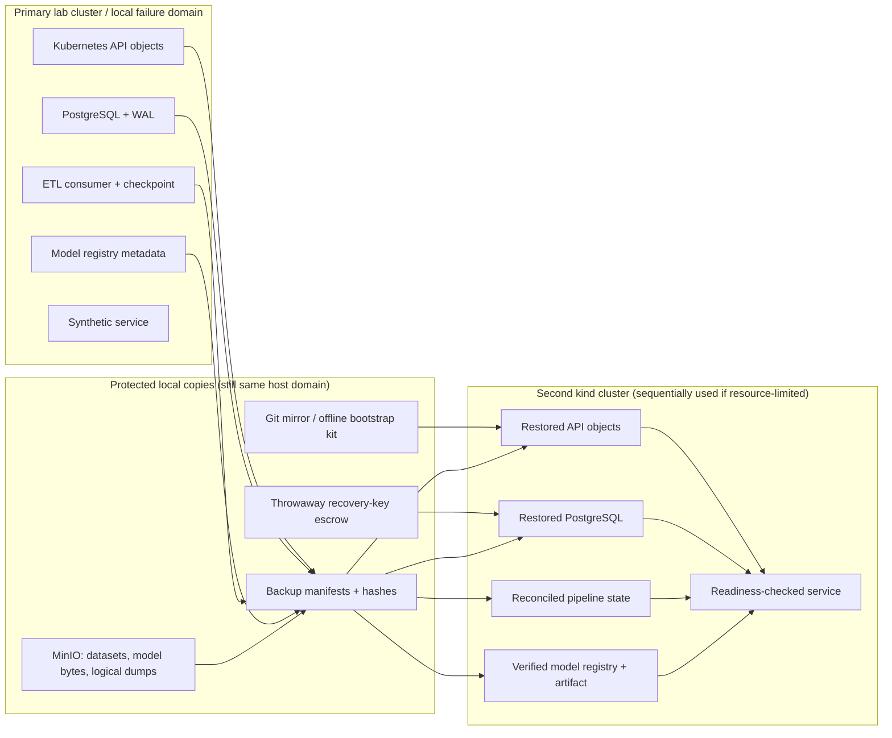
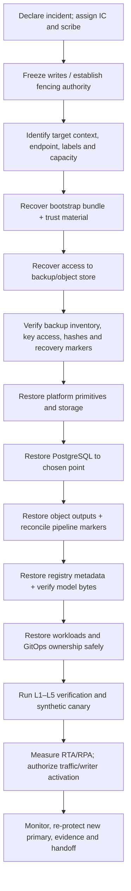

# Capstone Project — Tested Disaster Recovery for Data and ML

**Target file:**
`Projects/01-tested-disaster-recovery-for-data-and-ml.md`  
**Module:** M13 — Backup, Disaster Recovery, and Resilience Testing  
**Level:** Beginner → Advanced/Expert  
**Budget:** Zero-cost local lab; synthetic data only  
**Reference environment:** WSL2 Ubuntu or native Linux, approximately 4
CPU, 8 GB RAM, 30 GB disk  
**Status labels:** `[FACT]`, `[ASSUMPTION]`, `[ILLUSTRATIVE]`,
`[MEASURED]`, `[VERIFY]`, `[VERSION-SENSITIVE]`, `[AWARENESS]`

> **Operating rule:** an untested backup is an unproven hypothesis. A
> successful backup job is not proof of recoverability. The evidence
> chain is: defined scope → protected copy → isolated restore →
> integrity and functional verification → measured RTA/RPA → retained,
> secret-free evidence.

## 1. Project contract and source note

### 1.1 Objective

Build and demonstrate a bounded, synthetic-data disaster-recovery
capability for a small data/ML platform. The capstone integrates M13
Units 1–10: recovery objectives; backup scope, retention and
immutability; platform metadata and configuration recovery; pipeline
checkpoints; model artifacts and registry metadata; dependency outage
and failover decisions; restore drills and evidence; failure injection;
Velero; and dedicated chaos-tooling guardrails.

This is not a production platform-in-a-box. It is a repeatable
engineering exercise whose claims must be limited to the evidence
actually collected.

### 1.2 Source note and limitations

The supplied `PROMPT-Backup-Disaster-Recovery-and-Resilience-Testing.md`
content was inspected for the Unit 12 contract and shared constraints.
The supplied M13 lesson files for Units 1, 7, and 9, plus relevant
source prompts for Units 6 and 8, were available through the file
library and used for terminology and boundaries. The complete
`Roadmap_ptree.md`/equivalent full repository tree and every Unit 1–10
lesson were not all independently inspected in this turn. Therefore this
capstone uses the authoritative Unit 12 requirements and available
lesson material; details not supported by those materials are marked as
assumptions or verification items. No claim is made that a repository
was modified.

### 1.3 Labels used throughout

- `[FACT]` — supported by supplied source material or a source actually
  checked.
- `[ASSUMPTION]` — an implementation choice to validate in the learner's
  environment.
- `[ILLUSTRATIVE]` — synthetic numbers, example outputs, or sample
  calculations.
- `[MEASURED]` — use only for values actually measured by your run.
- `[VERIFY]` / `[VERSION-SENSITIVE]` — confirm against exact installed
  versions and official documentation.
- **Representative output — not executed here** — sample output, not
  evidence of a successful run.

### 1.4 Mandatory laptop-fidelity statement

Two Kubernetes clusters on one laptop are **not two regions**. They
share host hardware and may share power, storage, networking, kernel,
runtime, and other failure domains. This project simulates recovery
workflow and selected failures; it does not prove independent regional
resilience, provider control-plane failure recovery, WAN latency, real
DNS propagation, production RTO/RPO, or production-grade failover.
Repeat this limitation in every report that describes a local target as
a “DR site.”

## 2. Scenario and success definition

A synthetic data/ML platform contains:

- PostgreSQL as the system of record, with a base backup and continuous
  WAL/PITR concept plus a logical dump to local object storage.
- Synthetic object-store datasets and model artifacts.
- A local model registry whose metadata can drift from artifact bytes.
- A streaming/ETL consumer with offsets, checkpoints, and side effects.
- A GitOps-managed Kubernetes workload.
- An image registry and image-trust controls.
- A secrets/key-custody dependency.
- Backup jobs, observability, and a secret-free evidence repository.

The starting incident story is intentionally flawed: the “backup” was
not restored; a daily copy lived on the same disk as the source;
recovery objectives were not agreed; the DR runbook lived only on the
cluster it needed to recover; registry metadata could disagree with
artifact bytes; workload credentials had too much backup access; and
failover was not tested.

### Definition of success

The project succeeds only when the learner can:

1.  State per-component RTO/RPO targets and explain dependencies.
2.  Show backup coverage and survivability assumptions.
3.  Restore a selected recovery point into an isolated, positively
    identified lab target.
4.  Verify PostgreSQL, object-store, pipeline, model, and platform state
    as one coherent recovery point—or explicitly reject an inconsistent
    combination.
5.  Demonstrate that workload credentials cannot delete the last
    known-good backup.
6.  Rebuild/fail over to a second local `kind` cluster using a
    resource-sequenced workflow.
7.  Run bounded resilience experiments with preflight, abort, cleanup,
    and evidence.
8.  Measure RTA/RPA from timestamps and recovery markers; compare
    results with objectives.
9.  detect planted defects and retest at least two fixed defects.
10. Deliver a blameless postmortem, runbooks, ADRs, and a secret-free,
    hashed evidence bundle.

A design document, green dashboard, `Completed` backup status, or a
successful command exit alone does not satisfy these criteria.

## 3. Scope boundaries and prior modules

| Module | Reuse here                                              | Do not duplicate                                    |
|--------|---------------------------------------------------------|-----------------------------------------------------|
| M03    | Kubernetes platform concepts and etcd recovery decision | Detailed etcd snapshot mechanics                    |
| M05    | PostgreSQL backup/PITR and stateful recovery foundation | Entire database curriculum                          |
| M07    | Resource governance and infrastructure-state concepts   | Full Terraform/OpenTofu state curriculum            |
| M08    | GitOps ownership and deployment configuration           | Full GitOps curriculum                              |
| M09    | Secrets, Vault, encryption-key custody                  | Full secrets-platform curriculum                    |
| M10    | Incident command, communication, drills, postmortem     | Entire incident-management curriculum               |
| M11    | Metrics, alerting, monitoring                           | Full observability curriculum                       |
| M12    | Image trust, signatures, provenance                     | Full supply-chain curriculum                        |
| M14    | Multi-cluster/multi-region steady-state operations      | Fleet operations and complete regional architecture |
| M15    | Resource-unit estimates and capacity sequencing         | Pricing or full FinOps model                        |
| M16    | Future golden-path packaging                            | Platform product packaging                          |

## 4. Repository layout

Create this layout when implementing the capstone. The content below
supplies starter artifacts inline; copy them into your project only
after reviewing the safety contract.

``` text
01-tested-disaster-recovery-for-data-and-ml/
├── README.md
├── versions.txt
├── Makefile
├── docs/
│   ├── architecture.md
│   ├── dependency-graph.md
│   ├── recovery-contract.md
│   ├── known-limitations.md
│   └── production-readiness-review.md
├── objectives/
│   ├── register.csv
│   ├── bia-lite.md
│   ├── validate_objectives.py
│   ├── estimate_recovery.py
│   └── test_objectives.py
├── backup/
│   ├── inventory.yaml
│   ├── policy.yaml
│   ├── survivability-matrix.md
│   ├── verify_backup_manifest.py
│   ├── safe_prune.py
│   └── test_safe_prune.py
├── restore/
│   ├── verify_recovery.py
│   ├── defect-corpus.json
│   ├── drill-report-template.md
│   └── evidence-manifest.py
├── platform-recovery/
│   ├── phases.yaml
│   ├── orchestrate.py
│   ├── parity-check.py
│   └── readiness-check.py
├── pipelines/
│   ├── synthetic_events.jsonl
│   ├── process_events.py
│   ├── reconcile.py
│   └── test_pipeline.py
├── ml-registry/
│   ├── registry.json
│   ├── register_model.py
│   ├── verify_model.py
│   ├── predict.py
│   └── test_model_recovery.py
├── dr-site/
│   ├── failover-record.md
│   ├── fencing-check.py
│   └── failback-checklist.md
├── velero/
│   ├── install-notes.md
│   ├── backup-plan.md
│   └── restore-plan.md
├── chaos/
│   ├── experiment-template.md
│   ├── experiments.yaml
│   ├── run_bounded_experiment.py
│   └── adr-chaos-platform.md
├── drills/
│   ├── scenario-a.md
│   ├── scenario-b.md
│   ├── postmortem-template.md
│   └── drill-calendar.csv
├── evidence/
│   ├── README.md
│   ├── .gitignore
│   └── runs/                 # generated, secret-free evidence only
├── runbooks/
│   ├── accidental-deletion-pitr.md
│   ├── incomplete-backup.md
│   ├── simulated-workload-credential-compromise.md
│   ├── primary-cluster-loss.md
│   ├── regional-failure-simulation.md
│   ├── dependency-outage.md
│   ├── model-artifact-recovery.md
│   └── backup-system-failure.md
└── sim/
    ├── game_master.py
    ├── scenario.json
    └── answer-key.md           # facilitator only; do not show before the exercise
```

### File contracts

- `README.md`: learner entry point, safety boundary, setup sequence, and
  definition of done.
- `versions.txt`: actual installed versions and environment details; use
  placeholders until verified.
- `Makefile`: one command interface; mutation is dry-run by default.
- `objectives/`: objective register, BIA-lite, validator, estimates, and
  tests.
- `backup/`: state inventory, policy, backup verification, survivability
  matrix, and safe-prune invariant.
- `restore/`: layered verification, planted defects, reports, and
  evidence manifest.
- `platform-recovery/`: dependency-ordered, checkpointed recovery phases
  and readiness gates.
- `pipelines/`: idempotent synthetic processing and reconciliation.
- `ml-registry/`: two-phase model registration, hash verification,
  regression checks.
- `dr-site/`: failover authorization, fencing, failback, and
  steady-state checks.
- `velero/`: version-pinned install/restore plan; version-specific
  manifests are verified locally.
- `chaos/`: reusable experiment contracts and guarded runner; Chaos Mesh
  is the primary optional tooling integration, Litmus is
  comparison/stretch.
- `drills/`: scenario instructions, facilitator-only answer key,
  postmortem, calendar.
- `evidence/`: timestamps, hashes, logs scrubbed of secrets, version
  record, results and expiry.
- `runbooks/`: cold-read procedures for the eight required incident
  classes.
- `sim/`: harmless game-master event harness; no malware or
  encryption-for-impact.

## 5. Architecture and recovery model

### 5.1 End-to-end architecture



**Interpretation:** the diagram describes recovery paths, not
independent failure domains. Copies on the same laptop can all be lost
together. The second cluster is a target for rehearsing the workflow,
not proof of a true second region.

### 5.2 Protection map by state class

| State class            | Protection method                                             | Recovery proof                                                          | Important non-guarantee                                                       |
|------------------------|---------------------------------------------------------------|-------------------------------------------------------------------------|-------------------------------------------------------------------------------|
| PostgreSQL rows/schema | Base backup + WAL/PITR plan; logical dump as secondary path   | Restore in isolation; schema, row counts, marker and known-answer query | A dump is not automatically point-in-time consistent with object outputs      |
| WAL/archive            | Separate backup destination and retention check               | Restore to chosen timestamp/marker; record last recovered marker        | Archive completeness and key access must be verified                          |
| Object datasets        | Versioned object copy, manifest and hashes                    | Inventory + hash verification + known object reads                      | Versioning alone does not guarantee independent storage                       |
| Model artifacts        | Artifact bytes plus manifest/hash and registry snapshot       | Verify hash/signature and synthetic predictions                         | Registry metadata alone is insufficient                                       |
| Pipeline state         | Source offset, output transaction/marker, processing version  | Replay and reconciliation tests                                         | Offsets alone do not prove side effects committed                             |
| Kubernetes objects     | Git/GitOps source plus Velero where suitable                  | Restore in isolated namespace/cluster and check ownership               | API objects do not imply volume bytes or external dependencies                |
| Secrets/key custody    | Separate, restricted, documented escrow for throwaway lab key | Restore while primary secret service is unavailable; no secret output   | A backup encrypted by an unavailable key is not recoverable                   |
| Platform bootstrap     | Offline bundle, Git mirror, version record                    | Cold-read bootstrap test with primary endpoints unavailable             | Local mirror on same disk is not independent of host loss                     |
| Evidence               | Versioned run folder, checksums, scrubbing                    | Recompute evidence manifest hash and review expiry                      | Hashes prove file integrity since manifest creation, not truth of every claim |

### 5.3 Recovery dependency graph and bootstrap trust



**Bootstrap-cycle rule:** do not make recovery depend exclusively on the
service being recovered. Keep a small offline bootstrap bundle
containing non-secret manifests, trusted source fingerprints, version
placeholders/records, recovery procedure, and safe access instructions.
Store throwaway key escrow separately with restricted permissions. Do
not commit real secrets or keys to Git. If identity, registry, Git, and
secrets are simultaneously unavailable, explicitly record what the lab
can still recover and what remains a residual dependency.

## 6. Recovery objectives and BIA-lite

### 6.1 Terms

- **RTO — Recovery Time Objective:** target maximum elapsed time from
  the agreed incident start boundary to an accepted service recovery
  boundary.
- **RPO — Recovery Point Objective:** target maximum acceptable
  age/amount of lost business state at recovery.
- **RTA — Recovery Time Actual:** measured elapsed time from the
  recorded start to accepted recovery.
- **RPA — Recovery Point Actual:** measured loss/age of state based on a
  canary or known business marker, not guessed from backup cadence
  alone.
- **MTD/MTPD:** maximum tolerable disruption/downtime as defined by the
  organization's BIA.
- **WRT:** work required after technical recovery before business
  operations are usable.
- **Dependency-implied objective:** a service cannot meet a target if a
  critical dependency is unavailable beyond the time budget.

### 6.2 BIA-lite worksheet

For each service, document: business function; impact of downtime;
impact of data loss; maximum tolerable disruption; owner;
upstream/downstream dependencies; legal or contractual obligations to be
confirmed by the real organization; acceptable degraded mode; and
evidence required to return to service. Do not invent monetary loss or
compliance obligations.

**\[ILLUSTRATIVE\] worked example:** the synthetic model-scoring
endpoint is classified Tier 2 because it can be paused while a batch
scoring queue accumulates, but predictions must not use a model whose
artifact hash is unverified. The team proposes RTO = 90 minutes and RPO
= 15 minutes for the lab exercise. These are practice targets, not
production recommendations. If the registry is restored in 20 minutes
but the required artifact and key are not available until minute 110,
the service cannot meet the 90-minute RTO.

### 6.3 Recovery objectives register

Populate `objectives/register.csv` with at least these 15 components.
Targets are intentionally illustrative; owners, actual test timestamps,
RTA and RPA must be completed by the learner.

| Component                    | Tier | RTO \[ILLUSTRATIVE\] | RPO \[ILLUSTRATIVE\] | Mechanism                             | Critical dependencies            | Owner/role         | Last tested | RTA   | RPA   |
|------------------------------|-----:|---------------------:|---------------------:|---------------------------------------|----------------------------------|--------------------|-------------|-------|-------|
| PostgreSQL system of record  |    1 |               60 min |                5 min | Base backup + WAL/PITR                | Backup store, key, compatible DB | DB recovery lead   | blank       | blank | blank |
| WAL/archive continuity       |    1 |               30 min |                5 min | Continuous archive verification       | Object store, credentials        | DB recovery lead   | blank       | blank | blank |
| Object datasets              |    1 |               60 min |               15 min | Versioned copy + manifest             | Store, key, inventory            | Data platform lead | blank       | blank | blank |
| ETL output table             |    1 |               75 min |               15 min | DB restore + idempotent replay        | DB, source retention, checkpoint | Pipeline lead      | blank       | blank | blank |
| Stream offsets/checkpoint    |    1 |               45 min |                5 min | Checkpoint + recovery marker          | Source retention, output store   | Pipeline lead      | blank       | blank | blank |
| Model artifact bytes         |    1 |               45 min |               15 min | Artifact copy + hash manifest         | Object store, key                | ML platform lead   | blank       | blank | blank |
| Registry metadata/aliases    |    2 |               60 min |               15 min | Metadata backup + artifact pairing    | DB/object store                  | ML platform lead   | blank       | blank | blank |
| Kubernetes app resources     |    2 |               60 min |             0–15 min | Git + Velero as applicable            | API, CRDs, storage               | Platform lead      | blank       | blank | blank |
| Git mirror/config            |    1 |               30 min |             0–15 min | Offline mirror/bundle                 | Trusted access                   | Platform lead      | blank       | blank | blank |
| Container image availability |    2 |               45 min |                  N/A | Trusted mirror/cache                  | Image trust metadata             | Release lead       | blank       | blank | blank |
| Secret bootstrap             |    1 |               45 min |                  N/A | Restricted escrow + rebind            | Key custodian, identity          | Security lead      | blank       | blank | blank |
| Encryption-key recovery      |    1 |               30 min |                  N/A | Lab-only escrow procedure             | Access policy                    | Security lead      | blank       | blank | blank |
| Backup inventory/policy      |    2 |               30 min |                 24 h | Versioned policy + audit              | Git/object store                 | Backup owner       | blank       | blank | blank |
| Observability/runbook access |    2 |               30 min |                 24 h | Offline runbook + metrics definitions | Local evidence                   | SRE/IC             | blank       | blank | blank |
| Recovery evidence store      |    2 |               60 min |                 24 h | Hashed, versioned evidence bundle     | Storage and access               | Scribe/auditor     | blank       | blank | blank |

Do not treat `N/A` as “not important”; it means the stated RPO model
does not apply directly and must be explained. Every row needs a
last-tested timestamp and evidence reference before being called tested.

### 6.4 Validator starter — `objectives/validate_objectives.py`

``` python
# File: objectives/validate_objectives.py
from __future__ import annotations
import csv
import sys
from pathlib import Path

REQUIRED = {
    "component", "tier", "rto_minutes", "rpo_minutes", "mechanism",
    "dependencies", "owner", "last_tested", "rta_minutes", "rpa_minutes",
    "evidence_ref",
}

def validate(path: Path) -> list[str]:
    errors: list[str] = []
    with path.open(newline="", encoding="utf-8") as handle:
        reader = csv.DictReader(handle)
        fields = set(reader.fieldnames or [])
        missing = REQUIRED - fields
        if missing:
            return [f"missing columns: {sorted(missing)}"]
        rows = list(reader)
    if len(rows) < 15:
        errors.append(f"expected at least 15 components; found {len(rows)}")
    names: set[str] = set()
    for n, row in enumerate(rows, start=2):
        name = row["component"].strip()
        if not name:
            errors.append(f"row {n}: component is blank")
        if name in names:
            errors.append(f"row {n}: duplicate component {name!r}")
        names.add(name)
        if row["tier"].strip() not in {"1", "2", "3", "4"}:
            errors.append(f"row {n}: tier must be 1..4")
        for field in ("rto_minutes", "rpo_minutes"):
            value = row[field].strip()
            if value not in {"N/A", "na", "n/a"}:
                try:
                    if float(value) < 0:
                        errors.append(f"row {n}: {field} cannot be negative")
                except ValueError:
                    errors.append(f"row {n}: invalid {field}={value!r}")
        if not row["mechanism"].strip() or not row["dependencies"].strip():
            errors.append(f"row {n}: mechanism and dependencies are required")
        tested = row["last_tested"].strip()
        if tested and not row["evidence_ref"].strip():
            errors.append(f"row {n}: tested row requires evidence_ref")
    return errors

if __name__ == "__main__":
    file = Path(sys.argv[1] if len(sys.argv) > 1 else "objectives/register.csv")
    issues = validate(file)
    if issues:
        print("FAIL")
        print("\n".join(f"- {item}" for item in issues))
        raise SystemExit(1)
    print("PASS: objectives register structure is valid")
```

**Verification:**
`python objectives/validate_objectives.py objectives/register.csv`. A
pass validates structure only; it does not prove the objectives are
achievable. Extend it to detect impossible dependency combinations: if a
critical dependency's target RTO exceeds the dependent component's RTO,
flag it for review rather than silently accepting it.

### 6.5 RTO/RPO estimator

``` python
# File: objectives/estimate_recovery.py
from dataclasses import dataclass

@dataclass(frozen=True)
class RecoveryEstimate:
    data_gib: float
    throughput_mib_s: float
    startup_minutes: float
    validation_minutes: float
    dependency_wait_minutes: float
    backup_interval_minutes: float
    archive_lag_minutes: float

def estimate(x: RecoveryEstimate) -> dict[str, float]:
    if x.data_gib < 0 or x.throughput_mib_s <= 0:
        raise ValueError("size must be nonnegative and throughput positive")
    transfer_minutes = (x.data_gib * 1024) / x.throughput_mib_s / 60
    rto_estimate = transfer_minutes + x.startup_minutes + x.validation_minutes + x.dependency_wait_minutes
    # This is a coarse exposure estimate, not proof of actual recoverability.
    rpo_estimate = min(x.backup_interval_minutes, x.archive_lag_minutes)
    return {"transfer_minutes": transfer_minutes, "rto_estimate_minutes": rto_estimate,
            "rpo_estimate_minutes": rpo_estimate}

if __name__ == "__main__":
    example = RecoveryEstimate(10, 50, 8, 10, 5, 60, 4)
    print(estimate(example))
```

**\[ILLUSTRATIVE\] calculation:** 10 GiB at 50 MiB/s is
`10 × 1024 / 50 = 204.8 seconds`, or about 3.42 minutes. Add 8 minutes
startup, 10 minutes validation, and 5 minutes dependency wait: estimated
RTO = 26.42 minutes. The coarse RPO expression above is only a teaching
approximation and must be replaced by the actual selected recovery
mechanism and marker evidence; backup cadence and archive lag do not, by
themselves, prove a consistent recoverable point.

### 6.6 Strategy-selection record

For every component record: rebuild from source; restore from backup;
replay from source; fail over to a replica; or accept a documented
degraded mode. Include recovery-point correctness, integrity, dependency
availability, required operator skills, rollback/fencing, and proof. Use
resource units only: CPU cores, memory GiB, disk GiB, and concurrent
cluster count. Do not invent prices.

## 7. Backup design, scope, and survivability

### 7.1 Inventory and policy

The inventory must list: state owner, state type, source, backup
mechanism, schedule/cadence, retention, encryption/key dependency,
credentials allowed to read/write/delete, integrity check, restore test
frequency, and evidence path. An inventory row without a tested restore
is “declared protection,” not “proven recoverability.”

### 7.2 Distinguish protection mechanisms

- **Backup:** a recoverable copy with a defined capture boundary and
  retention.
- **Snapshot:** a point-in-time view whose consistency and portability
  depend on the implementation.
- **Replica:** a second live or near-live copy that can reproduce
  corruption/deletion if the bad state propagates.
- **Versioning:** preserves object versions under defined policy;
  deletion/retention semantics must be verified.
- **Git:** strong for declarative configuration, not a substitute for
  mutable database rows or binary artifacts.
- **Immutability/object lock:** constrains deletion or modification
  under defined policy; it does not prove the copy is complete or
  restorable.
- **Pull-based backup:** a backup identity initiates reads from
  workload/source systems; it can reduce the workload's ability to
  tamper with backup storage, but the architecture still needs scoped
  access and key management.

### 7.3 Survivability matrix

| Event                            | Likely protection contribution                             | Does not prove / residual risk                         | Required test                                                                        |
|----------------------------------|------------------------------------------------------------|--------------------------------------------------------|--------------------------------------------------------------------------------------|
| Accidental deletion              | Object versions, database PITR, independent backup         | Wrong retention or wrong recovery point                | Restore before deletion marker and query known data                                  |
| Logical corruption               | PITR, versioned copies, checksums                          | Corruption may be copied into every replica            | Restore a pre-corruption point and reconcile                                         |
| Host/disk loss                   | Independent copy                                           | Same-host MinIO copy is not independent                | Record same-host limitation; optional external target only if provisioned separately |
| Compromised workload credentials | Separate backup identity, deny-delete policy, immutability | Shared admin credentials or key compromise             | Negative test: workload identity cannot delete protected copy                        |
| Primary cluster loss             | Git/offline bundle, object-store copy, second cluster      | Both clusters on same laptop share host failure domain | Rebuild exercise; do not claim regional assurance                                    |
| Primary key store unavailable    | Restricted escrow and re-binding procedure                 | Backup remains unusable if required key is lost        | Restore using authorized lab escrow without printing key                             |
| Bad registry alias               | Metadata backup plus artifact hash manifest                | Registry-only restore may point at missing bytes       | Compare alias → manifest → artifact hash → deployment reference                      |

### 7.4 Safe-prune invariant

The prune tool must default to dry-run and never remove the last
known-good backup. The core decision is simple: a candidate is prunable
only if it is expired/eligible under policy, verified as lab data, and
at least one other independently verified recovery point remains for the
relevant state class.

``` python
# File: backup/safe_prune.py
from dataclasses import dataclass

@dataclass(frozen=True)
class Backup:
    backup_id: str
    lab: bool
    verified: bool
    eligible: bool

def choose_prune(candidates: list[Backup], apply: bool = False) -> list[str]:
    good = [b for b in candidates if b.lab and b.verified and not b.eligible]
    # `good` means retained, known-good copies; do not count unverified copies.
    verified_eligible = [b for b in candidates if b.lab and b.verified and b.eligible]
    if not verified_eligible:
        return []
    if len(good) < 1:
        raise ValueError("refusing to prune: no other verified known-good backup remains")
    return [b.backup_id for b in verified_eligible] if apply else []

if __name__ == "__main__":
    sample = [
        Backup("backup-old", True, True, True),
        Backup("backup-current", True, True, False),
    ]
    print("dry-run candidates:", choose_prune(sample, apply=False))
```

``` python
# File: backup/test_safe_prune.py
import unittest
from safe_prune import Backup, choose_prune

class PruneTests(unittest.TestCase):
    def test_never_prunes_last_good_backup(self):
        only = [Backup("only", True, True, True)]
        with self.assertRaises(ValueError):
            choose_prune(only, apply=True)

    def test_dry_run_never_mutates(self):
        rows = [Backup("old", True, True, True), Backup("good", True, True, False)]
        self.assertEqual(choose_prune(rows, apply=False), [])

    def test_unverified_backup_does_not_count_as_good(self):
        rows = [Backup("old", True, True, True), Backup("unknown", True, False, False)]
        with self.assertRaises(ValueError):
            choose_prune(rows, apply=True)

if __name__ == "__main__":
    unittest.main()
```

This is a pure decision helper, not a storage deletion client. A real
deletion adapter must add target identity checks, policy checks, locks,
dry-run, explicit `--apply`, bounded listing, audit events, and a second
review before deletion.

### 7.5 PostgreSQL, object store, key custody, and Velero

**PostgreSQL:** use the existing M05 database recovery approach.
Maintain a coherent base-backup/WAL/PITR path and a logical dump to the
local object store as a distinct recovery option. Verify archive
continuity, retention, compatible versions, recovery timestamp, and
known-answer queries. Exact backup/restore commands and configuration
are version/environment dependent: `[VERIFY]` against the official
PostgreSQL documentation for the installed major version. Never run
restore against a production or populated target.

**MinIO/object store:** configure lab-only versioning/retention and
separate credentials only after checking the exact server and client
versions and the applicable official documentation. Object-lock
requirements and behavior are version-sensitive. Use short, safe
retention in the lab where supported; retention can prevent immediate
cleanup. Do not print access keys. A workload identity should be able to
write only where required and should not have delete authority over the
backup repository.

**Key custody:** use a throwaway lab-only key and a documented
restricted escrow path outside source control. Test restore when the
primary secrets backend is unavailable. Evidence must say whether the
escrowed key was accessible and must not include the key or its value.

**Velero:** document the exact selected Velero version, plugins,
Kubernetes version, storage location, and data method in `versions.txt`.
Verify the current official Velero installation, backup/restore,
BackupStorageLocation, filesystem backup, CSI, hooks, schedules, and
compatibility documentation. Do not copy an unverified flag, annotation,
CRD field, or plugin version from a generic example. Kubernetes API
object backup does not automatically imply PVC bytes or
application-native consistency.

Compare:

- filesystem backup: portability and behavior depend on the selected
  data mover and configuration;
- CSI snapshots: behavior depends on CSI driver, storage platform,
  snapshot APIs, and restore environment;
- application-native backup: better aware of database consistency
  semantics when properly configured;
- GitOps: desired configuration and ownership, not a substitute for data
  backup.

During restore, use an isolated target and coordinate GitOps
reconciliation so it does not overwrite the recovery operation. Restore
CronJobs carefully: a restored scheduled job may create duplicate or
unexpected work. Pause/disable scheduling in the isolated restore
workflow, verify the exact mechanism for the chosen tool version, and
re-enable only after an explicit review.

## 8. Consistent pipeline recovery

### 8.1 Consistency contract

A recovery marker binds a source offset/range to:

- a processing-code version;
- database output state or transaction marker;
- object output keys and hashes;
- model/registry version if used;
- event time and recovery timestamp.

Do not declare a consistent cut solely because every system has a recent
backup. The records must correspond to the same logical boundary, or
reconciliation must identify and repair the mismatch.

### 8.2 Synthetic event processor

``` python
# File: pipelines/process_events.py
from __future__ import annotations
import json
from pathlib import Path

def process(input_path: Path, output_path: Path, checkpoint_path: Path) -> int:
    existing: dict[str, dict] = {}
    if output_path.exists():
        existing = {r["event_id"]: r for r in
                    (json.loads(line) for line in output_path.read_text().splitlines() if line)}
    events = [json.loads(line) for line in input_path.read_text().splitlines() if line]
    checkpoint = int(checkpoint_path.read_text()) if checkpoint_path.exists() else -1
    applied = 0
    for offset, event in enumerate(events):
        if offset <= checkpoint:
            continue
        event_id = event["event_id"]
        # Idempotency key prevents duplicate logical output for a replayed event.
        existing[event_id] = {
            "event_id": event_id,
            "source_offset": offset,
            "amount": event["amount"],
            "processor_version": "processor-v1",
        }
        checkpoint_path.write_text(str(offset))
        applied += 1
    output_path.write_text("".join(json.dumps(existing[k], sort_keys=True) + "\n"
                                   for k in sorted(existing)))
    return applied

if __name__ == "__main__":
    import sys
    print(f"applied={process(Path(sys.argv[1]), Path(sys.argv[2]), Path(sys.argv[3]))}")
```

This small fixture illustrates replay and idempotency; it is not a
transactional streaming engine. For a production-like implementation,
checkpoint commit and side-effect commit must be coordinated or
reconciled. The example's simple file writes are not crash-atomic and
must not be described as production-grade durability.

### 8.3 Reconciliation

``` python
# File: pipelines/reconcile.py
import json
from pathlib import Path

def reconcile(source: Path, output: Path) -> list[str]:
    events = [json.loads(x) for x in source.read_text().splitlines() if x]
    rows = [json.loads(x) for x in output.read_text().splitlines() if x] if output.exists() else []
    expected = {e["event_id"] for e in events}
    actual = [r["event_id"] for r in rows]
    errors: list[str] = []
    if len(actual) != len(set(actual)):
        errors.append("duplicate output event_id")
    missing = expected - set(actual)
    extra = set(actual) - expected
    if missing:
        errors.append(f"missing outputs: {sorted(missing)}")
    if extra:
        errors.append(f"phantom outputs: {sorted(extra)}")
    return errors

if __name__ == "__main__":
    import sys
    issues = reconcile(Path(sys.argv[1]), Path(sys.argv[2]))
    print("\n".join(issues) if issues else "PASS: source/output IDs reconcile")
    raise SystemExit(1 if issues else 0)
```

### 8.4 Retention and catch-up inequality

The source retention window must cover recovery delay plus
replay/catch-up time and a safety margin:

`source_retention >= detection_delay + restore_delay + replay_duration + safety_margin`

All terms must use the same units. **\[ILLUSTRATIVE\]** 24 h retention
versus 2 h detection + 3 h restore + 10 h replay + 4 h margin gives 19 h
required, so 24 h is sufficient under those assumptions. If replay takes
18 h instead, requirement becomes 27 h and 24 h is insufficient.
Catch-up rate must exceed incoming event rate for the backlog to shrink;
throttle recovery work to avoid saturating the database or downstream
service.

### 8.5 Pipeline negative tests

Plant and detect:

1.  missing output row;
2.  duplicate output ID;
3.  phantom output ID not in source;
4.  checkpoint ahead of committed output;
5.  checkpoint behind output (replay required);
6.  object output missing or hash mismatch;
7.  processor version mismatch;
8.  source retention shorter than recovery + replay budget.

A test suite that only checks process exit or checkpoint presence is
insufficient.

## 9. Model and registry recovery

### 9.1 Two-phase registration

1.  Write artifact bytes to a temporary lab path.
2.  Compute a cryptographic hash and create a manifest containing
    synthetic model ID, version, artifact hash, data/code references,
    and compatibility notes.
3.  Verify artifact bytes and manifest.
4.  Promote the artifact into its final immutable/versioned path.
5.  Only then publish registry metadata and alias.
6.  At load time, re-check hash/signature and fail closed if the bytes
    differ.

Do not point a registry alias to an artifact that has not been verified.

### 9.2 Model verification starter

``` python
# File: ml-registry/verify_model.py
from __future__ import annotations
import hashlib
import json
from pathlib import Path

def sha256(path: Path) -> str:
    h = hashlib.sha256()
    with path.open("rb") as handle:
        for chunk in iter(lambda: handle.read(1024 * 1024), b""):
            h.update(chunk)
    return h.hexdigest()

def verify(artifact: Path, manifest: Path) -> bool:
    data = json.loads(manifest.read_text(encoding="utf-8"))
    return data.get("artifact_sha256") == sha256(artifact)

if __name__ == "__main__":
    import sys
    ok = verify(Path(sys.argv[1]), Path(sys.argv[2]))
    print("PASS: artifact hash matches manifest" if ok else "FAIL: hash mismatch")
    raise SystemExit(0 if ok else 1)
```

This verifies a hash match, not authenticity of the manifest. In a
signed-artifact workflow, verify the signature and trusted signer under
the M12 trust policy as well. Do not invent a signing command; use the
exact tool already installed and its official documentation.

### 9.3 Consistency triple

Every model deployment must agree on:

1.  registry metadata/alias;
2.  artifact bytes plus manifest/hash;
3.  deployment reference (image/config/model version).

If any pair disagrees, fail closed and roll back to a previously
verified version or use a documented safe degraded mode. A registry
restore that points to missing or mismatched bytes is a failed recovery.

### 9.4 Synthetic prediction regression

Use a tiny deterministic synthetic fixture with expected outputs and a
tolerance chosen for the implementation. Do not present a synthetic
regression result as evidence of model quality or production behavior.
Include tests for missing artifact, mismatched hash, stale alias,
metadata/artifact drift, and deployment reference drift.

### 9.5 Restore vs retrain vs rollback

| Choice                     | Choose when                                                        | Reject/hold when                                                                  |
|----------------------------|--------------------------------------------------------------------|-----------------------------------------------------------------------------------|
| Restore artifact           | Bytes and manifest are intact; lineage and compatibility are known | Hash/signature mismatch or required key unavailable                               |
| Roll back alias/deployment | A previous verified version is available and compatible            | Previous version is not proven or data contract changed                           |
| Retrain                    | Data/code/parameters are reproducible and time/objectives permit   | Lineage is incomplete, training data is corrupted, or retraining misses objective |
| Degraded mode              | Business owner authorizes limited safe function                    | It would silently use an unverified model or inconsistent data                    |

## 10. Platform recovery, trust, and GitOps

### 10.1 Phase contract

| Phase | Action                                            | Gate before proceeding                                      |
|-------|---------------------------------------------------|-------------------------------------------------------------|
| 0     | Declare incident, IC, scribe, communications      | Roles and incident start timestamp recorded                 |
| 1     | Freeze writes / fence old primary                 | Single-writer authority confirmed                           |
| 2     | Positively identify lab target and capacity       | Context, endpoint, labels, namespace and free disk pass     |
| 3     | Recover offline bootstrap material                | Version record and trusted fingerprints available           |
| 4     | Restore access to protected copies and key escrow | Read test succeeds; no secret printed                       |
| 5     | Verify backup inventory and recovery markers      | Selected recovery point is coherent                         |
| 6     | Rebuild cluster primitives/storage                | Storage classes, CRDs and dependencies ready                |
| 7     | Restore PostgreSQL/object outputs/pipeline state  | Database and pipeline reconciliation pass                   |
| 8     | Restore model bytes and registry                  | Hash, signature policy and prediction tests pass            |
| 9     | Restore workload manifests                        | Images trusted; dependencies ready                          |
| 10    | Reconcile GitOps ownership                        | No uncontrolled overwrite; desired state reviewed           |
| 11    | Run L1–L5 checks                                  | All mandatory layers pass or service remains fenced         |
| 12    | Authorize writer/traffic                          | Named authority, recovery point, and uncertainty documented |
| 13    | Re-protect new primary                            | New backup schedule and access controls verified            |
| 14    | Evidence, handoff, postmortem                     | Bundle scrubbed, hashed, and actions assigned               |

### 10.2 Orchestration starter

``` python
# File: platform-recovery/orchestrate.py
from __future__ import annotations
import argparse
import json
import time
from pathlib import Path

PHASES = [
    "incident-and-roles", "fencing", "target-preflight", "bootstrap-trust",
    "backup-and-key-access", "recovery-point-selection", "platform-primitives",
    "database-and-pipeline", "model-integrity", "workloads-and-gitops",
    "layered-verification", "writer-authorization", "re-protect-and-evidence",
]

def run(apply: bool, state_path: Path, timeout_seconds: int = 900) -> int:
    state = json.loads(state_path.read_text()) if state_path.exists() else {"completed": []}
    completed = set(state["completed"])
    start = time.monotonic()
    for phase in PHASES:
        if phase in completed:
            continue
        if time.monotonic() - start > timeout_seconds:
            print(f"TIMEOUT before phase={phase}")
            return 2
        print(f"{'APPLY' if apply else 'DRY-RUN'} phase={phase}")
        if not apply:
            continue
        # The project implementation must call a phase-specific guarded function here.
        # Refuse unknown phases rather than silently treating them as successful.
        print(f"OPEN: phase adapter not configured: {phase}")
        return 3
        # After successful, verified adapter execution, persist a checkpoint:
        # completed.add(phase)
        # state_path.write_text(json.dumps({"completed": sorted(completed)}, indent=2))
    return 0

if __name__ == "__main__":
    parser = argparse.ArgumentParser()
    parser.add_argument("--apply", action="store_true", help="explicitly request state changes")
    parser.add_argument("--state", type=Path, default=Path("evidence/recovery-state.json"))
    parser.add_argument("--timeout-seconds", type=int, default=900)
    args = parser.parse_args()
    raise SystemExit(run(args.apply, args.state, args.timeout_seconds))
```

The starter deliberately refuses to claim success when real phase
adapters are absent. Implement each adapter as an explicit, tested
function with target guards, idempotency, timeouts, structured logs, and
a verification gate. Persist a checkpoint only after that phase's
verification passes. `--apply` is not a substitute for a context check.

### 10.3 Target guard contract

Every restore or destructive action must check all of the following
before mutation:

- explicit `--apply`;
- expected named lab context;
- API endpoint matches the recorded lab endpoint;
- target cluster/namespace has the required `lab=true` label;
- bucket/repository name uses the lab prefix;
- target is throwaway and isolated;
- target is empty or otherwise explicitly approved for the operation;
- free disk and resource capacity are adequate;
- a known-good backup exists and has been verified;
- timeout, lock, and abort path are configured.

If any check cannot be established, fail closed. A context name alone is
not proof of identity.

### 10.4 GitOps interaction

Before restore, decide which system owns each object. Avoid uncontrolled
reconciliation by pausing or scoping the GitOps controller using a
verified, version-specific procedure; restore into an isolated target;
compare restored resources with declarative desired state; resolve
ownership conflicts; then re-enable reconciliation only after explicit
review. Do not permanently disable GitOps as a workaround. Preserve
audit evidence of the change and reversal.

### 10.5 Rebuild vs restore metadata decision

Prefer rebuild from trusted declarative source for reproducible
configuration when source and trust roots are available. Restore
metadata/state only when required for continuity and the selected
snapshot is trustworthy and compatible. Use M03 for etcd mechanics. Do
not restore an old cluster state into a new cluster without an explicit
compatibility and trust analysis.

## 11. DR target, failover, fencing, and fail-back

### 11.1 Local DR target

Use a second local `kind` cluster as a simulated target. If 4 CPU / 8 GB
/ 30 GB cannot support both clusters concurrently, follow the sequential
resource plan in Section 18: capture evidence, stop workloads, remove
only the throwaway primary after guard verification, then create the
target cluster and restore. That proves a rebuild/restore workflow, not
a live regional failover.

### 11.2 Failover authority record

Before failover record:

- incident commander and technical decision-maker;
- evidence that the primary is unavailable or unsafe;
- fencing method and proof old writer cannot accept writes;
- chosen recovery point and uncertainty;
- target capacity and prerequisites;
- authorization timestamp and communications;
- conditions that would make the team wait rather than fail over;
- criteria for fail-back and owner of the final decision.

**Never permit two writable primaries.** Demonstrate fencing with a
harmless lab state file or lease simulation: the old writer's token must
be rejected after the authority epoch changes. This is a logic exercise,
not proof of distributed consensus safety.

### 11.3 Fail-back checklist

1.  Confirm old primary is fenced and isolated.
2.  Preserve its evidence; do not immediately reuse it.
3.  Select the authoritative new-primary data and reconcile any
    divergent writes.
4.  Verify database, objects, pipeline offsets, registry and model
    bytes.
5.  Rebuild/reseed the returning site from the authoritative source.
6.  Confirm backup, key access, image trust, GitOps ownership and
    alerts.
7.  Run L1–L5 checks.
8.  Obtain explicit authorization to move write authority.
9.  Verify only one writer is active.
10. Re-enable normal schedules and backups; run a post-failback drill.
11. Record measured RTA/RPA and residual uncertainty.

## 12. Restore harness and layered verification

The supplied Unit 7 material emphasizes that backup success, restore
success, and functional recovery are distinct. This capstone uses the
following operational layers; align exact local terminology with the
installed Unit 7 lesson if it differs.

| Layer                       | Meaning                                                                           | Example check                                  | Failure means                                        |
|-----------------------------|-----------------------------------------------------------------------------------|------------------------------------------------|------------------------------------------------------|
| L1 — Artifact/inventory     | Required backup objects, files, tables and versions exist                         | Inventory and size sanity checks               | Copy incomplete or scope wrong                       |
| L2 — Integrity              | Checksums, signatures, manifest linkage, object readability                       | SHA-256/hash/signature verification            | Corruption, tampering, or mismatch                   |
| L3 — Structural consistency | Schemas, tables, offsets, object keys, registry references agree                  | Schema inventory and cross-system marker check | Components restored to incompatible points           |
| L4 — Functional/business    | Known-answer query, synthetic ETL reconciliation, deterministic prediction        | Expected row/aggregate/output assertions       | Service starts but does not provide correct behavior |
| L5 — Operational acceptance | Dependencies, readiness, alerting, writer authority, runbook, measured objectives | Readiness checks, RTA/RPA, alert test, handoff | Not safe to declare service recovered                |

A passing L1 or L2 is not a substitute for L4. A service is not accepted
until all mandatory layers pass and the incident authority records any
consciously accepted limitation.

### 12.1 Verification defect corpus

Include at least these eight planted defects and score detection:

1.  Missing PostgreSQL table.
2.  Truncated object or wrong object hash.
3.  Stale model registry alias.
4.  Missing model artifact.
5.  Manifest hash mismatch.
6.  Pipeline checkpoint ahead of committed output.
7.  Missing secret/key dependency.
8.  Backup marked completed but containing no expected marker.
9.  Optional: duplicate pipeline output.
10. Optional: restored CronJob can launch unexpected duplicate work.

For each defect, record expected detector, actual detector, detection
result, severity, false-positive risk, and evidence path. A detector is
not proven by a test that never activates the defect.

### 12.2 Recovery marker and RPA

Write a synthetic canary marker into the system of record and link it to
a source offset, output object, processor version, and model version. On
restore, identify the newest marker that is both present and consistent
across all required state classes. Calculate RPA from the incident
boundary and that marker's business timestamp/sequence. If the marker
cannot establish a coherent cut, report RPA as unknown/unproven rather
than inventing a value.

### 12.3 RTA measurement

Record:

- `t0`: incident declared / clock start boundary;
- `t1`: first recovery attempt;
- `t2`: protected copy validated;
- `t3`: target rebuilt and dependencies ready;
- `t4`: L1–L4 checks passed;
- `t5`: authorized operational acceptance.

Use the pre-agreed boundary, for example `RTA = t5 - t0`. Do not start
the clock after difficult work has already happened. Capture timestamps
in UTC and state whether timings include decision/communication and
business validation.

### 12.4 Evidence bundle

Each run should contain:

- run ID and UTC timestamps;
- scenario variant and hidden-cause identifier revealed after the
  exercise;
- `versions.txt` snapshot;
- objectives and selected recovery point;
- backup IDs and hashes, not credentials;
- scrubbed command logs and exit codes;
- L1–L5 results;
- RTA/RPA calculations and assumptions;
- alert and negative-test results;
- before/after measurement row;
- cleanup verification;
- evidence manifest with hashes and expiry date.

Never place raw secrets, keys, bearer tokens, kubeconfig credentials,
customer data, or unredacted environment dumps in evidence.

## 13. Resilience experiments and chaos guardrails

### 13.1 Experiment template

``` markdown
# Experiment: <name>
- Hypothesis:
- Steady state and SLI:
- Lab target identity and selector:
- Fault and maximum duration:
- Blast radius:
- Preconditions and version checks:
- Expected signals:
- Abort thresholds:
- Kill switch / watchdog:
- Revert and cleanup:
- Evidence to capture:
- Observed result: [MEASURED]
- Learning and follow-up:
```

### 13.2 Required bounded experiments

All experiments use synthetic workloads and lab-only targets. Start with
a dry-run or manual simulation; use dedicated chaos tooling only after
confirming runtime support, selectors, privileges, and cleanup.

| ID  | Experiment                                        | Hypothesis                                                                 | Abort condition / proof                           |
|-----|---------------------------------------------------|----------------------------------------------------------------------------|---------------------------------------------------|
| E1  | Stop synthetic application pod                    | Service readiness detects missing replica                                  | Abort if target labels do not match exactly       |
| E2  | Delay a lab-only dependency                       | Timeouts and bounded retries prevent retry storm                           | Abort on resource saturation or unexpected target |
| E3  | Make object-store endpoint unavailable in fixture | Recovery detects dependency failure and does not accept incomplete restore | Abort if endpoint is not the isolated fixture     |
| E4  | Use invalid workload backup credentials           | Backup delete attempt is denied and alert emitted                          | Stop after one bounded negative request           |
| E5  | Restore a deliberately incomplete fixture         | L1/L3 verification blocks acceptance                                       | Do not run against real backup store              |
| E6  | Simulate stale registry alias                     | Model verification fails closed                                            | Revert alias fixture after evidence               |
| E7  | Simulate checkpoint/output mismatch               | Reconciliation blocks “recovered” status                                   | Keep source data synthetic                        |
| E8  | Simulate expired dependency credential            | Runbook identifies bootstrap dependency and safe rotation                  | Do not alter real identity provider               |
| E9  | Simulate old-primary writer after fencing         | Old writer token is rejected                                               | Abort if any real endpoint is involved            |
| E10 | Disable scheduled restore-test job                | Alert detects stale proof                                                  | Re-enable only after review                       |

For each run capture steady state, exact target, fault start/end, abort
status, alerts, recovery time, and cleanup. “Experiment ran” is not
equivalent to “hypothesis validated.”

### 13.3 Safe experiment runner starter

``` python
# File: chaos/run_bounded_experiment.py
from __future__ import annotations
import argparse
import json
import time
from pathlib import Path

ALLOWED_TARGETS = {"synthetic-app", "synthetic-object-store", "synthetic-registry"}

def run(target: str, duration: int, apply: bool, abort_file: Path) -> int:
    if target not in ALLOWED_TARGETS:
        print("REFUSED: target is not allow-listed")
        return 2
    if not 1 <= duration <= 30:
        print("REFUSED: duration must be between 1 and 30 seconds")
        return 2
    print(json.dumps({"event": "preflight", "target": target, "apply": apply}))
    if not apply:
        print("DRY-RUN: no fault injected")
        return 0
    started = time.monotonic()
    while time.monotonic() - started < duration:
        if abort_file.exists():
            print("ABORT: watchdog/kill switch observed")
            return 3
        time.sleep(0.25)
    print("SIMULATED COMPLETE: replace with a reviewed lab-only adapter")
    return 0

if __name__ == "__main__":
    parser = argparse.ArgumentParser()
    parser.add_argument("--target", required=True)
    parser.add_argument("--duration", type=int, default=5)
    parser.add_argument("--apply", action="store_true")
    parser.add_argument("--abort-file", type=Path, default=Path("evidence/ABORT"))
    args = parser.parse_args()
    raise SystemExit(run(args.target, args.duration, args.apply, args.abort_file))
```

This runner simulates a bounded experiment and demonstrates allow-list,
duration, dry-run, and abort-file checks. It does not actually stop pods
or inject network faults. A real adapter requires separate review and
testing. Chaos Mesh is the primary dedicated-tooling path only if
supported by the selected environment and version; Litmus is a
comparison/stretch goal. Verify official documentation for CRDs,
selectors, namespace scope, RBAC, duration, scheduling/workflow support,
runtime requirements, and experiment types. Do not assume WSL2/kind
supports every network, I/O, time, or node-level fault. Never run chaos
against production, shared, or non-lab resources.

### 13.4 Chaos policy checks

Before any tool-based experiment:

- namespace is explicitly labelled `lab=true`;
- target selector is exact and independently printed during preflight;
- duration is bounded;
- abort watchdog and kill switch have been tested;
- only required privileges are granted;
- expected steady state and alert exist;
- cleanup command is known and verified;
- version/CRD/API matches the installed tool;
- no host-network, node-wide, or broad network fault is used without a
  separate risk review.

Compound Schedule/Workflow experiments are optional and must only be
included if the chosen version's official documentation confirms
support.

## 14. Game-master simulation

### 14.1 Learner-facing rules

The facilitator selects Variant A or B and randomizes event timing. The
learner receives only the incident brief, observable events, and the
runbook index. The answer key remains hidden until the drill ends. All
events manipulate synthetic fixtures only.

Required phases:

1.  Bad migration or accidental deletion: synthetic database rows are
    changed/removed and one model artifact fixture is replaced or made
    unavailable.
2.  Attempted backup deletion: a workload credential is used in a
    harmless denied operation against the lab backup fixture;
    immutability/credential separation and detection are assessed.
3.  Primary cluster loss: only the throwaway lab primary may be removed,
    and only after read-only target verification, explicit `--apply`,
    and evidence capture.
4.  Injected complication: expired synthetic credential, missing
    dependency, corrupt fixture, or insufficient simulated disk forces
    adaptation.

Learner must contain the event, preserve evidence, protect the last good
backup, select the correct recovery point, restore in isolation, pass
layered checks, measure RTA/RPA, communicate uncertainty, and complete a
blameless postmortem.

### 14.2 Scenario variants

**Variant A — Bad migration + stale alias**

- Initial signal: business query count differs from expected; model
  prediction canary fails.
- Hidden cause: latest database snapshot is after the bad migration;
  model alias points at a missing artifact.
- Complication: primary secrets service is marked unavailable in the
  simulation.
- Expected direction: select a pre-migration recovery point, verify
  database marker, restore metadata and artifact as a pair, use the
  authorized lab escrow path, and keep writes fenced until L1–L5 pass.

**Variant B — Backup tampering attempt + primary loss**

- Initial signal: backup deletion denied event and backup-system alert;
  primary readiness then fails.
- Hidden cause: workload identity has write permission to an application
  prefix but must not have delete permission to protected backups; one
  newest backup fixture is corrupt.
- Complication: DR disk capacity is reported below the restore plan's
  required resource units.
- Expected direction: preserve the alert and corrupt fixture, choose the
  latest *verified* usable backup rather than the newest timestamp,
  protect the last good copy, reduce scope only with an explicit
  decision, and report objective breach or RPA uncertainty honestly.

### 14.3 Three-level hints

- **Hint 1:** identify the incident start boundary, the last verified
  marker, and whether the current primary is still allowed to write.
- **Hint 2:** compare the backup inventory with the recovery-point
  marker, object hashes, registry alias, and pipeline checkpoint; do not
  trust timestamp alone.
- **Hint 3:** isolate the target, verify key access and version
  compatibility, restore the database and paired object/model state,
  reconcile the pipeline, then pass L1–L5 before authorizing writes.

### 14.4 Facilitator answer key — do not share before the drill

The facilitator should score decisions rather than exact command
memorization. A strong learner:

- declares the incident and assigns IC, technical lead, scribe, and
  communications;
- records `t0`, fences writes, and preserves evidence;
- positively identifies the target context/endpoint/labels;
- refuses to delete the last known-good backup;
- treats `Completed` as insufficient and inspects backup contents and
  markers;
- chooses a coherent recovery point and documents uncertainty;
- restores only into an isolated target;
- verifies database, object, pipeline, model, platform, and operational
  layers;
- reports RTA/RPA against objectives, including breaches;
- does not claim a local second cluster is an independent region;
- documents gaps and retests two fixed defects.

### 14.5 Scoring rubric

Score each category 0–10 for a total of 100:

1.  Decision quality and incident declaration.
2.  Correct recovery point.
3.  Layered verification rigor.
4.  Security hygiene and target isolation.
5.  Communication cadence and handoff.
6.  Runbook adherence and safe adaptation.
7.  Evidence completeness and secret scrubbing.
8.  RTA/RPA measurement versus objectives.
9.  Backup/key protection and negative-test handling.
10. Postmortem quality and retested remediation.

Suggested descriptors: 0–3 Poor (unsafe or unsupported claim); 4–5
Adequate (safe but incomplete); 6–8 Strong (correct, evidence-backed,
documented); 9–10 Exemplary (handles uncertainty, challenges
assumptions, and proves fixes). A critical safety violation—wrong
target, exposure of a secret, or unbounded fault—caps the result and
stops the drill regardless of numeric score.

## 15. ADRs

Create at least these eight architecture decision records. Each must
include context, options, decision, consequences, rejected alternatives,
verification, and revisit trigger.

1.  **ADR-001 — Recovery objective tiers:** define tier criteria, owner
    approval, dependency-implied RTO, and review cadence.
2.  **ADR-002 — Backup immutability and credential separation:** compare
    role separation, pull-based backup, retention, and immutable policy;
    record exact tested behavior.
3.  **ADR-003 — Encryption-key custody and escrow:** define recovery
    access when primary key service is unavailable, dual control if
    appropriate, and secret-free evidence.
4.  **ADR-004 — Velero vs GitOps vs application-native backup:** state
    what each protects and why no single mechanism covers all state
    classes.
5.  **ADR-005 — Consistent recovery-point strategy:** choose a marker
    linking DB, object outputs, stream offsets, processing version, and
    model version.
6.  **ADR-006 — DR strategy and failover authority:** define when to
    fail over, when to wait, fencing, single-writer control, and
    fail-back authorization.
7.  **ADR-007 — Restore-drill and evidence program:** set test
    frequency, proof expiry, defect corpus, evidence hash, and
    remediation ownership.
8.  **ADR-008 — Chaos platform and guardrails:** compare manual/scripted
    experiments, Chaos Mesh, and Litmus; document runtime compatibility,
    privileges, selectors, abort, and cleanup.

## 16. Required runbooks

Each runbook must be cold-readable and include purpose, trigger,
incident roles, preflight, target identity, read-only diagnostics,
decision points, recovery procedure, L1–L5 verification, RTA/RPA
capture, abort/rollback, communication, cleanup, and evidence paths.

1.  **Accidental deletion/PITR:** identify last known-good point,
    restore to isolated target, validate marker and business query, and
    only then plan cutover.
2.  **Corrupted or incomplete backup:** preserve the failed backup,
    select a verified alternative, inspect inventory and hashes, open a
    defect, and prevent false green status.
3.  **Simulated workload-credential compromise:** contain identity, test
    denial of delete access, preserve audit events, rotate only
    synthetic credentials, and verify backup availability.
4.  **Lost primary cluster/platform rebuild:** recover offline
    bootstrap, trust material, storage, database, pipeline, model,
    workloads, and GitOps ownership in dependency order.
5.  **Regional-failure simulation and fail-back:** state laptop-fidelity
    limitation, fence old writer, recover target, measure RTA/RPA, and
    verify steady state after fail-back.
6.  **Dependency outage (registry/secrets/identity):** identify circular
    bootstrap dependencies, use approved offline material, fail closed
    if trust cannot be re-established, and document residual
    limitations.
7.  **Model registry/artifact recovery:** reconcile metadata, alias,
    artifact hash/signature, deployment reference, and synthetic
    prediction.
8.  **Backup-system failure:** identify stale/missing backup alerts,
    preserve remaining copies, restore backup service or switch to
    documented fallback, and re-protect recovered state.

### Runbook skeleton

``` markdown
# Runbook: <scenario>
## Trigger and severity
## Roles and communication channel
## Preconditions and prohibited actions
## Target identity (context, endpoint, labels, namespace)
## Read-only diagnostics
## Decision record and authorization
## Recovery steps (each with a verification gate)
## L1–L5 verification
## RTA/RPA calculation
## Abort and rollback
## Cleanup and teardown verification
## Evidence references and proof expiry
## Known limitations
```

## 17. Makefile verification interface

The following Makefile is an interface contract. It defaults to dry-run.
A target requiring an optional tool must fail clearly if unavailable; do
not silently pass.

``` makefile
# File: Makefile
.PHONY: up objectives-check backup backup-verify restore-test platform-rebuild \
        dr-failover dr-failback velero-test pipeline-recovery-test ml-recovery-test \
        chaos-suite drill-report evidence sim readiness verify-all down

PYTHON ?= python3
APPLY ?= 0

up:
    @echo "DRY-RUN: inspect versions and lab resource budget before startup"

objectives-check:
    $(PYTHON) objectives/validate_objectives.py objectives/register.csv

backup:
    @echo "DRY-RUN: backup plan only; set APPLY=1 after target and version review"
    @test "$(APPLY)" = "0" -o "$(APPLY)" = "1"

backup-verify:
    $(PYTHON) restore/verify_recovery.py --help

restore-test:
    @echo "DRY-RUN: restore into isolated lab target only"

platform-rebuild:
    $(PYTHON) platform-recovery/orchestrate.py

dr-failover:
    @echo "DRY-RUN: requires positive target identity and explicit reviewed apply adapter"

dr-failback:
    @echo "DRY-RUN: requires failback authorization and single-writer proof"

velero-test:
    @command -v velero >/dev/null || (echo "ERROR: Velero CLI unavailable; verify/install per official docs"; exit 2)
    @echo "OPEN: execute version-pinned Velero adapter only after review"

pipeline-recovery-test:
    $(PYTHON) -m unittest discover -s pipelines -p 'test_*.py'

ml-recovery-test:
    $(PYTHON) -m unittest discover -s ml-registry -p 'test_*.py'

chaos-suite:
    $(PYTHON) chaos/run_bounded_experiment.py --target synthetic-app --duration 5

drill-report:
    @echo "OPEN: create report only from a completed evidence run"

evidence:
    @echo "OPEN: scrub, hash, and verify evidence before submission"

sim:
    $(PYTHON) sim/game_master.py --help

readiness:
    @echo "OPEN: run all L1-L5 checks and fail closed on any missing evidence"

verify-all: objectives-check backup-verify pipeline-recovery-test ml-recovery-test
    @echo "Partial static checks passed; live target identity and recovery drill still required"

down:
    @echo "DRY-RUN: inspect resources; never delete a non-lab target"
```

This interface is intentionally conservative and does not claim every
operation is implemented. Replace each `OPEN`/dry-run placeholder only
after a complete, reviewed adapter and negative tests exist. A
production-quality `verify-all` must produce a pass/fail report with
evidence paths and assert the active context, endpoint, lab labels,
bucket prefix, and last-known-good-backup invariant. It must refuse all
destructive targets unless positively identified as throwaway lab
resources and explicitly opted in. An optional target that lacks its
required tool must return non-zero with a diagnostic.

### 17.1 Required guard tests

Test at minimum:

- wrong Kubernetes context → refusal before mutation;
- unexpected endpoint → refusal;
- missing `lab=true` label → refusal;
- non-lab bucket prefix → refusal;
- populated restore target → refusal;
- missing known-good backup → refusal;
- attempt to prune the last good backup → refusal;
- abort file present → no fault injection;
- verification failure → non-zero exit;
- optional tool absent → non-zero diagnostic, not a pass.

## 18. Resource-sequencing plan for 4 CPU / 8 GB / 30 GB

Do not require both heavy Kubernetes clusters to run simultaneously.

1.  **Primary-only phase:** create the primary lab; start only minimum
    services; load tiny synthetic data; capture baseline and backups.
2.  **Primary exercise phase:** run backup verification, pipeline/model
    checks, and bounded experiments; record memory and disk use.
3.  **Destroy/rebuild transition:** stop workloads, capture evidence,
    run read-only target checks, and remove only the throwaway primary
    after explicit confirmation.
4.  **DR-cluster phase:** create the DR cluster, restore from protected
    copies, measure RTA/RPA, and run L1–L5.
5.  **Fail-back and teardown:** verify single-writer state, re-protect
    the new primary, complete postmortem, and remove test resources.

### 18.1 Disk budget

| Item                                      |         Planning budget |
|-------------------------------------------|------------------------:|
| Container images and cluster layers       |  6 GiB `[ILLUSTRATIVE]` |
| PostgreSQL data and WAL                   |  3 GiB `[ILLUSTRATIVE]` |
| MinIO copies and logical dumps            |  4 GiB `[ILLUSTRATIVE]` |
| Restored data/target artifacts            |  4 GiB `[ILLUSTRATIVE]` |
| Velero objects and temporary restore data |  2 GiB `[ILLUSTRATIVE]` |
| Logs, reports, evidence                   |  1 GiB `[ILLUSTRATIVE]` |
| Headroom                                  | 10 GiB `[ILLUSTRATIVE]` |
| **Total**                                 |              **30 GiB** |

These are planning numbers, not universal estimates. Measure your
environment and leave headroom. Check disk with `df -h`, `du -sh` on
known lab directories, and the relevant container runtime's disk-usage
command. WSL2 virtual disk growth and reclamation vary by Windows/WSL
configuration; check current Microsoft documentation for your setup
rather than assuming deleting files inside Linux immediately shrinks the
host-side virtual disk.

If the budget is exceeded: stop safely, preserve evidence, identify
large lab-only candidates, prune only eligible copies when at least one
verified good copy remains, and never delete the last good backup. If
necessary, reduce synthetic data or split work across sessions. Do not
claim simultaneous failover if the resource plan only permits sequential
rebuild.

## 19. Version and environment record

``` text
# File: versions.txt
recorded_at_utc=<FILL_AFTER_RUN>
os=<FILL_AFTER_RUN>
kernel=<FILL_AFTER_RUN>
container_runtime=<VERSION>
kind=<VERSION>
kubectl=<VERSION>
kubernetes_cluster_version=<VERSION>
python=<VERSION>
postgresql_major=<VERSION>
minio_server=<VERSION>
minio_client=<VERSION>
velero=<VERSION_OR_NOT_INSTALLED>
velero_plugin_versions=<FILL_OR_NOT_INSTALLED>
gitops_tool=<VERSION_OR_NOT_INSTALLED>
prometheus=<VERSION_OR_NOT_INSTALLED>
promtool=<VERSION_OR_NOT_INSTALLED>
chaos_mesh=<VERSION_OR_NOT_INSTALLED>
litmus=<VERSION_OR_NOT_INSTALLED>
storage_driver=<NAME_AND_VERSION_OR_NOT_APPLICABLE>
filesystem=<NAME>
free_disk_before=<MEASURED>
memory_available_before=<MEASURED>
notes=<ENVIRONMENT_LIMITATIONS>
```

Do not replace placeholders with guesses. Use the actual installed
tool's version command, record the output and date, and verify
compatibility against official documentation. For Velero, MinIO,
Kubernetes, Chaos Mesh, Litmus, PostgreSQL, storage drivers, and GitOps,
confirm the relevant official install/compatibility/backup/restore
documentation before using version-sensitive syntax. No external docs
are claimed as live-checked in this artifact.

## 20. Milestones

Estimated times are planning estimates `[ASSUMPTION]`; adjust to prior
experience and measured laptop performance.

| Milestone                        | Goal and prerequisites             | Deliverables                                                        | Acceptance tests/evidence                                       | Estimate |
|----------------------------------|------------------------------------|---------------------------------------------------------------------|-----------------------------------------------------------------|---------:|
| M1 — Contract and inventory      | Read M13 units and safety contract | architecture, state inventory, objective register                   | ≥15 rows; validator passes; dependencies reviewed               |    4–6 h |
| M2 — Backup policy               | M05 backup/PITR and M09 key basics | backup inventory, retention/credential policy, survivability matrix | backup coverage audit; workload delete denial                   |    6–8 h |
| M3 — Recovery objective math     | M13 Unit 1                         | BIA-lite, estimator, objective dependencies                         | calculations reviewed; targets distinct from measured values    |    3–5 h |
| M4 — Data and pipeline recovery  | M13 Unit 4                         | synthetic processor, marker, reconciliation tests                   | planted missing/duplicate/phantom defects detected              |    5–7 h |
| M5 — Model recovery              | M13 Unit 5 and M12 trust           | registry/artifact manifest, verifier, regression tests              | mismatch/missing artifact fails closed                          |    4–6 h |
| M6 — Platform restore            | M03/M08/M09 and Unit 9             | bootstrap kit, Velero plan, GitOps restore plan                     | isolated restore and readiness gate; version checks recorded    |   6–10 h |
| M7 — DR target and drill harness | Units 6–7                          | second-cluster plan, L1–L5 suite, evidence bundle                   | RTA/RPA measured; resource sequence respected                   |   6–10 h |
| M8 — Resilience and game day     | Units 8–10, M10/M11                | ≥8 experiments, variants A/B, scoring                               | abort tested; defect detection scored; cleanup verified         |   6–10 h |
| M9 — Postmortem and retest       | all prior milestones               | postmortem, 8 ADRs, 8 runbooks, remediation plan                    | at least 2 fixed defects retested with evidence                 |    5–8 h |
| M10 — Final audit/submission     | full project                       | hashed evidence bundle and readiness review                         | binary definition of done passes or gaps explicitly remain open |    3–5 h |

## 21. Before/after measurement table

Leave learner result fields blank until measured. Do not fill the
“after” column with desired targets and label them actual.

| Metric                                  | Baseline | After remediation | Evidence / notes                         |
|-----------------------------------------|----------|-------------------|------------------------------------------|
| Stateful resources in scope             | blank    | blank             | Inventory count and coverage definition  |
| Backup coverage (%)                     | blank    | blank             | Covered / in-scope resources × 100       |
| Backups with verified restore (%)       | blank    | blank             | Verified restore / backups tested × 100  |
| Tier 1 RTO target vs measured RTA       | blank    | blank             | Record start/end boundaries              |
| Tier 1 RPO target vs measured RPA       | blank    | blank             | Marker/cut evidence                      |
| Platform rebuild time by phase          | blank    | blank             | UTC timestamps per phase                 |
| Replication lag at failover (if used)   | blank    | blank             | Record source and measurement method     |
| Defects found / fixed                   | blank    | blank             | Defect corpus and ticket/reference       |
| Verification defect detection rate      | blank    | blank             | Detected planted defects / total planted |
| Workload delete-denial test             | blank    | blank             | Expected deny and actual result          |
| Experiments run / passed / auto-aborted | blank    | blank             | Experiment records                       |
| Manual steps required                   | blank    | blank             | Count from runbook execution             |
| Last-good-backup invariant tests        | blank    | blank             | Test result and run ID                   |
| Readiness score                         | blank    | blank             | Rubric and residual risks                |
| Cleanup verification                    | blank    | blank             | Resource inventory before/after          |

Formula examples:

- Backup coverage = protected in-scope state classes ÷ total in-scope
  state classes × 100.
- Verified restore percentage = backups with successful isolated restore
  and required verification ÷ backups selected for restore test × 100.
- Defect detection rate = planted defects detected by the verification
  suite ÷ total planted defects × 100.

State the denominator and inclusion rules. Laptop measurements are not
production predictions and do not prove independent regional resilience.

## 22. Production-readiness review

For every Unit 1–10 checklist item, mark `PASS`, `FAIL`, `OPEN`, or
`NOT APPLICABLE` with evidence. At minimum review:

- objectives have owners and explicit clock boundaries;
- backup scope and retention are complete;
- at least one known-good backup survives the simulated workload
  compromise;
- selected restore point is consistent across database, object outputs,
  pipeline state, and model registry;
- key/bootstrap path works when primary secrets service is unavailable;
- GitOps does not overwrite recovery state unexpectedly;
- model loading fails closed on hash/signature mismatch;
- failover authority and fencing prevent two active writers;
- RTA/RPA are measured from defined markers;
- L1–L5 verification detects the planted defect corpus;
- stale evidence becomes “unproven” after the declared expiry;
- all fault experiments have tested abort/cleanup;
- evidence bundle is scrubbed and hashed;
- laptop-fidelity limitations are prominent;
- at least two fixed defects have been retested.

A readiness score cannot average away a critical safety failure. Wrong
target, exposed secret, unbounded fault, or unverified writer authority
blocks sign-off.

## 23. Blameless postmortem

### 23.1 Template

``` markdown
# DR Drill Postmortem — <run-id>
## Summary and scope
## Impact versus recovery objectives
## Incident timeline (UTC)
## RTA/RPA versus target and calculation
## Recovery point selected and evidence
## What went well
## What went poorly
## What worked only by luck
## Detection gaps and planted defects
## Contributing conditions (systems/processes, not blame)
## Security, key custody, and backup survivability
## Fidelity limitations and residual uncertainty
## Actions
| Action | Owner/role | Due date | Control hierarchy | Verification method | Status |
## Updated objectives/risk register
## Retest evidence for at least two fixed defects
## Approval and next drill date
```

### 23.2 Synthetic worked example — illustrative, not measured

**\[ILLUSTRATIVE\]** A drill target is accepted after 52 minutes against
a 60-minute objective. The recovered database marker is 9 minutes older
than the simulated incident boundary against a 5-minute objective. RTO
target is met; RPO target is missed. Do not report the drill as an
overall pass. The action plan must address archive cadence/continuity or
select a different recovery mechanism, and retest the exact gap. A later
successful run must retain both the initial failure and retest evidence.

### 23.3 Retest requirement

Choose at least two fixed defects, such as a missing model artifact and
a checkpoint/output mismatch. Re-run the same detector against the
planted defect to prove it still detects the defect, then run against
the corrected fixture to prove it no longer raises a false failure. Keep
both results. Do not delete failed evidence to improve the score.

## 24. Evidence expiry and readiness scorecard

Evidence records must include creation time, tool versions, scope, test
type, recovery point, checksums, results, owner, and expiry. Expiry
depends on risk and change rate; do not invent a universal duration.
Define a local policy and mark proof `STALE — UNPROVEN` when expired,
after a material platform change, or after relevant backup/restore
tooling changes.

Suggested scorecard categories:

- objective coverage and dependency consistency;
- backup completeness and restore verification;
- immutable/separate credential controls;
- pipeline and ML consistency;
- platform bootstrap and GitOps ownership;
- failover/fencing and fail-back;
- L1–L5 evidence and RTA/RPA;
- defect detection and retests;
- experiment safety and cleanup;
- communication, postmortem, and remediation closure.

A scorecard is a prioritization aid, not a substitute for explicit
pass/fail gates.

## 25. Common failure points and diagnostics

| Symptom                                   | Likely cause                                           | Diagnostic direction                                                   | Safe response                                                     |
|-------------------------------------------|--------------------------------------------------------|------------------------------------------------------------------------|-------------------------------------------------------------------|
| Backup says complete but restore is empty | Wrong scope, data method absent, empty source          | Inspect inventory, selected resources, backup contents and data method | Preserve evidence; choose verified copy; fix coverage test        |
| DB restores but outputs disagree          | Inconsistent recovery points                           | Compare marker, transaction boundary, object keys and offsets          | Keep writes fenced; reconcile or restore coherent set             |
| Model alias exists but prediction fails   | Artifact missing/mismatched or compatibility drift     | Compare registry metadata, manifest, hash, deployment reference        | Fail closed; restore paired metadata/bytes or roll back           |
| Pipeline duplicates output                | Non-idempotent side effect or checkpoint mismatch      | Reconcile event IDs and output transaction markers                     | Stop replay, preserve source, deduplicate through approved logic  |
| DR cluster cannot start workload          | Missing storage class, image, CRD, key or capacity     | Run phase-by-phase dependency checks                                   | Do not skip readiness gate; use resource-sequenced rebuild        |
| GitOps reverts restored object            | Ownership conflict/reconciliation active               | Compare desired state and live state; inspect controller status        | Pause/scope using verified procedure, reconcile intentionally     |
| Workload can delete backup                | Overbroad credential policy                            | Run bounded negative test using fake workload identity                 | Revoke lab credential, preserve audit evidence, fix policy        |
| Object lock prevents cleanup              | Retention still active                                 | Inspect exact version's retention semantics                            | Wait for expiry; do not bypass retention with risky shortcuts     |
| Chaos test continues after abort          | Watchdog/selector/cleanup design failure               | Stop experiment through tested kill switch; inspect resources          | Treat as safety incident; disable further experiments until fixed |
| RTA seems unrealistically short           | Clock starts late or validation omitted                | Reconstruct UTC timeline and accepted recovery boundary                | Recalculate; never hide excluded phases                           |
| RPA unknown                               | No reliable canary/consistent cut                      | Inspect markers and state linkage                                      | Report unknown/unproven; add marker and repeat                    |
| Disk exhausted                            | Concurrent clusters/copies or retained object versions | Inspect disk usage and resource phase                                  | Stop safely; preserve evidence; prune only eligible copies        |
| Optional tool missing                     | Not installed or unsupported environment               | Check `versions.txt` and official docs                                 | Fail target clearly; use documented manual simulation if allowed  |

## 26. Self-review checklist

- [ ] I can distinguish target RTO/RPO from measured RTA/RPA.
- [ ] The objective register has at least 15 complete components and
  evidence references.
- [ ] I have documented state scope, retention, credential separation,
  and survivability.
- [ ] The last known-good backup is protected by code and a negative
  test.
- [ ] PostgreSQL recovery includes a defined PITR/logical fallback and
  known-answer checks.
- [ ] The pipeline uses recovery markers and detects missing, duplicate,
  phantom, and stale outputs.
- [ ] The model registry cannot point to unverified bytes without
  failing closed.
- [ ] The platform recovery order breaks bootstrap dependency cycles.
- [ ] Restore is isolated and context/endpoint/labels are verified.
- [ ] GitOps ownership and CronJob hazards are addressed.
- [ ] Failover/fail-back includes fencing and single-writer proof.
- [ ] L1–L5 checks are defined and the eight required defects are
  tested.
- [ ] At least eight bounded resilience experiments are documented.
- [ ] Both game-day variants and all four phases are represented.
- [ ] At least eight ADRs and eight runbooks are complete.
- [ ] RTA/RPA and all before/after metrics are learner-measured, not
  fabricated.
- [ ] At least two fixed defects were retested.
- [ ] Evidence is secret-free, timestamped, versioned, hashed, and has
  expiry.
- [ ] The 4 CPU / 8 GB / 30 GB plan uses sequential cluster phases when
  needed.
- [ ] Cleanup verifies no test clusters, namespaces, buckets, objects,
  keys, credentials, chaos resources, network rules, or generated
  sensitive data remain.
- [ ] I have stated what was not simulated and what remains unproven.

## Definition of Done

The capstone is done only when every required item below is either
evidenced as `PASS` or explicitly recorded as `OPEN` with owner, risk,
mitigation, and retest plan. An unresolved critical safety item prevents
sign-off.

- [ ] At least 15 component objectives and a validated BIA-lite are
  recorded.
- [ ] Backup inventory, policy, survivability matrix, and safe-prune
  tests exist.
- [ ] A known-good backup survives the simulated workload deletion
  attempt.
- [ ] PostgreSQL recovery and a consistent data/pipeline recovery marker
  are verified.
- [ ] Model artifact, manifest, registry alias, and deployment reference
  agree.
- [ ] Platform recovery is dependency ordered, guarded, checkpointed,
  and gated.
- [ ] An isolated restore to the second local `kind` cluster or
  sequentially rebuilt target is complete.
- [ ] Velero plan includes verified version compatibility and PVC
  data-method limitations.
- [ ] At least eight bounded resilience experiments include abort and
  cleanup.
- [ ] Both game-day variants, all four phases, hints, answer key, and
  scoring rubric exist.
- [ ] L1–L5 checks detect at least eight planted defects.
- [ ] RTA/RPA are measured against objectives with the clock boundaries
  stated.
- [ ] At least two fixed defects have passing retest evidence.
- [ ] Eight ADRs and eight runbooks are completed.
- [ ] Before/after table contains actual learner measurements or clearly
  blank fields.
- [ ] Postmortem is blameless and actions have owner, due date, and
  verification method.
- [ ] Evidence is scrubbed, hashed, timestamped, versioned, and retained
  under a defined policy.
- [ ] Cleanup and teardown verification pass.
- [ ] All local-region and production-fidelity limits are stated without
  overclaiming.

## Evidence Submission Checklist

Submit one secret-free evidence bundle containing:

- [ ] `versions.txt` completed from actual tool output.
- [ ] Objective register, BIA-lite, dependency graph, and decision
  records.
- [ ] Backup inventory, policy audit, survivability matrix, and
  safe-prune test output.
- [ ] Backup IDs, checksums/manifests, and restore evidence without
  credentials.
- [ ] PostgreSQL known-answer query and recovery marker.
- [ ] Pipeline reconciliation report and planted-defect detection score.
- [ ] Model manifest/hash verification, registry reconciliation, and
  synthetic prediction report.
- [ ] Platform phase log, target preflight, GitOps ownership review, and
  readiness result.
- [ ] Velero compatibility record, backup/restore plan, and isolated
  restore report if the tool was installed.
- [ ] Failover authorization, fencing result, fail-back checklist,
  RTA/RPA calculations.
- [ ] At least eight experiment records with preflight, hypothesis,
  abort, cleanup, and results.
- [ ] Scenario variant, timeline, communication log, hints used, and
  scoring sheet.
- [ ] Before/after measurement table and readiness scorecard.
- [ ] Postmortem and retest evidence for at least two fixed defects.
- [ ] Evidence manifest and independently recomputed hashes.
- [ ] Cleanup verification and known-limitations register.

Evidence must contain only hashes, scrubbed logs, synthetic/public
material, and non-secret metadata. Never submit kubeconfig contents,
tokens, passwords, real keys, customer data, or raw secret dumps.

## Known Limitations and Not Simulated

- Two local `kind` clusters on one laptop share failure domains and do
  not prove real regional resilience.
- A sequential rebuild does not demonstrate simultaneous live failover.
- True regional loss, provider control-plane failure, independent
  storage/power/network domains, and real WAN latency are not simulated.
- Real DNS propagation and external identity-provider behavior are not
  proven.
- Production RTO/RPO and service-level guarantees cannot be inferred
  from laptop timings.
- Local MinIO/object storage on the same host is not an independent copy
  against host loss.
- The provided pipeline and model examples are small synthetic fixtures,
  not production transaction engines or model-quality benchmarks.
- The orchestration starter deliberately refuses to claim success until
  real phase adapters are implemented and tested.
- The chaos runner demonstrates guard concepts but does not itself
  inject Kubernetes faults.
- Velero, MinIO, Kubernetes, CSI, Chaos Mesh, Litmus, PostgreSQL, and
  GitOps behavior depends on exact versions and environment support.
- Object-lock retention may prevent immediate cleanup; the learner must
  document expiry and avoid unsafe bypasses.
- A passing self-audit is not evidence that commands were executed
  successfully.

## Open Verification Items

Close these items before using any version-sensitive procedure:

| Item                                                 | Verification action                                                                                                                             | Evidence to retain                                        |
|------------------------------------------------------|-------------------------------------------------------------------------------------------------------------------------------------------------|-----------------------------------------------------------|
| PostgreSQL backup/PITR commands                      | Check official docs for installed major version; validate base backup, WAL archive, recovery target and logical dump procedure in throwaway lab | Version record, commands, restore log, known-answer query |
| MinIO versioning/object lock/retention               | Check official docs for exact server/client versions and prerequisites; test with lab-only bucket                                               | Policy, positive/negative test, cleanup/expiry note       |
| Velero install/plugins/compatibility                 | Check official Velero installation and compatibility documentation for Kubernetes and plugin versions                                           | Version matrix and restore result                         |
| Velero filesystem backup vs CSI                      | Check selected data mover, CSI driver, storage API and restore requirements                                                                     | Config snapshot and restored-volume verification          |
| Velero hooks, schedules, annotations, CRDs and flags | Confirm exact syntax from installed-version docs; do not copy unverified examples                                                               | Source section, version and test result                   |
| Kubernetes API/CRD/storage support                   | Confirm API versions, storage class and snapshot behavior                                                                                       | `kubectl` discovery output and test                       |
| GitOps pause/resume/ownership                        | Confirm exact controller procedure and test in isolated namespace                                                                               | Before/after diff and audit record                        |
| Chaos Mesh CRDs/selectors/RBAC/duration              | Confirm exact version and runtime requirements; test selector preflight and abort in disposable lab                                             | CRD/version record, test logs, cleanup check              |
| Litmus comparison                                    | Check official docs if implementing optional comparison                                                                                         | ADR and compatibility note                                |
| Prometheus rule syntax                               | Run `promtool` against the actual rules if Prometheus tooling is installed                                                                      | `promtool` output; otherwise mark open                    |
| WSL2 disk reclamation and kernel capabilities        | Check current Microsoft/WSL and runtime documentation for local configuration                                                                   | Environment note and measured disk report                 |
| Encryption-key escrow                                | Have authorized reviewer inspect access, rotation, restore path, and no-secret logging                                                          | Review record without key material                        |

No official documentation was live-checked while generating this
artifact. The listed items are verification tasks, not claims that the
corresponding behavior was confirmed.

## Audit Report

| Check                                             | Result (PASS / FIXED / OPEN)       | Evidence/section                       | Residual limitation                                                       |
|---------------------------------------------------|------------------------------------|----------------------------------------|---------------------------------------------------------------------------|
| Exact target filename and M13 Unit 12 scope       | INSPECTION PASS — NOT EXECUTED     | Title and Sections 1–3                 | Repository itself was not modified                                        |
| Authoritative capstone requirements represented   | INSPECTION PASS — NOT EXECUTED     | Sections 1–27                          | Full project tree not independently inspected                             |
| Unit 1–10 integration and cross-module boundaries | INSPECTION PASS — NOT EXECUTED     | Sections 3, 6–13, 22                   | Full lessons not all available in this turn                               |
| ≥15 objective rows                                | INSPECTION PASS — NOT EXECUTED     | Section 6.3                            | Learner must complete test/evidence fields                                |
| Safe-prune invariant and negative tests           | INSPECTION PASS — NOT EXECUTED     | Section 7.4                            | Storage deletion adapter is not implemented                               |
| Pipeline consistency and defect scenarios         | INSPECTION PASS — NOT EXECUTED     | Section 8                              | Starter fixture is not a transactional engine                             |
| Model hash verification and fail-closed decision  | INSPECTION PASS — NOT EXECUTED     | Section 9                              | Signature integration must use verified M12 tool                          |
| Platform phase ordering and checkpoint concept    | INSPECTION PASS — NOT EXECUTED     | Section 10                             | Phase adapters intentionally remain open                                  |
| Velero plan and compatibility caution             | INSPECTION PASS — NOT EXECUTED     | Section 7.5, Section 17                | No version-specific commands are asserted                                 |
| ≥8 resilience experiments                         | INSPECTION PASS — NOT EXECUTED     | Section 13.2                           | Tool-based experiments require local validation                           |
| Game-day variants and four phases                 | INSPECTION PASS — NOT EXECUTED     | Section 14                             | Facilitator must randomize and record actual run                          |
| ≥8 ADRs and ≥8 runbooks                           | INSPECTION PASS — NOT EXECUTED     | Sections 15–16                         | Learner must expand records and runbooks to full local evidence           |
| Makefile target names                             | INSPECTION PASS — NOT EXECUTED     | Section 17                             | Some targets intentionally fail closed/open until adapters exist          |
| Resource sequence and disk budget                 | INSPECTION PASS — NOT EXECUTED     | Section 18                             | All budgets are illustrative and require measurement                      |
| Safety and secret handling                        | INSPECTION PASS — NOT EXECUTED     | Sections 4, 7, 10, 13, 14, 26          | Human review and local execution remain required                          |
| Technical calculations                            | INSPECTION PASS — arithmetic shown | Sections 6.5, 8.4, 21                  | Inputs are illustrative; validate with measured throughput/markers        |
| Live syntax, compatibility, and runtime behavior  | OPEN — REQUIRES LOCAL RUN          | Section 19 and Open Verification Items | Tool versions and environment are not pinned here                         |
| Restore, failover, chaos, and cleanup execution   | OPEN — REQUIRES LOCAL RUN          | Sections 11–14, 18                     | No live lab execution is claimed                                          |
| Production or independent-region assurance        | OPEN / NOT CLAIMED                 | Known Limitations                      | Requires separately provisioned failure domains and production governance |

The inspection audit checks that the specification contains the required
design elements and safety constraints. It does not replace execution,
code review, or independent human review. Any unimplemented adapter or
unresolved `[VERIFY]` item remains open.

## Sign-off and Fidelity Statement

This capstone is a teaching specification and starter guide. Any
unexecuted command output is representative, not measured. Tool
versions, flags, CRDs, plugins, compatibility, and provider behavior
must be rechecked against official documentation for the exact installed
versions. Local two-cluster exercises do not demonstrate real regional
resilience or establish production RTO/RPO. No backup should be trusted
until a restore from it has been performed and independently verified in
the learner's own environment. The AI self-audit is not a substitute for
human review, safe local execution, and evidence review.

Do not sign off while a critical safety gate is open. If a required
feature cannot be implemented within the local resource budget, record
the limitation and a safe alternative; do not convert a simulation into
a claim of production assurance.
