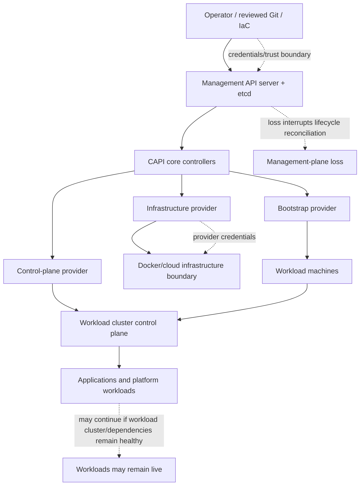
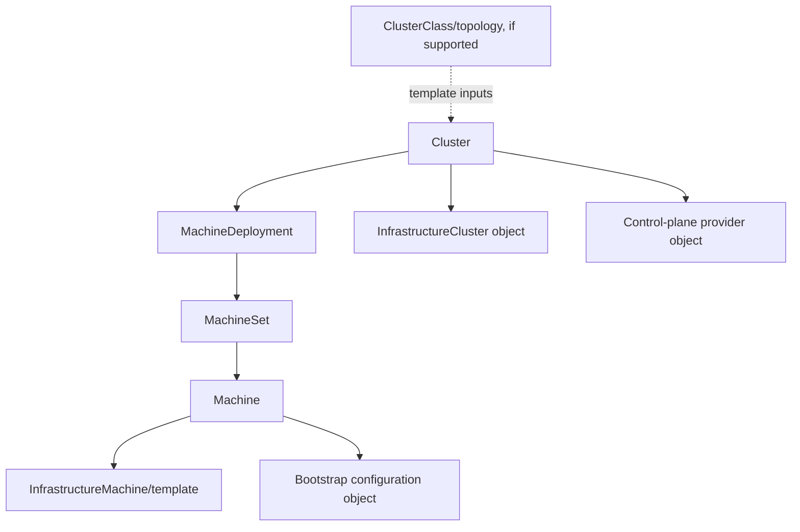

# Fleet Management and Cluster Lifecycle with Cluster API

> Module: M14 | Stage: 2E — Production DevOps & Platform Engineering | Unit: 2

This module teaches cluster lifecycle operations from design through decommission, with Cluster API (CAPI) as the central architecture and a zero-budget `kind` workflow toolkit as the reliable fallback. The learner should be able to explain declarative reconciliation, choose a lifecycle approach, gate upgrades, verify cluster baselines, detect orphan candidates, and plan management-plane recovery. CAPI/CAPD live work is conditional on preflight and current official documentation. A two-cluster `kind` lab on one laptop is a workflow simulation, not evidence of real regional independence or cloud-provider behavior.

## Module metadata

- **Target filename:** `02-fleet-management-and-cluster-lifecycle-with-cluster-api.md`
- **Prerequisites:** M03 Kubernetes operations; M04 networking/CIDRs; M05 stateful workloads; M07 IaC; M08 GitOps; M09 secrets/identity; M10 SRE; M11 observability; M12 supply-chain/admission; M13 backup/DR.
- **Estimated time:** 14–22 hours (planning estimate, not measured).
- **Last reviewed:** 2026-10-29 (authoring date; not a live-doc review).
- **Baseline:** WSL2 Ubuntu or native Linux, Docker, `kind`, `kubectl`, Python 3.10+; CAPI/CAPD versions and commands **[VERIFY]**.
- **Core tools:** `stage2e-east-lab`, `stage2e-west-lab`, explicit Kubernetes contexts, Python standard library.
- **Awareness:** CAPI, CAPD, `clusterctl`, ClusterClass, MachineHealthCheck, Crossplane, Terraform/OpenTofu, cloud CLIs and managed fleet products.
- **Stack profile:** Fleet-Core; add GitOps/data services only for the lab that needs them.
- **Footprint:** laptop baseline ~4 CPU, 8 GB RAM, 30 GB disk; actual resource use varies—**measure yours**.
- **Clusters touched:** east/west; optional disposable `stage2e-mgmt-lab` only for a verified CAPI lab.
- **Destructive labs:** yes, restricted to allow-listed disposable lab resources with dry-run, typed confirmation, cleanup and verification.
- **Source verification status:** official documentation was not live-checked during authoring. Version-sensitive claims remain `[VERIFY]`.

## Table of contents

- [1. Why this matters in production](#1-why-this-matters-in-production)
- [2. Learning objectives](#2-learning-objectives)
- [3. Prerequisites, environment, and safety contract](#3-prerequisites-environment-and-safety-contract)
- [4. Concept map and vocabulary](#4-concept-map-and-vocabulary)
- [5. Level 1 — Beginner: lifecycle and CAPI foundations](#5-level-1--beginner-lifecycle-and-capi-foundations)
- [6. Level 2 — Intermediate: guarded lifecycle operations](#6-level-2--intermediate-guarded-lifecycle-operations)
- [7. Level 3 — Advanced: lifecycle automation and fleet safety](#7-level-3--advanced-lifecycle-automation-and-fleet-safety)
- [8. Level 4 — Expert: governance and failure handling](#8-level-4--expert-governance-and-failure-handling)
- [9. SRE lens](#9-sre-lens)
- [10. Security lens](#10-security-lens)
- [11. Production-readiness checklist](#11-production-readiness-checklist)
- [12. Hands-on lab set](#12-hands-on-lab-set)
- [13. Self-check questions](#13-self-check-questions)
- [14. Evidence artifacts](#14-evidence-artifacts)
- [15. Senior interview and design-review questions](#15-senior-interview-and-design-review-questions)
- [16. What this unit teaches vs. what later units own](#16-what-this-unit-teaches-vs-what-later-units-own)
- [17. Sources and verification notes](#17-sources-and-verification-notes)
- [Appendix A — Runnable lab files](#appendix-a--runnable-lab-files)
- [Appendix B — Ordered execution, cleanup, and recovery](#appendix-b--ordered-execution-cleanup-and-recovery)
- [Appendix C — Traceable requirement audit](#appendix-c--traceable-requirement-audit)
- [Appendix D — Claim register and unresolved verification](#appendix-d--claim-register-and-unresolved-verification)
- [Appendix E — Truthful execution statement](#appendix-e--truthful-execution-statement)

## 1. Why this matters in production

A cluster is lifecycle-managed infrastructure, not a hand-built pet. If its owner, origin, version, dependencies, and rebuild procedure are unknown, an ordinary upgrade becomes a risky migration. A shared template change can unintentionally affect many clusters; a lost management plane can leave applications running while lifecycle repair and inventory are unavailable; and deleting a cluster object does not prove every disk, load balancer, IP, credential, DNS record, or inventory record was removed. The incidents discussed here are hypothetical patterns, not claims about named real events.

The operating discipline is to preserve declared intent, bound the blast radius of every change, inspect observed state independently, and retain evidence before and after lifecycle mutations.

## 2. Learning objectives

- **[L1]** Explain the lifecycle sequence and identify evidence for each phase.
- **[L1]** Distinguish CAPI objects, workload-cluster objects, provider resources, and application GitOps resources.
- **[L1]** Explain desired state, observed state, reconciliation, retries, idempotency, and drift.
- **[L2]** Run the feasibility preflight and choose Path A or Path B based on evidence.
- **[L2]** Use a guarded local lifecycle toolkit, dry-run, registry validation, and tests.
- **[L2]** Produce baseline and support-policy reports without inventing current support data.
- **[L3]** Design upgrade rings, health gates, credential boundaries, and bounded remediation.
- **[L3]** Define lifecycle SLIs/SLOs using measured baselines and internal customer needs.
- **[L4]** Analyze management-plane loss, unsupported-version drift, failed deletion, and remediation storms.
- **[L4]** Defend a lifecycle architecture decision and specify revisit triggers.

## 3. Prerequisites, environment, and safety contract

### 3.1 Zero-budget baseline

The laptop target is approximately 4 CPU cores, 8 GB RAM, and 30 GB disk. Use WSL2 Ubuntu or native Linux. Do not run two clusters, a management cluster, GitOps, observability, replicated databases, and cross-cluster networking simultaneously. The required lab clusters are `stage2e-east-lab` and `stage2e-west-lab`; `east` and `west` are labels, not real regions. `stage2e-mgmt-lab` is optional, disposable, and only for a verified CAPI path.

### 3.2 Path selection

- **Path A — CAPI + Docker infrastructure provider (CAPD):** only after local preflight and review of current official CAPI/CAPD compatibility and commands.
- **Path B — fallback:** read illustrative CAPI manifests/status snapshots and use the kind lifecycle toolkit in Appendix A. This is **not CAPI** and does not prove provider provisioning, CAPI reconciliation, machine remediation, or production upgrades.

If preflight cannot be executed, choose Path B. Missing information is `UNKNOWN`, not `PASS`. Do not pay for infrastructure or weaken host security to force Path A.

### 3.3 Safety contract

1. Never use production kubeconfigs or cloud administrator credentials.
2. Every command targeting an existing cluster uses explicit `--context` or a validated wrapper.
3. Cluster create/delete is limited to exact allow-listed disposable names.
4. Destructive actions require dry-run, target display, typed confirmation, cleanup instructions, and a second verification pass.
5. Never delete a resource solely because its name looks like a lab or appears old.
6. The toolkit is defense-in-depth, not a replacement for RBAC, admission policy, least privilege, or change approval.
7. Keep secrets, kubeconfigs, tokens, and private keys out of logs and evidence.
8. Two local clusters share host hardware, power, kernel, storage, and often networking; the lab cannot prove regional independence or WAN behavior.

### 3.4 Stack profiles

| Profile | Start | Stop | Use |
|---|---|---|---|
| Fleet-Core | Docker, east/west kind clusters only when needed, guard scripts | stop optional components between labs | contexts, lifecycle, inventory, baseline |
| Fleet+GitOps | Fleet-Core plus one GitOps controller and local Git | stop GitOps services when not needed | baseline/bootstrap handoff |
| Fleet+Data | selected cluster pair plus only the chosen data/DNS simulator | stop data services after measurement | dependency demonstrations |

Measure local CPU, memory, disk, image-cache growth, and startup duration; do not copy another learner’s numbers.

## 4. Concept map and vocabulary

| Term | Definition | Common misconception |
|---|---|---|
| Cluster lifecycle | Governed process from design through decommission | Creation is the whole lifecycle |
| Desired state | Declared target configuration | Desired state proves existence |
| Observed state | Status reported by APIs, controllers, and external inventory | Successful apply proves convergence |
| Reconciliation | Repeated comparison and correction of desired/observed differences | A controller is a one-shot script |
| Management cluster | Cluster hosting CAPI management APIs/controllers and lifecycle objects | Merely a dashboard |
| Workload cluster | Cluster whose nodes/workloads are lifecycle-managed | Automatically recoverable if management is lost |
| CAPI `Cluster` | API object representing a managed workload cluster | The remote cluster itself |
| CAPI `Machine` | Lifecycle object representing infrastructure intended to become a node | A Pod or the Node object itself |
| Infrastructure provider | Provider-specific controllers/resources for infrastructure | CAPI core knows every cloud API |
| Bootstrap provider | Prepares machines to join a cluster | Same thing as infrastructure provisioning |
| ClusterClass | Reusable topology/template abstraction where supported | Template edits always propagate immediately |
| Drift | Difference between declared and observed state | Every drift should be auto-corrected |
| Ring/wave | Bounded group receiving a change after earlier gates pass | A built-in CAPI guarantee |
| Orphan candidate | Resource with unclear owner/lifecycle relationship | Safe to delete automatically |
| Lifecycle SLO | Objective for internal cluster lifecycle service | A universal target percentage |



Existing workloads may continue while the management cluster is unavailable, but lifecycle operations, repair, upgrades, and visibility may stop or degrade. Behavior depends on provider and implementation; application availability is not proof that management control has recovered.

### CAPI resource relationship



Exact resource names, API groups/versions, ownership references, and topology behavior vary by CAPI/provider version: **[VERIFY]**. The analogy `MachineDeployment → MachineSet → Machine` resembles Kubernetes `Deployment → ReplicaSet → Pod`, but a CAPI Machine is infrastructure lifecycle state, not a Pod and not governed by identical scheduling/failure semantics.

### Lifecycle state transitions

```text
Requested -> Designed/Approved -> Provisioning -> Bootstrapping -> Baseline validation
                                                       |                    |
                                                       v                    v
                                                    Failed <------------- Ready/Operating
                                                       |                    |
                                                repair or stop              v
                                                                   Upgrade/Scale -> Verify
                                                                                     |
                                                                                     v
                                                                      Decommission approved
                                                                                     |
                                                                                     v
                                                                        Residual-resource audit
                                                                                     |
                                                                                     v
                                                                                  Retired
```

A state label is a summary, not proof. Retain separate evidence for infrastructure, Kubernetes readiness, baseline conformance, application behavior, and residual resources.

## 5. Level 1 — Beginner: lifecycle and CAPI foundations

### 5.1 The cluster lifecycle end to end

Required sequence: **design → provision → bootstrap → operate → upgrade → scale → repair → decommission**.

| Phase | Goal/input | Responsible actor | Evidence | Failure and safe stop | CAPI vs kind vs managed Kubernetes |
|---|---|---|---|---|---|
| Design | owner, purpose, tier, version, CIDRs, dependencies | platform + workload owner | ADR, registry, CIDR validation | missing owner/overlap: do not provision | CAPI consumes objects; kind consumes local config; managed service uses provider APIs |
| Provision | create infrastructure/control-plane foundation | provider/controller or approved pipeline | conditions/events/provider inventory | quota/API/credential failure: inspect, do not blindly retry | kind uses local Docker nodes; managed provider operates some control plane |
| Bootstrap | make nodes/control plane join a usable cluster | bootstrap/control-plane provider | node readiness, endpoint, status | preserve logs and repair cause before deletion | mechanism differs by provider |
| Operate | maintain access, policy, inventory, SLOs | platform/service owners | conformance and SLO evidence | quarantine unexplained drift | workload operations remain customer-owned |
| Upgrade | move to supported versions | lifecycle controller/pipeline | before/after versions and health gates | pause on compatibility failure; do not assume downgrade | CAPI/provider semantics vary; kind lab uses replacement |
| Scale | change desired capacity | controller/operator | desired vs observed replicas/capacity | quota/capacity issue: stop and revise | kind node count is not a generic mutable CAPI replica count |
| Repair | restore failed machine/control plane | provider/controller/on-call | health signals, remediation events, workload checks | provider outage can create false remediation | kind only simulates part of this |
| Decommission | retire after dependency review | owner + platform | approvals, deletion state, orphan scan | unknown dependency: stop | kind removes local cluster resources; cloud resources need separate checks |

### 5.2 Declarative state, controllers, reconciliation, and drift

Declarative configuration records intended outcome; controllers repeatedly compare desired and observed state and take permitted actions. A request may be accepted while provisioning remains pending or failed. Retries do not prove the failure is transient. Reapplying intent should not create duplicates, but provider/controller idempotency must be verified. Drift may be an emergency change, an intentional exception, an untracked resource, or an error; classify it before correction.

“Cattle, not pets” means reproducible and replaceable infrastructure—not that all state is disposable. Databases, volumes, identity, certificates, DNS, IP allocations, provider resources, and external integrations need explicit ownership and migration plans. CAPI manages cluster lifecycle; GitOps usually reconciles platform/application configuration. They complement rather than replace one another.

### 5.3 Cluster API: purpose and boundaries

Cluster API is a Kubernetes sub-project intended to provide declarative APIs and tooling to create, upgrade, and manage Kubernetes clusters. CAPI controllers reconcile management objects and delegate provider-specific work. Current project status, release policy, API versions, and provider compatibility are **[VERIFY]**; this file does not claim live verification.

CAPI may be useful when repeatable lifecycle operations justify operating a management plane, providers, credentials, templates, and failure handling. It does not automatically solve application delivery, data replication/migration, global traffic routing, complete DR, organizational ownership, cost attribution, or every external provider dependency.

### 5.4 Management cluster vs workload cluster

The management cluster hosts CAPI APIs/controllers. The workload cluster hosts its control plane, nodes, and workloads. Management loss can interrupt provisioning, upgrades, repair, and inventory. Workloads may continue if the workload cluster and dependencies remain healthy, but that is conditional. Verify separately: application health; management infrastructure/credentials; controllers; object/provider-state consistency; safe lifecycle operation; inventory/policy conformance.

### 5.5 Core CAPI resources and relationships

| Resource | Purpose/lifecycle role | Misconception |
|---|---|---|
| `Cluster` | top-level representation and relationship for managed cluster | is the remote cluster itself |
| `Machine` | lifecycle object for machine/node infrastructure | is a Pod or Kubernetes Node |
| `MachineSet` | maintains a set of Machines | always equals a cloud autoscaling group |
| `MachineDeployment` | higher-level replica/rollout abstraction where supported | identical behavior across providers |
| `MachineHealthCheck` | health detection/remediation mechanism when configured and supported | guarantees safe replacement |
| Control-plane provider object (e.g. `KubeadmControlPlane`) | provider-specific control-plane lifecycle | universal schema/name |
| Infrastructure cluster object (e.g. `DockerCluster`) | provider-specific cluster infrastructure | every provider uses Docker objects |
| Infrastructure machine/template (e.g. `DockerMachineTemplate`) | machine infrastructure intent | fields are universal |
| Bootstrap object (e.g. kubeadm config) | machine bootstrap input | creates all infrastructure dependencies |
| `ClusterClass` | reusable topology/template abstraction in supported versions | changes automatically roll every live cluster |

Exact schemas, API versions, names, and ownership references must be checked against the selected release and provider before manifests are used.

### 5.6 `clusterctl`: purpose and workflow

`clusterctl` is the CAPI CLI used to work with provider components and cluster lifecycle workflows. Conceptual tasks include provider initialization (`init`), cluster manifest generation, lifecycle inspection (`describe`), retrieving workload kubeconfig, and moving management objects between management clusters (`move`). `move` is sensitive and is not a required destructive lab. All exact commands/flags are **[VERIFY]** against current docs. Do not copy old commands without matching the installed release; use only the disposable management context.

### 5.7 Managed vs self-managed Kubernetes

| Responsibility | Managed Kubernetes | Self-managed/CAPI-managed |
|---|---|---|
| Control plane/etcd | provider operates some internals under its service contract | team/provider integration owns more lifecycle/failure handling |
| Nodes/images | customer still manages workload capacity and usually node configuration | team and provider integration manage machine lifecycle configuration |
| Upgrades | provider-supported path and constraints | team coordinates CAPI/provider/control-plane/node/add-on compatibility |
| CNI/CSI/add-ons | some provider-managed; customer still owns configuration/compatibility | team owns unless delegated |
| Identity/access | customer owns access and workload identity | customer owns management and workload access plus provider credentials |
| Workloads, policy, observability, data, fleet governance | customer responsibility | customer responsibility |

Managed services shift some control-plane operations to the provider; they do not remove workload, access, data, policy, fleet, or regional-failure responsibilities.

### 5.8 CAPI and lifecycle alternatives

These tools operate at different abstraction layers; they are not interchangeable.

| Approach | Abstraction/provider scope | Lifecycle automation | Portability/burden | Best fit and caveat |
|---|---|---|---|---|
| CAPI | Kubernetes-native lifecycle API; provider-specific infra/bootstrap/control-plane providers | declarative controller reconciliation, provider-dependent | potentially multi-provider, but semantics differ; management plane required | standardized cluster lifecycle; verify provider maturity/compatibility |
| Terraform/OpenTofu + kubeadm/managed K8s | IaC modules and provider resources | modules/pipelines/runbooks | depends on module design; state and module maintenance | teams already operating IaC; lifecycle semantics vary |
| `eksctl`, `gcloud`, `az` | cloud-specific API/CLI | provider operations and scripts | low across clouds; operationally familiar | cloud-native teams; command success is not fleet conformance |
| Crossplane | Kubernetes API for external resources/compositions | composition/provider-dependent | provider abstractions vary | platform APIs across resources; not automatically a CAPI replacement |
| Gardener | cluster management platform | platform capabilities vary | provider support must be checked | standardized managed cluster operations; status/features [VERIFY] |
| Rancher | cluster management platform | varies for imported/provisioned cluster types | multi-environment management, not identical lifecycle everywhere | fleet visibility/RBAC; distinguish imported from provisioned |
| Talos/Omni | OS/cluster management approach | product/version-specific | environment-dependent | declarative OS/cluster operations; current capabilities [VERIFY] |
| Kubespray | Ansible-based Kubernetes deployment/operations | playbook-driven | broad OS/infrastructure flexibility, higher runbook ownership | Ansible-capable self-managed teams; not same reconciliation model |
| k3s installers | lightweight distribution installation | installer/distribution-specific | useful in constrained/edge environments | installer alone is not a fleet lifecycle policy |
| Managed Kubernetes/fleet offering | provider service abstraction | provider feature-dependent | often strongest within provider ecosystem | less control-plane toil, but provider lock-in and service boundaries |
| kind toolkit here | local workflow simulation | only scripted local operations | portable to compatible local tooling; no provider proof | zero-budget practice, not CAPI/cloud/region assurance |

Verify current project status and product capabilities before production selection.

### 5.9 Common beginner mistakes: symptom → cause → fix

| Symptom | Cause | Fix |
|---|---|---|
| Wrong cluster displayed | context changed or kubeconfig assumptions wrong | explicit `--context`; display identity before mutation |
| CAPI object exists but cluster is not ready | API acceptance confused with convergence | inspect conditions/events and independently verify workload cluster |
| Repeated create attempts make state confusing | retry without checking partial resources | stop, inspect status/provider inventory, then follow recovery procedure |
| Template edit has no apparent effect | behavior depends on version/topology workflow | verify documented propagation semantics |
| Many machines remediate during provider outage | false health signals and unbounded retries | pause/quarantine through supported controls; check provider and health evidence |
| Cloud resources remain after cluster delete | external ownership/deletion is separate | compare provider inventory and dependency records; never delete by name alone |
| App probe passes but management plane is down | workload and lifecycle planes differ | verify controllers, inventory, provider access, and a safe lifecycle action |
| Version marked unsupported from memory | support policy changes | consult official policy, record source and review date |

### 5.10 “What just happened?” trace

Reviewed desired state is submitted to the management API. CAPI controllers observe it and delegate infrastructure, bootstrap, and control-plane tasks to providers. Conditions/events show partial progress but do not replace independent workload-cluster checks. After nodes are ready, baseline verification checks add-ons and metadata. GitOps separately deploys applications. During decommission, the operator verifies workload/data disposition and dependencies before deletion, then checks provider resources, registry, DNS, monitoring, and credentials. Path B simulates this sequence using local kind config and does not run CAPI controllers.

## 6. Level 2 — Intermediate: guarded lifecycle operations

### 6.1 CAPI feasibility preflight and Path A/Path B decision

Run `bash preflight.sh` from Appendix A. It checks discoverable local dependencies and reports WARN for items it cannot establish. It cannot certify official CAPI/CAPD compatibility; that requires a current documentation review. Choose Path B if any critical local prerequisite fails or is unknown, compatibility is unverified, disk/memory is constrained, or the host would require weakened security. Suggested resource thresholds are local recommendations only—measure yours.

### 6.2 Path A: CAPI with Docker provider (conditional)

**Not live-verified here.** First check the current official CAPI quick start, CAPD docs, compatibility matrix, API reference, and exact commands. Preconditions: Docker access; installed `kind`, `kubectl`, `clusterctl`; verified compatible versions; disposable `stage2e-mgmt-lab`; reviewed cleanup plan; no production credentials.

Conceptual sequence:
1. Create disposable `stage2e-mgmt-lab` from reviewed kind config.
2. Verify its context and nodes.
3. Initialize CAPI and CAPD using the current documented `clusterctl init` workflow.
4. Generate a workload manifest using the documented version-specific command; inspect the entire YAML before applying.
5. Apply only to the explicit management context; inspect Cluster, MachineDeployment, MachineSet, Machine, control-plane, bootstrap, and infrastructure objects.
6. Retrieve workload kubeconfig using the verified command; protect it as a credential and never include it in evidence.
7. Deploy a tiny app with explicit workload context and verify identity.
8. Change MachineDeployment replicas only after checking exact object and provider semantics; compare desired/observed replicas and workload nodes.
9. Delete the disposable workload Cluster declaratively after typed confirmation and dependency checks; verify CAPI objects and Docker resources.
10. Delete the management cluster last after evidence capture and dependency checks.

**[VERIFY]:** API versions, provider initialization, manifest generation, kubeconfig retrieval, object names/fields, scaling/deletion semantics, and CAPD/WSL2 compatibility. Do not use `clusterctl move` in this lab.

### 6.3 Path B: kind lifecycle toolkit

Path B is the default when CAPI feasibility is not verified. Appendix A contains a registry, kind configs, a guarded Python CLI, preflight script, baseline/support/decommission/rollout utilities, fixtures, and unit tests. It is a workflow simulation, not CAPI. It refuses unknown targets; destructive actions require exact typed confirmation. The wrapper cannot classify all Kubernetes mutations and does not replace RBAC or admission.

Example dry-run:

```bash
python fleet.py create stage2e-east-lab --dry-run
```

Any output shown by a learner should be labeled **Representative output (synthetic; not captured from a real run)** unless actually captured. Review code and tests before real local cluster operations.

### 6.4 Declarative scaling and lifecycle state

CAPI scaling generally changes desired replicas on a supported lifecycle object, then observes reconciliation; exact behavior is provider/version-specific. In the local toolkit, `fleet scale` deliberately refuses in-place node scaling because a kind node count is not a generic CAPI MachineDeployment replica count. Use a separately declared replacement config when changing local topology.

Distinguish CAPI Machine replicas, Kubernetes Node objects, workload Pod replicas, cloud VM count, and kind Docker node containers. They are different layers.

### 6.5 Blue/green cluster upgrade

For kind, use replacement rather than claiming an in-place Kubernetes upgrade:
1. create a new disposable cluster from a separately declared config;
2. verify nodes, DNS/CNI, and required baseline;
3. deploy workload configuration from source;
4. migrate only stateless/demo workloads unless a data-migration plan exists;
5. switch the local test endpoint only after health gates pass;
6. verify client identity and both old/new clusters independently;
7. retain evidence and rollback conditions;
8. delete the old cluster only after dependency, state, registry, GitOps, DNS, and monitoring checks.

| Strategy | Benefit | Cost/risk | Choose when |
|---|---|---|---|
| Supported in-place CAPI/provider upgrade | less duplicated infrastructure | compatibility and existing-cluster risk; rollback constrained | exact provider/version docs support it |
| Blue/green replacement | separate validated fallback | duplicate capacity; state and endpoint migration | dependencies can be migrated safely |
| Node replacement | replaces machine infrastructure within cluster | scheduling/PDB/capacity risk | node replacement is required and cluster remains supported |
| Application rollout | changes app, not cluster version | app-level risk; does not fix unsupported cluster | application release only |

Do not assume control-plane downgrade is a valid rollback. Check official Kubernetes upgrade/downgrade guidance; forward repair or traffic return to a separately validated cluster may be safer.

### 6.6 Version skew and support-window reporting

Populate `supported-versions.yaml` from current official Kubernetes and provider support pages. Record source URL, checked date, validity/review date, and reviewer. Appendix A’s sample is synthetic and not current support policy. The report should flag missing versions, unknown clusters, versions absent from the declared set, stale policy dates, and incomplete inventory. It validates the declared policy; it does not independently decide official support status.

### 6.7 Machine health and automated remediation

`MachineHealthCheck` conceptually detects defined unhealthy Machine conditions and can trigger remediation when supported and configured. Exact schema, thresholds, timeout behavior, and safeguards are **[VERIFY]**. Production policy must consider false positives, provider/API outages, simultaneous unhealthy Machines, replacement capacity, disruption budgets, rate limits, pause/quarantine controls, human escalation, audit trail, and post-remediation verification.

Hypothetical scenario: provider API disruption makes health signals stale, so many Machines appear unhealthy. Correlate provider health, controller errors, node conditions, and event timing. If a shared provider outage is likely, stop further remediation through a supported control, protect capacity, communicate, and resume with a canary only after evidence improves. Do not invent thresholds or incident metrics. A kind script can detect `NotReady` and rehearse a controlled replacement plan but does not reproduce CAPI provider-aware remediation.

### 6.8 Baseline readiness verification

A new cluster is not ready just because nodes are `Ready`. Verify node readiness, Kubernetes version and owner metadata, CNI/DNS, ingress/Gateway if required, cert-manager/TLS if required, policy/admission, observability, GitOps registration, storage/CSI if required, namespaces and labels. Optional components should report `NOT_INSTALLED`; required missing components should fail. Appendix A’s checker consumes snapshots; it is not a complete live collector.

### 6.9 Decommission checklist and orphan verifier

- [ ] owner and approval recorded;
- [ ] workload and stateful-data disposition agreed;
- [ ] M13 backup/retention obligations checked;
- [ ] CAPI objects inspected if Path A;
- [ ] kind containers/volumes checked for exact lab cluster;
- [ ] cloud load balancers/disks/IPs/snapshots checked in production (awareness only);
- [ ] GitOps, DNS/traffic, monitoring, registry, credentials, and certificates accounted for;
- [ ] dry-run orphan report reviewed;
- [ ] typed confirmation captured;
- [ ] cleanup performed by authoritative owner system;
- [ ] second verification confirms no unexplained resources.

The Appendix A verifier evaluates fixtures and never deletes resources. A local kind verifier is not a cloud inventory system. Unknown candidates must be reviewed, not auto-deleted.

### 6.10 Management-cluster-loss drill

**Path A:** only after a real disposable CAPI setup and a verified provider-specific recovery plan. Save non-secret inventory and provider-side resource IDs first. Use typed confirmation before any management-cluster deletion. After the drill, verify workload availability separately from lifecycle control, rebuild from declared configuration, initialize compatible providers, and follow supported re-adoption procedures **[VERIFY]**. Never improvise if it may duplicate infrastructure.

**Path B:** simulate missing management metadata, query existing workload contexts, reconstruct inventory from registry/config, and rerun baseline checks. Mark this explicitly as a simulation; it does not prove CAPI re-adoption.

### 6.11 Per-cluster verification matrix

| Check | east | west | Evidence |
|---|---|---|---|
| context resolves to expected cluster | explicit query | explicit query | context and identity output |
| node readiness | verify | verify | node report |
| version | collect | collect | inventory |
| baseline required components | verify profile | verify profile | baseline JSON |
| owner/tier/version metadata | validate | validate | registry report |
| support policy | report | report | dated support report |
| decommission dependencies | inspect before delete | inspect before delete | reviewed checklist |

### 6.12 Worked lifecycle ADR

**Hypothetical organization:** small data platform team, modest fleet, one primary cloud, limited on-call capacity, and no dedicated team for a complex management plane.

**Decision:** begin with managed Kubernetes plus reviewed IaC and a guarded lifecycle pipeline; reassess CAPI when repetitive lifecycle work, fleet scale, and operational capability justify operating CAPI controllers/providers. Reject manual CLI-only operations as the sole long-term approach because they can create drift and incomplete inventory. Evaluate Crossplane if the platform needs a broader Kubernetes API for cloud resources; do not treat it as a drop-in CAPI replacement. Portability is partial because network, identity, storage, and lifecycle semantics remain provider-specific. Platform team owns lifecycle policy, inventory, and upgrade gates; workload teams own application requirements and data disposition. Evidence gaps: real provisioning duration, toil, compatibility, and recovery time are unmeasured. Revisit when cluster vending, multiple providers, or repeated manual toil becomes material. Actual review date must be set by the organization.

## 7. Level 3 — Advanced: lifecycle automation and fleet safety

### 7.1 Cluster templates and ClusterClass

Templates reduce duplication and may parameterize region, version, machine class, and network allocation where supported. Version and review template changes as production code. Record template revision per cluster, constrain parameters, and classify drift. Do not assume an edit automatically changes existing clusters. Verify topology/template propagation and pause controls for the exact version **[VERIFY]**. Promote changes through canary/rings to limit blast radius.

### 7.2 Upgrade strategies, canaries, and rollout rings

A safe rollout defines eligibility, a canary, measurable gates, a bounded wave, and automatic halt conditions. Example rings: ring 0 canary; ring 1 low-criticality; ring 2 general fleet; ring 3 critical/regulated with explicit approval. Ring sizes are organization-specific, not universal.

Before upgrade: verify support policy and provider/add-on compatibility; scan deprecated APIs; check control-plane/node health, capacity, PDBs, backups/restore evidence where relevant; define SLO/error-budget gates and an accountable owner. After upgrade: compare versions, run baseline and application checks, inspect alerts/errors/latency/saturation, record pass/fail, and stop the next ring if a gate fails.

### 7.3 Pre-upgrade and post-upgrade gates

| Gate | Evidence | Stop condition |
|---|---|---|
| Version eligibility | dated support policy | version/provider compatibility unknown |
| API compatibility | deprecation scan/add-on matrix | unresolved incompatibility |
| Health | control-plane/node/baseline report | unexplained unhealthy state |
| Capacity | measured free capacity and disruption constraints | insufficient capacity |
| Recovery | relevant M13 restore evidence | required evidence missing |
| Canary | workload probes and SLO view | agreed signal gate fails |
| Post-upgrade | version inventory, conformance, workload checks | unexplained drift or baseline failure |
| Change control | owner/window/communications | no accountable decision maker |

### 7.4 Rollback realities and forward recovery

Do not assume control-plane downgrade is supported. Check current official guidance. Options include pausing later rings, repairing forward, reverting application/config separately, switching to a separately validated blue/green cluster, or restoring/rebuilding only under a documented procedure. “The old cluster exists” is not sufficient unless it remains healthy and compatible with current data and traffic.

### 7.5 Provider credentials and management-plane security

Management-plane credentials can create or delete many clusters; compromise may become fleet compromise. Use least privilege scoped by environment/account/project, short-lived/rotated credentials where supported, separate read-only inventory identity, M09 secret handling, restricted management API access, protected backups, audit logs, break-glass review, and no secrets in logs/Git/evidence. Broad long-lived administrator credentials inside the management cluster are high risk. Provider-specific IAM permissions are not supplied because they vary.

### 7.6 Machine health and remediation-storm control

Production policy should combine multiple signals, distinguish provider outage from machine failure, bound concurrent remediation, provide a supported pause/quarantine and human escalation, rate-limit retries, verify capacity/disruption constraints, and retain audit evidence. Hypothetical failure: many machines appear unhealthy during a provider API blip. Correlate provider status, controller errors, node conditions, and event timing; stop further remediation using supported controls, protect capacity, communicate, then resume with a canary after recovery. No real incident metrics are claimed.

### 7.7 Lifecycle SLIs/SLOs and internal platform contract

Candidate SLIs: provisioning success/duration; baseline-ready duration; upgrade completion/failure; unsupported-version detection time; management-control recovery time; decommission verification success; orphan rate; inventory freshness; automated-remediation failure rate. Set targets from observed baseline, internal customer needs, service criticality, and error budget—not universal values. The platform contract should define request inputs, eligibility, support window, evidence, escalation, and non-guarantees. M10 owns detailed SRE practice; M16 owns golden paths/service catalog.

### 7.8 Fleet-wide rollout blast-radius model

Inventory and exclude unknown/non-conformant clusters; validate the change; apply to canary; evaluate baseline/workload gates; halt on injected failure; require review before next ring; retain an audit log. Appendix A’s rollout simulation is deterministic and **not native CAPI ring behavior**.

### 7.9 State, infrastructure, and ownership boundaries

Replacement is not data migration. State may live in databases, volumes, object storage, DNS, registries, secrets backends, identity providers, load balancers, and monitoring systems. Identify each owner, dependency, source of truth, and retirement action. Reuse M13 backup/rebuild practices and M05 stateful-workload knowledge. Regional replication belongs to M14 Unit 7.

### 7.10 Lifecycle automation design exercise

For a hypothetical fleet of 20 clusters and two tiers, submit: registry schema; dated version policy; creation/CIDR gates; ring plan; provider credential boundary; management-plane recovery; decommission matrix; lifecycle SLI/SLO measurement plan; ADR comparing CAPI/IaC-CLI/Crossplane/managed Kubernetes; evidence gaps and revisit triggers. Defend the blast-radius limit, on-call ownership, and stop behavior when automation fails.

## 8. Level 4 — Expert: governance and failure handling

### 8.1 Cluster creation governance and vending flow

```text
request -> owner/purpose -> approval/quota/tier -> CIDR allocation
-> approved template/version -> provision -> baseline -> access setup
-> registry/inventory -> conformance -> owner handoff -> upgrade/review -> decommission
```

Require approved templates/versions, owner and sandbox TTL, registry registration as a gate, policy/baseline checks, quarantine of non-conformant clusters, and separate approval for production/regulated workloads. M16 owns the full golden path/portal; this unit defines the lifecycle contract.

### 8.2 Version/support policy and lifecycle standards

Define supported Kubernetes versions from current official policy; CAPI/provider compatibility; add-on compatibility and API deprecations; upgrade windows and owner; node image/certificate rotation; maximum age/rebuild cadence where justified; exception owner/expiry; inventory freshness; and decommission approval. Actual support values must be verified or marked `[VERIFY]`.

### 8.3 Orphaned infrastructure and failed deletion

Typical patterns: cluster deleted before load balancers/volumes; provider deletion failed; kubeconfig/registry/GitOps/DNS/monitoring records remain; undocumented manual steps block rebuild; expired credentials block repair; forgotten cluster certificates expire; ownerless sandbox exceeds TTL.

Review procedure: gather provider ID/tags/dependencies/owner; compare CAPI, provider, IaC, registry, GitOps, DNS, monitoring and access records; classify owned/orphan-candidate/unknown; verify dependencies and contact owner; produce dry-run; obtain approval; delete through authoritative owner system; run a second check. Never delete unknown resources based on names alone.

### 8.4 Management-plane loss and recovery architecture

Keep declared config, template versions, registry, policy, and runbooks in reviewed durable source control. Protect management backups/state and credentials. Recovery: freeze nonessential lifecycle changes; test workload health separately; restore config and authorized access; rebuild management cluster; initialize compatible providers; follow supported re-adoption process; compare CAPI/provider/registry inventories to avoid duplicate resources; run baseline/policy checks; perform one safe lifecycle action; communicate restoration only after evidence. If the lab cannot prove behavior, use a tabletop and label it as such.

### 8.5 Provider credential rotation and compromise

For exposure: revoke/rotate through approved provider identity process; scope potential impact; preserve audit evidence; pause unsafe automation; verify new credentials with minimal authorized operations; inspect provider inventory for unexpected resources; rotate dependent credentials; review access and residual risk. If credentials expire mid-upgrade, pause, inspect current state, restore authorized access, then resume from a known state—do not blindly retry.

### 8.6 Ten required incident analyses

All are hypothetical. For each, use **symptom → hypotheses → safe tests/evidence → root cause → immediate mitigation → durable prevention → residual risk**.

1. **Template upgrade fans out fleet-wide.** Evidence: template revision, CAPI conditions, versions, approvals. Cause: no bounded rollout or misunderstood propagation. Mitigate by stopping supported propagation and assessing each cluster. Prevent with canary/rings and halt tests. Residual risk: already-started operations may not reverse safely.
2. **Management cluster deleted; lifecycle unavailable.** Evidence: app probes, backups, Git/IaC state, provider inventory. Cause: no tested recovery. Freeze lifecycle changes, rebuild from declared config and supported re-adoption. Prevent with protected backups and recovery drills. Residual risk: provider state inconsistency.
3. **Remediation storm during provider API blip.** Evidence: controller errors, provider health, node conditions, event timeline. Cause: false signals and unbounded concurrency. Pause/quarantine through supported controls, protect capacity. Prevent with outage detection, bounds, and tabletop. Residual risk: in-flight operations.
4. **Cloud load balancers/volumes orphaned.** Evidence: provider inventory, IaC, CAPI status, dependencies/tags. Cause: cluster deletion treated as total cleanup. Create reviewed orphan report; do not delete unknown resources. Prevent dependency matrix and second pass. Residual risk: ambiguous ownership.
5. **Six Kubernetes minor versions, two outside policy.** Evidence: live versions, policy source date, exceptions, inventory freshness. Cause: no enforced owner/gate. Prioritize risk assessment and supported upgrade planning. Prevent scheduled inventory, alerts, exception expiry. Residual risk: upgrade compatibility work.
6. **Broad provider administrator credential leaks.** Evidence: audit logs, identity scope, secret access, provider inventory. Cause: excessive management-plane authority. Revoke/rotate, freeze unsafe automation, investigate changes. Prevent least privilege, short-lived credentials where supported, isolation and audit. Residual risk: unauthorized persistence.
7. **Certificates expire on ownerless cluster.** Evidence: inventory, certificate expiry report, owner audit. Cause: missing ownership/rotation controls. Identify dependencies and follow documented recovery. Prevent owner/TTL, expiry alerts, decommission gates. Residual risk: downtime if trust cannot be recovered.
8. **Rebuild drill fails due to undocumented manual steps.** Evidence: compare runbook/build, Git history, dependency inventory. Cause: repeatability assumed, not tested. Restore via approved path and document gap. Prevent clean-environment rebuild drills. Residual risk: hidden dependencies remain.
9. **Provider credentials expire during upgrade.** Evidence: credential status without secret values, controller errors, provider audit, cluster health. Cause: rotation not coordinated. Pause rollout, restore access, inspect state before retry. Prevent expiry alerts and rotation rehearsal. Residual risk: partially completed operations.
10. **Deletion stalls; CAPI/provider inventories disagree.** Evidence: conditions/events, controller logs, provider inventory, credentials/dependencies. Cause: provider deletion/finalizer/API/credential issue or stale inventory. Stop repeated delete attempts and follow exact release guidance. Prevent deletion SLOs, orphan checks, provider failure runbooks. Residual risk: force-removal may orphan resources.

### 8.7 Lifecycle ownership, on-call, and toil

Platform team owns lifecycle automation, cluster SLOs, version policy, registry, upgrade gates, quotas, and lifecycle incident response. Workload teams own application requirements, data disposition, and workload acceptance. Provider support owns only components within the service contract. Repeated manual creation, version chasing, credential rotation, and orphan cleanup are toil signals. M15 owns detailed FinOps; this unit records qualitative drivers and measured laptop footprint only.

### 8.8 Provider lock-in and portability

A common lifecycle API does not make identity, networking, storage, load balancing, quotas, and failure semantics identical. Evaluate provider-specific resources, data migration, identity portability, network assumptions, operational skills, upgrade/repair semantics, quota/credential failure, and maintenance cost. Multi-cloud is not automatically multi-region resilience and may add egress, networking, skills, and operational complexity.

### 8.9 Governance and change-review checklist

- [ ] owner, purpose, tier, environment, and sandbox TTL are recorded;
- [ ] template/version and compatibility evidence are approved;
- [ ] CIDR and identity boundaries are checked;
- [ ] provider credentials are least-privilege and absent from source/logs;
- [ ] baseline and registry registration are provisioning gates;
- [ ] non-conformant clusters are quarantined from rollout;
- [ ] canary/ring gates and pause conditions are tested;
- [ ] remediation is bounded and has escalation;
- [ ] management-plane recovery has an owner and evidence;
- [ ] decommission includes external-resource checks and second pass;
- [ ] exceptions have owner, expiry, and revisit trigger;
- [ ] evidence contains no secrets.

## 9. SRE lens

| SLI | Measurement | Purpose |
|---|---|---|
| Provisioning success/duration | eligible requests successful; request-to-ready time | detects provider/config/automation failure |
| Baseline-ready duration | request to required baseline success | measures usable delivery, not object creation |
| Upgrade success/failure | clusters passing post-upgrade gates / attempted | rollout quality |
| Unsupported-version detection | time from policy violation to alert | limits unmanaged drift |
| Management-control recovery | time until inventory and safe lifecycle action restored | separates app uptime from control-plane recovery |
| Decommission verification | retirements with complete second-pass evidence | detects residual resources |
| Orphan rate | confirmed candidates per inventory/retirement | exposes ownership gaps |
| Inventory freshness | age of latest successful inventory | stale inventory weakens decisions |
| Remediation failure rate | attempts not reaching verified healthy state | identifies unsafe repair |

Set SLOs from measured baseline, internal customer needs, service criticality, and error budgets. Do not invent universal targets. M10 supplies detailed error-budget practice.

**Runbook: lifecycle operation fails** — Trigger: provisioning/upgrade/deletion gate fails. Decision: pause rollout and classify local/config/provider/credential cause. Execute: collect non-secret status/events/logs and follow documented recovery; do not blindly retry. Verify: management context, workload context, provider inventory, baseline, and dependencies separately. Communicate: owner, affected clusters, risk, next update, stop condition. Follow up: update runbook/tests/SLO/governance.

Cost/capacity: each cluster adds control-plane/system/policy/observability and on-call overhead; replacement temporarily duplicates capacity. M15 owns detailed transfer/egress and cost allocation. Measure local footprint here.

## 10. Security lens

| Threat | Control | Negative test/evidence |
|---|---|---|
| Broad provider credential compromise | least privilege, rotation, separate read-only identity | prove read-only identity cannot mutate; never test production credentials |
| Management-plane compromise becomes fleet compromise | isolation, restricted API, audit, protected backups | review RBAC/network access and tabletop credential exposure |
| Wrong-cluster action | explicit context, allow-list, typed confirmation | unknown/prod target tests fail closed |
| Tampered config propagation | reviewed Git, M12 provenance/policy checks | invalid/unreviewed fixture rejected |
| Inconsistent baseline | baseline verifier/conformance gate | missing required policy fixture fails |
| Secret leakage | non-secret structured logs and evidence review | scan output; never dump env/kubeconfig |
| Public management API exposure | private/restricted endpoint in production | inspect provider config; lab creates no public endpoint |
| Orphan remains accessible | dependency review and second inventory pass | orphan fixture reported, never auto-deleted |
| Unsafe remediation | bounded concurrency and supported pause/escalation | simulation confirms broad failure halts |

A local toolkit cannot prove cloud IAM correctness, provider audit completeness, legal residency compliance, or production management-plane isolation. Those need provider-specific evidence.

## 11. Production-readiness checklist

- [ ] lifecycle sequence and ownership documented;
- [ ] desired/observed state recorded separately;
- [ ] CAPI/provider versions and official support docs verified before Path A;
- [ ] lab path labelled CAPI-live, kind-toolkit, or illustrative;
- [ ] mutations use explicit context/validated target and disposable allow-list;
- [ ] dry-run/typed confirmation tests pass;
- [ ] registry names/config/CIDRs/owner/tier/version validate;
- [ ] support policy has source URL, checked date, validity, reviewer;
- [ ] baseline reports PASS/FAIL/WARN/NOT_INSTALLED correctly;
- [ ] blue/green plan verifies client path and stateful constraints;
- [ ] remediation policy bounds provider-outage blast radius;
- [ ] management-loss plan separates workload health and lifecycle recovery;
- [ ] decommission includes external resources and second pass;
- [ ] orphan verifier reports unknowns rather than deleting them;
- [ ] rollout rings have measurable gates and approvers;
- [ ] evidence contains no secrets and labels synthetic values;
- [ ] open `[VERIFY]` items have owners before production use.

## 12. Hands-on lab set

All labs are zero-budget and local; footprint: **measure yours**. None proves regional independence.

### M14-U2-LAB-01 — CAPI feasibility and architecture inspection
- **Goal:** choose path from evidence and distinguish live vs illustrative.
- **Profile/prerequisites:** Fleet-Core; Docker/shell; optional kind, kubectl, clusterctl.
- **Footprint/clusters:** low preflight; Path A can be heavy; none unless optional `stage2e-mgmt-lab`.
- **Start/stop:** Docker only; do not create management cluster until compatibility/resource review.
- **Steps:** run preflight; save output; check official docs; record PASS/WARN/FAIL/UNKNOWN; choose Path A only if critical checks and compatibility pass, else Path B; inspect diagrams/synthetic snapshots.
- **Evidence:** preflight, path decision, source URLs/date, live-vs-illustrative statement.
- **Cleanup/destructive:** none for preflight; Path A uses verified cleanup.
- **Stretch:** list checks a shell script cannot prove.
- **Fidelity caveat:** Docker access does not prove cloud/region reliability.

### M14-U2-LAB-02 — Declarative cluster lifecycle
- **Goal:** safely exercise create/inspect/scale-limit/delete.
- **Profile/prerequisites:** Fleet-Core; Python, Appendix A files; Docker/kind for integration.
- **Footprint/clusters:** moderate; one lab cluster; optional mgmt only for Path A.
- **Start/stop:** run unit tests before integration; stop heavy services.
- **Steps:** run tests; dry-run create; inspect registry/config; create only after typed confirmation; verify context/nodes; run scale to observe stated limit; dry-run delete; inspect dependencies; type exact cluster name; run second-pass verifier.
- **Evidence:** tests, logs, registry validation, node/version report, measured timing template.
- **Cleanup/destructive:** guarded delete and second pass.
- **Stretch:** add unknown-target negative test.
- **Fidelity caveat:** Path B is not CAPI.

### M14-U2-LAB-03 — Blue/green cluster upgrade
- **Goal:** replace a disposable cluster and verify client identity.
- **Profile/prerequisites:** Fleet-Core; reviewed old/new configs; optional explicitly declared local proxy.
- **Footprint/clusters:** potentially high because both coexist; old/new disposable clusters only.
- **Start/stop:** start old; check disk/memory before new; stop unrelated services.
- **Steps:** declare new config/name; create new through guarded workflow; verify baseline; deploy stateless demo from source; switch test endpoint only if proxy is configured; compare old/new identity; retain old until checks pass; retire only after dependency review.
- **Evidence:** versions, baseline reports, client identity, ADR, measured durations.
- **Cleanup/destructive:** typed confirmation for retirement.
- **Stretch:** inject baseline failure and prove traffic is not switched.
- **Fidelity caveat:** not a production/cloud upgrade.

### M14-U2-LAB-04 — Baseline readiness verification
- **Goal:** run verifier on both lab clusters and test negative fixtures.
- **Profile/prerequisites:** Fleet-Core; verifier and registry.
- **Footprint/clusters:** low; east and west when live collection is implemented.
- **Start/stop:** fixture tests need no cluster; live checks require both.
- **Steps:** run tests; verify each explicit context; compare required/optional components; missing required fixture must FAIL; absent optional component must show NOT_INSTALLED.
- **Evidence:** east/west reports and negative tests.
- **Cleanup/destructive:** none.
- **Stretch:** add a required storage component.
- **Fidelity caveat:** local profile cannot prove production policy completeness.

### M14-U2-LAB-05 — Fleet version/support-window report
- **Goal:** join inventory to human-verified support policy.
- **Profile/prerequisites:** Fleet-Core; registry, inventory, policy file.
- **Footprint/clusters:** low; fixture mode needs no cluster.
- **Start/stop:** none.
- **Steps:** replace synthetic values with current official data; record URL/date/validity; run report; test missing version, unknown cluster, unsupported declared version, stale policy.
- **Evidence:** report and negative tests.
- **Cleanup/destructive:** none; preserve policy history.
- **Stretch:** add provider/add-on compatibility.
- **Fidelity caveat:** report validates declared policy, not official status independently.

### M14-U2-LAB-06 — Decommission and orphan verification
- **Goal:** detect orphan candidates without deleting them.
- **Profile/prerequisites:** Fleet-Core; fixture and verifier.
- **Footprint/clusters:** low; fixture-only mode needs none.
- **Start/stop:** none.
- **Steps:** run fixture; review ownership/dependencies; ensure unknown candidates remain flagged; create dry-run report; for optional live disposable cluster, check dependencies and guarded delete; rerun verifier.
- **Evidence:** before/after reports, approval record, disposition notes.
- **Cleanup/destructive:** optional kind deletion only; no cloud cleanup.
- **Stretch:** add dependent-resource fixture.
- **Fidelity caveat:** fixture does not inspect provider inventory.

### M14-U2-LAB-07 — Management-plane-loss drill
- **Goal:** distinguish workload availability from lifecycle recovery.
- **Profile/prerequisites:** Fleet-Core; Path A only with real disposable CAPI and verified recovery procedure.
- **Footprint/clusters:** low for simulation; Path A can be heavy; Path B metadata simulation or optional `stage2e-mgmt-lab`.
- **Start/stop:** do not delete mgmt cluster before inventory, recovery plan, preflight, typed confirmation.
- **Steps:** Path B marks management metadata unavailable, queries workload contexts, rebuilds inventory and baseline. Path A follows verified provider-specific procedure; no improvisation.
- **Evidence:** timeline, workload check, management-control check, explicit simulation/live label.
- **Cleanup/destructive:** Path A yes; Path B no.
- **Stretch:** tabletop simultaneous credential loss.
- **Fidelity caveat:** Path B is not real CAPI recovery; one laptop is not a separate region.

### M14-U2-LAB-08 — Fleet rollout blast-radius exercise
- **Goal:** prove a failed canary halts the next ring.
- **Profile/prerequisites:** Fleet-Core; rollout simulation and tests.
- **Footprint/clusters:** negligible; simulated entries only.
- **Start/stop:** no cluster required.
- **Steps:** run tests; simulate healthy canary; inject failure; verify halt/quarantine and no later-ring rollout.
- **Evidence:** test output and deterministic rollout record.
- **Cleanup/destructive:** none.
- **Stretch:** require approval after successful canary.
- **Fidelity caveat:** simulation is not native CAPI ring control.

## 13. Self-check questions

1. **Why is CAPI `Machine` not a Kubernetes Node?** Machine is lifecycle API state for infrastructure intended to provide a node; Node is an object in the workload cluster. Tempting alternative: both represent a worker concept.
2. **Does successful apply prove readiness?** No; it proves API acceptance, not controller convergence or baseline. Tempting alternative: exit code is easy to trust.
3. **What does the management cluster do?** Hosts CAPI objects/controllers for lifecycle operations. Tempting alternative: treating it as a dashboard.
4. **Will workloads always survive management loss?** No universal guarantee; it depends on workload cluster and dependencies. Tempting alternative: conceptual plane separation hides shared dependencies.
5. **What does Path B prove?** Guarded local lifecycle workflow practice, not CAPI or cloud behavior. Tempting alternative: similar command names imply equivalent mechanisms.
6. **Why is template change risky?** It may fan out depending on version/workflow semantics. Tempting alternative: template feels like static documentation.
7. **Why date support policy?** Release/support facts change. Tempting alternative: version numbers look stable.
8. **Why not auto-delete orphan candidates?** ownership/dependencies may be unknown; deletion can lose data or break service. Tempting alternative: “orphan” sounds safe.
9. **What is an upgrade gate?** Measurable pre/postcondition with owner and stop rule. Tempting alternative: command exit alone.
10. **Why not assume control-plane downgrade rollback?** Downgrade support is constrained/version-specific. Tempting alternative: app rollbacks are common.
11. **What causes remediation storm?** Many unhealthy signals trigger concurrent repair, perhaps during provider outage. Tempting alternative: automation assumed inherently safe.
12. **Why separate management SLI from app availability?** app can run while lifecycle control is unavailable. Tempting alternative: one green probe hides plane failure.
13. **CAPI vs GitOps?** CAPI manages cluster lifecycle; GitOps reconciles platform/application config. Tempting alternative: both use declarative YAML/controllers.
14. **What precedes decommission?** approval, workload/data disposition, dependencies, retention review, dry-run and confirmation. Tempting alternative: deleting cluster object seems final.
15. **Why is UNKNOWN not PASS?** missing evidence cannot establish safety. Tempting alternative: pressure to proceed.
16. **What should happen after a canary fails?** halt later rings, retain evidence, diagnose, require reviewed decision. Tempting alternative: continue to save time.

## 14. Evidence artifacts

Save under `evidence/`; do not include credentials or kubeconfigs.

```text
evidence/
├── preflight.txt
├── path-decision.md
├── source-verification.md
├── registry-validation.txt
├── unit-tests.txt
├── east-inventory.json
├── west-inventory.json
├── baseline-east.json
├── baseline-west.json
├── support-window-report.json
├── decommission-dry-run.json
├── orphan-review.md
├── blue-green-plan.md
├── blue-green-observations.md
├── management-plane-loss-drill.md
├── rollout-simulation.json
├── lifecycle-adr.md
└── unresolved-verification.md
```

State whether each result is measured, synthetic, or illustrative. Include timestamp, tool version, cluster/context, and command where relevant. Only report timing values actually measured; preserve failed output rather than editing it to look successful.

## 15. Senior interview and design-review questions

1. **When choose CAPI over IaC scripts?** Choose CAPI when common declarative lifecycle APIs justify operating management plane/providers; choose IaC/CLI if existing pipelines meet requirements with less complexity. Compare repeatability, drift, upgrades, recovery, and ownership.
2. **Largest CAPI risk?** No universal single risk; management-plane compromise/loss, provider incompatibility, credential failure, and unsafe rollout fan-out are high-impact candidates. Rank with a threat model.
3. **Prevent template fan-out?** Version templates, validate compatibility, restrict eligibility, canary/rings, gates, automatic halt; verify actual propagation semantics.
4. **Recover lost management cluster?** Separate workload health from lifecycle recovery; restore declared config/credentials, rebuild, follow supported re-adoption, reconcile inventories, test safe lifecycle action.
5. **Control remediation storms?** Validate signals, detect provider outage, bound concurrency, pause/quarantine, capacity checks, escalation, audit. Exact controls vary.
6. **Why isn't blue/green universal?** It duplicates capacity and complicates state, identity, network, and traffic migration.
7. **What belongs in registry?** identity/name, environment, region label, owner, tier, version, CIDRs, template revision, creation source, context reference, credential type (not secret), lifecycle state, TTL.
8. **Prove decommission complete?** authoritative owner inventories, dependency checks, approval, cleanup through owning system, second pass. Cluster deletion alone is insufficient.
9. **Portability limitations?** Identity, network, storage, load balancing, quotas and failure semantics remain provider-specific; measure migration surface.
10. **How set lifecycle SLOs?** Measure baseline, identify customer needs/criticality, set error budgets and stop conditions, review against incidents/toil.
11. **Separate workload and management health?** Probe app, then separately verify controllers, inventory freshness, provider access and a safe lifecycle action.
12. **Managed Kubernetes role?** Provider operates some control-plane components, but customer retains workload, access, policy, data, fleet and regional responsibilities.

## 16. What this unit teaches vs. what later units own

| Module | This unit applies | Deferred/owned elsewhere |
|---|---|---|
| M03 Kubernetes operations | version skew, upgrades, RBAC at fleet scale | full single-cluster upgrade fundamentals |
| M04 Networking | CIDR/network planning implications | full cross-cluster networking |
| M05 Stateful workloads | replacement and data-state concerns | regional replication |
| M07 IaC | compare CAPI, Terraform/OpenTofu, CLIs, Crossplane | full IaC curriculum |
| M08 GitOps | baseline bootstrap/workload migration handoff | multi-cluster fan-out/config propagation (Unit 3) |
| M09 Secrets/identity | provider credential scope/rotation | full identity module |
| M10 SRE | lifecycle SLOs, error budgets, ownership/toil | full SRE curriculum |
| M11 Observability | inventory freshness/report dimensions | aggregation/governance (Unit 8) |
| M12 Supply-chain/admission | baseline policy gates | full security module |
| M13 Backup/DR | rebuild evidence and recovery order | full DR workflow |
| M15 Capacity/FinOps | qualitative cost drivers/local measurements | detailed capacity economics/cost allocation |
| M16 Platform Engineering | lifecycle/vending flow | full golden path/portal/service catalog |
| M17 Integrated Capstone | lifecycle building blocks | final integrated capstone |

## 17. Sources and verification notes

No live official documentation was consulted during authoring. URLs below are starting points known to the author but were not opened/checked in this turn. Verify they resolve and match the installed version before use:

- Cluster API docs: https://cluster-api.sigs.k8s.io/
- CAPI quick start: https://cluster-api.sigs.k8s.io/user/quick-start
- CAPI provider contracts: https://cluster-api.sigs.k8s.io/developer/providers/contracts/
- Kubernetes version skew policy: https://kubernetes.io/releases/version-skew-policy/
- Kubernetes releases: https://kubernetes.io/releases/
- kind docs: https://kind.sigs.k8s.io/
- kind configuration: https://kind.sigs.k8s.io/docs/user/configuration/
- Terraform docs: https://developer.hashicorp.com/terraform/docs
- OpenTofu docs: https://opentofu.org/docs/
- Crossplane docs: https://docs.crossplane.io/
- Gardener docs: https://gardener.cloud/docs/
- Rancher docs: https://ranchermanager.docs.rancher.com/
- Kubespray docs: https://kubespray.io/
- CAPI repository: https://github.com/kubernetes-sigs/cluster-api

Unresolved verification: current CAPI status/release policy; compatible core/CAPD/bootstrap/control-plane versions; exact API groups/CRDs; `clusterctl` commands; CAPD/WSL2 requirements; MachineDeployment semantics; MachineHealthCheck schema/safeguards; ClusterClass propagation/pause controls; `move` preconditions; Kubernetes skew/downgrade policy; kind image/config behavior; current alternative product capabilities; provider deletion/finalizer recovery. Record exact official source, page/section, checked date, and installed version before production use. A URL is not evidence that it was consulted.

## Appendix A — Runnable lab files

The following files provide a deliberately limited Path B learning toolkit. They are not CAPI. Review and test them before any live local mutation.

### A.1 `registry.json` (example)

```json
{
  "clusters": [
    {"name":"stage2e-east-lab","context":"kind-stage2e-east-lab","config_path":"configs/kind-east.yaml","environment":"lab","region":"east-lab","owner":"learner","tier":"disposable-lab","kubernetes_version":"kindest/node:REPLACE_WITH_VERIFIED_TAG","pod_subnet":"10.240.0.0/16","service_subnet":"10.241.0.0/16","disposable":true},
    {"name":"stage2e-west-lab","context":"kind-stage2e-west-lab","config_path":"configs/kind-west.yaml","environment":"lab","region":"west-lab","owner":"learner","tier":"disposable-lab","kubernetes_version":"kindest/node:REPLACE_WITH_VERIFIED_TAG","pod_subnet":"10.242.0.0/16","service_subnet":"10.243.0.0/16","disposable":true}
  ]
}
```

Replace placeholder tags with a verified kind node image and ensure registry/config values match. The CIDR plan is illustrative; confirm it does not overlap with local/VPN networks. Optional `stage2e-mgmt-lab` is not in the Path B registry because it is not needed for the fallback.

### A.2 `configs/kind-east.yaml`

```yaml
kind: Cluster
apiVersion: kind.x-k8s.io/v1alpha4
name: stage2e-east-lab
networking:
  podSubnet: "10.240.0.0/16"
  serviceSubnet: "10.241.0.0/16"
nodes:
  - role: control-plane
```

### A.3 `configs/kind-west.yaml`

```yaml
kind: Cluster
apiVersion: kind.x-k8s.io/v1alpha4
name: stage2e-west-lab
networking:
  podSubnet: "10.242.0.0/16"
  serviceSubnet: "10.243.0.0/16"
nodes:
  - role: control-plane
```

These are small single-node learning clusters, not HA. Confirm `apiVersion`, networking fields, and image tags against the installed kind documentation before creation.

### A.4 `fleet.py`

```python
#!/usr/bin/env python3
"""Guarded local kind lifecycle planner; NOT Cluster API."""
import argparse, ipaddress, json, logging, shutil, subprocess, sys
from pathlib import Path

ROOT = Path(__file__).resolve().parent
REGISTRY = ROOT / "registry.json"
ALLOWED = {"stage2e-east-lab", "stage2e-west-lab"}
LOG = logging.getLogger("fleet")

class FleetError(Exception): pass

def load_registry():
    try: data = json.loads(REGISTRY.read_text(encoding="utf-8"))
    except (OSError, json.JSONDecodeError) as e: raise FleetError(f"registry read failed: {e}")
    rows = data.get("clusters")
    if not isinstance(rows, list): raise FleetError("registry must contain clusters list")
    result, networks = {}, []
    for row in rows:
        name = row.get("name")
        if name not in ALLOWED: raise FleetError(f"unknown target: {name!r}")
        if name in result: raise FleetError(f"duplicate target: {name}")
        if row.get("environment") != "lab" or row.get("tier") != "disposable-lab" or row.get("disposable") is not True:
            raise FleetError(f"{name}: target must be explicitly disposable lab")
        for key in ("context", "config_path", "owner", "region", "kubernetes_version", "pod_subnet", "service_subnet"):
            if not isinstance(row.get(key), str) or not row[key].strip(): raise FleetError(f"{name}: missing {key}")
        cfg = (ROOT / row["config_path"]).resolve()
        if ROOT.resolve() not in cfg.parents or not cfg.is_file(): raise FleetError(f"{name}: invalid config path")
        for key in ("pod_subnet", "service_subnet"):
            net = ipaddress.ip_network(row[key], strict=True)
            for prior_name, prior_net in networks:
                if net.overlaps(prior_net): raise FleetError(f"CIDR overlap: {name} {net} vs {prior_name} {prior_net}")
            networks.append((name, net))
        text = cfg.read_text(encoding="utf-8")
        if f"name: {name}" not in text or row["pod_subnet"] not in text or row["service_subnet"] not in text:
            raise FleetError(f"{name}: config name/CIDRs do not match registry")
        if "REPLACE_WITH_VERIFIED_TAG" in row["kubernetes_version"]: raise FleetError("replace placeholder kind image tag")
        if row["kubernetes_version"] not in text: raise FleetError(f"{name}: image tag mismatch in config")
        result[name] = row
    return result

def run(args, dry=False, timeout=120):
    LOG.info("command=%s", " ".join(args))
    if dry:
        print("DRY-RUN:", json.dumps(args)); return subprocess.CompletedProcess(args, 0, "", "")
    try: return subprocess.run(args, text=True, capture_output=True, check=True, timeout=timeout)
    except FileNotFoundError as e: raise FleetError(f"dependency missing: {args[0]}") from e
    except subprocess.TimeoutExpired as e: raise FleetError(f"timed out: {args[0]}") from e
    except subprocess.CalledProcessError as e: raise FleetError(f"command failed ({e.returncode}): {args[0]}: {(e.stderr or '').strip()}") from e

def target(name):
    rows = load_registry()
    if name not in ALLOWED or name not in rows: raise FleetError(f"target not registered/allow-listed: {name}")
    row = rows[name]
    print(f"TARGET name={name} context={row['context']} tier={row['tier']}")
    return row

def exists(name, dry=False): return name in run(["kind", "get", "clusters"], dry=dry).stdout.split()

def confirm(name, dry=False, yes=False):
    if dry: return
    if yes: raise FleetError("--yes is not allowed; type exact target name")
    if input(f"Type {name!r} to confirm: ").strip() != name: raise FleetError("confirmation mismatch; no action taken")

def verify(row, dry=False):
    if dry: print(f"DRY-RUN: would verify context {row['context']}"); return
    run(["kubectl", "config", "get-contexts", row["context"], "-o", "name"])
    run(["kubectl", "--context", row["context"], "get", "nodes", "-o", "name"])

def create(name, dry=False):
    row = target(name)
    if not shutil.which("kind") and not dry: raise FleetError("kind not found")
    if exists(name, dry): print("already exists; no create performed"); return
    cfg = str((ROOT / row["config_path"]).resolve())
    run(["kind", "create", "cluster", "--name", name, "--config", cfg, "--image", row["kubernetes_version"]], dry, 600)
    verify(row, dry)

def upgrade(name, dry=False):
    target(name)
    print("Blue/green replacement plan only: prepare a separately reviewed replacement name/config, validate baseline, migrate stateless demo, switch test endpoint, then retire old.")
    if not dry: raise FleetError("implicit replacement is refused; declare and review the replacement target/config first")

def scale(name, replicas, dry=False):
    target(name)
    if replicas < 1 or replicas > 3: raise FleetError("planning replica count must be 1..3")
    print("kind node scaling is not a generic CAPI MachineDeployment operation; use declared blue/green replacement.")
    if not dry: raise FleetError("in-place kind scaling is not implemented")
    print(f"DRY-RUN: topology request recorded as {replicas}; no mutation")

def delete(name, dry=False, yes=False):
    target(name)
    print("Verify workloads/data, dependencies, registry/GitOps/DNS/monitoring and external resources first.")
    if not exists(name, dry): print("cluster absent; no deletion performed"); return
    confirm(name, dry, yes)
    run(["kind", "delete", "cluster", "--name", name], dry, 300)
    if not dry and exists(name): raise FleetError("post-delete check failed")

def main():
    p = argparse.ArgumentParser(description=__doc__); s = p.add_subparsers(dest="cmd", required=True)
    for cmd in ("create", "upgrade", "delete"):
        q=s.add_parser(cmd); q.add_argument("cluster"); q.add_argument("--dry-run", action="store_true")
        if cmd == "delete": q.add_argument("--yes", action="store_true", help=argparse.SUPPRESS)
    q=s.add_parser("scale"); q.add_argument("cluster"); q.add_argument("--replicas", type=int, required=True); q.add_argument("--dry-run", action="store_true")
    a=p.parse_args(); logging.basicConfig(level=logging.INFO, format="%(levelname)s %(message)s")
    try:
        if a.cmd=="create": create(a.cluster,a.dry_run)
        elif a.cmd=="upgrade": upgrade(a.cluster,a.dry_run)
        elif a.cmd=="scale": scale(a.cluster,a.replicas,a.dry_run)
        else: delete(a.cluster,a.dry_run,a.yes)
        return 0
    except (FleetError, ValueError) as e: LOG.error("%s",e); return 2
if __name__ == "__main__": sys.exit(main())
```

The toolkit intentionally refuses real in-place scale and implicit upgrade. Registry/config checks are lightweight text validation, not a full YAML parser. It is not a complete authorization system. `kind get clusters` and other command syntax should be checked against the installed version.

### A.5 `preflight.sh`

```bash
#!/usr/bin/env bash
set -u
status=0
report(){ printf '%-7s %s\n' "$1" "$2"; }
check(){ if command -v "$1" >/dev/null 2>&1; then report PASS "$1 found: $(command -v "$1")"; else report FAIL "$1 not found"; status=1; fi; }
echo 'M14 U2 CAPI feasibility preflight'
if grep -qi microsoft /proc/version 2>/dev/null; then report WARN 'WSL-related kernel signal; exact WSL/Docker compatibility still needs review'; elif [ -r /proc/version ]; then report PASS 'kernel information available; not proof of native Linux'; else report UNKNOWN 'OS signal unavailable'; fi
for c in docker kind kubectl clusterctl; do check "$c"; done
if command -v docker >/dev/null 2>&1; then if docker info >/dev/null 2>&1; then report PASS 'Docker daemon reachable'; else report FAIL 'Docker daemon unavailable/access denied'; status=1; fi; else report UNKNOWN 'Docker check skipped'; fi
if [ -S /var/run/docker.sock ]; then report PASS 'standard Docker socket exists'; else report WARN 'standard socket absent; Desktop/WSL may use another access path'; fi
command -v kind >/dev/null 2>&1 && kind version 2>&1 | sed 's/^/INFO    kind /'
command -v kubectl >/dev/null 2>&1 && kubectl version --client 2>&1 | sed 's/^/INFO    kubectl /'
command -v clusterctl >/dev/null 2>&1 && clusterctl version 2>&1 | sed 's/^/INFO    clusterctl /'
command -v nproc >/dev/null 2>&1 && report INFO "CPU logical count: $(nproc)" || report UNKNOWN 'CPU count unavailable'
command -v free >/dev/null 2>&1 && free -h | sed 's/^/INFO    /' || report UNKNOWN 'memory report unavailable'
command -v df >/dev/null 2>&1 && df -h . | sed 's/^/INFO    disk /' || report UNKNOWN 'disk report unavailable'
report WARN 'CAPI/CAPD compatibility is not verified by this script; consult official compatibility matrix'
report WARN 'image-pull feasibility and peak memory are not proven; measure yours'
echo 'Decision: Path B unless critical local checks pass and official compatibility is independently verified.'
exit "$status"
```

A zero exit status only means the local dependency checks did not fail; it does not certify official CAPI compatibility. Unknowns must remain visible.

### A.6 `supported-versions.yaml` (synthetic template)

```yaml
policy:
  status: "SYNTHETIC_TEMPLATE_REQUIRES_REVIEW"
  source_url: "REPLACE_WITH_CURRENT_OFFICIAL_KUBERNETES_SUPPORT_URL"
  checked_date: "YYYY-MM-DD"
  valid_until: "YYYY-MM-DD"
  reviewer: "REPLACE_WITH_REVIEWER"
  supported_kubernetes_versions:
    - "REPLACE_WITH_VERIFIED_VERSION"
```

This is not current policy. The report script below consumes JSON for dependency-free execution; convert verified policy data to JSON or add a pinned YAML parser and tests.

### A.7 `version_report.py`

```python
#!/usr/bin/env python3
import argparse, datetime as dt, json, sys
from pathlib import Path

def report(registry, inventory, policy, today):
    p=policy.get("policy",{}); supported=set(p.get("supported_kubernetes_versions",[]))
    source=p.get("source_url",""); checked=p.get("checked_date",""); valid=p.get("valid_until","")
    placeholder=any("REPLACE_WITH" in str(x) for x in (source,checked,valid,*supported))
    try: stale=dt.date.fromisoformat(valid)<today; dt.date.fromisoformat(checked)
    except (ValueError,TypeError): stale=True
    inv={x.get("name"):x for x in inventory if x.get("name")}; known={x.get("name") for x in registry.get("clusters",[])}; rows=[]
    for item in registry.get("clusters",[]):
        name=item.get("name"); found=inv.get(name); version=(found or {}).get("kubernetes_version") or item.get("kubernetes_version"); problems=[]
        if found is None: problems.append("MISSING_INVENTORY")
        if not version or "REPLACE_WITH" in str(version): problems.append("MISSING_VERSION")
        elif version not in supported: problems.append("NOT_IN_DECLARED_SUPPORTED_SET")
        if placeholder: problems.append("POLICY_PLACEHOLDER_OR_INCOMPLETE")
        if stale: problems.append("STALE_OR_INVALID_POLICY_DATE")
        rows.append({"name":name,"version":version,"problems":problems,"status":"FAIL" if problems else "PASS"})
    for name in sorted(set(inv)-known): rows.append({"name":name,"version":inv[name].get("kubernetes_version"),"problems":["UNKNOWN_CLUSTER"],"status":"FAIL"})
    return {"source_url":source,"checked_date":checked,"valid_until":valid,"rows":rows}

def main():
    p=argparse.ArgumentParser(); p.add_argument("--registry",default="registry.json"); p.add_argument("--inventory",required=True); p.add_argument("--policy",required=True); p.add_argument("--today",default=dt.date.today().isoformat()); a=p.parse_args()
    try: r=report(json.loads(Path(a.registry).read_text()),json.loads(Path(a.inventory).read_text()),json.loads(Path(a.policy).read_text()),dt.date.fromisoformat(a.today))
    except (OSError,ValueError,TypeError,json.JSONDecodeError) as e: print(json.dumps({"status":"FAIL","error":str(e)})); return 2
    print(json.dumps(r,indent=2)); return 1 if any(x["status"]=="FAIL" for x in r["rows"]) else 0
if __name__=="__main__": sys.exit(main())
```

### A.8 `baseline_check.py`

```python
#!/usr/bin/env python3
import argparse,json,sys
from pathlib import Path
COMPONENTS=("cni","dns","gateway","cert_manager","policy","observability","gitops","storage")
def evaluate(s,required):
    checks=[{"name":"nodes_ready","status":"PASS" if s.get("nodes_ready") is True else "FAIL"}]
    for c in COMPONENTS:
        v=s.get("components",{}).get(c)
        status="PASS" if v is True else ("FAIL" if v is False and c in required else "NOT_INSTALLED" if v is False else "WARN")
        checks.append({"name":c,"status":status})
    for f in ("cluster","context","kubernetes_version","owner"):
        checks.append({"name":f,"status":"PASS" if s.get(f) else "FAIL"})
    overall="FAIL" if any(x["status"]=="FAIL" for x in checks) else "WARN" if any(x["status"]=="WARN" for x in checks) else "PASS"
    return {"cluster":s.get("cluster","UNKNOWN"),"overall":overall,"checks":checks}
def main():
    p=argparse.ArgumentParser(); p.add_argument("--snapshot",required=True); p.add_argument("--required",default="cni,dns,policy"); a=p.parse_args()
    try: s=json.loads(Path(a.snapshot).read_text())
    except (OSError,json.JSONDecodeError) as e: print(json.dumps({"overall":"FAIL","error":str(e)})); return 2
    r=evaluate(s,{x for x in a.required.split(",") if x}); print(json.dumps(r,indent=2)); return 1 if r["overall"]=="FAIL" else 0
if __name__=="__main__": sys.exit(main())
```

This checker evaluates snapshots; a live collector must query each explicit context and translate observed state. It is not a full live baseline collector.

### A.9 `decommission_check.py`

```python
#!/usr/bin/env python3
import argparse,json,sys
from pathlib import Path
def inspect(data):
    owners=set(data.get("known_owners",[])); rows=[]
    for r in data.get("resources",[]):
        problems=[]; owner=r.get("owner")
        if not owner or owner not in owners: problems.append("UNKNOWN_OWNER")
        if r.get("dependency_verified") is not True: problems.append("DEPENDENCY_NOT_VERIFIED")
        if r.get("lifecycle_record") is not True: problems.append("NO_LIFECYCLE_RECORD")
        rows.append({"id":r.get("id","UNKNOWN"),"kind":r.get("kind","UNKNOWN"),"problems":problems,"disposition":"REVIEW_REQUIRED" if problems else "MATCHED"})
    return {"resources_reviewed":len(rows),"rows":rows,"automatic_deletion":False}
def main():
    p=argparse.ArgumentParser(); p.add_argument("--input",required=True); a=p.parse_args()
    try: d=json.loads(Path(a.input).read_text())
    except (OSError,json.JSONDecodeError) as e: print(json.dumps({"status":"FAIL","error":str(e)})); return 2
    print(json.dumps(inspect(d),indent=2)); return 0
if __name__=="__main__": sys.exit(main())
```

### A.10 `rollout_sim.py`

```python
#!/usr/bin/env python3
import argparse,json,sys
def simulate(rings,results,quarantined=None):
    quarantined=set(quarantined or []); completed=[]; halted=False; log=[]
    for i,ring in enumerate(rings):
        if halted: log.append({"ring":i,"status":"NOT_STARTED","reason":"prior ring failed"}); continue
        eligible=[n for n in ring if n not in quarantined]; excluded=[n for n in ring if n in quarantined]; failed=[n for n in eligible if results.get(n) is not True]
        log.append({"ring":i,"eligible":eligible,"quarantined":excluded,"failed":failed,"status":"FAIL" if failed else "PASS"})
        if failed: halted=True
        else: completed.extend(eligible)
    return {"completed":completed,"halted":halted,"rings":log,"model":"simulation-only; not native CAPI ring behavior"}
def main():
    p=argparse.ArgumentParser(); p.add_argument("--input",required=True); a=p.parse_args()
    with open(a.input,encoding="utf-8") as f: d=json.load(f)
    print(json.dumps(simulate(d["rings"],d["results"],d.get("quarantined",[])),indent=2)); return 0
if __name__=="__main__": sys.exit(main())
```

### A.11 Fixtures

`fixtures/baseline-pass.json`:

```json
{"cluster":"stage2e-east-lab","context":"kind-stage2e-east-lab","kubernetes_version":"SYNTHETIC","owner":"learner","nodes_ready":true,"components":{"cni":true,"dns":true,"gateway":false,"cert_manager":false,"policy":true,"observability":null,"gitops":false,"storage":false}}
```

`fixtures/baseline-fail.json`:

```json
{"cluster":"stage2e-west-lab","context":"kind-stage2e-west-lab","kubernetes_version":"SYNTHETIC","owner":"learner","nodes_ready":false,"components":{"cni":true,"dns":false,"gateway":false,"cert_manager":false,"policy":false,"observability":null,"gitops":false,"storage":false}}
```

`fixtures/orphans.json`:

```json
{"known_owners":["learner","platform-team"],"resources":[{"id":"lab-east-cluster","kind":"kind-cluster","owner":"learner","dependency_verified":true,"lifecycle_record":true},{"id":"lb-candidate-01","kind":"load-balancer","owner":null,"dependency_verified":false,"lifecycle_record":false},{"id":"volume-candidate-02","kind":"volume","owner":"unknown-team","dependency_verified":false,"lifecycle_record":true}]}
```

`fixtures/rollout.json`:

```json
{"rings":[["canary-east"],["lab-west","lab-north"],["critical-a","critical-b"]],"results":{"canary-east":false,"lab-west":true,"lab-north":true,"critical-a":true,"critical-b":true},"quarantined":[]}
```

All fixture values are synthetic.

### A.12 Unit tests

`tests/test_toolkit.py`:

```python
import json, tempfile, unittest
from pathlib import Path
from unittest.mock import patch
import fleet
from baseline_check import evaluate
from decommission_check import inspect
from rollout_sim import simulate

class ToolkitTests(unittest.TestCase):
    def test_unknown_target_rejected(self):
        with self.assertRaises(fleet.FleetError): fleet.target("production")
    def test_placeholder_image_rejected(self):
        row=dict(fleet.load_registry()["stage2e-east-lab"])
        with self.assertRaises(fleet.FleetError): fleet.create(row["name"], dry=True)
    @patch("fleet.subprocess.run")
    def test_dry_run_does_not_execute_subprocess(self, mocked):
        fleet.run(["kind","get","clusters"], dry=True); mocked.assert_not_called()
    def test_confirmation_mismatch(self):
        with patch("builtins.input", return_value="wrong"):
            with self.assertRaises(fleet.FleetError): fleet.confirm("stage2e-east-lab")
    def test_yes_not_allowed(self):
        with self.assertRaises(fleet.FleetError): fleet.confirm("stage2e-east-lab", yes=True)
    def test_baseline_required_missing_fails(self):
        result=evaluate({"nodes_ready":False,"components":{"dns":False}}, {"dns"})
        self.assertEqual(result["overall"],"FAIL")
    def test_optional_absent_is_not_installed(self):
        result=evaluate({"nodes_ready":True,"cluster":"c","context":"x","kubernetes_version":"v","owner":"o","components":{"gateway":False}}, set())
        self.assertIn("NOT_INSTALLED", [x["status"] for x in result["checks"]])
    def test_orphan_never_auto_deleted(self):
        result=inspect({"known_owners":[],"resources":[{"id":"x"}]})
        self.assertFalse(result["automatic_deletion"])
        self.assertEqual(result["rows"][0]["disposition"],"REVIEW_REQUIRED")
    def test_failed_canary_halts_later_ring(self):
        result=simulate([["canary"],["prod"]], {"canary":False,"prod":True})
        self.assertEqual(result["rings"][1]["status"],"NOT_STARTED")

if __name__=="__main__": unittest.main()
```

The toolkit and tests are a teaching baseline, not a verified production package. In particular, review the registry loader/config path checks and expand negative tests before use. No tests are claimed to have run.

### A.13 Suggested commands

```bash
python -m unittest discover -s tests -v
python fleet.py create stage2e-east-lab --dry-run
python fleet.py delete stage2e-east-lab --dry-run
python fleet.py scale stage2e-east-lab --replicas 2 --dry-run
python fleet.py upgrade stage2e-east-lab --dry-run
```

These commands are non-destructive because they use unit tests or `--dry-run`; they were not executed during authoring. For real local create/delete, first replace image placeholders, verify kind schema, inspect the scripts, run tests, and understand the target. Delete requires typing the exact name.

## Appendix B — Ordered execution, cleanup, and recovery

1. Create workspace and copy Appendix A files; inspect each before running.
2. Run `bash preflight.sh > evidence/preflight.txt 2>&1`; inspect all WARN/UNKNOWN.
3. Verify current official CAPI/CAPD/kind docs and record version/source/date. If not verified, use Path B.
4. Run unit tests and repair any failures before integration.
5. Run dry-run; inspect registry/config/CIDRs and ensure placeholders are replaced before create.
6. Start only the services required for the selected lab.
7. Capture before-state: context, nodes, version, baseline, dependencies, and local footprint.
8. Perform one guarded mutation; inspect target identity and confirmation.
9. Verify after-state independently: context, nodes, baseline, registry, and local/provider inventory.
10. On failure, stop mutations, retain non-secret logs, classify cause, and do not blindly retry.
11. Cleanup via dependency checks, dry-run, typed confirmation, and second-pass verification.
12. Confirm no unexplained lab cluster or temporary artifact remains. This does not inspect cloud resources.

Recovery rules: if Docker/context is unexpected, stop. If create fails partway, inspect existing clusters before retry. If deletion fails, do not force-remove blindly. If CAPI objects stall, collect status/events/controller logs and verify provider access. If management recovery is uncertain, run a tabletop and mark behavior unproven.

## Appendix C — Traceable requirement audit

This is a static authoring audit, not execution evidence.

| Requirement | Location | Status |
|---|---|---|
| Lifecycle sequence/reconciliation | Sections 4–5 | PASS |
| CAPI status/API/support verification | Sections 5.3, 17, D | PARTIAL — no live docs checked |
| Management/workload model | Sections 4, 5.4, 8.4 | PASS |
| All core resource concepts | 4, 5.5 | PARTIAL — schemas `[VERIFY]` |
| `clusterctl` concepts | 5.6 | PARTIAL — exact syntax not verified |
| Alternatives and managed/self-managed | 5.7–5.8 | PARTIAL — current product details need review |
| Preflight and Path A/B decision | 3, 6.1, A.5 | PARTIAL — no official compatibility check |
| Path A or Path B toolkit | 6.2–6.3, A | PARTIAL — Path A unverified; Path B limited |
| Scale/blue-green | 6.4–6.5, A.4 | PARTIAL — no live integration; scale/upgrade refuse mutation |
| Baseline and negative tests | 6.8, A.8, A.12 | PARTIAL — snapshots, not live collector |
| Support report | 6.6, A.6–A.7 | PARTIAL — JSON input; policy synthetic |
| Machine health/remediation | 6.7, 7.6 | PARTIAL — provider schema/controls `[VERIFY]` |
| Decommission/orphan verifier | 6.9, A.9, A.11–A.12 | PARTIAL — fixture-only |
| Management-plane-loss drill | 6.10, Lab 7 | PARTIAL — Path B simulation; Path A not run |
| ClusterClass/template behavior | 7.1 | PARTIAL — current behavior `[VERIFY]` |
| Rings/gates/rollback | 7.2–7.4, 7.8 | PASS conceptually; simulation not native CAPI |
| Credentials/security | 7.5, 8.5, 10 | PASS conceptually; no provider IAM policy |
| Lifecycle SLI/SLO | 7.7, 9 | PASS; no invented targets |
| Governance/orphans/incidents | 8.1–8.9 | PASS conceptually |
| Eight labs | 12 | PARTIAL — described, not executed |
| Cross-module boundaries | 16 | PASS |
| Complete code and negative tests | Appendix A | PARTIAL — requires human review/expansion |
| Exact target names/allow-list | 3, A.1, A.4 | PARTIAL — optional mgmt not in fallback registry |
| Destructive guardrails | 3, A.4, 12 | PARTIAL — educational toolkit, not authorization layer |
| Truthful outputs/timings | Throughout | PASS |
| Truthful execution statement | Appendix E | PASS |

### Known code audit issues

- The version-report script consumes JSON while the example support policy is YAML; convert verified policy to JSON or add a pinned parser.
- Baseline checker consumes snapshots and is not a complete live component collector.
- Decommission checker evaluates fixtures only; no cloud inventory integration exists.
- `fleet.py` refuses real in-place scale and implicit upgrade; blue/green orchestration is a plan, not a complete automated migration.
- Registry/config validation is lightweight and should be strengthened with a YAML parser and more tests.
- Preflight does not prove official CAPI/CAPD compatibility, image-pull feasibility, or peak memory.
- kind command/schema behavior and image tags need version-specific verification.
- No tests, live clusters, CAPI providers, Docker commands, or cloud APIs were executed during authoring.

These limitations are intentionally marked PARTIAL/OPEN.

## Appendix D — Claim register and unresolved verification

| Claim | Why sensitive | Verification needed | Risk if wrong |
|---|---|---|---|
| Current CAPI status/release support | changes over time | official release/project docs and date | unsupported stack |
| API groups/versions/CRDs | API evolves | selected release API reference | invalid manifests |
| CAPD and WSL2 behavior | host/provider requirements vary | current CAPD docs and compatibility matrix | failed/unsafe lab |
| `clusterctl` commands | syntax changes | installed-version CLI docs | incorrect provider/lifecycle operation |
| MachineDeployment semantics | provider/version dependent | provider contract and release docs | disruption |
| MachineHealthCheck schema/safeguards | API evolves | API reference/remediation docs | remediation storm |
| ClusterClass propagation/pause controls | topology behavior varies | current topology docs | unintended fleet change |
| `clusterctl move` | sensitive lifecycle operation | current move guide/preconditions | lost management objects |
| Kubernetes skew/downgrade | policy changes | current official upgrade/skew docs | unsupported upgrade |
| kind networking/image behavior | kind releases differ | current kind config docs/release notes | failed cluster/CIDR collision |
| alternative product capabilities | projects/products evolve | current official product docs | poor selection |
| provider deletion/finalizer recovery | provider-specific | exact provider troubleshooting docs | orphan/data loss |

## Appendix E — Truthful execution statement

- **Source basis:** the user-provided M14 Unit 2 prompt was used as the task specification. This statement does not claim every line of the broader repository tree was independently re-read during authoring.
- **Official sources consulted live:** none. Section 17 URLs are starting points and were not opened/checked in this turn.
- **Commands/tests executed:** none; no shell, CAPI, kind, Kubernetes, Docker, or unit tests were run while authoring.
- **Static review:** section structure, key curriculum coverage, Path A/B distinction, safety caveats, synthetic-data labeling, and partial/open audit were included.
- **Unresolved:** current CAPI/provider compatibility, exact CLI syntax, kind config/image behavior, code/test coverage, JSON/YAML policy mismatch, and incomplete live baseline/decommission integration.
- **Conclusion:** this is a substantial learning-module draft and guarded local toolkit design, not a verified production-ready lifecycle system. AI self-audit does not replace running tests and lifecycle drills with installed versions, consulting official docs, and reviewing every mutation.
